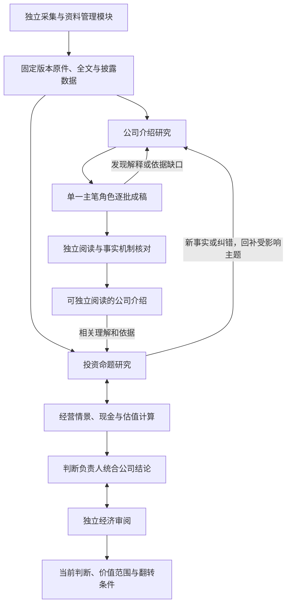

# 企业研究工作架构：公司介绍与投资判断

v9，2026年11月3日。投资体系以观察、判断与操作的正确性为核心，研究负责提供可靠事实、可核验判断及其行动含义，收益率用于经济反馈。两条工作线继续分别承担“帮助读者完整认识公司”和“形成负责的投资判断”，保留分批任务及单主笔。本文件是两条线的共同架构正文；[编辑流程](EDITORIAL_WORKFLOW.md)规定正文生产，[编写标准](WRITING_STANDARD.md)规定阅读质量。统一入口仍为[入库与修订任务](research/templates/企业书入库与修订任务.md)，外部模型沿用系统内固定资料版本、任务与整本企业书。[v8原文](../research_artifacts/process_first_20261103/before/enterprise_research/RESEARCH_VALUATION_WORKFLOW.md)及[v7原文](research/model_books_20261102/before/RESEARCH_VALUATION_WORKFLOW.md)保留。

本架构承接投资纲领第三层的企业理解与估值、第六层的跟踪纠错。它调整工作职责与交接，不修改投资阈值、仓位或交易权限。v9落实范围见[本批记录](../research_artifacts/process_first_20261103/改造记录.md)，两线架构的历史审阅见[11月1日记录](research/two_track_architecture_20261101/架构更新记录.md)；公司研究和网页实现的状态不能由本文件版本推定。

## 一、两条工作线，共用事实

公司介绍线对读者的完整理解负责：公司怎样走到今天、卖什么、客户为何购买、生产和交付怎样完成、行业与同行怎样竞争、收入成本和资金怎样形成、管理层做过什么及已有结果。它包括有依据的机制和历史因果解释，不是年报摘要或资料目录。介绍线应覆盖全貌，不能只挑目前影响买价的材料。

投资判断线对当前取舍负责：哪些经营解释更可信、未来正常收益和现金怎样形成、优势能持续多久、资产和资本用途怎样改变普通股价值，以及价格需要哪些条件。它选取少数有决定性的命题，不要求每次重新讲完公司全貌。

两条线都需要研究，都可以有证据支持的局部评价。区别是所承担的结论与完成范围，而非“介绍只能列事实、判断才能解释”。公司介绍可以先形成独立可读成果，尚未核定正常现金不阻止无依赖的介绍内容；投资判断可以先利用已经可靠的相关材料形成有边界的结论，不等待整本介绍完成。

两线沿用现有资料库、研究过程、专题、计算及成稿版本。原件和事实不复制成两套真源。判断引用实际采用的事实和解释版本；新事实引发的修订记下影响范围，旧正文、旧判断和原预测保留。

共用资料由[数据采集与资料管理模块](SOURCE_DATA.md)负责取得、版本、出处、全文、披露提取和覆盖缺口。明确公式的算术派生与原披露分开；经营解释、正常化、维护、资本成本等属于研究假设。资料不够时返回具体补采请求，补充后追加资料版本；不把已有报告摘要替代原件。

交给其他模型独立分析时，在系统中固定同一份资料版本，附完整原件、全文、数据字典和缺口，不附已有报告、判断、估值参数或审阅意见。模型分别形成自己的事实引用、假设和计算，再比较分歧。自行补资料应单列或另建资料版本，不能把不同信息集的差异全部归因于模型能力。现行三步估值方法可以共用，参数与结论必须独立论证。

外部 Agent 按[系统内接入约定](MODEL_BOOKS.md)直接读写 HTTP 接口。任务固定资料版本、模型身份和时点，按完整问题逐部分保存，完成后形成不可覆盖的整本。切换时全貌、八章、专题、判断、现金估值与依据一起切换，不混用另一模型内容；新成稿标注尚未独立审阅。本文既有单主笔与独立审阅规则保持，程序完成检查不代替研究和编辑验收。

## 二、谁对什么负责

| 职责 | 负责的结果 | 交接边界 |
| --- | --- | --- |
| 数据采集与资料管理 | 原件、全文、披露数据、资料修订、取得记录及在线固定版本 | 不选投资结论，不把解释或估值假设写成原披露；按明确问题补采 |
| 公司介绍主编兼主笔 | 全貌覆盖、阅读顺序、主题主讲位置、充分解释、统一叙述和全书衔接 | 使用完整专题研究，发现缺口回研究；不自行补事实或改变估值 |
| 专题研究者 | 一个完整问题的事实、经过、机制、已有结果与争议 | 提供可独立阅读的研究与关键原件；研究说明不自动成为正式书稿 |
| 投资判断负责人 | 决定性命题、竞争解释、正常现金、资本与价值的连贯公司判断 | 组织补证、选择假设和方法，承担综合取舍；不把专题结论并列后交作者拼装 |
| 计算模块或计算任务 | 明确输入下的现金桥、情景、每股结果和敏感性 | 不以算式成立证明假设有依据，不反向要求研究套现成表单 |
| 独立审阅者 | 阅读理解、事实机制或整体投资论证的相应意见与复核 | 不参与被审稿起草，不以人数投票；审阅范围和结论强度分别说明 |

这些是职责，不是必须启动的固定数量agent。主编与判断负责人可以由同一执行者在分开的任务中承担；同一人不能独立审阅自己的产出。现有企业书独立审阅及改后复核代理授权继续适用，其他代理使用按实际授权执行，不因画出分工图就自动扩大为并行起草或取证。

## 三、任务以“完整问题＋一种主要产出”组织

在同一份[批次记录](research/templates/企业书编辑批次.md)里维护两线工作地图。每个任务写明归属、负责人、实际输入、一个主要产出、结束条件及后续依赖。目录和地图负责防遗漏；单次执行不承担整家公司的全部工作。

研究、初稿、独立审阅、修订、发布核对是可分别接续的任务。一个完整主题可以跨这些任务往返；上一步产出保存后，下一步从实际版本接续。初稿写作可以同时完成必要配图和自查，但不能把自查同时称为独立审阅。纯错字或不改变意思的小修可直接完成，不机械拆成全部任务。

任务过大就缩小本批完整问题，或将尚未完成阶段排到后续；不压缩关键解释，也不为凑任务数量切断一条交易或因果过程。已有研究和未变化的审阅可复用，不规定固定篇数、轮数、字数或并发数。

接续材料包括：本篇在全貌中的位置、实际相关前文、完整研究及关键原件、当前意见和采用版本。摘要帮助定位，不能替代完整交接。不要求每个执行任务读取全部历史聊天，也不把其他agent的摘要当作唯一依据。

## 四、公司介绍怎样形成

主编先安排全貌范围与阅读顺序，再按需要组织研究。公司沿革和边界、产品客户、生产交付、行业同行、历史经营、财务资金、治理与资本历史应覆盖到足以理解公司；适用性由公司决定，不要求穷尽全部公开材料。三个经营因素用于突出公司特点，不替代全貌目录，专题数量由问题决定。

专题研究按[研究任务](research/templates/企业研究与估值任务.md)的“公司介绍”用途，取得并读完同一主题的材料，解释参与者、当时处境、动作、交易与资金流、结果和未明之处。材料范围以理解本题所需为准；即使暂不影响买价，解释公司所必需的背景仍要保留。

事实与机制核对针对本题的证据、口径、因果和表述，不要求先完成整家公司的估值审阅。主笔据此按[编写任务](research/templates/企业书编写任务.md)成稿，独立读者按真实顺序阅读，再核对重要事实和机制。重要事实错误或解释缺口返回相应研究任务。

介绍线的完成标准：本批约定范围内的重要内容已经覆盖，读者能够从正文理解过程，来源与解释可靠，实质意见已复核。若尚有影响理解的空白，按局部完成报告；估值待研究单独记在判断线，不用整书发布次数替代覆盖判断。

## 五、投资判断怎样形成

本线按[投资纲领](../INVESTMENT_TRADING_SYSTEM_CHARTER.md)评价观察、判断与纠错质量：选择能改变经营、现金、价值或损失的事实，分清事实与推断，解释当时为何采用这项判断及其动作含义。旧组合6%及相对基准目标只作历史参考，不要求研究配出达标方案；报价和预期回报仍服务于定价与机会成本分析。盈利、流程完成与多模型一致意见均不证明判断正确。

判断负责人利用已有材料选出会改变经营、现金、价值或永久损失判断的命题。每项命题说明当前较有依据的解释、最强另一种解释，以及什么事实能区分二者。作者的反方分析不替代独立审阅。

经营与财务研究反复对照：量价、竞争和工作变化怎样影响成本、必要投入、周转及普通股所得；财务变化是否支持经营解释；估值对哪项未知最敏感。局部增长不能直接外推集团，收入占比不能代替利润或损失比例。按实际问题使用[尽调与估值参考](research/methods/尽调与估值研究参考.md)，不强制每次填60题或跑全部估值方法。

后续估值默认采用《价值投资：从格雷厄姆到巴菲特》的三步主线。先研究资产，再研究现有盈利，最后判断增长是否值得评价；这是判断顺序，不是每次必须交三个价格。已有可靠研究可以引用，局部更新只重开受影响模块。银行、保险等不适合工业企业现金模型的业务，明确适用范围与替代方法，不强填模板。三个模块分别留下完整依据和实际结果，由同一判断负责人统合。

| 模块 | 本模块回答什么 | 交付与边界 |
| --- | --- | --- |
| 资产再生产价值 | 今天复制同等经营功能与剩余能力，要付出多少经济成本？ | 经营资源、可分离非经营资源及全部相应义务；表外客户、技术、渠道和组织资源有据估计且只计一次。不是账面净资产或清算底价。关键义务未计量时只能交部分合计。 |
| 正常盈利能力价值 EPV | 在现有规模、不依赖增长的条件下，维持竞争后能产生多少可持续经营盈利？ | 正常收入和利润率→必要研发营销等费用→折旧与维护替换→营运资本和经营税→匹配资本成本→核心经营价值→普通股权益桥。金融收益与本金、租赁、融资债务、少数及优先权益配对处理。 |
| 有资金支持的增长回报 | 哪些受保护市场能将新增投入变成额外价值，给定价格下能获得怎样的条件回报？ | 先给评价、定向核查、不适用或暂缓的理由。采用实际保存的EPV基础；分配D、有机增长投入I及剩余再投资A必须满足E=D+I+A。A为负就是资金缺口，不能自动借钱或截零。再投资因子F表示投入创造的全部价值倍数，F=1仅保值；衰减可有据量化或定性说明。结果是条件回报分解，不是第三个目标价或真实持有IRR。 |

资产与EPV在同主体、币种、日期、业务范围、租赁与普通股归属下比较，分歧返回经营研究。不能相加、加权平均，EPV高于资产也不自动证明护城河。增长承接已选EPV的盈利、权益桥与资本成本，改变基础必须明确重估并另存EPV，不能在增长环节悄悄换数字。留存现金不等于已经创造价值；即使不付增长溢价，毁值支出和未来供资仍需计入。

正常现金研究仍处理持续收益、维持竞争的费用与更新、周转、税息、归属和资本用途。恢复、资产回收、有限权利和额外用款继续使用时间现金路径，说明它调整或替代哪一部分；不能把完整现金路径结果再加到EPV上，也不能从采用的条件现金除以折现率就改名为严格EPV。明确稳定经营何时开始、等待期损失及用款是否已扣；单参数敏感性不能替代完整经营情景。已有网页表单不决定研究问题的边界。

资本成本由币种、经营风险和资本结构等依据支持；不自动给10%，不把当前估值方法设为交易准入阈值。缺数据优先补可复用采集，仍不可得就用有据范围或保留未知。资产或增长模块暂缓不阻止有依据的EPV局部结论，但综合结论必须说明尚未覆盖的价值与损失。

计算输入注明主体、币种、期间、单位、股份、参考价格及日期和假设理由。普通股起点已扣税息与少数股东份额不重复扣；资产和相应收益不重复计价。先有有依据的假设，再解释报价；已经见过报价不声称价格盲，不为现价倒推参数。

判断负责人最后形成连贯公司结论，交独立经济审阅。审阅分别说明：事实与计算是否可靠；关键假设及合理范围是否有依据；这些依据足以支持哪一种投资结论。允许“条件演算正确，但不足以支持该合理价值判断”；也允许合理推断有足够依据，不要求证明未来必然实现。局部审阅可复用，整体结论由明确的一位审阅责任人连贯核对，不以各章都通过或多agent赞成票替代。

判断线的完成标准是本次命题得到有依据的取舍或明确的判断边界，主要反方与错误后果已处理，适用计算与结论一致，独立经济意见已复核。可以形成“当前证据不足以确认便宜”，不必制造精确合理价值；不能把假设身份解释清楚当作假设依据充分。

### 观察与后续核验

重要投资命题说明具体观察对象、来源、口径、经营期间和预计可得信息的时点；实际公开日与本次知悉日分开。主判断与最强反方应有能区分它们的事实，并说明支持、恶化或无法判定时怎样更新研究及行动含义。引用既有观察即可，不为所有介绍段落增加预测，也不为无变化制造更新。研究说明买入、追加、持有、等待或减退的条件含义，实际额度与执行由年糕及用户负责。

当时有依据的决策与后来命题实现分别评价。方向或区间预测按原对象、范围和期限核验；条件估值检验条件及模型，不能计成方向预测命中。支持、部分支持、被反证、待观察与无法判定逐项说明依据，不把未知算对或悄悄删掉。已被反证的旧判断保留，及时纠错另记为改进；资料不可比或尚未到期说明原因与下一观察点，不自动延长原命题。当前研究完成和独立审阅完成均不表示未来预测已通过验证。

复盘先检查关键事实遗漏、推理与正常化、定价和纠错，再单列实际经济后果；不由价格上涨推断经营机制成立，也不由亏损否定全部事前依据。重大失误优先修正，不把大量微小命中汇成一个总分。若同类判断长期失准、资本持续受损或占资，则返回受影响的研究与规则，不能以“过程正确”豁免方法检验。沿已有研究、观察和版本记录执行，[简短记录模板](../INVESTMENT_OBSERVATION_DECISION_REVIEW_TEMPLATE.md)可辅助交接，不建立另一份公司事实真源。

## 六、缺口怎样返回，何时停止

每个重要缺口留在所属任务与现有地图中，记录它影响的理解或判断、当前处理和下一步责任。沿用 DATA_COVERAGE、ACQUISITION_MODULE、REASONING、MODEL、WRITING 分类，说明经济或阅读影响、缺失事实、禁止假设、可执行修法和结束条件。

- 公开资料存在但字段、时间或口径不足：先改善可复用采集或提取，再分析；已有材料漏读则读完主题和续页。
- 精确数难取得但能合理定界：用有依据的范围解释后果，介绍保留必要事实，判断采用与证据相称的结论。
- 关键未知无法定界：收窄受影响的主张，注明目前不能确认的价值或机制，继续无依赖部分；不把未知填零或包装为任意折扣。
- 进一步取证已不影响本题理解或判断：说明理由后结束，不为审计完整继续扩展。

介绍中的新事实送交判断负责人评估是否影响结论；判断研究发现事实或机制错误，回补相应介绍主题。先保存新研究及理由，再按依赖关系修受影响正文和计算，不每次重写整书。纯文字和图示变更不启动整套估值研究。

## 七、单一主笔如何跨任务接续

公司介绍的正式叙述由一个主笔角色负责，可以分多个执行任务和上下文顺序完成。主编预先安排每个问题的主要解释位置、已解释概念、前后承接和专题深度。判断说明由判断负责人对内容负责；进入书页时由主笔统一表达，不改经济含义。

多人研究可以提供充分的研究说明及不同解释，不能默认每个agent各写一章后直接拼成正式书稿。主笔亲读关键原件和完整研究，不能用摘要的摘要补出公司事实。跨上下文接手仍需读实际相关前文和现行书稿安排，不重新为每篇创建一套背景、定义和风险结尾。

审阅者提出具体问题及必要示例，主笔统一修订。审阅者若直接承担某篇实质重写，重写部分须换未参与写作的审阅者复核。按章分工审阅不能取代按实际顺序的整体阅读，也不能推定公司投资判断已经成立。

## 八、八章、专题与状态怎样承接两条线

既有八章和公司三个因素保留为阅读组织，不按章号机械划分两线。第五章的保证金、返利和贷款收付机制属于介绍；正常收益与净更新假设属于判断。第六章的收购与分配历史属于介绍；未来供资、回收价值及综合资本配置评价属于判断。同一页可以包含两者，但判断需连接实际采用版本、日期及依据。

两线在现有批次记录分别报告：公司介绍覆盖与阅读状态、投资命题与经济审阅状态。介绍已完成、投资判断待研究可以同时成立；局部观点修订不使未变化的介绍自动失效。介绍线成果可按已有接口独立保存为专题或正文；涉及判断的原部分维持明确的原条件或待研究说明，不为完成八章补造新结论。

整书阅读覆盖实际最终正文、专题及相关摘要和现金说明，检查两线的边界与衔接。发布仍固定研究、计算、专题和成稿版本，保留旧判断与原预测。图文与实际显示要求由编辑流程执行。

## 九、现有软件与本次边界

工作台在原研究项目内使用资产、EPV、增长三类独立计算记录；新增计算默认从三步入口选择，原条件现金、逐层归属及逐年现金路径继续保留。每次保存固定输入、结果、来源和研究版本；增长计算绑定实际保存的EPV，交接和成稿可同时固定多项计算。保存计算只表示完成这次演算，不表示模块研究或经济审阅完成。详细实现和验证以[本批记录](research/three_step_valuation_architecture_20261101/架构与实现记录.md)为准。

研究判断、证据采集、行业适配及独立审阅仍由实际执行者负责。格力现有条件现金结果保留原名称与边界，不随工具更新自动成为EPV。

本架构先用既有文档、过程记录和版本接口执行。两线工作地图与任务依赖由执行者维护，当前没有新增两线数据库字段、自动调度或自动审阅。两线的文章及判断可分别采用现有接口保存；整书固定采用关系仍按既有发布能力处理，不能宣称界面已自动识别并同步两线。

当前公司版本从[子项目指引](AGENTS.md)及正式对象读取。本次v9更新目标、观察核验与任务要求，现有研究和事实审阅接口读取同源新标准；不修改演算程序、运行页面或正式公司记录。前批估值模块的实现沿用上文记录。后续应用从各自现行版本追加，不重跑历史发布脚本。
