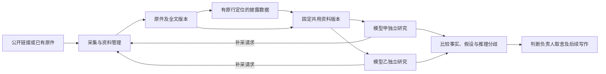

# 数据采集与资料管理模块

2026-11-03补充：港股等使用整数金额的披露行可显式声明`number_format: financial`，支持逗号、括号负数及实际小数位；`skip_amounts`仅在原表确有附注数字列时显式配置。默认仍为两位小数格式；横线不自动变成零。保利物业首轮以实际年报/中报验证，原行与页码、比较期及口径变化分别保留。

v2，2026年11月3日。`source_data/`独立负责资料取得、原件与全文关联、披露提取、固定资料版本和在线读取。研究与写作消费这些输入；经营解释、正常化、维护投入、资本成本、价值及审阅意见留在研究侧。

## 边界与数据流



这是现有应用内的独立模块，不新开服务。它不导入企业正文或估值模块。使用原`research.db`和`uploads/`，保留已有`sources`编号、原路径与阅读接口；新增`source_documents`、`source_acquisitions`、`source_packages`三张表分别保存资料修订、取得结果和固定资料版本。既有阅读笔记可留在资料库，但不能冒充原件进入共用资料版本。

| 对象 | 实际保存什么 | 边界 |
| --- | --- | --- |
| 原始来源 | 文件或链接、原有来源编号及索引信息 | 不保证该来源的全部说法为真 |
| 资料版本 | 发布主体、性质、事实期、公开日、取得日，原件与全文关联 | 未知公开日不能用于严格事前回测 |
| 披露数据 | 指标、原表列、期间、币种单位、主体范围、原行及PDF页 | 股本金额不自动等于实际在外股数；未抽取不等于零 |
| 派生数据 | 明确公式、输入编号和结果；当前支持同口径累计流量相减 | 不承载正常化、折价或维护资本等研究假设 |
| 共用资料版本 | 固定修订、原件全文、数据、目录、缺口和研究任务 | 不附内部报告、估值假设或原判断，不代表穷尽公开信息 |

`public_reporting`覆盖公开报道和采购方等机构公告，界面显示“公开报道与公告”；具体发行主体及文件标题保留，采购公告不标成媒体转述。

更正资料追加修订，已固定的版本保持原文件和原版本。补采后另建版本；不同模型如果自行加入新资料，应在报告中列明，不能再称完全相同输入的对照。比较工作定位事实、范围、假设和推理差异，由负责人判断，不用模型多数票决定价值。

## 使用入口

网页：公司 → 资料档案 → **采集与资料管理**。支持公开URL采集、原件与全文阅读、选择资料当前版本、固定共用资料版本、在线分页阅读与全文检索、创建外部 Agent 任务。信息截止日必填；公开日晚于截止日的资料拒绝加入该版本，未知日期保留未知。网页目前不配置财务行或派生公式；这些通过清单和命令执行。

在本目录运行：

```bash
python3 -m source_data --data-dir data collect COMPANY_ID collection.json
python3 -m source_data --data-dir data extract COMPANY_ID extraction.json
python3 -m source_data --data-dir data package COMPANY_ID package_spec.json
python3 -m source_data --data-dir data list COMPANY_ID
python3 -m source_data validate data/packages/PACKAGE_ID
```

`collect`清单包含`acquired_on`和`documents`。每份声明`id/title/nature/issuer/fact_period/published_on/url`，已有文件可给`local_path/text_path`，既有来源可给`original_source_id/text_source_id`。本地路径相对清单解析。网页可按`html_content_class`提取正文区域；未找到明确正文区域则失败，不用导航代替。PDF使用`pdftotext -layout`；扫描件无文字时留下实际失败和补OCR需求。返回逐份`available/failed`，批量任务应读取实际结果，不能仅看进程退出状态。

`extract`使用原`extract_disclosure_rows.py`的显式页、正则和列定义，通过资料编号解析全文；结果必须在实际原页定位。财务列须给期间含义，资产种类或期初/增减列用类别含义。旧采集、提取脚本仍保留命令入口，实际逻辑已移至本模块。

`package`清单必须选择`documents: [{id, revision}]`，声明公司身份、`information_cutoff`、可选`valuation_date`及覆盖缺口。`research_output`性质不得进入；`external_analysis`明确标识且网页默认不选。其他类别仍须人工确认其真实身份，程序不能识别任意文件内容是否中立。

格力首批可参考本批[采集清单](research/source_data_module_20261102/collection.json)、[提取清单](research/source_data_module_20261102/extraction.json)及[正式包规格](research/source_data_module_20261102/published_spec.json)。这些记录已执行输入，不是每家公司必须具备的固定字段表，不直接重跑已有发布。

## 系统内访问与多模型接入

主流程为固定资料版本 → 外部 Agent 读取接口 → 分批写回整书 → 页面切换模型版本。模型不需要下载、解压或上传 ZIP；具体任务、读写端点、正文结构及完成边界见[多模型企业书](MODEL_BOOKS.md)。资料目录、原件、1 起始的分页全文、词面检索、披露与派生值都通过固定版本 ID 读取。

网页创建版本使用 `POST /api/companies/{cid}/data/versions`，不生成 ZIP。既有包和 CLI `package` 保留为离线备份用途，继续保存 `README.md`、任务、目录、缺口、`manifest.json`、`data/` 和 `documents/`；它们不是模型接入的必要步骤。底层沿用 `source_packages` 表和目录，避免复制第二份事实真源。

独立模型分别形成事实引用、假设和计算，记录实际版本与新增来源，再比较分歧。资料版本不包含内部企业书、原判断或估值假设。历史版本的缺口仍然存在，在线访问不会自动补全原始资料。

## 当前实现范围

已实现声明来源采集、版本登记、显式披露行提取、固定资料版本、在线分页与检索、外部 Agent 任务接入，以及既有离线导出和资料兼容。未实现自动发现全部资料、通用网页正文识别、OCR、全部财务附注自动抽取、自动调用外部模型或自动归因比较；整本版本切换已由 model_books 模块提供。取得失败、未抽取和已知覆盖不足可见；共用资料版本可以在有明确缺口的情况下用于第一轮独立研究。

实际格力交付、独立审阅及页面验证见[实施记录](research/source_data_module_20261102/实施与交付记录.md)。本次没有重写或重新估值格力。
