# 中国食品 v27

研究时点 2026-11-08 · 本地发布版本 foods-codex-v27

中国食品把可口可乐、雪碧、芬达等饮料生产出来，再通过经销商、门店和自营渠道送到消费者手里。成熟汽水提供了主要订单，区域重组后的工厂、仓库和销售组织改善了利润。近年来，公司又扩展线上零售和自动售货机，尝试用同一套品牌与供货能力多做一些生意。企业书沿着这些实际变化，解释它怎样赚钱、需要不断投入哪些资金，以及最后有多少能归到上市公司股东。

## 第1章 · 企业沿革与业务边界

先看今天卖什么、怎样赚钱，再回到业务出售与区域重组，理解这家公司为什么成为现在的样子。

### 汽水主业与经营改善

中国食品今天最重要的生意，是在获授权的地区经营可口可乐、雪碧和芬达等饮料。品牌带来熟悉的口味和购买习惯，公司负责把浓缩液、糖和包装变成成品，安排库存和运输，再让经销商与门店持续进货。消费者买到的一瓶可乐，背后有品牌方、装瓶工厂、经销商和零售商共同完成工作；中国食品赚取其中装瓶、配送和销售环节留下的收益。

成熟汽水是这套经营网络的基础。2025年汽水收入约166.85亿元，占集团收入约75.6%。公司可以围绕这些反复出现的订单安排生产和配送，也可以沿已有路线销售果汁、水和功能饮料。销量足够密集时，同一座仓库、同一条配送路线和同一批销售人员能够服务更多订单，每箱需要分摊的成本随之降低。对一家装瓶企业而言，这些日常组织工作会直接影响利润。

过去几年的改善，主要发生在这些经营环节。2016—2017年重组把更多装瓶业务交给中粮可口可乐经营；接下来，公司统一管理、提高自产比例，重新安排相邻地区供货和仓库。2018年以后的销量总体增长并不快，利润却有较大改善，说明区域整合、售价与产品结构、成本和费用管理发挥了作用。理解这段历史，有助于判断以后的利润还能从哪里增加。

最近的经营结果同时显示了优势和压力。2026年上半年，集团销量增长9.6%，收入增长4.0%，毛利额基本没有增加。汽水每箱经营利润大致维持，公司主要靠多卖货和减少销售费用提高总利润。顾客仍在购买，销售网络仍能赚钱；保持这些销量所需的促销、送货和设备支出，将决定现有利润能否延续。报告中的销量常用“标箱”，它把不同瓶装折成统一的液体容量，便于跨规格比较。

公司也在改变到达消费者的方式。悦享会经营线上订单、组合装和营销活动；智尚通过自动售货机完成零售，并组织补货、设备维修和合作伙伴。新增渠道给公司带来更接近消费者的收入，同时增加订单履约、设备和人员责任。它们能否继续增加利润，要看接回这些工作后还剩下多少收益，以及维持设备需要投入多少钱。

上市股东取得的现金还要经过股权分配。中国食品持有中粮可口可乐65%，地方装瓶公司另有股东，全资平台归属又不同。集团收入先承担生产、渠道、税和必要更新，再分配到各层股东。本轮三步研究在60%正常收益归属条件下估普通股年度经营现金约7.26亿元；第五章解释来源，第六章看用途，第七章计算资源、盈利价值和增长投入。

依据 · 2025 年度报告 · 第97页；2025 年度报告 · 第148页；2025 年度报告 · 第177页；2018 年度报告 · 第26页；[2026 中期报告 · 第10页](https://www.hkexnews.hk/listedco/listconews/sehk/2026/0917/2026091700946_c.pdf#page=10)；[2026 中期报告 · 第24页](https://www.hkexnews.hk/listedco/listconews/sehk/2026/0917/2026091700946_c.pdf#page=24)；递延收入与正常现金核验；[2026 中期报告 · 第9页](https://www.hkexnews.hk/listedco/listconews/sehk/2026/0917/2026091700946_c.pdf#page=9)

### 从综合食品平台到饮料公司

中国食品的名字来自中粮早年的综合食品业务。中粮官网记载，1993年收购中粮国际、鹏利国际两家香港上市公司；2007年3月，中粮国际分拆形成中粮控股和中国食品，中粮控股随后在香港上市。今天的中国食品与中粮旗下其他上市平台，分别持有不同业务。

2016年，中国食品仍同时经营饮料、酒类和厨房食品。旗下产品包括长城葡萄酒、福临门包装油、黄中皇绍兴酒，以及可口可乐系列饮料。2017年的集中出售改变了公司的业务构成，也改变了此后财务报表的比较基础。

长城、福临门等品牌仍在中粮体系内，其经营结果在退出中国食品后，由各自所属平台承接。00506的股东此后主要持有饮料业务。

依据 · [中粮历史与荣誉](https://www.cofco.com/cn/AboutCOFCO/HistoryandHonor/)；[中国食品2016年报 · 第2页](https://www.hkexnews.hk/listedco/listconews/sehk/2017/0426/LTN20170426415_C.pdf#page=2)

### 重组前，饮料已经是主要利润来源

2016年，中国食品持续经营收入279.859亿港元，其中厨房食品139.632亿、饮料112.905亿、酒类25.031亿、其他2.291亿。厨房食品约占收入一半，饮料占40.3%。

饮料贡献了大部分分部利润：分部业绩6.405亿港元，占各分部合计的76.1%；酒类1.111亿、厨房食品0.857亿、其他0.042亿。各分部业绩合计后，还要扣除总部和其他未分配开支4.167亿港元。

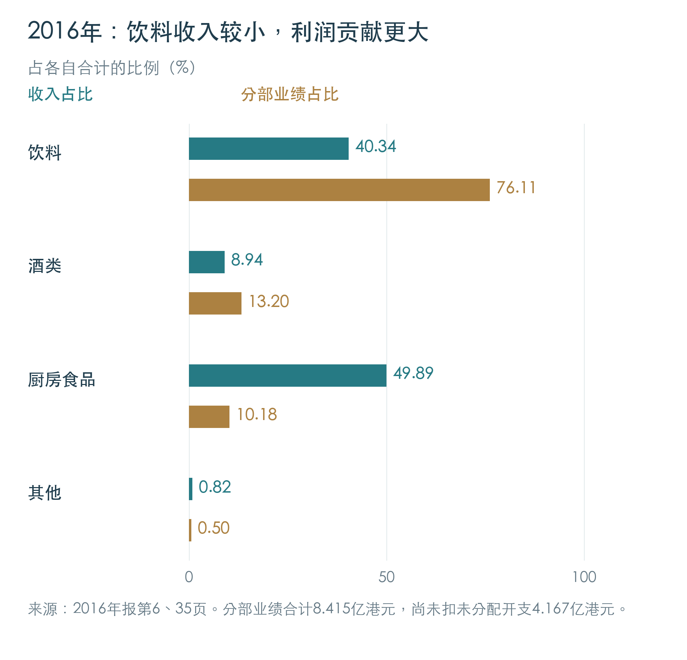

来源：2016年报第6、35页。分部业绩合计8.415亿港元，尚未扣未分配开支4.167亿港元。

厨房食品的困难是增量销售留下的利润很少。福临门小包装油、中包装油销量分别增长14.3%和16.2%，按人民币计算收入增长15.7%，分部业绩却下降22.1%。中包装油毛利较低、占比上升，拉低整体毛利率约1个百分点；市场竞争又要求增加广告及推广。费用率的改善不足以抵消毛利下降，分部业绩率从0.91%降至0.61%。出售这项业务，意味着放弃大量低贡献收入，释放被它占用的资本和经营资源。

2016年饮料总销量增加1.9%，但汽水与果汁销量分别下降1.2%和6.1%，较低单价的水增加11.4%，按人民币计算收入反而下降2.5%。原料降价带来的毛利改善，大部分被营销和重组费用抵消。饮料已是主要利润来源，管理层又看到了整合工厂和销售网络、提高效率的空间，随后将资源集中到这项业务。

依据 · [中国食品2016年报 · 第35页](https://www.hkexnews.hk/listedco/listconews/sehk/2017/0426/LTN20170426415_C.pdf#page=35)；[中国食品2016年报 · 第6页](https://www.hkexnews.hk/listedco/listconews/sehk/2017/0426/LTN20170426415_C.pdf#page=6)；[中国食品2016年报 · 第32页](https://www.hkexnews.hk/listedco/listconews/sehk/2017/0426/LTN20170426415_C.pdf#page=32)；[中国食品2016年报 · 第33页](https://www.hkexnews.hk/listedco/listconews/sehk/2017/0426/LTN20170426415_C.pdf#page=33)；[中国食品2016年报 · 第23页](https://www.hkexnews.hk/listedco/listconews/sehk/2017/0426/LTN20170426415_C.pdf#page=23)

### 中粮与可口可乐的合作

中粮官网记载，中粮可口可乐于2000年正式成立。可口可乐提供品牌、产品和相关供应体系；中粮一方投入资本、组织生产，并建设中国本地的销售网络。中国食品目前持有核心合资主体65%权益，可口可乐持有35%，双方分别投入品牌与本地经营能力，再分享装瓶收益。

装瓶业务需要长期经营终端。饮料重量大，单件价值有限，配送距离、每次送货量、线路上的客户密度都会影响利润。便利店是否有货、饮料是否冷藏、餐饮客户使用什么规格，也会影响销量。工厂之外的销售和配送网络，是这项业务的重要资产。

2017年报披露，公司有1.1万余名销售人员，服务约140万客户，其中月均交易客户约90万，可控分销约占销量80%。后续数字化改造是在这套已有客户和配送线路上改善订货、拜访与补货。

依据 · [中粮可口可乐官方业务介绍](https://www.cofco.com/cn/brandproduct/cofcococacola/)；[中国食品2017年报 · 第25页](https://www.hkexnews.hk/listedco/listconews/SEHK/2018/0425/LTN20180425423.pdf#page=25)；[中国食品2017年报 · 第27页](https://www.hkexnews.hk/listedco/listconews/SEHK/2018/0425/LTN20180425423.pdf#page=27)

### 2016—2017年的装瓶区域重组

2016年，可口可乐开始将更多自有装瓶业务交给合作伙伴经营。中国地区的重组涉及可口可乐、中粮和太古，主要是重新分配区域业务、工厂和相关权益。

根据2017年报，中粮可口可乐从可口可乐收购黑龙江、吉林、辽宁、山西、四川、重庆六地装瓶业务，基本对价约人民币29亿元；另从太古收购陕西装瓶业务，基本对价约人民币4.87亿元。最终对价还需按交割情况调整。

公司同时向太古出售江西、海南、广东湛茂的装瓶业务，以及江苏、浙江、上海、温州、惠州、广东等地的联属或少数权益，协议总对价人民币21.22亿元。多数交易于2017年4月1日完成，上海申美权益出售于7月1日完成。

管理层希望统一安排相邻市场的生产和配送，提高产能利用率、减少重复运输和分销成本。收购先增加了借款、整合和设备支出；完成后的排产、仓储调整以及后续偿债，才把交易规模转化为经营改善。

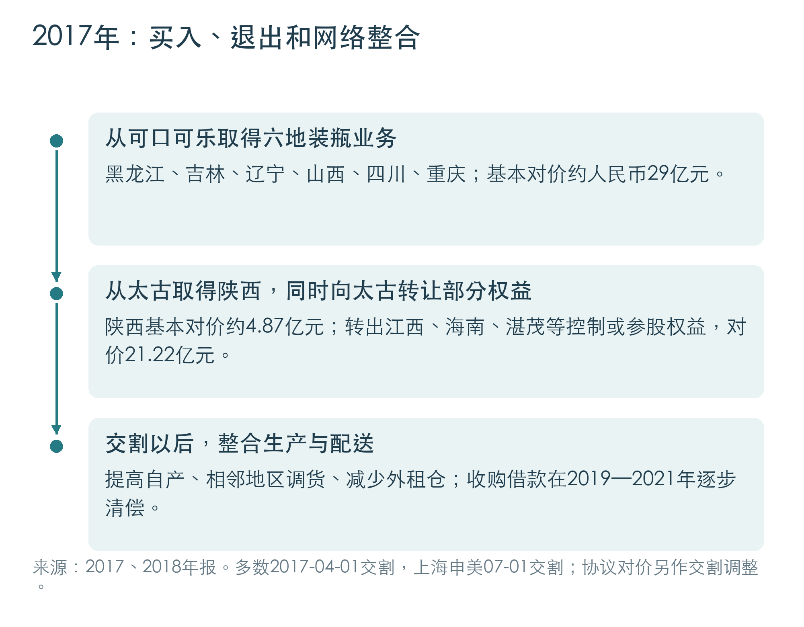

来源：2017、2018年报。多数2017-04-01交割，上海申美07-01交割；协议对价另作交割调整。

依据 · [可口可乐加快装瓶业务再特许经营](https://investors.coca-colacompany.com/news-events/press-releases/detail/810/the-coca-cola-company-announces-plans-to-significantly-accelerate-bottler-refranchising)；[中国食品2017年报 · 第21页](https://www.hkexnews.hk/listedco/listconews/SEHK/2018/0425/LTN20180425423.pdf#page=21)；[中国食品2017年报 · 第22页](https://www.hkexnews.hk/listedco/listconews/SEHK/2018/0425/LTN20180425423.pdf#page=22)；[中国食品2017年报 · 第35页](https://www.hkexnews.hk/listedco/listconews/SEHK/2018/0425/LTN20180425423.pdf#page=35)

### 退出厨房食品和酒类，回收部分资本

2017年5月，公司签约出售福临门食品营销全部股权，价款人民币10.5亿元，9月完成。该公司主要从事小包装食用油和糖、酱油、醋等厨房食品的销售、分销及推广。交易完成后，这部分业务退出中国食品的合并报表。

同年10月，中国食品又将四家酒类及其他非饮料公司出售给直接控股股东。股权对价14亿港元，另收回相关公司所欠贷款约36.69亿港元，合计交易价值约50.69亿港元。其中大部分金额是债权回收。

2016年酒类分部仍有1.111亿港元业绩，按人民币计算比上年增长25.7%；长城葡萄酒销量却下降9%，依靠提高出厂价、以中高端替代低端产品以及较低成本的旧原酒库存支撑毛利，广告费用又增加人民币8,500万元。到2017年讨论出售时，董事会判断国内葡萄酒竞争加剧、未来数年增长缓慢，改善措施的效果仍不确定。拟出售的非饮料公司组合持续亏损，旧股东贷款短期内也难以全额收回。第六章列明了当时出售组合的损益和回款。

控股股东承接这些资产并提前偿还贷款，使上市公司收回了难以在短期内回收的资金，也结束了对已出售公司的持续供资。这次退出是对原有业务组合的收缩：厨房食品收入大、利润薄，酒类及其他非饮料公司持续亏损，饮料则已经是最主要的利润来源。

2017年12月18日，公司支付两项特别股息：福临门营销出售对应每股0.10港元，非饮料出售对应每股0.93港元，合计每股1.03港元。资金来自当年的业务出售及贷款回收。

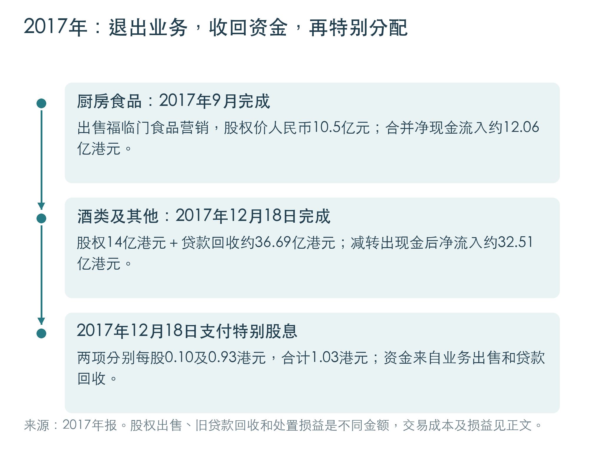

来源：2017年报。股权出售、旧贷款回收和处置损益是不同金额，交易成本及损益见正文。

依据 · [中国食品2017年报 · 第22页](https://www.hkexnews.hk/listedco/listconews/SEHK/2018/0425/LTN20180425423.pdf#page=22)；[中国食品2017年报 · 第23页](https://www.hkexnews.hk/listedco/listconews/SEHK/2018/0425/LTN20180425423.pdf#page=23)；[中国食品2017年报 · 第24页](https://www.hkexnews.hk/listedco/listconews/SEHK/2018/0425/LTN20180425423.pdf#page=24)；[中国食品2016年报 · 第28页](https://www.hkexnews.hk/listedco/listconews/sehk/2017/0426/LTN20170426415_C.pdf#page=28)；[中国食品2016年报 · 第29页](https://www.hkexnews.hk/listedco/listconews/sehk/2017/0426/LTN20170426415_C.pdf#page=29)

### 2017年重组收益与2018年可比起点

2017年持续经营税前利润约25.119亿港元，其中装瓶重组相关出售收益约18.978亿港元。大额处置收益使当年税前利润明显高于日常经营水平。年报扣除处置收益，并调整融资成本、联营业绩及非经常费用后，列示经调整EBIT（息税前利润）约8.062亿港元，作为观察持续经营的参照。

新购装瓶资产大多从2017年4月并表，2018年才贡献完整年度业绩。2018年收入和销量分别增长17.1%和17.0%，原授权区域则分别增长8.0%和7.4%。前一组增速同时包含经营增长和并表时间的影响。

2018年报告改用人民币列报。2016—2017年的港元原数保留在重组分析中；主要财务图从2018年人民币本期数开始，2023年五厂并入等后续合并范围变化，在对应年份另作说明。

依据 · [中国食品2017年报 · 第6页](https://www.hkexnews.hk/listedco/listconews/SEHK/2018/0425/LTN20180425423.pdf#page=6)；2018 年度报告 · 第19页；2018 年度报告 · 第26页；2018 年度报告 · 第140页

### 重组的实际结果与资金代价

收购新装瓶资产需要债务融资，2017年融资成本随之上升；出售部分联营权益，也减少了后续联营利润。2019年公司偿还银行借款7.60亿元，2020年偿还11.27亿元，2021年清偿剩余有息银行借款。相应年度融资成本先后下降28%、53%和82.1%。经营现金的一部分由此用于消化重组的融资负担。

重组后的中国食品收入来源更集中：非饮料业务退出，饮料工厂与配送网络整合，部分出售及贷款回收款通过特别股息返还股东。少做低回报业务、整合已有网络和还债，是这一阶段利润改善的三项重要原因。

公司已经清偿当年的有息银行借款，还债带来的降息收益也已陆续兑现。往后改善盈利，要在既有网络中卖出更有利润的产品，控制生产与配送成本，并让新工厂和渠道投入产生回报。

依据 · [中国食品2017年报 · 第35页](https://www.hkexnews.hk/listedco/listconews/SEHK/2018/0425/LTN20180425423.pdf#page=35)；2019 年度报告 · 第29页；2020 年度报告 · 第30页；2021 年度报告 · 第29页；2018 年度报告 · 第26页；[中国食品2017年报 · 第23页](https://www.hkexnews.hk/listedco/listconews/SEHK/2018/0425/LTN20180425423.pdf#page=23)；[中国食品2017年报 · 第24页](https://www.hkexnews.hk/listedco/listconews/SEHK/2018/0425/LTN20180425423.pdf#page=24)

### 重组以后的经营变化

重组后的第一项任务是把新购地区接入已有生产和配送网络。2018年报列出已经发生的变化：新厂提高自产比例、减少代加工；相邻区域重新安排供货，缩短运输距离；增加仓储能力，减少外租仓库。新增地区既带来规模，也让原有工厂和线路得到更充分利用。

2018年，时任董事总经理栾秀菊提出收入增长快于销量、利润增长快于收入。当时中粮可口可乐销量增长较强，盈利能力与部分优秀装瓶集团仍有差距。公司当年上市35个新产品，推进无糖汽水、摩登罐、果汁包装和2元纯悦水，并设立电商事业部、增加餐饮外卖合作，争取让现有工厂和销售网络卖出更多、收入更高的产品。

2019年报于2020年发布，董事总经理函件已由庆立军署名。其后公司的工作继续沿着产品、网络和效率三条线展开：2020年疫情中增加家庭与社区供给，2021年披露中央计划中心、可乐GO商户平台和快乐会消费者平台，2022年把线上消费者营销交给全资悦享会。2023年取得原授权区域内五家非汽水生产公司，把原来向共同生产体系采购的部分产品改为内部制造。

2025年9月陕西新厂投产。此时公司已清偿当年重组形成的有息银行借款，单靠还债降息继续增利的空间已经用完。之后的改善更依赖产品每箱能赚多少、送货服务花多少，以及新厂和新渠道能否得到充分利用。

依据 · 2018 年度报告 · 第26页；2020 年度报告 · 第24页；2023 年度报告 · 第15页；2023 年度报告 · 第75页；2025 年度报告 · 第25页；2018 年度报告 · 第19页；2018 年度报告 · 第20页；2018 年度报告 · 第21页；2018 年度报告 · 第31页；2019 年度报告 · 第13页；2021 年度报告 · 第18页；2022 年度报告 · 第14页

### 经营区域、工厂和产品范围

核心装瓶业务覆盖19个省级市场。2017年报逐名列出黑龙江、吉林、辽宁、内蒙古、河北、北京、天津、山东、山西、陕西、甘肃、青海、宁夏、西藏、新疆、四川、重庆、贵州、湖南，2025年报仍披露19个省级区域。地图按省级范围展示，具体品类及县市的授权以合同为准。

中粮现行官网介绍，公司拥有20家装瓶厂，覆盖81%的国土面积和46.8%的内地人口，页面未注明统计时点；2017年报的覆盖人口比例为51%，两次统计的时点和基数不同。经营区域包含人口密度较低的西部市场，辽阔地域既带来市场，也增加了组织配送的难度。

区域装瓶厂负责本地生产供货，非汽水工厂承担相应品类的制造；一家工厂内还可有多条产线，法律主体、生产地点与设备数量分别统计。产品从2017年的8品类16品牌扩展至2025年的10品类25品牌，收入仍主要来自汽水和果汁。

集团其他业务的范围更广。悦享会线上销售覆盖全国，智尚在2025年披露布局31省、逾400城市。这些是销售渠道的覆盖范围，与核心装瓶业务的19个省级授权市场分别统计。

依据 · [中国食品2017年报 · 第25页](https://www.hkexnews.hk/listedco/listconews/SEHK/2018/0425/LTN20180425423.pdf#page=25)；[中国食品2017年报 · 第27页](https://www.hkexnews.hk/listedco/listconews/SEHK/2018/0425/LTN20180425423.pdf#page=27)；[中粮可口可乐官方业务介绍](https://www.cofco.com/cn/brandproduct/cofcococacola/)；2025 年度报告 · 第2页；2025 年度报告 · 第28页

### 从上市公司到地方工厂的股权

2025年底，中国食品的直接控股股东持股约74.10%，最终由中粮控制。公众股东和控股股东持有同一上市公司的普通股，每股价值按全部普通股股数计算。

中国食品向下持有中粮可口可乐65%权益。后者部分地方公司另有股东，所以中国食品在地方公司的有效权益不尽相同：陕西65%、北京48.75%、辽宁南39%、新疆52%。年报列出的这些有效比例已经考虑上层持股。有效权益低于50%的部分公司，仍因上层主体具有控制权而纳入合并。

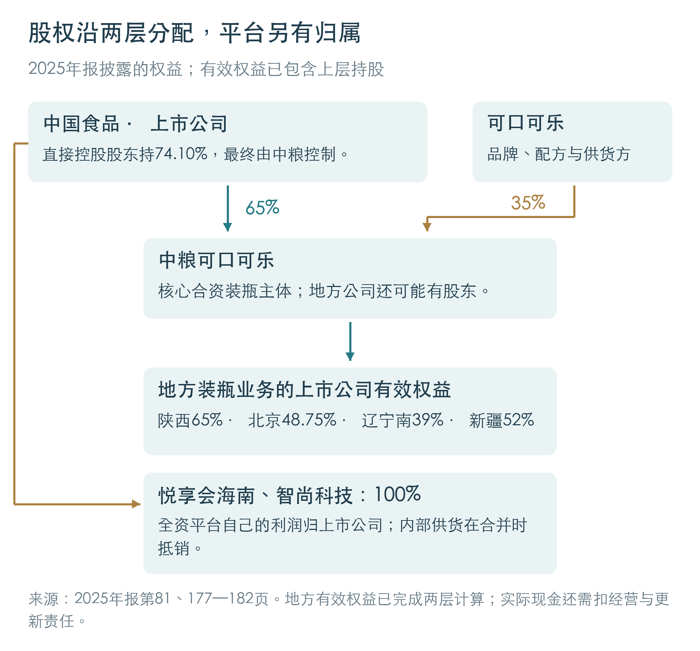

来源：2025年报第81、177—182页。地方有效权益已完成两层计算；实际现金还需扣经营与更新责任。

合并报表计入受控公司的全部对外收入，再于利润末端分出非控股股东应占部分。地方公司先以经营现金支付采购、交货和设备更新，再向各方股东分配；普通股现金估计因而要沿股权层次扣除下层股东的份额，并考虑各层经营所需的留存。

可口可乐既掌握关键品牌与配方，又持有核心合资主体35%。双方共同经营，也分别分享浓缩液和装瓶环节的收益。上游采购条款与普通股现金归属，分别在第三章、第五章展开。

依据 · 2025 年度报告 · 第81页；2025 年度报告 · 第177页；2025 年度报告 · 第178页；2025 年度报告 · 第180页；2025 年度报告 · 第182页；[浓缩液及关联采购框架 · 第11页](https://www.hkexnews.hk/listedco/listconews/sehk/2023/1107/2023110700390_c.pdf#page=11)

### 治理与管理层

2025年报所列执行董事为展在中、唐强，非执行董事为庆立军（主席）、陈刚、宋亮，另有三名独立非执行董事。2026中报披露的人员变化是陈刚辞任、郭莹获委任为非执行董事，均自2026年6月10日起生效。

团队有从装瓶一线升任的连续经历。庆立军曾任中可销售运营经理、吉林公司副总经理及北京、山东公司总经理，2020年1月起任上市公司董事总经理，2022年9月兼任主席；2025年1月6日卸任董事总经理后留任主席并转为非执行董事。接任的展在中于2004年加入集团，曾负责内蒙古、新疆、北京装瓶公司，后任中可副总经理及首席执行官。销售、区域工厂和供应链经验，为其执行产品与网络调整提供了业务基础。

截至2025年底，年报披露董事及最高行政人员没有按有关证券规则须申报的股份权益，集团也没有购股权计划。2026年管理层开始增持：8月26日公告包括执行董事在内的高管计划合计购买100万股，10月23日确认计划已完成。参与高管由此增加了个人持股，承担更多股价变化；具体激励和资本配置记录见第六章。

这些经营变化跨越了不同管理任期。2017年的资产出售和随后还债已经完成，2018年的工厂与仓配整合也取得了成本改善。展在中任内的重要任务是利用好陕西新厂、控制渠道费用并收回新业务投入；这些项目的成绩应由投产后的经营结果评价。

依据 · 2025 年度报告 · 第78页；2025 年度报告 · 第80页；2025 年度报告 · 第77页；[中国食品2017年报 · 第23页](https://www.hkexnews.hk/listedco/listconews/SEHK/2018/0425/LTN20180425423.pdf#page=23)；[中国食品2017年报 · 第24页](https://www.hkexnews.hk/listedco/listconews/SEHK/2018/0425/LTN20180425423.pdf#page=24)；[2026 中期报告 · 第20页](https://www.hkexnews.hk/listedco/listconews/sehk/2026/0917/2026091700946_c.pdf#page=20)；[高管拟购买本公司股份之计划 · 第1页](https://www.hkexnews.hk/listedco/listconews/sehk/2026/0826/2026082600766_c.pdf#page=1)；[高管完成购买本公司股份 · 第1页](https://newsfile.futunn.com/public/NN-PersistNoticeAttachment/7781/20261023/12381272-0.PDF#page=1)；2025 年度报告 · 第35页；2025 年度报告 · 第36页

2017年前后的出售与区域重组，把中国食品从业务较分散的食品平台变成以饮料为主的公司。重组后新增工厂和区域需要持续整合，公司通过生产、仓配和销售管理逐步改善利润。今天的经营基础是成熟汽水需求与本地网络，上市股东的收益则取决于这套网络扣除持续投入、并分给各层股东后留下的现金。

可口可乐掌握品牌和浓缩液，装瓶商持续承担生产、配送和终端投入。历史上的资产退出、特别分红及还债降息已经兑现；未来若采购涨价、终端让利和设备更新消耗了经营改善，中国食品能留给普通股的现金仍会减少。

已有区域整合和资本回收的能力，能否延续到陕西迁建及新渠道？；配对的项目投入、投产后总成本与现金、退出或返还记录；决定陕西迁建和新渠道的新增留存价值

地方经营成果有多少能分配到上市普通股？；各层权益、必要资本与资金安排；决定正常经营现金向普通股价值的归属

## 第2章 · 商业模式与价值链

饮料从生产到交货、收款的过程，以及产品、渠道与费用对利润的影响。

### 制造、经销与零售之间的交易

中粮可口可乐承担中国食品的主要饮料生产和销售。它向品牌方购买浓缩液，组织原料和包装采购、装瓶生产、仓储配送，再把成品卖给经销及零售客户；部分业务经网上渠道和自动售货机触达消费者。装瓶商依靠生产组织、销售服务和成本管理，在收入中留下经营利润。

公司同时通过经销商和直接服务客户销售。2024年报分别讨论现代零售、传统零售、学校和餐饮渠道，2025年又落地区域特许经销商模式，整合下沉市场资源。线上悦享会和智慧零售中粮智尚各自组织履约。这些服务路径连接不同客户，汽水、果汁等产品则分别汇入集团的品类收入。

依据 · 2025 年度报告 · 第161页；2025 年度报告 · 第183页；2024 年度报告 · 第27页；2025 年度报告 · 第17页；2025 年度报告 · 第28页

### 一笔对经销商或零售客户的销售

集团把成品送到客户指定地点、转移商品控制权后确认收入。交货后的客户自行决定分销方式和转售价格，并承担商品报废、损失和转售的主要责任。在经销路径中，经销商先向集团订货并承担货款，再把饮料卖给门店，由门店卖给消费者；集团在向经销商交货这一步取得收入。

公司还直接向零售店、餐饮客户供货，并与重点连锁客户合作。KA是重点客户的简称，由连锁总部、门店还是区域主体下单付款，以及送到哪个仓库，按具体合同安排。

公司向经销商交货时已经确认销售，消费者购买发生在后面。饮料如果积在经销商或门店，下一轮订货就会减慢。经销商库存尚无连续披露，公司的出货增长因此需要结合后续补货才能判断是否持久。

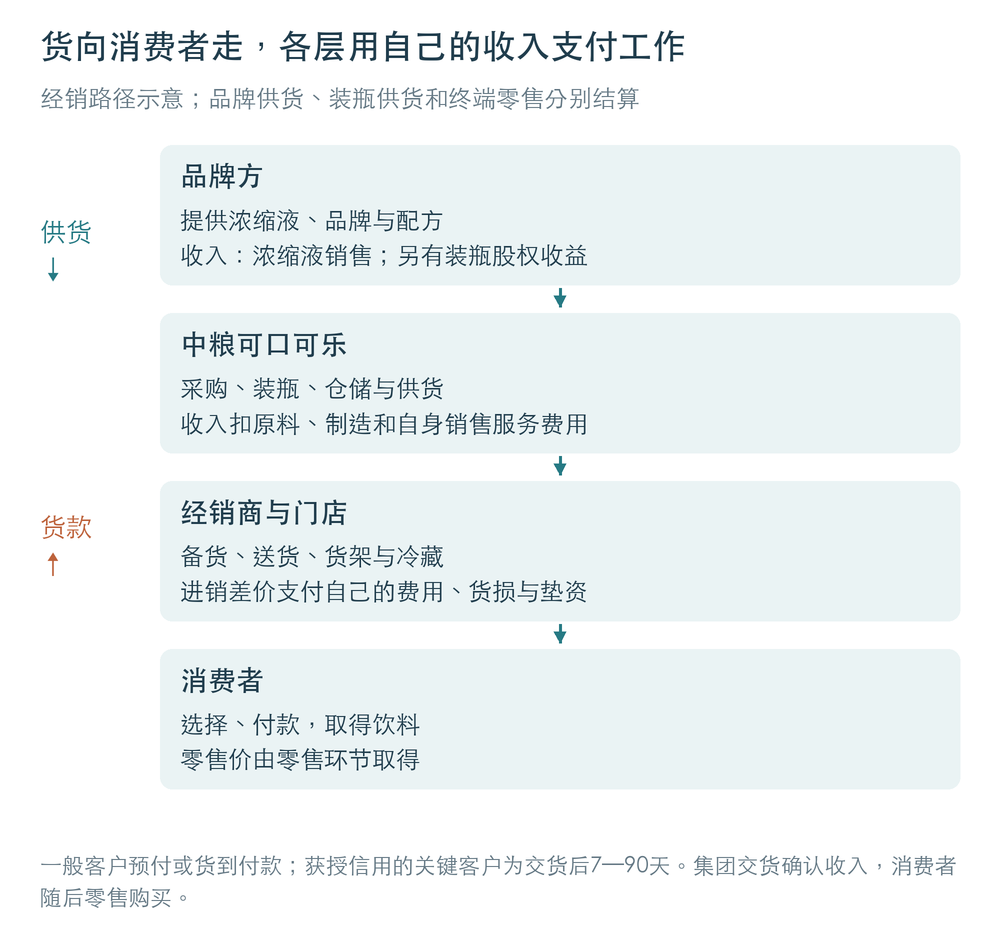

一般客户预付或货到付款；获授信用的关键客户为交货后7—90天。集团交货确认收入，消费者随后零售购买。

依据 · 2025 年度报告 · 第148页；2025 年度报告 · 第167页；2024 年度报告 · 第27页

### 一箱饮料的价差怎样分给经销商和门店

门店卖出一瓶饮料，零售价通常高于向上游进货的价格。门店用这部分差价支付租金、员工、冷藏和占用货架的成本；经销商也要从自己的买卖差价中支付仓库、送货和备货资金。每一层愿意继续经营，取决于商品卖得多快，以及这些开支付完后还剩多少。

经销商的购销价差支付了仓储、送货、销售人员和垫资；门店的进销差价支付了租金、人工、冷藏和损耗。可口可乐卖得快，能让一格货架反复周转，也能让同一趟配送多送几箱。这是经销商和店主愿意经营成熟汽水的经济基础。慢销新品即使单瓶差价更大，积压和临期也会吃掉收入。

2024年6月，苏影采访的一位华北餐饮配送商说，500ml汽水每箱进价涨约7元，供价只涨5元。他的开票购销差额因此缩小约2元。另一位西南县域配送商也暂时自行承受进价上升。这些是可口可乐101渠道的局部经历，报道未列供货装瓶公司的名称；返利和配送费用仍要另结，2元不是净利润变动。

厂家提高开票价后，配送商要看餐饮店肯不肯接受，店主又要看顾客会不会转去别家。一层暂时承担涨幅，可以维持货物流转；价差长期不足以支付服务，经销商就会减少拜访、压低库存或转推别的产品。厂家的提价最终能否留下来，取决于下游还愿不愿意接着经营。

中国食品2024年增加直接服务客户，2025年又在下沉市场发展区域特许经销商（RFP）。两种路径可以按线路密度分工：密集门店便于公司直配，零散客户借当地经销网络覆盖。直配能留下中间环节的价差，但车辆、仓储和客户维护也转由公司承担。保留经销合作，可以减少为分散订单自建末端网络的负担。

依据 · 2025 年度报告 · 第148页；2025 年度报告 · 第17页；2024 年度报告 · 第27页；[苏影：可口可乐又涨价了，“快乐水”之外再难有爆款？](https://www.inewsweek.cn/yysbg/2024-06-11/22269.shtml)

### 客户先付款，还是公司先垫款

中国食品通常要求预付货款或货到付款；获得信用的关键客户可在交货后7至90天付款。2025年末应收贸易款净额约3.30亿元，客户预收货款形成的合同负债约13.08亿元；2024年末两项分别约3.39亿元和8.66亿元。预收制度减少了公司为下游垫资的需要，部分关键客户则由公司先承担账期内的资金占用。

预收支持了周转，同时要求公司以后交货。2025年初的8.66亿元合同负债在年内全部随交货转为收入，年末新收而未履约的货款继续列负债。订货时点和季节会改变预收规模，后续履约则消耗采购和配送资金。

依据 · 2025 年度报告 · 第167页；2025 年度报告 · 第171页

### 传统零售、可乐GO与重点客户

可乐GO把商户订货转到手机上。开发者介绍，客户可查看商品和优惠、下单、跟踪配送并进入支付环节，连接订货、送货和结算。2024年报将其列在传统渠道，称自主下单金额增加、整体销售效率提高。一部分原来依靠销售人员联系的订货工作由此在线完成。

服务商北京友生意把可乐GO介绍为连接品牌、经销商和终端的系统，销售管理模块还容纳业代拜访、代下订单和门店管理。店主自己补货以后，业务员可以减少重复接单，把时间用于新售点、陈列和动销；经销商仍可在体系内供货。可乐GO改变的是订单和服务的组织，线上订单增长不代表整笔生意已经改成直营。

2024年报称，直营服务客户数量增长，可控业务收入约占整体90%。这一比例涵盖公司组织管理的多种路径，年报未将它定义为直营收入：现代渠道调整品类、包装、陈列及促销；餐饮渠道开发高质量及头部连锁客户；2025年区域特许经销商继续服务下沉市场。中国食品通过直接服务和经销合作扩大触达。

依据 · 2024 年度报告 · 第27页；2025 年度报告 · 第17页；[可乐GO开发者产品说明](https://apps.apple.com/cn/app/%E5%8F%AF%E4%B9%90go/id1093345922)；[北京友生意：可乐GO与深度分销服务](https://ysyboom.com/)

### 悦享会怎样把饮料卖到消费者手中

悦享会承担中国食品的一部分线上销售。消费者在网店或微信小程序“快乐会”下单以后，仓库按订单拆包、组合商品，再交给快递送货。2025年，公司披露已建立四大仓网，提供22城次日达服务。这套仓配安排让中国食品在向商户供货之外，也能自己完成消费者的小批量订单。

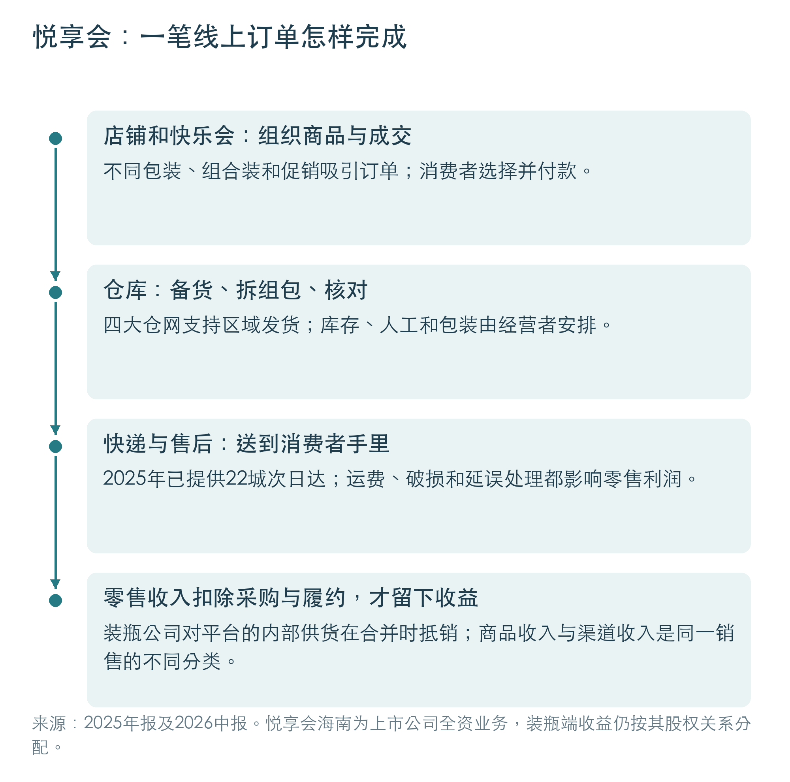

来源：2025年报及2026中报。悦享会海南为上市公司全资业务，装瓶端收益仍按其股权关系分配。

线上销售也有专门的商品安排。悦享会采用与线下不同的包装，减少同款饮料直接比价，同时引入其他品牌。2025年合作品牌达到19个；2026年上半年又引入吉意欧，并承接其天猫超市和京东业务。悦享会开始把已经建立的店铺运营和仓配能力用于更宽的商品组合。

规模确实在增长。2026年上半年悦享会卖出3086.7万标箱饮料，同比增长25%，运营口径收入增长19%至7.52亿元，合并口径收入增长16.9%至7.22亿元。销量增长快于收入，平均每标箱运营收入约下降4.8%。每箱收入是全部商品混合后的平均数，商品和包装组合都会影响它，不能当作同一瓶饮料的降价幅度。

外部品牌还处在较小规模。同期非可口可乐产品销售3050万元，占悦享会运营收入约4%，其中吉意欧相关业务带来超过800万元增量。因此，悦享会现阶段主要仍在经营原有饮料，向其他品牌扩展已经开始，但还没有改变收入主体。

快乐会与微信支付“摇一摇”折扣活动合作，公司报告小程序访问转化率达到73%、成交单量同比增长167%。这是小程序的促销和成交情况。报告另列会员中台活跃用户2490万，范围是会员中台，不能当作这次活动的购买人数。

悦享会已建起实际运营的线上销售和仓配业务，外部品牌也开始贡献收入。独立利润、连续复购，以及订单中新增购买与原渠道迁移的比例仍未披露。现行估值保留集团已有现金，不因用户和销售规模增长另加一笔平台价值。

依据 · 2025 年度报告 · 第28页；[2026 中期报告 · 第13页](https://www.hkexnews.hk/listedco/listconews/sehk/2026/0917/2026091700946_c.pdf#page=13)；[2026上半年业绩发布会 · 第11页](https://cdn.financialreports.eu/financialreports/media/filings/49257/2026/RNS/49257_rns_2026-08-25_559c59b7-309d-46de-bc9c-ae3549c10f8a.pdf#page=11)

### 冷柜和自动售货机怎样增加销售

冷柜和自动售货机解决的是两种不同的销售问题。门店冷柜让饮料在消费者想喝的时候保持冰凉，也让商品更容易被看到；售货机则直接接收消费者付款并交付饮料，承担了一部分门店零售的工作。中国食品增加设备投入，是为了让既有品牌在更多地点完成购买。

智尚较早开始把自动售货机做成一门单独的经营业务。2021年，公司披露智慧零售管理近2万台设备，销售额超过3亿元，首次实现全年盈利，利润超过1000万元。此后继续扩展设备和合作网络。到2026年上半年，业绩演示披露直营单机每月收入2178元，同比增长9%。早期盈利说明这项业务已有商业结果，近期单机收入增加则表明已有直营设备卖出了更多收入。

一台机器持续卖货，需要有人选址、补货、清洁、处理支付与出货故障，还要根据各个位置的销量调整商品。旺销地点断货，会错过本来能够完成的购买；较慢的地点放太多货，又会占用库存并增加临期处理。智尚的数字系统和运营组织，主要是在这些具体工作上提高补货与设备服务效率。

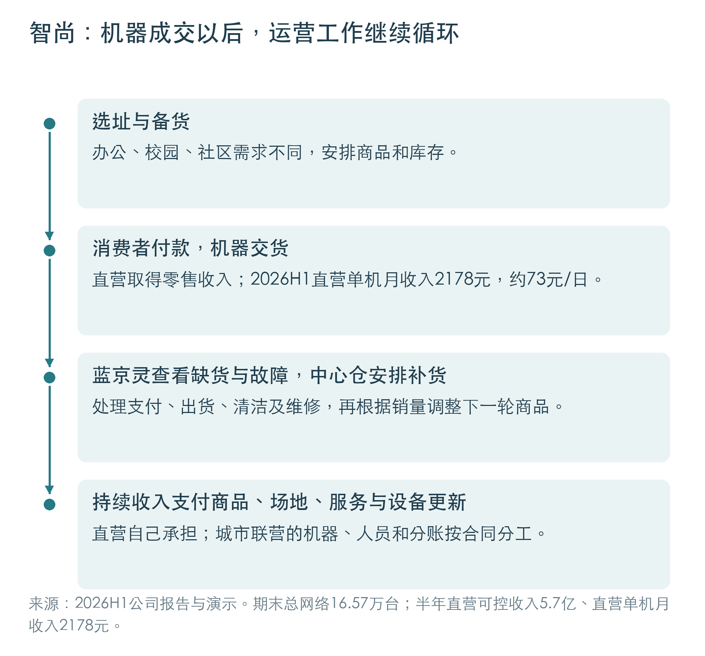

来源：2026H1公司报告与演示。期末总网络16.57万台；半年直营可控收入5.7亿、直营单机月收入2178元。

直营与合作网络的责任也有差别。直营设备的经营收入由公司直接取得，相应的设备和服务成本也由公司承担；合作伙伴参与的设备，需要按合同划分投入、补货、收益和维修责任。因此，直营单机收入应与直营设备成本对应，不能把一个直营平均数乘到全部网络设备上推算公司收入。

估值关注的是设备在整个使用期能留下多少现金。机器运行时的收入先支付商品、场地、运营和维护费用，使用多年后还要更新设备。2026年的单机收入改善是值得继续观察的进展，后续净收益和设备更新记录决定它能够给普通股增加多少现金。已有经营结果已包含在集团现金起点，未来新增贡献在第六章和第七章另行讨论。

依据 · 2025 年度报告 · 第24页；2025 年度报告 · 第170页；2025 年度报告 · 第28页；2025 年度报告 · 第29页；[2026 中期报告 · 第13页](https://www.hkexnews.hk/listedco/listconews/sehk/2026/0917/2026091700946_c.pdf#page=13)；[中粮可口可乐蝉联可口可乐系统全球客户及商务领导力大奖](https://www.cofco.com/cn/News/Allnews/Latest/2022/0801/51763.html)；[2026上半年业绩发布会 · 第12页](https://cdn.financialreports.eu/financialreports/media/filings/49257/2026/RNS/49257_rns_2026-08-25_559c59b7-309d-46de-bc9c-ae3549c10f8a.pdf#page=12)；[中粮智尚城市联营项目启动](https://www.cfsn.cn/news/detail/2137/344913.html?view=pc)；2021 年度报告 · 第14页

### 仓库怎样把不同包装送到指定客户

包装差异化使仓库处理的不只是几种口味。同一品牌会因市场活动、渠道定制、生产地和生产日期形成不同批次，客户又有各自要求的到货新鲜度。富勒披露的中粮可口可乐案例中，原来依赖人员经验的方式已难以处理这些差别。2019年，总部物流部从北京厂引入仓储管理系统，管理自产和委外成品，以及瓶箱、托盘等周转物料，再逐步推广到山西、山东等地。

产品下线后，系统记录版面、产地和包装属性，按规则上架；接到订单时，再按客户代码和生产日期要求分配库存。库内按指令拣配、复核、发运，使定制包装和批次要求落实到出库操作。产品从赋码系统直接进入仓库记录，减少托盘与产品的重复绑定；仓储系统向ERP回传收发结果，并把作业指令送给运输配送系统，仓内拣货时调度人员就开始排车。

库位和人员也作了调整。项目组用北京厂半年的库存周转、库位占用、日订单和发货资料重新分配库位，将周转快慢不同的商品安排到不同区域；叉车司机和混合托盘拣配人员通过语音及无线终端接收、确认任务。原来需要保管员现场指挥、经理频繁挪货的工作，部分转为系统分配。

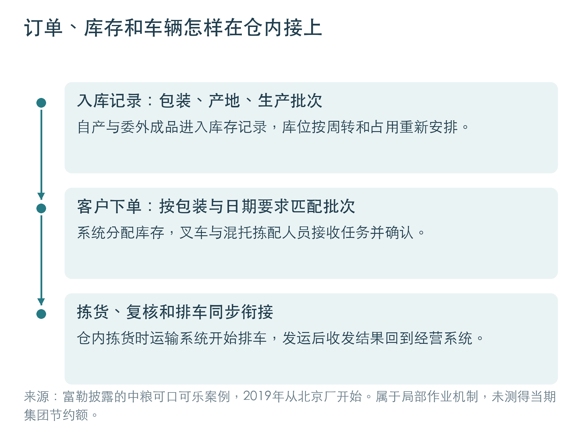

来源：富勒披露的中粮可口可乐案例，2019年从北京厂开始。属于局部作业机制，未测得当期集团节约额。

富勒在这项案例中自报拣货准确率99.98%、仓库最高密度较上年同期提高13.5%、仓储人员劳动生产率提高25%、产品库存天数减少2.9天。按供应商描述，这些改善来自具体仓内作业：渠道和包装增加后，公司通过批次匹配、库位安排和同步排车减少差错、搬运及库存占用。这些作业改善说明了仓储效率的来源；当期全集团费用变化见第四章。

依据 · [富勒：中粮可口可乐仓储系统案例](https://www.flux.com.cn/CustomerCase/info/900)

### 售价、返利和销售费用怎样影响收入

公司报出的收入，通常已经扣除了会影响成交价的折让。比如向经销商发货时约定达到一定采购量可以取得返利，最后留下的净收入要把相应返利考虑进去。另一些支出用于广告、陈列和销售服务，会出现在销售费用里。理解利润变化时，需要把售价扣减和费用支出接在一起看，才能知道公司为完成一笔销售总共让出了多少钱。

集团出货价与消费者支付的零售价分属前后两笔交易。交货后的购货客户可以自行决定转售价格；公司则通过品牌活动、包装、陈列和促销影响终端需求及渠道利润。分析公司收入时，应使用集团对客户的成交价格。

呵呵2017关于农夫山泉的文章强调，消费者成交价、厂家净收款与经销商经营意愿要连着看。折扣店或线上卖得更便宜时，有几种不同的账：厂家降低净供价，利润先从装瓶环节让出；经销商或门店少赚价差，压力先落到渠道；平台出补贴，消费者少付的钱可能由平台承担；仓配和周转效率提高，则可以用较低成本支持低价。仅看最后一张价签，分不出是哪一种。中国食品的成交收入、客户返利及销售费用共同记录了厂家实际承担的部分。

让利有一部分直接减少收入。数量折扣影响预计交易对价；支付或承诺给客户、又不是换取可区分货品或服务的返利，也从收入中扣减。营销促销和物流支出另计费用。2025年末应付销售折扣约3.34亿元，应计营销促销约15.87亿元，应计物流约0.51亿元，分别对应尚待结算的折扣、推广和配送责任；全年销售费用由损益表反映。

2026年上半年销售费用率下降约1.71个百分点，来自支出减少和收入增长；同期集团收入除以饮料标箱数，平均每标箱收入下降约5.2%。少花销售费用抵消了部分单位收入压力。成交收入与销售费用需合起来看，因为客户优惠可能直接扣减货价，也可能以推广服务支出体现。

结算还会影响费用的现金支付时点。中报所列应计营销促销15.07亿元、应计物流1.32亿元，上年同期分别为18.88亿元和0.03亿元，是计提与付款共同形成的期末余额。它们帮助跟踪尚需支付的推广和物流款；本期9077万元降费的具体组成仍缺少损益明细支持。

依据 · 2025 年度报告 · 第148页；2025 年度报告 · 第118页；2025 年度报告 · 第119页；2025 年度报告 · 第170页；[2026 中期报告 · 第14页](https://www.hkexnews.hk/listedco/listconews/sehk/2026/0917/2026091700946_c.pdf#page=14)；[2025 中期报告 · 第41页](https://www.hkexnews.hk/listedco/listconews/sehk/2025/0919/2025091900590.pdf#page=41)；[2026 中期报告 · 第39页](https://www.hkexnews.hk/listedco/listconews/sehk/2026/0917/2026091700946_c.pdf#page=39)；销售费用持续性：原数、机制与反方；[呵呵2017：农夫山泉学习笔记（三）及采用记录](https://www.xueqiu.com/1373067614/384792146)；2025 年度报告 · 第28页；[2026 中期报告 · 第13页](https://www.hkexnews.hk/listedco/listconews/sehk/2026/0917/2026091700946_c.pdf#page=13)；已有八篇雪球文章：原文回读与经营分析恢复

### 区域独家权怎样延续

中粮可口可乐通过多份装瓶协议，取得在其经营所在19个省级行政区域准备、包装、分销和销售可口可乐指定品牌产品的独家权利。这种安排减少同体系装瓶商在区域内的重复竞争，让工厂、销售网络和客户关系围绕相对稳定的范围建设；公司同时要与区域内的其他品牌争取消费者。

2025年报写明，基于双方战略关系及过往经验，装瓶协议续期或延期时无需支付对价。公司评估合同条款、续订记录和双方互惠关系后，相信特许经营权会在各到期日继续续新，因而将其会计使用寿命列为不确定。实际续约记录和不另收费的安排，支持目前对合作延续的判断。

授权延续的判断建立在续约记录和双方继续履约上。各区域到期日、续约考核、提前终止及违约补救条款尚未完整公开。2026年末届满的是浓缩液采购框架，区域装瓶权的期限由各份装瓶协议另行约定。

依据 · 2025 年度报告 · 第161页；2025 年度报告 · 第162页；2025 年度报告 · 第85页；[浓缩液及关联采购框架 · 第10页](https://www.hkexnews.hk/listedco/listconews/sehk/2023/1107/2023110700390_c.pdf#page=10)

### 品牌方如何分享这门生意

可口可乐同时从浓缩液供应和装瓶股权分享收益。2024至2026年采购框架规定，浓缩液价格由可口可乐上海确定；改价须提前30日通知并协商，考虑装瓶商授权区域的市场条件。装瓶商若拒绝新价，应在收到通知后30日内通知，相关浓缩液购销协议在通知起三个月后终止。价格安排给予品牌方较强主动权，装瓶商通过协商或退出回应。

2025年集团向可口可乐上海支付或应付浓缩液采购49.09亿元，2024年为46.58亿元。可口可乐持有的中粮可口可乐35%股权，2025年另分得会计利润约4.20亿元。前一项是形成装瓶利润之前的采购金额，包含上游成本；后一项是利润形成后的权益分配，实际股息付款还会跨期。两项分别揭示品牌方的供货与股东利益。

2025年浓缩液采购额增长约5.4%，集团收入增长约2.7%，采购支出增加得更快。金额受到采购数量、产品组合和单价影响，库存又使采购与耗用错期，现有披露无法单独算出浓缩液涨幅。由于品牌方掌握定价主动权，续约后的采购条件会直接影响装瓶商能留下多少利润。

依据 · [浓缩液及关联采购框架 · 第10页](https://www.hkexnews.hk/listedco/listconews/sehk/2023/1107/2023110700390_c.pdf#page=10)；[浓缩液及关联采购框架 · 第11页](https://www.hkexnews.hk/listedco/listconews/sehk/2023/1107/2023110700390_c.pdf#page=11)；2025 年度报告 · 第85页；2025 年度报告 · 第183页；2024 年度报告 · 第87页；2023 年度报告 · 第6页；2023 年度报告 · 第15页

### 销量增长与利润来源

2026年上半年，中国食品多卖了9.6%的饮料，收入增长4.0%，毛利额却只增加403万元。同期销售费用减少9077万元。这半年利润改善主要来自销售费用减少。

降低服务成本有具体的做法。2018年区域重组后，公司提高自产比例，减少付给外部工厂的代加工费；相邻装瓶区域重新安排供货路线，缩短运距；扩充自有仓储，减少外租仓库。2025年继续统一装瓶厂销售架构和考核，调整直配与跨区域货运，可乐GO则让商户自主下单。生产、接单、仓储和配送衔接得更顺，同一套工厂和销售网络就能承接更多生意。

卖什么同样重要。2025年水品类销量双位数增长，收入只增长4.3%，低毛利水占比提高拉低了集团毛利率。功能饮料收入增长28.1%，但全年收入占比只有约1.5%，对集团的带动还小。成熟汽水仍是利润基础，功能饮料提供增量，水业务则要在规模和单位收益之间取舍。

2024年原料成本和产品结构改善，毛利增加5.77亿元；为应对竞争，公司加大推广，销售费用增加4.01亿元，花掉了约七成毛利增量。品牌和渠道能带来持续订单，但维持销量也要投入促销、陈列和配送。产品毛利改善之后，剩下多少要看这些支出。

依据 · 2025 年度报告 · 第24页；2024 年度报告 · 第27页；2025 年度报告 · 第28页；2025 年度报告 · 第148页；2025 年度报告 · 第170页；2025 年度报告 · 第171页；[呵呵2017：农夫山泉学习笔记（三）及采用记录](https://www.xueqiu.com/1373067614/384792146)；[2026 中期报告 · 第24页](https://www.hkexnews.hk/listedco/listconews/sehk/2026/0917/2026091700946_c.pdf#page=24)；[2026 中期报告 · 第9页](https://www.hkexnews.hk/listedco/listconews/sehk/2026/0917/2026091700946_c.pdf#page=9)；2018 年度报告 · 第26页；2018 年度报告 · 第34页；2025 年度报告 · 第18页；2024 年度报告 · 第29页；2024 年度报告 · 第30页；已有八篇雪球文章：原文回读与经营分析恢复

### 标箱、收入与单位贡献

“标箱”将不同包装换成统一的饮料容量。按可口可乐体系定义，一标箱为192美制液量盎司，即24份8盎司饮料，约5.678升。中国食品英文披露使用unit cases；它是统计单位，与门店实际采购的一箱小罐或大瓶饮料不同。

2026H1公司披露销量8.10亿标箱，同比增长9.6%；按该增速反推，上年同期约7.39亿标箱。以集团金额除以饮料量，收入约由每标箱16.61元降至15.76元，毛利由6.33元降至5.78元，销售支出由4.38元降至3.88元。这些比率把集团金额与饮料量放在一起，包含创新平台等业务，用于观察整体单位产出和费用方向；纯装瓶产品售价与单箱净利润需采用相应业务范围的数据。

每标箱毛利减少的同时，销售支出也在下降，费用节约抵消了部分产品端压力。这组变化综合了产品、规格、渠道和价格的影响，同款产品的价格还需单独销售数据判断。

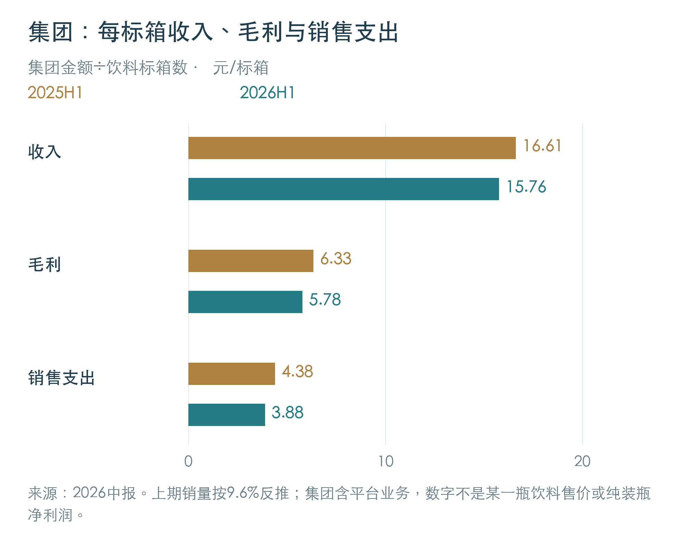

来源：2026中报。上期销量按9.6%反推；集团含平台业务，数字不是某一瓶饮料售价或纯装瓶净利润。

依据 · [可口可乐2025 Form 10-K，Beverage Volume](https://investors.coca-colacompany.com/filings-reports/all-sec-filings/content/0001628280-26-010047/ko-20251231.htm)；[2026 中期报告 · 第9页](https://www.hkexnews.hk/listedco/listconews/sehk/2026/0917/2026091700946_c.pdf#page=9)；[2026 中期报告 · 第24页](https://www.hkexnews.hk/listedco/listconews/sehk/2026/0917/2026091700946_c.pdf#page=24)

### 2026年上半年的收入和利润增量

本期集团收入增加约4.85亿元，汽水增加约1.96亿元、果汁1.06亿元、功能饮料1.05亿元。功能饮料当期收入占比约2.4%，虽然增长较快，集团绝大部分经营基础仍在成熟品类。具体品牌和竞争者将在第三章展开。

汽水和果汁合计贡献了约六成新增收入，功能饮料又贡献约两成。功能饮料增长快，但收入体量仍小，集团利润首先取决于成熟品类。

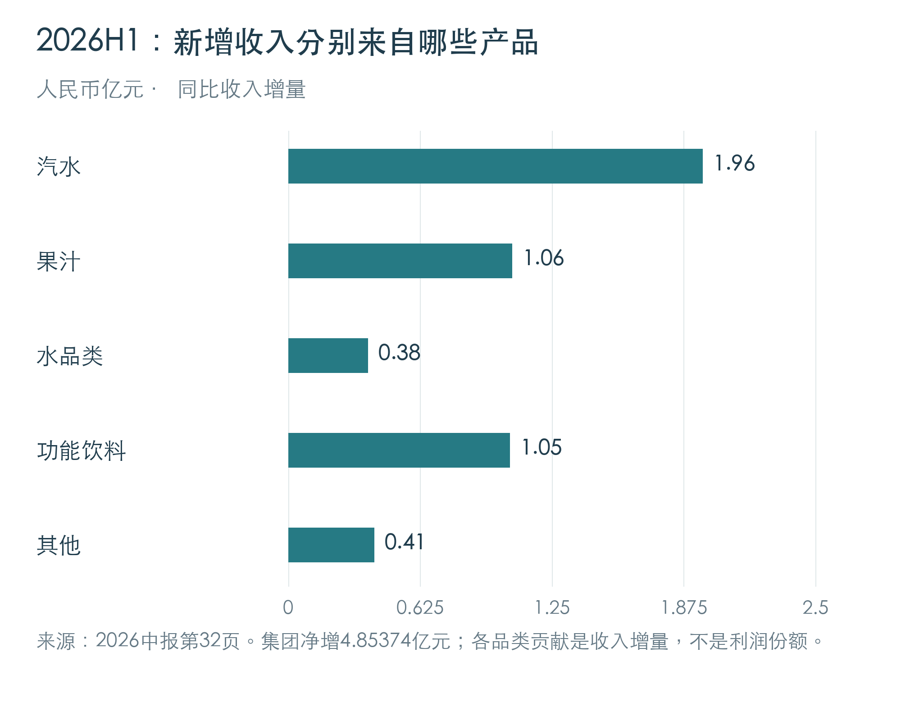

来源：2026中报第32页。集团净增4.85374亿元；各品类贡献是收入增量，不是利润份额。

依据 · [2026 中期报告 · 第24页](https://www.hkexnews.hk/listedco/listconews/sehk/2026/0917/2026091700946_c.pdf#page=24)；[2026 中期报告 · 第32页](https://www.hkexnews.hk/listedco/listconews/sehk/2026/0917/2026091700946_c.pdf#page=32)；[2026 中期报告 · 第14页](https://www.hkexnews.hk/listedco/listconews/sehk/2026/0917/2026091700946_c.pdf#page=14)

### 每100元销售留下多少经营余额

收入增长能否提高利润，取决于制造和销售两端留下多少。2018年每100元收入中，销售成本约64.59元，销售费用28.55元，行政费用2.88元，扣除后二项的毛利余额约3.98元；2025年提高到约7.98元。公司已经在长期经营中提高了每元销售的贡献。

历年改善的来源并不一致。2020年原料低价抬高毛利率，2021年原材料上涨后毛利率明显回落；2024年毛利和销售费用同时增加；2026H1毛利额基本不变，利润主要受益于销售费用减少。现阶段的经营任务是让较低服务费用延续，并改善每箱产品贡献。

图中深绿色为商品毛利扣除销售与行政费用后的余额。沿这笔余额继续计入其他收益、融资和所得税，再处理各层股东权益及必要投入，才能得到第五章估计的普通股可持续现金。

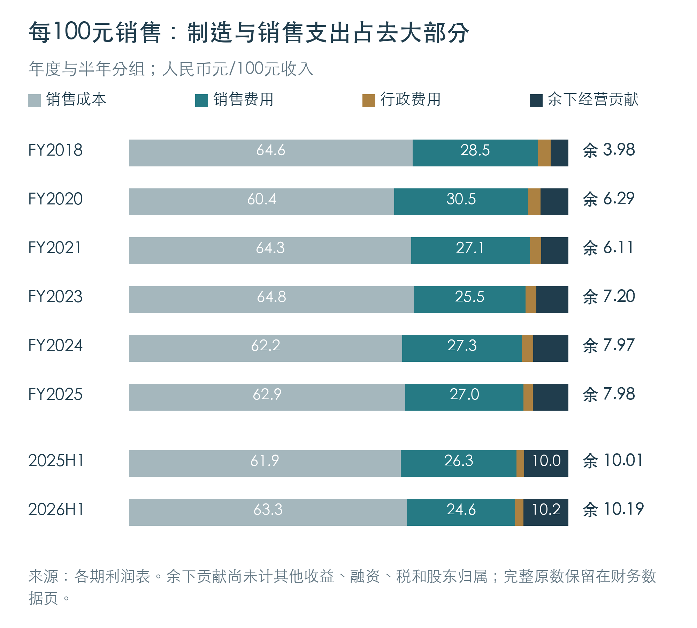

来源：各期利润表。余下贡献尚未计其他收益、融资、税和股东归属；完整原数保留在财务数据页。

依据 · 2018 年度报告 · 第132页；2020 年度报告 · 第136页；2021 年度报告 · 第166页；2024 年度报告 · 第99页；2025 年度报告 · 第97页；[2026 中期报告 · 第24页](https://www.hkexnews.hk/listedco/listconews/sehk/2026/0917/2026091700946_c.pdf#page=24)

中国食品的日常工作从采购和排产开始，经过仓储、订货、配送、陈列与促销，最后以客户付款完成一轮经营。经销商、门店和自营渠道承担的工作不同，各自需要取得足够收益。数字订货、仓配改造和新零售可以提高效率；它们的经济效果，要落到商品卖得更顺、服务同一批订单所需成本更低，以及扣除设备投入后留下更多现金。

若经销商和门店卖货变慢，下一轮订货及预收会减少，公司可能同时承担让价、促销和维持售点的支出。库存报废责任由客户承担，订单减少与终端让利仍影响公司收益。

销售费用减少由哪些具体措施带来，哪些支出只是延后？；销售组织、配送和推广的费用明细，配合后续同季支出及售点动销；决定较低费用水平能否持续支撑正常现金

主要渠道的净贡献有没有随销量提高？；渠道收入与履约、返利、设备成本配对；披露不足时用集团毛利和费用交叉判断；区分有价值的增长与以更多投入换规模

## 第3章 · 行业、竞争与同行

核心汽水的品牌需求与区域网络，以及果汁、水和功能饮料各自面对的竞争。

### 汽水是竞争地位的核心

2025年，中国食品汽水收入166.85亿元，占集团约75.6%；果汁30.28亿元，占13.7%；水9.29亿元，占4.2%；功能饮料3.20亿元，占1.5%。汽水与果汁合计约89.3%。因此，小品类即使增长很快，也很难抵消成熟品类的大幅下滑。

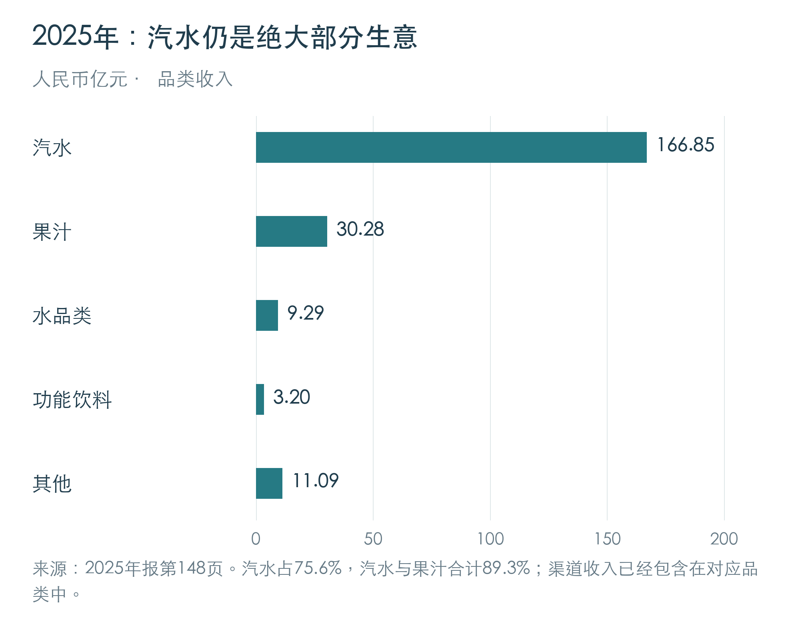

来源：2025年报第148页。汽水占75.6%，汽水与果汁合计89.3%；渠道收入已经包含在对应品类中。

公司在2025年报披露，其经营区域内汽水份额接近60%。这一公司口径的区域份额，与成熟汽水的收入规模和销量记录一起，支持核心市场领先的判断。

区域装瓶授权让中粮可口可乐在指定地区经营可口可乐体系产品，太古主要经营另一些地区。两者分别建设当地供货网络，消费者在售点仍可选择百事、农夫山泉、统一及其他品牌。中国食品在核心汽水的品牌需求与生产配送配合上最有基础；果汁新品、水和功能饮料则面对不同对手，分别评价。

依据 · 2025 年度报告 · 第25页；2025 年度报告 · 第148页；[中国食品2017年报 · 第21页](https://www.hkexnews.hk/listedco/listconews/SEHK/2018/0425/LTN20180425423.pdf#page=21)

### 汽水收入增长放慢，销量基础仍在

核心汽水已经进入低速成熟阶段。2018年收入约114亿元，2025年约167亿元，2022年以后收入增速明显放慢。2025年汽水销量稳定，2026年上半年又增长8.5%。较长的收入记录和近期销量表现，支持这门生意仍有稳定的需求基础。

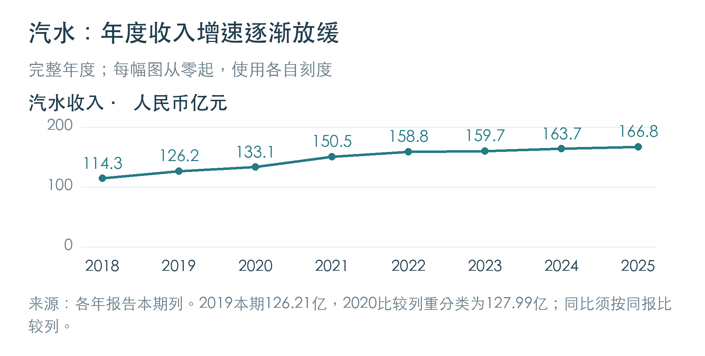

来源：各年报告本期列。2019本期126.21亿，2020比较列重分类为127.99亿；同比须按同报比较列。

2025年上半年汽水收入增长约9.4%，按全年减上半年计算，下半年收入同比下降约6.4%。2026年上半年汽水销量增长8.5%，收入却只增长约2.1%，每标箱收入约下降5.9%；同期经营利润仍增长8%，折算每标箱仅下降约0.5%。包装、价格和成本都在变化，最终每箱经营利润大致守住，多卖的货增加了总利润。

金色小路在中报分析中指出，汽水自身的收入增速也低于销量，集团低毛利水占比提高不能解释全部变化。中国食品同时调整大包装、无糖新品、餐饮配方和便利店促销，每箱收入受到产品组合与折扣的共同影响。太古同期明确披露更高折扣抵消部分收入增长，说明让利压力确实存在于装瓶行业。中国食品没有分拆两者金额，但每箱经营利润的结果表明，本期仍消化了大部分单位收入压力。

图中年度收入采用各年报告本期列。2020年报将2019年汽水比较列重分类为127.99亿元，原2019年本期为126.21亿元，因此2020年同比按同报比较列计算。全年和半年分别比较，早年没有披露的汽水销量仍保留为空。

依据 · 2018 年度报告 · 第176页；2019 年度报告 · 第167页；2020 年度报告 · 第175页；2021 年度报告 · 第214页；2022 年度报告 · 第217页；2023 年度报告 · 第116页；2024 年度报告 · 第158页；2025 年度报告 · 第148页；[2025 中期报告 · 第33页](https://www.hkexnews.hk/listedco/listconews/sehk/2025/0919/2025091900590.pdf#page=33)；[2026 中期报告 · 第32页](https://www.hkexnews.hk/listedco/listconews/sehk/2026/0917/2026091700946_c.pdf#page=32)；[2026 中期报告 · 第10页](https://www.hkexnews.hk/listedco/listconews/sehk/2026/0917/2026091700946_c.pdf#page=10)；[金色小路：中国食品（00506.HK）2026年中报点评](https://www.xueqiu.com/2892426645/408661736)；[太古2026中期业绩公告（含新闻稿） · 第28页](https://www.swirepacific.com/storage/fm/PressRelease/pdf/en/swirepacific-interim-2026.pdf#page=28)；已有八篇雪球文章：原文回读与经营分析恢复

### 无糖与包装调整怎样延续需求

无糖产品帮助公司适应消费偏好，但还未形成连续的高增长。2020年无糖及纤维+系列合计增长近50%，2021年无糖汽水增长逾50%；2023年无糖收入下降，汽水微增由传统产品带动；2025年含糖与无糖收入同时增长，无糖增幅为高个位数。传统产品仍是支柱，无糖扩大了选择，也承受自身需求与推广效果的起伏。2020—2021年的增幅未统一明确为销量或收入，也未单列金额和占比。

公司先后推出摩登罐、迷你罐、多支装、大包装零度可乐和248毫升口袋瓶，分别服务家庭配餐、分享和随身即饮。2024年公司称行业汽水销售额下降，自身通过扩大铺货跑赢市场；2026年上半年继续开发餐饮、辣食和连锁便利店。公司通过包装和触达适应不同购买场景，维护成熟产品的销量；这些销售的盈利仍由包装、终端促销及配送成本共同决定。

2026年上半年业绩演示进一步列出，可口可乐收入增长3.7%、无糖可口可乐增长10.5%，芬达增长3.2%、无糖芬达增长60.2%。无糖子产品的增幅快于所列主品牌，说明公司在既有品牌下适应口味和无糖需求；较小单品的高增速与汽水整体2.1%的收入增长须结合理解。同期，雪碧经典柠檬茶全渠道上市，可口可乐和雪碧“纤维+”升级为益生元产品，以较高定价进入餐饮及辣食场景；无糖柠檬味可口可乐则在连锁便利店增加陈列，配合跨品类捆绑。公司一边用分享装和铺货争取购买量，一边用配方、口味及场景争取较高单价。

果汁与汽水经历了不同的需求变化：2023年果汁增长、汽水微增；2024—2025年果汁连续下降、汽水仍增；2026年上半年果汁又增长6.3%。在中国食品现有记录中，两类产品各有顺逆风，果汁的恢复更适合结合自己的新品和渠道动作解释。

依据 · 2020 年度报告 · 第22页；2021 年度报告 · 第21页；2023 年度报告 · 第18页；2024 年度报告 · 第22页；2025 年度报告 · 第25页；[2026 中期报告 · 第10页](https://www.hkexnews.hk/listedco/listconews/sehk/2026/0917/2026091700946_c.pdf#page=10)；[2026 中期报告 · 第11页](https://www.hkexnews.hk/listedco/listconews/sehk/2026/0917/2026091700946_c.pdf#page=11)；[2026上半年业绩发布会 · 第7页](https://cdn.financialreports.eu/financialreports/media/filings/49257/2026/RNS/49257_rns_2026-08-25_559c59b7-309d-46de-bc9c-ae3549c10f8a.pdf#page=7)

### 汽水：百事体系争夺同一批消费场景

可口可乐、雪碧、芬达分别面对百事可乐、7喜和美年达等具名对手。康师傅的相关饮品业务承担百事、7喜、美年达在中国的生产销售。康师傅2025年报记载，百事可乐经营无糖、口味和校园音乐活动，美年达更新橙味并推出高端浓系列，7喜以清爽口感和喜庆主题进入宴席。竞争围绕佐餐、聚会、校园和年轻消费者展开，产品风味、包装、品牌活动和终端陈列共同影响购买。

中国食品同年通过可口可乐烧烤节和分享瓶、雪碧音乐节和校园赛事、芬达校园及IP活动支持销量。含糖和无糖汽水收入都增长，无糖汽水增长高个位数，汽水整体销量稳定、收入接近增长2%。这些表现支持核心品牌仍能留住消费，也显示无糖只是成熟汽水内部的一项增长来源，尚未带动整个品类销量明显扩张。

茶饮也在争取佐餐和家庭分享。农夫山泉2025年推出碳酸茶饮料“冰茶”，东方树叶增加1.5升家庭分享装；康师傅继续发展冰红茶及无糖茶。消费者在家庭聚会、佐餐和即饮解渴时由此有更多选择。中国食品需要借汽水的品牌偏好和可得性维持购买，持续经营新品、陈列与促销。

依据 · [康师傅控股2025年报 · 第19页](https://www.masterkong.com.cn/wp-content/uploads/2026/05/C322_ARs_4c1cac99.pdf#page=19)；[康师傅控股2025年报 · 第20页](https://www.masterkong.com.cn/wp-content/uploads/2026/05/C322_ARs_4c1cac99.pdf#page=20)；2025 年度报告 · 第25页；[农夫山泉2025年报 · 第19页](https://www.hkexnews.hk/listedco/listconews/sehk/2026/0417/2026041701390_c.pdf#page=19)；[农夫山泉2025年报 · 第24页](https://www.hkexnews.hk/listedco/listconews/sehk/2026/0417/2026041701390_c.pdf#page=24)

### 果汁：原有大单品承压，新品与餐饮包装争取增量

中国食品的美汁源和酷儿面对的对手包括统一鲜橙多、统一果漾、康师傅每日C、纯果乐果缤纷，以及农夫山泉的NFC、17.5°果汁。它们的果汁含量、配方、储运要求、价格和场景并不完全相同。低浓度果汁饮料争取大众即饮与佐餐，100%果汁和NFC产品更多强调原料、纯果汁和健康诉求，各自争取的消费需求和可接受价格也有差异。

2025年中国食品果汁收入下降3.4%，太古内地果汁收入下降3%、销量下降4%，而农夫山泉果汁饮料收入增长26.7%。农夫山泉继续经营NFC和17.5°系列，并把900毫升100%鲜果冷压榨橙汁送入山姆会员商店。统一鲜橙多用罐装产品拓展餐饮和宴席，统一果漾经营低糖柚子口味，元气觉醒经营100%果蔬汁。销售表现及产品动作显示，果汁需求正在不同配方和渠道间分化。中国食品既有大单品承压，纯果汁及特定渠道仍能形成增长。

中国食品的修复从旧品牌重新组织开始。2025年酷儿按地区分阶段投放不同规格，按渠道安排铺货和陈列；美汁源部分非橙口味由420毫升改为450毫升、价格不变，扩展桃、青提、红提和热带果粒口味，并通过数字派样、揭盖扫码及箱码营销支持终端销售。同一时期既有品牌更新，也有加量让利，增长首先需要把产品重新卖动。

2026年上半年，酷儿用涂鸦活动、IP包装和角色周边吸引消费者，公司披露销量同比增长101.2%，贡献果汁品类40%的收入增量。3月上市的维生素C和益生元美汁源新品又贡献约2,200万元增量收入，6月推出餐饮专供310毫升双爽柠柠拉罐。酷儿恢复、功能配方和餐饮规格共同解释了果汁收入6.3%的增长，比将其归为普遍需求复苏更符合公司当期的经营记录。 这一期果汁收入合计增加约1.059亿元，酷儿按40%贡献折算约4237万元，与两款新品的2200万元合计约6437万元，约占新增收入的61%；其余产品合计约4155万元。

生产方式还在跟随产品调整。中报把酷儿桃、葡萄和260毫升橙、苹果口味转为自产，以及聚焦450毫升和750毫升即饮包装，列为下半年的后续动作。自产计划把采购成品的一部分成本转回公司自己的生产组织，若产量和排产合适，可以减少外部加工环节并提高已有设施利用率；投产及节约结果需由后续披露结算。

果汁的恢复已经有具体来源：酷儿重新分地区铺货，两款美汁源新品和餐饮包装争取新增销售。继续修复这项业务有经营依据。不过，统一、农夫山泉等对手也在推出餐饮罐装、低糖和纯果汁；中国食品2025年加量不加价，也显示老产品面临性价比压力。接下来的盈利改善主要靠新品卖动、推广费用得到分摊，以及酷儿转自产后降低供货成本。

依据 · 2025 年度报告 · 第26页；2025 年度报告 · 第148页；[2026 中期报告 · 第11页](https://www.hkexnews.hk/listedco/listconews/sehk/2026/0917/2026091700946_c.pdf#page=11)；[太古2025年报 · 饮料业务 · 第50页](https://www1.hkexnews.hk/listedco/listconews/sehk/2026/0408/2026040800985.pdf#page=50)；[农夫山泉2025年报 · 第22页](https://www.hkexnews.hk/listedco/listconews/sehk/2026/0417/2026041701390_c.pdf#page=22)；[统一企业中国2025年报 · 第19页](https://www1.hkexnews.hk/listedco/listconews/sehk/2026/0427/2026042700614.pdf#page=19)；[统一企业中国2025年报 · 第20页](https://www1.hkexnews.hk/listedco/listconews/sehk/2026/0427/2026042700614.pdf#page=20)；[康师傅控股2025年报 · 第20页](https://www.masterkong.com.cn/wp-content/uploads/2026/05/C322_ARs_4c1cac99.pdf#page=20)；[2026上半年业绩发布会 · 第8页](https://cdn.financialreports.eu/financialreports/media/filings/49257/2026/RNS/49257_rns_2026-08-25_559c59b7-309d-46de-bc9c-ae3549c10f8a.pdf#page=8)；[2026 中期报告 · 第32页](https://www.hkexnews.hk/listedco/listconews/sehk/2026/0917/2026091700946_c.pdf#page=32)

### 水：铺货能扩大规模，品牌和单位收益仍是弱项

冰露、纯悦和集团另行经营的悦活，面对农夫山泉包装水、怡宝纯净水及其他水品牌。农夫山泉以天然水源及工厂透明度强化品牌，华润饮料围绕怡宝、本优发展不同水种和规格，2025年推出本优5升泡茶用水、怡宝210毫升便携水。竞争同时涉及单瓶即饮、家庭及办公室用水、餐饮和运动场景。品牌要通过水源、口感、规格和使用场景，让消费者形成具体的选择理由。

2025年农夫山泉包装饮用水收入增长17.3%，华润饮料包装饮用水收入下降21.6%，反映品牌销售存在较大分化。中国食品水品类销量双位数增长，收入只增长4.3%；太古内地水销量增长6%，收入下降4%。地域和产品组合会影响各家结果，但两家装瓶商的销量都快于收入增长，显示水的扩量承受着价格和结构压力。

扩张已经落实到具体售点。2026年上半年冰露铺货客户达到70万家，同比增长49%，销量增长12%；纯悦销量增长8%，通过支付宝活动、景区联名定制瓶，以及酒店和交通等特殊渠道接触出行消费者。水动乐900毫升装在北京、四川、河北、山东和辽宁五个市场试销，争取夏季大包装、性价比补水需求。水品类同期收入增长6.5%。冰露先扩大覆盖，纯悦和水动乐按场景切入，这比把水增长归为普遍提价更有依据。

悦活则尝试另一条路线。2025年它将天然苏打水作为重点，更新瓶型和标签，并与京东合作平台专属产品，借体育活动和小红书吸引消费者。2026年上半年业绩演示列示悦活收入1.21亿元，同比增长33%。这是集团另行经营的具名品牌业务，和可口可乐体系授权产品分别识别；该金额也不另加到集团水收入之上。公司试图在既有铺货网络之外，用产品形象和渠道区隔争取更好的价格。

水的低毛利是已经出现的经营弱项：公司明确将2025年毛利率下降部分归于水的销量占比提高。现成渠道能把更多水铺进门店，但低价水每箱留下的钱少，仍要付配送和终端服务费用。大包装、景区定制和较高价格产品有助于改善组合；在这些产品形成足够收入之前，水的扩量主要增加销售规模，难以成为集团利润率提升的主力。

依据 · 2025 年度报告 · 第26页；2025 年度报告 · 第27页；2025 年度报告 · 第31页；2025 年度报告 · 第148页；[农夫山泉2025年报 · 第17页](https://www.hkexnews.hk/listedco/listconews/sehk/2026/0417/2026041701390_c.pdf#page=17)；[华润饮料2025年报 · 第18页](https://tzzgx.crbeverage.com/media/0nolef4r/2025-annual-report.pdf#page=18)；[太古2025年报 · 饮料业务 · 第50页](https://www1.hkexnews.hk/listedco/listconews/sehk/2026/0408/2026040800985.pdf#page=50)；[2026 中期报告 · 第12页](https://www.hkexnews.hk/listedco/listconews/sehk/2026/0917/2026091700946_c.pdf#page=12)；[2026上半年业绩发布会 · 第9页](https://cdn.financialreports.eu/financialreports/media/filings/49257/2026/RNS/49257_rns_2026-08-25_559c59b7-309d-46de-bc9c-ae3549c10f8a.pdf#page=9)

### 功能饮料的渠道增量与强势对手

中国食品2025年功能饮料收入增长28.1%，魔爪销量接近增长50%，猎兽以维生素能量饮料定位进入工矿、高速服务区和蓝领消费。魔爪、猎兽通过合作品牌和分销关系进入公司的渠道，中国食品分享供货和销售环节的收益。

2026年上半年，功能饮料收入3.04亿元，同比增长超过50%；1月推出的无糖魔爪“超越幻紫葡萄”贡献5,000万元收入，占魔爪整体收入增量的45%。公司用“能量周一”数字派样、连锁便利店和校园体育活动推广新品，并计划下半年继续投放品类专属冰柜。魔爪主要接触年轻即饮客群，猎兽则进入工矿、高速服务区等劳动和出行场景。

提神与运动补水分别面对强势对手。能量饮料竞争包括东鹏特饮；运动及出汗后的补水包括东鹏补水啦、农夫山泉尖叫和力量帝维他命水、统一海之言等。东鹏2025年报引述尼尔森IQ称，东鹏特饮在中国能量饮料市场销量份额51.6%、销售额份额38.3%。按该统计，中国食品面对的是已有较强市场地位的竞争者。

东鹏补水啦2025年销售增长约119%，已有便携、标准、家庭及特定渠道规格；东鹏有效活跃终端超过450万家，并继续增加冰柜。中国食品也依靠既有渠道推新品，但功能饮料收入占比从2025年的约1.5%升到2026年上半年的约2.4%，仍不足以改变汽水主导的结构。魔爪新品已经卖出实质金额，值得继续经营；增加派样和专属冰柜时，还要让新增毛利支付这些投入。各公司对能量、运动和电解质饮料的分类不同，增速按各自披露范围列示。

依据 · 2025 年度报告 · 第27页；2025 年度报告 · 第148页；[东鹏饮料2025年报 · 第14页](https://static.cninfo.com.cn/finalpage/2026-03-31/1225063447.PDF#page=14)；[东鹏饮料2025年报 · 第29页](https://static.cninfo.com.cn/finalpage/2026-03-31/1225063447.PDF#page=29)；[农夫山泉2025年报 · 第21页](https://www.hkexnews.hk/listedco/listconews/sehk/2026/0417/2026041701390_c.pdf#page=21)；[统一企业中国2025年报 · 第19页](https://www1.hkexnews.hk/listedco/listconews/sehk/2026/0427/2026042700614.pdf#page=19)；[2026 中期报告 · 第12页](https://www.hkexnews.hk/listedco/listconews/sehk/2026/0917/2026091700946_c.pdf#page=12)；[2026上半年业绩发布会 · 第10页](https://cdn.financialreports.eu/financialreports/media/filings/49257/2026/RNS/49257_rns_2026-08-25_559c59b7-309d-46de-bc9c-ae3549c10f8a.pdf#page=10)

### 货架、冷柜和履约服务决定品牌能卖出多少

即时饮用要求消费者找得到冰饮；家庭购买关心大包装、成箱价格和送达；餐饮和宴席还要求合适的包装、陈列和经销服务。中国食品2025年增加空白售点开发、即饮客户和冰柜投入，悦享会用分区仓配和线上线下不同包装经营线上业务。它需要争取零售商愿意保留的货架和冷柜位置，也要让经销客户在销售该产品后获得足够收益。

东鹏用冰柜、箱码返利和终端服务推广多品类，华润饮料设置品类、餐饮和特渠服务商并拓展折扣渠道，统一鲜橙多用罐装进入宴席。竞争落实到销售人员一次拜访补什么货、冰柜里摆什么、店主能赚多少，以及消费者多久收到货。中国食品可以借现成网络铺入新品，也要持续付出服务和推广成本，争取这些终端资源。

呵呵2017关于农夫山泉的分析，把渠道优势落在好位置、服务密度和门店收益之间的配合。放到中国食品，已有可口可乐购买习惯的售点，既给新品提供进入货架的机会，也使销售人员的一次拜访和一辆配送车可以服务多种产品；店主则要在毛利、卖出速度、补货便利和占用空间之间作取舍。冰柜里的位置即使已经铺进去，若产品转得慢、返利变少，店主仍会调整陈列。因而，渠道价值来自持续卖货和服务关系，不只来自门店数量。公司用酷儿分地区投放、魔爪便利店派样及冰露扩大铺货，正是在同一销售网络中经营不同产品，而这些产品给门店和公司的收益并不相同。

推新品还涉及谁承担卖不完的损失。苏影的两位101受访者给出了不同的过期补偿安排，其中一位新品补贴只有口头承诺。经销商拿货时厂家已经完成一笔销售，经销商却还要等门店卖掉、再来补货。补贴推动的首次进货和能够自行周转的常备商品，对渠道是两种生意。对中国食品的新品，应把后续补货与初次铺货连着看，才能判断已有网络带来的是持续需求还是一次备货。

中国食品2025年前五大客户销售额合计不足4%，收入分散于较多直接买家，有利于降低单一客户依赖。客户交货后可以决定分销方式和转售价格，店主也会比较陈列收益、促销和周转。渠道优势的价值最终体现为销售所得毛利能否覆盖拜访、配送和终端服务费用。

零售价格一直随渠道和购买条件分层。雪球上的搜狐财经在2023年5月走访北京：物美500ml可乐卖3.6元，同店888ml促销会员价却为2.99元。单瓶、会员、整箱各有价盘，较大包装可以在一次促销中反而更便宜。对店主而言，厂家建议售价只是参照，实际成交还要面对邻店和促销。

2024年7月，《中国消费者报》记者看到500ml可乐在赵一鸣卖2.1元，在北京增光路物美实卖3.5元。西城一位便利店店主标了3.5元，却仍按3元卖，担心顾客流失，准备等旧库存售完再调价。这个场景把竞争落在了收银台：消费者能比较同一款货，传统门店就未必能把进价上涨立即转出去。

中国食品也在主动进入量贩网络。2026年6月中国食品安全网点名，湖南的戴永红与中粮可口可乐华中厂合作多年，合作包括供货与渠道支持。量贩店因此不只是传统网络外的低价卖家，也已经成为公司的客户。集中采购和成批交货可以降低服务成本；连锁方掌握大量售点后，也更有条件争取供价和促销支持。哪部分效率归厂家，哪部分让给连锁和消费者，要从净供价与履约成本判断。

成熟汽水的消费需求有助于中国食品进入量贩等新渠道，集中采购的连锁客户也更有条件压低供价。2025年前五大客户销售额不足4%，当时直接买家仍然分散；若连锁占比提高，公司可能用更低的交货成本换取更低的供货价格。不同包装、直配与经销并行，使公司可以按渠道安排售价和服务，而非让所有客户使用同一种成本较高的路径。

依据 · 2025 年度报告 · 第24页；2025 年度报告 · 第28页；2025 年度报告 · 第77页；2025 年度报告 · 第148页；[东鹏饮料2025年报 · 第29页](https://static.cninfo.com.cn/finalpage/2026-03-31/1225063447.PDF#page=29)；[东鹏饮料2025年报 · 第32页](https://static.cninfo.com.cn/finalpage/2026-03-31/1225063447.PDF#page=32)；[华润饮料2025年报 · 第25页](https://tzzgx.crbeverage.com/media/0nolef4r/2025-annual-report.pdf#page=25)；[统一企业中国2025年报 · 第19页](https://www1.hkexnews.hk/listedco/listconews/sehk/2026/0427/2026042700614.pdf#page=19)；[呵呵2017：农夫山泉学习笔记（三）及采用记录](https://www.xueqiu.com/1373067614/384792146)；[2026上半年业绩发布会 · 第8页](https://cdn.financialreports.eu/financialreports/media/filings/49257/2026/RNS/49257_rns_2026-08-25_559c59b7-309d-46de-bc9c-ae3549c10f8a.pdf#page=8)；[2026上半年业绩发布会 · 第9页](https://cdn.financialreports.eu/financialreports/media/filings/49257/2026/RNS/49257_rns_2026-08-25_559c59b7-309d-46de-bc9c-ae3549c10f8a.pdf#page=9)；[2026上半年业绩发布会 · 第10页](https://cdn.financialreports.eu/financialreports/media/filings/49257/2026/RNS/49257_rns_2026-08-25_559c59b7-309d-46de-bc9c-ae3549c10f8a.pdf#page=10)；已有八篇雪球文章：原文回读与经营分析恢复；[搜狐财经：3块5买不到“肥宅快乐水”，“硬通货”也要涨价！](https://xueqiu.com/8647410512/251378890)；[孙蔚：可乐市场还“可乐”吗？](https://zxb.ccn.com.cn/html/zxb/20240718/127908.html)；[中粮可口可乐与戴永红的湖南渠道合作](https://www.cfsn.cn/news/detail/2138/353768.html?view=pc)；[苏影：可口可乐又涨价了，“快乐水”之外再难有爆款？](https://www.inewsweek.cn/yysbg/2024-06-11/22269.shtml)

### 品牌需求与本地销售网络相互加强

中国食品最值得重视的优势，是可口可乐系列的消费习惯与本地销售网络相互配合。消费者愿意反复购买，使工厂、仓储和配送有较稳定的业务量；较密的销售网络又让产品容易买到、补货及时，进一步维护品牌需求。区域装瓶协议将这套经营能力交给相对固定的合作主体建设和维护。

品牌名字参与选择，有比市场份额更直接的证据。2004年《Neuron》的实验让受试者比较两杯相同的可口可乐，一杯标Coke、一杯不标，样本更偏向带Coke标签的一杯；相同做法换成Pepsi时没有同样显著的效果，匿名比较两种可乐也没有样本整体的明显偏向。这说明既有品牌认知可以影响偏好，而不只是口味差异。1985年美国New Coke替换经典配方后，消费者抗议促使公司79天后恢复经典配方，也显示熟悉产品与记忆有自身价值。

这些历史样本解释了品牌如何形成需求，不能测出今天中国食品地区的复购率、溢价或长期增长。当地经营证据仍是汽水持续销售、市场份额与每箱贡献；无糖、包装和终端服务负责把偏好接成实际订单。面对百事等已有品牌，消费者也会按口味、价签和冷饮是否在手边重新选择。

《价值投资：从格雷厄姆到巴菲特》讨论政府许可及法律保护，以及供给成本、客户锁定和规模经济。格林沃尔德在公开讲解中以可口可乐说明配送和广告的局部固定成本：在具体产品和服务区域内，较大的相对销量能够分摊这些投入。中国食品的售点和配送线路，是把这一机制落到经营中的环节。

在中国食品身上，消费者黏性主要来自习惯和品牌偏好，换一瓶饮料本身几乎没有操作成本。核心配方属于可口可乐，中国食品负责制造和销售。它通过授权分享品牌带来的需求优势，再靠当地网络保留一部分经营收益。

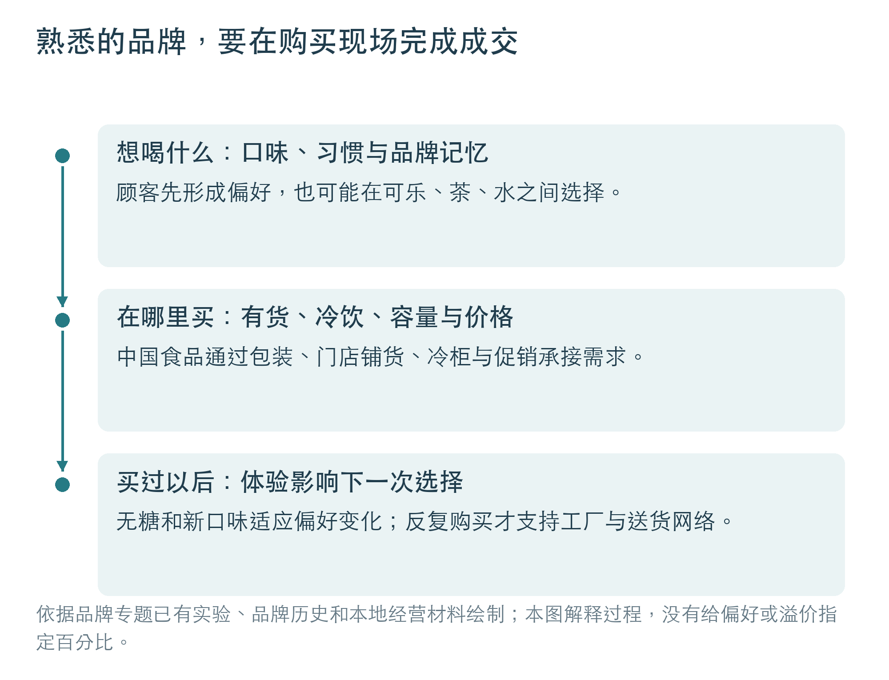

依据品牌专题已有实验、品牌历史和本地经营材料绘制；本图解释过程，没有给偏好或溢价指定百分比。

依据 · 《价值投资：从格雷厄姆到巴菲特》第2版阅读笔记；[格林沃尔德谈竞争优势与局部规模经济](https://business.columbia.edu/press-release/cbs-press-releases/understanding-competitive-advantage)；2025 年度报告 · 第2页；2025 年度报告 · 第161页；2025 年度报告 · 第162页；[McClure等2004可乐标签偏好实验原文 · 第4页](https://fbri.vtc.vt.edu/content/dam/fbri_vtc_vt_edu/publications/montague-publications/McClureLi2004.pdf#page=4)；[可口可乐公司：1985年新配方与经典配方恢复 · 阅读笔记](https://www.coca-colacompany.com/about-us/history/new-coke-the-most-memorable-marketing-blunder-ever)

### 销量密度怎样保护利润

送货路线的成本有一部分随行程和停靠次数发生。相邻几家门店都有稳定订单时，一趟车可以装得更满，同样的路程分摊到更多饮料上；订单分散、每店要货又少时，车辆和人员花费的时间更长。这就是销量密度对装瓶商的意义。它也解释了公司为什么既重视品牌带来的重复需求，又重视门店覆盖和补货频率。

一家新进入者可以买设备、生产饮料，但进入零售网络还需要销售人员、配送路线、仓储和终端服务。初期销量少，这些投入分摊到每箱饮料上就较重。中国食品已有品牌需求和售点，更容易填满配送车辆、提高拜访效率和利用既有产能。2018—2019年整合时，公司披露自产比例提高、供货路线优化和外租仓库减少，说明这条降成本路径实际发生过。

富勒案例补充了销量密度怎样在仓内发挥作用：公司并非仅把更多货塞入同一仓库，而是根据订单和周转重排库位，把包装及批次要求交给系统，拣货同时安排车辆。北京仓形成标准流程后，再按各地仓库布局、产量和设备微调复制到山西、山东。这使已有业务规模可以承载一套可复用的操作方法，减少每个仓库重新组织流程的成本；供应商披露的劳动生产率和库存改善，为这一过程提供了局部结果。

规模优势要落实到当地售点和线路密度。19个省级区域的人口和售点密度差异很大，服务成本也随线路密度变化；康师傅等大型对手能以多品类共享物流和客户。公司自报区域汽水份额接近60%，显示核心产品已有较大业务量，同区域、相近渠道的服务量和费用才能进一步判断相对成本优势。

现成订单、售点和线路使小规模新进入者很难用同样成本供货，这是中国食品可以持续经营的优势。面对康师傅等同样拥有大网络的对手，这种优势会弱得多：双方都有规模，竞争更取决于当地销量密度、门店收益和补货效率。现有披露未提供双方同区域单位成本，不能再把一份未经测得的成本领先收益加进估值。

依据 · [All Strategy Is Local · Greenwald与Kahn](https://business.columbia.edu/faculty/research/all-strategy-local)；2018 年度报告 · 第26页；2019 年度报告 · 第29页；2025 年度报告 · 第24页；[2026 中期报告 · 第10页](https://www.hkexnews.hk/listedco/listconews/sehk/2026/0917/2026091700946_c.pdf#page=10)；[富勒：中粮可口可乐仓储系统案例](https://www.flux.com.cn/CustomerCase/info/900)

### 品牌方与装瓶商的共同利益及分成

可口可乐需要装瓶商投入工厂、库存、销售队伍和配送，把浓缩液变成随处买得到的饮料。装瓶环节保留盈利，才有资金更新设备、维护冷柜和开发售点，进而增加品牌销量与浓缩液需求。可口可乐2025年Form 10-K也指出，其经营部分取决于装瓶商的财务实力及盈利能力；实际调价受到装瓶商财务状况和向下游转嫁涨价能力的约束。

该10-K披露，多数市场的浓缩液定价考虑装瓶商售价、渠道与包装组合，并存在营销、销量和基础设施支持。可口可乐还持有中粮可口可乐35%权益，直接分享合资装瓶利润。供应和股权关系使双方都有动力维护装瓶经营；上述全球安排解释了合作机制，中国食品逐产品的公式、支持金额及回报约束仍须以本地合同为据。

双方历次续期或延期无须对价，公司据此将特许经营权列为使用寿命不确定资产。第二章列明续约依据及合同期限的披露范围；这些合作记录支持区域业务继续经营。

品牌方在收益分配中更主动。2025年前五大供应商约占采购58%，最大一家约44%；浓缩液支付及应付约49.09亿元。本地采购框架由品牌方确定新价，装瓶商可以协商或退出，却没有固定利润率保护。双方都有维持生意的利益，装瓶商最终能赚多少，仍取决于采购价格与向下游销售之间留下的差额。

依据 · [可口可乐公司2025年Form 10-K](https://investors.coca-colacompany.com/filings-reports/all-sec-filings/content/0001628280-26-010047/ko-20251231.htm)；2025 年度报告 · 第2页；2025 年度报告 · 第77页；2025 年度报告 · 第85页；2025 年度报告 · 第162页；[浓缩液及关联采购框架 · 第10页](https://www.hkexnews.hk/listedco/listconews/sehk/2023/1107/2023110700390_c.pdf#page=10)；[浓缩液及关联采购框架 · 第11页](https://www.hkexnews.hk/listedco/listconews/sehk/2023/1107/2023110700390_c.pdf#page=11)

### 农夫费用率下降中的产品与推广因素

农夫山泉2025年销售及分销开支由约91.73亿元增至98.00亿元，费率却由21.4%降至18.6%。年报给出的原因包括：2024年奥运会之后广告促销减少，以及销售品项结构改变使物流费率下降。较低费率可以同时来自推广周期、产品组合与收入增长。

这一变化有助于解释中国食品：高货值产品占比提高，同一车货可以承载更多收入；低毛利水增长较快，则可能压低每箱贡献。中国食品2026H1销量增速高于收入，单位收入下降，近期利润改善主要来自销售费用减少。比较的重点因而是产品结构、每箱毛利和配送成本各自怎样变化。农夫保留品牌与产品收益，中国食品需与品牌方分享，这也决定了两者利润率的经济含义不同。

依据 · [农夫山泉2025年报 · 第25页](https://www.hkexnews.hk/listedco/listconews/sehk/2026/0417/2026041701390_c.pdf#page=25)；[农夫山泉2025年报 · 第115页](https://www.hkexnews.hk/listedco/listconews/sehk/2026/0417/2026041701390_c.pdf#page=115)；[2026 中期报告 · 第14页](https://www.hkexnews.hk/listedco/listconews/sehk/2026/0917/2026091700946_c.pdf#page=14)；[呵呵2017：农夫山泉学习笔记（三）及采用记录](https://www.xueqiu.com/1373067614/384792146)；已有八篇雪球文章：原文回读与经营分析恢复

### 太古提供了装瓶经济性的现实参照

太古与中国食品同为可口可乐体系装瓶商，经营角色较为接近。2025年太古内地业务收入按本币经营口径增长1%、销量持平，每标箱毛利下降1%；经营表EBIT率为5.6%，与上年持平。这是一项仍能盈利的成熟业务，单位毛利则已有压力。

分品类看，太古汽水收入增长2%、销量持平，水收入下降4%、销量增长6%，能量饮料收入增长49%、销量增长53%。汽水稳住基本盘，能量饮料扩量较快，水增长则明显承受单位收入压力。这个组合与中国食品同期面临的问题接近。

2026年上半年，太古内地业务销量增长12%，本币经营收入增长6%。新兴电商渠道推动销量，更高的价格折扣抵消了部分收入增长，配送量上升也增加了销售配送成本。与此同时，太古的采购策略缓和了铝和PET涨价的影响，经营效率提高，本币EBIT增长14%，EBIT率从7.0%升至7.5%。让利压力和利润改善在同一期发生。

两家本期都在单箱收入承压时增加销量，但提高利润的路径不同。中国食品同期销量增长9.6%、收入增长4.0%，毛利额基本持平，利润改善更多来自销售费用下降；太古则由采购、经营效率和规模增长抵消部分折扣及配送压力。后者表明，单位收入下降时，装瓶商仍能通过具体经营改进增加总利润。

两家公司的结果说明，成熟装瓶业务仍有改善空间。太古靠采购和经营效率消化部分折扣及配送压力，中国食品主要靠减少销售费用增利。持续销量提供了改善的基础，管理层在采购、产品和配送上的选择决定了这份基础能留下多少利润。

2025全年与2026上半年：同体系装瓶业务的经营方向

| 指标 | 中国食品 | 太古内地经营口径 | 经济含义 |
| --- | --- | --- | --- |
| 总收入/销量 | +2.7% / +2.8% | +1% / 持平 | 整体业务低速增长，核心需求维持 |
| 汽水收入/销量 | +1.9% / 稳定 | +2% / 持平 | 核心品类维持基础 |
| 果汁收入/销量 | −3.4% / 小幅下降 | −3% / −4% | 果汁原有业务有压力 |
| 水收入/销量 | +4.3% / 双位数增长 | −4% / +6% | 水扩量伴随单位收入压力 |
| 功能/能量饮料收入 | 功能饮料+28.1% | 能量饮料+49% | 小品类扩张较快，按各公司分类理解 |
| 单位收益/利润层次 | 水结构拖累集团毛利率 | 每标箱毛利−1%；EBIT率5.6%持平 | 产品毛利承压后，还需靠销售与经营效率留下利润 |
| 2026H1总收入/销量 | +4.0% / +9.6% | 本币+6% / +12% | 两家均为量增快于收入；全品类组合各异 |
| 2026H1销售服务支出 | 销售费总额同比减少0.91亿元 | 公司解释销量增加推高销售配送成本 | 销量增长的配送压力不同，中国食品本期销售费总额下降 |
| 2026H1利润结果 | 毛利额约持平；销售费减少0.91亿元 | 本币EBIT+14%；EBIT率7.0%→7.5% | 采购及效率改善已抵消部分折扣、配送压力，形成利润增长 |

前六行为2025全年，后三行为2026H1。太古经营表含上海申美、剔除装瓶商互销，增速为本币；地区、产品及利润层次与中国食品不同，表中分别列示各自经营变化。

依据 · [太古2025年报 · 饮料业务 · 第47页](https://www1.hkexnews.hk/listedco/listconews/sehk/2026/0408/2026040800985.pdf#page=47)；[太古2025年报 · 饮料业务 · 第48页](https://www1.hkexnews.hk/listedco/listconews/sehk/2026/0408/2026040800985.pdf#page=48)；[太古2025年报 · 饮料业务 · 第50页](https://www1.hkexnews.hk/listedco/listconews/sehk/2026/0408/2026040800985.pdf#page=50)；[太古2026中期业绩公告（含新闻稿） · 第26页](https://www.swirepacific.com/storage/fm/PressRelease/pdf/en/swirepacific-interim-2026.pdf#page=26)；[太古2026中期业绩公告（含新闻稿） · 第28页](https://www.swirepacific.com/storage/fm/PressRelease/pdf/en/swirepacific-interim-2026.pdf#page=28)；[金色小路：中国食品（00506.HK）2026年中报点评](https://www.xueqiu.com/2892426645/408661736)；[太古2026中期业绩公告（含新闻稿） · 第29页](https://www.swirepacific.com/storage/fm/PressRelease/pdf/en/swirepacific-interim-2026.pdf#page=29)；已有八篇雪球文章：原文回读与经营分析恢复

### 竞争地位与长期现金的判断

汽水的销量和经营利润仍在增长，授权地区与本地网络也没有发生根本变化，成熟业务的盈利基础仍然成立。中国食品需要持续支付品牌方的浓缩液价格，以及本地促销、配送和设备更新费用，因而这项优势更适合支持现有现金的延续，而非年年大幅提价或利润率持续上升。

2024、2025年归母账面净资产回报率高于10%，已有业务取得了高于当前资本成本情景的账面回报。新厂和渠道扩张需要另外投入资金，估值暂按成熟现金计算，不用这两年的账面回报率外推新项目收益。

后续若汽水销量持续下降，含糖流失超过无糖新增，铺货和促销仍未止跌，并带动经营现金下降，就下修现金基数或持续期。销量维持、每箱贡献稳定，以及单位服务成本保持优势，则支持继续采用成熟现金判断。

依据 · 2025 年度报告 · 第25页；2025 年度报告 · 第26页；2025 年度报告 · 第31页；2025 年度报告 · 第162页；[2026 中期报告 · 第9页](https://www.hkexnews.hk/listedco/listconews/sehk/2026/0917/2026091700946_c.pdf#page=9)；[2026 中期报告 · 第10页](https://www.hkexnews.hk/listedco/listconews/sehk/2026/0917/2026091700946_c.pdf#page=10)；[2026 中期报告 · 第11页](https://www.hkexnews.hk/listedco/listconews/sehk/2026/0917/2026091700946_c.pdf#page=11)

可口可乐、雪碧和芬达仍为中国食品提供了较稳定的需求基础，既有工厂和销售网络能够承接这些订单。竞争发生在具体产品和消费场景中：百事体系争夺汽水购买，茶饮分走部分佐餐需求，水依赖价格与配送效率，能量饮料又面对终端很强的东鹏。近期汽水每箱经营利润大致维持，支持成熟经营仍有价值；其他品类能增加多少收益，要按各自的产品、渠道和投入判断。

核心汽水保持市场地位，仍可能在大包装、让价和上游涨价中减少每箱贡献；新类别又要持续投入推广。若费用与产品端压力消耗了规模收益，品牌知名度和出货量可以维持，普通股现金却会下降。

核心汽水能否在保持终端动销的同时守住单位贡献？；公司和可比装瓶商的量价组合、毛利、促销与费用变化；决定成熟现金基础是否稳定

授权和采购条件有没有发生实质变化？；装瓶协议续约披露、浓缩液采购新框架及实际支付变化；分别判断经营权能否延续，以及品牌方与装瓶商怎样分配利润

相对大型同行，本地销售密度留下了多少单位成本收益？；同区域或相近渠道的每箱销售配送费用、活跃售点产出、路线密度及投入；决定局部规模优势的强度，以及竞争加剧时利润的承受能力

## 第4章 · 历史经营、转折与当前阶段

区域整合、原料周期和费用管理怎样提高盈利，近年的销量又为何没有带来同样的毛利。

### 2018—2025年改善主要发生在哪里

把收入、销量和利润放在同一段历史里看，才能分辨中国食品主要靠什么改善。多卖饮料会增加收入，提高每箱留下的贡献也会增加利润；两种变化对以后的要求不同。前者需要市场继续吸收更多产品，后者依赖售价、产品组合、采购和服务成本的改善能够维持。下面从2018年这个较可比的起点，逐年还原这些因素。

中国食品2018—2025年收入由156.48亿元增至220.70亿元，归母净利润由3.21亿元增至8.62亿元。按逐年披露同比链算的销量指数，2018年为100，2025年约为106.8。销量的累计增长有限，利润改善主要发生在产品与价格结构、采购成本和经营费用上。

毛利扣掉销售和行政费用后，剩下的经营贡献从2018年的6.23亿元增至2025年的17.61亿元，占收入从3.98%升至7.98%。这个指标反映商品经营承担主要日常费用后的收益，尚未计入其他收入、融资、税和非控股股东分配。

毛利率由35.41%升至37.08%，销售费率由28.55%降至26.96%，行政费率由2.88%降至2.14%，商品与费用两端共同增加了经营贡献。不过，毛利率在2020年曾高至39.57%，随后回落，2024年销售费率又显著上升。长期改善是真实的，每年的利润仍受原料、产品组合和市场投放影响。

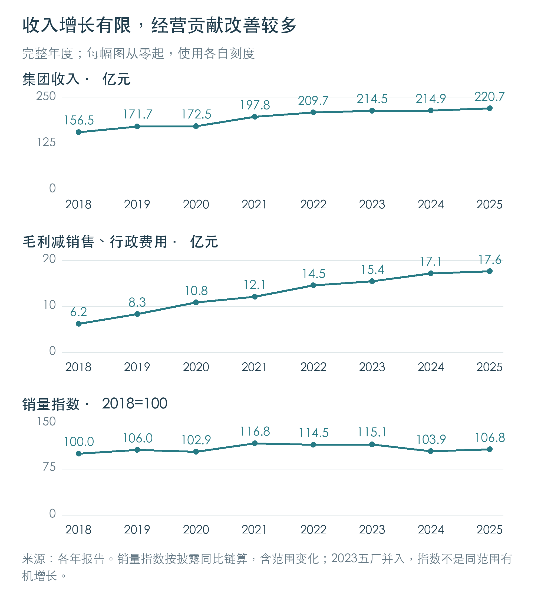

来源：各年报告。销量指数按披露同比链算，含范围变化；2023五厂并入，指数不是同范围有机增长。

依据 · 2018 年度报告 · 第132页；2025 年度报告 · 第97页；中国食品经营驱动取证与计算

### 2018—2019年：区域整合改善了生产和配送

2018年是2017年4月装瓶区域重组后的第一个完整年度。总销量增长17.0%、收入增长17.1%，原授权区域则分别增长7.4%和8.0%。新增地区多并表一个季度与原业务增长共同推高规模，原授权区域的表现更能反映既有市场当年的增长。

整合直接改变了生产和物流：新购工厂提高利用率和自产比例，减少代加工费；相邻区域重新安排供货，缩短运距；增加仓储能力，减少外租仓库。公司称新厂税前利润率显著改善。同期白糖以外的主要原料价格上升，高毛利新品和生产改善抵消了成本压力，毛利率仅小幅变化。

产品调整与工厂整合同步推进。2018年新品占总销量3.5%，却占收入7.2%；这是该年新品组合每标箱带来较高收入的直接表现。公司扩展无糖汽水，推出纤维系列和摩登罐，在果汁中增加1升家庭装及300毫升多支装，以不同包装承接即饮和家庭需求。

2019年销量增长6%，收入约增长10%，年报将差额解释为价格管理、产品和包装结构改善；原料综合均价大致持平，增值税率下降也帮助了毛利。毛利比2018年增加7.33亿元，销售和行政费用合计增加5.22亿元，经营贡献净增加2.11亿元。业务扩大的同时，服务这些销量也需要更多销售支出。

2019年新品贡献超过8%的收入。公司继续推出无糖、纤维系列、摩登罐和迷你罐，并严格执行价格管理；美汁源升级果粒和包装，增加百香果及山楂口味，2元纯悦水持续扩大铺货。这些产品和价格调整推动收入快于销量增长。魔爪则与中石油、中石化合作建设逾2,000家加油站和服务区形象店，在学校、网吧及商超进行陈列和赠饮，能量饮料收入增长逾倍。

两年利润还受到一次事项和融资变化影响。2018年行政费率同比下降1.7个百分点，既有整合，也有2017年重组专业费不再发生；2019年约0.75亿元资产处置收益帮助了最终利润。2019年偿还7.60亿元银行借款，降低融资成本。生产和配送效率可以持续支持经营，重组费用消失、出售收益和还债降息带来的改善则各有终点。

当时的增长期待也需要放回历史。2018年报以经营区域人均饮用约43杯、低于中国区及全球平均来说明空间；BigJerry后来在文章中也质疑，仅凭低消费基数能否支持投资。此后集团销量并未形成持续高增长，反而在2020、2022和2024年下降。更可信的历史解释，是公司依靠产品与包装结构、价格执行和生产配送改善增加收益，而非等待人均饮用量自动追平其他市场。

依据 · 2018 年度报告 · 第26页；2018 年度报告 · 第34页；2019 年度报告 · 第29页；2019 年度报告 · 第169页；2018 年度报告 · 第132页；2019 年度报告 · 第128页；2018 年度报告 · 第19页；2018 年度报告 · 第27页；2018 年度报告 · 第28页；2018 年度报告 · 第29页；2019 年度报告 · 第13页；2019 年度报告 · 第22页；2019 年度报告 · 第23页；2019 年度报告 · 第24页；2019 年度报告 · 第25页；2018 年度报告 · 第33页；[BigJerry：印象系列之中国食品](https://www.xueqiu.com/1964170661/315265953)；已有八篇雪球文章：原文回读与经营分析恢复

### 2020年：需求受损与原料低价同时发生

疫情压低外出和餐饮消费，2020年销量下降2.9%，收入仅增约0.4%。公司转向电商、水站和社区合作，满足家庭用水需求，大包装收入增加；持续投入的纯悦实现双位数增长，冰露则走弱。产品、包装和渠道的重新安排缓冲了外出消费下降。

这次转向有明确的恢复过程。2020年第一季度收入和利润大幅下滑，管理层扩大新零售和社区销售，并继续准备原计划新品，疫情缓和后立即上市。公司称4月业务恢复增长，第二季度大致追回疫情期间的收入利润损失，下半年销量和收入均同比增长。经营团队没有停掉产品与终端建设，而是在外出消费受阻时改变供给场景。

利润上升的主要支持来自成本和结构。全球油价下降带动PET包装材料采购成本降低，高毛利产品和包装改善也有帮助，毛利率升至39.57%，比2019年高约3.03个百分点。公司增加营销应对疫情，销售费率升至30.48%；毛利增量仍足以覆盖这项加费，经营贡献增加约2.51亿元，归母利润增至4.99亿元。

公司同时偿还11.27亿元银行借款，融资成本下降53%。低价原料、产品结构和降息合力抵消了需求受损及营销加费。2021年原料涨价很快拉低了毛利率，因此2020年的高点宜理解为有利成本环境中的结果，正常现金采用跨成本环境的经营水平。

依据 · 2020 年度报告 · 第20页；2020 年度报告 · 第24页；2020 年度报告 · 第30页；2020 年度报告 · 第136页；2020 年度报告 · 第142页；2020 年度报告 · 第18页；2020 年度报告 · 第19页；2020 年度报告 · 第21页

### 2021—2022年：量恢复后，再以价格和费用抵消成本

2021年销量恢复13.5%，收入增长14.7%，走出2020年的低基期；毛利率却回落约3.88个百分点至35.69%。公司提前锁定部分采购价格，仍未完全挡住原料上涨。恢复的销量摊薄了线路、仓储和人员成本，销售费用总额只增加约1.9%，低于收入增幅；经营贡献增加约1.24亿元，但其收入占比从6.29%略降至6.11%。

2022年疫情反复使销量再降2%，收入仍增长6%。年报解释为整体价格提高和产品、包装结构改善，毛利率35.76%，大致维持上年水平。公司继续深化区域整合、扩大集中采购，销售费率降至26.42%，行政费率降至2.41%，经营贡献增加约2.44亿元。

组织和工具的改造在2021年报已有连续安排：中央计划中心统筹生产供应，B端可乐GO服务终端商户，C端快乐会连接消费者，供应链工具逐步上线。到2022年，公司披露通过线路优化和可乐GO提高业务拜访效率；新零售完成主流渠道D2C门店铺设和配送网络布局，省仓支持第三方物流到厂自提。订单、拜访和发运由这些工具衔接，改进了销售人员与仓配之间的协调。

产品升级也经历取舍。2021年冰露面对主要竞品低价促销，公司称拒绝跟随恶性低价，增长较慢，纯悦依靠持续投入快速增长，水品类份额却轻微下降。2022年继续推广纯悦、果味水和苏打水，并以水站、社区及电商承接家庭大包装，全年水收入和份额仍下滑。管理层选择提高单位贡献，付出的代价包括部分低价销量及份额；这条路径后来仍受竞争约束。

这两年，公司先靠销量恢复分摊成本，再靠价格、产品结构和运营调整吸收成本压力。银行有息借款在2021年清偿，早年的降息收益已经兑现，后续增利的主要来源转回经营。

依据 · 2021 年度报告 · 第20页；2021 年度报告 · 第29页；2021 年度报告 · 第166页；2022 年度报告 · 第19页；2022 年度报告 · 第26页；2022 年度报告 · 第168页；2021 年度报告 · 第14页；2021 年度报告 · 第15页；2021 年度报告 · 第16页；2021 年度报告 · 第18页；2021 年度报告 · 第23页；2022 年度报告 · 第13页；2022 年度报告 · 第17页；2022 年度报告 · 第22页；2022 年度报告 · 第24页

### 2021—2022年现金低点：预收、往来和付款的变化

2020年经营现金净额22.14亿元，到2021年、2022年分别降为10.74亿元、11.41亿元；同期周转前经营现金反从18.36亿元增至19.35亿元、22.57亿元。利润和周转前经营能力仍在增长，现金低点主要出现在结算与税息支付环节。

2020年营运资金项目合计贡献约6.66亿元，2021年转为消耗约5.04亿元。2021年合同负债减少1.86亿元，前一年则增加1.80亿元；其他应付款当年仅增加1.71亿元，前一年增加6.82亿元；应收附属公司非控股股东往来又消耗2.54亿元。预收和应付款的支持减弱，关联应收增加，使前一年的收款顺风反转。2021年现金税另较上年多付约0.90亿元。

2022年周转进一步消耗约7.02亿元。其中合同负债减少5.94亿元，预付款、按金及其他应收款增加消耗3.67亿元，其他应付款减少消耗3.05亿元；应付贸易款增加及部分关联往来抵消了一部分。公司交付已经收款的订单会减少合同负债，新订单的预付款则补充余额。这两项未分开披露，单看余额下降不能确定是需求减弱还是交货时点变化。

这两年的现金低点主要出在预收、供应商和关联往来结算，周转前经营现金仍在增长。因此，正常现金估计将年度结算波动剥离；如果此后预收持续下降、收款账期拉长，公司长期需要垫付的资金增加，就应在估值中增加营运资金需求。

依据 · 2020 年度报告 · 第142页；2021 年度报告 · 第171页；2021 年度报告 · 第248页；2021 年度报告 · 第249页；2022 年度报告 · 第173页；2022 年度报告 · 第251页；2022 年度报告 · 第252页

### 2023年：内部制造整合与利润中的非主营增量

2023年1月1日，公司取得营口、济南、石家庄、长沙、成都五家非汽水生产公司，把原授权区域内的生产供应接入集团。此前公司采购不含气成品后在指定区域转售，并入后开始控制相关制造资产，采购、制造成本和内部交易随之变化。公司预期通过内置生产降低管理成本、改善供货。

当年总销量仅增0.5%，收入增2.3%，白糖涨价抵消了果糖降价的部分帮助，毛利率降至35.18%。毛利只增加0.45亿元，销售费用减少0.69亿元、行政费用增加0.25亿元，经营贡献合计增加约0.90亿元。经营有改善，但归母利润26.2%的增幅还包含较大的非主营增量。

其他收入净额增加约1.90亿元，其中处置联营公司收益0.916亿元，政府补助从0.894亿元增至1.757亿元。五厂自收购日起计入合并损益的收入为3.2万元，净利润1,529万元。内部供货收入在合并时抵销，这组收入反映的是抵销后对合并报表的贡献。

渠道扩张仍在推进：传统渠道继续用线路优化和可乐GO改善拜访；现代渠道调节促销、发展多支包装，力求提高品类毛利。新零售自营店铺收入同比逾倍，智尚收入也逾倍，覆盖30个省份、280多个城市。新增线上订单和无人零售点已经形成销售，集团当年的利润改善却仍有较大一次收益成分，因此平台扩张与集团归母利润增幅需要分别观察。

正常收益保留持续费用管理形成的成本改善，剔除处置收益，补助按性质和持续性处理。五厂把制造贡献留在集团，也把设备折旧、维护和周转责任带入集团。第六章结合权益交换和回款评价这项整合，持续收益看采购制造节约扣除新增责任后的余额。

依据 · 2023 年度报告 · 第15页；2023 年度报告 · 第75页；2023 年度报告 · 第17页；2023 年度报告 · 第90页；2023 年度报告 · 第118页；2023 年度报告 · 第149页；2023 年度报告 · 第21页

### 2024年：水业务缩量，毛利改善被营销和一次项目抵消

2024年销量下降9.7%，年报主要解释为水品类转型升级。收入仍为214.92亿元、略增0.2%，平均收入结构上移，公司也提到提升价格与改善产品结构。水的缩量改变了集团产品组合，核心汽水的需求则由其自身销量和收入反映。

水业务的收缩延续了前几年的转型。2023年报已经说明，升级产品和提高价格影响水的总销量，收入稍降，后续仍准备重点发展纯悦和高端水。2024年销量进一步减少，是管理层继续调整产品组合的结果，也表明高单价产品尚未完全弥补退出或缩减的低价销量。收入结构上移能够提高每箱收入，现金改善仍要看毛利能否覆盖为维持客户和份额付出的推广费用。

除白糖以外主要原料采购价格下降，连同价格和结构调整，将毛利率推升至37.79%，毛利额增加5.77亿元。竞争又要求更多市场推广，销售费用增加4.01亿元，行政费用增加0.07亿元，经营贡献留下的增量为1.69亿元。原料和组合带来的大部分好处被服务市场的支出吸收。

2023年0.916亿元联营处置收益不再发生，补助减少0.851亿元，归母利润只增加0.28亿元。现金税比2023年多付约2.20亿元，长期资产现金付款由6.48亿增至7.75亿元。按零周转、扣全长期资产及租赁的集团参考口径，现金由15.33亿降至12.94亿元：税和资产付款的增加超过了经营改善。第五章再将集团现金分配到普通股。

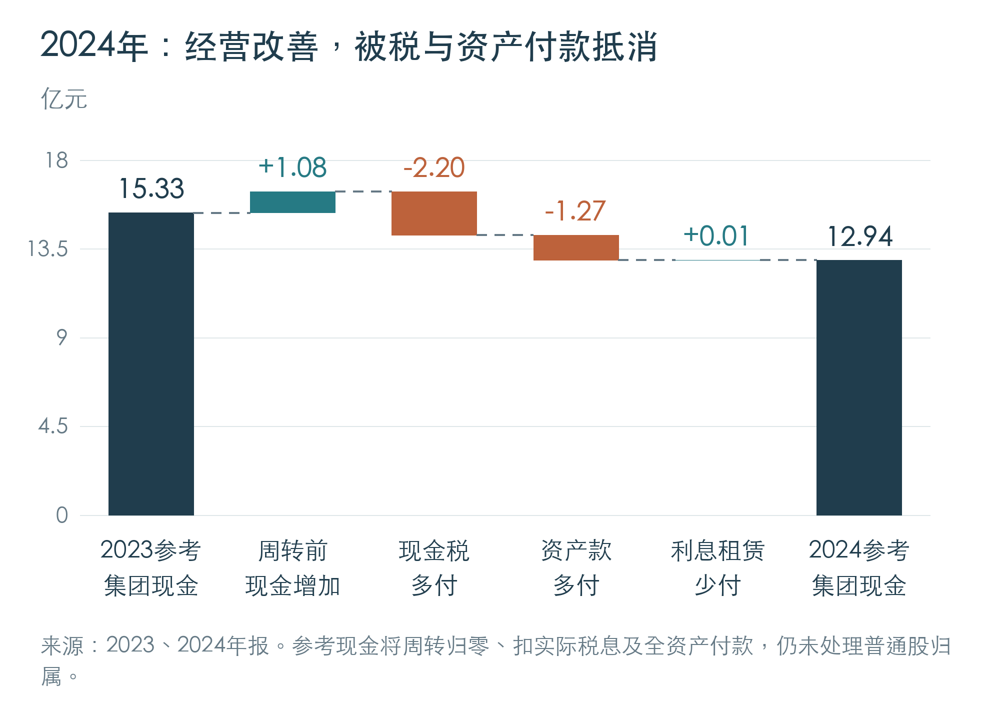

来源：2023、2024年报。参考现金将周转归零、扣实际税息及全资产付款，仍未处理普通股归属。

2024年表明，较好的毛利率仍要依靠终端投入维持。正常收益应同时保留产品经营改善和相应的营销成本，不能只采用有利原料下的毛利高点。

依据 · 2024 年度报告 · 第21页；2024 年度报告 · 第29页；2024 年度报告 · 第30页；2024 年度报告 · 第99页；2024 年度报告 · 第104页；2023 年度报告 · 第95页；2023 年度报告 · 第20页

### 2025年：水恢复、铝罐和税务清理塑造了利润

2025年销量增加2.8%、收入增加2.7%。汽水销量基本稳定、收入增长近2%；公司自报经营区域内汽水份额接近60%，核心汽水仍有稳固市场地位。水的低毛利销量占比增加，加上铝价较高推升易拉罐成本，集团毛利率回落至37.08%。与2016年类似，水扩量提高了集团销量，却拉低产品组合的单位贡献。

毛利额增加0.62亿元，销售费用增加0.78亿元，行政费用减少0.65亿元，经营贡献只增加约0.49亿元。其他收入净额增加约0.60亿元，其中补助增加0.34亿元、利息收入增加0.19亿元，同时确认0.637亿元厂房设备减值。年报解释，集团部分资产因工厂搬迁失去使用价值，减值未逐厂归集。经营改善、补助、利息及旧资产损伤共同形成最终利润。

税前利润增加约1.12亿元，所得税费用却增加约1.07亿元，其中过往年度拨备不足约0.537亿元；归母利润最终仅增加约143万元。旧期补税吸收了部分利润增量，正常税的采用理由见第五章。搬迁减值则体现旧资产已经失去用途，未来保持生产能力需要继续替换和维护。

2025年9月陕西新厂投产，渠道端同时增加星级客户、冷柜和即时零售合作。成熟汽水维持份额和收入，新厂及更多终端则要求继续投入资本。资产更新既关系现有生产能否延续，也会影响此后有多少经营现金可以分配。

依据 · 2025 年度报告 · 第24页；2025 年度报告 · 第25页；2025 年度报告 · 第31页；2025 年度报告 · 第97页；2025 年度报告 · 第149页；2025 年度报告 · 第151页；2025 年度报告 · 第159页

### 2026H1：量明显恢复，毛利额基本不变

2026年上半年销量增9.6%至8.10亿标箱，集团收入增长4.0%至127.63亿元。公司称平均销售价格下降，毛利率同比下降约1.4个百分点。毛利额只增加402.9万元，更多销量带来的贡献被较低单位收入和毛利率大幅抵消。

利润增长主要来自销售费用减少：销售费用减少9,076.5万元，行政费用增加2,337.5万元，毛利减销售行政的经营贡献增加7,141.9万元；归母利润最后增加4,523.7万元。公司另披露汽水经营利润增加8%，表明核心品类盈利也有改善，绝对利润额及品类占比未披露。

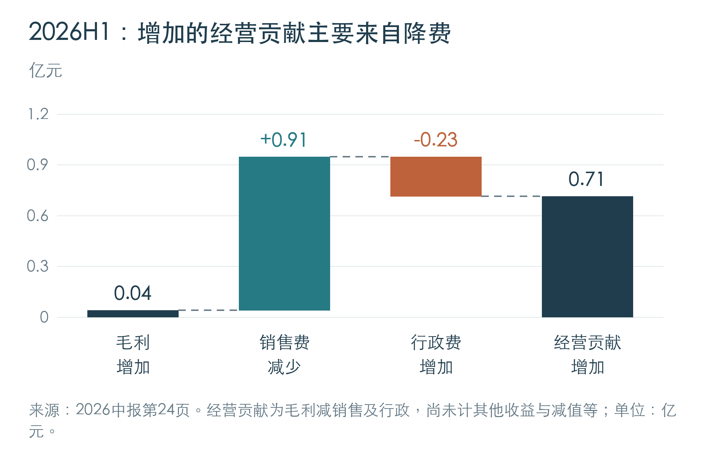

来源：2026中报第24页。经营贡献为毛利减销售及行政，尚未计其他收益与减值等；单位：亿元。

降费有具体的组织和配送动作。2025年报披露，公司统一装瓶厂销售架构与考核、试点区域供应链运营，并重塑直配和交叉货运。2026年2月，永洪科技报告中粮可口可乐物流指标项目验收，可按线路、运量、运价和承运商分析单标箱物流费；富勒的较早案例描述从北京仓起推广仓储系统和语音拣配。这些工具和组织调整作用于销售管理、仓储和运输，公司正在改善销量背后的服务成本。供应商未披露各项目在本期实现的净节约额。

销售费用率从26.35%降至24.64%，下降约1.71个百分点。按先固定旧费用、再改变收入的分解，其中约1.00个百分点来自收入分母扩大，约0.71个百分点来自费用总额减少。公司在销量增长时减少了销售支出，收入增长又进一步摊薄费用率；这两种作用应分别判断持续性。

推广时点显著影响半年比较。2024年及2025年上半年，公司都解释过因竞争加大市场推广。2025H1销售费用同比多6.80亿元，下半年却同比少6.02亿元，全年仍多0.78亿元。2026H1集团工资薪金及奖金增加1.56亿元、设备折旧增加0.36亿元，费用控制发生在这些成本仍增加的背景下。

把费用放回完整十二个月，位置就更清楚：2025下半年27.14亿元加2026上半年31.44亿元，销售费用合计58.58亿元，接近2024全年的58.71亿元，也略低于2025全年的59.49亿元。与前一个滚动十二个月相比减少约6.92亿元，其中约6.02亿元发生在2025下半年的同比比较，只有约0.91亿元发生在2026上半年。推广投放跨半年移动，使滚动同比降幅大于最近两个完整年度之间的差异。当前现金采用的是跨一个旺淡季、接近最近年度水平的费用总额。

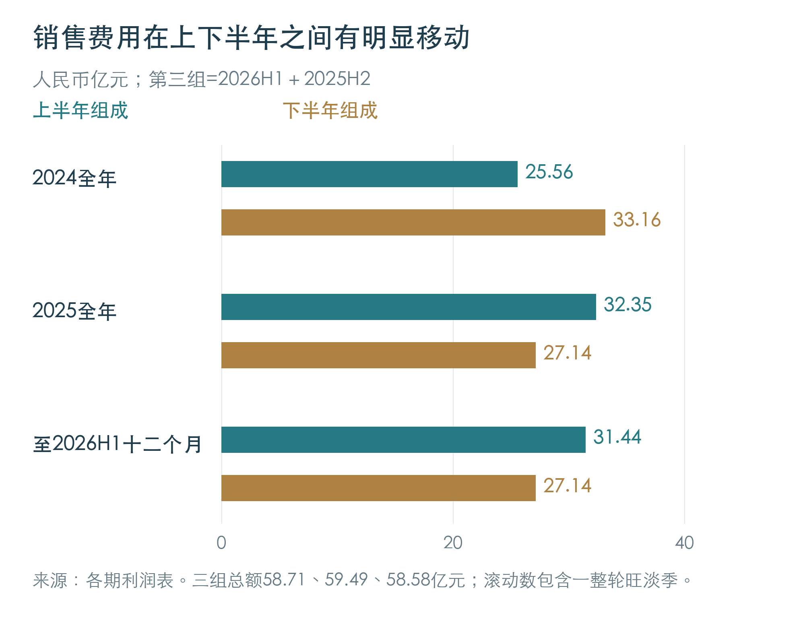

来源：各期利润表。三组总额58.71、59.49、58.58亿元；滚动数包含一整轮旺淡季。

太古同期内地业务同样面对折扣和配送支出增加，采购和经营效率改善仍使本币EBIT增长14%，EBIT率由7.0%升至7.5%。同行和中国食品的结果都显示，销量、价格与成本共同决定利润，量价压力可以被经营改善抵消。对中国食品，接下来最影响现金的是推广和渠道服务支出会否回升。

销售费用减少0.91亿元，同时销量增长9.6%，是本期明确的经营成绩。完整十二个月费用58.58亿元又接近最近两个年度，正常现金估计继续采用这一水平。若以后必须恢复推广支出才能保住销量，就把增加的费用扣回；若销量和毛利维持而服务费用稳定，较低费用水平才算延续。

依据 · [2026 中期报告 · 第9页](https://www.hkexnews.hk/listedco/listconews/sehk/2026/0917/2026091700946_c.pdf#page=9)；[2026 中期报告 · 第10页](https://www.hkexnews.hk/listedco/listconews/sehk/2026/0917/2026091700946_c.pdf#page=10)；[2026 中期报告 · 第14页](https://www.hkexnews.hk/listedco/listconews/sehk/2026/0917/2026091700946_c.pdf#page=14)；[2026 中期报告 · 第24页](https://www.hkexnews.hk/listedco/listconews/sehk/2026/0917/2026091700946_c.pdf#page=24)；[2026 中期报告 · 第35页](https://www.hkexnews.hk/listedco/listconews/sehk/2026/0917/2026091700946_c.pdf#page=35)；2025 年度报告 · 第18页；2024 年度报告 · 第30页；[2025 中期报告 · 第16页](https://www.hkexnews.hk/listedco/listconews/sehk/2025/0919/2025091900590.pdf#page=16)；[永洪科技：中粮可口可乐物流指标项目验收](https://m.yonghongtech.com/gy/xwhd/6461170.html)；[富勒：中粮可口可乐仓储系统案例](https://www.flux.com.cn/CustomerCase/info/900)；销售费用持续性：原数、机制与反方；[太古2026中期业绩公告（含新闻稿） · 第28页](https://www.swirepacific.com/storage/fm/PressRelease/pdf/en/swirepacific-interim-2026.pdf#page=28)；[太古2026中期业绩公告（含新闻稿） · 第29页](https://www.swirepacific.com/storage/fm/PressRelease/pdf/en/swirepacific-interim-2026.pdf#page=29)；2025 年度报告 · 第97页；[2025 中期报告 · 第26页](https://www.hkexnews.hk/listedco/listconews/sehk/2025/0919/2025091900590.pdf#page=26)；2024 年度报告 · 第99页

### 人员与网络：更多业务由相近规模的团队服务

BigJerry把利润快于收入的增长与人效联系起来，这个解释有集团经营记录支持。2018年末集团员工19,910人，2023年末18,889人，减少约5%；同期收入从156.48亿元增至214.46亿元。用全年收入除年末员工数作粗略比较，约从每人79万元升至114万元，增加约44%。已有网络在相近的集团人数下承接了更多收入，产品结构、价格、工厂与线路组织共同影响这一结果。

经营系统的改造与此相呼应：公司从区域整合、排产和仓储，逐步推进终端商户下单、业务拜访及配送工具。2021年销量恢复时销售费用总额仅增约1.9%，2022及2023年销售费率继续下降，支持网络能够吸收部分业务增长。总人数与全年收入这一比较只描述集团产出变化；股权范围变化、外部物流和人工费用仍会影响实际服务成本。

人员数量后来重新增加：2024年末17,533人，2025年末18,349人；2026H1工资、薪金和奖金仍增加约1.56亿元。因此，本期降费并非所有成本一起减少，而是在人工成本增加时压低了整体销售支出。后续同季比较可以辨认节约是否持续，或只是推广付款与投放时点变化。

依据 · 2018 年度报告 · 第37页；2023 年度报告 · 第25页；2024 年度报告 · 第32页；2025 年度报告 · 第33页；2021 年度报告 · 第18页；2021 年度报告 · 第20页；[2026 中期报告 · 第35页](https://www.hkexnews.hk/listedco/listconews/sehk/2026/0917/2026091700946_c.pdf#page=35)；[BigJerry：印象系列之中国食品](https://www.xueqiu.com/1964170661/315265953)；2018 年度报告 · 第132页；2023 年度报告 · 第90页；2024 年度报告 · 第99页；2025 年度报告 · 第97页；已有八篇雪球文章：原文回读与经营分析恢复

### 经营阶段与正常现金的含义

从区域整合到疫情调整，中国食品在既有网络内改善了生产、包装和费用，并清偿早年的银行借款。2018—2025年经营贡献及周转前现金均提高，支持成熟装瓶网络能够持续产生收益。最近两年集团税后利润仍约14亿元，净资产继续增加，新增留存尚未带来早期整合那样清楚的盈利改善。

公司当前处于成熟网络内的产品、渠道和生产资产调整期。汽水销量近期仍稳，每箱收入和集团毛利承压，费用管理与必要更新决定最终留下多少普通股现金。第五章按新的利润正常化和分项维护得到约7.26亿元普通股现金条件；2020年原料低价、2017及2023年出售收益和早年还债降息仍分别解释历史额外改善。

当前估计最直接的挑战是：2024年有利毛利被更高营销支出吸收，2026H1量增长而毛利额近乎不增。低单位贡献产品比重继续提高、销售费用回升或必要更新增加，都会压低正常现金。已有产能若带来持续毛利增量，而费用和维护保持可控，则支持提高现金，并评价相应增长所需的资金。

依据 · 2018 年度报告 · 第26页；2021 年度报告 · 第29页；2024 年度报告 · 第30页；[2026 中期报告 · 第24页](https://www.hkexnews.hk/listedco/listconews/sehk/2026/0917/2026091700946_c.pdf#page=24)；中国食品经营驱动取证与计算；2026-10-27现金与价值判断（历史版本）；原始前瞻记录v4

2018年以来，区域整合提高了生产配送效率，原料价格、包装调整和费用管理又在不同年份影响利润。2021—2022年的现金低点还包含预收和往来结算的回吐。2026年上半年销量恢复较快，毛利额基本持平，利润改善主要落在销售费用。这一阶段适合把公司看作已有盈利基础、需要继续维护产品与渠道的成熟业务，后续增值要由新的净现金来证明。

2024年的毛利改善大量用于营销，2026H1的销量增长又几乎没有增加毛利。若低单位贡献产品继续扩量，保量所需推广和设备更新同时增加，成熟业务的正常现金将低于当前估计。

恢复的销量能留下多少持续毛利，渠道服务需要多少销售费用？；同季销量、毛利额、销售费用，结合促销、订货及配送安排；毛利与服务成本共同决定正常现金能否维持或提高

新厂与渠道投入怎样改变制造、配送和维护后的现金？；投产后的利用、成本、后续投入及资产更新；辨明经营改善的来源，再评价有资金支持的增长价值

## 第5章 · 财务质量与现金归属

把报表利润、当年实际收付和可持续的普通股现金逐步分开，再解释税、设备与股权的每一项处理。

### 2025年利润怎样变成经营现金

“公司赚了多少”和“股东能拿走多少”之间，隔着几步具体的收付款。卖出的货可能还没收钱，已经收到的钱也可能对应以后才交付的订单；工厂设备的消耗进入利润时叫折旧，换设备时才真正付钱；合并报表里的利润还包含合作股东的份额。先把这些事情逐项摆开，现金数字才有明确含义。

2025年中国食品归母净利润8.62亿元，合并税后利润14.28亿元，差额属于各层非控股股东。设备和销售网络由整个集团共同使用，因而先计算集团经营现金与维护支出，再按股权分给普通股，才能让投入和收益对应同一范围。

合并税前利润19.79亿元，加回厂房设备折旧8.07亿元、使用权资产折旧0.65亿元和无形资产摊销0.21亿元，再调整利息、联营业绩、减值、处置及补助摊销等，得到周转前经营现金28.74亿元。折旧和减值本期不直接付钱，设备更新却迟早需要付款，因此随后仍要扣除必要维护。

年内库存、预收、应付和关联往来等净增加约9.07亿元现金，经营所得现金达到37.81亿元。再支付现金所得税5.48亿元、利息约345万元，经营现金净额为32.29亿元。9.07亿元包含关联往来及递延收入，是全部报表经营项目的净结算结果。

2025年扣全部长期资产付款10.61亿元和租赁本金0.53亿元后，集团剩余约21.16亿元。它反映这一年的实际收付，包含周转顺风及资本付款时点；以下再判断其中可持续的部分，并分配到普通股。

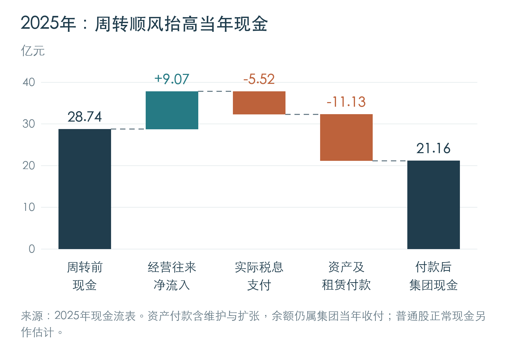

来源：2025年现金流表。资产付款含维护与扩张，余额仍属集团当年收付；普通股正常现金另作估计。

依据 · 2025 年度报告 · 第97页；2025 年度报告 · 第101页；2025 年度报告 · 第102页；2025 年度报告 · 第103页

### 八年现金记录中的周转顺逆风

2018—2025年，周转前经营现金从11.68亿元升至28.74亿元，反映业务现金产生能力扩大。实际经营现金波动更大：2020年为22.14亿元，2021年降至10.74亿元，2022年仍只有11.41亿元，而后两年的周转前现金分别为19.35亿和22.57亿元。第四章已分析低点时的具体结算变化。

2021年，向附属公司非控股股东的应收增加约2.54亿元，客户预收减少约1.86亿元；2022年预付款、按金及其他应收增加约3.67亿元，客户预收减少约5.94亿元。合并其他项目后，净经营往来及周转分别消耗约5.04亿、7.02亿元。2024及2025则各带来约7.18亿、9.07亿元正贡献。这些年度释放和回吐应与主营现金能力分开。

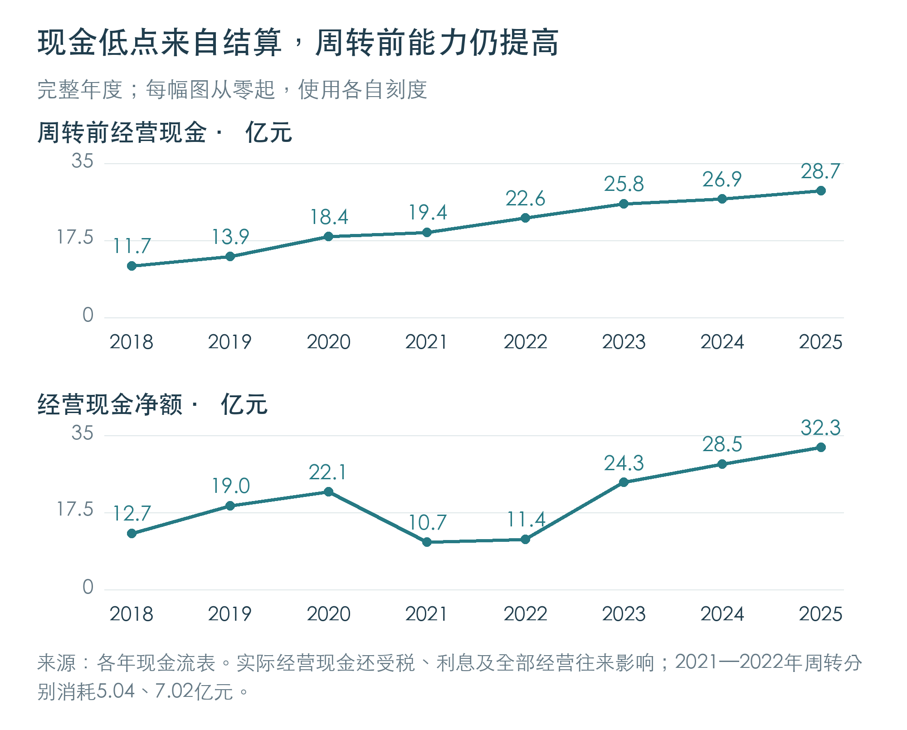

来源：各年现金流表。实际经营现金还受税、利息及全部经营往来影响；2021—2022年周转分别消耗5.04、7.02亿元。

正常现金桥假定原有经营规模维持，库存、客户预收和采购付款的年度净变动为零，同时保留经营所需的存量资产与负债。历史递延款的释放另作调整；增长增加库存、客户账期延长或预收模式改变所需的资金，也应分别纳入。

依据 · 2018 年度报告 · 第137页；2020 年度报告 · 第142页；2021 年度报告 · 第248页；2021 年度报告 · 第249页；2022 年度报告 · 第251页；2022 年度报告 · 第252页；2024 年度报告 · 第105页；2025 年度报告 · 第102页

### 客户预收、渠道账期与关联往来

公司通过反复订货、先收款和交货，减少为下游垫资的需要，信用政策见第二章。2025年底合同负债13.08亿元，高于2024年底8.66亿元，公司预计在一年或以内交货；2025年初余额已经全部履约并转为收入。

先收后付的效果可以在基础商品周转中看到。2025年底，存货16.30亿元、贸易应收净额3.30亿元，合计19.59亿元；贸易应付及票据10.35亿元、客户预收13.08亿元，合计23.43亿元。后两项比前两项多约3.83亿元，说明这四项对应的周转由供应商账期和客户预付款提供了净资金。其他应收、促销应付、税及资本结算另有用途，四项差额只解释商品周转这一部分。

绿野风云的文章强调了经营负债可以滚动这一点。一批货交付后，原来的预收转成收入；下一轮订单又带来预收。供应商旧账付款的同时，新采购形成新的应付。只要产品持续卖动、客户愿意预付、供应商信用不收紧，公司就不必为全部日常周转预先投入自己的资金。这是成熟渠道的一项经济优势，也解释了为何判断支付能力要看收款和到期付款节奏。账上资金超过银行借款，并不意味着超过客户交货、采购结算和全部经营需用。

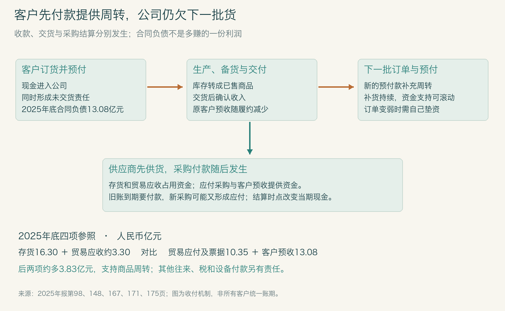

2025年底客户预收与供应商应付支持商品周转；下一轮预收能否补上，取决于持续订货和结算。

2026H1合同负债减少9.82亿元，同期库存释放5.63亿元，应收增加3.27亿元，应付贸易款增加6.14亿元，欠关联方款增加4.05亿元。合并这些变动，半年经营现金仍有17.61亿元。2025H1合同负债也减少6.86亿元，预收在两期都从年底向半年回吐，交货和收款存在明显的时间差。

两个上半年都出现较大预收回吐，表明交货和收款节奏确实会影响余额。2026年回吐更大，需要结合全年收款和后续补货判断。如果同时出现库存积压、回款变慢或退货增加，就意味着先款后货的资金优势在减弱，公司要自己垫付更多周转资金。

2025年现金流表列欠非控股股东款增加7.31亿元，为经营现金净额（CFO）提供正贡献。采购和结算中的债权人暂时提供了资金，公司以后仍须偿付。现金流变动与期末余额可能受其他调整影响，估值按相应债权和用途处理。

依据 · 2025 年度报告 · 第171页；2025 年度报告 · 第175页；2025 年度报告 · 第102页；[2026 中期报告 · 第28页](https://www.hkexnews.hk/listedco/listconews/sehk/2026/0917/2026091700946_c.pdf#page=28)；[2026 中期报告 · 第37页](https://www.hkexnews.hk/listedco/listconews/sehk/2026/0917/2026091700946_c.pdf#page=37)；2025 年度报告 · 第98页；2025 年度报告 · 第148页；2025 年度报告 · 第167页；[绿野风云：现金头寸和净现金的意义](https://www.xueqiu.com/5842207545/314028858)；已有八篇雪球文章：原文回读与经营分析恢复

### 二、盈利价值：先留下卖饮料的正常收益

盈利价值假定企业维持现在的销售规模和竞争位置，不要求未来越卖越多。先从营业利润剥离不能稳妥外推的收益，再换掉会计折旧，扣实际维持能力所需的更新资金和经营税。这笔钱是全集团提供给资本的年度经营能力，最后才分到上市普通股。

完整十二个月收入为22070.162＋12763.435−12278.061＝22555.536百万元，报告经营利润为1978.925＋1433.009−1356.442＝2055.492百万元。原报利润率约9.11%，含利息、补助、其他收益及处置损益，不能直接除以资本成本。

本次先剔除全部其他净收入221.526＋130.002−127.007＝224.521百万元，再保留与生产伴生的废料销售15.886＋7.385−8.740＝14.531百万元，得到1845.502百万元、利润率约8.18%。其他净收入里的利息、政府支持及未能拆清的收益暂不永续化；搬迁减值、处置等也随这一净项一起移出，避免仅剔掉坏处、保留好处。信用减值净费用仍在利润起点内。

这一选择比把所有“其他收益”长期保留更谨慎，可能少计部分持续的业务支持。它也没有预设费用继续下降：TTM分销销售费用58.583亿元，与2024全年58.712亿元接近；近期效率改善可以支持现有费用量级，却不能保证更低费用会一直维持。若营销、配送和服务费反弹，必须直接减盈利。

二、盈利价值：先留下卖饮料的正常收益 · 计算

| 百万人民币 | 2024全年 | 2025全年 | 截至2026H1的十二个月 |
| --- | --- | --- | --- |
| 收入 | 21491.811 | 22070.162 | 22555.536 |
| 报告经营利润 | 1865.899 | 1978.925 | 2055.492 |
| 报告经营利润率 | 8.68% | 8.97% | 9.11% |
| 剔其他净收入、加回废料销售后的利润 | 1731.915 | 1773.285 | 1845.502 |
| 对应利润率 | 8.06% | 8.03% | 8.18% |
| 归母/集团净利润比例 | 60.49% | 60.36% | 60.21% |

金额为人民币百万元；每股列为人民币元，估计条件不是披露事实。

依据 · 2025 年度报告 · 第97页；2025 年度报告 · 第149页；[2026 中期报告 · 第24页](https://www.hkexnews.hk/listedco/listconews/sehk/2026/0917/2026091700946_c.pdf#page=24)；[2026 中期报告 · 第33页](https://www.hkexnews.hk/listedco/listconews/sehk/2026/0917/2026091700946_c.pdf#page=33)

### 9333万元旧款与租赁：不能把收款时间差反复变成收益

2024、2025现金流表都在周转前经营现金之后扣除93.333百万元递延收入。这说明把所有周转变化一律归零会漏掉一个重要调整。但它的具名合同、收款实体及利润表落点没有完整披露；另外11.314百万元资产补助摊销已经单列处理，两者不能混为一项。

新算法已移除全部其他净收入，因此93.333有可能已经部分包含在移除项内。主条件额外全扣93.333，作为可能偏低的保守处理；另算“完全包含、无需再扣”的一端。它们表示同一已知项目的重叠边界，不是对未知合同损失的完整估计，更不表示公司以后每年都要另外付9333万元。原件不能支持的映射保持未知。下面25%税率相应计入了23.333百万元税节约，这也不是已核定税务效果；若该扣项不产生税节约，每股价值再少约0.050元。所谓保守只指这一重叠问题的一端，不是整家公司价值的保证下限。

仓库与设备租赁选择按持续租金处理。TTM使用权折旧64.057百万元，其中土地使用权折旧暂沿用2025年的15.335，保留在利润内作为取得土地权的消耗；其余48.722加回。再加回已进入费用的短租62.009，统一扣正常租金118.290，净调整为48.722＋62.009−118.290＝−7.559百万元。租金取2025全年实付量级，2024总租赁付款含一次使用权资产取得款50.143，不能机械拿来做常年仓租。

于是正常营业利润为1845.502−93.333−7.559＝1744.610百万元。已按租金维持仓库和租赁设备后，EPV权益桥不再减同一笔租赁负债，也不把租赁使用权再加成一块额外资产；土地消耗不再重复加进下一节维护。

依据 · 2025 年度报告 · 第101页；2025 年度报告 · 第102页；2025 年度报告 · 第160页；[2026 中期报告 · 第28页](https://www.hkexnews.hk/listedco/listconews/sehk/2026/0917/2026091700946_c.pdf#page=28)

### 维持现有能力，每年需要多少新设备和软件

会计折旧反映过去购置价的分摊。估值要承担的是今天继续提供同等产品、配送和冷饮服务所需的更新，而不是把账面折旧原封不动视作答案，也不是将所有新厂支出都叫增长后免扣。陕西迁建既替代旧厂，也加入新的生产和仓储能力；冷柜保住售点位置，同样可能属于必要投入。

本次按设备类别重建：楼宇原价2864.600百万元，替换价加5%，用30年更新；机器与终端设备原价7931.173百万元，替换价加5%，用10年更新。30年和10年在公司楼宇5—30年、机器5—15年的会计寿命范围内，但它们仍是本研究的经济更新假设，并非披露的实际全网更新周期。软件按TTM摊销20.360百万元估正常资本更新；已费用化的订阅和维修不再加一次。

楼宇100.261＋机器832.773＋软件20.360＝953.394百万元，即每年约9.53亿元。这里用的是全新同功能成本除更新年限，不用上一步资产法的剩余净值除年限。否则旧设备越多，算出的未来维护反而越少。

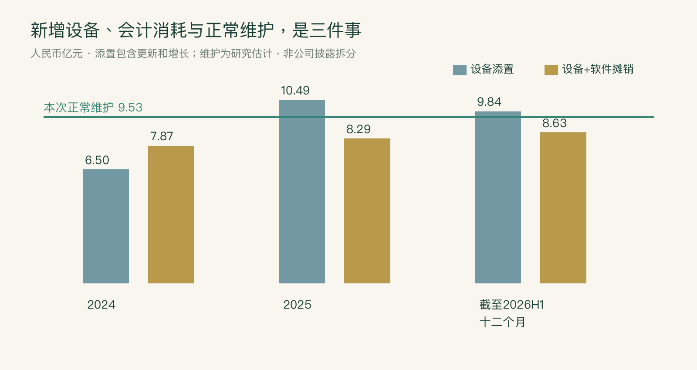

重建一套设施是存量问题，每年替换耗损是流量问题。两步采用不同的计算，不能把剩余净值当年度更新预算。

这个结果与实物投入相互核对：2024、2025设备添置分别6.503亿元和10.489亿元，TTM设备添置约9.844亿元，设备及软件摊销约8.634亿元。9.53亿元高于摊销约0.90亿元，处在近期混合添置的量级内；添置同时含更新和扩容，不能由“数接近”证明估值已经精确。2026H1设备添置5.615亿元、付款4.364亿元，资本应付增加1.245亿元，付款后移不构成维护需求下降。

较短更新周期、设备提价、迁建尾款及冷柜换型都可能推高必要投入。因此再算10.50亿元维护的压力情景。反过来，只有投入降低而销量、服务与售点竞争力同时保持，才能支持下调维护；不因某一年付款少就直接上调价值。

维持现有能力，每年需要多少新设备和软件 · 计算

| 类别 | 计算，百万元人民币 | 正常年度维护 |
| --- | --- | --- |
| 楼宇 | 2864.600×1.05÷30 | 100.261 |
| 机器、产线与终端设备 | 7931.173×1.05÷10 | 832.773 |
| 资本化软件等 | TTM摊销量级 | 20.360 |
| 合计 | 100.261＋832.773＋20.360 | 953.394 |

金额为人民币百万元；每股列为人民币元，估计条件不是披露事实。

依据 · 2025 年度报告 · 第126页；2025 年度报告 · 第158页；2025 年度报告 · 第159页；2025 年度报告 · 第161页；[2026 中期报告 · 第37页](https://www.hkexnews.hk/listedco/listconews/sehk/2026/0917/2026091700946_c.pdf#page=37)；[2026 中期报告 · 第39页](https://www.hkexnews.hk/listedco/listconews/sehk/2026/0917/2026091700946_c.pdf#page=39)

### 从正常营业利润到普通股：税和两层权益只扣一次

正常税采用25%的经营税率，另加8百万元持续非抵扣净差。2025税表披露标准税率25%、非抵扣费用税差8.440百万元，部分地区优惠可降低税负；本次不依赖优惠扩大。2025的53.692百万元以前年度补税不原样年年重复。直接现金税也会受以前年度和暂时性差异影响，所以不用某一年实付数机械永续。

先计算集团年度经营能力：1744.610＋863.384−953.394−444.153＝1210.447百万元。863.384为TTM设备折旧843.024加软件等摊销20.360；使用权折旧已在租金转换中处理，土地折旧仍留在利润，不再加回。正常税为1744.610×25%＋8＝444.153百万元。不增长时周转持续滚动，本次年度新增净周转资金取零，不把历史预收和应付扩张带来的现金释放永续。

集团不是上市股东全资拥有。2025年合并净利润1428.047百万元，其中861.968归上市公司股东，566.079归外部股东。外部收益又分两层：中可上层可口可乐35%对应419.934百万元，下层地方合作权益146.145百万元。先扣全部外部权益后再乘65%，会重复扣除。

正常化和维护没有完整逐法人分拆，因此这里用普通股60%、外部40%的收益分配条件，并用58%—62%检验；60%参考2024、2025及TTM实际归母利润比例约60%，不把历史利润比例宣称为未来精确现金归属。集团1210.447×60%＝726.268百万元，约7.26亿元，是估计的普通股正常经营现金能力，尚不是当年到账分红。

10%下，集团核心盈利价值1210.447÷10%＝12104.473百万元；外部股东正常收益价值为1210.447×40%÷10%＝4841.789百万元。相减得到7262.684百万元，除2797.223396百万股＝每股2.596元人民币。资产法的外部股东账面权益4001.333不能替代这里的4841.789：前者是资源存量，后者是持续收益的权利。

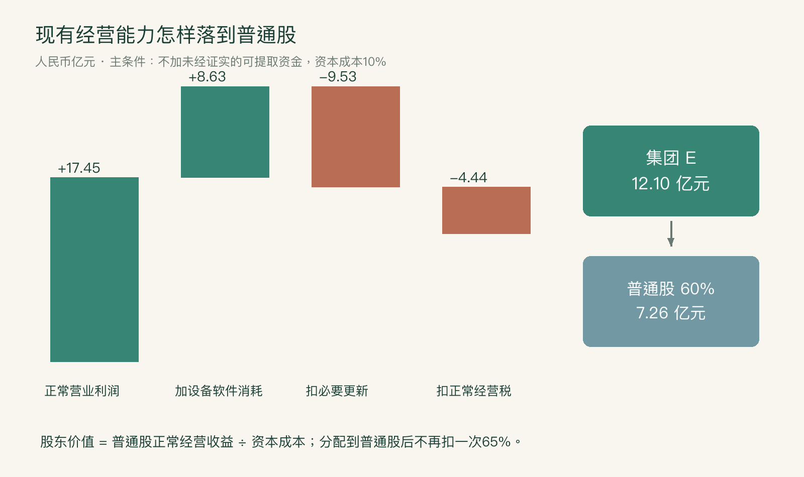

从经营利润到普通股的完整桥：替换会计折旧，扣必要更新与税，再处理合作股东；不重复扣65%。

依据 · 2025 年度报告 · 第151页；2025 年度报告 · 第152页；2025 年度报告 · 第183页；2025 年度报告 · 第184页；[2026 中期报告 · 第24页](https://www.hkexnews.hk/listedco/listconews/sehk/2026/0917/2026091700946_c.pdf#page=24)；[2026 中期报告 · 第28页](https://www.hkexnews.hk/listedco/listconews/sehk/2026/0917/2026091700946_c.pdf#page=28)

### 上市母公司有分配储备，现金仍须回到正确主体

2025年底集团现金等价物45.49亿元，其中内地中粮财务存款7.90亿元；香港中良财务3.90亿元短贷另列关联应收。资金分布在不同法人，还需覆盖客户交货、供应商、资本结算及其他股东权利。第六章进一步分析内地调配和香港短贷的具体用途。

上市母公司单体现金2.10亿元，应收子公司11.09亿元，关联应收3.90亿元，欠子公司1.44亿元，流动负债合计1.50亿元。当年母公司利润6.79亿元，包含内部收益。子公司上游分配和内部应收回收，承担把经营资金转到上市主体的作用。

年报披露，母公司按注册地公司法口径计算的可供分派储备约30.22亿元，拟派2025年度末期股息约4.31亿元。分派储备足以容纳该股息，但母公司现有现金低于拟派额，需要子公司分配、应收回收或其他资金安排。历史派息表明这条资金通道已经反复运作。

税附注说明，公司及大部分境外注册附属公司被认定为中国居民企业，其内地子公司向它们分配留存盈利，不再承担该项预扣税，因此现金桥不再扣10%的上游税。各法人仍要先满足经营留用和少数股东权利，再完成分配；个人投资者税负另按持有方式处理。

依据 · 2025 年度报告 · 第77页；2025 年度报告 · 第166页；2025 年度报告 · 第169页；2025 年度报告 · 第175页；2025 年度报告 · 第197页；2025 年度报告 · 第198页

### 实际派现验证通道，留存质量仍要看用途

2023—2025年上市普通股实际收到股息约11.79亿元，其中2025年支付约4.28亿元。2026年6月9日股东大会批准每股0.154元末期股息，公告安排7月8日或前后派付；6月底约4.31亿元仍列应付，对应上半年尚未支付。当前依据是宣派及派付安排，后续实付以现金流或具名结算记录确认。

2025年支付非控股股东股息11.49亿元，包括期初应付5.12亿元和当期宣派约6.37亿元。当年大额支付中有旧款结算，持续分配比例应按当期宣派另行判断。

连续普通股股息、2017年特别分配及重组款回收，说明资金确实可以返还给股东。未分出的部分用于设备、经营周转、新项目和关联短贷，其价值各不相同：设备维持主业，新项目需要赚回新增投入，短贷则取决于利息和实际回收时间。

依据 · 2025 年度报告 · 第103页；2025 年度报告 · 第170页；[2026 中期报告 · 第29页](https://www.hkexnews.hk/listedco/listconews/sehk/2026/0917/2026091700946_c.pdf#page=29)；[2026 中期报告 · 第39页](https://www.hkexnews.hk/listedco/listconews/sehk/2026/0917/2026091700946_c.pdf#page=39)；留存资金用途与回报复核；[2026-06-09股东周年大会投票表决结果 · 第1页](https://www.hkexnews.hk/listedco/listconews/sehk/2026/0609/2026060900521_c.pdf#page=1)；[2026-06-09股东周年大会投票表决结果 · 第3页](https://www.hkexnews.hk/listedco/listconews/sehk/2026/0609/2026060900521_c.pdf#page=3)；留存去向：实际分配、资本回收与资金池

实际收付款与正常经营能力分别计算。新研究从利润剥离非持续收益、按楼宇/设备/软件估每年9.53亿元维护，集团正常E约12.10亿元；60%收益归属条件下普通股约7.26亿元。两层权益、递延落点、必要更新与税效都有明确边界，不再沿用旧65%减U的数作为当前结论。

集团正常化与分项维护的归属尚未逐法人披露，60%只是收益工作条件；不能据当年合并现金或账面利润证明普通股能够同额提取。

约9.53亿元更新能否维持现有竞争位置？；新厂、设备和冷柜添置、实付与未付，及同规模业务服务结果。；持续必要投入更高，直接降低正常经营收益。

递延款的利润科目、税务和权益归属如何？；具名合同、利润列示和对应主体。；判断93.333是否重复剔除及是否可节税。

## 第6章 · 资本配置与股东分配

从退出旧业务、交换区域与生产资产，到迁建、渠道和分红，评价管理层怎样使用并返还资本。

### 控制权、管理激励与资本使用者

中国食品由中粮控制的上市平台和职业经理团队共同决定资本用途。2025年底，中粮通过控股主体持有74.10%；可口可乐持有核心装瓶主体35%。中粮既参与上市平台的资本安排，又通过关联公司承接出售资产、提供财务服务；可口可乐兼任品牌方、供应商和合资股东。普通股收益取决于这些参与者共同形成的采购、投资和分配安排。

展在中2004年加入集团，曾负责内蒙古、新疆和北京装瓶公司，后任中可副总经理及首席执行官，2025年1月6日接任上市公司董事总经理。庆立军曾长期负责销售运营、区域公司、财务及战略，2020年任董事总经理，2022年兼任主席，2025年转任非执行主席。管理团队熟悉地方工厂和销售网络，适合处理跨区域排产、供货和客户经营；近年新项目能否赚钱，还要看这些经验怎样转化为投入后的收益。

2025年底，董事和最高行政人员没有须披露的本公司及相联法团股份权益，公司及附属公司也没有购股权计划。若干执行董事的奖金参考收入增长、利润、市场份额和质量指标。2025年执行董事酬金合计433.2万元，其中酌情奖金233.4万元；展在中当年1月6日出任董事总经理。公开激励以经营业绩为主，项目资本回报率或每股现金与奖金的对应公式未披露。

2026年高管开始用个人资金购股。8月26日公告，包括执行董事在内的高管拟在两个月内合计购买100万股，10月23日确认完成。参与者由此直接承担了一部分普通股的盈亏，但个人购买金额和财富占比未披露，购股本身不足以衡量激励强度。

这是一支在中粮体系内经营实业的职业经理团队。收入、利润、份额和质量是公开披露的奖金依据；工厂与销售网络调整、偿债和分红已有结果。对新增资本，则还缺少持续的项目净回报记录；2018年以来也没有公司择价回购的实绩。

依据 · 2025 年度报告 · 第81页；2025 年度报告 · 第80页；2025 年度报告 · 第153页；2025 年度报告 · 第154页；2025 年度报告 · 第155页；2025 年度报告 · 第76页；[高管拟购买本公司股份之计划 · 第1页](https://www.hkexnews.hk/listedco/listconews/sehk/2026/0826/2026082600766_c.pdf#page=1)；[高管完成购买本公司股份 · 第1页](https://newsfile.futunn.com/public/NN-PersistNoticeAttachment/7781/20261023/12381272-0.PDF#page=1)；2025 年度报告 · 第35页；2025 年度报告 · 第36页

### 成熟业务的账面回报与新增资本

一家成熟公司可以把赚来的钱分给股东，也可以留在企业里继续使用。留用的钱有些用于更换旧设备，有些用于开拓新生意；前者维持原有收益，后者才有机会增加收益。因此，评价管理层的资本使用，需要把“既有生意赚得怎样”和“新花的钱赚得怎样”分开。

按归母净利润除以期初、期末归母净资产平均值，2024年账面ROE约13.8%，2025年约12.9%，均高于当前10%的股权资本成本情景。按历史账面成本衡量，已有经营为普通股资本创造了较好的利润。

2025年归母利润约8.62亿元，平均归母净资产约66.79亿元，计算为8.62÷66.79≈12.9%。归母利润较2024年基本持平，净资产继续增加，账面回报因此收窄。成熟业务仍在赚钱，增加的资本则需要经营收益继续跟上。

账面净资产保留过去投入、收购、折旧和分配的影响，与今天重建同样经营能力的成本有差异；当期利润还包含税和其他收益。持续经济回报须把正常收益与同范围经济资本匹配，第三章已从品牌、区域和销售网络解释收益能否维持。

区域整合、新厂与平台不能沿用同一回报率。五厂交换放弃了原生产体系权益，换入制造资产；陕西迁建既替代旧能力，也增加技术和产能。各自多赚的钱，需要覆盖放弃的收益、全部新增投入和以后维护，才能成为成熟业务之外的额外价值。

依据 · 2024 年度报告 · 第99页；2024 年度报告 · 第102页；2025 年度报告 · 第97页；2025 年度报告 · 第99页；《价值投资：从格雷厄姆到巴菲特》第2版阅读笔记

### 2017年出售非饮料业务：摆脱亏损，收回贷款

2017年，中国食品分两步出售非饮料业务。厨房食品仍有盈利，但收入大、利润薄；酒类及其他非饮料公司则持续亏损。董事会认为葡萄酒行业竞争加剧、增长缓慢，继续持有很难在短期内全额收回借给这些公司的贷款，遂将资源集中到盈利更好的饮料业务。

9月完成福临门食品营销出售，基本价人民币10.5亿元。年报按港元记录现金对价约12.36亿元，减去随业务转出的约0.30亿元现金，集团净流入约12.06亿港元，确认税后处置收益约11.97亿港元。该业务2016年盈利约0.93亿港元、2017年出售前约0.16亿港元，出售主要是业务取舍，并非退出一家全无盈利的公司。

12月18日，控股股东接手酒类及其他非饮料公司，支付14亿港元股权价款，并提前偿还约36.69亿港元贷款。两项合计约50.69亿港元，大部分是收回此前垫付的本金。扣去出售公司带走的约18.18亿港元现金，集团净流入约32.51亿港元；这笔交易仍确认约1.49亿港元税后处置损失。

此前的亏损也很明确。按2017年报重列的出售组合，2016年经营期税后亏损约2.22亿港元，2017年出售前亏损约6.24亿港元，其中包括酒类商誉减值约4.79亿港元。这里包括酒类及其他公司，与第一章2016年单一酒类分部约1.11亿港元业绩的范围和费用归集不同。

这次退出是合理的：不再为亏损业务持续提供资金，收回难以短期回收的贷款，并将资源集中到饮料。随后支付的特别股息又把部分资金交还股东。商誉减值和处置损失说明此前投资留下了代价；及时收缩业务，是对原有经营问题的纠正。

来源：2017年报。股权出售、旧贷款回收和处置损益是不同金额，交易成本及损益见正文。

依据 · [中国食品2017年报 · 第23页](https://www.hkexnews.hk/listedco/listconews/SEHK/2018/0425/LTN20180425423.pdf#page=23)；[中国食品2017年报 · 第24页](https://www.hkexnews.hk/listedco/listconews/SEHK/2018/0425/LTN20180425423.pdf#page=24)；[中国食品2017年报 · 第205页](https://www.hkexnews.hk/listedco/listconews/SEHK/2018/0425/LTN20180425423.pdf#page=205)；[中国食品2017年报 · 第206页](https://www.hkexnews.hk/listedco/listconews/SEHK/2018/0425/LTN20180425423.pdf#page=206)；[中国食品2017年报 · 第208页](https://www.hkexnews.hk/listedco/listconews/SEHK/2018/0425/LTN20180425423.pdf#page=208)；[中国食品2017年报 · 第209页](https://www.hkexnews.hk/listedco/listconews/SEHK/2018/0425/LTN20180425423.pdf#page=209)；[中国食品2017年报 · 第210页](https://www.hkexnews.hk/listedco/listconews/SEHK/2018/0425/LTN20180425423.pdf#page=210)；[中国食品2017年报 · 第211页](https://www.hkexnews.hk/listedco/listconews/SEHK/2018/0425/LTN20180425423.pdf#page=211)；[中国食品2017年报 · 第228页](https://www.hkexnews.hk/listedco/listconews/SEHK/2018/0425/LTN20180425423.pdf#page=228)；[中国食品2016年报 · 第201页](https://www.hkexnews.hk/listedco/listconews/sehk/2017/0426/LTN20170426415_C.pdf#page=201)

### 2017年特别分配与此后的普通股股息

2017年12月18日，公司支付每股0.10及0.93港元两笔特别股息，合计每股1.03港元。股息附注确认特别分配约28.81亿港元；全年现金流表列普通股已付股息约28.40亿港元，含常规股息。两项披露反映分配确认和净现金结算，年报未逐笔勾稽。大额特别分配已经发生，来源主要是业务出售与贷款回收。

2018—2025年，普通股实付现金股息累计人民币约21.11亿元，同期归母利润累计约50.25亿元。年度付款包含上一年度末期股息，受结算时点影响。2019年支付额低于2018年，2020年起逐年上行，2025年实付约4.28亿元，显示持续返还及后期分配提高。

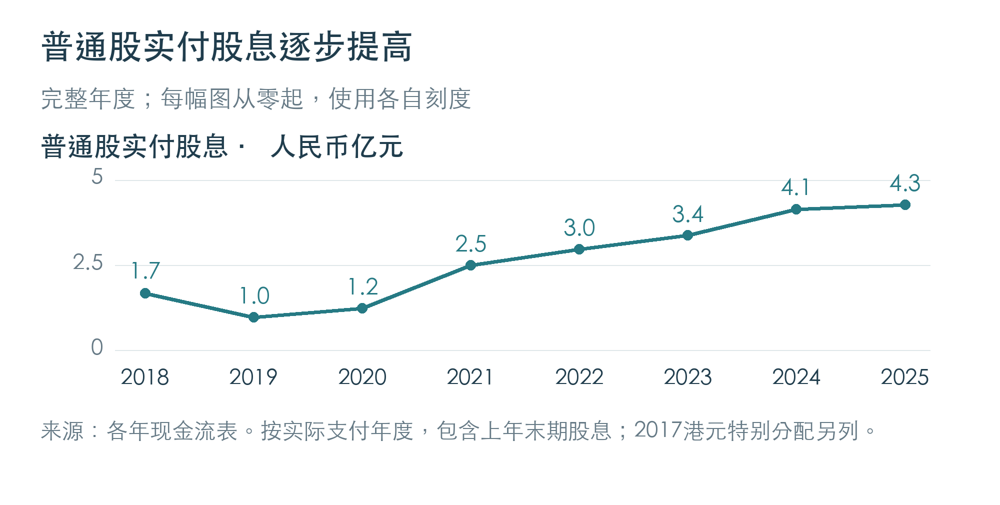

来源：各年现金流表。按实际支付年度，包含上年末期股息；2017港元特别分配另列。

同期向非控股股东实际支付约23.43亿元，按其权益另行分配；2025年约11.49亿元中包含跨期应付结算。2026年6月股东大会已批准FY2025末期股息，安排7月8日或前后派付。第五章已列明宣派、6月底应付与实付记录的区别。

管理层返还资本的主要方式是特别分配和普通股现金股息。2018—2025各年年报及2026H1均披露，没有买卖或赎回本公司上市证券，同期尚无低价回购实绩。

依据 · [中国食品2017年报 · 第23页](https://www.hkexnews.hk/listedco/listconews/SEHK/2018/0425/LTN20180425423.pdf#page=23)；[中国食品2017年报 · 第24页](https://www.hkexnews.hk/listedco/listconews/SEHK/2018/0425/LTN20180425423.pdf#page=24)；[中国食品2017年报 · 第220页](https://www.hkexnews.hk/listedco/listconews/SEHK/2018/0425/LTN20180425423.pdf#page=220)；[中国食品2017年报 · 第150页](https://www.hkexnews.hk/listedco/listconews/SEHK/2018/0425/LTN20180425423.pdf#page=150)；2025 年度报告 · 第103页；[2026 中期报告 · 第29页](https://www.hkexnews.hk/listedco/listconews/sehk/2026/0917/2026091700946_c.pdf#page=29)；[2026 中期报告 · 第39页](https://www.hkexnews.hk/listedco/listconews/sehk/2026/0917/2026091700946_c.pdf#page=39)；2025 年度报告 · 第87页；[2026-06-09股东周年大会投票表决结果 · 第3页](https://www.hkexnews.hk/listedco/listconews/sehk/2026/0609/2026060900521_c.pdf#page=3)

### 2016—2017年区域交换：买入的是经营权和整合机会

区域收购在2016年签署，2017年4月1日完成主要交割。中可饮料向可口可乐收购黑龙江、吉林、辽宁、山西、四川和重庆六个地区的装瓶业务，基本价人民币29亿元；向太古收购陕西业务，基本价4.87亿元。同时向太古出售江西、海南、广东湛茂的控制权益和另外六个地区的参股权益，对价21.22亿元。公司借交换区域重排生产、供货和销售网络。

管理层在2016年年报提出：连接相邻区域、提升工厂利用率、减少运输、分销和外包生产成本，并为产量增长增加空间；首年整合、竞争及新品推广则会压低单价并推高费用率。实际收购附注记录现金对价约39.85亿港元，带入现金约6.67亿，净现金流出约33.19亿，另有约4,967万港元交易费用计入损益。随资产转入的约11.24亿港元银行借款，也成为需要偿还的融资责任。

收购形成商誉约24.56亿港元，对价中包含了对区域经营及整合收益的预期。从交割至2017年末，新购实体贡献约52.88亿港元收入、1.55亿港元合并利润，覆盖九个月并包含部分非全资下层主体。判断收购是否划算，除这些利润外，还需要扣除后续设备与周转资金。

2018年首个完整并表年度，集团收入156.48亿元人民币、销量12.5亿标箱，分别增长17.1%和17.0%；原有授权区域收入与销量增长8.0%和7.4%。公司称新购厂提高自产、减少代工，相邻区域缩短运距，仓网利用改善并降低外租费用，新购厂税前利润率明显提高。预期中的生产和物流节约开始实现；集团17%的增长同时包含新增地区多并表一个季度的影响。

整合在经营上取得了成果：提高自产、连接相邻地区供货、改善仓网，均降低了服务这些销量的成本。交易的完整回报还包括出售区域放弃的利润，以及新购区域后续资本支出，相关资料未逐区披露。因此，可以肯定整合的执行，尚无法算出整个区域交换取得了多少超额回报。

交易以后，公司并未只等待新区域自然增长。2018年同时投产4条生产线，继续提高自产比例、调整相邻市场供货和仓储；资本付款与生产改善一同发生。随后2019—2021年逐步清偿银行借款，融资成本分别下降28%、53%和82.1%。这条路径是先承担资产与融资责任，再用经营和回收逐步消化，说明管理层将整合落实到了产线、配送及资产负债表。债务清偿后，这一轮降息收益也已经大体用完。

依据 · [中国食品2017年报 · 第21页](https://www.hkexnews.hk/listedco/listconews/SEHK/2018/0425/LTN20180425423.pdf#page=21)；[中国食品2017年报 · 第22页](https://www.hkexnews.hk/listedco/listconews/SEHK/2018/0425/LTN20180425423.pdf#page=22)；[中国食品2016年报 · 第25页](https://www.hkexnews.hk/listedco/listconews/sehk/2017/0426/LTN20170426415_C.pdf#page=25)；[中国食品2017年报 · 第247页](https://www.hkexnews.hk/listedco/listconews/SEHK/2018/0425/LTN20180425423.pdf#page=247)；[中国食品2017年报 · 第248页](https://www.hkexnews.hk/listedco/listconews/SEHK/2018/0425/LTN20180425423.pdf#page=248)；[中国食品2017年报 · 第249页](https://www.hkexnews.hk/listedco/listconews/SEHK/2018/0425/LTN20180425423.pdf#page=249)；2018 年度报告 · 第26页；2018 年度报告 · 第34页；2018 年度报告 · 第27页；2019 年度报告 · 第29页；2020 年度报告 · 第30页；2021 年度报告 · 第29页

### 五厂整合：以旧权益换生产资产，再收净差额

非汽水生产体系原由CCBMH持有，中国食品通过中可饮料参股。2022年协议将生产资产分别转入中粮和太古装瓶体系，中可购买方取得营口、济南、石家庄、长沙、成都五家公司全部股权。公告基本价人民币约5.44亿元，按交割净现金和营运资金调整，上限5.64亿元；拟以贷款票据结算，再由原生产体系开始清盘后的分配抵销或退还，另有交割现金及适用税费安排。

2023年1月1日完成时，会计对价约5.54亿元，取得同额可识别净资产，其中设备约5.42亿元、现金约0.51亿元，收购当日现金支付为零。原生产体系处置权益账面约5.87亿元、处置收益约0.92亿元，对应公平值约6.79亿元；约6.79减约5.54，形成集团净应收约1.25亿元。交易用旧体系权益换入五厂，旧权益本身就是经济代价。

2025年现金流确认从联营公司收回约1.25亿元，结清此前净应收。11月6日CCBMH完成减资，集团另收到1.575亿元，当年联营股息0.294亿元。三笔分别是应收结算、本金返还和收益分配；年末中可体系仍持有CCBMH21%，后续权益继续保留。

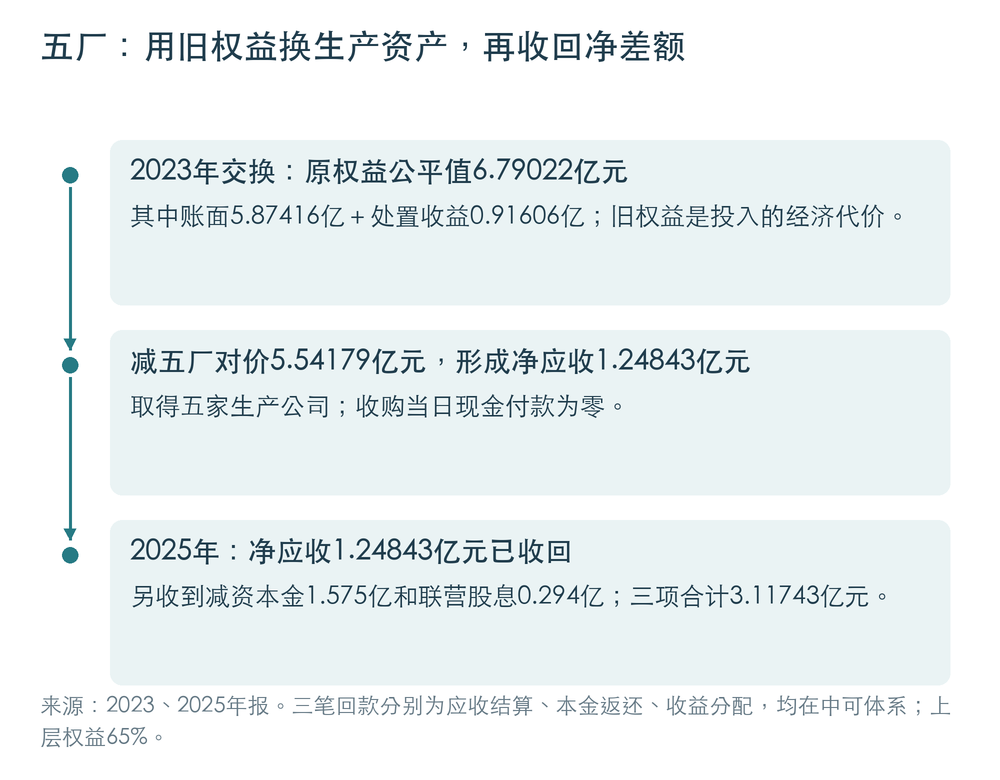

来源：2023、2025年报。三笔回款分别为应收结算、本金返还、收益分配，均在中可体系；上层权益65%。

五厂2023年对合并报表的收入贡献3.2万元，净利润贡献1,529万元。制造厂主要向集团内部供货，收入在合并时抵销，部分节约也可能留在装瓶销售环节。评价交换后的收益，应观察制造、采购和配送的整体净变化，再扣设备维护及周转需求，第一年的合并净利润只覆盖其中一部分。

公司由间接参股共同生产体系，转为直接控制五家工厂，排产、采购和供货更容易与装瓶销售协调。净应收也已收回，交易结算没有继续占住这部分资金。整合以后的长期收益，来自减少外部采购和协调成本，再扣除自己承担的设备维护及周转。

2025年净应收回收、联营减资及联营股息三项实收约3.12亿元，部分旧资本已经兑现。前两项是本金，第三项是分配，均在中可体系；按上层65%计算，普通股经济份额约2.03亿元，资金到上市主体仍经过上划。持续收益与这些一次回款分别评价。

依据 · [非汽水生产重组公告 · 第2页](https://www1.hkexnews.hk/listedco/listconews/sehk/2022/0715/2022071501130.pdf#page=2)；[非汽水生产重组公告 · 第3页](https://www1.hkexnews.hk/listedco/listconews/sehk/2022/0715/2022071501130.pdf#page=3)；[非汽水生产重组公告 · 第4页](https://www1.hkexnews.hk/listedco/listconews/sehk/2022/0715/2022071501130.pdf#page=4)；2023 年度报告 · 第131页；2023 年度报告 · 第148页；2023 年度报告 · 第149页；2025 年度报告 · 第103页；2025 年度报告 · 第164页；留存去向：实际分配、资本回收与资金池

### 陕西迁建：替代旧厂并更新生产和仓储

陕西业务是2017年购入的区域，2024年开始迁建，2025年9月16日新厂投产。既有政府项目摘录列预算约10亿元、7条饮料线和1条糖浆线，设计满产112.9万吨，实际决算未取得。新厂承担旧产能替代并采用数字化生产，上市公司有效权益65%，资本支出和收益按同一权益匹配。

投入覆盖土建、生产和仓储。建设承包商2024年7月公告中标约1.73亿元土建工程，属于约10亿元项目预算的一部分；井松智能披露部署搬运机器人和仓储系统，连接原料补给、成品周转和追溯。旧厂2021年环评列有汽水、水和罐装产线，以及蒸汽、制冷、压缩空气和污水设施。迁建延续的是整套生产与配送功能，必要替代覆盖灌装线以外的配套。

2025年集团因搬迁对楼宇和机器计提6,368.9万元减值。附注说明旧资产已难以产生未来收益、可收回金额极低，但没有逐厂拆分。停用旧厂造成了损失，新设备又要继续付款，两者共同构成迁建的资金代价。

集团2025年设备添置约10.49亿元、实付约10.49亿元；2026H1继续添置约5.61亿元、实付4.364亿元。半年末长期资产应付约2.33亿元，较年初增加约1.24亿元，另有已订约未计提资本承诺约1.43亿元。第五章已说明集团资产取得与付款的差别，未逐厂披露的余额按集团责任处理。

迁建的经济目标是用新设备和布局减少人工、运输、能耗及外租成本，同时承接旧厂生产。利用不足则会增加闲置和折旧负担。当前已能确认交付与技术安排；累计已付及未付、旧厂补偿和清理、实际利用与节约尚不足以核算完整回报。估值将必要替代纳入维护，现阶段不另加陕西的增长价值。

依据 · 2024 年度报告 · 第5页；2025 年度报告 · 第10页；2025 年度报告 · 第25页；2025 年度报告 · 第158页；2025 年度报告 · 第159页；2025 年度报告 · 第178页；[2026 中期报告 · 第37页](https://www.hkexnews.hk/listedco/listconews/sehk/2026/0917/2026091700946_c.pdf#page=37)；[2026 中期报告 · 第39页](https://www.hkexnews.hk/listedco/listconews/sehk/2026/0917/2026091700946_c.pdf#page=39)；[2026 中期报告 · 第40页](https://www.hkexnews.hk/listedco/listconews/sehk/2026/0917/2026091700946_c.pdf#page=40)；[陕西迁建政府、品牌方及供应商原始网页既有摘录](https://xetdz.xa.gov.cn/zwgk/scztxxgk/1962364203997683714.html)；[世界500强标杆首作：中粮可口可乐全国首个数智化工厂投产](https://xetdz.xa.gov.cn/zsyz/zsxm/1968122546887417857.html)；[新兴公司中标1.73亿元中粮可口可乐陕西搬迁新建项目](https://www.xxg.com.cn/xwzx/gsdt/202407/t20240725_51864.html)；[中粮可口可乐牵手井松智能](https://www.gen-song.net/show/390)；[新增6T天然气锅炉房环境影响报告表 · 第10页](https://qxb-img-osscache.qixin.com/qianlima/%E6%96%B0%E5%A2%9E6T%E5%A4%A9%E7%84%B6%E6%B0%94%E9%94%85%E7%82%89%E6%88%BF-%E5%8F%AF%E5%8F%A3%E5%8F%AF%E4%B9%906%E5%90%A8%E9%94%85%E7%82%89.pdf#page=10)；[新增6T天然气锅炉房环境影响报告表 · 第11页](https://qxb-img-osscache.qixin.com/qianlima/%E6%96%B0%E5%A2%9E6T%E5%A4%A9%E7%84%B6%E6%B0%94%E9%94%85%E7%82%89%E6%88%BF-%E5%8F%AF%E5%8F%A3%E5%8F%AF%E4%B9%906%E5%90%A8%E9%94%85%E7%82%89.pdf#page=11)

### 冷柜与零售平台：从既有铺货转向直接服务消费者

冷柜维持饮料在消费现场的位置。2022年冬奥村使用600台双温柜，中粮称交易频次和设备产出提高，让同一设备冬季卖热饮、夏季卖冷饮。2025年继续增加冰箱投放，2026H1又提出功能饮料专属冰柜，以设备和陈列争取即饮销售。

2026年6月底冰箱按金约5.32亿元。客户支付的可退按金减轻设备资金占用，但公司仍有返还责任。保持原有终端销量所需的冷柜采购和更新计入维护；新点位的设备则要靠增加的销售贡献收回成本。

新渠道的建设有数年积累。2018年，公司设立电商事业部，开展B2B合作，并与京东、天猫、盒马合作展示和销售，另组建餐饮外卖团队。2020年上线快乐会小程序商城、发展线上旗舰店及自有直播团队，疫情期间又增加社区和到家供给。传统业务已经拥有饮料、仓库与配送关系，线上经营在这些资源上增加订单入口和消费者运营。

2022年，新成立的全资悦享会接手线上消费者营销，当年收入增长33%；D2C门店和省仓配送网络逐步成形，省仓可由第三方物流到厂自提。2023年报在新零售渠道中披露自营店铺收入逾倍，另在悦享会D2C业务口径下披露增长76%。两项分别按店铺与业务对象列示，报告没有逐项对应；悦享会继续搭建消费者营销平台。到2025年形成4大仓网、22城次日达，2026H1合并口径收入7.22亿元、同比增长16.9%。业务从平台试验走到了订单和履约网络共同运转的阶段。

2026H1业绩演示还显示，悦享会销售非可口可乐产品超过3,000万元、同比增长63%；引入吉意欧并承接天猫超市和京东业务，带来超过800万元增量规模。平台开始把线上运营能力用于更多品牌，而不仅销售原有可口可乐饮料。粉丝和活跃用户增加有助于扩大触达，经营成果仍要通过成交、履约和利润结算；上述渠道销售中，集团自产饮料同时计入对应品类收入。

智尚的早期经营已经盈利。2021年设备近2万台，年销售超过3亿元，首个完整运营年度盈利超过1,000万元。2022年收入增长76%，2023年收入再逾倍，覆盖30省、280多个城市。公司提出用自动售货机填补没有商铺和商铺关闭后的消费时段，同时扩大商品种类、提高单机收入。设备投入争取的是一笔原网络未覆盖的生意，补货、点位及机器更新也成为长期经营责任。

2026H1智尚设备增至165,691台，同比增加48%，比2025年底增加22%；直营可控收入5.7亿元、同比增加27%，直营单机月收入2,178元、同比增加9%，另披露非饮料收入8,188万元。总设备与直营指标范围不同，前者不能作为后者的简单分母；能够确认的是设备扩张、直营收入和直营单机产出同时增长，非饮料收入的商品、广告或设备等组成尚未拆分。

智尚科技、悦享会海南在2025年附属公司表中均由上市公司持股100%，注册资本分别1.3亿元、0.3亿元。它们已经建立订单入口、点位和履约网络，直营单机收入也提高了。扩张还需要机器、软件、仓储、周转与后续供资，不能只按注册额衡量投入。现有利润已进入集团经营现金；独立利润、设备更新和累计净投入没有完整披露，因此估值暂不另加一份平台价值。

换渠道会改变谁承担库存和资金。先款后货的经销商替厂家垫付部分周转；直接向有账期的重点客户供货，公司要自己等回款。直营售货机和电商自营还接过库存、补货、售后及设备责任。城市联营可以借伙伴扩大覆盖，是否减少智尚的资本需求，要看机器和周转资金由谁出。收入增加有经营意义，资本回报则要把这些新增责任一并扣除。

利润落在哪个主体还影响普通股所得。中粮可口可乐有35%的外部股东，地方工厂也有其他股东；智尚和悦享会海南为上市公司全资业务。在装瓶公司供货、平台对外零售的路径中，合并时内部销售抵销，外部消费者付款只计一次。装瓶利润按装瓶股权分配，平台扣除采购、获客和履约后自己的利润归全资股东。第五章的净归属调整U已处理这两层方向，平台营业额不会再全额加到普通股现金。

这类渠道投资也要经过完整的设备周期。新机器刚铺出时，新增销售比较容易看到，设备更换往往在以后几年发生；运营进入稳定阶段以后，维修、场地续约和淘汰旧机才会更充分地反映成本。用早期盈利判断这门生意已经有收入基础是合理的，用它直接推算所有新增设备都能取得同样回报，所需资料还不够。后续应把已经使用一段时间的设备收入、日常支出和更新付款放在同一组记录里比较。

依据 · [中粮可口可乐蝉联可口可乐系统全球客户及商务领导力大奖](https://www.cofco.com/cn/News/Allnews/Latest/2022/0801/51763.html)；2025 年度报告 · 第24页；2025 年度报告 · 第28页；2025 年度报告 · 第29页；2025 年度报告 · 第181页；[2026 中期报告 · 第12页](https://www.hkexnews.hk/listedco/listconews/sehk/2026/0917/2026091700946_c.pdf#page=12)；[2026 中期报告 · 第13页](https://www.hkexnews.hk/listedco/listconews/sehk/2026/0917/2026091700946_c.pdf#page=13)；[2026 中期报告 · 第39页](https://www.hkexnews.hk/listedco/listconews/sehk/2026/0917/2026091700946_c.pdf#page=39)；2021 年度报告 · 第14页；2022 年度报告 · 第14页；[2026上半年业绩发布会 · 第13页](https://cdn.financialreports.eu/financialreports/media/filings/49257/2026/RNS/49257_rns_2026-08-25_559c59b7-309d-46de-bc9c-ae3549c10f8a.pdf#page=13)；[BigJerry：印象系列之中国食品](https://www.xueqiu.com/1964170661/315265953)；[红狼Red：UBS非交易路演要点转述](https://www.xueqiu.com/4455823068/408434816)；[2026上半年业绩发布会 · 第12页](https://cdn.financialreports.eu/financialreports/media/filings/49257/2026/RNS/49257_rns_2026-08-25_559c59b7-309d-46de-bc9c-ae3549c10f8a.pdf#page=12)；2018 年度报告 · 第31页；2020 年度报告 · 第19页；2022 年度报告 · 第24页；2023 年度报告 · 第21页；[2026上半年业绩发布会 · 第11页](https://cdn.financialreports.eu/financialreports/media/filings/49257/2026/RNS/49257_rns_2026-08-25_559c59b7-309d-46de-bc9c-ae3549c10f8a.pdf#page=11)；已有八篇雪球文章：原文回读与经营分析恢复；[中粮智尚城市联营项目启动](https://www.cfsn.cn/news/detail/2137/344913.html?view=pc)；2023 年度报告 · 第13页

### 营养健康：借用中粮研发资源，走到首批订单

营养健康是2026年新增的经营方向。公司业绩演示披露，业务1月正式启动，3月注册，4月签署首批订单；依托中粮营养健康研究院自研专利菌株完成配方开发，规划5条产品线、17个SKU。管理层试图把集团已有菌株与配方资源转为商品，并利用线上运营和既有销售能力触达客户。

与已有销量的装瓶、零售平台相比，这项业务目前最明确的进展是团队、配方和首批订单，已从筹备进入客户接洽和签约。首批订单的金额、交付回款、毛利及后续供资尚未公开，17个SKU仍是规划。当前不把这一方向计为新增正常现金，后续以交付、复购与追加资金判断它能否形成独立收益。

依据 · [2026上半年业绩发布会 · 第13页](https://cdn.financialreports.eu/financialreports/media/filings/49257/2026/RNS/49257_rns_2026-08-25_559c59b7-309d-46de-bc9c-ae3549c10f8a.pdf#page=13)；[2026上半年业绩发布会 · 第14页](https://cdn.financialreports.eu/financialreports/media/filings/49257/2026/RNS/49257_rns_2026-08-25_559c59b7-309d-46de-bc9c-ae3549c10f8a.pdf#page=14)；[2026 中期报告 · 第13页](https://www.hkexnews.hk/listedco/listconews/sehk/2026/0917/2026091700946_c.pdf#page=13)；[红狼Red：UBS非交易路演要点转述](https://www.xueqiu.com/4455823068/408434816)；已有八篇雪球文章：原文回读与经营分析恢复

### 还债、留存与关联资金的实际去向

2018年末集团计息银行借款约11.67亿元，2019年降至6.07亿元，2020年降至0.20亿元，2021—2025年末均无计息银行及其他借款。经营和处置所得的一部分用于去杠杆，公司同时维持股息及必要投资，到期续借风险随之降低。其余租赁、资本应付、客户按金和经营责任仍由资金覆盖。

2018—2025年长期资产现金付款累计约60.70亿元，包括维护及扩张，股权购买价另列；同期归母利润与普通股现金支付相差约29.14亿元。前者为集团资本付款，后者为普通股会计收益与派现的差额，中间还经过周转、非控股分配和其他现金往来。留存最终分布在经营资产、现金及应收，按各自用途评价。

2025年底集团现金约45.49亿元，其中7.9亿元存放中粮财务。财务服务协议说明，资金主要用于中国食品子公司内部结算和委托贷款，经供应链（天津）在需要资金的集团子公司间调配，中粮财务担任代理。这是持续使用的内部资金组织安排，具体使用实体和金额未公开，普通股可额外抽取的闲置部分暂无法分离。

香港3.9亿元另列上市母公司对中良财务（香港）的无担保债权，2025年底年息1.2%，一个月内到期。2025年11月公告的资金池框架为期三年、每日上限4亿元，活期资金按每周计划回拨，定期各笔至少30天，到期本息转回公司。合同允许在框架内短期调拨，实际停留多久由每笔回拨和续作决定。

2026H1同控公司合计还款约0.69亿元、期末关联应收约4.13亿元，未具名对应香港债权，其回收或续作金额仍未确认。短期停放的等待成本有限，长期反复按低息滚续则会降低回收现值，后续以具名余额、回款和收回后的用途更新判断。

已付股息、银行借款清偿和五厂回款，都说明公司确实返还过资金。内地资金池服务子公司内部结算，香港短贷则以1.2%的利息等待回拨，两者用途不同。新厂与平台占用的资金需要项目收益回收，低息短贷主要依靠本金按期返还；它们不能因为都叫“留存资金”就赋予相同价值。

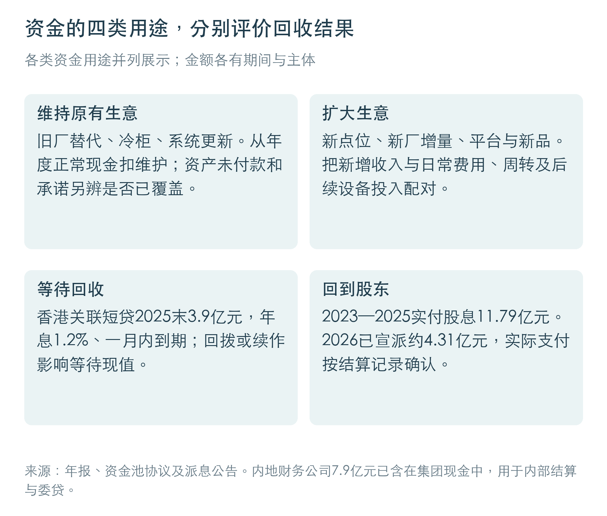

来源：年报、资金池协议及派息公告。内地财务公司7.9亿元已含在集团现金中，用于内部结算与委贷。

依据 · 2018 年度报告 · 第36页；2019 年度报告 · 第31页；2021 年度报告 · 第30页；2022 年度报告 · 第27页；2023 年度报告 · 第24页；2024 年度报告 · 第31页；2025 年度报告 · 第32页；2025 年度报告 · 第169页；2025 年度报告 · 第175页；2025 年度报告 · 第197页；[2026 中期报告 · 第29页](https://www.hkexnews.hk/listedco/listconews/sehk/2026/0917/2026091700946_c.pdf#page=29)；[2024年财务服务协议公告 · 第4页](https://www.hkexnews.hk/listedco/listconews/sehk/2024/1028/2024102800708_c.pdf#page=4)；[2024年财务服务协议公告 · 第5页](https://www.hkexnews.hk/listedco/listconews/sehk/2024/1028/2024102800708_c.pdf#page=5)；[香港资金池资金委托管理协议公告 · 第2页](https://www.hkexnews.hk/listedco/listconews/sehk/2025/1110/2025111000773.pdf#page=2)；[香港资金池资金委托管理协议公告 · 第3页](https://www.hkexnews.hk/listedco/listconews/sehk/2025/1110/2025111000773.pdf#page=3)；留存去向：实际分配、资本回收与资金池；[2026上半年业绩发布会 · 第13页](https://cdn.financialreports.eu/financialreports/media/filings/49257/2026/RNS/49257_rns_2026-08-25_559c59b7-309d-46de-bc9c-ae3549c10f8a.pdf#page=13)

### 管理层的强项与当前资本配置问题

中国食品有较好的经营整合和资本回收记录。2017年退出酒类及其他亏损业务、提前收回贷款并特别分配，区域整合后的生产及配送节约回应了原计划；此后清偿银行借款、持续支付普通股股息，五厂净应收及联营资本也已实际回收。成熟经营资本能够运转并部分返还股东。

管理层的强项是经营执行和资本回收。区域收购后调整产线、仓储和配送，随后用现金还债；智尚和悦享会则从试验逐步形成实际销售规模。较弱的一环是新增资本的回报记录：酒类投资曾发生损失，迁建又淘汰了一批旧资产，平台持续扩张还需要资金。已有生意做得更好，与新投的钱一定划算，是两个不同的成绩。

成熟业务的正常现金仍是当前估值主体。陕西、冷柜和平台已有利润继续包含在集团现金中，额外增长要等到投入、维护和周转之后仍有持续净收益才能增加价值。若必要设备更新超过现用维护估计，或关联资金长期低息滚续，分别减少正常现金或降低资金回收的现值。

后续最影响价值的，是已取得设备还要付多少钱、香港债权实际何时回拨，以及新厂投产后能节约多少成本。这些款项和经营结果直接决定现有利润中有多少最终能交给普通股股东。

依据 · [中国食品2017年报 · 第24页](https://www.hkexnews.hk/listedco/listconews/SEHK/2018/0425/LTN20180425423.pdf#page=24)；[中国食品2017年报 · 第209页](https://www.hkexnews.hk/listedco/listconews/SEHK/2018/0425/LTN20180425423.pdf#page=209)；2018 年度报告 · 第26页；2025 年度报告 · 第103页；2025 年度报告 · 第159页；[2026 中期报告 · 第39页](https://www.hkexnews.hk/listedco/listconews/sehk/2026/0917/2026091700946_c.pdf#page=39)；2026-10-27现金与价值判断（历史版本）

### 三、增长先付成本：新增一元收入，并非新增一元现金

中国食品的既有区域授权和配送网可以降低同品牌新装瓶商进入的机会，也让既有客户增加订货时不必重建整个网络。但消费者仍可换其他饮料，品牌方可以改变浓缩液及合作的经济条件；网上零售、自动售货或跨品类扩张也不自动享有原来的保护。增长只在能说明受保护范围及新增投入时才可能值得付溢价。

本次以既有区域收入占集团95%作近似，参考2025中可摘要收入20953.946/集团22070.162约94.9%；该摘要是内部抵销前，比例不是精确分部权重。利润权重另按90%粗估，给全资平台、总部费用和正常化归属留出差异，不用收入比例直接冒充利润比例。受保护业务收入与盈利各增长2%、其他业务不增，折成集团收入增长1.9%、集团正常盈利增长1.8%。

2%是温和增长的条件检验，并非2026预测，也没有把中报9.6%销量增长照搬为利润增长。2026H1销量增加但集团毛利基本不增，说明低价品类和组合变化会吞掉增量。公司自身减值测试的五年收入增长约0.87%—1.55%也提示成熟业务不宜预设高速增长；那套预算和税前折现率不直接作为本次估值参数。

新增集团收入22555.536×1.9%＝428.555百万元。假定每增加一元收入，需要0.35元设施、冷柜和系统资本，另需0.15元净周转资金，合计0.50元，年度有机投入I＝214.278百万元。现有设备净值/收入约0.25、机器厂房原价/收入约0.48，说明扩张不是毫无资本成本；取0.50是含周转的工作情景，并非公司披露的项目预算。必要更新已经在E扣过，I只计增加规模所需部分。

对应正常经营收益增加1210.447×1.8%＝21.788百万元。增量收益/新增资本约10.17%，刚接近10%的资本要求；若资本需求翻倍，同样收益只对应约5.08%。收入增长可能成立，但这两种增长对价值的意义完全不同。因此本次不因“未来还会增长”就再加一个成长倍数。

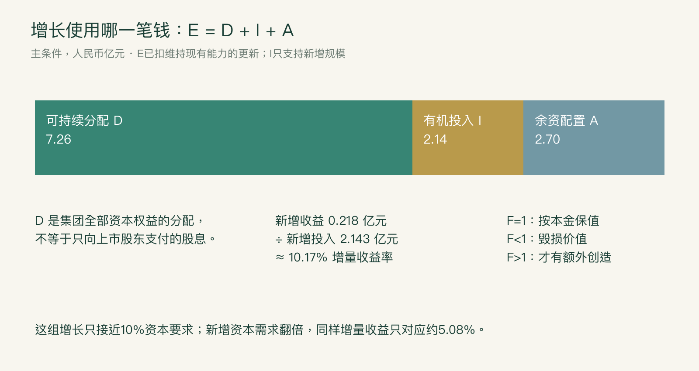

先从正常E拨出维持增长的I，再谈分配D与余资A；新增收益与新增投入配对，增长不自动创造溢价。

依据 · 2025 年度报告 · 第162页；2025 年度报告 · 第184页；[2026 中期报告 · 第10页](https://www.hkexnews.hk/listedco/listconews/sehk/2026/0917/2026091700946_c.pdf#page=10)；[2026 中期报告 · 第24页](https://www.hkexnews.hk/listedco/listconews/sehk/2026/0917/2026091700946_c.pdf#page=24)

已经发生的区域整合、还债、分红与资金调配说明管理层怎样使用资本，不能单凭历史账面回报率证明新投入高回报。新增长测算把集团E分成分配D、维持增长的I与剩余配置A；这组增量投入只接近10%资本要求，继续保留不采用成长溢价的判断。

设备替换如果持续加重，现有生意留下的现金会减少。新平台若每年都要追加资金才能扩张，回收新增投入也会更慢。关联短贷反复滚续，则延后普通股取得现金的时间。后续把各项实际投入、运营净现金和回拨记录接起来，才能判断管理层的资金使用是在增加价值，还是占用了可以返还的钱。

区域整合、五厂、陕西和平台各自留下多少维护后的普通股净现金？；已披露的实体投入与权益、后续设备和周转需要、税与实际分配；将已确认的经营改善接到资本回报，决定对应增长值多少钱

香港资金何时回拨，新业务还需多少供资，剩余资金如何返还？；具名回款及滚续、项目后续付款和供资、股息实付与具体资本方案；明确留存的用途、兑现时间和等待成本

## 第7章 · 估值、价格与错误后果

资产重建、现有盈利与增长投入各自算清；人民币价格情景不冒充港股报价。

### 先回答：能维持现有收益，但增长还没有证明值得多付钱

中国食品最有价值的资源，是可口可乐授权下的区域装瓶和销售网络。它能依靠反复购买、到店服务和既有设备继续赚钱；但品牌所有权不在上市公司手里，装瓶网络还需要不断更新，可口可乐与地方合资股东也分走一部分收益。估值要回答的不是销量还能不能增长，而是中国食品普通股股东为这套网络付多少钱，才能得到足够可靠的收益。

本次重新计算了三个问题：现有资源需要多少重建成本；不靠增长，现有业务每年能留下多少可分配收益；如果继续增长，新增收入与利润要用多少新资金支持。资产部分目前只能计量其中一部分；不增长的主要条件下，集团正常经营收益约12.10亿元，归上市普通股约7.26亿元，10%资本成本对应每股2.60元人民币。增长先作为投入与回报的条件检验，没有另加一笔“成长价值”。

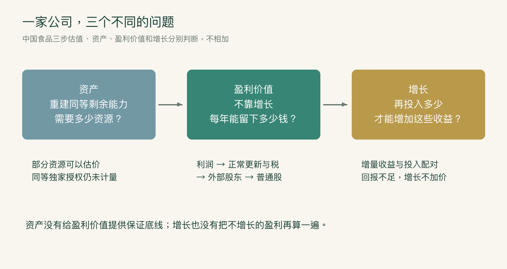

三种方法各回答一个问题：资产成本不与盈利价值相加，增长必须先说明新增投入。

所有计算以2026年中报、2025及2024年报为基础。存量是2026年6月末，经营采用2025全年加2026上半年、减2025上半年，得到一个完整十二个月。它不等于2026全年预测，也不是11月的银行余额。下文表格金额统一为人民币百万元，股票数量为27.97223396亿股；每股价值和价格情景均用人民币，不是香港市场报价。

本篇把主要条件和反方都展开。读者可以直接用正文复算，不必另找专题补齐算式。原先约8.24亿元现金和3.36—3.46港元的逐层留存估值仍留在旧版，它们没有被改写成新的资产价值或盈利价值。

依据 · [2026 中期报告 · 第24页](https://www.hkexnews.hk/listedco/listconews/sehk/2026/0917/2026091700946_c.pdf#page=24)；[2026 中期报告 · 第25页](https://www.hkexnews.hk/listedco/listconews/sehk/2026/0917/2026091700946_c.pdf#page=25)；[2026 中期报告 · 第26页](https://www.hkexnews.hk/listedco/listconews/sehk/2026/0917/2026091700946_c.pdf#page=26)；2025 年度报告 · 第161页；2025 年度报告 · 第183页

### 一、先数清资产与义务：现金很多，净资源没有那么多

2026年6月末，集团资产合计194.82亿元，包括工厂和设备、土地及租赁权、存货、客户和关联方欠款，以及58.98亿元现金。资产的资金来源并不全是普通股股东：集团同时有83.92亿元负债，剩余110.90亿元净资产中，还有40.01亿元属于合作股东；上市普通股账面权益是70.89亿元。

这些负债有不同的业务过程。客户预付款意味着以后要交货；营销推广、工资和物流应付意味着服务已经发生、钱还没付；冷柜按金原则上可能要退给经销商；已安装设备的资本应付以后要付供应商；已经宣派的股息则属于股东既有权利。没有银行借款，不代表现金都能拿走。

资产法从这张完整资产负债表出发，再把账面金额改成维持同等功能所需的资源。集团全部已列负债按原额保留，包含资本应付2.335亿元以及归母应付股息4.308亿元。不会在净资产后再次减这两笔，也不会把已订约但尚未入账的1.430亿元资本承诺直接认成损失：将来付款通常也换来设备，只有超出所得资源和已计维护的净责任才另扣。

一、先数清资产与义务：现金很多，净资源没有那么多 · 计算

| 账面起点 | 百万元人民币 | 业务含义 |
| --- | --- | --- |
| 合并总资产 | 19,481.712 | 所有已列资源，含现金及无形资产 |
| 全部负债 | −8,391.731 | 货款、运营费用、押金、税、租赁、递延款及已宣派股息 |
| 集团净资产 | 11,089.981 | 全部股东账面权益 |
| 外部股东账面权益 | −4,001.333 | 可口可乐及地方合作股东等 |
| 上市普通股账面权益 | 7,088.648 | 调整重建成本之前的起点 |

金额为人民币百万元；每股列为人民币元，估计条件不是披露事实。

依据 · [2026 中期报告 · 第25页](https://www.hkexnews.hk/listedco/listconews/sehk/2026/0917/2026091700946_c.pdf#page=25)；[2026 中期报告 · 第26页](https://www.hkexnews.hk/listedco/listconews/sehk/2026/0917/2026091700946_c.pdf#page=26)；[2026 中期报告 · 第39页](https://www.hkexnews.hk/listedco/listconews/sehk/2026/0917/2026091700946_c.pdf#page=39)；[2026 中期报告 · 第40页](https://www.hkexnews.hk/listedco/listconews/sehk/2026/0917/2026091700946_c.pdf#page=40)

### 厂房、设备和组织要按今天的能力估，不照抄收购价

厂房设备账面净值57.41亿元，不能直接叫作重新建一套同等网络的成本。2025年末楼宇原价28.646亿元、机器设备原价79.312亿元；扣折旧和减值后分别剩17.978亿元与37.981亿元。账面消耗提供年龄与剩余能力的量级，实际换一条线、换一批冷柜的价格仍可能不同。

中间条件按楼宇原价的63%、机器原价的48%估计剩余服务能力，替换价格暂与原价相同；加在建工程0.120亿元，以及2026上半年设备净值增加1.331亿元，得到57.568亿元。计算为（2864.600×63%＋7931.173×48%）×1.00＋11.988＋133.119＝5756.768百万元。上半年未披露各类新旧比例，所以净变动暂按账面衔接，没有假装完成逐厂估价。

低侧把替换价格设为原价95%，楼宇和机器剩余能力分别58%、43%；高侧用110%、68%、53%。这给出49.634—69.117亿元的设施参照。更换价格、使用效率和剩余寿命都可能有误，区间是工作估计，不是评估机构给出的市场成交价。

账上18.468亿元商誉是历史收购产生的价差，不能再建一份“商誉”。16.595亿元特许权也主要来自历史收购估值；过去续约不另付对价，说明已有合作关系可以延续，却不说明一个新竞争者能免费得到同等独家区域权。计算先移除这两项历史价，再估可解释的组织建立工作；取得同等授权的成本保留未计量。

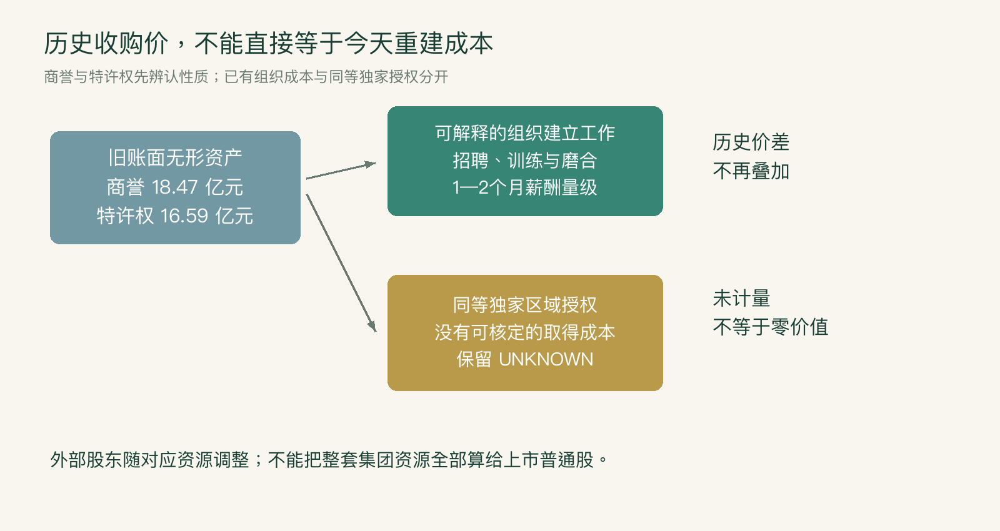

资产重建只替换对应资源：设备按剩余服务能力估，历史商誉与权利不再照抄；同等授权仍未计量。

组织建立按2025年工资28.958亿元的1—2个月估计招聘、训练和磨合，得到2.413—4.826亿元，中间取1.5个月、3.620亿元。它只覆盖建立有效队伍和运行流程，不把以后每年的工资资本化，也不另外叠加同一份软件、厂房或可口可乐品牌。这个短周期是粗估，未披露的客户关系与独家授权没有靠它一并包办。

依据 · 2025 年度报告 · 第158页；2025 年度报告 · 第159页；2025 年度报告 · 第150页；2025 年度报告 · 第161页；2025 年度报告 · 第162页；[2026 中期报告 · 第37页](https://www.hkexnews.hk/listedco/listconews/sehk/2026/0917/2026091700946_c.pdf#page=37)

### 逐项调整与普通股归属：这是部分资产参照

存货和应收均从已经扣除会计拨备的净额起算，再给适销、回收和预付可用性留折让：存货中间保留95%，贸易及其他应收预付保留98%；递延税资产保留90%，因为它要靠以后有利润并发生税务回转才能使用。现金、关联应收、剩余租赁权等暂按账面，但这一步不宣称它们可随时分配。

资产调整不能统一乘60%或65%。2018年报把现有18.468亿元商誉拆出：2017年收购形成10.657亿元，收购前饮料业务保留7.811亿元。2017年的买方是中可，被购地方股东按可识别净资产计量，不享有这部分商誉，但中可上层35%的股东仍享有。所以2017商誉调减的65%由上市普通股承担。早期7.811亿元主条件也按中可65%承担，低侧另按100%承担检验未核持有链风险；特许权和其他资源则另用60%主条件、53%—65%组合边界，不让地方股东承担本不属于它的商誉。

中间条件的集团资源净调整为-3262.535百万元。分项归普通股：商誉调减1846.799×65%＝1200.419；特许权调减1659.475×60%＝995.685；其余净资源增加243.739×60%＝146.243。因此7088.648−1200.419−995.685＋146.243＝5038.787百万元，除2797.223396百万股，约每股1.80元。外部股东同步调整为2788.659百万元，不再另扣一遍账面NCI。两侧组合结果约1.43—2.10元人民币。低侧由普通股承担更多负调整，高侧承担较少；它们不是同一法律持股比例。

低侧的可复算条件是：设施4963.386，组织241.314，存货971.422，贸易及其他应收预付1582.239，递延税373.918；特许权和其他资源调整65%归普通股，2017商誉65%、早期商誉100%由普通股承担。对应普通股4275.937−781.066×35%＝4002.564百万元，每股1.431元。高侧是设施6911.702、组织482.627、存货1079.358、应收预付1665.515、递延税467.398；特许权与其他资源53%归普通股，两批商誉均65%。由普通股账面7088.648分别加减上述归属调整，得到5884.981百万元，每股2.104元。低高侧参数同时变化，不代表单独一个项目的上下限。

这一步最重要的结论是边界：它不是清算时一定能收到的钱，不是股价底线，也不是完整再生产价值。没有同等区域授权，一个投资者即使买齐设备、招齐员工，也不能复制现在的装瓶业务。因此不能根据盈利价值高于这组资源参照，就反推公司已经证明拥有多少可永久保持的垄断利润。

逐项调整与普通股归属：这是部分资产参照 · 计算

| 资源或调整 | 原账面 | 中间计量 | 理由 |
| --- | --- | --- | --- |
| 工厂设备及在建 | 5740.982 | 5756.768 | 按现价与剩余能力重建 |
| 存货 | 1079.358 | 1025.390 | 已扣拨备后再留5% |
| 贸易及其他应收预付 | 1665.515 | 1632.205 | 净额再留2%可用性折让 |
| 递延税资产 | 467.398 | 420.658 | 保留90%可用税益 |
| 历史商誉 | 1846.799 | 0 | 用可解释资源替代历史收购价差 |
| 历史特许权 | 1659.475 | 0 | 不把旧收购估值当今天取得授权的成本 |
| 招聘、训练、磨合 | 0 | 361.971 | 全年工资÷12×1.5个月 |
| 其他已列资产与全部负债 | 见资产负债表 | 按账面保留 | 本表列差额；未再次扣资本应付 |
| 同等独家授权 | 未能可靠计量 | UNKNOWN | 不当成已证明价值为零 |

金额为人民币百万元；每股列为人民币元，估计条件不是披露事实。

依据 · 2018 年度报告 · 第201页；2018 年度报告 · 第215页；2018 年度报告 · 第216页；2025 年度报告 · 第161页；2025 年度报告 · 第183页；[2026 中期报告 · 第25页](https://www.hkexnews.hk/listedco/listconews/sehk/2026/0917/2026091700946_c.pdf#page=25)；[2026 中期报告 · 第26页](https://www.hkexnews.hk/listedco/listconews/sehk/2026/0917/2026091700946_c.pdf#page=26)

### 二、盈利价值：先留下卖饮料的正常收益

盈利价值假定企业维持现在的销售规模和竞争位置，不要求未来越卖越多。先从营业利润剥离不能稳妥外推的收益，再换掉会计折旧，扣实际维持能力所需的更新资金和经营税。这笔钱是全集团提供给资本的年度经营能力，最后才分到上市普通股。

完整十二个月收入为22070.162＋12763.435−12278.061＝22555.536百万元，报告经营利润为1978.925＋1433.009−1356.442＝2055.492百万元。原报利润率约9.11%，含利息、补助、其他收益及处置损益，不能直接除以资本成本。

本次先剔除全部其他净收入221.526＋130.002−127.007＝224.521百万元，再保留与生产伴生的废料销售15.886＋7.385−8.740＝14.531百万元，得到1845.502百万元、利润率约8.18%。其他净收入里的利息、政府支持及未能拆清的收益暂不永续化；搬迁减值、处置等也随这一净项一起移出，避免仅剔掉坏处、保留好处。信用减值净费用仍在利润起点内。

这一选择比把所有“其他收益”长期保留更谨慎，可能少计部分持续的业务支持。它也没有预设费用继续下降：TTM分销销售费用58.583亿元，与2024全年58.712亿元接近；近期效率改善可以支持现有费用量级，却不能保证更低费用会一直维持。若营销、配送和服务费反弹，必须直接减盈利。

二、盈利价值：先留下卖饮料的正常收益 · 计算

| 百万人民币 | 2024全年 | 2025全年 | 截至2026H1的十二个月 |
| --- | --- | --- | --- |
| 收入 | 21491.811 | 22070.162 | 22555.536 |
| 报告经营利润 | 1865.899 | 1978.925 | 2055.492 |
| 报告经营利润率 | 8.68% | 8.97% | 9.11% |
| 剔其他净收入、加回废料销售后的利润 | 1731.915 | 1773.285 | 1845.502 |
| 对应利润率 | 8.06% | 8.03% | 8.18% |
| 归母/集团净利润比例 | 60.49% | 60.36% | 60.21% |

金额为人民币百万元；每股列为人民币元，估计条件不是披露事实。

依据 · 2025 年度报告 · 第97页；2025 年度报告 · 第149页；[2026 中期报告 · 第24页](https://www.hkexnews.hk/listedco/listconews/sehk/2026/0917/2026091700946_c.pdf#page=24)；[2026 中期报告 · 第33页](https://www.hkexnews.hk/listedco/listconews/sehk/2026/0917/2026091700946_c.pdf#page=33)

### 9333万元旧款与租赁：不能把收款时间差反复变成收益

2024、2025现金流表都在周转前经营现金之后扣除93.333百万元递延收入。这说明把所有周转变化一律归零会漏掉一个重要调整。但它的具名合同、收款实体及利润表落点没有完整披露；另外11.314百万元资产补助摊销已经单列处理，两者不能混为一项。

新算法已移除全部其他净收入，因此93.333有可能已经部分包含在移除项内。主条件额外全扣93.333，作为可能偏低的保守处理；另算“完全包含、无需再扣”的一端。它们表示同一已知项目的重叠边界，不是对未知合同损失的完整估计，更不表示公司以后每年都要另外付9333万元。原件不能支持的映射保持未知。下面25%税率相应计入了23.333百万元税节约，这也不是已核定税务效果；若该扣项不产生税节约，每股价值再少约0.050元。所谓保守只指这一重叠问题的一端，不是整家公司价值的保证下限。

仓库与设备租赁选择按持续租金处理。TTM使用权折旧64.057百万元，其中土地使用权折旧暂沿用2025年的15.335，保留在利润内作为取得土地权的消耗；其余48.722加回。再加回已进入费用的短租62.009，统一扣正常租金118.290，净调整为48.722＋62.009−118.290＝−7.559百万元。租金取2025全年实付量级，2024总租赁付款含一次使用权资产取得款50.143，不能机械拿来做常年仓租。

于是正常营业利润为1845.502−93.333−7.559＝1744.610百万元。已按租金维持仓库和租赁设备后，EPV权益桥不再减同一笔租赁负债，也不把租赁使用权再加成一块额外资产；土地消耗不再重复加进下一节维护。

依据 · 2025 年度报告 · 第101页；2025 年度报告 · 第102页；2025 年度报告 · 第160页；[2026 中期报告 · 第28页](https://www.hkexnews.hk/listedco/listconews/sehk/2026/0917/2026091700946_c.pdf#page=28)

### 维持现有能力，每年需要多少新设备和软件

会计折旧反映过去购置价的分摊。估值要承担的是今天继续提供同等产品、配送和冷饮服务所需的更新，而不是把账面折旧原封不动视作答案，也不是将所有新厂支出都叫增长后免扣。陕西迁建既替代旧厂，也加入新的生产和仓储能力；冷柜保住售点位置，同样可能属于必要投入。

本次按设备类别重建：楼宇原价2864.600百万元，替换价加5%，用30年更新；机器与终端设备原价7931.173百万元，替换价加5%，用10年更新。30年和10年在公司楼宇5—30年、机器5—15年的会计寿命范围内，但它们仍是本研究的经济更新假设，并非披露的实际全网更新周期。软件按TTM摊销20.360百万元估正常资本更新；已费用化的订阅和维修不再加一次。

楼宇100.261＋机器832.773＋软件20.360＝953.394百万元，即每年约9.53亿元。这里用的是全新同功能成本除更新年限，不用上一步资产法的剩余净值除年限。否则旧设备越多，算出的未来维护反而越少。

重建一套设施是存量问题，每年替换耗损是流量问题。两步采用不同的计算，不能把剩余净值当年度更新预算。

这个结果与实物投入相互核对：2024、2025设备添置分别6.503亿元和10.489亿元，TTM设备添置约9.844亿元，设备及软件摊销约8.634亿元。9.53亿元高于摊销约0.90亿元，处在近期混合添置的量级内；添置同时含更新和扩容，不能由“数接近”证明估值已经精确。2026H1设备添置5.615亿元、付款4.364亿元，资本应付增加1.245亿元，付款后移不构成维护需求下降。

较短更新周期、设备提价、迁建尾款及冷柜换型都可能推高必要投入。因此再算10.50亿元维护的压力情景。反过来，只有投入降低而销量、服务与售点竞争力同时保持，才能支持下调维护；不因某一年付款少就直接上调价值。

维持现有能力，每年需要多少新设备和软件 · 计算

| 类别 | 计算，百万元人民币 | 正常年度维护 |
| --- | --- | --- |
| 楼宇 | 2864.600×1.05÷30 | 100.261 |
| 机器、产线与终端设备 | 7931.173×1.05÷10 | 832.773 |
| 资本化软件等 | TTM摊销量级 | 20.360 |
| 合计 | 100.261＋832.773＋20.360 | 953.394 |

金额为人民币百万元；每股列为人民币元，估计条件不是披露事实。

依据 · 2025 年度报告 · 第126页；2025 年度报告 · 第158页；2025 年度报告 · 第159页；2025 年度报告 · 第161页；[2026 中期报告 · 第37页](https://www.hkexnews.hk/listedco/listconews/sehk/2026/0917/2026091700946_c.pdf#page=37)；[2026 中期报告 · 第39页](https://www.hkexnews.hk/listedco/listconews/sehk/2026/0917/2026091700946_c.pdf#page=39)

### 从正常营业利润到普通股：税和两层权益只扣一次

正常税采用25%的经营税率，另加8百万元持续非抵扣净差。2025税表披露标准税率25%、非抵扣费用税差8.440百万元，部分地区优惠可降低税负；本次不依赖优惠扩大。2025的53.692百万元以前年度补税不原样年年重复。直接现金税也会受以前年度和暂时性差异影响，所以不用某一年实付数机械永续。

先计算集团年度经营能力：1744.610＋863.384−953.394−444.153＝1210.447百万元。863.384为TTM设备折旧843.024加软件等摊销20.360；使用权折旧已在租金转换中处理，土地折旧仍留在利润，不再加回。正常税为1744.610×25%＋8＝444.153百万元。不增长时周转持续滚动，本次年度新增净周转资金取零，不把历史预收和应付扩张带来的现金释放永续。

集团不是上市股东全资拥有。2025年合并净利润1428.047百万元，其中861.968归上市公司股东，566.079归外部股东。外部收益又分两层：中可上层可口可乐35%对应419.934百万元，下层地方合作权益146.145百万元。先扣全部外部权益后再乘65%，会重复扣除。

正常化和维护没有完整逐法人分拆，因此这里用普通股60%、外部40%的收益分配条件，并用58%—62%检验；60%参考2024、2025及TTM实际归母利润比例约60%，不把历史利润比例宣称为未来精确现金归属。集团1210.447×60%＝726.268百万元，约7.26亿元，是估计的普通股正常经营现金能力，尚不是当年到账分红。

10%下，集团核心盈利价值1210.447÷10%＝12104.473百万元；外部股东正常收益价值为1210.447×40%÷10%＝4841.789百万元。相减得到7262.684百万元，除2797.223396百万股＝每股2.596元人民币。资产法的外部股东账面权益4001.333不能替代这里的4841.789：前者是资源存量，后者是持续收益的权利。

从经营利润到普通股的完整桥：替换会计折旧，扣必要更新与税，再处理合作股东；不重复扣65%。

依据 · 2025 年度报告 · 第151页；2025 年度报告 · 第152页；2025 年度报告 · 第183页；2025 年度报告 · 第184页；[2026 中期报告 · 第24页](https://www.hkexnews.hk/listedco/listconews/sehk/2026/0917/2026091700946_c.pdf#page=24)；[2026 中期报告 · 第28页](https://www.hkexnews.hk/listedco/listconews/sehk/2026/0917/2026091700946_c.pdf#page=28)

### 为什么没有把58.98亿元现金全部加上去

EPV已经估了工厂与渠道持续赚钱的能力。只有维持该能力之后仍可独立提取、且属于普通股的资源，才能再加。客户预收、供应商账期和营销费用结算支持现金余额；这些款未来会随着交货和付款流出，不能从六月末一个数断言有同额余资。

先估运营支付的量级：收入22555.536−正常营业利润1744.610−非现金设备软件消耗863.384＝19947.542百万元，约199.48亿元一年。这不是已经逐笔证实的现金预算，而是检查备资是否合理的年度现金运营成本近似。留三个月约4986.885百万元；留两个月约3324.590百万元。本次假定原料货款、工资、推广和物流能由这一整体准备及正常经营流入覆盖，所以不再各自全额相加；中报9.804亿元关联应付及其他到期责任尚未取得逐项资金匹配，不能据两个月缓冲就证明所有旧账都有钱付。

另外为不宜混入普通月度经营成本的事项留资：冷柜按金531.650、资本应付233.496、迁厂按金140.000，以及已宣派归母/外部股息430.772和52.229，合计1388.147百万元。搬迁按金仍是责任，不先拿来抵扣更新；资本应付已包含取得的存量资产，所以此处只在“可提取现金”测试中留款，不再从EPV另扣同一损失。

三个月运营准备加上述事项为6375.032百万元，超过5898.074现金，主条件因此不加未经证实的余资。两个月条件下，5898.074−3324.590−1388.147＝1185.337百万元；若两个月准备足以覆盖全部正常到期义务、关联应付已有资金来源，而且这笔余额确能提取且60%归普通股，增加711.202百万元、每股约0.254元，EPV由2.596升至2.851元。两个月还是三个月并非披露事实；要升级采用值，需要看旺淡季最低现金、付款节奏和分主体可提取余额。

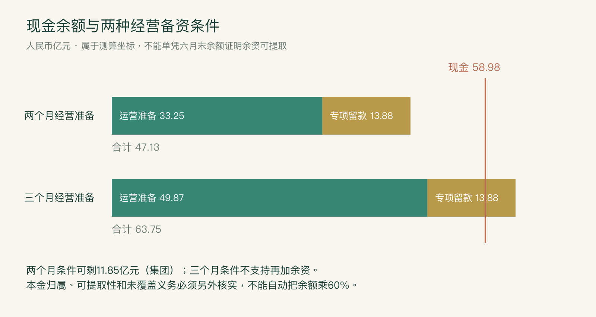

两种备资条件影响可加回本金；两端均先留独立付款责任，没有把所有经营应付再扣一次。

现金利息已经从经营利润剥离；主条件既不另加现金本金，也暂不给未拆明的金融收益资本化价值。这会偏谨慎，但避免一边把全部资金算为可提取本金，一边继续永续化同一本金的利息。资产法仍列这些资源，因为它在那里配套扣了全部义务，两步回答的问题不同。

2025年底中粮财务存款7.90亿元已经包含在45.49亿元现金中，不能再加一次；同年中良财务香港贷款3.90亿元已经在关联应收内。2026H1关联应收4.128亿元未拆出该贷款最新余额，同控公司归还0.689亿元也未具名，不能把残差当成已核准贷款余额。主条件暂不给额外贷款或小额联营投资价值，不把母公司内部应收再加到集团经营价值上。

依据 · 2025 年度报告 · 第169页；2025 年度报告 · 第175页；[2026 中期报告 · 第25页](https://www.hkexnews.hk/listedco/listconews/sehk/2026/0917/2026091700946_c.pdf#page=25)；[2026 中期报告 · 第29页](https://www.hkexnews.hk/listedco/listconews/sehk/2026/0917/2026091700946_c.pdf#page=29)；[2026 中期报告 · 第39页](https://www.hkexnews.hk/listedco/listconews/sehk/2026/0917/2026091700946_c.pdf#page=39)

### 哪些错误会改变结果：不把一个小数当作公司公允价

10%是本次人民币名义回报要求的工作选择，反映品牌授权依赖、利润分配权和必要更新的不确定；它不是市场测得的精确WACC，更不是所有公司的统一买入门槛。集团没有需要按市价另扣的大额银行借款，租赁又已按持续租金处理，因此不靠假定廉价债务来压低经营资本成本。9%—11%是检验资本要求差异的条件范围。

下表每个情景都重新配对经营税和外部股东收益价值，没有把40%合作股东的价值固定不动。它们是具体错误的后果，不能把所有有利端拼成新中心，也不能把两条单变量边界称为企业所有风险都已经覆盖。

仅把资本成本从9%改到11%，普通股EPV约2.88降至2.36元人民币；如果正常维护要10.50亿元，10%下约2.39元。如果利润率再低0.5个百分点且维护10.50亿元，约2.21元。相比之下，递延项目完全已包含在被剔除收益内，约可增加每股0.15元。经营稳定性和设备维护比多保留几位小数重要得多。

本研究没有把未来额外资本损失假装为零：若平台扩张、迁建或授权变化要求既有盈利与维护之外的新投入，必须把对应净现金损失或持续利润变化接回模型。现有资本应付、租赁和已宣派股息已各有处理位置，不能再以笼统“风险准备”重复扣。

哪些错误会改变结果：不把一个小数当作公司公允价 · 计算

| 条件（其他按主条件） | 每股人民币 | 改变的判断 |
| --- | --- | --- |
| 资本成本9% | 2.885 | 要求的回报较低 |
| 资本成本11% | 2.360 | 要求的回报较高 |
| 递延调整完全包含在已移除收益内 | 2.747 | 避免同一项目重复剔除 |
| 必要维护1050 | 2.389 | 每年更新需要多付资金 |
| 归母份额58% | 2.510 | 合作股东占比更高 |
| 归母份额62% | 2.683 | 上市普通股占比更高 |
| 递延扣项不产生当期税节约 | 2.546 | 未核税效不给节约 |
| 两个月运营准备且余额可按60%归母提取 | 2.851 | 所有到期义务已覆盖且本金可抽取 |
| 经营利润率再降0.5个百分点且维护1050 | 2.208 | 经营与更新同时不利 |

金额为人民币百万元；每股列为人民币元，估计条件不是披露事实。

依据 · 2025 年度报告 · 第160页；[2026 中期报告 · 第25页](https://www.hkexnews.hk/listedco/listconews/sehk/2026/0917/2026091700946_c.pdf#page=25)；[2026 中期报告 · 第39页](https://www.hkexnews.hk/listedco/listconews/sehk/2026/0917/2026091700946_c.pdf#page=39)

### 三、增长先付成本：新增一元收入，并非新增一元现金

中国食品的既有区域授权和配送网可以降低同品牌新装瓶商进入的机会，也让既有客户增加订货时不必重建整个网络。但消费者仍可换其他饮料，品牌方可以改变浓缩液及合作的经济条件；网上零售、自动售货或跨品类扩张也不自动享有原来的保护。增长只在能说明受保护范围及新增投入时才可能值得付溢价。

本次以既有区域收入占集团95%作近似，参考2025中可摘要收入20953.946/集团22070.162约94.9%；该摘要是内部抵销前，比例不是精确分部权重。利润权重另按90%粗估，给全资平台、总部费用和正常化归属留出差异，不用收入比例直接冒充利润比例。受保护业务收入与盈利各增长2%、其他业务不增，折成集团收入增长1.9%、集团正常盈利增长1.8%。

2%是温和增长的条件检验，并非2026预测，也没有把中报9.6%销量增长照搬为利润增长。2026H1销量增加但集团毛利基本不增，说明低价品类和组合变化会吞掉增量。公司自身减值测试的五年收入增长约0.87%—1.55%也提示成熟业务不宜预设高速增长；那套预算和税前折现率不直接作为本次估值参数。

新增集团收入22555.536×1.9%＝428.555百万元。假定每增加一元收入，需要0.35元设施、冷柜和系统资本，另需0.15元净周转资金，合计0.50元，年度有机投入I＝214.278百万元。现有设备净值/收入约0.25、机器厂房原价/收入约0.48，说明扩张不是毫无资本成本；取0.50是含周转的工作情景，并非公司披露的项目预算。必要更新已经在E扣过，I只计增加规模所需部分。

对应正常经营收益增加1210.447×1.8%＝21.788百万元。增量收益/新增资本约10.17%，刚接近10%的资本要求；若资本需求翻倍，同样收益只对应约5.08%。收入增长可能成立，但这两种增长对价值的意义完全不同。因此本次不因“未来还会增长”就再加一个成长倍数。

先从正常E拨出维持增长的I，再谈分配D与余资A；新增收益与新增投入配对，增长不自动创造溢价。

依据 · 2025 年度报告 · 第162页；2025 年度报告 · 第184页；[2026 中期报告 · 第10页](https://www.hkexnews.hk/listedco/listconews/sehk/2026/0917/2026091700946_c.pdf#page=10)；[2026 中期报告 · 第24页](https://www.hkexnews.hk/listedco/listconews/sehk/2026/0917/2026091700946_c.pdf#page=24)

### 把增长资金账展开，再看给定价格是否值得

增长沿用上一步实际计算的集团E＝1210.447百万元和普通股权益桥B＝−4841.789百万元，不能暗换盈利基础。这里的D是集团全部资本权益获得的可持续分配，包括合作股东；不是只把中国食品向上市股东派的430.772百万元放进集团公式。

主条件假定分配60%的集团E：D＝726.268百万元；支持上述增长投入I＝214.278；剩余资金A＝E−D−I＝269.901百万元。D、I、A分别有用途，合计才等于E。这里集团分配率60%恰与普通股归属比例60%相同，只是两个假设的数字巧合；若集团分配条件成立，上市普通股应得约D×60%＝435.761百万元，其余分给合作股东。积极配置因子F取1，表示每投一元最终形成一元现值，不是多赚一元；F=0.7表示毁掉三成价值，F>1才是创造额外价值。当前没有足够项目回报证据，不能把F直接写成高于1。

以每股3元人民币这个假设买价演示：普通股总价Q＝3×2797.223396＝8391.670百万元。集团核心购买成本M＝Q−B＝8391.670−（−4841.789）＝13233.460百万元。之所以加回外部股东价值，是因为E是整个集团的收益，不能用全集团赚的钱只除上市股东买价。M不是投资者实际再向合作股东支付一笔钱，而是把分子和分母还原到同一范围；它假设外部股东权益按前一步EPV计价，形成一个合成的集团比较口径，不等于上市普通股实际持有收益率。

在经营价值与购买成本近似、持续增长和资本配置条件都成立时，衰减前回报参照为D/M＋集团有机盈利增长率＋A×F/M。代入726.268/13233.460＋1.8%＋269.901×1/13233.460＝5.49%＋1.80%＋2.04%＝9.33%。这是方法中的条件回报分解，不是现金流已经排好时间后的个人实际IRR；A×F/M包含投入本金形成的价值，不能再额外加一次A。

上述9.33%属于假定合作股东权益按EPV计价的合成集团参照。真正比较中国食品普通股买价，应把分配和再投资也折成普通股口径：D普通股＝726.268×60%＝435.761，I普通股＝214.278×60%＝128.567，A普通股＝269.901×60%＝161.941百万元，三项合计为普通股E726.268。当前未加非经营本金，普通股经营权成本就是Q；未来权益份额不变时，其有机盈利增速仍为1.8%。

因此每股3元人民币下，普通股衰减前条件回报为435.761/8391.670＋1.8%＋161.941/8391.670＝5.19%＋1.80%＋1.93%＝8.92%。这仍是假定价值与购买成本近似的回报分解，不是实际IRR；60%同时用于正常收益、增量投入、分配和再投资价值，也是需持续核验的权益条件。集团9.33%不能拿来与普通股8.92%平均，更不能把较高的那一个用作股东回报承诺。

同一普通股条件下，每股2.5、3、3.5、4元人民币的衰减前参照约为10.35%、8.92%、7.91%、7.14%。尚未扣经济衰减，3元情景已经低于10%要求；2.5元也只多约0.35个百分点，没有证明足以承受授权、渠道和资本配置的误差。这些人民币情景不是香港当前报价，也没有反解一个精确目标价。

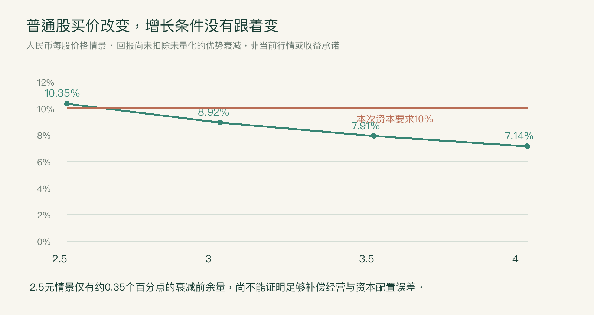

普通股口径的价格对照，分配与再投资均按60%归属；未扣除未量化衰减，不是收益承诺。

如果余资只能创造投入价值的70%，3元普通股情景降至约8.34%；如果有机投入从集团2.143亿元翻到4.286亿元，普通股对应投入也翻倍，回报降至约7.39%。若一年额外侵蚀1个百分点，原8.92%变7.92%；这一扣减是压力假设，不是测得的衰减速度或损失概率。区域授权可以长期存在，超额收益仍可能被品牌方和竞争者挤走。

这里保留最实用的结论：现有生意的正常收益有明确价值，但当前证据不足以支持为增长支付额外溢价。若后续同范围新增现金能证明每元投入持续带来超过资本成本的收益，并且不依赖更多营销补贴或更长账期，再上调增长的采用程度。若增长靠加柜、加库存和补贴堆出来，应先调高I、调低F或减E，而不是提高预测增长率来补偿。

依据 · 2025 年度报告 · 第183页；2025 年度报告 · 第184页

### 与旧稿的差别，及下一次什么证据会改判

旧稿以周转前现金减正常税510、利息3、租赁本金53.554、维护900，再按65%和净扣项85处理，得到823.720百万元普通股现金。新稿从营业利润重建，明确剔除其他净收益并处理递延重叠，按设备类别估953.394维护，用正常经营税444.153，最后按集团收益权益分配。两者起点、租赁、税、维护和归属都变了，不能把旧3.36—3.46港元留下当作新方法的结论。

差额可以逐步对上。旧集团在税和维护前的现金基数为2957.918−93.333−3−53.554＝2808.031；新基数为正常营业利润1744.610＋折旧摊销863.384＝2607.994，少200.037。税从510降到444.153补回65.848，维护从900升到953.394再少53.394，集团正常能力由1398.031降到1210.447。把新集团数先代旧65%−85得到701.791；再按本次60%归属得到726.268，比旧普通股823.720少97.452百万元。这个桥解释的是研究口径与采用条件变化，不是公司突然少收了同样一笔钱。

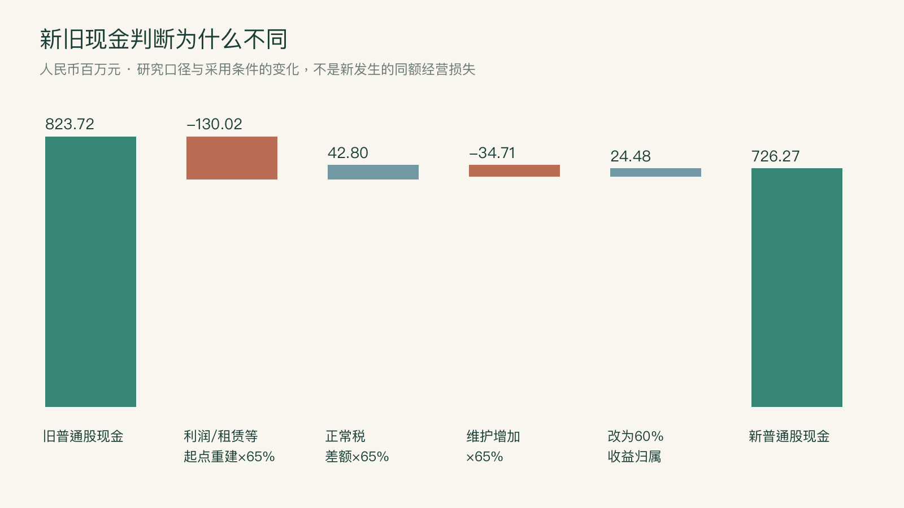

旧现金路径与新盈利价值的差别来自可复算的口径与假设变化；旧记录保留，不把研究修订当经营事实。

下一次先看三件事：第一，完整年度约58—59亿元销售费用能否维持现有毛利、售点和服务；第二，新厂与终端设备的更新、添置、实付和应付能否支持约9.53亿元年度必要投入；第三，新增项目和留存资金是否产生普通股真正可得的增量现金。递延款落点、分主体收益和季内最低现金一旦披露，也会直接缩小现在的条件范围。

当前采用顺序是：以正常盈利解释主要价值，资产作为不完整的资源参照，用增长资金账检验是否值得多付钱。三者不相加、不平均。本文新判断追加保存，旧F0、原预测和原核验期限都保留；将来比较真实经营时，不能拿今天较谨慎的新条件去改写过去已经提出的判断。

已计量资产参照约1.43—2.10元人民币/股，独家授权尚未计量；正常普通股经营现金约7.26亿元，10%且不加未经证明余资时EPV约2.60元。增长投入回报仅接近资本要求，本轮不为增长加价。

这些都是条件价值；授权、费用或资本配置受损时，没有资产底价保证。增长的普通股回报列与集团合成列分开，不相加或平均。

约9.53亿元更新能否维持现有竞争位置？；新厂、设备和冷柜添置、实付与未付，及同规模业务服务结果。；持续必要投入更高，直接降低正常经营收益。

递延款的利润科目、税务和权益归属如何？；具名合同、利润列示和对应主体。；判断93.333是否重复剔除及是否可节税。

新增资本能否创造超过资本要求的普通股现金？；同范围新增设备/周转资金与后续净收益；分配和外部权益。；影响是否采用增长溢价，不用收入增长自动替代。

## 第8章 · 预测、跟踪与复盘

以经营、投入和回款解释后续结果，按原登记定义与窗口检验预测。

### 当前判断与后续检验

中国食品的成熟汽水仍能产生利润，重组后的经营贡献和实际分红已有改善。近期销量增长却几乎没有增加集团毛利，新厂和渠道还需要资金。当前预期是先守住既有现金，新增投入随后逐步增加普通股净所得；若费用回升或投入收不回来，这个预期就会落空。

2026年11月8日当前普通股正常经营现金条件改为约7.26亿元：正常化营业利润、分项维护、经营税和收益归属重新计算。原F0使用实际税与登记时的集团B，原定义、区间和观察期限保持；今天的新估计不能回填成旧预测。

太古在折扣增加时仍通过采购和效率提高利润率，说明装瓶业务有调整成本的空间。中国食品智尚的直营单机收入提高，营养业务签下首批订单，分别处在经营改善和初期试销阶段。FY2026全年及2027上半年的披露，将继续检验这些变化能否在扣除后续投入后增加现金。

依据 · 2026-10-27现金与价值判断（历史版本）；原始前瞻记录v4；[2026 中期报告 · 第24页](https://www.hkexnews.hk/listedco/listconews/sehk/2026/0917/2026091700946_c.pdf#page=24)；销售费用持续性：原数、机制与反方；必要维护：资产消耗与更新责任；留存去向：实际分配、资本回收与资金池；[太古2026中期业绩公告（含新闻稿） · 第28页](https://www.swirepacific.com/storage/fm/PressRelease/pdf/en/swirepacific-interim-2026.pdf#page=28)；2021 年度报告 · 第14页；[2026上半年业绩发布会 · 第13页](https://cdn.financialreports.eu/financialreports/media/filings/49257/2026/RNS/49257_rns_2026-08-25_559c59b7-309d-46de-bc9c-ae3549c10f8a.pdf#page=13)；[高管完成购买本公司股份 · 第1页](https://newsfile.futunn.com/public/NN-PersistNoticeAttachment/7781/20261023/12381272-0.PDF#page=1)；[太古2026中期业绩公告（含新闻稿） · 第29页](https://www.swirepacific.com/storage/fm/PressRelease/pdf/en/swirepacific-interim-2026.pdf#page=29)；[2026上半年业绩发布会 · 第12页](https://cdn.financialreports.eu/financialreports/media/filings/49257/2026/RNS/49257_rns_2026-08-25_559c59b7-309d-46de-bc9c-ae3549c10f8a.pdf#page=12)

### 原主预测F0

F0于2026年10月26日首次登记，观察集团B：周转前经营现金减实际现金所得税、利息及租赁本金。长期资产付款另在现金桥处理。FY2026部分经营发生在登记之前，2027H1则为完整登记后期间。

完整报告公开后，按原区间记录带内、向下偏差或向上偏差。税付款若有一次因素，原数字偏差保留，正常化解释另列。滚动十二个月现金桥与相邻期间重叠，只用于分析，不增加独立预测样本。

依据 · 原始前瞻记录v4

### 全年预测对下半年的具体要求

2026上半年集团经营现金B约15.20亿元，已在原预测登记前披露。FY2026原区间22.5—24.5亿元减去已知上半年，得到下半年约7.30—9.30亿元；2025下半年按全年减上半年计算约8.17亿元。因此原全年区间要求的下半年现金，围绕上年这一量级波动。

上述拆解沿用F0原登记日2026年10月26日，登记时下半年也已有部分经营发生。2027上半年才是完整登记后期间，原区间为14.5—16.0亿元。拆分计算用于理解原预测，没有增加独立预测。

饮料销售、税款、采购付款和年末应付都有季节差异。年报公布后先计算下半年实际B，再将毛利、费用和税款时点变化接入全年结果。成熟现金仍用全年和同季经营解释，避免将上半年直接年化。

依据 · 原始前瞻记录v4；2025 年度报告 · 第101页；[2026 中期报告 · 第28页](https://www.hkexnews.hk/listedco/listconews/sehk/2026/0917/2026091700946_c.pdf#page=28)；[2026 中期报告 · 第29页](https://www.hkexnews.hk/listedco/listconews/sehk/2026/0917/2026091700946_c.pdf#page=29)

### 经营、投入和分配的观察基准

销售费用以2026H1的31.44亿元、同比减少0.91亿元为同季基准。费用率下降约1.71个百分点，其中收入分母效应约1.00个百分点，因而判断效率改善应同时看绝对费用。FY2026报告核对全年金额和推广安排，2027H1再作同季比较。若毛利、销量和终端服务稳定，较低费用就有持续的经营支持；若保量让利、推广和物流支出重新挤压净贡献，则下修持续现金。

核心汽水最近的经营基准为2026上半年销量增长8.5%、收入增长2.1%、经营利润增长8%。完整FY2026及2027H1报告公布时，分别对照同季销量、单位收入和营销后的贡献，判断卖得更多最终留下多少利润。持续促销若吞掉新增贡献，就降低成熟现金估计。

本次年度必要更新约9.53亿元，来自楼宇2864.600×1.05÷30、设备7931.173×1.05÷10、软件20.360百万元；10.50亿元用于较高投入压力。后续分别跟踪添置、实付、资本应付和承诺，核对同等规模下保住生产与售点需要多少投入；混合总CAPEX不直接结算维护是否准确。

资金回收在FY2026关联交易和现金流披露中逐笔核对：香港3.9亿元的期初、放款、回收和期末余额，内地财务公司存款及内部委贷用途，以及2025末期股息实际支付。合同到期回拨提供权利，真实回款及后续用途决定资金兑现。合计关联往来若缺少单笔匹配，相应债权继续记为未确认回收。

递延项跟踪新增收款、转入收益、税及实际归属，判断历史释放有没有新的持续现金来源。当前按93.333全扣的重叠边界处理；若映射证明已在其他净收益中剔除，应消除重复扣减；新增持续收款则另核合同、归属和税效。资产相关补助摊销继续按原现金桥处理。

资本回报以2025年账面ROE约12.9%作历史参照。FY2026年报公布后，按相同归母口径重算全年回报，解释利润、留存及新增资本如何变化。陕西和五厂将投入、成本节约与净收益单独配对；2027H1主要核对项目经营和付款进展，半年收益作同季比较。

智尚后续利润及设备净投入，应接在现有设备规模和单机产出之后，判断扩张是否增加净现金。营养业务则继续核对首批订单交付、回款、客户复购和新增供资。历史盈利与订单进展支持经营执行，新增现金与投入配对后，才支持项目增长价值。

果汁核对酷儿、新配方和自产能否延续收入及毛利增长；水核对冰露扩点后的补货与让利；魔爪核对新品销售能否覆盖派样和冰柜支出。悦享会需要把销量、收入、获客和履约合看，智尚则区分直营与联营的设备和周转责任。期限均沿用FY2026和2027H1，实际经营变化用于解释现金，不新增预测样本。

依据 · [2026 中期报告 · 第24页](https://www.hkexnews.hk/listedco/listconews/sehk/2026/0917/2026091700946_c.pdf#page=24)；[2026 中期报告 · 第37页](https://www.hkexnews.hk/listedco/listconews/sehk/2026/0917/2026091700946_c.pdf#page=37)；2025 年度报告 · 第197页；2025 年度报告 · 第198页；2025 年度报告 · 第97页；2025 年度报告 · 第99页；销售费用持续性：原数、机制与反方；必要维护：资产消耗与更新责任；留存去向：实际分配、资本回收与资金池；2021 年度报告 · 第14页；[2026上半年业绩发布会 · 第13页](https://cdn.financialreports.eu/financialreports/media/filings/49257/2026/RNS/49257_rns_2026-08-25_559c59b7-309d-46de-bc9c-ae3549c10f8a.pdf#page=13)；[2026上半年业绩发布会 · 第8页](https://cdn.financialreports.eu/financialreports/media/filings/49257/2026/RNS/49257_rns_2026-08-25_559c59b7-309d-46de-bc9c-ae3549c10f8a.pdf#page=8)；[2026上半年业绩发布会 · 第9页](https://cdn.financialreports.eu/financialreports/media/filings/49257/2026/RNS/49257_rns_2026-08-25_559c59b7-309d-46de-bc9c-ae3549c10f8a.pdf#page=9)；[2026上半年业绩发布会 · 第10页](https://cdn.financialreports.eu/financialreports/media/filings/49257/2026/RNS/49257_rns_2026-08-25_559c59b7-309d-46de-bc9c-ae3549c10f8a.pdf#page=10)；[2026上半年业绩发布会 · 第11页](https://cdn.financialreports.eu/financialreports/media/filings/49257/2026/RNS/49257_rns_2026-08-25_559c59b7-309d-46de-bc9c-ae3549c10f8a.pdf#page=11)；[中粮智尚城市联营项目启动](https://www.cfsn.cn/news/detail/2137/344913.html?view=pc)

### 已有复盘：2024年利润与现金为何不同向

2024年销量下降9.7%，收入大致持平，归母利润却从8.33亿元增至8.61亿元。公司调整水业务，价格和产品组合变化，加上原料成本回落，帮助毛利增加5.77亿元；为应对竞争，销售费用又增加4.01亿元。结构和成本改善抵消总销量下降的影响，营销支出吸收了部分毛利增量。

同年报表经营现金由24.30亿元增至28.47亿元，其中含较大周转释放。剔除周转、采用当年实际税息，再扣全部长期资产付款和租赁本金后，集团参考现金由15.33亿元降至12.94亿元。付款前经营贡献虽增加，更多现金税和资产付款使付款后的现金反而下降。第四、五章分别提供经营过程及现金明细。

来源：2023、2024年报。参考现金将周转归零、扣实际税息及全资产付款，仍未处理普通股归属。

2024年的差异出在税和设备付款：产品与成本改善增加了经营贡献，却没能覆盖这两项增加的现金支出。这段复盘在2026年完成，2023时点的分析也是事后重建，因此不计作事前预测命中。

依据 · 2023—2024历史经营核验；2024 年度报告 · 第21页；2024 年度报告 · 第104页

### 已有纠错：现金估计与愿付价格

前期研究曾同时使用约8.50亿元和9.30亿元正常普通股现金，维护、税和归属处理不同，逐项对齐后采用约8.84亿元。再读2025中报后，确认9,333万元递延调整全部发生于2025下半年。旧模型把该项随一般周转归零，结果让这笔有限历史释放留在正常现金起点。按65%归属、不预计税节约修正，得到约8.24亿元。

此前曾将2.30港元升级为通用买价，并据此推导3.05需要普遍减仓，这项结论已撤回。2.30来自演练设定，3.05来自旧现金估计与当时自选的价格余量，两者都不是新经营事实。递延项修正则有具体项目和金额，使10%条件价值减少约0.19—0.25港元；原判断和更正分别保留。

两项纠错分别处理了现金事实与愿付价格。经营变化修订对应现金，资金用途和回收变化修订对应价值；投资者要求更大余量，则明确记录为愿付价格取舍。本次第七章使用人民币假设价格，历史报价及其形成依据另行保留，不作最新行情比较。

2026年11月8日再按三步方法重做研究：新正常普通股现金约7.26亿元，旧8.24亿元、旧港元现金价值和原F0均原样保留。正常化收益与更新依据重建，而非用新数字宣称旧预测命中；完整新旧差额在第七章及现金主报告展开。

依据 · 中国食品历史报价来源与更正；2026-10-27现金与价值判断（历史版本）；[2025 中期报告 · 第30页](https://www.hkexnews.hk/listedco/listconews/sehk/2025/0919/2025091900590.pdf#page=30)；递延收入与正常现金核验

### 修订判断与核验原预测的责任

持续毛利承压、销售投入明显增加，或已确认必要更新高于原判断，都可能降低普通股正常现金，即使当期B仍在原预测带内。毛利增加且费用、维护和权益归属共同支持更高现金时，也有上修依据。预测落在带内与正常价值保持不变，分别由各自事实判断。

实际税款造成B偏离时，先按原定义记录偏差，再解释一次清缴或长期税负。项目延期时保留原期结果，新的回收时间另存。项目现金未披露，就保留未解决状态，核验窗口照原登记执行。

原F1、F2等虽已移出主屏，仍保存在原前瞻记录中，按原窗口承担核验责任。同一经营事实若解释了多个判断，只作为同一事实使用，避免虚增独立预测样本。新记录保存事实期间、披露日、原判断、实际结果和修订理由。

依据 · 原始前瞻记录v4；2026-10-27现金与价值判断（历史版本）

### 全书的当前结论

中国食品拥有一门已经能够持续产生利润和经营现金的饮料生意。成熟汽水带来反复购买，区域工厂、仓配和门店网络完成交易。重组后的生产配送改善，以及后来的费用管理，解释了收入增长不快时利润仍能提高的历史。这些事实构成当前经营价值的基础。

接下来的改善需要更具体的来源。汽水要在无糖、包装和消费场景变化中维护整条产品线的购买；果汁修复主要来自酷儿和两款新品；功能饮料有增长，体量仍较小；水需要把配送和促销成本算清。悦享会、智尚接回更多零售环节后，也接回了履约、设备与服务责任，新增收入最终要变成扣除这些支出的现金。

当前采用约7.26亿元普通股正常经营现金，主条件不额外计未经证明的自由资金；10%下约2.60元人民币/股。资产参照只覆盖已计量资源，增长按普通股的分配、再投入和收益核对，本轮不加成长溢价。后续若经营费用、设备更新、权益份额或资金配置改变，应修订对应参数，并与原预测分开核验。

第八章保存原F0的定义和期限，届时按原条件核验。当前正常现金、历史价格比较和资本用途另行跟踪，不能拿其中一项的改善替另一项宣布兑现。本版将研究过程、计算输入、成稿和专题连接起来，以后能够看清当时为何这样判断，以及后来究竟发生了什么。

依据 · 2026-10-27现金与价值判断（历史版本）；原始前瞻记录v4；2023—2024历史经营核验

跟踪按原定义核验F0，同时检验本次正常收益、必要更新、外部权益和增长投入。旧现金路径和原期限保留，新7.26亿元条件不替代原预测；经营能力的变化与资金等待/毁值分别解释。

核心汽水即使保持市场地位，采购条件、销售投入和必要更新仍会侵蚀装瓶商现金；已经回到集团的资本，也可能在低息留用中延迟普通股回收。前者由经营与投入核对，后者由具名资金的回款和用途核对。

费用下降能否转成持续的普通股现金？；下一同季毛利、费用、税、维护和实体归属；决定当前约7.26亿元正常现金、维护或权益条件是否需要改变。

迁建、新渠道和关联资金的实际回收，与既有解释是否相符？；投入、经营贡献、实付及回拨的连续记录；以投入和回收的连续记录评价增长价值及等待代价

现有竞争优势是否支持超过资本成本的持续与增量回报？；同口径经济资本估计；五厂或陕西完整投入、后续付款及新增净收益。；同口径比较决定能否确认受保护的超额收益，项目净现金决定增长价值；原F0继续按原定义核验。

## 中国食品：资产、盈利价值与增长，普通股到底买到什么

从重建资源，到维持当前盈利，再到增长的投入与回报。财务至2026年6月末，2026年11月8日重新研究；全部金额为人民币，价格仅作明确情景。

### 先回答：能维持现有收益，但增长还没有证明值得多付钱

中国食品最有价值的资源，是可口可乐授权下的区域装瓶和销售网络。它能依靠反复购买、到店服务和既有设备继续赚钱；但品牌所有权不在上市公司手里，装瓶网络还需要不断更新，可口可乐与地方合资股东也分走一部分收益。估值要回答的不是销量还能不能增长，而是中国食品普通股股东为这套网络付多少钱，才能得到足够可靠的收益。

本次重新计算了三个问题：现有资源需要多少重建成本；不靠增长，现有业务每年能留下多少可分配收益；如果继续增长，新增收入与利润要用多少新资金支持。资产部分目前只能计量其中一部分；不增长的主要条件下，集团正常经营收益约12.10亿元，归上市普通股约7.26亿元，10%资本成本对应每股2.60元人民币。增长先作为投入与回报的条件检验，没有另加一笔“成长价值”。

三种方法各回答一个问题：资产成本不与盈利价值相加，增长必须先说明新增投入。

所有计算以2026年中报、2025及2024年报为基础。存量是2026年6月末，经营采用2025全年加2026上半年、减2025上半年，得到一个完整十二个月。它不等于2026全年预测，也不是11月的银行余额。下文表格金额统一为人民币百万元，股票数量为27.97223396亿股；每股价值和价格情景均用人民币，不是香港市场报价。

本篇把主要条件和反方都展开。读者可以直接用正文复算，不必另找专题补齐算式。原先约8.24亿元现金和3.36—3.46港元的逐层留存估值仍留在旧版，它们没有被改写成新的资产价值或盈利价值。

依据 · [2026 中期报告 · 第24页](https://www.hkexnews.hk/listedco/listconews/sehk/2026/0917/2026091700946_c.pdf#page=24)；[2026 中期报告 · 第25页](https://www.hkexnews.hk/listedco/listconews/sehk/2026/0917/2026091700946_c.pdf#page=25)；[2026 中期报告 · 第26页](https://www.hkexnews.hk/listedco/listconews/sehk/2026/0917/2026091700946_c.pdf#page=26)；2025 年度报告 · 第161页；2025 年度报告 · 第183页

### 一、先数清资产与义务：现金很多，净资源没有那么多

2026年6月末，集团资产合计194.82亿元，包括工厂和设备、土地及租赁权、存货、客户和关联方欠款，以及58.98亿元现金。资产的资金来源并不全是普通股股东：集团同时有83.92亿元负债，剩余110.90亿元净资产中，还有40.01亿元属于合作股东；上市普通股账面权益是70.89亿元。

这些负债有不同的业务过程。客户预付款意味着以后要交货；营销推广、工资和物流应付意味着服务已经发生、钱还没付；冷柜按金原则上可能要退给经销商；已安装设备的资本应付以后要付供应商；已经宣派的股息则属于股东既有权利。没有银行借款，不代表现金都能拿走。

资产法从这张完整资产负债表出发，再把账面金额改成维持同等功能所需的资源。集团全部已列负债按原额保留，包含资本应付2.335亿元以及归母应付股息4.308亿元。不会在净资产后再次减这两笔，也不会把已订约但尚未入账的1.430亿元资本承诺直接认成损失：将来付款通常也换来设备，只有超出所得资源和已计维护的净责任才另扣。

一、先数清资产与义务：现金很多，净资源没有那么多 · 计算

| 账面起点 | 百万元人民币 | 业务含义 |
| --- | --- | --- |
| 合并总资产 | 19,481.712 | 所有已列资源，含现金及无形资产 |
| 全部负债 | −8,391.731 | 货款、运营费用、押金、税、租赁、递延款及已宣派股息 |
| 集团净资产 | 11,089.981 | 全部股东账面权益 |
| 外部股东账面权益 | −4,001.333 | 可口可乐及地方合作股东等 |
| 上市普通股账面权益 | 7,088.648 | 调整重建成本之前的起点 |

金额为人民币百万元；每股列为人民币元，估计条件不是披露事实。

依据 · [2026 中期报告 · 第25页](https://www.hkexnews.hk/listedco/listconews/sehk/2026/0917/2026091700946_c.pdf#page=25)；[2026 中期报告 · 第26页](https://www.hkexnews.hk/listedco/listconews/sehk/2026/0917/2026091700946_c.pdf#page=26)；[2026 中期报告 · 第39页](https://www.hkexnews.hk/listedco/listconews/sehk/2026/0917/2026091700946_c.pdf#page=39)；[2026 中期报告 · 第40页](https://www.hkexnews.hk/listedco/listconews/sehk/2026/0917/2026091700946_c.pdf#page=40)

### 厂房、设备和组织要按今天的能力估，不照抄收购价

厂房设备账面净值57.41亿元，不能直接叫作重新建一套同等网络的成本。2025年末楼宇原价28.646亿元、机器设备原价79.312亿元；扣折旧和减值后分别剩17.978亿元与37.981亿元。账面消耗提供年龄与剩余能力的量级，实际换一条线、换一批冷柜的价格仍可能不同。

中间条件按楼宇原价的63%、机器原价的48%估计剩余服务能力，替换价格暂与原价相同；加在建工程0.120亿元，以及2026上半年设备净值增加1.331亿元，得到57.568亿元。计算为（2864.600×63%＋7931.173×48%）×1.00＋11.988＋133.119＝5756.768百万元。上半年未披露各类新旧比例，所以净变动暂按账面衔接，没有假装完成逐厂估价。

低侧把替换价格设为原价95%，楼宇和机器剩余能力分别58%、43%；高侧用110%、68%、53%。这给出49.634—69.117亿元的设施参照。更换价格、使用效率和剩余寿命都可能有误，区间是工作估计，不是评估机构给出的市场成交价。

账上18.468亿元商誉是历史收购产生的价差，不能再建一份“商誉”。16.595亿元特许权也主要来自历史收购估值；过去续约不另付对价，说明已有合作关系可以延续，却不说明一个新竞争者能免费得到同等独家区域权。计算先移除这两项历史价，再估可解释的组织建立工作；取得同等授权的成本保留未计量。

资产重建只替换对应资源：设备按剩余服务能力估，历史商誉与权利不再照抄；同等授权仍未计量。

组织建立按2025年工资28.958亿元的1—2个月估计招聘、训练和磨合，得到2.413—4.826亿元，中间取1.5个月、3.620亿元。它只覆盖建立有效队伍和运行流程，不把以后每年的工资资本化，也不另外叠加同一份软件、厂房或可口可乐品牌。这个短周期是粗估，未披露的客户关系与独家授权没有靠它一并包办。

依据 · 2025 年度报告 · 第158页；2025 年度报告 · 第159页；2025 年度报告 · 第150页；2025 年度报告 · 第161页；2025 年度报告 · 第162页；[2026 中期报告 · 第37页](https://www.hkexnews.hk/listedco/listconews/sehk/2026/0917/2026091700946_c.pdf#page=37)

### 逐项调整与普通股归属：这是部分资产参照

存货和应收均从已经扣除会计拨备的净额起算，再给适销、回收和预付可用性留折让：存货中间保留95%，贸易及其他应收预付保留98%；递延税资产保留90%，因为它要靠以后有利润并发生税务回转才能使用。现金、关联应收、剩余租赁权等暂按账面，但这一步不宣称它们可随时分配。

资产调整不能统一乘60%或65%。2018年报把现有18.468亿元商誉拆出：2017年收购形成10.657亿元，收购前饮料业务保留7.811亿元。2017年的买方是中可，被购地方股东按可识别净资产计量，不享有这部分商誉，但中可上层35%的股东仍享有。所以2017商誉调减的65%由上市普通股承担。早期7.811亿元主条件也按中可65%承担，低侧另按100%承担检验未核持有链风险；特许权和其他资源则另用60%主条件、53%—65%组合边界，不让地方股东承担本不属于它的商誉。

中间条件的集团资源净调整为-3262.535百万元。分项归普通股：商誉调减1846.799×65%＝1200.419；特许权调减1659.475×60%＝995.685；其余净资源增加243.739×60%＝146.243。因此7088.648−1200.419−995.685＋146.243＝5038.787百万元，除2797.223396百万股，约每股1.80元。外部股东同步调整为2788.659百万元，不再另扣一遍账面NCI。两侧组合结果约1.43—2.10元人民币。低侧由普通股承担更多负调整，高侧承担较少；它们不是同一法律持股比例。

低侧的可复算条件是：设施4963.386，组织241.314，存货971.422，贸易及其他应收预付1582.239，递延税373.918；特许权和其他资源调整65%归普通股，2017商誉65%、早期商誉100%由普通股承担。对应普通股4275.937−781.066×35%＝4002.564百万元，每股1.431元。高侧是设施6911.702、组织482.627、存货1079.358、应收预付1665.515、递延税467.398；特许权与其他资源53%归普通股，两批商誉均65%。由普通股账面7088.648分别加减上述归属调整，得到5884.981百万元，每股2.104元。低高侧参数同时变化，不代表单独一个项目的上下限。

这一步最重要的结论是边界：它不是清算时一定能收到的钱，不是股价底线，也不是完整再生产价值。没有同等区域授权，一个投资者即使买齐设备、招齐员工，也不能复制现在的装瓶业务。因此不能根据盈利价值高于这组资源参照，就反推公司已经证明拥有多少可永久保持的垄断利润。

逐项调整与普通股归属：这是部分资产参照 · 计算

| 资源或调整 | 原账面 | 中间计量 | 理由 |
| --- | --- | --- | --- |
| 工厂设备及在建 | 5740.982 | 5756.768 | 按现价与剩余能力重建 |
| 存货 | 1079.358 | 1025.390 | 已扣拨备后再留5% |
| 贸易及其他应收预付 | 1665.515 | 1632.205 | 净额再留2%可用性折让 |
| 递延税资产 | 467.398 | 420.658 | 保留90%可用税益 |
| 历史商誉 | 1846.799 | 0 | 用可解释资源替代历史收购价差 |
| 历史特许权 | 1659.475 | 0 | 不把旧收购估值当今天取得授权的成本 |
| 招聘、训练、磨合 | 0 | 361.971 | 全年工资÷12×1.5个月 |
| 其他已列资产与全部负债 | 见资产负债表 | 按账面保留 | 本表列差额；未再次扣资本应付 |
| 同等独家授权 | 未能可靠计量 | UNKNOWN | 不当成已证明价值为零 |

金额为人民币百万元；每股列为人民币元，估计条件不是披露事实。

依据 · 2018 年度报告 · 第201页；2018 年度报告 · 第215页；2018 年度报告 · 第216页；2025 年度报告 · 第161页；2025 年度报告 · 第183页；[2026 中期报告 · 第25页](https://www.hkexnews.hk/listedco/listconews/sehk/2026/0917/2026091700946_c.pdf#page=25)；[2026 中期报告 · 第26页](https://www.hkexnews.hk/listedco/listconews/sehk/2026/0917/2026091700946_c.pdf#page=26)

### 二、盈利价值：先留下卖饮料的正常收益

盈利价值假定企业维持现在的销售规模和竞争位置，不要求未来越卖越多。先从营业利润剥离不能稳妥外推的收益，再换掉会计折旧，扣实际维持能力所需的更新资金和经营税。这笔钱是全集团提供给资本的年度经营能力，最后才分到上市普通股。

完整十二个月收入为22070.162＋12763.435−12278.061＝22555.536百万元，报告经营利润为1978.925＋1433.009−1356.442＝2055.492百万元。原报利润率约9.11%，含利息、补助、其他收益及处置损益，不能直接除以资本成本。

本次先剔除全部其他净收入221.526＋130.002−127.007＝224.521百万元，再保留与生产伴生的废料销售15.886＋7.385−8.740＝14.531百万元，得到1845.502百万元、利润率约8.18%。其他净收入里的利息、政府支持及未能拆清的收益暂不永续化；搬迁减值、处置等也随这一净项一起移出，避免仅剔掉坏处、保留好处。信用减值净费用仍在利润起点内。

这一选择比把所有“其他收益”长期保留更谨慎，可能少计部分持续的业务支持。它也没有预设费用继续下降：TTM分销销售费用58.583亿元，与2024全年58.712亿元接近；近期效率改善可以支持现有费用量级，却不能保证更低费用会一直维持。若营销、配送和服务费反弹，必须直接减盈利。

二、盈利价值：先留下卖饮料的正常收益 · 计算

| 百万人民币 | 2024全年 | 2025全年 | 截至2026H1的十二个月 |
| --- | --- | --- | --- |
| 收入 | 21491.811 | 22070.162 | 22555.536 |
| 报告经营利润 | 1865.899 | 1978.925 | 2055.492 |
| 报告经营利润率 | 8.68% | 8.97% | 9.11% |
| 剔其他净收入、加回废料销售后的利润 | 1731.915 | 1773.285 | 1845.502 |
| 对应利润率 | 8.06% | 8.03% | 8.18% |
| 归母/集团净利润比例 | 60.49% | 60.36% | 60.21% |

金额为人民币百万元；每股列为人民币元，估计条件不是披露事实。

依据 · 2025 年度报告 · 第97页；2025 年度报告 · 第149页；[2026 中期报告 · 第24页](https://www.hkexnews.hk/listedco/listconews/sehk/2026/0917/2026091700946_c.pdf#page=24)；[2026 中期报告 · 第33页](https://www.hkexnews.hk/listedco/listconews/sehk/2026/0917/2026091700946_c.pdf#page=33)

### 9333万元旧款与租赁：不能把收款时间差反复变成收益

2024、2025现金流表都在周转前经营现金之后扣除93.333百万元递延收入。这说明把所有周转变化一律归零会漏掉一个重要调整。但它的具名合同、收款实体及利润表落点没有完整披露；另外11.314百万元资产补助摊销已经单列处理，两者不能混为一项。

新算法已移除全部其他净收入，因此93.333有可能已经部分包含在移除项内。主条件额外全扣93.333，作为可能偏低的保守处理；另算“完全包含、无需再扣”的一端。它们表示同一已知项目的重叠边界，不是对未知合同损失的完整估计，更不表示公司以后每年都要另外付9333万元。原件不能支持的映射保持未知。下面25%税率相应计入了23.333百万元税节约，这也不是已核定税务效果；若该扣项不产生税节约，每股价值再少约0.050元。所谓保守只指这一重叠问题的一端，不是整家公司价值的保证下限。

仓库与设备租赁选择按持续租金处理。TTM使用权折旧64.057百万元，其中土地使用权折旧暂沿用2025年的15.335，保留在利润内作为取得土地权的消耗；其余48.722加回。再加回已进入费用的短租62.009，统一扣正常租金118.290，净调整为48.722＋62.009−118.290＝−7.559百万元。租金取2025全年实付量级，2024总租赁付款含一次使用权资产取得款50.143，不能机械拿来做常年仓租。

于是正常营业利润为1845.502−93.333−7.559＝1744.610百万元。已按租金维持仓库和租赁设备后，EPV权益桥不再减同一笔租赁负债，也不把租赁使用权再加成一块额外资产；土地消耗不再重复加进下一节维护。

依据 · 2025 年度报告 · 第101页；2025 年度报告 · 第102页；2025 年度报告 · 第160页；[2026 中期报告 · 第28页](https://www.hkexnews.hk/listedco/listconews/sehk/2026/0917/2026091700946_c.pdf#page=28)

### 维持现有能力，每年需要多少新设备和软件

会计折旧反映过去购置价的分摊。估值要承担的是今天继续提供同等产品、配送和冷饮服务所需的更新，而不是把账面折旧原封不动视作答案，也不是将所有新厂支出都叫增长后免扣。陕西迁建既替代旧厂，也加入新的生产和仓储能力；冷柜保住售点位置，同样可能属于必要投入。

本次按设备类别重建：楼宇原价2864.600百万元，替换价加5%，用30年更新；机器与终端设备原价7931.173百万元，替换价加5%，用10年更新。30年和10年在公司楼宇5—30年、机器5—15年的会计寿命范围内，但它们仍是本研究的经济更新假设，并非披露的实际全网更新周期。软件按TTM摊销20.360百万元估正常资本更新；已费用化的订阅和维修不再加一次。

楼宇100.261＋机器832.773＋软件20.360＝953.394百万元，即每年约9.53亿元。这里用的是全新同功能成本除更新年限，不用上一步资产法的剩余净值除年限。否则旧设备越多，算出的未来维护反而越少。

重建一套设施是存量问题，每年替换耗损是流量问题。两步采用不同的计算，不能把剩余净值当年度更新预算。

这个结果与实物投入相互核对：2024、2025设备添置分别6.503亿元和10.489亿元，TTM设备添置约9.844亿元，设备及软件摊销约8.634亿元。9.53亿元高于摊销约0.90亿元，处在近期混合添置的量级内；添置同时含更新和扩容，不能由“数接近”证明估值已经精确。2026H1设备添置5.615亿元、付款4.364亿元，资本应付增加1.245亿元，付款后移不构成维护需求下降。

较短更新周期、设备提价、迁建尾款及冷柜换型都可能推高必要投入。因此再算10.50亿元维护的压力情景。反过来，只有投入降低而销量、服务与售点竞争力同时保持，才能支持下调维护；不因某一年付款少就直接上调价值。

维持现有能力，每年需要多少新设备和软件 · 计算

| 类别 | 计算，百万元人民币 | 正常年度维护 |
| --- | --- | --- |
| 楼宇 | 2864.600×1.05÷30 | 100.261 |
| 机器、产线与终端设备 | 7931.173×1.05÷10 | 832.773 |
| 资本化软件等 | TTM摊销量级 | 20.360 |
| 合计 | 100.261＋832.773＋20.360 | 953.394 |

金额为人民币百万元；每股列为人民币元，估计条件不是披露事实。

依据 · 2025 年度报告 · 第126页；2025 年度报告 · 第158页；2025 年度报告 · 第159页；2025 年度报告 · 第161页；[2026 中期报告 · 第37页](https://www.hkexnews.hk/listedco/listconews/sehk/2026/0917/2026091700946_c.pdf#page=37)；[2026 中期报告 · 第39页](https://www.hkexnews.hk/listedco/listconews/sehk/2026/0917/2026091700946_c.pdf#page=39)

### 从正常营业利润到普通股：税和两层权益只扣一次

正常税采用25%的经营税率，另加8百万元持续非抵扣净差。2025税表披露标准税率25%、非抵扣费用税差8.440百万元，部分地区优惠可降低税负；本次不依赖优惠扩大。2025的53.692百万元以前年度补税不原样年年重复。直接现金税也会受以前年度和暂时性差异影响，所以不用某一年实付数机械永续。

先计算集团年度经营能力：1744.610＋863.384−953.394−444.153＝1210.447百万元。863.384为TTM设备折旧843.024加软件等摊销20.360；使用权折旧已在租金转换中处理，土地折旧仍留在利润，不再加回。正常税为1744.610×25%＋8＝444.153百万元。不增长时周转持续滚动，本次年度新增净周转资金取零，不把历史预收和应付扩张带来的现金释放永续。

集团不是上市股东全资拥有。2025年合并净利润1428.047百万元，其中861.968归上市公司股东，566.079归外部股东。外部收益又分两层：中可上层可口可乐35%对应419.934百万元，下层地方合作权益146.145百万元。先扣全部外部权益后再乘65%，会重复扣除。

正常化和维护没有完整逐法人分拆，因此这里用普通股60%、外部40%的收益分配条件，并用58%—62%检验；60%参考2024、2025及TTM实际归母利润比例约60%，不把历史利润比例宣称为未来精确现金归属。集团1210.447×60%＝726.268百万元，约7.26亿元，是估计的普通股正常经营现金能力，尚不是当年到账分红。

10%下，集团核心盈利价值1210.447÷10%＝12104.473百万元；外部股东正常收益价值为1210.447×40%÷10%＝4841.789百万元。相减得到7262.684百万元，除2797.223396百万股＝每股2.596元人民币。资产法的外部股东账面权益4001.333不能替代这里的4841.789：前者是资源存量，后者是持续收益的权利。

从经营利润到普通股的完整桥：替换会计折旧，扣必要更新与税，再处理合作股东；不重复扣65%。

依据 · 2025 年度报告 · 第151页；2025 年度报告 · 第152页；2025 年度报告 · 第183页；2025 年度报告 · 第184页；[2026 中期报告 · 第24页](https://www.hkexnews.hk/listedco/listconews/sehk/2026/0917/2026091700946_c.pdf#page=24)；[2026 中期报告 · 第28页](https://www.hkexnews.hk/listedco/listconews/sehk/2026/0917/2026091700946_c.pdf#page=28)

### 为什么没有把58.98亿元现金全部加上去

EPV已经估了工厂与渠道持续赚钱的能力。只有维持该能力之后仍可独立提取、且属于普通股的资源，才能再加。客户预收、供应商账期和营销费用结算支持现金余额；这些款未来会随着交货和付款流出，不能从六月末一个数断言有同额余资。

先估运营支付的量级：收入22555.536−正常营业利润1744.610−非现金设备软件消耗863.384＝19947.542百万元，约199.48亿元一年。这不是已经逐笔证实的现金预算，而是检查备资是否合理的年度现金运营成本近似。留三个月约4986.885百万元；留两个月约3324.590百万元。本次假定原料货款、工资、推广和物流能由这一整体准备及正常经营流入覆盖，所以不再各自全额相加；中报9.804亿元关联应付及其他到期责任尚未取得逐项资金匹配，不能据两个月缓冲就证明所有旧账都有钱付。

另外为不宜混入普通月度经营成本的事项留资：冷柜按金531.650、资本应付233.496、迁厂按金140.000，以及已宣派归母/外部股息430.772和52.229，合计1388.147百万元。搬迁按金仍是责任，不先拿来抵扣更新；资本应付已包含取得的存量资产，所以此处只在“可提取现金”测试中留款，不再从EPV另扣同一损失。

三个月运营准备加上述事项为6375.032百万元，超过5898.074现金，主条件因此不加未经证实的余资。两个月条件下，5898.074−3324.590−1388.147＝1185.337百万元；若两个月准备足以覆盖全部正常到期义务、关联应付已有资金来源，而且这笔余额确能提取且60%归普通股，增加711.202百万元、每股约0.254元，EPV由2.596升至2.851元。两个月还是三个月并非披露事实；要升级采用值，需要看旺淡季最低现金、付款节奏和分主体可提取余额。

两种备资条件影响可加回本金；两端均先留独立付款责任，没有把所有经营应付再扣一次。

现金利息已经从经营利润剥离；主条件既不另加现金本金，也暂不给未拆明的金融收益资本化价值。这会偏谨慎，但避免一边把全部资金算为可提取本金，一边继续永续化同一本金的利息。资产法仍列这些资源，因为它在那里配套扣了全部义务，两步回答的问题不同。

2025年底中粮财务存款7.90亿元已经包含在45.49亿元现金中，不能再加一次；同年中良财务香港贷款3.90亿元已经在关联应收内。2026H1关联应收4.128亿元未拆出该贷款最新余额，同控公司归还0.689亿元也未具名，不能把残差当成已核准贷款余额。主条件暂不给额外贷款或小额联营投资价值，不把母公司内部应收再加到集团经营价值上。

依据 · 2025 年度报告 · 第169页；2025 年度报告 · 第175页；[2026 中期报告 · 第25页](https://www.hkexnews.hk/listedco/listconews/sehk/2026/0917/2026091700946_c.pdf#page=25)；[2026 中期报告 · 第29页](https://www.hkexnews.hk/listedco/listconews/sehk/2026/0917/2026091700946_c.pdf#page=29)；[2026 中期报告 · 第39页](https://www.hkexnews.hk/listedco/listconews/sehk/2026/0917/2026091700946_c.pdf#page=39)

### 哪些错误会改变结果：不把一个小数当作公司公允价

10%是本次人民币名义回报要求的工作选择，反映品牌授权依赖、利润分配权和必要更新的不确定；它不是市场测得的精确WACC，更不是所有公司的统一买入门槛。集团没有需要按市价另扣的大额银行借款，租赁又已按持续租金处理，因此不靠假定廉价债务来压低经营资本成本。9%—11%是检验资本要求差异的条件范围。

下表每个情景都重新配对经营税和外部股东收益价值，没有把40%合作股东的价值固定不动。它们是具体错误的后果，不能把所有有利端拼成新中心，也不能把两条单变量边界称为企业所有风险都已经覆盖。

仅把资本成本从9%改到11%，普通股EPV约2.88降至2.36元人民币；如果正常维护要10.50亿元，10%下约2.39元。如果利润率再低0.5个百分点且维护10.50亿元，约2.21元。相比之下，递延项目完全已包含在被剔除收益内，约可增加每股0.15元。经营稳定性和设备维护比多保留几位小数重要得多。

本研究没有把未来额外资本损失假装为零：若平台扩张、迁建或授权变化要求既有盈利与维护之外的新投入，必须把对应净现金损失或持续利润变化接回模型。现有资本应付、租赁和已宣派股息已各有处理位置，不能再以笼统“风险准备”重复扣。

哪些错误会改变结果：不把一个小数当作公司公允价 · 计算

| 条件（其他按主条件） | 每股人民币 | 改变的判断 |
| --- | --- | --- |
| 资本成本9% | 2.885 | 要求的回报较低 |
| 资本成本11% | 2.360 | 要求的回报较高 |
| 递延调整完全包含在已移除收益内 | 2.747 | 避免同一项目重复剔除 |
| 必要维护1050 | 2.389 | 每年更新需要多付资金 |
| 归母份额58% | 2.510 | 合作股东占比更高 |
| 归母份额62% | 2.683 | 上市普通股占比更高 |
| 递延扣项不产生当期税节约 | 2.546 | 未核税效不给节约 |
| 两个月运营准备且余额可按60%归母提取 | 2.851 | 所有到期义务已覆盖且本金可抽取 |
| 经营利润率再降0.5个百分点且维护1050 | 2.208 | 经营与更新同时不利 |

金额为人民币百万元；每股列为人民币元，估计条件不是披露事实。

依据 · 2025 年度报告 · 第160页；[2026 中期报告 · 第25页](https://www.hkexnews.hk/listedco/listconews/sehk/2026/0917/2026091700946_c.pdf#page=25)；[2026 中期报告 · 第39页](https://www.hkexnews.hk/listedco/listconews/sehk/2026/0917/2026091700946_c.pdf#page=39)

### 三、增长先付成本：新增一元收入，并非新增一元现金

中国食品的既有区域授权和配送网可以降低同品牌新装瓶商进入的机会，也让既有客户增加订货时不必重建整个网络。但消费者仍可换其他饮料，品牌方可以改变浓缩液及合作的经济条件；网上零售、自动售货或跨品类扩张也不自动享有原来的保护。增长只在能说明受保护范围及新增投入时才可能值得付溢价。

本次以既有区域收入占集团95%作近似，参考2025中可摘要收入20953.946/集团22070.162约94.9%；该摘要是内部抵销前，比例不是精确分部权重。利润权重另按90%粗估，给全资平台、总部费用和正常化归属留出差异，不用收入比例直接冒充利润比例。受保护业务收入与盈利各增长2%、其他业务不增，折成集团收入增长1.9%、集团正常盈利增长1.8%。

2%是温和增长的条件检验，并非2026预测，也没有把中报9.6%销量增长照搬为利润增长。2026H1销量增加但集团毛利基本不增，说明低价品类和组合变化会吞掉增量。公司自身减值测试的五年收入增长约0.87%—1.55%也提示成熟业务不宜预设高速增长；那套预算和税前折现率不直接作为本次估值参数。

新增集团收入22555.536×1.9%＝428.555百万元。假定每增加一元收入，需要0.35元设施、冷柜和系统资本，另需0.15元净周转资金，合计0.50元，年度有机投入I＝214.278百万元。现有设备净值/收入约0.25、机器厂房原价/收入约0.48，说明扩张不是毫无资本成本；取0.50是含周转的工作情景，并非公司披露的项目预算。必要更新已经在E扣过，I只计增加规模所需部分。

对应正常经营收益增加1210.447×1.8%＝21.788百万元。增量收益/新增资本约10.17%，刚接近10%的资本要求；若资本需求翻倍，同样收益只对应约5.08%。收入增长可能成立，但这两种增长对价值的意义完全不同。因此本次不因“未来还会增长”就再加一个成长倍数。

先从正常E拨出维持增长的I，再谈分配D与余资A；新增收益与新增投入配对，增长不自动创造溢价。

依据 · 2025 年度报告 · 第162页；2025 年度报告 · 第184页；[2026 中期报告 · 第10页](https://www.hkexnews.hk/listedco/listconews/sehk/2026/0917/2026091700946_c.pdf#page=10)；[2026 中期报告 · 第24页](https://www.hkexnews.hk/listedco/listconews/sehk/2026/0917/2026091700946_c.pdf#page=24)

### 把增长资金账展开，再看给定价格是否值得

增长沿用上一步实际计算的集团E＝1210.447百万元和普通股权益桥B＝−4841.789百万元，不能暗换盈利基础。这里的D是集团全部资本权益获得的可持续分配，包括合作股东；不是只把中国食品向上市股东派的430.772百万元放进集团公式。

主条件假定分配60%的集团E：D＝726.268百万元；支持上述增长投入I＝214.278；剩余资金A＝E−D−I＝269.901百万元。D、I、A分别有用途，合计才等于E。这里集团分配率60%恰与普通股归属比例60%相同，只是两个假设的数字巧合；若集团分配条件成立，上市普通股应得约D×60%＝435.761百万元，其余分给合作股东。积极配置因子F取1，表示每投一元最终形成一元现值，不是多赚一元；F=0.7表示毁掉三成价值，F>1才是创造额外价值。当前没有足够项目回报证据，不能把F直接写成高于1。

以每股3元人民币这个假设买价演示：普通股总价Q＝3×2797.223396＝8391.670百万元。集团核心购买成本M＝Q−B＝8391.670−（−4841.789）＝13233.460百万元。之所以加回外部股东价值，是因为E是整个集团的收益，不能用全集团赚的钱只除上市股东买价。M不是投资者实际再向合作股东支付一笔钱，而是把分子和分母还原到同一范围；它假设外部股东权益按前一步EPV计价，形成一个合成的集团比较口径，不等于上市普通股实际持有收益率。

在经营价值与购买成本近似、持续增长和资本配置条件都成立时，衰减前回报参照为D/M＋集团有机盈利增长率＋A×F/M。代入726.268/13233.460＋1.8%＋269.901×1/13233.460＝5.49%＋1.80%＋2.04%＝9.33%。这是方法中的条件回报分解，不是现金流已经排好时间后的个人实际IRR；A×F/M包含投入本金形成的价值，不能再额外加一次A。

上述9.33%属于假定合作股东权益按EPV计价的合成集团参照。真正比较中国食品普通股买价，应把分配和再投资也折成普通股口径：D普通股＝726.268×60%＝435.761，I普通股＝214.278×60%＝128.567，A普通股＝269.901×60%＝161.941百万元，三项合计为普通股E726.268。当前未加非经营本金，普通股经营权成本就是Q；未来权益份额不变时，其有机盈利增速仍为1.8%。

因此每股3元人民币下，普通股衰减前条件回报为435.761/8391.670＋1.8%＋161.941/8391.670＝5.19%＋1.80%＋1.93%＝8.92%。这仍是假定价值与购买成本近似的回报分解，不是实际IRR；60%同时用于正常收益、增量投入、分配和再投资价值，也是需持续核验的权益条件。集团9.33%不能拿来与普通股8.92%平均，更不能把较高的那一个用作股东回报承诺。

同一普通股条件下，每股2.5、3、3.5、4元人民币的衰减前参照约为10.35%、8.92%、7.91%、7.14%。尚未扣经济衰减，3元情景已经低于10%要求；2.5元也只多约0.35个百分点，没有证明足以承受授权、渠道和资本配置的误差。这些人民币情景不是香港当前报价，也没有反解一个精确目标价。

普通股口径的价格对照，分配与再投资均按60%归属；未扣除未量化衰减，不是收益承诺。

如果余资只能创造投入价值的70%，3元普通股情景降至约8.34%；如果有机投入从集团2.143亿元翻到4.286亿元，普通股对应投入也翻倍，回报降至约7.39%。若一年额外侵蚀1个百分点，原8.92%变7.92%；这一扣减是压力假设，不是测得的衰减速度或损失概率。区域授权可以长期存在，超额收益仍可能被品牌方和竞争者挤走。

这里保留最实用的结论：现有生意的正常收益有明确价值，但当前证据不足以支持为增长支付额外溢价。若后续同范围新增现金能证明每元投入持续带来超过资本成本的收益，并且不依赖更多营销补贴或更长账期，再上调增长的采用程度。若增长靠加柜、加库存和补贴堆出来，应先调高I、调低F或减E，而不是提高预测增长率来补偿。

依据 · 2025 年度报告 · 第183页；2025 年度报告 · 第184页

### 与旧稿的差别，及下一次什么证据会改判

旧稿以周转前现金减正常税510、利息3、租赁本金53.554、维护900，再按65%和净扣项85处理，得到823.720百万元普通股现金。新稿从营业利润重建，明确剔除其他净收益并处理递延重叠，按设备类别估953.394维护，用正常经营税444.153，最后按集团收益权益分配。两者起点、租赁、税、维护和归属都变了，不能把旧3.36—3.46港元留下当作新方法的结论。

差额可以逐步对上。旧集团在税和维护前的现金基数为2957.918−93.333−3−53.554＝2808.031；新基数为正常营业利润1744.610＋折旧摊销863.384＝2607.994，少200.037。税从510降到444.153补回65.848，维护从900升到953.394再少53.394，集团正常能力由1398.031降到1210.447。把新集团数先代旧65%−85得到701.791；再按本次60%归属得到726.268，比旧普通股823.720少97.452百万元。这个桥解释的是研究口径与采用条件变化，不是公司突然少收了同样一笔钱。

旧现金路径与新盈利价值的差别来自可复算的口径与假设变化；旧记录保留，不把研究修订当经营事实。

下一次先看三件事：第一，完整年度约58—59亿元销售费用能否维持现有毛利、售点和服务；第二，新厂与终端设备的更新、添置、实付和应付能否支持约9.53亿元年度必要投入；第三，新增项目和留存资金是否产生普通股真正可得的增量现金。递延款落点、分主体收益和季内最低现金一旦披露，也会直接缩小现在的条件范围。

当前采用顺序是：以正常盈利解释主要价值，资产作为不完整的资源参照，用增长资金账检验是否值得多付钱。三者不相加、不平均。本文新判断追加保存，旧F0、原预测和原核验期限都保留；将来比较真实经营时，不能拿今天较谨慎的新条件去改写过去已经提出的判断。

## 成熟装瓶网络还在赚钱，新的投入需要新的回收证据

判断阶段，要看客户需求、交付成本和资本用途怎样变化。重组后的效率改善已经发生，未来不能把同一轮改善再算一次。

### 当前位置：成熟经营中的产品和渠道调整

汽水在2025年仍占收入约75.6%，消费者重复购买和已有工厂、售点支撑经营。2018—2025年的收入和利润增加，并非持续高速销量扩张：区域整合、产品价格和费用管理解释了大部分改善。公司已经形成可以经营和分配的盈利基础，暂没有依据把它判为高速成长或即将退出。

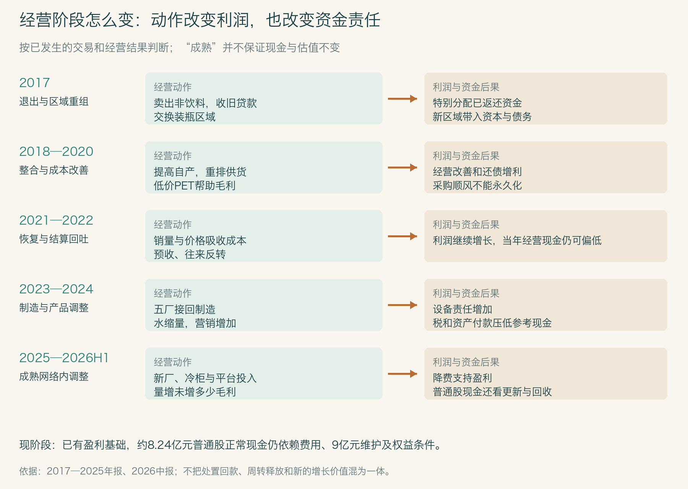

同一门生意在不同阶段面对不同问题：整合、采购环境、结算、更新分别影响利润与现金。

最近的矛盾在每笔订单留下多少：2026H1销量增加较快，集团毛利额却近乎不增；费用减少带来利润改善，新厂与终端又需要更新。新研究在约9.53亿元年度维护和60%收益归属条件下估普通股现金约7.26亿元，“成熟”并不保证这组条件永远成立。

依据 · 2025 年度报告 · 第148页；[2026 中期报告 · 第24页](https://www.hkexnews.hk/listedco/listconews/sehk/2026/0917/2026091700946_c.pdf#page=24)；中国食品v23：分层现金、留存与港元估值

### 什么变化会把公司带入下一阶段

若汽水的重复补货和单位贡献维持，果汁新品及现有工厂增加毛利，配送和推广支出没有同步吃掉增量，就有依据提高持续现金。陕西与平台还需将新增现金对应到全部已投、待投和后续维护，才能进一步承认增长价值。

若保住销量需要连续降价、更多促销和设备投入，现有网络虽仍有规模，盈利质量也可能减弱。先按实际支出下修正常现金，再看品牌需求和当地网络是否被竞争侵蚀，不能只用销量回升延续原值。

主业稳定但留存长期低息使用或项目迟迟不回款，损失发生在普通股兑现。应降低对应资金现值，或延长回收时间；一次预收回吐只改变当期收付，若预付模式持续弱化并需要新增周转，才进一步改变长期资金要求。

依据 · [2026 中期报告 · 第24页](https://www.hkexnews.hk/listedco/listconews/sehk/2026/0917/2026091700946_c.pdf#page=24)；[香港资金池资金委托管理协议公告 · 第3页](https://www.hkexnews.hk/listedco/listconews/sehk/2025/1110/2025111000773.pdf#page=3)；中国食品v23：分层现金、留存与港元估值

## 利润、周转和设备付款怎样走出不同轨迹

### 2018—2025年改善主要发生在哪里

把收入、销量和利润放在同一段历史里看，才能分辨中国食品主要靠什么改善。多卖饮料会增加收入，提高每箱留下的贡献也会增加利润；两种变化对以后的要求不同。前者需要市场继续吸收更多产品，后者依赖售价、产品组合、采购和服务成本的改善能够维持。下面从2018年这个较可比的起点，逐年还原这些因素。

中国食品2018—2025年收入由156.48亿元增至220.70亿元，归母净利润由3.21亿元增至8.62亿元。按逐年披露同比链算的销量指数，2018年为100，2025年约为106.8。销量的累计增长有限，利润改善主要发生在产品与价格结构、采购成本和经营费用上。

毛利扣掉销售和行政费用后，剩下的经营贡献从2018年的6.23亿元增至2025年的17.61亿元，占收入从3.98%升至7.98%。这个指标反映商品经营承担主要日常费用后的收益，尚未计入其他收入、融资、税和非控股股东分配。

毛利率由35.41%升至37.08%，销售费率由28.55%降至26.96%，行政费率由2.88%降至2.14%，商品与费用两端共同增加了经营贡献。不过，毛利率在2020年曾高至39.57%，随后回落，2024年销售费率又显著上升。长期改善是真实的，每年的利润仍受原料、产品组合和市场投放影响。

来源：各年报告。销量指数按披露同比链算，含范围变化；2023五厂并入，指数不是同范围有机增长。

依据 · 2018 年度报告 · 第132页；2025 年度报告 · 第97页；中国食品经营驱动取证与计算

### 2021—2022年现金低点：预收、往来和付款的变化

2020年经营现金净额22.14亿元，到2021年、2022年分别降为10.74亿元、11.41亿元；同期周转前经营现金反从18.36亿元增至19.35亿元、22.57亿元。利润和周转前经营能力仍在增长，现金低点主要出现在结算与税息支付环节。

2020年营运资金项目合计贡献约6.66亿元，2021年转为消耗约5.04亿元。2021年合同负债减少1.86亿元，前一年则增加1.80亿元；其他应付款当年仅增加1.71亿元，前一年增加6.82亿元；应收附属公司非控股股东往来又消耗2.54亿元。预收和应付款的支持减弱，关联应收增加，使前一年的收款顺风反转。2021年现金税另较上年多付约0.90亿元。

2022年周转进一步消耗约7.02亿元。其中合同负债减少5.94亿元，预付款、按金及其他应收款增加消耗3.67亿元，其他应付款减少消耗3.05亿元；应付贸易款增加及部分关联往来抵消了一部分。公司交付已经收款的订单会减少合同负债，新订单的预付款则补充余额。这两项未分开披露，单看余额下降不能确定是需求减弱还是交货时点变化。

这两年的现金低点主要出在预收、供应商和关联往来结算，周转前经营现金仍在增长。因此，正常现金估计将年度结算波动剥离；如果此后预收持续下降、收款账期拉长，公司长期需要垫付的资金增加，就应在估值中增加营运资金需求。

依据 · 2020 年度报告 · 第142页；2021 年度报告 · 第171页；2021 年度报告 · 第248页；2021 年度报告 · 第249页；2022 年度报告 · 第173页；2022 年度报告 · 第251页；2022 年度报告 · 第252页

### 2024年：水业务缩量，毛利改善被营销和一次项目抵消

2024年销量下降9.7%，年报主要解释为水品类转型升级。收入仍为214.92亿元、略增0.2%，平均收入结构上移，公司也提到提升价格与改善产品结构。水的缩量改变了集团产品组合，核心汽水的需求则由其自身销量和收入反映。

水业务的收缩延续了前几年的转型。2023年报已经说明，升级产品和提高价格影响水的总销量，收入稍降，后续仍准备重点发展纯悦和高端水。2024年销量进一步减少，是管理层继续调整产品组合的结果，也表明高单价产品尚未完全弥补退出或缩减的低价销量。收入结构上移能够提高每箱收入，现金改善仍要看毛利能否覆盖为维持客户和份额付出的推广费用。

除白糖以外主要原料采购价格下降，连同价格和结构调整，将毛利率推升至37.79%，毛利额增加5.77亿元。竞争又要求更多市场推广，销售费用增加4.01亿元，行政费用增加0.07亿元，经营贡献留下的增量为1.69亿元。原料和组合带来的大部分好处被服务市场的支出吸收。

2023年0.916亿元联营处置收益不再发生，补助减少0.851亿元，归母利润只增加0.28亿元。现金税比2023年多付约2.20亿元，长期资产现金付款由6.48亿增至7.75亿元。按零周转、扣全长期资产及租赁的集团参考口径，现金由15.33亿降至12.94亿元：税和资产付款的增加超过了经营改善。第五章再将集团现金分配到普通股。

来源：2023、2024年报。参考现金将周转归零、扣实际税息及全资产付款，仍未处理普通股归属。

2024年表明，较好的毛利率仍要依靠终端投入维持。正常收益应同时保留产品经营改善和相应的营销成本，不能只采用有利原料下的毛利高点。

依据 · 2024 年度报告 · 第21页；2024 年度报告 · 第29页；2024 年度报告 · 第30页；2024 年度报告 · 第99页；2024 年度报告 · 第104页；2023 年度报告 · 第95页；2023 年度报告 · 第20页

### 客户预收、渠道账期与关联往来

公司通过反复订货、先收款和交货，减少为下游垫资的需要，信用政策见第二章。2025年底合同负债13.08亿元，高于2024年底8.66亿元，公司预计在一年或以内交货；2025年初余额已经全部履约并转为收入。

先收后付的效果可以在基础商品周转中看到。2025年底，存货16.30亿元、贸易应收净额3.30亿元，合计19.59亿元；贸易应付及票据10.35亿元、客户预收13.08亿元，合计23.43亿元。后两项比前两项多约3.83亿元，说明这四项对应的周转由供应商账期和客户预付款提供了净资金。其他应收、促销应付、税及资本结算另有用途，四项差额只解释商品周转这一部分。

绿野风云的文章强调了经营负债可以滚动这一点。一批货交付后，原来的预收转成收入；下一轮订单又带来预收。供应商旧账付款的同时，新采购形成新的应付。只要产品持续卖动、客户愿意预付、供应商信用不收紧，公司就不必为全部日常周转预先投入自己的资金。这是成熟渠道的一项经济优势，也解释了为何判断支付能力要看收款和到期付款节奏。账上资金超过银行借款，并不意味着超过客户交货、采购结算和全部经营需用。

2025年底客户预收与供应商应付支持商品周转；下一轮预收能否补上，取决于持续订货和结算。

2026H1合同负债减少9.82亿元，同期库存释放5.63亿元，应收增加3.27亿元，应付贸易款增加6.14亿元，欠关联方款增加4.05亿元。合并这些变动，半年经营现金仍有17.61亿元。2025H1合同负债也减少6.86亿元，预收在两期都从年底向半年回吐，交货和收款存在明显的时间差。

两个上半年都出现较大预收回吐，表明交货和收款节奏确实会影响余额。2026年回吐更大，需要结合全年收款和后续补货判断。如果同时出现库存积压、回款变慢或退货增加，就意味着先款后货的资金优势在减弱，公司要自己垫付更多周转资金。

2025年现金流表列欠非控股股东款增加7.31亿元，为经营现金净额（CFO）提供正贡献。采购和结算中的债权人暂时提供了资金，公司以后仍须偿付。现金流变动与期末余额可能受其他调整影响，估值按相应债权和用途处理。

依据 · 2025 年度报告 · 第171页；2025 年度报告 · 第175页；2025 年度报告 · 第102页；[2026 中期报告 · 第28页](https://www.hkexnews.hk/listedco/listconews/sehk/2026/0917/2026091700946_c.pdf#page=28)；[2026 中期报告 · 第37页](https://www.hkexnews.hk/listedco/listconews/sehk/2026/0917/2026091700946_c.pdf#page=37)；2025 年度报告 · 第98页；2025 年度报告 · 第148页；2025 年度报告 · 第167页；[绿野风云：现金头寸和净现金的意义](https://www.xueqiu.com/5842207545/314028858)；已有八篇雪球文章：原文回读与经营分析恢复

### 维持现有能力，每年需要多少新设备和软件

会计折旧反映过去购置价的分摊。估值要承担的是今天继续提供同等产品、配送和冷饮服务所需的更新，而不是把账面折旧原封不动视作答案，也不是将所有新厂支出都叫增长后免扣。陕西迁建既替代旧厂，也加入新的生产和仓储能力；冷柜保住售点位置，同样可能属于必要投入。

本次按设备类别重建：楼宇原价2864.600百万元，替换价加5%，用30年更新；机器与终端设备原价7931.173百万元，替换价加5%，用10年更新。30年和10年在公司楼宇5—30年、机器5—15年的会计寿命范围内，但它们仍是本研究的经济更新假设，并非披露的实际全网更新周期。软件按TTM摊销20.360百万元估正常资本更新；已费用化的订阅和维修不再加一次。

楼宇100.261＋机器832.773＋软件20.360＝953.394百万元，即每年约9.53亿元。这里用的是全新同功能成本除更新年限，不用上一步资产法的剩余净值除年限。否则旧设备越多，算出的未来维护反而越少。

重建一套设施是存量问题，每年替换耗损是流量问题。两步采用不同的计算，不能把剩余净值当年度更新预算。

这个结果与实物投入相互核对：2024、2025设备添置分别6.503亿元和10.489亿元，TTM设备添置约9.844亿元，设备及软件摊销约8.634亿元。9.53亿元高于摊销约0.90亿元，处在近期混合添置的量级内；添置同时含更新和扩容，不能由“数接近”证明估值已经精确。2026H1设备添置5.615亿元、付款4.364亿元，资本应付增加1.245亿元，付款后移不构成维护需求下降。

较短更新周期、设备提价、迁建尾款及冷柜换型都可能推高必要投入。因此再算10.50亿元维护的压力情景。反过来，只有投入降低而销量、服务与售点竞争力同时保持，才能支持下调维护；不因某一年付款少就直接上调价值。

维持现有能力，每年需要多少新设备和软件 · 计算

| 类别 | 计算，百万元人民币 | 正常年度维护 |
| --- | --- | --- |
| 楼宇 | 2864.600×1.05÷30 | 100.261 |
| 机器、产线与终端设备 | 7931.173×1.05÷10 | 832.773 |
| 资本化软件等 | TTM摊销量级 | 20.360 |
| 合计 | 100.261＋832.773＋20.360 | 953.394 |

金额为人民币百万元；每股列为人民币元，估计条件不是披露事实。

依据 · 2025 年度报告 · 第126页；2025 年度报告 · 第158页；2025 年度报告 · 第159页；2025 年度报告 · 第161页；[2026 中期报告 · 第37页](https://www.hkexnews.hk/listedco/listconews/sehk/2026/0917/2026091700946_c.pdf#page=37)；[2026 中期报告 · 第39页](https://www.hkexnews.hk/listedco/listconews/sehk/2026/0917/2026091700946_c.pdf#page=39)

## 下一批披露要回答的五件经营问题

原F0的集团B定义、区间及期限不变。当前另跟踪7.26亿元正常普通股经营现金、资产重建、增长投入与资金分配条件。

### 汽水与新品能否留下单位贡献

2026H1汽水量+8.5%、收入+2.1%、经营利润+8%；果汁增量主要来自酷儿及两款新品。

FY2026、2027H1分别作全年与同季比较

汽水量收和利润、渠道净供价、果汁持续补货、水与功能饮料促销及设备投入。

量增而毛利不增时，不能提高正常现金；产品毛利增加仍需扣新增服务与投入。

### 全年销售投入是否维持当前效率

滚动十二个月销售费用58.58亿元，接近2024、2025完整年度；半年降费含推广时点变化。

FY2026完整年度，随后2027H1同季复核

毛利额、销售费用绝对额、推广安排、人员与配送成本，不能只比较费用率。

保持订单所需的持续支出增加，按相同税和权益范围下修现金；半年度时点移动先解释归属期。

### 正常收益、必要更新和递延税效是否改变

本轮正常营业利润17.446亿元，设备/软件加回8.634亿元，维护9.534亿元，经营税4.442亿元；集团E12.104亿元，普通股60%为7.263亿元。

下一年报和相应合同、项目付款披露

税款所属期；添置、实付、资本应付和承诺；递延合同主体、税务及新增收款。

先按同范围经营与资本事实复算；93.333递延与其他净收益的重叠及税效未核明，不把全扣的一端称公司价值下限。

### 客户预付和各层权益是否保持

2025年底合同负债13.08亿元，2026H1回吐9.82亿元；现金桥65%后再净扣U0.85亿元。

FY2026全年与2027H1同季

预收、存货、应付、关联结算；地方合作股东与全资平台各自的利润、更新和现金。

永久增加周转需求时另留资金；用实体现金替换U近似。地方有效权益已含上层持股，不能再乘65%。

### 分红、项目和关联资金实际怎样回收

2025普通股实付4.28亿元；FY2025末期4.31亿元为宣派/安排，香港3.9亿元短贷的后续具名回款尚待确认。

资金回拨、派付或项目披露时及FY2026年报

普通股真实付款；香港单笔期初、放款、回收、滚续和余额；陕西、五厂及平台后续投入和净现金。

实际回款支持兑现，长期低息滚续减少现值；不能给未配对项目追加增长溢价，亦不能用合计关联还款认定具体短贷已收回。

### 增长是否真正超过资本要求

集团有机增收1.9%、增益1.8%，每元增收需0.5元资本；新增收益/投入约10.17%，暂不采用溢价。

下一完整年度及具名新增项目结果

新增资本、净周转和同范围收益，实际分配及归属。

维持0.5资本强度仍只是近保值；资本需求翻倍或费用侵蚀时下调增长回报，不拿销量增长替代。

## 专题 · 悦享会：一家装瓶商怎样开始自己做线上零售

中国食品原来主要围绕商业客户做生意。公司把饮料生产出来，供给经销商、超市、便利店和餐饮客户，再由这些客户卖给消费者。厂家关注生产、供货和门店销售，顾客进店以后怎样选择、怎样付款，主要由零售商负责。

悦享会接过了其中一部分零售工作。它经营线上店铺，安排商品和促销，直接接消费者订单，再把货送到顾客手里。中国食品因此增加了一种接触消费者的办法，也开始承担零售商原来完成的工作。这项变化经过了多年的积累，平台合作、自营店铺、小程序和仓网逐步接在一起，形成了今天的业务。

## 从平台供货到自营店铺

2018年，中国食品设立电商事业部，推进与京东、天猫、盒马等平台的合作，开展产品上架、双十一活动和新品推广。公司也有面向商业客户的电商业务，并组建餐饮外卖团队，让饮料进入外卖场景。消费者购买饮料的地方在变化，中国食品随之把产品铺到新的入口。 2018年报：电商事业部与平台合作 · 第31页

2020年，公司开始建设线上旗舰店、培养直播团队，并上线快乐会小程序商城。自营店铺使公司更直接地参与顾客的选购过程：页面展示哪些商品，活动怎样安排，顾客通过什么入口下单，都成为公司自己的工作。公司与消费者的联系，也从提供商品向直接成交延伸。 2020年报：旗舰店、直播与快乐会 · 第19页

2022年6月，全资子公司中粮悦享会海南成立，接手此前开展的线上消费者营销。公司披露的设立目的，包括直接接触消费者、分析需求和组织营销。已有的线上业务由专门的公司承接，继续扩大。2023年报披露，悦享会直接面向消费者的D2C业务增长76%。同一报告在新零售渠道下另列自营店铺收入逾倍，分别按业务和店铺对象披露，没有逐项对应。 2022年报：悦享会成立与目的 · 第8页 2022年报：接手线上营销 · 第14页 2023年报：悦享会D2C业务 · 第13页

悦享会、快乐会和D2C，指的是这门生意中的不同事物。悦享会是经营公司，快乐会是消费者下单的小程序，D2C是“直接面向消费者销售”的简称。悦享会也在其他平台经营店铺，快乐会是其中一个购买入口。

## 悦享会怎样争取顾客的订单

可口可乐在超市、便利店和多家网店都能买到。顾客选定品牌以后，还会比较在哪家店买更合适：商品怎样组合，到手价格多少，多久能够送到，能否一次买齐。悦享会需要把这些具体事情安排好，才能把消费者对饮料的需求变成自己店铺的订单。

2025年报提到，悦享会采用线上线下不同的包装。不同规格和组合，给各渠道留下组织商品、安排价格和促销的空间。相同规格在不同渠道很容易直接比价；包装有所区别以后，顾客会结合购买数量、每瓶或每升价格、运费，判断哪种更合适。公司也借此协调线上活动与线下销售的关系。 2025年报：线上线下包装安排 · 第28页

店铺把商品组合摆到网页上，仓库就要能够按这个组合发货。顾客选好商品付款以后，仓库按订单取货，完成相应的拆包或组包，再交给快递。悦享会在安排商品时，既要让顾客觉得值得买，也要把发货需要的人工、包装和运输考虑进去。店铺里的商品安排，就这样与仓库的实际作业联系起来。

快乐会还通过微信支付合作吸引顾客。2026年上半年，公司用“摇一摇”折扣活动引流，披露小程序访问转化率达到73%、成交单量同比增长167%。消费者从活动入口进入小程序，优惠促进了成交。报告另列2490万会员中台活跃用户，这是会员系统的统计，与前面的活动和小程序成交指标分别反映不同范围。 2026中报：快乐会活动与会员数据 · 第13页

第一次购买以后，会员关系让公司有机会继续向顾客介绍商品。哪些活动有人响应、哪些商品有人购买，可以为下一次推荐提供依据。顾客愿意再次购买，前期建立的联系就能继续带来生意；经营者也需要持续安排商品、服务和促销。已有披露说明活动带来了成交，顾客之后怎样复购、需要多少维护费用，仍缺少连续数据。

## 一笔订单怎样从仓库送到顾客手里

工厂向经销商或大型零售客户供货，可以按商业订单安排整批商品。消费者订单更分散，购买数量和规格各有不同。付款以后，仓库要找到对应商品，完成拆包、组包和核对，再交给快递送到顾客手中。少发、破损或送达延误，则要继续处理售后。悦享会直接接订单，也接下了这段交付责任。

2025年报披露，悦享会建立了四大仓网，与多家快递合作，提供22城次日达服务，并具备仓内拆组包能力。各地仓库承担区域发货，拆组包处理店铺销售的不同组合。店铺承诺卖什么、何时送到，都需要备货、仓内作业和快递安排跟上。这些能力让线上销售有了实际交付的支撑。 2025年报：分区仓网、次日达与拆组包 · 第28页

零售收入要支付这段交付工作的开支。饮料有重量和体积，运输需要快递费，仓内整理商品和准备包装需要人工。过去零售商取得的差价，有一部分就是用来支付这些开支。悦享会把零售接到集团内部，取得了相应收入，也要自己付完这段工作的钱，最后留下的部分才构成零售利润。

仓网还需要先备货。商品放在仓库中等待销售，形成库存投入；订单成交后，通过收款逐步回收。采购付款与平台结算的账期，还会影响实际占用资金的时间。业务扩大时，商品库存和日常作业也要相应安排。悦享会的增长因此同时涉及销售和投入：线上多接订单，仓内需要有合适的货，并把每一笔订单及时送出去。

## 开始经营外部品牌，收入主体仍是原有饮料

悦享会也把线上经营能力用到了可口可乐体系以外的商品。2025年报披露，合作品牌已经达到19个；2026年上半年，非可口可乐产品销售3050万元，同比增长63%。其中，公司引入吉意欧，承接其天猫超市和京东业务，带来超过800万元增量规模。具体平台上的商品经营交给悦享会，原有团队由此服务了新的品牌。 2025年报：合作品牌 · 第28页 2026中报：非可口可乐产品与吉意欧 · 第13页

这类合作可以利用已有的店铺运营和仓配经验。悦享会原本就在维护店铺、组织活动、管理仓库和安排发货，接入其他品牌后，这些工作能够继续发挥作用。同时，新商品的采购、库存和推广也进入了经营范围。现有披露给出的是销售规模，商品差价和代运营服务费各有多少，尚未分别列出。

3050万元约占悦享会同期7.52亿元运营收入的4%。外部品牌增长较快，所占份额仍小。悦享会现阶段的销售规模主要来自可口可乐体系商品，外部合作则扩大了商品范围，也让团队积累了服务其他品牌的经验。

## 货量增长以后，收入和利润怎样变化

2026年上半年，悦享会销量达到3086.7万标箱，同比增长25%；运营口径收入为7.52亿元，同比增长19%。标箱把不同包装的饮料折算为统一数量，25%的增长说的是饮料货量。消费者一笔订单可以包含不同包装和数量，所以订单数与标箱数各有自己的含义。 2026中报：销量与两种收入口径 · 第13页

货量增长快于收入，平均每标箱带来的收入便有所下降。把上年销量和收入都看作100，本期分别是125和119；119除以125等于95.2%，相当于平均每标箱运营收入下降约4.8%。这个平均数汇集了不同产品、包装和销售组合，同一商品的价格变化只是其中一种影响。

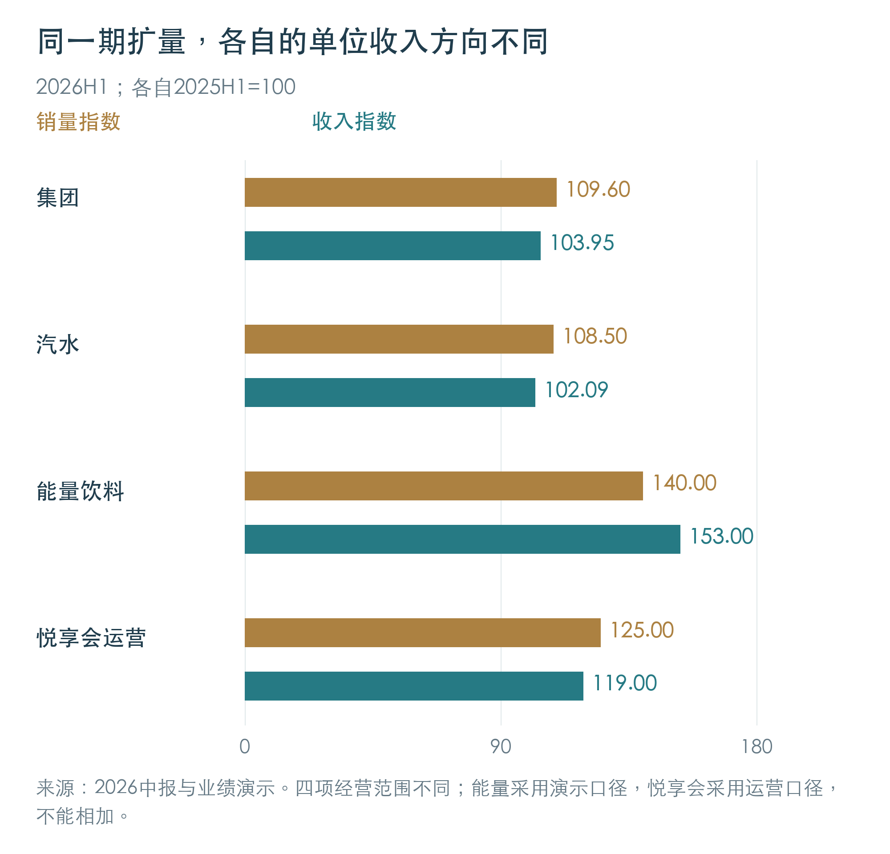

悦享会这一期卖出了更多饮料，也取得了更多收入。每标箱收入降低以后，商品采购和完成订单的开支，会影响增长最终能留下多少利润。卖出的商品不同、每笔订单的组合不同，对采购和配送的要求也不同。公司尚未单列悦享会的成本和利润，这部分结果还无法从现有收入、货量中算出。

报告另外披露合并口径收入7.22亿元，同比增长16.9%，以及D2C渠道收入达到预算的111%。前面的每标箱计算采用与销量一同披露的运营收入7.52亿元；7.22亿元是合并收入统计，111%表示实际完成额超过内部预算。运营与合并两种收入统计之间的差额，报告没有进一步拆解。

悦享会收入与集团的汽水、果汁收入，也是在从不同角度描述同一批商品。一笔汽水销售，按渠道看属于悦享会，按商品看属于汽水。渠道统计显示饮料通过哪里卖出，品类统计显示卖了什么；这部分收入存在交叉，集团总收入在合并报表中汇总。

## 从零售收入到股东收益

悦享会海南由中国食品全资持有，主要装瓶业务则通过持有65%权益的中粮可口可乐经营，部分下属公司还另有其他股东。一瓶饮料从制造到零售，在不同环节形成的利润，对应着不同的股权归属。 2025年报：装瓶公司股权 · 第177页 2025年报：悦享会全资主体 · 第181页

装瓶公司把饮料供给悦享会，悦享会再卖给消费者。合并报表抵销集团内部的供货，留下对消费者的外部销售。制造和分销环节的利润，按相应装瓶公司的股权关系分享；悦享会扣除采购、促销、仓配、售后等开支及税费后，留在本公司的利润全部归上市公司。零售收入增加，股东最后得到的，是完成这段经营之后留下的收益。

渠道变化也会改变集团原有生意的收入和开支。原来在集团供货门店购买的顾客，转到悦享会下单，零售环节就进入了集团；新顾客加入，或者原有顾客买得更多，还会增加商品销售。两种变化可以同时发生。现有披露没有拆出各自份额，能够确认的是悦享会销售扩大，集团开始直接服务更多消费者订单。

悦享会已经建立起线上店铺、商品运营和仓配能力，也开始服务外部品牌。它让中国食品可以随着消费者购买方式的变化，继续经营熟悉的饮料生意。已有经营进展值得认可，独立利润、连续复购和完整资金投入仍未公开。现行估值把已有贡献放在集团现金中，进一步扩张能留下多少额外收益，等这些经营结果更清楚以后再计入。

## 专题 · 中粮智尚：设备网络、直营产出与城市联营

一台自动售货机把选商品、付款和取货放在同一个位置。消费者付完钱拿走饮料，经营者收到零售收入；机器后面仍需要商品采购、场地、补货、清洁和维修。智尚要做的，是让许多分散设备持续完成这样的购买，并让设备收入足以支付服务和更新成本。

## 先分清门店冷柜与自动售货机

中国食品投放的门店冰柜，主要帮助店主把饮料以适合即饮的温度卖出去。装瓶商取得对商业客户的供货收入，顾客在店里支付的零售价由门店收取。双温柜又把设备延伸到冬季热饮，中粮2022年披露冬奥村使用600台。这样的投入应当通过装瓶供货增加的收益回收，600台是具名场景的设备数。2025年报：对商业客户供货 · 第148页[中粮：冬奥双温柜](https://www.cofco.com/cn/News/Allnews/Latest/2022/0801/51763.html)

智尚直营自动售货机则由公司直接经营终端销售，消费者付款后，公司取得零售收入，同时承担场地、库存、补货和维修。两种设备都把饮料送到购买现场，但收入和成本的范围不同。直营机还可以利用设备屏幕和交易过程经营广告等服务，形成饮料销售之外的收入。2025年报：智尚智慧零售 · 第28页2025年报：设备与运营 · 第29页

## 从早期盈利到扩大运营网络

智尚已经有数年的实际经营记录。2021年公司披露，智慧零售管理近2万台设备，销售额超过3亿元，首个完整运营年度盈利超过1000万元。2022年收入同比增长76%；2023年收入又超过翻倍，业务覆盖30个省份、280多个城市。这段历史说明公司先有设备和销售，随后继续扩大网络，早期已经取得过利润。2021年报：设备、销售及首次盈利 · 第14页2022年报：智慧零售增长 · 第14页2023年报：收入与覆盖 · 第21页

2025年，设备网络覆盖31个省份、400多个城市。2026年上半年报告设备总量165691台，同比增长48%；直营可控收入5.7亿元，同比增长27%。网络设备与直营收入的范围分别披露，数字可以说明各自的扩展进度，不能直接用总设备去除直营收入，计算所有机器的平均产出。2025年报：经营覆盖 · 第28页[2026H1业绩演示：设备及直营可控收入 · 第12页](https://cdn.financialreports.eu/financialreports/media/filings/49257/2026/RNS/49257_rns_2026-08-25_559c59b7-309d-46de-bc9c-ae3549c10f8a.pdf#page=12)

## 一台机器怎样持续卖出商品

售货机投放以后，经营工作每天都在继续。办公楼、学校和社区的顾客不同，适合的商品和购买时段也不同。运营者要观察哪些货卖得快，及时补入；较慢的商品则要调整数量与组合，减少库存占用和临期处理。出货故障或支付问题也要有人处理，设备才能继续完成交易。

公司披露使用“蓝京灵”平台查看缺货与出货故障，并建设区域中心仓、安排补货。库存信息帮助运营人员决定带什么货、去哪台机器；中心仓和路线组织影响一次补货能服务多少设备。2026年上半年还恢复支付后广告等业务，开始同时经营商品交易和机器上的其他收入。业绩演示列出的8188万元非饮料收入尚未拆出广告、设备与其他项目，本文保留这一整体披露范围。2025年报：中心仓与缺货故障治理 · 第29页[2026上半年演示：运营平台和非饮料收入 · 第12页](https://cdn.financialreports.eu/financialreports/media/filings/49257/2026/RNS/49257_rns_2026-08-25_559c59b7-309d-46de-bc9c-ae3549c10f8a.pdf#page=12)

同期直营单机月收入2178元，同比增长9%，按30天换算约为每天73元。这个换算便于理解收入量级：每台机器要先取得销售收入，再支付商品、场地和服务成本，剩余部分才能回收设备投入。单机收入增加是已披露结果，系统和运营调整是公司正在做的工作；现有资料没有拆出各项措施对这9%的贡献，所以不能把增长全部归因于某一套技术。[2026上半年演示：直营单机收入 · 第12页](https://cdn.financialreports.eu/financialreports/media/filings/49257/2026/RNS/49257_rns_2026-08-25_559c59b7-309d-46de-bc9c-ae3549c10f8a.pdf#page=12)

## 城市联营把哪些工作交给伙伴

2026年4月，智尚面向拥有本地资源的经销企业招募城市合作伙伴，6家企业签署战略协议。公布的合作架构由智尚统一品牌、运营和供应链，输出选址评估、筹建和日常运维能力，面向办公、社区、校园等场景。传统经销商可以从送货给门店，进一步参与终端零售；智尚则借助合作方进入当地市场。[2026城市联营大会：合作对象与职责](https://www.cfsn.cn/news/detail/2137/344913.html?view=pc)

具体回报取决于合同怎样分工。机器由谁购买，场地由谁取得，补货人员和维修由谁支付，都会改变双方最终留下的现金。公开材料给出了合作方向，尚未给出完整出资和分账条款，也没有证明签约的6家已经全部投入稳定运营。因此，16.57万台继续按整体网络规模理解，5.7亿元与2178元分别按直营指标使用。

## 收入增长怎样成为股东现金

智尚科技是上市公司全资业务，2025年附属公司表列注册资本1.3亿元。注册资本说明法定出资安排，设备购买、后续供资和经营积累会使实际投入与这个数不同。评价扩张需要把设备、软件、仓储和周转资金的实际支出放在一起，再与扣除日常费用后的现金比较。2025年报：智尚权益和注册资本 · 第181页

设备还会经历更新。新机器刚铺出时，营业额很快可以观察，换机和淘汰支出则往往较晚出现。持续经营的利润要为这个周期留下空间。一批设备在使用几年后仍能维持收入，并从自己的现金中支付维修和替换，才更有依据说明增长能够自我支持。

现有证据支持两项判断：智尚早期已经盈利，近期直营单机收入继续提高。当前集团现金起点已经包含现有业务的经营结果，估值另加的新价值需要以后新增净现金支持。后续最有用的资料是成熟设备的收入与维护、合作方实际分工，以及每批扩张投入后留下的现金；这些资料能帮助判断继续铺机是在增加股东收益，还是持续消耗原本可以分配的钱。

## 专题 · 产品组合：汽水守住现金基础，新增长仍要留下利润

产品组合可以先理解为“卖出去的饮料里，各种商品各占多少”。同样卖出一箱容量，高价即饮包装与低价大包装带来的收入不同，水、汽水和果汁的成本也不同。因此，集团多卖了多少容量、增加了多少收入、最后增加多少利润，是三个相连但各自需要解释的问题。

中国食品从2017年的8品类16品牌扩展到2025年的10品类25品牌，但收入仍高度集中。2025年汽水166.85亿元、约占75.6%，果汁30.28亿元、占13.7%，合计约89.3%；水9.29亿元、占4.2%，功能饮料3.20亿元、占1.5%。汽水维持主要盈利，果汁需要修复，功能饮料增加新收入，水则考验低价销售能否付得起配送。这几项业务的规模和成本差异，比品牌数量更能解释利润。 2025年报：经营回顾 · 第24页 2025年报：商品类型收入 · 第148页

### 收入增量正在分散，盈利基础仍集中

各品类收入增量由中报同季商品类型收入相减得到，合计约4.85亿元。汽水贡献约四成，果汁和功能饮料各贡献约两成。它解释新增销售来自哪里，不是利润权重。悦享会和售货机卖出的汽水、果汁已计入对应产品，渠道收入是同一销售的另一种分类。2026中报：渠道经营 · 第14页2026中报：利润表 · 第24页2026中报：商品类型收入 · 第32页

### 多卖饮料与多留现金是两件相接的经营工作

2026H1销量增长9.6%至8.10亿标箱，收入增长4.0%至127.63亿元，集团平均收入/标箱按这两项展示增速计算约下降5.1%。毛利额只增加约403万元，销售费用却减少约9077万元，行政费用增加约2338万元。毛利减销售及行政费用留下的经营贡献增加约7142万元，本期利润改善主要来自销售支出减少。更多饮料通过了生产线和配送网络，但较低单位收入与毛利率吞掉了大部分新增毛利。2026中报：经营与毛利解释 · 第9页2026中报：财务回顾 · 第14页2026中报：利润表 · 第24页

产品结构有实际作用。2025年水销量双位数增长、收入只增加4.3%，公司明确说低毛利水占比上升拉低集团毛利率。功能饮料仍处小基数，增加约1.05亿元收入，净贡献需要扣除产品成本和销售投入。汽水本期经营利润增长8%值得肯定，它说明核心品类能在价格与结构压力下改善经营，虽未披露绝对利润额和占比。2025年报：水品类 · 第26页2025年报：功能饮料 · 第27页2025年报：商品类型收入 · 第148页[2026H1演示：汽水利润 · 第7页](https://cdn.financialreports.eu/financialreports/media/filings/49257/2026/RNS/49257_rns_2026-08-25_559c59b7-309d-46de-bc9c-ae3549c10f8a.pdf#page=7)

2018年的新品组合提供了一个较清楚的对照：它占销量3.5%、收入7.2%，按两项占比计算，单位销量收入约为集团平均的2.06倍。公司同时披露，高毛利新品与生产效率改善抵消了除白糖以外主要原料涨价的压力。当年的包装与配方包括摩登罐、无糖及纤维系列，以及1升果汁家庭装和300毫升多支装。新品怎样提高组合收入，有销量、收入占比和具名产品可以相互核对。 2018年报：新品占比、原料与毛利 · 第26页 2018年报：汽水包装与配方 · 第27页 2018年报：果汁包装 · 第28页

2019年公司将收入快于销量的增长归于价格和包装结构改善。2026H1则不同：集团和汽水每标箱收入都下降，能量饮料每标箱收入提高。减糖、高价配方、大包装与促销同时存在，小品类的改善不足以抵消整体单位收入压力；本期增利主要靠销售费用减少。 2019年报：价格与组合解释 · 第18页 2026中报：收入、毛利及销售支出 · 第24页 [2026H1演示：能量饮料量收 · 第10页](https://cdn.financialreports.eu/financialreports/media/filings/49257/2026/RNS/49257_rns_2026-08-25_559c59b7-309d-46de-bc9c-ae3549c10f8a.pdf#page=10)

经营资源应优先维护汽水，再沿已卖动的产品修复果汁、扩大能量饮料。汽水体量最大，2026H1销量与经营利润都增长约8%；果汁恢复能追到酷儿与两款新品；能量饮料的收入增速快于销量，单位收入也提高。水恢复销量时低毛利占比增加，应优先利用已有客户和线路，控制额外配送与设备支出。

2018年工厂仓配整合、近期费用控制、果汁重新投放和智尚单机收入提高，都是管理层已经做出的经营改善。下一阶段资金更多投向新渠道、设备和产品，成绩就需要看新增收入扣完这些投入后能留下多少。经营增长值得肯定，但资金回报决定扩张是否划算。 2026中报：果汁增量来源 · 第11页 2026中报：毛利与费用 · 第24页 2026中报：分品类增量 · 第32页

### 这些判断怎样进入估值

中国食品适合按成熟装瓶业务估值。汽水仍有顾客，区域网络能把订单转成利润，整合和费用控制也有实际记录。百事、茶饮和上游浓缩液价格构成持续压力，因此估值依靠守住现有现金，而非预设年年提价。

本轮三步研究重新正常化经营利润、按楼宇和设备周期估每年9.53亿元维护，并区分外部权益，得到普通股正常经营现金约7.26亿元的条件。完整十二个月销售费用约58.58亿元，能否维持现有销量和毛利仍须观察；不因本期新品表现好就自动上调正常盈利。

不增长、普通股收益份额60%、不另加未经证明余资时，10%资本成本对应约2.60元人民币/股。普通股每年必要维护负担增加0.60亿元，会令这一价值约少0.215元人民币；集团收入增长还需新增设备与周转资金。本次增长条件的增量收益/新增投入约10.17%，只接近10%资本要求，暂不为扩张另付溢价。完整资产、盈利与增长计算见当前现金与估值主报告。

悦享会、智尚和魔爪已有利润包含在集团现金中，以后的增长要扣掉为它追加的资金。收入增长快并不足以单独增加估值；如果投入长期收不回来，还会损害原有留存资金的价值。

## 专题 · 经销商与门店：价差、服务与补货

饮料从工厂到消费者，通常要经过经销商和门店。经销商提前备货、把商品送到不同售点，门店提供货架、冷饮和现场服务。两者都要占用资金并支付日常费用，愿意继续进货和推荐商品的前提，是售出的速度和留下的差价足以支撑自己的经营。中国食品扩大覆盖和调整直配时，改变的正是这套工作与收益分工。

中国食品已有工厂、仓库、送货线路和反复补货的门店，推销员不必从零建立交易。可乐GO和直配继续减少接单及配送中的重复工作。面对百事等同样有网络的对手，门店愿意卖哪种产品，取决于价差、周转、补货速度和顾客选择。

## 一笔对经销商或零售客户的销售

集团把成品送到客户指定地点、转移商品控制权后确认收入。交货后的客户自行决定分销方式和转售价格，并承担商品报废、损失和转售的主要责任。在经销路径中，经销商先向集团订货并承担货款，再把饮料卖给门店，由门店卖给消费者；集团在向经销商交货这一步取得收入。 2025年报 第148页 · 第148页 2025年报 第167页 · 第167页

公司还直接向零售店、餐饮客户供货，并与重点连锁客户合作。KA是重点客户的简称，由连锁总部、门店还是区域主体下单付款，以及送到哪个仓库，按具体合同安排。 2024年报 第27页 · 第27页

集团向经销商交货时已确认销售，消费者购买发生在后面。货如果积在渠道里，下一轮补货就会减少。经销商库存未连续披露，公司出货增长需要结合后续订货判断其持续性。

## 一箱饮料的价差怎样分给经销商和门店

经销商要用进销差价支付仓储、送货、货损和垫资，门店还要承担冷藏与场地费用。中国食品2025年报明确，交货后转售和主要货损责任由商业客户承担。厂家确认出货时，渠道还没有完成赚钱的过程；卖得慢或利润不足，就会影响下一次订货。 2025年报：销售确认与客户转售责任 · 第148页

2024年6月，苏影采访的一位华北餐饮配送商说，500ml汽水每箱进价涨约7元，供价只涨5元。他的开票购销差额因此缩小约2元。另一位西南县域配送商也暂时自行承受进价上升。这些是可口可乐101渠道的局部经历，报道未列供货装瓶公司的名称；返利和配送费用仍要另结，2元不是净利润变动。 [苏影餐饮配送渠道访谈](https://www.inewsweek.cn/yysbg/2024-06-11/22269.shtml)

厂家提高开票价后，配送商要看餐饮店肯不肯接受，店主又要看顾客会不会转去别家。一层暂时承担涨幅，可以维持货物流转；价差长期不足以支付服务，经销商就会减少拜访、压低库存或转推别的产品。厂家的提价最终能否留下来，取决于下游还愿不愿意接着经营。

中国食品2024年增加直接服务客户，2025年又在下沉市场发展区域特许经销商（RFP）。直配让公司接近终端订单，经销合作借助当地已有资源。两种路径并行，比全部自行配送更能适应分散市场：取得中间价差的同时，也要有人支付仓储、送货和客户维护。公司尚未公开具体线路的划分规则。 2024年报：直接服务客户与渠道经营 · 第27页 2025年报：下沉市场RFP · 第17页

## 一次提价怎样穿过整条渠道

海通国际2024年7月18日的中国食品报告记录了一个具体过程：2023年下半年，500毫升PET汽水零售价由3元升至3.5元，出厂价约提高5%；百事直到2024年二季度才跟进。报告将这段先后差与当时需求偏弱联系起来，判断中国食品阶段性承受销量和份额压力。渠道调研没有列明门店样本，但它比“可口可乐有提价能力”更接近实际经营：竞争者尚未跟涨时，先提价的一方要承担消费者转买其他产品的风险。 [海通国际2024-07-18：中国食品渠道调研 · 第1页](https://pdf.dfcfw.com/pdf/H3_AP202407191638082098_1.pdf#page=1)

终端每瓶多收0.5元，不会全部成为装瓶商收入；零售价与出厂价的基数不同，涨幅也不能相减为渠道利润率。经销商还要结算返利、货损及仓配。海通记录的调价过程与101配送访谈共同表明，下游传递涨幅需要时间，部分经销商会先承担进价上涨，品牌带来的提价机会受渠道承受力约束。 [海通国际：零售与出厂调价 · 第1页](https://pdf.dfcfw.com/pdf/H3_AP202407191638082098_1.pdf#page=1) [苏影：2024年餐饮配送商采访](https://www.inewsweek.cn/yysbg/2024-06-11/22269.shtml)

## 门店要的是卖得快、占地少、留下钱

2026年6月的果汁报道中，经销商赵谦提到，一些店主会把冰柜电费和陈列回报一起算，甚至自己购置二手冰柜，以便选择不同品牌。报道未指明其供货装瓶公司；这段访谈的价值在于解释店主的选择。厂家提供设备，换来的是冷饮可得性和陈列位置；店主若能用自有设备卖更多高贡献商品，就有了接受或拒绝专属陈列的筹码。 [付艳翠：经销商关于冰柜与陈列的访谈](https://www.xueqiu.com/5899108858/395796675)

冰柜放进经常补货的门店，可以增加冰饮销售，也给原有送货线路增加货量；放在卖不动的地方，设备、维修和拜访支出就先落到公司。设备数量本身不能衡量渠道成绩，补货频率和投放后的净收益才决定这笔投入是否划算。

富勒公开的中粮可口可乐项目从2019年北京厂开始。同类饮料要区分包装版面、产地和生产批次，客户对日期的要求也不同。系统按订单匹配批次并分配库存，仓内拣货时运输系统同步排车；库位按周转快慢重排，叉车和混合托盘拣货通过语音指导。原来靠人员记忆和现场协调的挑批次、找货及装车，变成统一作业，减少错配与搬运。这是供应商披露的局部项目，未单列当期集团节约金额。 [富勒：北京厂及相关仓库的批次、库位与发运作业](https://www.flux.com.cn/CustomerCase/info/900)

## 传统零售、可乐GO与重点客户

可乐GO接的是门店向供货方补货的订单。中粮2021年12月回顾称，2020年用7个月将系统推广到超过150万家客户；同文把服务终端商户的可乐GO与面向消费者的快乐会分开介绍。商户可以在手机上看商品、优惠、下单和查配送，业务员仍可拜访及代下单。2024年报披露自主下单金额增加、整体销售效率提高。它省掉的是部分重复接单与传单工作，交货、陈列和客户维护仍需有人完成。 [中粮2021-12-15：可乐GO与快乐会的不同客户](https://www.cofco.com/cn/News/Allnews/Latest/2021/1215/51085.html) 2024年报：自主下单与销售效率 · 第27页 [可乐GO开发者：订货、配送及支付](https://apps.apple.com/cn/app/%E5%8F%AF%E4%B9%90go/id1093345922)

服务商北京友生意把可乐GO介绍为连接品牌、经销商和终端的系统，销售管理模块还容纳业代拜访、代下订单和门店管理。店主自己补货以后，业务员可以减少重复接单，把时间用于新售点、陈列和动销；经销商仍可在体系内供货。可乐GO改变的是订单和服务的组织，线上订单增长不代表整笔生意已经改成直营。 [北京友生意中粮可口可乐案例](https://ysyboom.com/)

2024年报称，直营服务客户数量增长，可控业务收入约占整体90%。这一比例涵盖公司组织管理的多种路径，年报未将它定义为直营收入：现代渠道调整品类、包装、陈列及促销；餐饮渠道开发高质量及头部连锁客户；2025年区域特许经销商继续服务下沉市场。中国食品通过直接服务和经销合作扩大触达。 2024年报 第27页 · 第27页

## 售价、返利和销售费用怎样影响收入

集团出货价与消费者支付的零售价分属前后两笔交易。交货后的购货客户可以自行决定转售价格；公司则通过品牌活动、包装、陈列和促销影响终端需求及渠道利润。分析公司收入时，应使用集团对客户的成交价格。 2025年报 第148页 · 第148页 [2025中报 第41页 · 第41页](https://www.hkexnews.hk/listedco/listconews/sehk/2025/0919/2025091900590.pdf#page=41) 2025年报 第28页 · 第28页

呵呵2017关于农夫山泉的文章强调，消费者成交价、厂家净收款与经销商经营意愿要连着看。折扣店或线上卖得更便宜时，有几种不同的账：厂家降低净供价，利润先从装瓶环节让出；经销商或门店少赚价差，压力先落到渠道；平台出补贴，消费者少付的钱可能由平台承担；仓配和周转效率提高，则可以用较低成本支持低价。仅看最后一张价签，分不出是哪一种。中国食品的成交收入、客户返利及销售费用共同记录了厂家实际承担的部分。 [呵呵2017农夫山泉文章阅读笔记](https://www.xueqiu.com/1373067614/384792146)

让利有一部分直接减少收入。数量折扣影响预计交易对价；支付或承诺给客户、又不是换取可区分货品或服务的返利，也从收入中扣减。营销促销和物流支出另计费用。2025年末应付销售折扣约3.34亿元，应计营销促销约15.87亿元，应计物流约0.51亿元，分别对应尚待结算的折扣、推广和配送责任；全年销售费用由损益表反映。 2025年报 第118页 · 第118页 2025年报 第119页 · 第119页 2025年报 第170页 · 第170页

2026H1销售费用减少9077万元，集团毛利只增加403万元。本期管理层的主要成绩，是在卖出更多饮料时压低销售支出。利润改善依赖这项费用节约，若以后必须重新增加推广和服务才能保住销量，当前利润就会受到侵蚀。 2026中报 第14页 · 第14页 销售费用原表核对 2026中报 第13页 · 第13页 经营原件回读笔记

供货价直接降低会减少收入，推广和物流则计入费用。中报尚待支付的营销促销款约15.07亿元、物流款约1.32亿元，是已经计提但未结算的责任。损益表反映费用发生，现金流反映付款，两者共同决定利润何时变成可用资金。 2026中报 第39页 · 第39页

## 经销网络怎样进入股东所得

经销商的购销差额留在经销企业，门店零售差额留在门店。中国食品取得的是装瓶销售扣除制造和自身服务成本后的贡献，中粮可口可乐由上市公司持股65%；因此不能用消费者零售价倒算上市公司所得。现有现金判断已包含既有销售网络，不因订货改到手机上另加平台价值。 2025年报 第148页 · 第148页 2025年报 第177页 · 第177页

## 补货、返利与直配成本

FY2026和2027H1继续核对毛利与销售支出：销量维持而支出稳定，支持目前的现金估计；新增让利、服务和设备支出超过扩量所得，就应调低正常现金。

## 专题 · 成熟产品的更新：无糖、包装与果汁修复

一款已经卖了多年的饮料，更新的目的往往是让熟悉它的人继续购买。有人开始少喝糖，有人需要随身小瓶，有人希望同样的钱买到更多容量，公司便分别调整配方、包装和规格。中国食品的汽水与果汁都在做这些工作，但所处阶段不同：汽水要维护庞大的既有需求，果汁则要把经历下滑的销售重新做起来。

### 无糖扩大选择，传统汽水仍承担基本盘

2020年无糖及纤维+系列合计增长近50%，2021年无糖汽水增长超过50%；原披露没有统一明确这两个增幅的量或收入口径。2023年无糖收入又下降，汽水微增主要由传统产品带动；2025年含糖与无糖收入一起增长，无糖增长高个位数。无糖经历扩张、回落与恢复，产品更新的成效需要放在整个汽水业务中评价。2020年报：无糖及纤维系列 · 第22页2021年报：汽水 · 第21页2023年报：汽水 · 第18页2025年报：汽水 · 第25页

2026H1无糖可口可乐收入增长10.5%，无糖芬达增长60.2%，汽水整体销量增长8.5%、经营利润增长8%。平均每标箱经营利润约下降0.5%，大致守住；每标箱收入下降约5.9%，并未同比例传到利润。无糖与包装调整的主要作用，是在消费偏好变化时维持这门成熟生意。 [2026H1演示：品牌增速、整体量收及利润 · 第7页](https://cdn.financialreports.eu/financialreports/media/filings/49257/2026/RNS/49257_rns_2026-08-25_559c59b7-309d-46de-bc9c-ae3549c10f8a.pdf#page=7)

公司用摩登罐、迷你罐、多支装、大包装零度可乐和248毫升口袋瓶服务即饮、随身、家庭配餐与分享；2026年又以益生元配方进入餐饮和辣食，无糖柠檬味可口可乐配合便利店陈列及跨品类捆绑。较高定价和组合优惠都要在产品成本、实际折让与推广之后看收益。

### 包装怎样改变收入：曾经减量提价，也会加量保销量

国金证券2019年深度报告拆开了2018年前后的包装动作。可乐口味没有根本变化，包装、容量和销售场景已经能够改变一次购买的收入结构。 [国金证券2019深度：包装、容量和即饮结构 · 第23页](https://img3.gelonghui.com/pdf/91e20-e3a986fa-47c6-46f2-90ed-4b5d08904cef.pdf#page=23)

历史上的另一种做法，是将部分330毫升矮罐换成同容量摩登罐，以外观支持售价；即饮包装占比提高，也同时改变单位容量收入和服务成本。

两种容量调整对每升收入的方向正好相反。在瓶价不变时，600毫升改为500毫升，算术上使每升售价提高20%；420毫升改为450毫升，则使每升售价下降约6.7%。2025年美汁源部分非橙口味采用了后一种做法，增加容量争取购买。小瓶化可以提高单位液体售价，却仍要付瓶盖、标签及送货成本；加量则先让消费者得到更多液体，再靠销量和生产组织争取补偿。管理层是在不同产品的需求条件下作取舍，不能把两者一概写成包装升级。 [国金2019：部分即饮瓶600转500毫升 · 第23页](https://img3.gelonghui.com/pdf/91e20-e3a986fa-47c6-46f2-90ed-4b5d08904cef.pdf#page=23) 2025年报：美汁源420转450毫升 · 第26页

### 价格随规格和渠道变化

价格也取决于在哪里买、是否促销。搜狐财经2023年5月北京走访发现，物美500毫升可乐卖3.6元，同店888毫升促销会员价却为2.99元。对顾客而言，大瓶可能更便宜；对公司而言，小瓶即饮、大瓶家庭装和促销装要同时经营。这个历史门店例子说明，单看一个规格的价签，很容易误判整条产品线的售价变化。 [搜狐财经：2023年北京门店走访](https://xueqiu.com/8647410512/251378890)

百事可乐、7喜和美年达也经营无糖、口味和包装，争夺佐餐、宴席、校园和年轻消费者；农夫山泉的碳酸茶“冰茶”、东方树叶1.5升家庭装，以及康师傅冰红茶、无糖茶又进入部分相同场景。无糖本身不是排他优势，可口可乐体系的价值仍在消费者愿意反复买、售点能够持续供应。若含糖流失持续超过无糖新增，促销铺货仍不能稳住汽水总体销量，成熟需求的持续期就需要缩短；若销量和每箱经营贡献一起维持，包装更新便有经济成效。[康师傅2025年报：饮品竞争 · 第19页](https://www.masterkong.com.cn/wp-content/uploads/2026/05/C322_ARs_4c1cac99.pdf#page=19)[康师傅2025年报：果汁与汽水 · 第20页](https://www.masterkong.com.cn/wp-content/uploads/2026/05/C322_ARs_4c1cac99.pdf#page=20)[农夫山泉2025年报：茶饮料 · 第19页](https://www.hkexnews.hk/listedco/listconews/sehk/2026/0417/2026041701390_c.pdf#page=19)[农夫山泉2025年报：新品 · 第24页](https://www.hkexnews.hk/listedco/listconews/sehk/2026/0417/2026041701390_c.pdf#page=24)

### 果汁先修复卖动能力，再看利润恢复

2025年中国食品果汁收入下降3.4%，太古内地果汁收入下降3%、销量下降4%，农夫山泉果汁饮料收入却增长26.7%。农夫山泉经营NFC、17.5°及900毫升100%鲜果冷压榨橙汁的会员店渠道，统一以鲜橙多罐装进入餐饮和宴席，并经营低糖柚子和100%果蔬汁。低浓度果汁饮料经营平价佐餐和即饮，强调原料与纯果汁的产品争取另一类需求。同行表现的分化表明，中国食品果汁的恢复还要靠自身产品与渠道调整。2025年报：果汁 · 第26页[太古2025年报：内地饮料 · 第50页](https://www1.hkexnews.hk/listedco/listconews/sehk/2026/0408/2026040800985.pdf#page=50)[农夫山泉2025年报：果汁 · 第22页](https://www.hkexnews.hk/listedco/listconews/sehk/2026/0417/2026041701390_c.pdf#page=22)[统一2025年报：产品 · 第19页](https://www1.hkexnews.hk/listedco/listconews/sehk/2026/0427/2026042700614.pdf#page=19)[统一2025年报：果汁 · 第20页](https://www1.hkexnews.hk/listedco/listconews/sehk/2026/0427/2026042700614.pdf#page=20)

中国食品2025年重新按地区、规格和渠道投放酷儿；美汁源部分非橙口味由420毫升改为450毫升、价格不变，并增加桃、青提、红提和热带果粒，配合派样、揭盖扫码和箱码营销。加量不加价提高了消费者获得的容量，也增加每瓶灌装的液体用量；包装成本还受瓶型、材料和采购安排影响。公司要用销量与生产效率改善，抵消让利对单位贡献的压力。2025年报：酷儿、美汁源和包装 · 第26页

2026H1果汁收入从16.746亿元增至17.805亿元，净增加约1.059亿元。按公司披露的40%增量贡献，酷儿对应约4237万元；3月上市的维生素C和益生元美汁源新品增加约2200万元。合计约6437万元，占新增收入约61%，其余产品合计约4155万元。酷儿重新投放与两款新品解释了大部分修复，余下增量未按单品拆分。 2026中报：果汁两期收入 · 第32页 2026中报：酷儿40%与两款新品2200万元 · 第11页

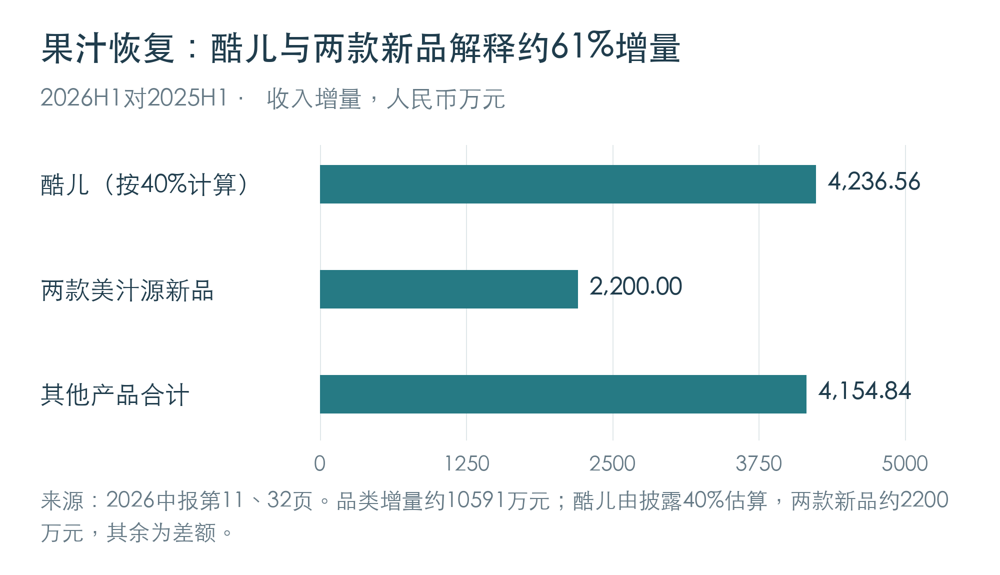

酷儿同期销量增长101.2%，公司将其与涂鸦、IP包装和角色周边相连。同年6月，美汁源又推出餐饮专供的310毫升“双爽柠柠”拉罐。经营动作已经具体到重推哪些商品、向哪些场景销售，销量和收入也已有结果。当前最有依据的是这批商品重新形成销售，不是所有老果汁都恢复了吸引力。 [2026H1演示：酷儿及餐饮新品 · 第8页](https://cdn.financialreports.eu/financialreports/media/filings/49257/2026/RNS/49257_rns_2026-08-25_559c59b7-309d-46de-bc9c-ae3549c10f8a.pdf#page=8)

这轮果汁调整取得了收入效果。连续下滑后，公司重新安排酷儿的地区、规格和渠道，并推出两款新品，它们贡献了大部分增量。果粒橙对年轻家庭吸引力减弱，与酷儿卖得更好可以同时发生。因此，修复应围绕恢复销售的具体产品继续推进，不能把品类增长看成所有老产品都重新畅销。 [付艳翠：2026年6月果汁访谈](https://www.xueqiu.com/5899108858/395796675) [2026上半年业绩演示：果汁经营结果 · 第8页](https://cdn.financialreports.eu/financialreports/media/filings/49257/2026/RNS/49257_rns_2026-08-25_559c59b7-309d-46de-bc9c-ae3549c10f8a.pdf#page=8)

下半年公司计划把酷儿桃、葡萄及260毫升橙、苹果口味转为自产，继续经营450毫升、750毫升即饮包装。先有销量，再扩大内部生产，有助于提高设备利用；2018年提高自产曾减少代加工费，团队已有相关经验。生产接回后，也要承担排产、换线、库存和设备责任，实际节约取决于订单能否延续及工厂能否高效安排。当前估值保留已有经营，计划中的节约待实际发生再计入。 2026中报：酷儿转自产计划 · 第11页 2018年报：提高自产比例与代加工费下降 · 第26页

## 专题 · 水与功能饮料：销量扩张、场景差异和增长质量

送货车可以同时带上汽水、水和功能饮料，但每种商品支付这趟运输费用的能力不同。水每箱收入和毛利较低，经营规模扩大以后，路程、装卸与促销支出会明显影响最终收益；功能饮料的售价结构较好，又需要持续争取消费者和冰柜位置。比较这两类增长，需要顺着各自的商品与销售过程看。

近期的经营结果也呈现差异。水恢复了销量，公司同时指出低毛利水占比增加影响集团毛利率；能量饮料的销量与平均每标箱收入一起增加，具备较好的收入增量条件。两者体量仍远小于汽水，对集团利润的影响要与各自规模一起看。 2025年报：水 · 第26页 2025年报：功能饮料 · 第27页 [2026H1演示：包装水 · 第9页](https://cdn.financialreports.eu/financialreports/media/filings/49257/2026/RNS/49257_rns_2026-08-25_559c59b7-309d-46de-bc9c-ae3549c10f8a.pdf#page=9) [2026H1演示：能量饮料 · 第10页](https://cdn.financialreports.eu/financialreports/media/filings/49257/2026/RNS/49257_rns_2026-08-25_559c59b7-309d-46de-bc9c-ae3549c10f8a.pdf#page=10)

### 水在低价规模与产品区隔之间来回取舍

这项业务的转型已有多年。2019年公司以2元纯悦水持续投入市场；2021年冰露面对竞品低价促销，公司称拒绝跟随恶性低价，纯悦快速增长，但水品类份额轻微下降。2022年继续发展纯悦、果味水、苏打水，以水站、社区和电商承接家庭大包装，全年水收入和份额仍下滑。2023年提高水价并调整产品组合，总销量随之下降；2024年销量进一步减少。历史表明更高价格与更好包装需要消费者接受，低价销量减少之后，新产品并未立即填上全部收入。2019年报：纯悦水 · 第24页2021年报：水竞争 · 第23页2022年报：水业务 · 第22页2023年报：水价和结构 · 第20页2024年报：水业务 · 第23页

2025年水销量重新双位数增长，收入只增长4.3%，公司将低毛利水占比提高列为集团毛利率压力。2026H1冰露铺货客户增至70万家、同比增加49%，销量增长12%；纯悦销量增长8%，经营支付宝活动、景区联名瓶、酒店与交通通路。冰露扩大了可以卖货的客户范围，纯悦则在不同消费地点组织产品。客户数与半年销量不是同一时点口径，不能用12%除以49%推成老店销量下降。公司已取得覆盖面扩大与总销量增长两项进展，各店周转是否改善，仍需同店补货记录。 2025年报：水量收与组合 · 第26页 [2026H1演示：冰露与纯悦 · 第9页](https://cdn.financialreports.eu/financialreports/media/filings/49257/2026/RNS/49257_rns_2026-08-25_559c59b7-309d-46de-bc9c-ae3549c10f8a.pdf#page=9)

雪球作者DeMarco提出通过酒店等差异化通路做水。公司2026H1披露的纯悦酒店、交通和景区经营，说明这条路径已在使用，但三种客户不能用同一套“便利溢价”解释：景区联名瓶增加当地标识，交通场景争取途中即时饮用，酒店供货还要先争取采购方。对酒店采购，持续供货、进货价格与服务安排才是装瓶商面对的成交条件，不能把游客或住客终端支付的价格直接当成公司能收的价。当前已披露的差异是通路与商品安排，尚没有酒店合同价或场景利润支撑提高水的回报假设。 [DeMarco：水渠道分析](https://www.xueqiu.com/1126097467/339314560) [2026H1演示：纯悦场景安排 · 第9页](https://cdn.financialreports.eu/financialreports/media/filings/49257/2026/RNS/49257_rns_2026-08-25_559c59b7-309d-46de-bc9c-ae3549c10f8a.pdf#page=9)

水的提价和产品升级效果一直偏弱。2021年不跟随低价促销、随后提价及调整组合，都没能立即稳住销量；2025年销量恢复，低毛利水占比又提高。纯悦进入酒店、景区和交通渠道，可以利用已有供货能力争取不同订单，但这些订单仍要支付配送与客户服务，不能仅凭消费场景赋予高利润。

水动乐900毫升畅饮装在北京、四川、河北、山东、辽宁五个市场试销，抓住夏季大包装、性价比补水。悦活则以天然苏打水、更新瓶型标签和京东专属产品争取区隔，2026H1披露收入1.21亿元、增长33%。悦活是集团另行经营的品牌业务，该金额不再另加到水品类收入上。两类动作分别争取大容量消费与品牌包装溢价，利润取决于实际出货价、包装和配送成本。2025年报：悦活 · 第31页[2026H1演示：悦活及补水产品 · 第9页](https://cdn.financialreports.eu/financialreports/media/filings/49257/2026/RNS/49257_rns_2026-08-25_559c59b7-309d-46de-bc9c-ae3549c10f8a.pdf#page=9)

竞争者也在拆分使用场景。华润饮料推出本优5升泡茶用水和怡宝210毫升便携水，农夫山泉强调天然水源与工厂信息；家庭、办公室、交通和即时解渴对容量、价格、携带的需求不同。2025年农夫山泉包装水收入增长17.3%，华润饮料包装水收入下降21.6%，没有一个“水行业增长”能概括品牌间的分化。中国食品最现实的路径是用现成网络增加有效销售，同时少让配送、促销和低毛利组合吞掉新增贡献。[华润饮料2025年报：包装水 · 第18页](https://tzzgx.crbeverage.com/media/0nolef4r/2025-annual-report.pdf#page=18)[农夫山泉2025年报：水业务 · 第17页](https://www.hkexnews.hk/listedco/listconews/sehk/2026/0417/2026041701390_c.pdf#page=17)

水可以作为现有网络的补充生意，投入优先级低于汽水维护和已卖动的新品。同一辆车和同一仓库承接更多订单，低毛利产品也可能增加利润；若专门增加远距离配送、促销和设备，额外支出就可能超过新增毛利。现阶段水尚未建立明显的定价优势，应以每条销售路径的净贡献决定扩量。 2025年报：水销量恢复 · 第26页 2026中报：低毛利水与集团毛利 · 第9页

### 能量饮料值得继续投入，但仍要赢过强对手

魔爪的渠道选择有连续记录。2019年中国食品与中石油、中石化合作，在加油站及服务区建设超过2000家形象店，同时进入学校、网吧和商超，当年能量饮料收入增长超过一倍。2025年魔爪销量接近增长50%，猎兽则面向工矿、高速服务区与蓝领消费；2026年魔爪继续以无糖口味、便利店和校园体育活动争取年轻人。它们共用一部分送货网络，争取的购买理由却不同：魔爪用口味和年轻人活动推广，猎兽更强调工作与长途场景的能量补充。已有网络提供进店条件，具名产品及投放记录解释公司具体在争取谁。 2019年报：加油站、服务区及推广 · 第25页 2025年报：魔爪与猎兽 · 第27页 2026中报：新品与校园、便利店经营 · 第12页

2026H1业绩演示披露能量饮料收入增长53%、销量增长40%，魔爪收入增长65%。1月上市的无糖“超越幻紫葡萄”带来5000万元收入，中报另披露其占魔爪收入增量45%。这个SKU已经贡献实质销售。公司用“能量周一”数字派样、便利店深耕和校园体育营销接触年轻消费者，并计划下半年继续投放品类专属冰柜。公司称这些活动提高年轻人复购，现有材料没有披露独立复购率序列；当前能确认的是新品销售及营销动作。[2026H1演示：能量饮料 · 第10页](https://cdn.financialreports.eu/financialreports/media/filings/49257/2026/RNS/49257_rns_2026-08-25_559c59b7-309d-46de-bc9c-ae3549c10f8a.pdf#page=10)2026中报：魔爪与推广规划 · 第12页

收入增速快于销量，在演示所列能量饮料口径下，按增速计算平均收入/标箱约提高9.3%，与集团整体单位收入下降形成区别。这一变化可能由更高价格新品及产品组合带来，仍需扣除产品成本与推广投入。中报财务商品类型“功能饮料”2026H1收入约3.04亿元，约占集团2.4%；经营演示使用“能量饮料”，两项披露各按原范围理解。[2026H1演示：能量饮料量收增速 · 第10页](https://cdn.financialreports.eu/financialreports/media/filings/49257/2026/RNS/49257_rns_2026-08-25_559c59b7-309d-46de-bc9c-ae3549c10f8a.pdf#page=10)2026中报：商品类型收入 · 第32页

提神和补水也要分开看。魔爪、猎兽面对东鹏特饮等能量饮料；水动乐等运动补水产品又面对东鹏补水啦、尖叫、力量帝维他命水、海之言。东鹏2025年报引述尼尔森IQ称，特饮在中国能量饮料市场销量份额51.6%、销售额份额38.3%，其有效活跃终端超过450万家，并继续增加冰柜。东鹏补水啦2025年销售增长约119%，已拓展便携、标准、家庭和特定渠道规格。中国食品借汽水网络进入售点，面对的是已有广泛终端、多种规格并持续投放冰柜的对手。[东鹏饮料2025年报：份额与新品 · 第14页](https://static.cninfo.com.cn/finalpage/2026-03-31/1225063447.PDF#page=14)[东鹏饮料2025年报：终端网络 · 第29页](https://static.cninfo.com.cn/finalpage/2026-03-31/1225063447.PDF#page=29)[农夫山泉2025年报：功能饮料 · 第21页](https://www.hkexnews.hk/listedco/listconews/sehk/2026/0417/2026041701390_c.pdf#page=21)[统一2025年报：运动补水 · 第19页](https://www1.hkexnews.hk/listedco/listconews/sehk/2026/0427/2026042700614.pdf#page=19)

能量饮料目前比水更值得继续投入：“超越幻紫葡萄”已卖出5000万元，品类收入增速又高于销量，增长并非只靠更便宜的货。现有网络提供便利店和校园的销售入口，但东鹏已有强终端和持续投入，中国食品仍是挑战者。

追加投入应围绕已经卖动、能继续补货的产品。冰柜和派样扩大以后，新增毛利需要覆盖设备及推广支出；一年后的补货与净收益比初次铺货更能说明产品能否延续。估值保留已实现利润，未来增长扣除所需资金后再计入。 2026中报：魔爪新品金额、占比与后续冰柜投入 · 第12页 [2026H1演示：能量饮料量收 · 第10页](https://cdn.financialreports.eu/financialreports/media/filings/49257/2026/RNS/49257_rns_2026-08-25_559c59b7-309d-46de-bc9c-ae3549c10f8a.pdf#page=10)

## 专题 · 授权品牌的收益归谁：装瓶权、谈判与现金

消费者看到的是同一个可口可乐品牌，收入和利润却经过不同企业。品牌方提供商标、配方和浓缩液，装瓶企业负责当地生产与销售，经销商和门店接着完成分销零售。投资中国食品，取得的是装瓶经营及相关业务的股东权利。先分清这些角色，才能理解品牌为什么有价值，以及品牌带来的收益怎样分配。

## 品牌名字属于谁，谁把它变成一瓶饮料

中粮可口可乐于2000年成立。中国食品目前持有核心合资主体65%，可口可乐持有35%。品牌方提供品牌及浓缩液体系；装瓶企业采购原料包装，安排生产、库存、仓储配送、销售与促销。消费者对可口可乐的偏好先产生需求，装瓶企业必须完成这一连串本地工作，才能取得成品销售收入。中国食品因此承担制造、配送和终端服务的成本，资本需求也集中在机器、仓网及设备。 [中粮：中粮可口可乐业务介绍](https://www.cofco.com/cn/brandproduct/cofcococacola/) 2025年报：核心业务持股 · 第177页 [浓缩液采购框架：商标与配方归属 · 第11页](https://www.hkexnews.hk/listedco/listconews/sehk/2023/1107/2023110700390_c.pdf#page=11)

本地规模也有实际积累。2017年报披露1.1万余名销售人员、约140万客户及约90万月均交易客户。2016—2017年区域重组后，中粮可口可乐接入黑龙江、吉林、辽宁、山西、四川、重庆和陕西等装瓶业务，同时退出其他部分地区权益；随后通过相邻地区供货、增加自产和减少外租仓库改善成本。品牌方需要的是能够投入和运营整套网络的长期伙伴，已建网络也增加了替换合作主体的实际成本。这是装瓶商谈判位置的一部分，而非它拥有了商标。 [2017年报：区域业务重组 · 第21页](https://www.hkexnews.hk/listedco/listconews/SEHK/2018/0425/LTN20180425423.pdf#page=21) [2017年报：销售组织与客户 · 第25页](https://www.hkexnews.hk/listedco/listconews/SEHK/2018/0425/LTN20180425423.pdf#page=25) 2018年报：整合后的生产配送改善 · 第26页

## 独家授权保护了什么

2025年报附注说明，特许权来自多项装瓶协议，赋予集团在所经营的19个省级行政区域准备、包装、分销和销售可口可乐品牌产品的独家权利。它使公司建设工厂、仓配和客户网络时，具有相对稳定的体系内经营边界。消费者仍然可以购买百事、茶、水或其他饮料，因此独家权主要解决同一品牌体系内谁来经营，不替装瓶商消除市场竞争。 2025年报：区域独家特许权 · 第161页

年报进一步解释，鉴于战略关系及历次续订经验，续期或延期不必支付代价；管理层评估协议条款、续订记录和互惠关系后，相信到期会继续续订，因而将特许权指定为使用寿命不确定。长期合作及既有网络支持继续经营，特许权的持续价值建立在续约和双方合作之上。另行签订的浓缩液采购框架覆盖2024—2026年，后续应关注新的供货与定价条款。 2025年报：续约记录与特许权寿命 · 第162页 [浓缩液采购框架：协议期间 · 第10页](https://www.hkexnews.hk/listedco/listconews/sehk/2023/1107/2023110700390_c.pdf#page=10)

## 本地合同给出了真实的调价权

2023年11月7日签订的浓缩液采购框架规定，集团向可口可乐（上海）采购浓缩液，价格由后者确定。它可以修订价格，但必须提前30日通知并协商，适当考虑授权区域的市场条件。如果集团相关成员不愿支付新价，须在收到通知后30日内通知；相关采购协议在该通知起三个月后自动终止。条文里有协商和本地市场条件，也有装瓶商拒绝的权利；拒绝的结果却是结束供给关系，而不是继续用旧价取得同一配方。这决定了双方议价地位并不对称。 [浓缩液采购框架：供货与定价主体 · 第10页](https://www.hkexnews.hk/listedco/listconews/sehk/2023/1107/2023110700390_c.pdf#page=10) [浓缩液采购框架：调价、协商和终止 · 第11页](https://www.hkexnews.hk/listedco/listconews/sehk/2023/1107/2023110700390_c.pdf#page=11)

替代糖、瓶盖或物流供应商，仍可继续制造同一品牌饮料；替代专有浓缩液则触及品牌与配方本身。2025年前五大供应商占集团采购约58%，最大一家约44%，浓缩液支付及应付约49.09亿元。这一规模说明上游条款足以影响经营现金。约49.09亿元是装瓶集团采购成本，品牌方还需承担其自身成本才能形成利润。 2025年报：供应商集中度 · 第77页 2025年报：浓缩液关联采购 · 第85页

品牌方既是供应商，又持有中粮可口可乐35%的股权。若浓缩液涨价使装瓶利润下降，它自身的装瓶权益收益也会受影响；但它同时取得上游销售收益，中国食品则主要承受装瓶端成本。因此，合资关系使双方有维持销量与网络的共同利益，并不意味着每次定价的利益完全一致。可口可乐2025年10-K还说明，多数市场会结合装瓶商售价、渠道和包装组合确定浓缩液价格，并提供营销、销量或基础设施支持。全球经营惯例解释了合作如何维持，本地采购框架决定中国食品具体有哪些协商与拒绝权。 2025年报：核心业务股权 · 第177页 [可口可乐2025年10-K：定价与装瓶商支持](https://investors.coca-colacompany.com/filings-reports/all-sec-filings/content/0001628280-26-010047/ko-20251231.htm) [本地浓缩液采购框架：协商与终止 · 第10页](https://www.hkexnews.hk/listedco/listconews/sehk/2023/1107/2023110700390_c.pdf#page=10)

35%的参股和多年续约，使继续合作比突然拆伙更符合双方利益。品牌方需要有人在这些地区生产和送货，中国食品则依赖品牌及浓缩液。合作有延续的基础，利润分配却未固定：更高的浓缩液价格会把一部分收益转向上游。

## 品牌收益经过两条路径离开装瓶环节

可口可乐一方面取得浓缩液销售收入，另一方面通过持有中粮可口可乐35%分享装瓶层面的利润。第一条是采购交易，先进入装瓶经营成本；第二条是股东分配，在经营收益形成后按权益分享。同一笔浓缩液采购已经扣进经营结果，计算中国食品股东现金时不能再把采购额当成额外分红扣一次。 [浓缩液采购框架：关联交易 · 第11页](https://www.hkexnews.hk/listedco/listconews/sehk/2023/1107/2023110700390_c.pdf#page=11) 2025年报：中粮可口可乐权益 · 第177页

中国食品持有上层65%，部分地方装瓶公司还有股东。年报列示的有效权益包括陕西65%、北京48.75%、辽宁南39%、新疆52%。集团控制这些业务时合并其全部对外收入，合并收入因此不是上市普通股拥有100%的收入收益。现金须先支持地方经营、设备更新，再沿实际股权关系分享；现行现金桥先对扣除正常税、利息、租赁本金和维护后的集团经营起点取65%，再用净归属调整处理下层股东及外围业务。品牌收益已经包含在这项持续经营现金中。 2025年报：附属公司权益 · 第177页 2025年报：地方主体有效权益 · 第178页 2025年报：地方主体有效权益续表 · 第180页 2025年报：附属公司资料续表 · 第182页

集团另行经营悦活等业务，与可口可乐授权体系具有不同的经营归属。平台及售货机是销售通路，某个商品通过它们销售时，产品收入和渠道服务收益分别按经营主体归属。 2025年报：悦活经营 · 第27页 [2026上半年业绩演示：水与悦活 · 第9页](https://cdn.financialreports.eu/financialreports/media/filings/49257/2026/RNS/49257_rns_2026-08-25_559c59b7-309d-46de-bc9c-ae3549c10f8a.pdf#page=9)

## 本地网络怎样形成优势，管理层怎样把它用好

中国食品管理层能够影响的利润，具体落在排产、采购、仓配、客户服务和资源投放上。国金证券2019年的研究记录了重组后的做法：向新并购厂派驻管理人员，统一业务及IT流程，调整奖金安排，再以华北、东北等区域统筹产能和物流。它还提到根据原有厂的费用标准调整新厂销售支出。这些是把多座工厂变成一套经营网络的具体工作。 [国金2019：并购厂的管理、流程与产能调整 · 第20页](https://img3.gelonghui.com/pdf/91e20-e3a986fa-47c6-46f2-90ed-4b5d08904cef.pdf#page=20) [国金2019：费用与产品结构调整 · 第21页](https://img3.gelonghui.com/pdf/91e20-e3a986fa-47c6-46f2-90ed-4b5d08904cef.pdf#page=21)

2018年报披露，新购厂提高利用率和自产比例，减少代加工费；相邻区域重新安排供货，缩短运输距离；提高仓库利用率并减少外租仓库，带动新厂税前利润率改善。品牌没有因为重组而更换，工厂、仓库和路线重新组织后，一箱饮料送到客户手中的成本却降低了，这是管理层创造的经营收益。 2018年报：自产、运输、仓库及利润率改善 · 第26页

新品牌进入一个地区，需要积累订单、建立补货关系，初期每箱要分摊的服务成本较高。中国食品已有的汽水需求可以支持现成网络。但康师傅的百事、7喜、美年达同样经营无糖、口味和宴席，东鹏也持续铺冰柜和下沉终端。面对这些对手，汽水的地位不能自动转移给果汁、水或功能饮料，每个品类都要重新争取顾客和货架。 [康师傅2025年报：汽水品牌与场景 · 第20页](https://www.masterkong.com.cn/wp-content/uploads/2026/05/C322_ARs_4c1cac99.pdf#page=20) [东鹏2025年报：终端、冰柜与数字化服务 · 第29页](https://static.cninfo.com.cn/finalpage/2026-03-31/1225063447.PDF#page=29)

## 价值取决于合作后留下的现金

这套安排对投资者有两项实质结果。第一，稳定的品牌需求、续约历史和已建区域网络使公司能够作为成熟业务估值，直接按清算工厂解释价值会漏掉持续经营能力。第二，品牌产权与浓缩液定价主动权留在上游，装瓶业务需承担推广和资产维护，并与合资及下层股东分享收益。估值应使用这些责任扣除后的普通股现金；品牌需求优势已经包含其中。

2024—2026年浓缩液采购框架到期后的供货与定价条款，会影响双方的利润分配。如果上游提价超过装瓶商能用售价、支持或效率抵消的幅度，正常现金会下降；若区域续约出现重大额外付款，还会增加资本需求。当前续约记录支持继续经营，现有估值采用这一条件。 [现有采购框架的期间与续期条件 · 第10页](https://www.hkexnews.hk/listedco/listconews/sehk/2023/1107/2023110700390_c.pdf#page=10) 2025年报：长期合作及续约判断 · 第162页

## 专题 · 品牌如何留住消费者：偏好、替代与定价

顾客站在冷柜前，可能已经想好要一瓶可口可乐，也可能在可乐、茶和水之间挑选。前一种购买反映熟悉口味与品牌的力量，后一种购买让价格、温度、容量和陈列位置发挥更大作用。中国食品既要承接已有偏好，也要在具体购买现场把饮料卖出去。本篇从消费者的选择出发，再看这份品牌需求怎样变成装瓶商的收入和利润。

## 从想喝可乐，到拿起可口可乐

想喝可乐，与只想解渴，是两种购买要求。前者要的是甜味、酸味、气泡和可乐风味组合起来的饮用体验；换成水或无糖茶，补水的需要仍能满足，口味体验却变了。这解释了可乐作为一个品类的需求。走到同一排货架前，为什么拿可口可乐而不是百事，则还要解释两者的味觉偏好，以及名字本身带来的影响。

2004年发表于《Neuron》的一项实验将两杯相同的可口可乐摆在受试者面前，一杯标出Coke，另一杯不标品牌。受试者更偏向标明Coke的一杯；换成两杯百事、其中一杯标出Pepsi时，没有出现同样显著的标签效应。匿名比较两种可乐时，样本整体也没有明显偏向其中一种。这个结果说明，可口可乐的名字已经能参与形成偏好，消费者的选择包含对品牌的既有认知，而不只是液体入口后的味道。 [McClure等，2004：同液体、不同标签的偏好实验 · 第4页](https://fbri.vtc.vt.edu/content/dam/fbri_vtc_vt_edu/publications/montague-publications/McClureLi2004.pdf#page=4)

1985年美国New Coke事件把这种依恋表现得更直接。按可口可乐公司的历史记录，新配方在近20万人的口味测试中更受偏好；公司用它替换原配方后，却遭到消费者抗议，79天后恢复经典配方。对反对换配方的老顾客而言，他们希望继续喝自己熟悉的那瓶可乐，经营者给出的“口味改进”并不是他们想要的改变。 [可口可乐公司：1985年新配方与经典配方恢复](https://www.coca-colacompany.com/about-us/history/new-coke-the-most-memorable-marketing-blunder-ever)

可口可乐已经积累了一批偏爱特定产品的消费者，品牌名字与过去的饮用经验联系在一起。新品牌可以做出另一种好喝的可乐，却需要先让顾客尝试，再让他们反复购买。百事已经走过这个过程，所以两者仍要靠口味、价格和购买便利争夺选择。

## 品牌方维护偏好，中国食品把商品送到购买现场

品牌方保留经典口味，同时通过包装增加交流和赠送的用途。2013年的昵称瓶印上不同称呼，2025年分享瓶换成“I人”“E人”“气氛组”等字样，顾客可以挑适合自己或朋友的一瓶。产品本身变化不大，新的购买理由帮助老品牌维持兴趣。 [可口可乐中国，2025-04-28：分享瓶的具体设计](https://www.coca-cola.com/cn/zh/media-center/Share-a-Coke)

中国食品承接的是本地生产、铺货和终端服务。它在2025年把可口可乐推广与烧烤、分享瓶结合，雪碧围绕音乐、校园和辣食，芬达围绕校园与IP开展活动。对装瓶商而言，品牌偏好要在购买现场兑现：顾客想喝的时候有货，需要冷饮的时候有冷饮，门店也愿意继续进货。假如喜欢可口可乐的人到店只能买到常温瓶、另一品牌却有合适的冰饮，品牌偏好就要与眼前的饮用条件竞争。因此中国食品的冷柜、配送和门店服务，直接影响它能承接多少品牌需求。 2025年报：汽水品牌与消费场景 · 第25页

这项需求对中国食品很重要：2025年汽水收入166.85亿元，约占集团75.6%，公司披露其经营区域内汽水份额接近60%。这些数字覆盖可口可乐、雪碧、芬达等汽水组合，说明集团对核心汽水的依赖程度。至于品牌偏好最终留下多少利润，要接着看每箱实际收入、推广支出，以及与上游和渠道的分配。 2025年报：区域汽水地位 · 第25页 2025年报：分品类收入 · 第148页

## 无糖是在保留消费者，还是增加新需求

健康及糖分偏好的变化，对经典汽水的威胁是消费者少买整个品类，也可能是转向同品牌的无糖选择。中国食品早在2018年便在零度可乐、雪碧零卡基础上扩充无糖和纤维+；2020年无糖及纤维+合计增长近50%，2021年无糖增长逾50%。但2023年无糖收入下降，汽水总收入仅微升，靠传统产品继续增长支撑。2025年含糖与无糖收入都增长，无糖为高个位数。无糖经历早期扩张、回落和恢复，其主要作用是通过配方调整适应不同偏好。2020—2021年原文未统一明确增幅的量或收入口径，这两期用于说明产品发展的阶段。 2018年报：无糖产品扩展 · 第27页 2020年报：无糖与纤维+ · 第22页 2021年报：无糖和传统汽水 · 第21页 2023年报：无糖回落与传统产品 · 第18页 2025年报：含糖与无糖表现 · 第25页

2026年上半年，无糖可口可乐收入增长10.5%，无糖芬达增长60.2%，汽水整体收入增长2.1%。顾客想保留可乐或橙味汽水的体验，又希望减少糖分时，可以留在原品牌内换配方。无糖既可能留住本会离开的顾客，也可能替代原来的含糖购买，报告没有区分两者。因而它对公司最明确的作用，是适应偏好变化、维护整个汽水组合。 [2026H1演示：无糖与汽水整体收入 · 第7页](https://cdn.financialreports.eu/financialreports/media/filings/49257/2026/RNS/49257_rns_2026-08-25_559c59b7-309d-46de-bc9c-ae3549c10f8a.pdf#page=7)

2026年，可口可乐和雪碧将纤维+升级为益生元，以较高定价进入餐饮和辣食；无糖柠檬味可口可乐则加强便利店陈列和跨品类捆绑。前者用配方卖点争取高价，后者用位置与优惠争取成交。益生元的溢价要支付配方和推广成本，捆绑销售则要在扣除实际折让后留下利润。 2026中报：益生元定价及新品推广 · 第10页 [2026H1演示：便利店陈列与跨品类捆绑 · 第7页](https://cdn.financialreports.eu/financialreports/media/filings/49257/2026/RNS/49257_rns_2026-08-25_559c59b7-309d-46de-bc9c-ae3549c10f8a.pdf#page=7)

## 竞争既来自另一瓶可乐，也来自别的佐餐饮品

康师傅2025年报披露，百事可乐围绕校园音乐与无糖产品吸引年轻人，美年达更新橙味并开发高端浓系列，7喜通过清爽口感、无糖口味和喜庆主题进入宴席。这些对手与可口可乐、芬达、雪碧争夺的是同一批消费者和消费时刻。双方都拥有熟悉的名字、资金和终端网络，必须持续争取消费者注意与门店陈列。 [康师傅2025年报：百事、美年达与7喜 · 第20页](https://www.masterkong.com.cn/wp-content/uploads/2026/05/C322_ARs_4c1cac99.pdf#page=20)

替代范围还会跨过汽水。农夫山泉推出碳酸茶饮料“冰茶”，东方树叶增加1.5升家庭分享装；康师傅发展无糖茶与冰红茶。茶饮与汽水在佐餐和分享场景里争夺同一笔消费预算。汽水品牌面对的长期问题，是在更多选择中维持饮用频率和预算份额。 [农夫山泉2025年报：冰茶与茶饮 · 第19页](https://www.hkexnews.hk/listedco/listconews/sehk/2026/0417/2026041701390_c.pdf#page=19) [农夫山泉2025年报：家庭分享包装 · 第24页](https://www.hkexnews.hk/listedco/listconews/sehk/2026/0417/2026041701390_c.pdf#page=24) [康师傅2025年报：即饮茶经营 · 第19页](https://www.masterkong.com.cn/wp-content/uploads/2026/05/C322_ARs_4c1cac99.pdf#page=19)

酷儿与美汁源的调整也体现了不同选择。2025年酷儿重新安排地区、规格与渠道，2026年加入涂鸦、IP包装和角色周边；美汁源部分非橙口味则从420毫升增至450毫升、价格不变。前者用重新投放和包装吸引购买，后者直接增加同一笔钱买到的容量。公司披露酷儿2026H1销量增长101.2%、贡献果汁收入增量40%，可以确认它已成为收入恢复的重要来源；具体增量及自产安排在产品专题展开。 2025年报：酷儿投放与美汁源加量 · 第26页 2026中报：果汁增量来源 · 第11页

## 消费者认可的价值会变，提价收益也需要分配

品牌熟悉度能保住被看见的机会，购买理由却会变化。2026年6月，付艳翠在《创业最前线》的果汁报道中写到，一个家庭里，长辈仍把果粒橙当作孩子喜欢的饮料，年轻父母却更在意配料和糖分；受访店主同时认为，果粒橙、酷儿仍能吸引客流。这组局部访谈把美汁源面对的问题说得更具体：老品牌还有认知和销量基础，但同一个名字需要重新说服不同购买者。 [付艳翠：果汁消费者与门店访谈，2026-06-21](https://www.xueqiu.com/5899108858/395796675)

无糖、不同口味和包装给老顾客增加了选择，有助于在偏好变化时保住销量。果汁需要更大的调整：年轻购买者对配料和糖分的关注，削弱了经典果粒橙原有的吸引力；2026年恢复又主要靠酷儿和两款新品。这里起作用的是重新做产品和渠道，老商标本身不足以保证增长。 2026中报：果汁恢复及产品动作 · 第11页

国金证券2019年报告估计，2018年结构性提价的增量收益约25%归公司，其余留在渠道，并据此推演装瓶商日后提高留存比例的空间。比例是券商当时的估计，不是固定合同条款；其中的经营逻辑是先让经销商和门店有利可图，换取推广和陈列，商品卖动后再争取更好的供货价格。终端涨价只有一部分能留给中国食品。 [国金证券2019深度：结构性提价与渠道分配 · 第25页](https://img3.gelonghui.com/pdf/91e20-e3a986fa-47c6-46f2-90ed-4b5d08904cef.pdf#page=25)

## 能卖更多，与能收更高净价之间的距离

报告用“标箱”把不同瓶装折成统一的饮料容量，便于比较销量。下面的每箱收入和利润，都按这个容量单位计算，不是门店买进的一只实际纸箱。 [可口可乐2025年10-K：unit case的定义](https://investors.coca-colacompany.com/filings-reports/all-sec-filings/content/0001628280-26-010047/ko-20251231.htm)

汽水收入从2018年的114.28亿元增至2025年的166.85亿元，但2022年以后增速明显放慢。2025年汽水销量稳定，全年收入增1.9%；按年度减上半年计算，2025下半年收入同比下降约6.4%。2026年上半年销量增长8.5%，收入只增长约2.1%，两者比值意味着平均每标箱收入下降约5.9%。消费者仍在购买，装瓶商每箱取得的收入却受到包装、产品、渠道或折让的共同影响。 2018年报：汽水收入起点 · 第176页 2025年报：汽水收入 · 第148页 [2025中报：汽水收入 · 第33页](https://www.hkexnews.hk/listedco/listconews/sehk/2025/0919/2025091900590.pdf#page=33) 2026中报：汽水收入 · 第32页 2026中报：汽水数量与利润 · 第10页

汽水自己的每箱收入也在下降，金色小路据此反对把集团量收差全归给低价水，这个质疑成立。太古同期披露电商扩量与较高折扣并存，说明装瓶同行确实面对让利压力。不过，每箱收入还受容量与产品组合影响；判断中国食品是否少赚了，必须把同期汽水经营利润放进来。 [金色小路：2026中报分析阅读笔记](https://www.xueqiu.com/2892426645/408661736) [太古2026中期业绩：折扣与电商增长 · 第28页](https://www.swirepacific.com/storage/fm/PressRelease/pdf/en/swirepacific-interim-2026.pdf#page=28)

2026H1汽水销量增长8.5%，经营利润增长8%，折算每标箱经营利润约下降0.5%，基本持平。每箱收入虽下降约5.9%，成本和费用变化消化了大部分压力，公司仍靠多卖增加总利润。经营利润之后还需支付税、设备更新并分给其他股东。

汽水仍是一门能持续赚钱的成熟生意：顾客继续买，每箱经营利润近期也守住了。主要威胁是保销量所需的促销、设备和配送支出不断增加。若每箱利润持续下降，扩量又补不回来，正常现金就要调低；品牌知名度本身无法弥补这笔损失。 2026中报：汽水经营结果 · 第10页

## 研究依据

同等装瓶网络需要什么资源，不增长的普通股收益价值是多少，增长能否超过新增资本成本？

资产已计量部分约1.43—2.10元人民币/股；不含同等授权完整成本。集团E12.104亿元，60%归母约7.263亿元，10%且不加未经证明余资时EPV2.596元。增长增量回报近保值，不采用溢价；3元人民币下普通股衰减前参照8.923%，合成集团列9.328%不可混用。

费用维持不住、更新周期缩短或新增资本需求更大，会直接降低E/增长回报；93.333可能与已移除收益重叠，税效、早期商誉和余资归属尚有限制。

沿原F0期限核验；观察同规模设备更新、递延科目税务、分主体现金及新增资本净回报，不等待没有实质影响的资料齐全。

## 公开来源目录

- [2026 中期报告](https://www.hkexnews.hk/listedco/listconews/sehk/2026/0917/2026091700946_c.pdf)

- [太古：饮料业务官方介绍](https://www.swirepacific.com/en/about-us/our-businesses/beverages)

- [可口可乐2025 Form 10-K](https://investors.coca-colacompany.com/filings-reports/all-sec-filings/content/0001628280-26-010047/ko-20251231.htm)

- [中粮官网 · 中国食品业务与省级市场名单](https://www.cofco.com/cn/BrandProduct/zhongguoshipin/)

- [阿里云 DataV · 中国省级地理底图](https://geo.datav.aliyun.com/areas_v3/bound/100000_full.json)

- [太古2025年报 · 饮料业务](https://www1.hkexnews.hk/listedco/listconews/sehk/2026/0408/2026040800985.pdf)

- [2023-11-07浓缩液及关联采购框架公告](https://www.hkexnews.hk/listedco/listconews/sehk/2023/1107/2023110700390_c.pdf)

- [中国食品2016年报](https://www.hkexnews.hk/listedco/listconews/sehk/2017/0426/LTN20170426415_C.pdf)

- [中国食品2017年报](https://www.hkexnews.hk/listedco/listconews/SEHK/2018/0425/LTN20180425423.pdf)

- [非汽水生产重组公告](https://www1.hkexnews.hk/listedco/listconews/sehk/2022/0715/2022071501130.pdf)

- [浓缩液及关联采购框架](https://www.hkexnews.hk/listedco/listconews/sehk/2023/1107/2023110700390_c.pdf)

- [中粮历史与荣誉](https://www.cofco.com/cn/AboutCOFCO/HistoryandHonor/)

- [可口可乐加快装瓶业务再特许经营](https://investors.coca-colacompany.com/news-events/press-releases/detail/810/the-coca-cola-company-announces-plans-to-significantly-accelerate-bottler-refranchising)

- [中粮可口可乐官方业务介绍](https://www.cofco.com/cn/brandproduct/cofcococacola/)

- [可乐GO开发者产品说明](https://apps.apple.com/cn/app/%E5%8F%AF%E4%B9%90go/id1093345922)

- [中粮可口可乐蝉联可口可乐系统全球客户及商务领导力大奖](https://www.cofco.com/cn/News/Allnews/Latest/2022/0801/51763.html)

- [可口可乐2025-06-26 SEC重列业务说明之Bottler Agreements](https://investors.coca-colacompany.com/filings-reports/all-sec-filings/content/0000021344-25-000047/ko-20250626_d2.htm)

- [农夫山泉2025年报](https://www.hkexnews.hk/listedco/listconews/sehk/2026/0417/2026041701390_c.pdf)

- [统一企业中国2025年报](https://www1.hkexnews.hk/listedco/listconews/sehk/2026/0427/2026042700614.pdf)

- [东鹏饮料2025年报](https://static.cninfo.com.cn/finalpage/2026-03-31/1225063447.PDF)

- [可口可乐公司2025年Form 10-K](https://investors.coca-colacompany.com/filings-reports/all-sec-filings/content/0001628280-26-010047/ko-20251231.htm)

- [康师傅控股2025年报](https://www.masterkong.com.cn/wp-content/uploads/2026/05/C322_ARs_4c1cac99.pdf)

- [华润饮料2025年报](https://tzzgx.crbeverage.com/media/0nolef4r/2025-annual-report.pdf)

- [可口可乐2025 Form 10-K，Beverage Volume](https://investors.coca-colacompany.com/filings-reports/all-sec-filings/content/0001628280-26-010047/ko-20251231.htm)

- [陕西迁建政府、品牌方及供应商原始网页既有摘录](https://xetdz.xa.gov.cn/zwgk/scztxxgk/1962364203997683714.html)

- [2025 中期报告](https://www.hkexnews.hk/listedco/listconews/sehk/2025/0919/2025091900590.pdf)

- [格林沃尔德谈竞争优势与局部规模经济](https://business.columbia.edu/press-release/cbs-press-releases/understanding-competitive-advantage)

- [All Strategy Is Local · Greenwald与Kahn](https://business.columbia.edu/faculty/research/all-strategy-local)

- [香港资金池资金委托管理协议公告](https://www.hkexnews.hk/listedco/listconews/sehk/2025/1110/2025111000773.pdf)

- [2024年财务服务协议公告](https://www.hkexnews.hk/listedco/listconews/sehk/2024/1028/2024102800708_c.pdf)

- [2026-06-09股东周年大会投票表决结果](https://www.hkexnews.hk/listedco/listconews/sehk/2026/0609/2026060900521_c.pdf)

- [呵呵2017：农夫山泉学习笔记（三）及采用记录](https://www.xueqiu.com/1373067614/384792146)

- [永洪科技：中粮可口可乐物流指标项目验收](https://m.yonghongtech.com/gy/xwhd/6461170.html)

- [富勒：中粮可口可乐仓储系统案例](https://www.flux.com.cn/CustomerCase/info/900)

- [世界500强标杆首作：中粮可口可乐全国首个数智化工厂投产](https://xetdz.xa.gov.cn/zsyz/zsxm/1968122546887417857.html)

- [新兴公司中标1.73亿元中粮可口可乐陕西搬迁新建项目](https://www.xxg.com.cn/xwzx/gsdt/202407/t20240725_51864.html)

- [中粮可口可乐牵手井松智能](https://www.gen-song.net/show/390)

- [新增6T天然气锅炉房环境影响报告表](https://qxb-img-osscache.qixin.com/qianlima/%E6%96%B0%E5%A2%9E6T%E5%A4%A9%E7%84%B6%E6%B0%94%E9%94%85%E7%82%89%E6%88%BF-%E5%8F%AF%E5%8F%A3%E5%8F%AF%E4%B9%906%E5%90%A8%E9%94%85%E7%82%89.pdf)

- [金色小路：中国食品（00506.HK）2026年中报点评](https://www.xueqiu.com/2892426645/408661736)

- [BigJerry：印象系列之中国食品](https://www.xueqiu.com/1964170661/315265953)

- [红狼Red：UBS非交易路演要点转述](https://www.xueqiu.com/4455823068/408434816)

- [數碼爆熊不追高：现金派：中国食品](https://www.xueqiu.com/3161697512/411322033)

- [frank72：可口可乐特许专营是个好生意吗，兼谈中国食品的估值](https://www.xueqiu.com/1472083184/320741882)

- [他强任他强：量贩零食门店的无糖可乐渠道款观察](https://www.xueqiu.com/4240219892/412187700)

- [绿野风云：现金头寸和净现金的意义](https://www.xueqiu.com/5842207545/314028858)

- [太古2026中期业绩公告（含新闻稿）](https://www.swirepacific.com/storage/fm/PressRelease/pdf/en/swirepacific-interim-2026.pdf)

- [2026上半年业绩发布会](https://cdn.financialreports.eu/financialreports/media/filings/49257/2026/RNS/49257_rns_2026-08-25_559c59b7-309d-46de-bc9c-ae3549c10f8a.pdf)

- [高管拟购买本公司股份之计划](https://www.hkexnews.hk/listedco/listconews/sehk/2026/0826/2026082600766_c.pdf)

- [高管完成购买本公司股份](https://newsfile.futunn.com/public/NN-PersistNoticeAttachment/7781/20261023/12381272-0.PDF)

- [搜狐财经：3块5买不到“肥宅快乐水”，“硬通货”也要涨价！](https://xueqiu.com/8647410512/251378890)

- [苏影：可口可乐又涨价了，“快乐水”之外再难有爆款？](https://www.inewsweek.cn/yysbg/2024-06-11/22269.shtml)

- [孙蔚：可乐市场还“可乐”吗？](https://zxb.ccn.com.cn/html/zxb/20240718/127908.html)

- [中粮可口可乐与戴永红的湖南渠道合作](https://www.cfsn.cn/news/detail/2138/353768.html?view=pc)

- [中粮智尚城市联营项目启动](https://www.cfsn.cn/news/detail/2137/344913.html?view=pc)

- [北京友生意：可乐GO与深度分销服务](https://ysyboom.com/)

- [McClure等2004可乐标签偏好实验原文](https://fbri.vtc.vt.edu/content/dam/fbri_vtc_vt_edu/publications/montague-publications/McClureLi2004.pdf)

- [McClure等2004可乐标签偏好实验 · 原文阅读笔记](https://mcclurelab.org/pdf/McClureLi2004.pdf)

- [可口可乐公司：1985年新配方与经典配方恢复 · 阅读笔记](https://www.coca-colacompany.com/about-us/history/new-coke-the-most-memorable-marketing-blunder-ever)
