# 格力电器 v14

研究时点 2026-11-01 · 本地发布版本 gree-codex-v14

格力以空调为中心，制造部件和整机，借助门店、代理商及服务网络完成销售与交付，也通过收购进入制冷零部件、电池、储能和整车业务。2026年，公司同时经历渠道调整、费用减少和主营盈利压力。本书前六章依次介绍业务、行业、历史经营、现金和资本配置；第七章集中讨论投资判断及其依据，第八章说明后续怎样更新与复盘。

## 第1章 · 企业沿革与业务边界

从珠海的空调组装业务出发，认识今天的制造、销售服务和投资范围。

### 今天的格力，主要经营什么

珠海格力电器股份有限公司是在深圳证券交易所上市的000651。它经营家用和商用空调，也销售冰箱、洗衣机等生活电器，生产压缩机、电机和制冷阀件，并进入了电池、储能、整车和智能装备。买入这家上市公司的股票，对应的是这些业务按持有权益归属后的整体结果。

业务种类已经很多，分量却很不一样。2025年消费电器收入约1331亿元，占营业收入约78%；工业制品及绿色能源约174亿元，智能装备约6.8亿元。消费电器包含空调及其他家电，不能把整栏都称为空调收入，但它足以说明集团经营的重心仍在消费电器。智能装备当年增长60.5%，收入规模仍只有消费电器的约0.5%。

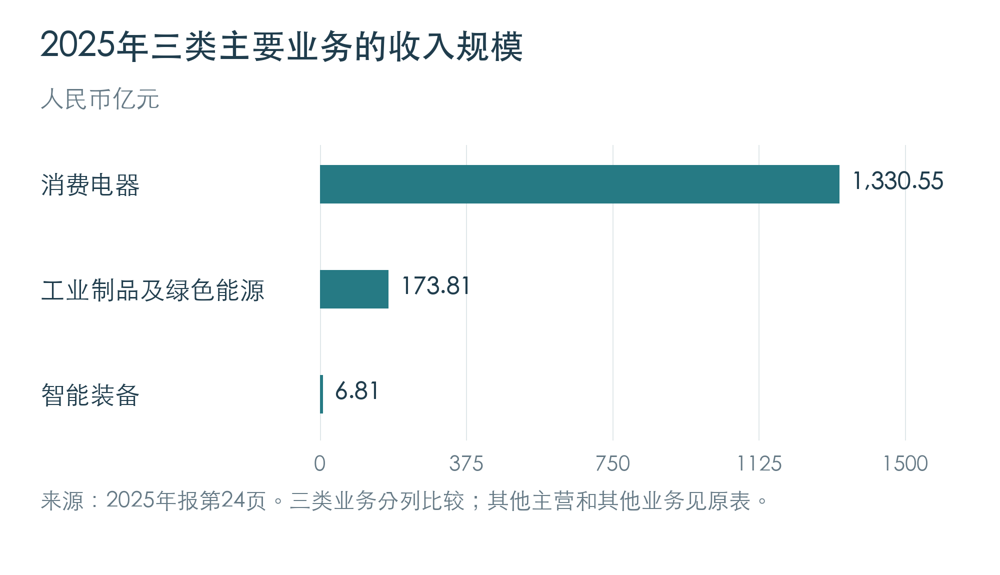

2025年三类业务的收入规模。来源：年报第24页；其他主营和其他业务见原表。

同一年的消费电器毛利率为35.28%，工业制品及绿色能源为15.53%。毛利是收入扣掉营业成本后的余额，还要支付销售、研发、管理和税息。因此，一项新业务增长得快，并不意味着它已经贡献了与空调相当的利润。先分清业务分量，再看各项工作怎样运转，才能理解格力的整体变化。

依据 · [格力电器2025年度报告 · 第10页](https://static.cninfo.com.cn/finalpage/2026-04-29/1225250396.PDF#page=10)；[格力电器2025年度报告 · 第24页](https://static.cninfo.com.cn/finalpage/2026-04-29/1225250396.PDF#page=24)

### 从组装家用空调，到掌握更多制造环节

格力电器成立于1991年，1996年11月上市。公司2021年社会责任报告回顾，成立初期主要组装生产家用空调。此后，公司逐步把工作延伸到产品研发、关键部件和制造工艺：既要把机器生产出来，也要解决长期运行中的耗电、噪声、可靠性和维修问题。

到2025年，凌达压缩机、凯邦电机、新元电子等专业子公司已经成为制造体系的一部分。压缩机让制冷剂循环工作，电机驱动风扇，电子控制部件调节运行。内部部件团队与整机团队共同开发，使格力能够围绕具体机型调整性能，再把生产和使用中发现的问题反馈给研发。第二章会接着说明这些部件怎样共同完成制冷。

掌握更多制造环节，也意味着自己承担更多厂房、设备、员工和研发开支。订单充足时，设备和团队能由更多产品使用；需求下降时，公司需要调整产量与库存，同时维持继续开发产品的能力。这是格力长期经营中反复面对的生产安排。

依据 · [格力电器2021年度企业社会责任报告 · 第6页](https://static.cninfo.com.cn/finalpage/2022-04-30/1213262527.PDF#page=6)；[格力电器2025年度报告 · 第12页](https://static.cninfo.com.cn/finalpage/2026-04-29/1225250396.PDF#page=12)

### 地方经营者怎样帮助格力铺开市场

制造之外，格力还需要把空调卖到各地。20世纪90年代推行的淡季优惠和返利，吸引经销商提前付款、备下旺季的货；1997年在湖北成立的区域销售公司，则把当地经营者组织起来。工厂获得较早回款，经销商用自己的资金和门店销售机器，从进销差价和返利中取得收益。

这张网络后来同时承担了供货、推广、培训和服务协调。2025年报披露，全国已有30个区域销售公司、超过2万家销售门店和3万家专业服务网点。这些是不同层次的经营及服务单位，不能把网点数量相加当作直营门店，也不能仅凭使用格力品牌就认定它们全部由上市公司拥有。

线上比价普及后，原来的多层价差和备货方式受到压力。格力开始把订货搬到网上，调整部分进货主体，并建立统一仓配和调度。渠道改革改变的既有货款和库存，也有地方人员的工作与收入；第二章讲它在整门生意中的位置，渠道专题再沿具体地区展开。

依据 · [长江证券：初心如磐，奋楫笃行（2024-09-11） · 第10页](https://pdf.dfcfw.com/pdf/H3_AP202409121639846051_1.pdf#page=10)；[长江证券：初心如磐，奋楫笃行（2024-09-11） · 第16页](https://pdf.dfcfw.com/pdf/H3_AP202409121639846051_1.pdf#page=16)；[格力电器2025年度报告 · 第11页](https://static.cninfo.com.cn/finalpage/2026-04-29/1225250396.PDF#page=11)；[格力电器2025年度报告 · 第12页](https://static.cninfo.com.cn/finalpage/2026-04-29/1225250396.PDF#page=12)；[格力渠道大洗牌：核心代理商时代将落幕](https://www.yicai.com/news/102817963.html)

### 卖出机器之后，还要服务很多年

空调需要上门安装，也可能在多年使用中更换配件或维修。格力2021年把家用空调免费包修由六年延长到十年，2025年报继续披露这项承诺。顾客购买时，也获得了承诺范围内故障处理的安排。

为了兑现服务，销售公司要储备配件，客服系统汇集维修和库存信息，安装人员和服务网点接受资格管理。可靠的产品减少故障，及时处理故障又维护用户信任。品牌的积累因此与实际制造、销售和售后工作连在一起，公司也需要长期支付这些工作的费用。

依据 · [格力电器2021年度企业社会责任报告 · 第18页](https://static.cninfo.com.cn/finalpage/2022-04-30/1213262527.PDF#page=18)；[格力电器2021年度企业社会责任报告 · 第20页](https://static.cninfo.com.cn/finalpage/2022-04-30/1213262527.PDF#page=20)；[格力电器2021年度企业社会责任报告 · 第21页](https://static.cninfo.com.cn/finalpage/2022-04-30/1213262527.PDF#page=21)；[格力电器2025年度报告 · 第11页](https://static.cninfo.com.cn/finalpage/2026-04-29/1225250396.PDF#page=11)

### 股权转让与两项重要业务扩展

2019年12月，原股东珠海格力集团签约向珠海明骏转让格力电器15%股份，2020年1月完成过户。此后上市公司披露无控股股东、无实际控制人。格力集团与格力电器是两个主体，上市公司赚取的资金用于自己的经营、投资和分配，重大选择由其股东会、董事会和管理体系承担。第六章继续说明重要股东和实际资金用途。

2021年，格力取得格力钛30.47%股权，并通过表决权安排取得控制；2023年又增持至55.01%。电池、储能和整车进入了上市公司的经营范围。盾安环境则经营制冷阀件等零部件，2025年格力持股38.13%，并通过董事会控制将其纳入合并报表。两项扩展与空调的联系不同，后来的投资结果也需要分别看。

合并报表把受控制公司的资产、负债和经营结果纳入，归母利润再分清其中属于格力股东的份额。控制表决权、持有股权和最后取得的现金，是三个相关但不同的问题。格力钛与盾安的收入不能全部当作格力普通股股东的收益。

合并范围还包括珠海格力集团财务有限责任公司。2025年报列示，格力直接及间接持有其100%权益。它的贷款等金融业务也进入集团报表，所以格力的现金流量表除了制造业收付，还能见到贷款本金回收。第五章会把这些来处分开解释。

2019—2020年的15%股份转让，是买方购买格力集团原来持有的股份，对价由买方付给原股东；这笔交易没有使上市公司新发股票，也不是格力电器取得的一笔经营收入或募资现金。它改变谁影响资金配置，不能直接加进公司的现金与估值。

依据 · [格力电器2025年度报告 · 第6页](https://static.cninfo.com.cn/finalpage/2026-04-29/1225250396.PDF#page=6)；[格力电器2025年度报告 · 第7页](https://static.cninfo.com.cn/finalpage/2026-04-29/1225250396.PDF#page=7)；[格力电器2025年度报告 · 第78页](https://static.cninfo.com.cn/finalpage/2026-04-29/1225250396.PDF#page=78)；格力电器2021年度报告 · 第29页；格力电器2023年度报告 · 第222页；[格力电器2025年度报告 · 第185页](https://static.cninfo.com.cn/finalpage/2026-04-29/1225250396.PDF#page=185)；[格力电器2025年度报告 · 第188页](https://static.cninfo.com.cn/finalpage/2026-04-29/1225250396.PDF#page=188)

### 贯穿全书的三条经营主线

产品解释格力怎样把技术、材料和制造变成一台适合顾客的空调；品牌解释顾客为何愿意考虑它，以及长期使用和服务怎样影响信任；渠道解释订单、机器和上门人员怎样到达顾客，各方为此投入什么、取得什么收入。三者共同完成同一门生意。

在这门生意之外，还要看行业需求和同行怎样变化，历史利润怎样形成，钱如何沉淀在设备、库存和金融资产中，以及管理层怎样投资和分配。先把这些经过与结果连起来，第七章再集中回答现有依据支持怎样的现金与价格判断。

依据 · [格力电器2025年度报告 · 第10页](https://static.cninfo.com.cn/finalpage/2026-04-29/1225250396.PDF#page=10)；[格力电器2025年度报告 · 第11页](https://static.cninfo.com.cn/finalpage/2026-04-29/1225250396.PDF#page=11)；[格力电器2025年度报告 · 第12页](https://static.cninfo.com.cn/finalpage/2026-04-29/1225250396.PDF#page=12)

格力电器的中心仍是空调。围绕这门生意形成的研发、零部件、整机和服务体系，解释了它怎样发展；后来取得的电池、汽车和零部件企业，又带来了不同的经营与资金责任。

业务扩展增加了公司的经营范围，但空调仍是理解集团结果的起点。以后业务重心是否改变，应看持续收入、利润和投入回收，而不只看新业务名称或单年增速。

扩展业务在集团里实际贡献了什么？；各业务同口径经营结果、主要子公司投入与分配，以及控制和持有权益的变化。；分清公司经营重心是否改变，并把新增责任与取得的经济利益对应起来。

## 第2章 · 商业模式与价值链

沿着选购、制造、供货和上门服务，理解一台空调怎样成为公司的生意。

### 家庭选择的是一组具体购买条件

家庭选空调，通常先确定房间怎样用、预算有多少，再比较噪声、送风、耗电和维修。出租房业主可能更重视首次投入，自住家庭则可能为夜间安静或长期省心多付钱。同一个品牌需要覆盖不同用途，门店也要把产品功能、报价和安装条件一起解释。

格力把AI冷静王的节能、风不吹人产品的送风体验，以及中央空调的温湿度控制作为卖点。2026年中报又介绍以质价比争取市场的悦清凉挂机，柜机等部分产品仍列为将推出的安排。制造商能提出不同产品，只有具体型号、到手价格和使用条件相配，才会成为顾客实际的选择。产品专题进一步展开这些型号及其阶段。

卧室产品首先要让人能在睡觉时用得舒服。2026中报介绍，AI月亮女神采用单贯流可逆上下出风：让送风位置可以调整，是为了减少冷风直吹和脚下不暖这类体验问题。“零温差睡眠空间”是公司的产品表述，本书不把它当成所有房间都已经实测达到的结果。对夜间长时间开机的家庭，这项送风安排提供了具体的比较理由；只需要低成本偶尔制冷的用户，可能并不愿为相同功能付更高价格。

依据 · [格力电器2025年度报告 · 第12页](https://static.cninfo.com.cn/finalpage/2026-04-29/1225250396.PDF#page=12)；[格力电器2026半年度报告 · 第11页](https://static.cninfo.com.cn/finalpage/2026-08-27/1225515004.PDF#page=11)

### 部件怎样配合，把室内热量送到室外

空调制冷，是让制冷剂在封闭管路里循环，把室内热量送到室外。室内机的风扇使房间空气流过冷的换热器；管道中的制冷剂吸收热量，空气降温后重新吹回房间。

吸热后的制冷剂以气体形式进入压缩机。压缩机提高它的压力和温度，使它比室外空气更热；随后在室外换热器中向空气放热，并逐渐成为液体。液体再经过节流部件，压力和温度下降，回到室内吸热。室外风扇帮助带走热量，控制器则根据室温等信号调节压缩机和风机。

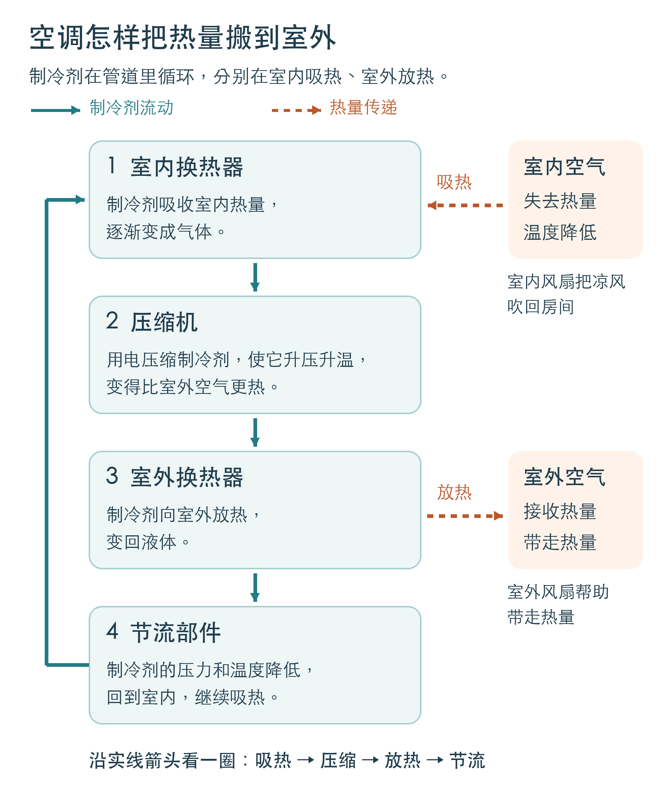

制冷剂在封闭管路内循环：室内吸热，压缩后向室外放热，再节流回流。

格力的凌达、凯邦、新元电子等分别经营压缩机、电机和电子部件，盾安经营制冷阀件。部件团队与整机团队共同开发，可以围绕同一机型调整制冷、耗电和噪声。2025年报记载，新一代家用空调电机已批量应用；风道部件的一体化成型工艺，则通过减少模具和工序改善装配。设计既影响顾客的使用，也会改变工厂具体怎样生产。

自己制造部件，需要格力拥有并维护相应设备、团队和研发能力。与外购相比，公司掌握了更多开发和供货环节，也承担了更多固定投入。足够的订单让这些资源得到利用，少卖时则需要调整产量、采购和库存。自制的经济结果，要把性能、成本、供货和设备利用一起看。

依据 · [伊顿：压缩机制冷基本循环](https://www.eaton.com.cn/cn/zh-cn/products/thermal-management-solutions/chillers/compressor-based-refrigeration-basics.html)；[格力电器2025年度报告 · 第12页](https://static.cninfo.com.cn/finalpage/2026-04-29/1225250396.PDF#page=12)；[格力电器2025年度报告 · 第23页](https://static.cninfo.com.cn/finalpage/2026-04-29/1225250396.PDF#page=23)；[格力电器2025年度报告 · 第26页](https://static.cninfo.com.cn/finalpage/2026-04-29/1225250396.PDF#page=26)；[格力电器2025年度报告 · 第28页](https://static.cninfo.com.cn/finalpage/2026-04-29/1225250396.PDF#page=28)

### 售价和产量，怎样分别影响利润

2025年原材料占家电制造营业成本87.52%，人工约占5.07%。铜等材料与部件是生产成本的大头；设计用量、采购价格和生产良率，都会改变做出一台机器需要花多少钱。研发、营销和售后还在制造成本之外继续发生，2025年利润表已扣除64.63亿元研发费用。

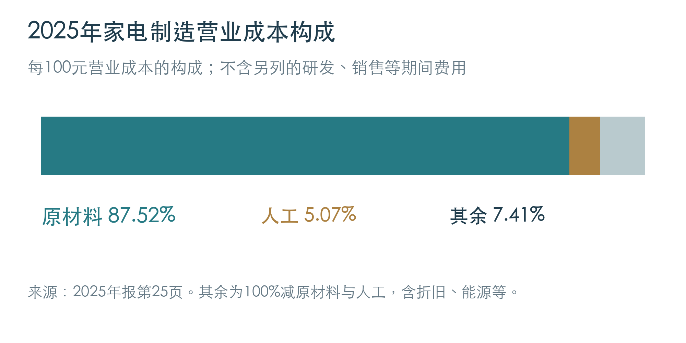

2025年家电制造营业成本结构。来源：年报第25页；此图不含销售、研发等期间费用。

对于尚未生产的机器，减少产量能够相应减少一部分采购，却也可能放弃本来能赚钱的订单；设备和团队的持续开支，仍要由其他产品承担。对于已经做好的库存，材料投入已经发生，降价会减少每台毛利，但也可能带来成交、收回资金并减少积压。生产计划与销售定价因而需要共同安排。

格力正在覆盖更多价格带。低价产品要让材料、配置和交付成本与售价相配；中高端产品要让性能和服务足以吸引顾客接受差价。保持某个价位并不会自动保护总利润，结果取决于最终卖出多少、每台留下多少，以及整套经营的开支。

依据 · [格力电器2025年度报告 · 第25页](https://static.cninfo.com.cn/finalpage/2026-04-29/1225250396.PDF#page=25)；[格力电器2025年度报告 · 第26页](https://static.cninfo.com.cn/finalpage/2026-04-29/1225250396.PDF#page=26)；[拆解报表，探索格力的真相（之一）](https://www.xueqiu.com/2892426645/409943676)；[格力2025年度业绩说明会（2026-05-28） · 第1页](https://static.cninfo.com.cn/finalpage/2026-05-28/1225336605.PDF#page=1)

### 厂家、渠道与消费者的三次交易时点

格力传统渠道通过优惠和返利吸引经销商淡季打款、备货。厂家较早收到钱，并安排生产供货；渠道等门店零售以后再收回投入。地方销售公司还组织培训、推广和服务协调。提前回款帮助厂家经营，经销商则承担了等待销售和库存积压的风险。

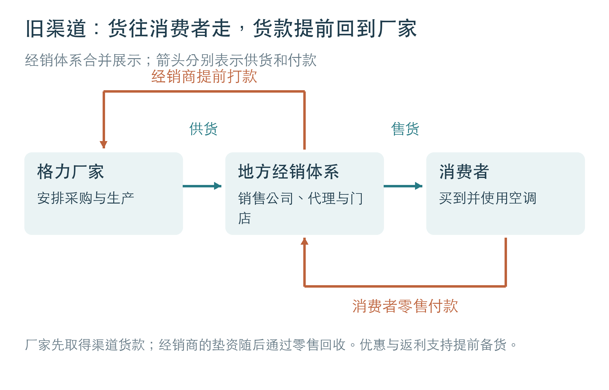

厂家回款可以早于消费者购买；渠道垫资要等零售发生后逐步收回。

线上比价增加以后，多层进货的价差受到挤压。格力一方面让门店在线办理进货，另一方面调整部分地区的交易对方。河北的采访记录了传真下单改为线上；广州2025年的采访则记录，门店网批由盛世欣兴体系转向恒信智远体系，旧货款、保证金及返利使新旧系统继续并行。网批是门店向渠道供货方在线进货，实际向谁付款仍取决于当地交易安排。

报道中的恒信平台上层由自然人出资，未显示上市公司持股。它取得的进销差价，先归该经营主体；格力电器的收益取决于自己的供货数量、供货条件和新增工作成本。改革可以重新分配渠道收益，也需要接续原有的地方服务。渠道专题沿具体事件把这些关系讲透。

依据 · [长江证券：初心如磐，奋楫笃行（2024-09-11） · 第10页](https://pdf.dfcfw.com/pdf/H3_AP202409121639846051_1.pdf#page=10)；[长江证券：初心如磐，奋楫笃行（2024-09-11） · 第16页](https://pdf.dfcfw.com/pdf/H3_AP202409121639846051_1.pdf#page=16)；[格力成立家用电器经营部 董明珠为渠道变革再引“外援”](https://www.yicai.com/news/102105169.html)；[格力渠道大洗牌：核心代理商时代将落幕](https://www.yicai.com/news/102817963.html)

### 订货、仓库和上门人员怎样完成交付

门店接到订单以后，要找到对应型号、安排运输，再约好人员上门安装。格力在2026年5月说明会上披露，基地仓、区域仓和前置微仓组成三级仓网，订单、库存和运输接入统一调度。公司称流转周期缩短20%，2025年整体物流成本降低超过1亿元。

仓网安排已经做好的货从哪里发，生产计划决定下一批做什么。公司介绍按月修正需求、按周微调计划，并按产品生命周期精简型号。把两者接起来，才能减少一地缺货、另一地积货的情况。

送到家里以后，还要安装、调试并处理使用中的故障。格力已有配件储备、客服信息和服务人员资格管理，十年包修又把责任延续到多年使用中。集中组织能够减少重复搬运、改善调度，但运力、安装人手和维修配件仍需要持续投入。

广州2025年9月的采访显示，门店网批进货关联主体从盛世欣兴转向恒信智远，原货款和市场保证金拟迁移；旧返利和余额又使新旧系统并行。报道中的恒信股权链未显示上市公司持股，平台差价先归平台。格力自己取得什么收益，仍要看供货条件、终端订单和承担的仓配服务成本。这个地区样本解释交易关系如何调整，不代表全国已经统一切换。

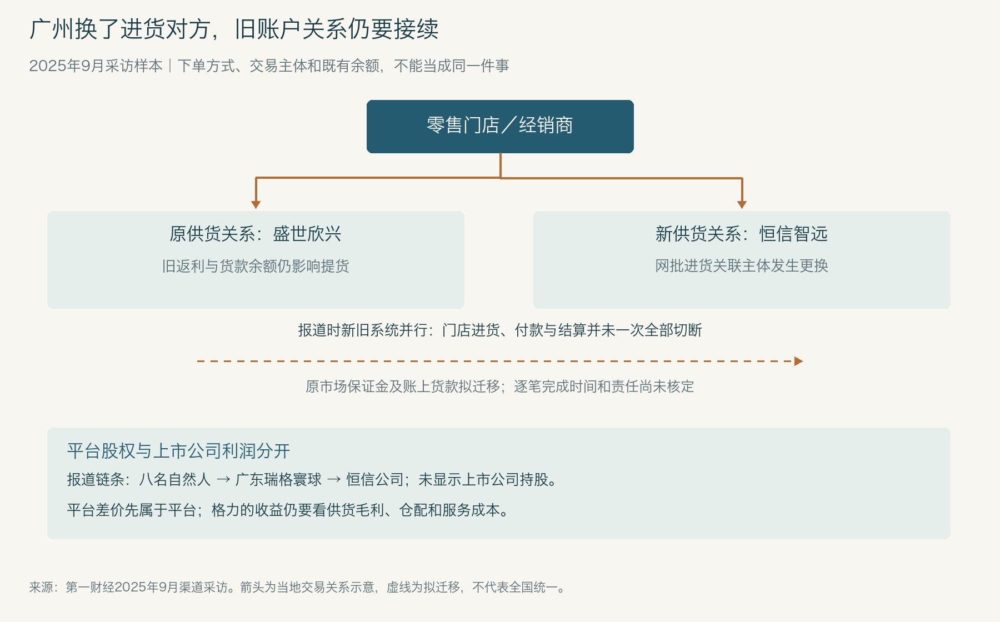

广州2025年9月样本：新旧系统并行，拟迁移不等于已完成；地方平台所得不能直接加为上市公司利润。

依据 · [格力2025年度业绩说明会（2026-05-28） · 第3页](https://static.cninfo.com.cn/finalpage/2026-05-28/1225336605.PDF#page=3)；[格力电器2021年度企业社会责任报告 · 第18页](https://static.cninfo.com.cn/finalpage/2022-04-30/1213262527.PDF#page=18)；[格力电器2021年度企业社会责任报告 · 第20页](https://static.cninfo.com.cn/finalpage/2022-04-30/1213262527.PDF#page=20)；[格力电器2026半年度报告 · 第13页](https://static.cninfo.com.cn/finalpage/2026-08-27/1225515004.PDF#page=13)；[格力渠道大洗牌：核心代理商时代将落幕](https://www.yicai.com/news/102817963.html)

### 商业客户、零部件客户与海外代理

家庭通常为一套住房选择机器，商用中央空调还要与建筑设计、施工和运行维护配合。项目进度会影响设备交付、验收和收款；主机性能之外，方案与长期服务同样进入采购决定。

零部件业务面对整机企业。客户要确认压缩机、电机或阀件符合设计要求，质量稳定，并能按生产计划供货。集团内部可以共享部分技术和制造资源，对外取得的收入仍来自具体客户的采购；内部供应不能再算成集团对外销售。

海外业务主要依靠当地代理商开发客户并组织销售服务。2025年6月说明会介绍，格力以GREE、TOSOT、KINGHOME三组品牌开展品牌授权和区域代理业务，已形成近500家代理商网络。格力已有巴西等海外生产基地；说明会提出的区域销售公司则属于计划试点的安排，后续实施进度需另有资料确认。国内门店、海外代理和工程客户的采购及交付方式各不相同，后面的收入和利润需要沿对应业务理解。

依据 · [格力电器2025年度报告 · 第10页](https://static.cninfo.com.cn/finalpage/2026-04-29/1225250396.PDF#page=10)；[格力电器2025年度报告 · 第12页](https://static.cninfo.com.cn/finalpage/2026-04-29/1225250396.PDF#page=12)；[格力电器2025年度报告 · 第23页](https://static.cninfo.com.cn/finalpage/2026-04-29/1225250396.PDF#page=23)；[格力2024年度业绩说明会（2025-06-09） · 第9页](https://pdf.dfcfw.com/pdf/H2_AN202506091687837662_1.PDF#page=9)

格力的工作贯穿产品开发、部件和整机制造、渠道供货与长期服务。每一笔销售取得的收入，要支付这些工作；厂家、平台和经销商怎样分工，又决定各方何时收款、承担哪些费用与库存。

厂家出货、渠道回款和消费者实际购买可以发生在不同时间。判断生意是否变好，要把最终销售、交付成本与各方占用资金接起来。

渠道调整后，哪些工作和资金责任真正改变了？；具体地区的供货主体、付款与返利安排、仓配和安装职责，以及同口径库存和终端销售。；辨认交易效率改善与责任转移，避免把渠道少一层直接等同于厂家多一层利润。

## 第3章 · 行业需求、竞争与格力的位置

家庭和工程客户为何买空调，价格变化又怎样改变格力与同行的竞争。

### 需求来自新增安装，也来自旧机更换

家庭第一次安装空调、增加房间的空调，或更换旧机，都会形成订单。前两类与住房和家庭安排有关；旧机更换则还取决于机器是否损坏、能耗是否过高，以及家庭愿不愿意现在花这笔钱。商用空调的需求另有节奏，要跟随厂房、办公楼、商业设施等项目建设或改造。两类客户有部分共同技术，但下单原因和收款过程不同。

因此，空调已经相当普及，并不意味着以后没有生意；存在换新需要，也不意味着每年都能维持同样销量。天气、促销和补贴可能改变购买时间，工程项目放缓则会影响新增安装。评价一个季度时，需要分清一部分购买被推迟、提前，还是客户长期不再需要同样多的产品。

截至2026年第三季度，行业需求正在承压。格力三季报引用的行业出货同比降幅，从第一季度的2.8%扩大到第三季度的15.1%。这是行业向渠道出货的变化，并非格力消费者零售份额，也不能与线上某个价格段的销量直接比较。它说明格力面对共同的行业压力，格力自身受影响多大仍要看产品和渠道的表现。

依据 · [格力电器2026第三季度报告 · 第3页](https://static.cninfo.com.cn/finalpage/2026-10-27/1225627217.PDF#page=3)；[格力电器2025年度报告 · 第10页](https://static.cninfo.com.cn/finalpage/2026-04-29/1225250396.PDF#page=10)

### 低价需求扩大，考验产品覆盖

2026年上半年，2100元以下机型占奥维云网线上监测空调销量的54.45%，比上年同期提高6.97个百分点。这个统计限定在线上、按销量计；它不表示全国一半以上的销售额都来自低价产品。它显示的变化是：在这一渠道，更多成交集中到了较低价格段。

格力在2026年5月的业绩说明会上承认，低价零售和工程机布局存在短板。公司已有悦清凉挂机，并提出继续推出相关柜机，争取预算较紧的客户；另一边，AI冷静王、风不吹人等产品继续强调节能、舒适和使用体验。低价产品补覆盖，中高端产品争取愿意为性能付钱的家庭，两边都需要与相应成本配合。

低售价不必然意味着一笔生意不赚钱：适当配置、材料设计和批量生产可能降低成本。高售价也不自动产生高收益：更多功能、推广和保修责任会增加开支。格力的制造积累给了它组织产品组合的条件，但目前材料没有提供同等规格下全面优于同行的成本比较。

产品已经取得的销售结果也有边界。中报披露2026上半年“冷静王”系列全国销售额超过50亿元，说明这个覆盖挂柜、多个价位的系列已有真实市场规模；它不是单款新品收入，也未单列渠道确认口径、毛利和投入，不能据此把全部销售增长归给某个AI功能。格力一边扩展老系列，一边补悦清凉等较低预算产品，成败最终仍要看相应价位的订单、净售价与扣除服务费用后的利润。

依据 · [格力电器2026半年度报告 · 第10页](https://static.cninfo.com.cn/finalpage/2026-08-27/1225515004.PDF#page=10)；[格力电器2026半年度报告 · 第11页](https://static.cninfo.com.cn/finalpage/2026-08-27/1225515004.PDF#page=11)；[格力2025年度业绩说明会（2026-05-28） · 第1页](https://static.cninfo.com.cn/finalpage/2026-05-28/1225336605.PDF#page=1)；[格力电器2025年度报告 · 第25页](https://static.cninfo.com.cn/finalpage/2026-04-29/1225250396.PDF#page=25)

### 品牌帮助进入选择，成交仍由具体产品和服务决定

空调安装后会用很多年，消费者购买时无法当场验证未来故障率，也无法提前经历一次维修。格力长期形成的可靠性认知、十年包修以及当地服务网点，为顾客提供了愿意认真考虑它的理由。品牌的作用首先发生在这里：减少对长期使用和出问题后找不到人的担心。

但顾客仍会比较价格、噪声、外观、安装便利和门店接待。市场上还有美的、海尔等选择，网上参数和价格又很容易看到。格力能否获得更高售价，要落实到具体机型和当地服务；不能把“知名品牌”直接换成固定比例的溢价。品牌专题进一步讨论这种信任如何形成，以及一次具体购买中仍可能失去顾客的原因。

2026年中报披露格力品牌家用空调全渠道零售份额25.8%，说明其仍有较大的终端销售基础，但材料未进一步交代这个数字按金额还是台数统计。2025年的24.31%是线上口径，2021年的37.4%是内销出货量口径。覆盖范围和计量方式不同，三者不能连成一条份额升降曲线。

依据 · [格力电器2025年度报告 · 第10页](https://static.cninfo.com.cn/finalpage/2026-04-29/1225250396.PDF#page=10)；[格力电器2026半年度报告 · 第11页](https://static.cninfo.com.cn/finalpage/2026-08-27/1225515004.PDF#page=11)；[格力电器2021年度企业社会责任报告 · 第20页](https://static.cninfo.com.cn/finalpage/2022-04-30/1213262527.PDF#page=20)；格力电器2021年度报告 · 第11页

### 同行也在改善交付，渠道优势需要持续经营

格力2025年披露超过2万家专卖店和3万家售后网点。它们让消费者在当地看到产品、完成安装并找到维修人员。这种覆盖需要培训、配件供应和费用结算维持，网点数量只是基础，顾客实际遇到的服务才决定覆盖有没有发挥作用。

美的2026年中报披露，其国内渠道按零售实销安排补货，日均自有库存同比下降16%，云仓覆盖超过94%的线下渠道。格力则推进三级仓网、订单和运输调度。两家公司都在缩短终端需求与供货之间的距离，减少货物分散在多层渠道中的成本。美的披露的库存是其自有库存，不能与格力未披露的全国渠道库存直接相减。

交付效率提高后，节约的钱可能留在厂家，也可能用于支持门店或降低售价。竞争会影响这笔节约最终归谁。格力改革是否取得持续收益，要一起看终端销售、主营毛利、履约费用和资金占用，不能只凭层级减少便认定上市公司利润上升。

依据 · [格力电器2025年度报告 · 第10页](https://static.cninfo.com.cn/finalpage/2026-04-29/1225250396.PDF#page=10)；[美的集团2026半年度报告 · 第29页](https://static.cninfo.com.cn/finalpage/2026-08-28/1225533135.PDF#page=29)；[格力电器2026半年度报告 · 第13页](https://static.cninfo.com.cn/finalpage/2026-08-27/1225515004.PDF#page=13)

### 商用与海外提供其他市场，也有不同压力

2025年报引述的市场统计显示，格力中央空调国内占有率超过15%。工程客户需要适合建筑的系统、安装配合和后续运行维护，主机性能只是采购的一部分。已有技术和品牌帮助格力取得订单，项目需求、客户回款及工程服务仍会影响最终收益。

海外业务通过GREE、TOSOT、KINGHOME等品牌和当地代理商开展。2025年6月业绩说明会介绍了近500家代理商网络，代理商承担当地销售与服务，格力提供产品和品牌；同时提出计划试点区域销售公司，并逐步完善海外制造布局。计划的后续落实程度需要另外核实。2025年自主品牌出口占比约70%，表明它并非主要依赖没有自有品牌的供货方式。这个占比本身不等于海外盈利已经增长。

2026年上半年，主营出口收入下降约22%，虽然毛利率提高，总毛利仍下降。海外恢复需要代理商获得订单，也需要合适产品、推广和服务支持。现阶段能看到的是经营基础仍在、当期销售承压；未来扩张能贡献多少收益，要由实际收入、毛利和新增投入回答。

依据 · [格力电器2025年度报告 · 第10页](https://static.cninfo.com.cn/finalpage/2026-04-29/1225250396.PDF#page=10)；[格力2024年度业绩说明会（2025-06-09） · 第9页](https://pdf.dfcfw.com/pdf/H2_AN202506091687837662_1.PDF#page=9)；[格力电器2026半年度报告 · 第24页](https://static.cninfo.com.cn/finalpage/2026-08-27/1225515004.PDF#page=24)

格力拥有成熟的制造、品牌和服务网络，但需求下行与低价产品扩张正在检验这套优势。较大的销售份额说明它仍在主要竞争者之列，不能单独证明利润已经稳住。

行业需求下降可以解释共同压力，却不能解释格力与同行之间的全部差异。格力需要用合适的产品和交付成本争取客户，才能将制造与品牌积累转化为利润。

低价产品补齐以后，格力能否同时稳住销量与每笔订单的收益？；同口径的价格段销量、成交价和毛利变化，以及销售和服务费用。；区分有效扩大客户覆盖与仅靠让价维持规模。

## 第4章 · 历史经营、转折与当前阶段

先看2018—2025年的经营轨迹，再拆开2026年的收入、毛利与费用变化。

### 收入与利润的长期轨迹

2018年营业收入约1981亿元，2023年达到2040亿元，2025年回到1704亿元。归母利润则在2024年达到322亿元，2025年降至290亿元。收入和利润并非同步变化，业务组合、成本和费用都在影响公司留下多少钱。

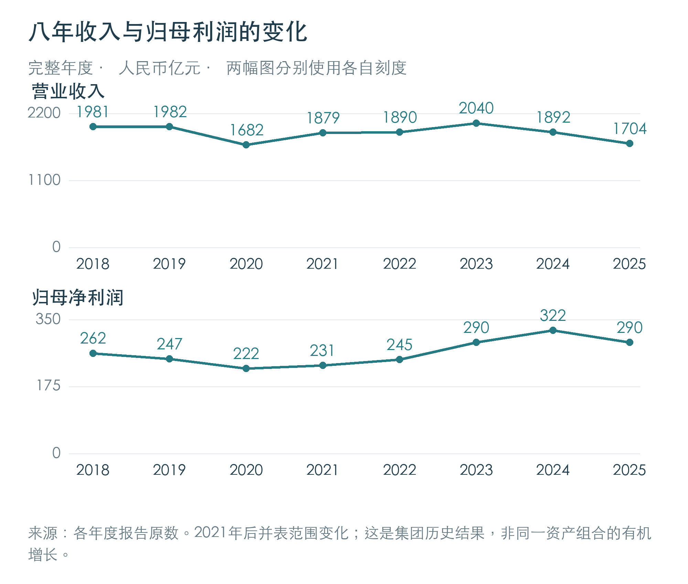

来源：各年度报告原数。2021年后并表范围变化；这是集团历史结果，非同一资产组合的有机增长。

这段时期还经历了格力钛等业务并表，集团经营的资产范围发生变化。图中呈现的是集团各年的实际结果。接下来再拆开最近的主营业务和利润，解释当下压力从哪里来。

依据 · 格力电器2019年度报告 · 第6页；格力电器2023年度报告 · 第7页；[格力电器2025年度报告 · 第7页](https://static.cninfo.com.cn/finalpage/2026-04-29/1225250396.PDF#page=7)；格力电器2021年度报告 · 第7页；格力电器2022年度报告 · 第7页；格力电器2024年度报告 · 第7页

### 需求冲击、主业恢复与费用调整

2020年的收缩发生在疫情冲击之下。年报引用的行业资料显示，家用空调内销下降12.9%，同时家电线上零售比重首次超过一半。格力当年营业收入降至1682亿元，归母利润降至222亿元，并推进线上线下结合的新零售。这既是需求冲击，也是原有依靠线下门店的销售方式加快调整的时期；行业数不能直接当作格力零售降幅。

到2023年，行业空调零售和内外销出货均恢复增长。格力当年单列的空调收入1512.17亿元，同比增长12.13%，占集团营业收入74.14%；制造业收入增长13.97%，高于集团7.93%的收入增速，原因之一是其他业务收入仍在收缩。国内主营收入增长15.22%，出口增长7.02%，说明这轮恢复确实有主业销售支撑。格力钛、盾安等并表变化也进入集团数列，不能把2018年以来的全部增长都算成原有空调业务自然增长。

2024年又出现收入下降、归母利润升至322亿元的组合。其他业务收入下降33.88%，制造业收入下降2.78%；制造业毛利率还下降1.09个百分点，并非主业每元收入更赚钱推动了这项利润高点。与此同时，同一份年报中的可比销售费用减少约50.49亿元，公司将其与渠道营销费用和产品结构变化联系起来，管理费用也下降。费用调整解释了利润为何能够在收入和主业毛利承压时得到支持，但这不是全部利润变化的逐项归因，也不能证明每项节约以后都能持续。

这里使用2024年报重述后的2023年比较数，避免把质量保证费用从销售费用移到营业成本的列报调整误当成新节约。2025年集团收入和利润再次下降，消费电器收入也从2024年1485.60亿元降至1330.55亿元。高利润年份能否重复，要回到主营销售、毛利及必要费用，而不能只沿集团总收入外推。接下来把2026年的这些变化逐项拆开。

依据 · 格力电器2020年度报告 · 第9页；格力电器2020年度报告 · 第14页；格力电器2023年度报告 · 第10页；格力电器2023年度报告 · 第20页；格力电器2024年度报告 · 第25页；格力电器2024年度报告 · 第26页；格力电器2024年度报告 · 第31页；格力电器2024年度报告 · 第77页；[格力电器2025年度报告 · 第24页](https://static.cninfo.com.cn/finalpage/2026-04-29/1225250396.PDF#page=24)

### 2026上半年的收入下降需拆开看

2026年上半年，格力总营业收入比上年同期减少约79.27亿元。其中，其他业务收入减少约56.88亿元，占总降幅的71.8%。主营制造收入下降2.56%，消费电器收入下降2.89%，降幅都小于集团总收入的8.15%。集团缩减低毛利的其他业务，使总收入的变化看起来比制造业务本身更大。理解空调经营，接下来需要看制造业务怎样取得收入，又留下多少毛利。

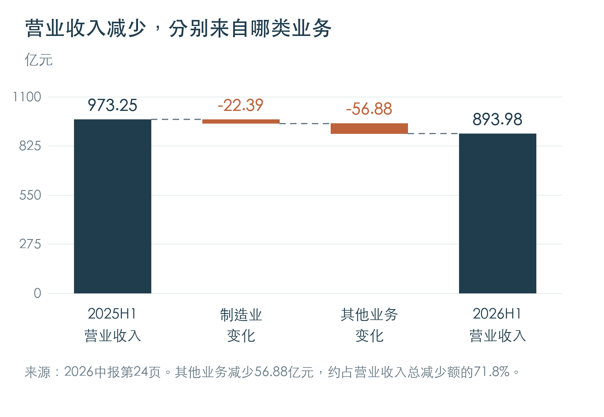

来源：2026中报第24页。其他业务减少56.88亿元，约占营业收入总减少额的71.8%。

国内主营业务的情况是，收入增长1.90%，毛利率却下降2.62个百分点，降至31.94%。毛利是销售收入扣掉营业成本后剩下的钱，还要继续支付销售、研发、管理等费用。国内收入增加而毛利率下降，意味着每一元收入留下的钱更少，售价、材料成本或产品组合的压力仍然存在。

出口的变化是收入下降21.98%，毛利率提高1.74个百分点。每一元出口收入留下的钱增加了，但销售规模的缩小超过了这项改善，出口毛利额仍在下降。内销面对的是每元收入毛利减少，出口面对的是收入规模明显收缩；两条路径都在压低主业的毛利额。
按产品分类，消费电器同期收入下降2.89%，毛利率降至31.77%、同比减少1.43个百分点。消费电器与国内、出口属于交叉分类，不能把它们的金额相加。

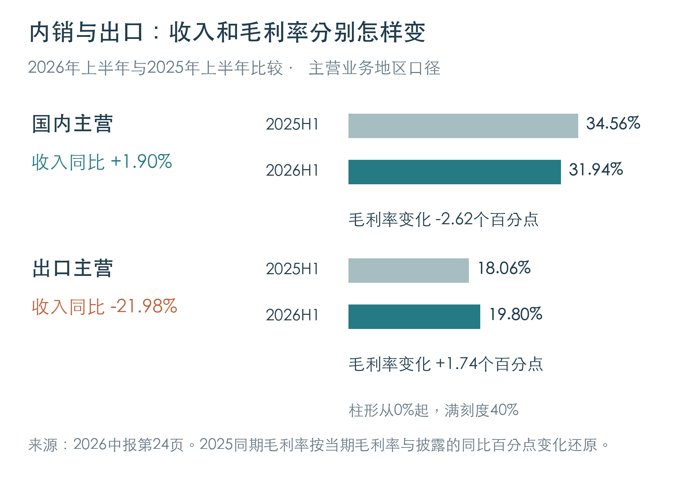

来源：2026中报第24页。2025同期毛利率按当期毛利率与披露的同比百分点变化还原。

“其他业务”体量大，却只留很薄的毛利。2025年收入166.65亿元、成本162.18亿元，毛利4.47亿元；2026上半年收入从上年同期98.30降至41.42亿元，少56.88亿元，毛利只由1.87降至0.71亿元，少1.16亿元。因此不能把这56.88亿元收入下降当成同额空调盈利损失。

这类收入至少需要分清材料转售与制造整机的区别。长江证券2024年研究介绍2023年结构时，将其他业务主要解释为“甲供”：格力先采购原材料，再转售给供应商，供应商加工零部件后供货。格力一边付采购款、一边向供应商收材料款，材料销售形成一笔收入；后续购买部件又形成支出，薄利大流水与一台空调的整机毛利不是同一件事。

这段是对历史甲供机制的解释。2025年报和2026中报只列其他业务收入成本，未把当期全部内容、账期及净结算方式逐项拆开，所以不能声称2026年的41.42亿元全部来自甲供，也不能据此推断所有材料款已经收到。当前判断可以确认它的收入变化远大于毛利变化；更细的资金期限仍待披露。

依据 · [格力电器2026半年度报告 · 第7页](https://static.cninfo.com.cn/finalpage/2026-08-27/1225515004.PDF#page=7)；[格力电器2026半年度报告 · 第24页](https://static.cninfo.com.cn/finalpage/2026-08-27/1225515004.PDF#page=24)；[格力电器2025年度报告 · 第173页](https://static.cninfo.com.cn/finalpage/2026-04-29/1225250396.PDF#page=173)；[格力电器2026半年度报告 · 第145页](https://static.cninfo.com.cn/finalpage/2026-08-27/1225515004.PDF#page=145)；[长江证券：初心如磐，奋楫笃行（2024-09-11） · 第7页](https://pdf.dfcfw.com/pdf/H3_AP202409121639846051_1.pdf#page=7)

### 毛利少了以后，哪些费用下降保住了一部分利润

2026年上半年，集团毛利从277.28亿元降到257.58亿元，少了19.70亿元。与此同时，毛利率却从28.49%略升到28.81%。这两个结果可以同时出现：低毛利的其他业务收缩后，在剩下的收入里，较高毛利业务所占比例变大了，集团的平均毛利率就可能上升。

集团毛利率是把各类业务放在一起算出的平均数。低毛利业务收缩，会提高其余业务在总收入里的比重；同一时期，制造业主营毛利率下降了1.35个百分点。银河证券的中报点评也指出这两种口径的差别。对格力来说，压缩低收益业务是一项调整，改善空调制造的盈利是另一项工作，二者在本期呈现出不同结果。

费用减少替公司保住了一部分利润。销售费用比上年同期少10.72亿元，研发费用少7.51亿元，两项开支合计减少18.23亿元，抵消了相当一部分毛利损失。这里的研发费用是当期利润表上扣除的金额，与公司披露的全部研发投入采用不同口径。

随后还要考虑管理费用、财务收支、所得税等变化。这些项目有增有减，逐项算下来，归属于上市公司股东的净利润减少11.35亿元，剩下132.78亿元。用这个利润除以营业收入，利润率约为14.85%，与上年同期14.81%接近。公司确实通过费用调整减轻了利润下降，但主业毛利减少的问题也仍然存在。
图中的“其余营业项目合计”包括税金及附加、财务公司息差、其他及投资收益、公允价值变动、减值和处置，按原表逐项相加得到；这些项目有各自的业务来处，不全部属于渠道改革成果。

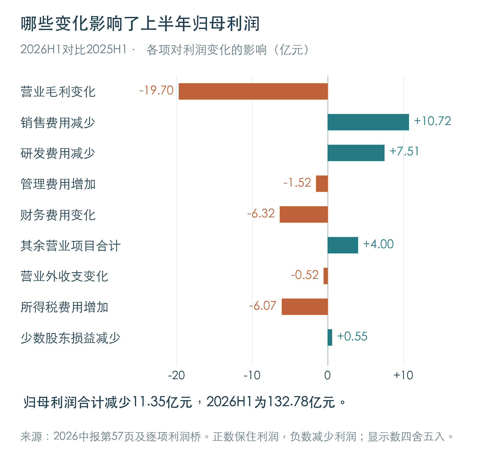

来源：2026中报第57页及逐项利润桥。正数保住利润，负数减少利润；显示数四舍五入。

销售费用中包含安装、仓储装卸、推广和员工薪酬。中报没有把10.72亿元的减少逐项解释清楚，研发费用下降也没有直接证明研发效率提高。仓配改善可以解释其中一部分方向，销量、业务组合和支出时间变化也可能有影响。长期判断需要看：公司是否在把事情做得更省钱，同时还能把产品研发、安装和售后做好。必要工作持续少做，即使短期利润好看，后面也可能失去订单。

依据 · [暖通行业承压 渠道提效缓解利润](https://stock.finance.sina.com.cn/stock/go.php/vReport_Show/kind/search/rptid/841219387495/index.phtml)；[格力电器2026半年度报告 · 第23页](https://static.cninfo.com.cn/finalpage/2026-08-27/1225515004.PDF#page=23)；[格力电器2026半年度报告 · 第24页](https://static.cninfo.com.cn/finalpage/2026-08-27/1225515004.PDF#page=24)；[格力电器2026半年度报告 · 第57页](https://static.cninfo.com.cn/finalpage/2026-08-27/1225515004.PDF#page=57)；[格力电器2026半年度报告 · 第147页](https://static.cninfo.com.cn/finalpage/2026-08-27/1225515004.PDF#page=147)；2026H1归母利润同比桥与原数

### 第三季度使恢复判断更谨慎

2026年前三季度归母净利润为172.74亿元，扣除非经常性损益后为164.03亿元。第三季度单季分别为39.96亿元和36.96亿元，比2025年第三季度下降43.31%和44.32%，表明利润下降仍在继续。公司把压力与行业需求、原材料价格以及坚持中高端产品的策略联系起来。行业出货降幅也从第一季度的2.8%扩大到第三季度的15.1%，可见需求问题并非格力独有。

2026年第三季度集团收入366.78亿元，毛利83.23亿元，毛利率22.69%；上年同期毛利112.84亿元、毛利率28.31%。毛利减少29.61亿元，归母利润减少30.53亿元，两者接近。销售、研发与财务收支的变化进一步压低利润，管理费用减少抵消了一部分；所得税费用减少4.87亿元反而减轻了下降。主要问题已经落在经营毛利，不能只归因于税率。

需求较弱时，格力既要争取订单，也要维护每台机器留下的利润。较低价位产品帮助公司覆盖更多预算，中高端产品依靠性能和服务争取差价，仓配调整则减少完成销售的开支。行业需求回暖能够提供机会，格力实际恢复多少收益，还会受这几项经营工作的结果影响。

最新滚动扣非归母利润235.24亿元仍包含2025年第四季度71.21亿元，未来一个季度变弱会继续压低滚动数。第七章据收入、毛利和必要费用另作经营估计，采用逐步恢复至约159亿元合并经营现金的主判断，不直接把滚动利润延续或按固定比例打折。

依据 · [格力电器2026第三季度报告 · 第2页](https://static.cninfo.com.cn/finalpage/2026-10-27/1225627217.PDF#page=2)；[格力电器2026第三季度报告 · 第3页](https://static.cninfo.com.cn/finalpage/2026-10-27/1225627217.PDF#page=3)；[格力电器2025年度报告 · 第8页](https://static.cninfo.com.cn/finalpage/2026-04-29/1225250396.PDF#page=8)；[格力电器2026第三季度报告 · 第7页](https://static.cninfo.com.cn/finalpage/2026-10-27/1225627217.PDF#page=7)；格力正常现金与价值判断及经营推导

### 应当怎样看行业补贴与换新

旧空调替换带来购买需求，促销和补贴则影响家庭何时下单、买哪一档产品。格力2026中报介绍7月开始的以旧换新回收补贴：旧格力挂机补贴400—600元，其他品牌330—500元，柜机另有金额。准备换机的家庭因而少支付一部分费用，公司也获得推动成交的机会。

这类活动既关系销售数量，也关系每笔订单留下的收入。部分家庭可能提前更换，部分家庭会在补贴帮助下选择更高价格的产品。评价活动结果，需要把活动期间与后续销售连起来，再看促销后的净售价、毛利和备货资金。公司整体利润才是这些变化汇总后的结果。

依据 · [格力电器2026半年度报告 · 第13页](https://static.cninfo.com.cn/finalpage/2026-08-27/1225515004.PDF#page=13)

2026年集团收入下降有较大部分来自其他业务收缩，主营业务也确实少赚毛利。销售和研发费用下降减轻了压力，第三季度利润继续下行，经营尚未呈现全面恢复。

目前的事实是主营毛利和第三季度利润仍在下降。费用减少减轻了压力，但尚不能据此认定经营已经见底。

2026年第四季度能否止住盈利下行？；从2026年报核对第四季度扣非利润，并结合主营业务、原材料成本及返利变化分析。；区分经营开始稳定与滚动数字仍被较高的旧季度支撑。

## 第5章 · 财务质量与现金归属

沿回款、返利、设备投入和金融业务，解释利润与可供股东使用的现金为什么不同。

### 先收货款，还承担着供货与服务责任

第二章介绍了传统渠道的先款后货：经销商提前付款，格力收到资金，之后按约供货。提前收到的货款在交货等履约前形成合同负债，不能因为钱已到账，就把它全当作当期利润或可以返还给股东的闲钱。交货确认收入之后，机器仍可能伴随后续质量保证等责任。

返利又把一次进货与以后结算联系起来。厂家根据销售政策给经销商优惠，可以影响实际供货价格、以后进货的抵扣和应付责任。它与客户预付货款不是同一项目，返利的计提和兑现也可能跨期。渠道改制时，旧货款、保证金和返利需要继续结算，门店因此可能同时使用新旧系统。

改革若减少经销商提前付款，厂家就可能需要自己补上部分经营资金，即使终端销量不变也会发生这种变化。反过来，预收款减少也可能来自经销商对未来销售转弱的预期。需要将付款政策与真实零售、出货和库存放在一起，才能分清效率改善与需求不足。

依据 · [格力电器2026半年度报告 · 第150页](https://static.cninfo.com.cn/finalpage/2026-08-27/1225515004.PDF#page=150)；[格力渠道大洗牌：核心代理商时代将落幕](https://www.yicai.com/news/102817963.html)；[长江证券：初心如磐，奋楫笃行（2024-09-11） · 第16页](https://pdf.dfcfw.com/pdf/H3_AP202409121639846051_1.pdf#page=16)

### 2025年的高现金，有一部分来自保证金收回

2025年，格力经营现金净流入463.83亿元，其中156.67亿元来自票据保证金减少。保证金是为相关票据业务按安排存放、受到使用限制的资金；缴存需要下降时，原来压在其中的钱释放出来，成为公司可以重新安排的资金。

这项变化改善了当年的资金状况。它的经济过程是原有资金收回，与持续销售空调创造收益不同：保证金余额降低之后，今后能否继续释放，取决于下一期余额和业务安排。估计每年可持续的股东现金时，应将这笔收回单独解释。

463.83亿元扣去156.67亿元，剩307.16亿元。这个余额仍包含其他周转和金融业务收付款，后面还要支付必要资产投入，并处理普通股归属。现金补充表里的股权激励等非现金项目，也有相应股东成本。它们使报表现金与持续可分配现金之间，需要一条完整的解释，而不只是减掉一笔购建设备付款。

依据 · [格力电器2025年度报告 · 第179页](https://static.cninfo.com.cn/finalpage/2026-04-29/1225250396.PDF#page=179)；[格力电器2025年度报告 · 第180页](https://static.cninfo.com.cn/finalpage/2026-04-29/1225250396.PDF#page=180)

### 保证金、贷款和日常周转怎样影响2026年现金

2026年前三季度经营现金流为240.63亿元，同比下降47.38%。公司披露，票据保证金变化造成同比差额136.17亿元；剔除这项差额影响后，经营现金仍少约80.48亿元、下降24.71%。保证金影响很大，剩余收付款同样转弱。

合并现金表还包含财务公司业务。前三季度“客户贷款及垫款净增加额”为负64.17亿元，表示该项净收回贷款，给集团带来资金流入。原来的贷款资产转回现金，改善了资金可用性；贷款本金本身并不是这一年新增的利润。

上半年存货、应收和经营应付款三项变化合计释放约61.51亿元。库存变少、款项收回或付款安排变化，都能影响某一期的现金。因此，分析格力资金时，一方面追踪这些真实收付，另一方面研究维持日常经营需要留多少资金，避免把存量资金收回持续计成年度收益。

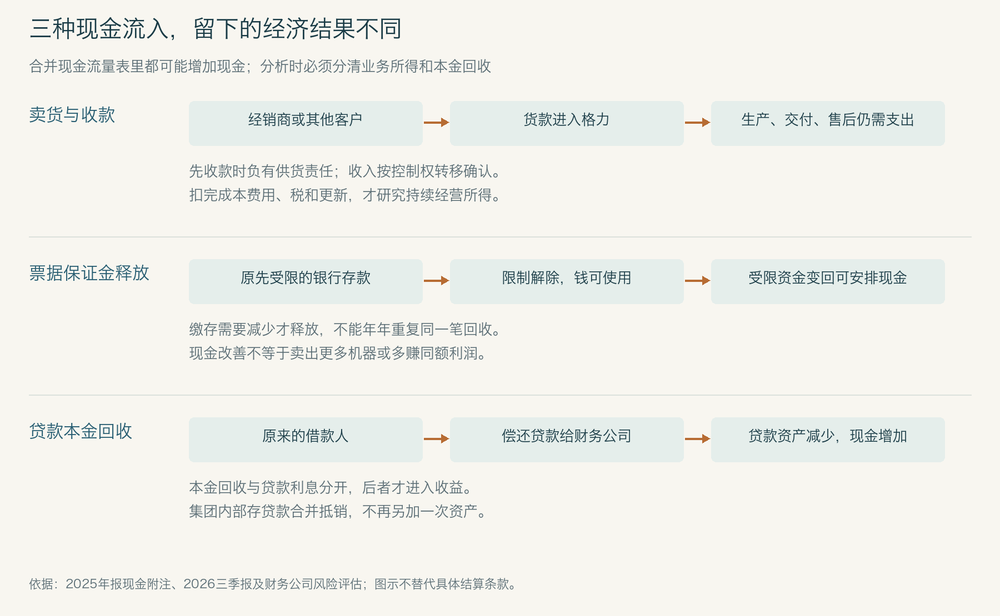

销售回款、保证金解除和贷款本金收回进入现金表的原因不同；后两者把已有资产变回现金，不能作为每年新增利润。

依据 · [格力电器2026第三季度报告 · 第3页](https://static.cninfo.com.cn/finalpage/2026-10-27/1225627217.PDF#page=3)；[格力电器2026第三季度报告 · 第8页](https://static.cninfo.com.cn/finalpage/2026-10-27/1225627217.PDF#page=8)；[格力电器2026半年度报告 · 第151页](https://static.cninfo.com.cn/finalpage/2026-08-27/1225515004.PDF#page=151)；[格力电器2026半年度报告 · 第152页](https://static.cninfo.com.cn/finalpage/2026-08-27/1225515004.PDF#page=152)

### 销售费用减少，有时是省了钱，有时只是报表换了位置

比较销售费用时，先要确认同一笔支出是不是一直放在同一个位置。2024年报调整了质量保证费用的列报方式，把其中一类原来列在销售费用里的支出，改列到营业成本，并相应调整2023年的比较数字，金额为23.28亿元。

这相当于把一笔费用从报表的一行搬到另一行：营业成本变高、毛利变少，销售费用同时变少，总利润并没有因此增加。如果直接拿2023年旧报表和2024年新报表相比，就可能误以为销售费用一下省下了很多钱。

2026年上半年销售费用同比减少10.72亿元，用的是同一份中报里的比较数字，因此确实发生了费用减少。这部分好处已经反映在当期利润里，计算股东现金时不能再把整笔金额额外加一遍。钱是否已经省下来，还要看付款时间、返利兑现，以及库存和应收款有没有同时占用更多资金。

合同负债在这里主要反映客户先交钱、公司还需要供货等义务。它下降可能是渠道减少提前压货，也可能是需求变弱、经销商不愿提前付款。需要结合供货政策和实际销售来分辨，不能只凭应收款没有明显增加，就认定改革已经让所有交易都即时结清。

依据 · 格力电器2024年度报告 · 第77页；格力电器2024年度报告 · 第152页；[格力电器2026半年度报告 · 第57页](https://static.cninfo.com.cn/finalpage/2026-08-27/1225515004.PDF#page=57)；[格力电器2026半年度报告 · 第150页](https://static.cninfo.com.cn/finalpage/2026-08-27/1225515004.PDF#page=150)；[拆解报表，探索格力的真相（之一）](https://www.xueqiu.com/2892426645/409943676)

### 设备付款、折旧与长期更新需要

2025年，格力购建长期资产实际支付17.17亿元；2018—2023年，每年约为38—60亿元。付款发生在合同和建设进度安排的时点，设备则跨多年使用，一次建设付款也可能分散到几个年度。最近一年付款较低，首先反映当年的投资和结算节奏。

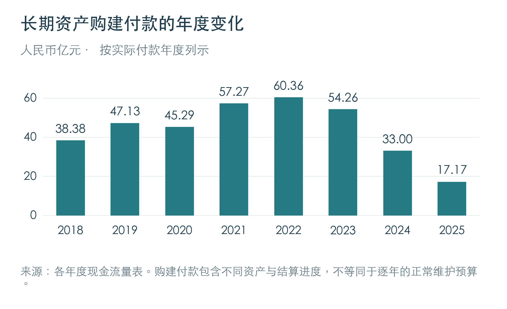

来源：各年度现金流量表。购建付款包含不同资产与结算进度，不等同于逐年的正常维护预算。

利润表中的折旧与摊销采用另一种时间安排：过去买入资产的成本，分摊到使用这些资产的年份。至2026年上半年的滚动折旧摊销约47.86亿元，包含使用权资产。它说明过去投入正在分期进入成本，与当期新付款对应的资产和时期有差别。

折旧是过去投入在当期分摊的成本；设备更新是以后继续经营需要付出的投入。当前估计先在合并经营范围加回折旧摊销，再扣必要的未来替代能力投入；存量租赁融资和少数股东权益在后面的权益桥处理。新建产能与维护现有能力的用途也要区分。

2025年购建长期资产只支付17.17亿元，不能代表此后每年更新设备的代价。2023—2025年在建工程新增由56.20亿元降至10.98亿元，大项目转固后，付款自然会回落；同时，2026年上半年机器设备原值331.84亿元、累计折旧242.48亿元，仍需要持续更新生产能力。折旧程度不等于物理设备损坏，但也不支持永久维持十多亿元的低付款。

近年折旧摊销约48—53亿元，2022—2023年含扩张的购建付款约54—60亿元。结合工程收缩，当前合并范围采用48亿元折旧摊销、51亿元维护；维护包含未来租用能力的替代投入，当前租赁债务另在融资桥扣除。没有逐厂更换计划，51亿元是工作估计。旧稿从归母利润后净扣3亿元采用了不同归属口径，当前不再直接沿用那条现金起点。

依据 · [格力电器2025年度报告 · 第89页](https://static.cninfo.com.cn/finalpage/2026-04-29/1225250396.PDF#page=89)；[格力电器2025年度报告 · 第179页](https://static.cninfo.com.cn/finalpage/2026-04-29/1225250396.PDF#page=179)；[格力电器2026半年度报告 · 第151页](https://static.cninfo.com.cn/finalpage/2026-08-27/1225515004.PDF#page=151)；格力电器2018年度报告 · 第91页；格力电器2019年度报告 · 第90页；格力电器2020年度报告 · 第101页；格力电器2021年度报告 · 第121页；格力电器2022年度报告 · 第120页；格力电器2023年度报告 · 第117页；格力电器2024年度报告 · 第114页；格力电器2023年度报告 · 第183页；格力电器2023年度报告 · 第186页；[格力电器2025年度报告 · 第154页](https://static.cninfo.com.cn/finalpage/2026-04-29/1225250396.PDF#page=154)；[格力电器2026半年度报告 · 第129页](https://static.cninfo.com.cn/finalpage/2026-08-27/1225515004.PDF#page=129)；[格力电器2026半年度报告 · 第130页](https://static.cninfo.com.cn/finalpage/2026-08-27/1225515004.PDF#page=130)；格力正常现金与价值判断及经营推导；格力资产、经营EPV与增长适用性完整研究

### 同季比较：贸易资金支持减少多少

渠道资金采用同季比较。2025年6月底至2026年6月底，应收账款、应收款项融资、存货与预付款合计减少86.69亿元；应付账款、应付票据、合同负债与销售返利合计减少102.33亿元。前一组少占了钱，后一组提供的资金也少了，净支持减少约15.64亿元。这组选择不等于完整营运资金，但比单看合同负债更能解释贸易资金关系。

主判断据此为前两年各留15亿元过渡投入，共30亿元；这是量级估计，不是把一次同比变化当成固定预测。达到稳定规模、结算关系也稳定之后，不再假定每年增加同额占用。若经销商和供应商继续减少资金支持，预算和持续时间都要上调。旧返利已通过日常成本和结算进入经营关系，不能再把484亿元余额整笔重复扣掉；若旧责任加速清理，则另算提前流出的现金。

依据 · [格力电器2025半年度报告 · 第50页](https://disc.static.szse.cn/disc/disk03/finalpage/2025-08-29/e433fd33-a08e-48eb-a15c-9d529c9ac12d.PDF#page=50)；[格力电器2025半年度报告 · 第139页](https://disc.static.szse.cn/disc/disk03/finalpage/2025-08-29/e433fd33-a08e-48eb-a15c-9d529c9ac12d.PDF#page=139)；[格力电器2026半年度报告 · 第53页](https://static.cninfo.com.cn/finalpage/2026-08-27/1225515004.PDF#page=53)；[格力电器2026半年度报告 · 第141页](https://static.cninfo.com.cn/finalpage/2026-08-27/1225515004.PDF#page=141)；格力正常现金与价值判断及经营推导

### 从利润走向维持经营后的现金

会计利润已经扣过折旧，设备更新则是实际维持生产能力的投入。近年折旧摊销约48—53亿元，近期开支较低又包含工程建设节奏变化，不能把两者差额永久视为普通股所得。

当前工作估计在合并范围采用48亿元折旧摊销和51亿元维护：后者包含自有能力更新及未来租用能力替代，当前租赁债务另在权益桥处理。必要研发、营销和股份支付仍留在成本中。

国内外主营和正常费用支持的经营利润197.4亿元，扣18%经营税、加回折旧并扣维护，得到158.868亿元正常经营现金。这里剥离了金融收益，尚未把外部股东权益分出去；不能把它直接叫格力普通股每年可收到的分红。

资金留存在企业的部分按相应收益估值，可单独计价的金融本金再扣融资与其他义务；前两年渠道过渡各15亿元由已有圈存资金转为经营周转，只扣少收利息，不再次扣同一笔本金。完整衔接见第七章。

依据 · 格力资产、经营EPV与增长适用性完整研究

### 账上资金的期限、限制与用途

2025年底货币资金1105.53亿元，其中724.09亿元定期存款及应计利息未计入现金等价物，105.78亿元为受限资金；按现金流量表定义，现金及现金等价物余额约275.66亿元。2026年三季度末，货币资金1175.16亿元，现金及现金等价物余额256.72亿元。两组数字采用不同的可用性和期限定义。

定期存款可能按合同到期收回，受限资金则要满足解除限制的安排。与此同时，公司还承担短期借款、采购应付款、销售返利和客户结算责任，经营也需要保持一定资金。要找出真正多余、可以分给股东的一部分，需要把这些用途与到期安排对应起来。

当前估值先从经营盈利中剥离资金收益和融资收支，再把金融资源、对应融资与必要留存配对。保留的资金计相应持续收益，可单独计价的本金则进入权益桥，相关利息不再同时永续。取得或分配本金的时间若延后，再按实际条件折现；第七章分别展示500亿元留存、高备资及本金滞留情景。

财务公司是集团内的金融服务企业，不是多出一座装满现金的银行金库。成员单位把钱存进去，财务公司承担还本付息和结算责任；它向符合范围的成员单位贷款、办理票据及其他金融业务，持有对方未来还本付息的请求权，也要承担信用风险、运营费用和监管留资。贷款发放把现金换成贷款资产，收回本金把贷款资产换回现金，利息收入才是这段金融业务的收益。

集团合并时，格力体系内公司彼此的存款和贷款、利息收入和支出要抵销：母公司存入财务公司的100元，不能在母公司存款与财务公司总资产中各算100元。合并后仍留下的贷款、对外投资及外部成员存款才影响集团对外资源和义务。2026中期风险评估披露财务公司总资产541.94亿元、净资产75.47亿元；这些独立口径金额用来理解资本与经营限制，不另加进已经合并的2649.93亿元金融资源。

依据 · [格力电器2025年度报告 · 第180页](https://static.cninfo.com.cn/finalpage/2026-04-29/1225250396.PDF#page=180)；[格力电器2025年度报告 · 第167页](https://static.cninfo.com.cn/finalpage/2026-04-29/1225250396.PDF#page=167)；[格力电器2026第三季度报告 · 第4页](https://static.cninfo.com.cn/finalpage/2026-10-27/1225627217.PDF#page=4)；[格力电器2026第三季度报告 · 第8页](https://static.cninfo.com.cn/finalpage/2026-10-27/1225627217.PDF#page=8)；格力正常现金与价值判断及经营推导；格力资产、经营EPV与增长适用性完整研究

### 存款收益与短期融资还会变化

2026年9月底短期借款约807.62亿元，长期借款约6.61亿元，一年内到期的非流动负债约13.57亿元，最后一项还含不同性质责任。账上大额存款与短期融资并存，意味着期限、受限条件和结算需要必须配对；直接用货币资金减一项借款，不能得到全部可分配现金。

前三季度财务费用项下利息收入34.67亿元，上年同期45.35亿元；利息费用9.22亿元，上年同期15.66亿元。存款收益下降部分被融资成本下降抵消，二者净差约减少4.24亿元，均为税前比较。正常收益不应永远沿用旧利率；若以后返还大量金融资产，也要同步减少对应利息收入。

依据 · [格力电器2026第三季度报告 · 第5页](https://static.cninfo.com.cn/finalpage/2026-10-27/1225627217.PDF#page=5)；[格力电器2026第三季度报告 · 第6页](https://static.cninfo.com.cn/finalpage/2026-10-27/1225627217.PDF#page=6)；[格力电器2026第三季度报告 · 第7页](https://static.cninfo.com.cn/finalpage/2026-10-27/1225627217.PDF#page=7)

保证金释放、贷款收回与制造业周转分别解释。正常经营现金采用合并经营口径，约159亿元/年；金融本金、融资债务、必要留存和少数股东权益另外配对，具体价值见第七章。

现金流增加可能来自经营赚钱，也可能来自原有资产收回或暂缓付款。只有把来源、持续性和未来责任接起来，才能判断普通股股东真正获得多少。

要让现有业务长期正常运转，每年究竟需要付出多少钱？；工厂设备更新计划、尚未支付的资产款项、租赁本金，以及财务公司自身需要保留的资金。；形成有经营依据的正常现金范围，并分清一次性资金需求与持续年度投入。

## 第6章 · 资本配置与股东分配

从股权和管理安排，走到实际分红、回购以及格力钛和盾安的投资结果。

### 股权变化之后，谁影响资金用途

2019年12月，格力集团签约向珠海明骏转让15%股份。2025年报说明，单一第一大股东及一致行动人不能决定股东会和过半董事选任，公司因此无控股股东和实际控制人。

2026年三季度末，珠海明骏持股15.35%，京海互联网持股7.83%，董明珠持股2.22%。重要股东、经营管理层及经销体系通过不同关系参与公司的决策和经营。评价这些安排的经济结果，仍然要落到具体行动：分了多少现金，按什么价格回购，新的项目投入了多少，后来又收回多少。

2019—2020年的15%股份转让，是买方购买格力集团原来持有的股份，对价由买方付给原股东；这笔交易没有使上市公司新发股票，也不是格力电器取得的一笔经营收入或募资现金。它改变谁影响资金配置，不能直接加进公司的现金与估值。

依据 · [格力电器2025年度报告 · 第78页](https://static.cninfo.com.cn/finalpage/2026-04-29/1225250396.PDF#page=78)；[格力电器2026第三季度报告 · 第3页](https://static.cninfo.com.cn/finalpage/2026-10-27/1225627217.PDF#page=3)

### 分红已经发生，未来金额仍由经营支持

分红有两个时间：利润属于哪一年，以及钱实际在哪一年付给股东。格力在2025日历年支付的2024年中期和末期股息，合计约167.55亿元。归属于2025年度的每股3元，则分成两次：中期每股1元在2026年1月支付，末期每股2元在8月支付，合计约167.87亿元。总额略有差别，与实际用于分红的股份基数变化有关。

2026年10月27日公布的中期每股1元、合计约55.53亿元，在本研究采用的2026年11月1日资料截止时，仍是等待股东会审议的预案。它说明董事会准备继续分红，但股东还没有因为预案公布就收到这笔钱。后续需要记录批准、实施和实际付款。

用10月30日38.49元的参考股价计算，过去年度每股3元对应约7.79%的股息率。这个数字直观地说明过去分红与参考买价的关系，但未来能否继续分这么多，仍要靠经营赚钱来支持。而且，股息本来就来自公司能够给股东的现金，不能再把7.79%加到股东现金收益率上，当成两份独立回报。

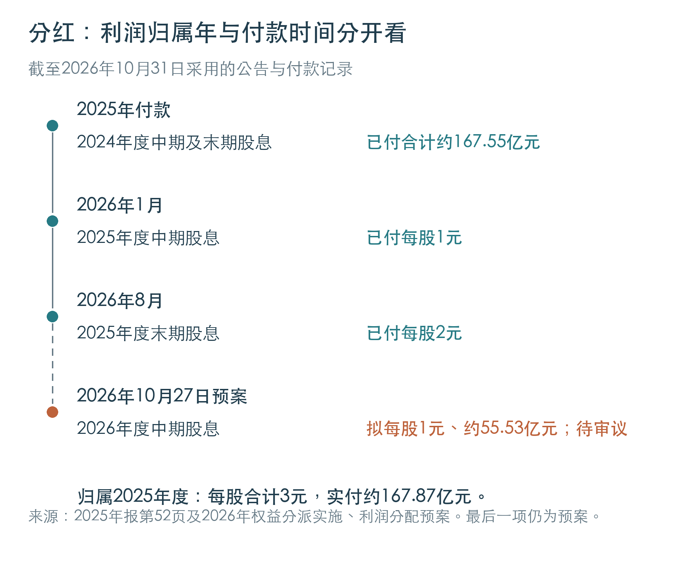

来源：2025年报第52页及2026年权益分派实施、利润分配预案。最后一项仍为预案。

依据 · [格力电器2025年度报告 · 第52页](https://static.cninfo.com.cn/finalpage/2026-04-29/1225250396.PDF#page=52)；[2025年度权益分派实施](https://static.cninfo.com.cn/finalpage/2026-08-21/1225487186.PDF)；[2026年中期利润分配预案](https://vip.stock.finance.sina.com.cn/corp/view/vCB_AllBulletinDetail.php?id=12663747&stockid=000651)；[格力2026-10-30收盘价核对记录](https://quote.cfi.cn/quote.aspx?stockcode=000651)

### 回购需要看买价和最终用途

截至2026年10月28日，格力本轮回购约6197万股，已经花费23.25亿元。回购计划总额为50—100亿元，其中至少70%的股份拟用于注销，最多30%用于员工持股或股权激励。因此，买回来的股份不一定全部从股本中永久消失。

注销以后，股份总数减少，仍然持股的人在公司中的比例会提高。但公司也已经花掉了回购款。在其他条件相同时，回购价格低于回购前的每股价值，才会通过这笔交换提高留存股东的每股价值；按价值相当的价格买回，主要是改变现金和股份的规模。评价这次回购，需要同时看公司付出的钱与减少的股份。用于员工激励的部分，则还要评价激励效果是否值得股东承担的成本。

本版估值使用56.014亿法定总股本，没有提前扣除未来计划回购的股份。以后评估回购、注销的效果，需要把当时的现金、利润和股份数放在同一个时点，避免只享受股份减少的好处，却忘了公司为此花掉的钱。

依据 · [回购比例达到1%进展](https://money.finance.sina.com.cn/corp/view/vCB_AllBulletinDetail.php?id=12672006&stockid=000651)；[格力电器2026第三季度报告 · 第5页](https://static.cninfo.com.cn/finalpage/2026-10-27/1225627217.PDF#page=5)

### 格力钛把资本配置风险变成了实际损失

格力2021年以18.28亿元取得格力钛30.47%的股权，并通过表决权安排取得控制；2023年又花约10.15亿元增持24.54%。到2025年，格力直接持股55.01%，拥有的表决权为72.47%。前一个比例主要说明经济利益归属，后一个比例说明对公司决策的控制程度，不能互相替代。

公司收购时期待电池、储能和整车业务能够与已有业务配合、创造收益。但后来的结果已经出现损失：2025年，格力钛部分在建项目不再继续建设，并新增约9.96亿元减值。收购形成的约6.13亿元商誉也已全额减值，不过这是既有损失，不能再说成2025年新发生的同一笔损失。

减值记录了资产回收预期的下降。设备和工程通常在以前已经支付了资金，到了确认减值时，公司把账面价值调低，承认这部分钱难以按原预期收回来。因此，当期记账往往没有再付现金，过去投入却已经给股东留下损失，仍应据此评价这项投资。

母公司单独编制的报表里，格力钛长期股权投资在2025年末的原值和减值准备均约28.46亿元，账面净值为零。这是从母公司持有股权的角度记录损失；合并报表里的工程和商誉，则从集团资产角度记录。它们可能涉及同一底层损失，不能把这些数字机械相加，当成几笔独立损失。

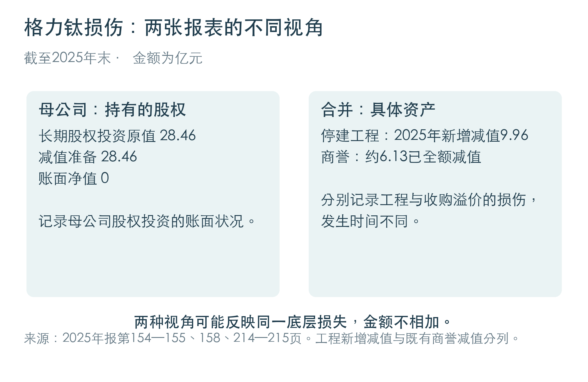

来源：2025年报第154—155、158、214—215页。工程新增减值与既有商誉减值分列。

格力钛继续经营，也就继续涉及人员、设备、周转和融资。2026年5月，管理层仍介绍商用车、电池和储能的经营安排。部分项目停建后，已有资产可以通过经营或处置回收，继续运行的业务还可能需要资金。未来能收回多少、还要投入多少，将决定历史减值之后，股东是否还会承受新的代价。

依据 · 格力电器2021年度报告 · 第29页；格力电器2023年度报告 · 第222页；[格力电器2025年度报告 · 第154页](https://static.cninfo.com.cn/finalpage/2026-04-29/1225250396.PDF#page=154)；[格力电器2025年度报告 · 第155页](https://static.cninfo.com.cn/finalpage/2026-04-29/1225250396.PDF#page=155)；[格力电器2025年度报告 · 第158页](https://static.cninfo.com.cn/finalpage/2026-04-29/1225250396.PDF#page=158)；[格力电器2025年度报告 · 第188页](https://static.cninfo.com.cn/finalpage/2026-04-29/1225250396.PDF#page=188)；[格力电器2025年度报告 · 第214页](https://static.cninfo.com.cn/finalpage/2026-04-29/1225250396.PDF#page=214)；[格力电器2025年度报告 · 第215页](https://static.cninfo.com.cn/finalpage/2026-04-29/1225250396.PDF#page=215)；[格力2025年度业绩说明会（2026-05-28） · 第7页](https://static.cninfo.com.cn/finalpage/2026-05-28/1225336605.PDF#page=7)

### 产业链投资与跨行业扩张的取舍

盾安环境的制冷阀件等业务与空调制造直接相连，格力2025年持股38.13%并控制董事会，因而纳入合并。这样的布局有明确的产品联系，仍应把取得控制权所花的钱、后续投入与归属收益配起来，不能只用整个子公司的利润证明上市公司投资回报。

格力钛则面临电池与整车各自的竞争、产能和历史纠纷。格力钛持有珠海广通100%股权；年报及中报披露，历史担保涉及阳光人寿相关对赌纠纷，格力钛被判承担过错赔偿责任，其持有的珠海广通股权被冻结。冻结限制的是这项股权的处置。最终对股东造成多少代价，还要看实际赔付款、继续供资，以及处置和追索取得的回款。空调积累的现金越多，继续投错钱的绝对代价也越大。

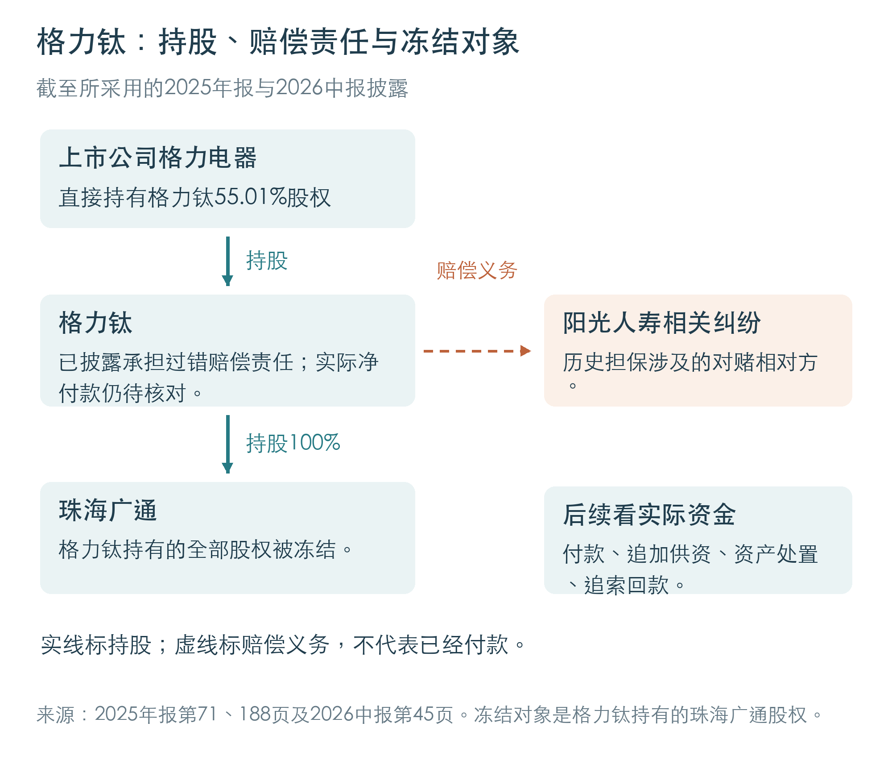

来源：2025年报第71、188页及2026中报第45页。冻结对象是格力钛持有的珠海广通股权。

盾安投资有三笔性质不同的资金。2022年格力以21.89916亿元受让盾安精工持有的2.7036亿股盾安环境股份，取得29.48%并获得控制；钱付给出售股份的原股东，盾安不会因为这笔老股交易收到同额新资本。收购后12个月内格力另支付相关担保款2.33115亿元，年报将合并成本计为24.23031亿元，并形成商誉约11.9830亿元。买下权益与承担原有责任共同构成最初代价。

随后格力再用自有资金8.10亿元认购盾安新发行的1.39414802亿股，2022年12月13日前完成缴款，2023年1月6日上市。扣发行费用后盾安收到净募集7.99134亿元；这一次钱进入盾安，公告明确净募资金全部用于补充流动资金及偿还银行借款，格力在增发完成后的持股提高至38.78%。以后股本变动又改变比例，到2026年9月末按实际股份为38.1546%，不能把不同日期比例混用。

上述已识别母公司支付及出资合计32.33031亿元，但不等于合并集团对外净流出同额现金：取得控制后的母子增资属于集团内部资金转移，盾安以后向外部供应商、债权人等付款才消耗集团现金。历史收购和增资已经反映在现有资产负债中，估值不能再把历史成本扣一遍。也不能拿盾安一年的净利润除以这32.33亿元就认定格力回报率：须区分取得权益、增资日期、盾安自身再投入与实际分红。

经营上，盾安把阀件和其他制冷部件卖给空调制造商，也经营制冷设备、汽车热管理和数据中心相关产品。若卖给格力集团内部企业，内部销售在集团合并中抵销；卖给外部客户的收入才保留在合并收入中。零部件能力可以服务格力的制造，但盾安面向其他客户的新业务仍要自己收款、支付材料和研发、投入产能。2026前三季数据中心相关收入超过7亿元且同比翻番，盾安归母利润却同比下降5.28%，新增收入还没有自动证明高增量资本回报。

依据 · [格力电器2025年度报告 · 第71页](https://static.cninfo.com.cn/finalpage/2026-04-29/1225250396.PDF#page=71)；[格力电器2025年度报告 · 第188页](https://static.cninfo.com.cn/finalpage/2026-04-29/1225250396.PDF#page=188)；[格力电器2026半年度报告 · 第45页](https://static.cninfo.com.cn/finalpage/2026-08-27/1225515004.PDF#page=45)；格力电器2022年度报告 · 第198页；[格力认购盾安新股完成公告（2023-002） · 第1页](https://static.cninfo.com.cn/finalpage/2023-01-07/1215540028.PDF#page=1)；[盾安发行情况暨上市公告书 · 第8页](https://static.cninfo.com.cn/finalpage/2023-01-05/1215526945.PDF#page=8)；[盾安发行情况暨上市公告书 · 第11页](https://static.cninfo.com.cn/finalpage/2023-01-05/1215526945.PDF#page=11)；格力资产、经营EPV与增长适用性完整研究；[盾安发行情况暨上市公告书 · 第10页](https://static.cninfo.com.cn/finalpage/2023-01-05/1215526945.PDF#page=10)

### 分红值得肯定，投资亏损也要单独评价

格力的分配记录与投资记录呈现出两种结果。一方面，公司持续把大额现金分给股东，也实施过注销回购；另一方面，格力钛停建和减值表明，部分投入未能取得原先预期的收益。经营创造了可分配的资金，资本配置决定这些资金最后有多少成为股东回报。

主业投入、与主业相关的收购、跨行业投资和分红，需要各自交代结果。产品和服务投入维持现有生意，新增项目需要证明新增收益，停建项目则需要追踪处置、回款和剩余责任。格力钛已经显示了损伤，不能用集团整体仍然赚钱来掩盖；持续分红也已经发生，不能因为投资失败就抹去这项股东回报。

现行估值把经营与金融资源分开：正常经营E剥离金融收支，金融本金先扣融资、必要留资及已知义务，再处理普通股归属。留资部分只计其持续低息收益，剩余本金另计；同一资金不同时享受完整本金和永久利息。分红和回购是已发生的交付证据，未来仍须观察资金用途与支付节奏。

依据 · [读财报探索格力管理层的陈述与资本配置](https://www.xueqiu.com/2892426645/410094925)；[格力电器2025年度报告 · 第52页](https://static.cninfo.com.cn/finalpage/2026-04-29/1225250396.PDF#page=52)；[格力电器2025年度报告 · 第155页](https://static.cninfo.com.cn/finalpage/2026-04-29/1225250396.PDF#page=155)；[格力电器2026第三季度报告 · 第4页](https://static.cninfo.com.cn/finalpage/2026-10-27/1225627217.PDF#page=4)；格力正常现金与价值判断及经营推导

大额分红已经把钱交给股东，格力钛也留下了实际投资损伤。未来回报既取决于空调赚钱，也取决于回购价格、新项目回收和后续分配。

历史投资损伤保留在资本配置评价中，未来新增供资则进入后续现金判断。同一损失在母公司与合并报表的反映，需要避免重复扣减。

空调以外的业务，未来还需要格力追加多少钱？；格力钛资产处置收款、停建后仍需支付的费用、融资和担保实际付款，以及盾安分红和新增投入计划。；判断空调赚来的钱能有多少留下来给股东，是否还会被其他业务持续消耗。

## 第7章 · 投资判断、估值依据与价格条件

先看资源，再算持续盈利；让经营恢复、资金占用和普通股归属各有位置

### 经营恢复与资金兑现共同决定价值

格力的空调技术、生产体系和服务网络仍能支持成熟经营，账上也有大额金融资源。估值既要看现有生意持续创造多少钱，也要看这些存量资源能够怎样回到股东手里。

2026年10月30日的历史参考价38.49元有可能低于正常经营与有效使用资金支持的价值，但不能只凭较高的盈利估值就确认安全。主营利润若持续承压，或大额本金继续低息滞留，价格余量会明显缩小。资产、现有盈利和新增投资分开研究，能看清这个分歧。

本篇按三步展开：先看重建现有资源需要多少钱，再看现有业务持续创造多少收益，最后检查增长是否值得另付钱。资产参照与盈利价值回答不同问题，不能相加。下面金额除另注外均为亿元人民币；本次补充解释和图示，采用的财务时点与研究条件保持到2026年11月1日，不代表对今日股价的判断。

依据 · 格力资产、经营EPV与增长适用性完整研究

### 资产参照：资源厚实，仍不足以单独保护现价

资产再生产价值，是今天重新取得同功能、同剩余服务能力的工厂、设备、技术和客户关系需要的成本，再扣全部经济义务与外部股东权益。它不等于清算变卖所得。

从2026年9月末资产3881.74亿元、负债2337.85亿元出发，金融资源按已有计量，生产设施按剩余服务能力估计；土地、有效研发成果、客户渠道及组织能力分别估计，并取消重复的商誉计价。技术采用约65亿元年度投入、2个有效年、70%有效成果的中间条件，销售费用只取其中建立客户关系的部分，不把日常安装和仓配费用全部资本化。

按中间条件，现有生产设施约392亿元、土地权85.5亿元、有效技术91亿元、客户渠道27亿元、非研发组织7亿元；旧递延税资产取135亿元，低于账面167.45亿元。扣全部负债、约54亿元外部股东经济权益及已知10月回购，约1591亿元归普通股，即28.41元/股。资源成本与可用性联合变化时约24.64—32.93元。

下表从账面资产逐项替换，未调整项目合并列示。三列是同一持续经营前提下的资源成本与可用性组合，不是概率区间。先求全部资产，再扣全部负债；账面少数权益不预先扣，最后扣的是重估后的外部股东份额。

这些调整并非给每项资产统一打折。存货在报表拨备后再保留85%—100%的适销能力，中间取95%。生产设施以中报房屋原价405.8445、机器331.8422、其他55.4454为起点：中间值＝（405.8445×1.05×65%＋331.8422×35%＋55.4454×12%）×（330.4106÷337.3011）＝391.62。最后一项用三季末与中期净额比例衔接。较低时三类系数分别为55%、25%、8%；较高时为1.15×70%、1.1×45%、20%。价格与剩余服务比例是粗估，未做工厂现场评估。

在建工程账面10.55，中间扣掉格力钛剩余工程净值2.856，留下7.69；较低只保留5，较高保留账面。先前已计提减值不再重扣。土地使用权中间取剩余账面约85.5，低高70和100检验用途与替代成本；不把土地使用权误写为永久拥有土地。技术用年度研发投入×有效年数×有效成果比例重建：中间65×2×70%＝91，较低65×1.5×50%＝48.75，较高70×3×80%＝168。它替换账面相关无形资产10.84，并不与全部历史研发费用相加。

客户与渠道重建只取正常销售费用中建立关系的部分：90×15%×2＝27；低高以90×10%×1.5＝13.5、90×20%×3＝54比较。安装、仓配及每天维持售后不全部变成资产。非研发组织以约130亿元现金薪酬中20%的岗位、三个月训练磨合约6.5为量级，中间取7，低高3和13；与技术和获客投入不重叠。商誉归零，是因为已分别估了其可能代表的资源，不等于公司已披露这笔商誉必然全损。

递延税资产是未来符合条件时可以少交税的权利，不能直接提款。中报费用暂差形成税益121.95、减值20.63、亏损16.02；亏损能否抵税取决于对应实体以后是否盈利及期限。中间只承认135，低高110—155，未给167.45全额价值。负债侧递延税仍在全部负债中扣除。

外部股东份额另作同样的资源重估。盾安归母净资产72.89，分别加入设施、技术、客户与组织的低中高调整（2＋4＋0.5＋0.2／4＋7.28＋0.8＋0.3／6＋11＋1.5＋0.5），扣原商誉1.2582，再乘外部股东61.8454%；其他正权益分别留0、2、5，得到48.44、53.96、61.05。亏损子公司的负少数权益不当作格力能向外部股东追回的钱。中间净资源因此为3995.38－2337.85－53.96－12.41＝1591.16，除以股数得28.41元。

设备服务能力、有效研发年限和税益回收均有估计误差，所以这些值只是持续经营资产参照。未量化额外赔偿或供资L还需扣除。这个范围低于38.49元，资产本身没有提供足够的现价保护。

亿元人民币；比例与每股值另注明

| 项目 | 账面 | 较低 | 中间 | 较高 |
| --- | --- | --- | --- | --- |
| 未调整的金融、贸易及其他资产 | 2999.99 | 2999.99 | 2999.99 | 2999.99 |
| 现有可用存货 | 263.76 | 224.20 | 250.58 | 263.76 |
| 现有生产设施经济净再生产值 | 330.41 | 304.27 | 391.62 | 491.80 |
| 仍有经济用途的在建工程 | 10.55 | 5.00 | 7.69 | 10.55 |
| 剩余土地使用权 | 85.50 | 70.00 | 85.50 | 100.00 |
| 现有技术与产品能力 | 10.84 | 48.75 | 91.00 | 168.00 |
| 并购商誉 | 13.24 | 0.00 | 0.00 | 0.00 |
| 可复制的品牌、客户及渠道建立工作 | 0.00 | 13.50 | 27.00 | 54.00 |
| 非研发组织与流程建立 | 0.00 | 3.00 | 7.00 | 13.00 |
| 可回收旧税益 | 167.45 | 110.00 | 135.00 | 155.00 |
| 全部资产 | 3881.74 | 3778.71 | 3995.38 | 4256.10 |
| 减：全部账内负债 | 2337.85 | 2337.85 | 2337.85 | 2337.85 |
| 减：外部股东经济权益 | 39.03 | 48.44 | 53.96 | 61.05 |
| 减：已知10月增量回购 | — | 12.41 | 12.41 | 12.41 |
| 普通股净资源，L扣前 | — | 1380.00 | 1591.16 | 1844.79 |
| 每股人民币，除以56.01405741亿股 | — | 24.64 | 28.41 | 32.93 |

账面起点为2026Q3；非金融细分沿用H1，表内显示两位小数，独立加总可能有尾差。L未计量，未填零。

依据 · 格力资产、经营EPV与增长适用性完整研究

### 现有盈利：先估维持生意后的年度现金

正常盈利能力价值（EPV）从现有规模出发：先估每年能挣多少，扣掉维持产品竞争力、设备能力、正常纳税和周转所需的钱，再按资本成本换算为今天的价值。新增业务增长另行研究，不能预先塞进正常利润。

正常国内主营收入取1200亿元、毛利率32%，出口230亿元、毛利率22%，其他业务80亿元、毛利率1%，合计毛利435.4亿元。国内收入低于2025年1264亿元，毛利率接近2026上半年31.94%；出口规模低于2025年274亿元，利润率则要求从2026上半年19.80%部分恢复。它是成熟经营的工作判断，不是延续2025年第四季度的高利润。

毛利扣销售90、管理55、研发70、税金17亿元，再扣其他经营净负担5亿元，得到不含金融收益的经营基数198.4亿元。额外保留1亿元常态结算手续费等负担：2024/2025手续费为0.67/0.80亿元，2026上半年0.36亿元，不能随利息收益一起删除。因此正常息税前经营利润为197.4亿元。正常研发、营销、股份支付全部保留；财务公司未单拆的运营成本仍在合并费用里，没有擅自加回。

费用没有随收入简单同比压低。2025年销售费84.11、滚动至2026前三季度约75.45，正常取90，给安装、服务和竞争留出费用；管理费2025年51.80、滚动约51.15，取55。研发费2024/2025年69.04/64.63、滚动约58.07，取70，不把近期缩减当作可永久省下。税金及附加取17，是当前规模的工作估计；其他经营净负担5保留正常减值等损耗，剔除不能持续的收益。后两项没有逐业务稳定率，仍需以后披露校准。

其他业务取80亿元收入、1%毛利，是低毛利辅助业务收缩后的条件量级：2025年约166.65亿元，2026上半年约41.42亿元；不把全年166机械延续，也不把半年简单翻倍视为事实。80×1%只贡献0.8亿元毛利，正常盈利主要仍由国内与出口制造业务支持。

197.4亿元减18%的正常经营税，再加折旧摊销48、扣维护更新51亿元，得到158.868亿元。18%没有融资利息税盾，也没有延续2024年约12.3%的低有效税率；2025年约16.7%、2026前三季约17.4%提供近年参照。

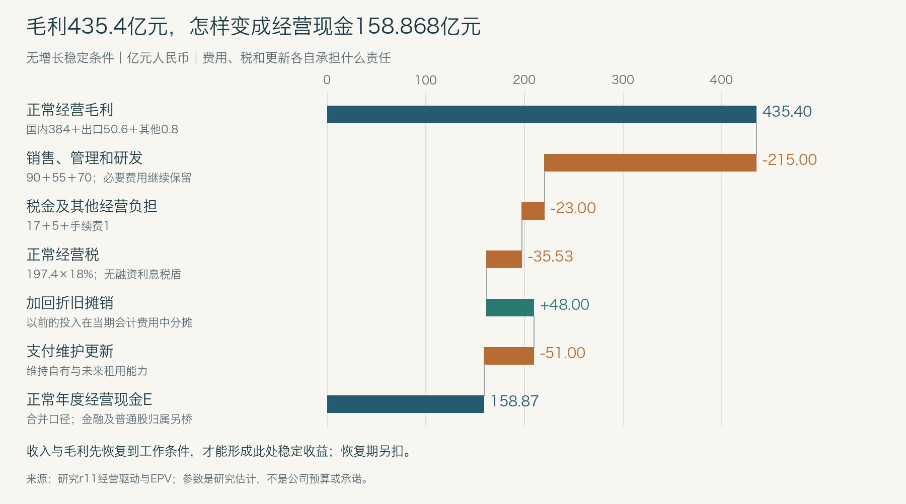

正常条件的累计变化：毛利扣必要费用、税，再以维护替换折旧。158.868仍属合并经营，金融资源及外部股东另行处理。

折旧48和维护51均为合并范围估计。2023—2025折旧摊销约53、53、51亿元，滚动至2026H1约48亿元；2022—2023长期资产付款约60、54亿元，近年新建工程下降。维护51亿元取既有45—55亿元工作范围的中部，包含自有设施/无形能力约50.4亿元和未来租用能力替代约0.6亿元。采用融资租赁口径：折旧加回含使用权，未来替代能力计入维护，当前约7.6亿元租赁及到期义务在融资桥扣除。51不是当期租赁本金付款，故不与存量租赁债重复。

当前规模不增长，所以稳定期不继续年年增加营运资本。前两年各15亿元渠道过渡资金仍保留，但由权益桥采用的500亿元留资条件转为经营周转，不再把本金扣第二次；只扣其少收的利息。毛利恢复需两年，前两年相对稳定盈利少收的税后现金现值约47.14亿元，单独扣除，不能把立即稳定的EPV直接当今天全部价值。

10%是成熟制造且面临竞争、恢复不确定性时的这里的比较要求，不是估计已经精确观测到的加权平均资本成本，更不是以后所有公司的统一参数。低息借款主要和金融资产一起剥离，不能拿巨额低息负债给核心生意机械降资本成本。8%和12%连同留存收益、少数权益、恢复期一起重算后分别为57.47、45.64元；它们只是同一经营判断的资本成本敏感性。

依据 · 格力资产、经营EPV与增长适用性完整研究

### 恢复需要时间，渠道周转也要先留钱

正常收益是假定业务已经稳定后的能力。当前毛利还没达到这一条件，因此不能把158.868从第一年起就当作每年收到的钱。下面以两年恢复连接到稳定期；这些“第1年、第2年”是估值路径，不是公司承诺对应年份一定完成。各年手续费1、税率18%、折旧48、维护51保持一致。

第1年毛利388.75，扣销售88、管理55、研发70、税金16和其他负担5，再扣手续费1，税后加48减51，现金为123.075；第2年以毛利413.85及销售90、管理55、研发70、税金17、其他负担5、手续费1，同样处理后为141.197。相对稳定期分别少35.793和17.671。估值时扣35.793÷1.1＋17.671÷1.1²＝47.1432，不能既扣短缺又把整个前两年现金再扣一遍。

渠道调整可能使格力更早付款、晚些收回库存与货款。前两年各15亿元的估计，参照2026上半年同季贸易资金净支持少15.64亿元；并未把半年差额永久年化。15亿元先从权益桥采用的500亿元留资条件内转入经营周转：本金仍属于公司，只是不能再拿去赚利息，所以不第二次扣30亿元本金。

计算假定每年年末转入，次年起不再取得税后1.25%利息；固定规模下这部分资金持续占用。两笔少息价值＝（15×1.25%÷10%）÷1.1＋（15×1.25%÷10%）÷1.1²＝3.2541。与盈利恢复47.1432合计50.3974，约50.40。若实际要投入更多、提前支付，或规模不增长仍年年新增占款，就必须重做这条路径，不能只调一句“已留足资金”。

亿元人民币；比例与每股值另注明

| 经营输入 | 第1年 | 第2年 | 稳定后 |
| --- | --- | --- | --- |
| 国内收入 × 毛利率 | 1150 × 30% | 1180 × 31% | 1200 × 32% |
| 出口收入 × 毛利率 | 210 × 20.5% | 220 × 21.5% | 230 × 22% |
| 其他收入 × 毛利率 | 70 × 1% | 75 × 1% | 80 × 1% |
| 合计毛利 | 388.75 | 413.85 | 435.40 |

两年路径与原采用研究一致；费用与现金计算在表后完整接续。

依据 · 格力资产、经营EPV与增长适用性完整研究

### 约2649.9亿元金融资源怎样进入权益桥

此处使用合并口径，内部存贷款已经抵销。Q3货币资金1175.16、交易金融资产369.05、其他债权投资354.70亿元；一年内到期资产159.10、其他流动资产169.12、其他非流动资产448.11亿元中，按中报金融工具明细剔除非金融部分；另含净贷款7.28亿元。合计约2649.93亿元。三季报不重复列出全部附注，后三项内的非金融部分沿用中报小额余额，是明确估计，不能说每笔本金都已逐项核实到9月末。

具体归集如下。其他流动资产扣30.5942亿元预付及待抵扣税费等非金融部分；其他非流动资产扣1.9399亿元非金融部分；一年内到期资产再扣0.0474亿元长期应收转入。这些明细在三季报没有重披露，沿用中报金额是分类估计，不能把差额当成查明的现金。

融资扣851.71亿元，包括短借807.62、当前到期13.57、长借6.61、长租赁6.60、外部吸收存款1.61，以及中报其他应付款中的企业借款及利息15.69亿元。当前到期已经含当前租赁；其他借款未在Q3单拆，暂按中报额。经营应付和返利不在这里再当融资债扣除。净金融资源约1798.22亿元，先扣已知10月回购12.41亿元；9月末库存股成本不能再扣一次。

受限资金不能机械清零。中报受限现金139.63亿元及受限存单有些服务于借款，债务清偿后可能解除；财务公司经营又要留下资本和结算资金。2026H1财务公司净资产75.47亿元、资本充足率33.49%，并不说明75.47亿元都能取出，也不能用净资产乘资本充足率差算出精确可释放额。它由格力直接、间接全资持有；其541.94亿元独立资产和股东在财务公司的内部存款都不能再次加进合并估值。

500亿元是这里的工作留存条件，不是披露最低现金。参照Q3现金等价物256.72亿元、中报受限现金139.63亿元及财务公司净资产75.47亿元的量级，留出合计接近472亿元的宽缓冲后取500亿元。这三项可能重叠，且抵押在还债后可释放；这里只用来构造偏宽的工作量级，不能称已证明500亿元恰好需要或充分覆盖一切风险。财务公司资本、日常现金和渠道资金都在500中，不再另扣。未取得逐笔期限和替代资本表，是此处价值区间的重要原因。

另一条更保守的持资政策，是把应付票据、应付账款、合同负债及中报返利，减去现有贸易应收/票据、预付、存货和合同资产，得到约714.63亿元净贸易浮存资金，再加当前现金等价物256.72亿元，保留971.34亿元。这是在正常周转以外主动防范浮存资金收缩，不是每年要新支付971亿元，更不是监管最低。它也不是完整清算资金覆盖；税、工资及其他事项仍在各自经营或负债处理中。

无论保留500还是971亿元，留存资金均按税后1.25%的合并正常收益资本化。旧工作金融贡献29亿元税前约23.78亿元税后，与此处约1798亿元净金融资源相比约1.32%；1.25%是低利率下的工作估计。不是把财务公司独立净利润直接搬过来——独立利润含内部利息，在合并时有抵销。其余可单独计价本金按本金进入桥，相关利息已从核心E删除，两处没有同时取得本金和整份利息永续。

高备资的714.6277可以直接重建：应付票据258.1768＋应付账款417.3510＋合同负债77.9123＋中报返利484.6665，减去贸易应收150.8884、应收款项融资90.0339、应收票据0.000251、预付15.3477、存货263.7638、合同资产3.4449。再加现金等价物256.7166，得到971.3443。这里返利使用中报，其他主要余额用三季末，属于工作情景，不能当作同日逐笔清偿表。

在500亿元条件下，先从金融资源2649.9321扣融资851.7106、留资500、旧递延税24.4054和已知增量回购12.4138，余1261.4023。这个本金余额才进入下一步普通股桥；仍有很小的衍生负债0.000725亿元在桥末另扣。留资500不再按本金加一次，只计它带来的收益价值500×1.25%÷10%＝62.50。

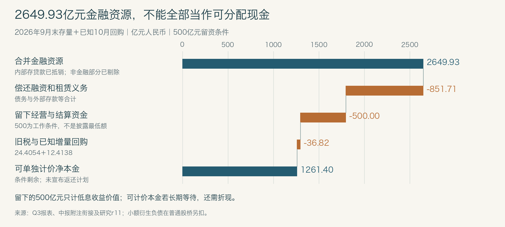

账面金融资源分到偿债、经营留资、已知税与回购后，剩下的本金才可单独计价。500亿元不是公告可分配余额；留资收益在下一图进入价值。

亿元人民币；比例与每股值另注明

| 报表项目 | 账面 | 扣非金融部分 | 纳入金融资源 |
| --- | --- | --- | --- |
| 货币资金 | 1175.1612 | 0.0000 | 1175.1612 |
| 交易性金融资产 | 369.0545 | 0.0000 | 369.0545 |
| 其他债权投资 | 354.7025 | 0.0000 | 354.7025 |
| 一年内到期资产 | 159.0953 | 0.0474 | 159.0479 |
| 其他流动资产 | 169.1172 | 30.5942 | 138.5230 |
| 其他非流动资产 | 448.1057 | 1.9399 | 446.1658 |
| 贷款及垫款 | 7.2771 | 0.0000 | 7.2771 |
| 合计 | 2682.5136 | 32.5815 | 2649.9321 |

只是合并资源归集，不表示都可立即取用。账面与估计分开。

依据 · 格力资产、经营EPV与增长适用性完整研究

### 从核心盈利走到格力普通股

格力通过控制盾安把它纳入合并报表，因此经营收入和利润先按盾安全部业务计入；但格力经济上只持有38.1546%的普通权益，另外61.8454%属于其他股东。把合并经营价值换成格力普通股价值时，必须扣去这一外部份额，财务上称少数股东权益。盾安的外部股东应得价值不能被另一家亏损子公司的负权益抵成格力可收的钱，除非后者外部股东确有补款义务。

先将经营E资本化，再与上节的净金融本金合流，扣清外部股东与过渡负担。下图显示两路价值各占多少，不把合并经营现金直接当作格力普通股所得。

联营、权益投资及投资物业Q3账面合计约46.95亿元，工作值取30亿元、20—45亿元作为情景，未将其权益法收益另放回核心。旧递延所得税资产167.45亿元不另加到已经正常化税的EPV；24.41亿元旧递延税负债暂全扣，其中中报计息暂差对应12.90亿元税负明确与金融本金有关。全扣其余暂差属于未拆结算时点的保守近似，不能说它都是立即应付税；即使其余约11.5亿元全不另扣，影响也仅约0.21元/股，不能解释31元和50元的主要差别。

少数权益按盾安自己的现金与资源算。其2026上半年归母利润4.67亿元、前三季7.28亿元；此处正常股东经营现金采用8.4亿元/年，保留维护与费用，剥离资金及联营收益。以10%计84亿元，另加现金/交易资产34.87减融资7.60、必要资金5亿元，加该5亿元留存收益值0.625及联营权益4.5，分配给外部61.8454%，再为其他正权益估2亿元，合计70.89亿元。8.4是当前盈利规模下的工作估计，非公告自由现金。负少数股东权益不给格力正价值；股权桥没有把集团净少数损益2亿元直接永续。

较长资源滞留的情景也同步调整盾安外部股东的金融资源价值，防止只折格力资产、不折外部股东同一资源。披露没有逐家完整重建非全资子公司，这项仍有估计误差，但它已不会通过亏损抵销把外部盈利长期送给格力。

完整算式是：158.868÷10%＋1261.4023＋62.50＋30－70.8924－50.3974－0.000725＝2821.2918；除以56.01405741亿股＝50.3676元，显示为50.37元。1261.4023已经扣了债、留资、旧税和增量回购，不能在本行再扣一次。未计量额外损失L仍在这个小计之后。

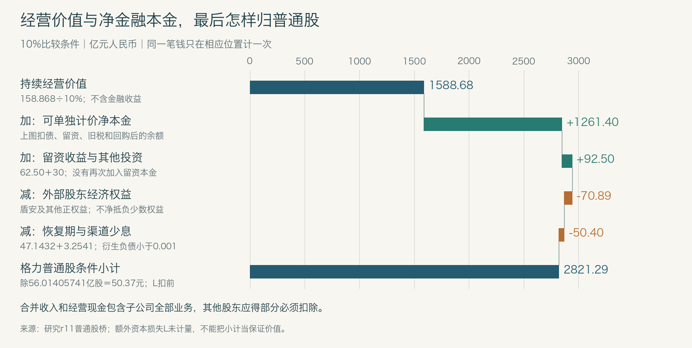

经营价值与净金融本金合流后，还要加留资收益、处理其他投资，再扣外部股东与恢复负担。全部为L扣前；并非宣布分配。

依据 · 格力资产、经营EPV与增长适用性完整研究

### 本金怎样兑现，会改变现价判断

500亿元留存下，扣债、旧税与期后回购之后，可单独计价净金融本金约1261亿元。按本金计价是在正常可用性的条件下承认其经济权利，不等于预测明天特别分红。若这笔钱继续以税后1.25%持有，5年末才返还本金，价值约42.98元；10年末返还，约38.39元。期间收益和末期本金都按10%折现，不能只打一个任意折扣，也不能永远抹去本金。 两条等待路径还同步下调盾安外部股东对应的资源价值，具体计算在下文给出。

相较38.49元参考价，正常经营并较有效使用资源的50.37元有约24%的价值折让；主动高备资或再滞留5年的约43元只剩约10%；10年滞留几乎没有余量。这些是不同政策/兑现路径，不是把互不兼容的条件拼成一条“43—50元高概率公允区间”。公司近年分红和回购提供愿意回馈股东的证据，但未宣布释放这里估计的整笔净资源，不能由近年分配直接证明哪条路径必然发生。

持续竞争压力是主要反方：收入和毛利较低，研发、管理与维护仍要支付。国内1050×29%、出口200×19%、其他60×1%得到毛利343.1；扣销售85、管理55、研发70、税金16、其他经营负担8、手续费1，经营利润108.1；按20%纳税，加折旧48、扣维护56，得到78.48。销售费只降到85，是因为销量减少并不使服务、品牌与渠道支出按比例消失；研发70和管理55保留，税率与维护采用更谨慎条件。

压力路径采用971.3443高备资、其他投资20，盾安正常现金降到6.8、必要资金增到7：外部权益＝（6.8÷10%＋34.8682－7.5987－7＋7×1.25%÷10%＋4.5）×61.8454%＋2＝59.9148。前三年各30亿元转为经营周转，少息现值＝Σ[30×1.25%÷10%÷1.1^t]，t取1至3，合计9.3257；不再假设恢复到正常E，因此没有另一笔恢复短缺。权益＝784.8＋1678.5878－851.7106＋121.4180＋20－24.4054－0.000725－59.9148－9.3257－12.4138＝1647.0348；除股数为29.40元。该条件已低于历史参考价。

单独改变留资政策，也能重算43.00：从正常条件2821.2918中少计本金471.3443，再加这笔留资的低息收益价值58.9180，即（2821.2918－471.3443＋58.9180）÷56.01405741＝43.0047。经营E未变，差别来自更多钱长期留在低收益用途。

等待本金返还则是另一种变化。设P＝1261.4023，等待n年，每年末取得P×1.25%，第n年末收回本金；现值＝P×[1.25%÷10%×(1－1.1^(－n))＋1.1^(－n)]。5年为843.0029，10年为583.2098。盾安相应净本金为34.8682－7.5987－5－0.1878＝22.0818，按同一公式折现、再乘外部61.8454%，外部权益由70.8924分别降到66.3626、63.5499。因此5年值＝(2821.2918－1261.4023＋843.0029＋70.8924－66.3626)÷56.01405741＝42.98，10年同样替换得到38.39。0.1878为盾安对应旧税，避免只折集团资源而不折同一资产中属于他人的部分。

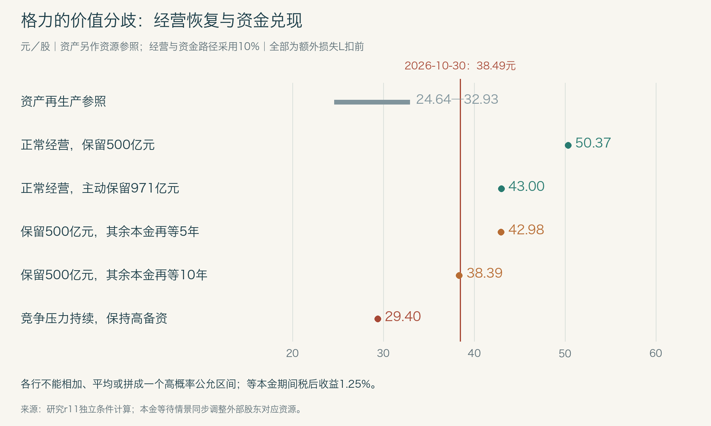

同一历史参考价下，不同经营和资金路径分别比较。资产行不是10%折现结果；全部未扣尚未计量的额外资本损失L。

格力有实质金融资源，但38.49元是否有足够余量，要同时相信主业利润能稳定、资源不会长期低效滞留。资产参照和竞争压力情景均低于现价；增长暂不另给溢价，格力钛未量化的额外资本损失L仍待扣。

依据 · 格力资产、经营EPV与增长适用性完整研究

### 更好恢复与资本成本，只作辅助比较

较好恢复不是额外增长溢价，而是现有业务在较高收入和毛利条件下的盈利。国内1300×34%、出口270×24%、其他100×2%合计毛利508.8；减销售95、管理55、研发72、税金18、其他负担3与手续费1，得264.8。按17%税率，加折旧48减维护48，经营E为219.784。相比正常条件，它需要更好的产品、价格和销售结果，不能由旧高利润自动证明。

该路径仍须经历恢复。第1年手续费前经营利润154.75，第2年只恢复到正常条件198.4，稳定后才到265.8；短缺＝(265.8－154.75)×83%÷1.1＋(265.8－198.4)×83%÷1.1²＝130.0253。渠道少息仍3.2541；其他投资45，盾安现金9.5并按同一桥算外部权益77.6954，其余资源保持。权益＝2197.84＋1261.4023＋62.5＋45－77.6954－130.0253－3.2541－0.000725＝3355.7668，除股数59.91元。更高利润对应更大的恢复缺口，不能只换永续利润而保留较小过渡扣减。

资本成本敏感性则保持正常经营E158.868与净本金不变。8%时留资收益价值78.125、外部权益83.9765、两年短缺48.2917、渠道少息4.1795；12%时分别52.0833、62.1696、46.0452、2.6407。按E÷资本成本＋1261.4023＋留资收益价值＋30－外部权益－短缺－少息－0.000725，除股数，分别得57.47和45.64元。它们检验资本成本选择的影响，不是另一组可以平均的公司目标价。

依据 · 格力资产、经营EPV与增长适用性完整研究

### 增长暂不另给溢价，资金损失仍须承担

格力现有空调产品、核心部件、制造能力和售后网络，能够支持成熟经营的正常盈利研究。但从这些存量能力走到“每投入一元还能持续创造超额价值”，中间仍缺少关键证据。此处暂缓采用成长溢价，不填增长率、积极投资因子和目标回报率；这不是认定格力永远不能增长。

家用空调正在承受需求、原料及价格竞争。2026Q3制造和销售组合的毛利压力已明显进入归母利润。渠道改造有机会提高效率，但线上迁移、价格让利、返利兑现和新增服务成本必须一起算。现有资料没有把同口径新增渠道投入、回收和利润增量配成一组，不能把收入恢复全部算成受到保护的有机增长，更不能把安装和售后等维持费用改叫可避免的增长费。

盾安是值得单独跟踪的局部机会。其2026前三季数据中心相关产品收入超过7亿元、同比翻番，制冷设备与汽车热管理也有新客户和订单。然而同期盾安归母利润同比仍下降5.28%，集团整体亦承压。收入增长不直接说明新增资本回报超过成本，股东只按38.1546%享有盾安自身普通权益。将这一局部增长率直接套在格力1510亿元收入或158.9亿元经营现金上，会严重夸大成长回报。

财务资源的供资能力很大，但留存资金没有天然高回报。格力钛历史资本损失、未定净赔偿和未来注资，仍可能侵蚀正常盈利与本金；不计成长溢价不会使这些损失归零。此处EPV已经保留现有低效业务经营负担，额外未覆盖的净支出继续进入L，不能把同一日常亏损再扣一次。

真正可能改变下一轮选择的，是三类实际证据：渠道改革后，在相近销量与产品组合下，利润、存货、应收及返利兑现共同改善；盾安新增业务的资本投入、经营现金与增量利润能够对上；闲置金融资源通过分红、注销或有回报约束的投资转为普通股所得。届时应在同一集团口径核对持续分配、增长投入和剩余可投资资金，再估剩余资金的去向。旧167.87亿元历史分红不能直接塞进158.9亿元企业经营E：前者属于普通股支付，后者尚未减外部股东、且剥离了全部金融收益，范围不同。

资产与EPV此处均保留额外资本损失L的未知项。即使没有该未知，此处也缺乏合理的集团增长与投入映射，因此不计算增长回报，不通过“低增长率”或任意半衰期填完表。技术优势、客户粘性和服务网络会受竞争侵蚀；失去部分超额利润不等于公司归零，已有经营压力情景承担这部分解释，未将其改成量化风险概率。

依据 · 格力资产、经营EPV与增长适用性完整研究

### 日期、股数与额外资本损失

财务存量以2026年9月30日为底，只扣已披露到10月28日的增量回购12.41亿元，未填造10月经营结果。参考价为2026年10月30日收盘38.49元。全法律股本56.014亿股用作保守摊薄分母，暂不提前享受回购注销；这不是当日实际在外股数。

格力钛既有经营损失已在正常经营中保留，历史工程与商誉减值反映在资产中。还须扣的L，是超出这些已覆盖项目的最终净赔偿、无回报追加供资，减去能够取得的处置及追索回款。公开资料仍不足以核定金额，计算没有将其填零。

一次性新增净损失10亿元约减少0.18元/股；若每年永久额外用款10亿元，在10%下约减少1.79元/股。正常经营、资本成本、现金留存和兑现期限均可能变化，条件值不构成公司价值底线。

依据 · 格力资产、经营EPV与增长适用性完整研究

格力的成熟经营和大额金融资源都有价值。剥离金融收支后，正常经营现金约159亿元/年；按10%比较，保留500亿元资金时的条件价值约50.37元，主动保留约971亿元时约43.00元。可单独计价净本金再低息滞留10年，约38.39元，接近38.49元参考价。资产参照约24.6—32.9元，竞争压力情景约29.40元，均低于现价。现价有可能低于正常经营与有效用资支持的价值，但明显便宜的判断仍需经营恢复和资金用途共同支持；额外未计量资本损失L仍待扣。

经营改善和金融资源有效分配，可以支持高于现价的价值；竞争压力持续或长期低息滞留，会压缩甚至消除余量。不能由一条较好的条件估值认定本金安全。

主业恢复与本金兑现，哪一项正在真正发生？；国内外毛利与必要费用、财务资金期限和受限对应债务、实际分红注销、格力钛净赔偿及新增供资。；分别更新经营E、权益桥、资金等待期限和额外损失，不以一次现金流改善替代全部判断。

## 第8章 · 预测、跟踪与复盘

保留旧判断，明确本次更正，再分别跟踪经营事实与尚未完成的估值研究。

### 首版判断与时间边界

2026年10月底，旧稿认为格力仍有空调竞争基础、盈利正在下行，并采用210亿元正常归母收益和200亿元年度股东现金作为估值条件。2018—2025年财务数列、2026半年报和三季报、当时已公开公告，都是形成该判断时已经知道的资料。200亿元没有被登记为更早提出的2026全年事前预测。

2026年11月1日第一轮两线重编，更正的是这些假设的采用强度：现有事实与计算不足以把200亿元作为已论证的正常现金中枢，35.71元及32.13—41.95元也不再作为已支持的合理价值点或范围。旧版和原计算保留。这项更正来自重新检查推理依据，并不是等到未来经营结果公布后才宣布原预测失效。

2026年11月1日随后完成的判断研究，另行从国内与出口经营、必要费用、设备更新及渠道过渡推导出约181亿元稳定年度现金。主路径前两年现金较少，10%比较约31.09元；保留金融收益、不加额外本金返还，额外资本耗损尚须扣除。这是该轮形成的有条件估计，不倒填为原预测，也不证明未来已经按此发展。

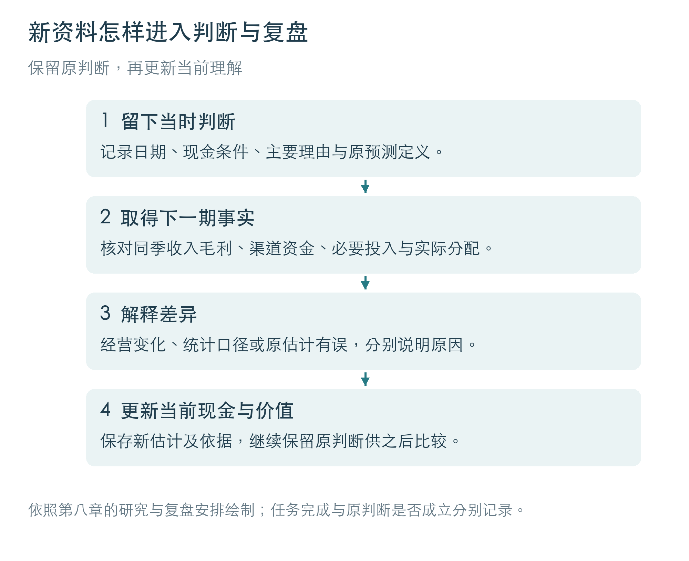

依照第八章的研究与复盘安排绘制；任务完成与原判断是否成立分别记录。

后续复盘需要分别回答：经营究竟怎样变化，原来对因果的理解是否正确，新现金范围依据什么形成。不能把未来估计倒填到旧记录，也不能把“已经完成一次研究任务”写成“投资判断得到验证”。

随后采用三步方法，金融本金与收益分别计价、少数权益按子公司经济价值处理。正常经营E约159亿元，500亿元留存条件约50.37元，高备资约43.00元；净本金再滞留10年约38.39元。旧31.09元不再作为当前完整估值，它仍保留为当时资金长期留存的现金路径，不能倒写成早先已经提出了新结论。

旧181亿元包含金融收益并按旧方案扣过少数股东，当前约159亿元则剥离了金融、尚未扣外部股东，二者不能直接比较为盈利下降。31元到50元的主要差别来自金融本金计价和归属方式改变，不是把公司突然估得更会赚钱。

依据 · [格力电器2026半年度报告 · 第7页](https://static.cninfo.com.cn/finalpage/2026-08-27/1225515004.PDF#page=7)；[格力电器2026第三季度报告 · 第2页](https://static.cninfo.com.cn/finalpage/2026-10-27/1225627217.PDF#page=2)；格力正常现金与价值判断及经营推导；格力资产、经营EPV与增长适用性完整研究

### 产品：性能与成本如何改变毛利

下一份年报应先核对消费电器、内销和外销的收入、毛利率及可比范围。国内收入若增长但毛利继续下滑，说明竞争或成本仍在吃掉增量；出口收入恢复同时毛利额增加，才构成较完整的恢复证据。

AI产品销量、健康家门店和京东合作进展可以解释经营动作，但先看订单、实际交付与费用。公司公布的目标不直接接到现金模型；具体产品成功也不能自动推成全集团利润恢复。

依据 · [格力电器2026半年度报告 · 第11页](https://static.cninfo.com.cn/finalpage/2026-08-27/1225515004.PDF#page=11)；[格力电器2026半年度报告 · 第24页](https://static.cninfo.com.cn/finalpage/2026-08-27/1225515004.PDF#page=24)；[格力与京东AI空调合作发布](https://www.xinhuanet.com/tech/20260313/7fa42a7baef1446ba92e6851261d4ef3/c.html)

### 品牌：销售是否依赖更大让价

品牌判断需要结合可比规格、渠道和时间观察实际成交价与促销条件，再看老用户选择、安装维修体验及售后负担。公司披露的市场份额可以记录结果，不能单独说明消费者愿意多付多少钱。

若核心产品在相近规格和服务条件下持续需要更大折扣才能维持销售，品牌的价格保护力就应下调；若价格和毛利能够稳定，服务责任也能经济地履行，成熟现金持续时间的依据才会增强。集团毛利还受原材料和产品组合影响，具体归因应与产品、渠道资料一起核对。

依据 · [格力电器2025年度报告 · 第11页](https://static.cninfo.com.cn/finalpage/2026-04-29/1225250396.PDF#page=11)；[格力电器2026半年度报告 · 第10页](https://static.cninfo.com.cn/finalpage/2026-08-27/1225515004.PDF#page=10)；[格力电器2026半年度报告 · 第24页](https://static.cninfo.com.cn/finalpage/2026-08-27/1225515004.PDF#page=24)

### 按销售、交付和资金占用跟踪渠道

渠道改革后，公司需要持续观察销售和交付怎样配合。门店取得订单，仓库调配货物，服务人员完成送装，这些工作分别形成毛利、费用和资金占用。2025年的物流节约给出了一个已经披露的结果，后续还要接到库存、回款和服务表现。

财务比较采用上年同季，尽量让淡旺季一致。再结合当时的订货和返利政策，解释存货、应收、合同负债与返利余额。厂家收入和回款可以早于终端零售，所以终端销售与渠道库存的连续资料，对判断改革后备货是否更贴近需求尤其有用。

门店和服务人员的反馈也属于这项研究。哪些地方订货更方便，哪些地方需要重新分配安装收入，哪里仍在处理旧货款，能帮助解释经营数字。保证金释放或财务公司贷款收回则单独列出，保持渠道经营与存量资金回收的区别。

依据 · [格力电器2026第三季度报告 · 第4页](https://static.cninfo.com.cn/finalpage/2026-10-27/1225627217.PDF#page=4)；[格力电器2026第三季度报告 · 第8页](https://static.cninfo.com.cn/finalpage/2026-10-27/1225627217.PDF#page=8)；[格力电器2026半年度报告 · 第13页](https://static.cninfo.com.cn/finalpage/2026-08-27/1225515004.PDF#page=13)；[格力电器2026半年度报告 · 第141页](https://static.cninfo.com.cn/finalpage/2026-08-27/1225515004.PDF#page=141)

### 资本与分配：把承诺变成实际记录

对分红记录股东会批准、实施基数和实际付款；对回购记录花费、股份用途和注销，而不把总计划一次计入。对格力钛和其他新业务，优先追新增资金、项目停建、处置回款及实际担保履约。

2026年报是下一个重要综合观察点，2027中报可进一步核对毛利与正常更新是否持续。现在建立这几项跟踪任务，不预先把任务完成当作投资判断命中。

依据 · [2026年中期利润分配预案](https://vip.stock.finance.sina.com.cn/corp/view/vCB_AllBulletinDetail.php?id=12663747&stockid=000651)；[回购比例达到1%进展](https://money.finance.sina.com.cn/corp/view/vCB_AllBulletinDetail.php?id=12672006&stockid=000651)；[格力电器2025年度报告 · 第155页](https://static.cninfo.com.cn/finalpage/2026-04-29/1225250396.PDF#page=155)

### 后续核对恢复、用资和资金回收

格力的产品、品牌和渠道继续支撑成熟生意。当前估值将现有盈利和大额金融资源分别处理，增长暂不另给溢价；不是把新方法的几个数相加。

经营侧核对国内32%、出口22%正常毛利条件及必要费用能否形成；资金侧核对留存是否确有用途、分红和回购注销是否推进、低回报投资是否继续；外部股东归属与格力钛额外净损失分别更新。

原判断与新判断各自保留。复盘既要区分经营事实后来改变了，也要承认原来对金融本金、少数权益或现金取得时间的处理需要纠正。

跟踪页已把现行核验拆为经营毛利、产品订单、渠道资金、金融兑现、格力钛责任和盾安外部权益六件具体工作。原登记中的210亿元是首版含金融的归母条件，现159亿元是剥离金融的合并经营E；旧任务保留用于追溯，不再作为当前正常经营中枢。新证据要先按同一范围重建，才评价原判断对错。

依据 · 格力资产、经营EPV与增长适用性完整研究

介绍线沿用已有公司全貌，当前判断线采用资产、经营EPV与增长适用性研究。旧200亿元/35.71元和181亿元/31.09元保留原日期与口径；后续分别核对主营恢复、资金用途、外部权益和额外资本损失。

主业盈利、必要投入和资金用途发生变化，会推动研究更新。原判断与新判断分别保存，复盘据此解释经营和估值差异。

下一次更新最需要弄清哪些变化？；产品毛利和成本、实际成交价与服务体验、渠道费用和占用资金、格力钛新增投入及回收、实际分红和注销。；据此形成新的现金与价值判断，并保留旧判断的日期和理由，便于区分事实变化与原推理纠正。

## 格力的现金与估值：主业恢复以后，钱能怎样归股东

成熟空调业务和金融资源共同支持价值，也分别面临毛利压力与低收益留存。本文从真实收付出发，依次展开资产参照、正常经营现金、资金与普通股桥、主要反方及增长取舍。采用研究r11，财务至2026Q3，比较2026年10月30日历史价38.49元；不是实时行情报告。

### 经营恢复与资金兑现共同决定价值

格力的空调技术、生产体系和服务网络仍能支持成熟经营，账上也有大额金融资源。估值既要看现有生意持续创造多少钱，也要看这些存量资源能够怎样回到股东手里。

2026年10月30日的历史参考价38.49元有可能低于正常经营与有效使用资金支持的价值，但不能只凭较高的盈利估值就确认安全。主营利润若持续承压，或大额本金继续低息滞留，价格余量会明显缩小。资产、现有盈利和新增投资分开研究，能看清这个分歧。

本篇按三步展开：先看重建现有资源需要多少钱，再看现有业务持续创造多少收益，最后检查增长是否值得另付钱。资产参照与盈利价值回答不同问题，不能相加。下面金额除另注外均为亿元人民币；本次补充解释和图示，采用的财务时点与研究条件保持到2026年11月1日，不代表对今日股价的判断。

依据 · 格力资产、经营EPV与增长适用性完整研究

### 2025年的高现金，有一部分来自保证金收回

2025年，格力经营现金净流入463.83亿元，其中156.67亿元来自票据保证金减少。保证金是为相关票据业务按安排存放、受到使用限制的资金；缴存需要下降时，原来压在其中的钱释放出来，成为公司可以重新安排的资金。

这项变化改善了当年的资金状况。它的经济过程是原有资金收回，与持续销售空调创造收益不同：保证金余额降低之后，今后能否继续释放，取决于下一期余额和业务安排。估计每年可持续的股东现金时，应将这笔收回单独解释。

463.83亿元扣去156.67亿元，剩307.16亿元。这个余额仍包含其他周转和金融业务收付款，后面还要支付必要资产投入，并处理普通股归属。现金补充表里的股权激励等非现金项目，也有相应股东成本。它们使报表现金与持续可分配现金之间，需要一条完整的解释，而不只是减掉一笔购建设备付款。

依据 · [格力电器2025年度报告 · 第179页](https://static.cninfo.com.cn/finalpage/2026-04-29/1225250396.PDF#page=179)；[格力电器2025年度报告 · 第180页](https://static.cninfo.com.cn/finalpage/2026-04-29/1225250396.PDF#page=180)

### 保证金、贷款和日常周转怎样影响2026年现金

2026年前三季度经营现金流为240.63亿元，同比下降47.38%。公司披露，票据保证金变化造成同比差额136.17亿元；剔除这项差额影响后，经营现金仍少约80.48亿元、下降24.71%。保证金影响很大，剩余收付款同样转弱。

合并现金表还包含财务公司业务。前三季度“客户贷款及垫款净增加额”为负64.17亿元，表示该项净收回贷款，给集团带来资金流入。原来的贷款资产转回现金，改善了资金可用性；贷款本金本身并不是这一年新增的利润。

上半年存货、应收和经营应付款三项变化合计释放约61.51亿元。库存变少、款项收回或付款安排变化，都能影响某一期的现金。因此，分析格力资金时，一方面追踪这些真实收付，另一方面研究维持日常经营需要留多少资金，避免把存量资金收回持续计成年度收益。

销售回款、保证金解除和贷款本金收回进入现金表的原因不同；后两者把已有资产变回现金，不能作为每年新增利润。

依据 · [格力电器2026第三季度报告 · 第3页](https://static.cninfo.com.cn/finalpage/2026-10-27/1225627217.PDF#page=3)；[格力电器2026第三季度报告 · 第8页](https://static.cninfo.com.cn/finalpage/2026-10-27/1225627217.PDF#page=8)；[格力电器2026半年度报告 · 第151页](https://static.cninfo.com.cn/finalpage/2026-08-27/1225515004.PDF#page=151)；[格力电器2026半年度报告 · 第152页](https://static.cninfo.com.cn/finalpage/2026-08-27/1225515004.PDF#page=152)

### 资产参照：资源厚实，仍不足以单独保护现价

资产再生产价值，是今天重新取得同功能、同剩余服务能力的工厂、设备、技术和客户关系需要的成本，再扣全部经济义务与外部股东权益。它不等于清算变卖所得。

从2026年9月末资产3881.74亿元、负债2337.85亿元出发，金融资源按已有计量，生产设施按剩余服务能力估计；土地、有效研发成果、客户渠道及组织能力分别估计，并取消重复的商誉计价。技术采用约65亿元年度投入、2个有效年、70%有效成果的中间条件，销售费用只取其中建立客户关系的部分，不把日常安装和仓配费用全部资本化。

按中间条件，现有生产设施约392亿元、土地权85.5亿元、有效技术91亿元、客户渠道27亿元、非研发组织7亿元；旧递延税资产取135亿元，低于账面167.45亿元。扣全部负债、约54亿元外部股东经济权益及已知10月回购，约1591亿元归普通股，即28.41元/股。资源成本与可用性联合变化时约24.64—32.93元。

下表从账面资产逐项替换，未调整项目合并列示。三列是同一持续经营前提下的资源成本与可用性组合，不是概率区间。先求全部资产，再扣全部负债；账面少数权益不预先扣，最后扣的是重估后的外部股东份额。

这些调整并非给每项资产统一打折。存货在报表拨备后再保留85%—100%的适销能力，中间取95%。生产设施以中报房屋原价405.8445、机器331.8422、其他55.4454为起点：中间值＝（405.8445×1.05×65%＋331.8422×35%＋55.4454×12%）×（330.4106÷337.3011）＝391.62。最后一项用三季末与中期净额比例衔接。较低时三类系数分别为55%、25%、8%；较高时为1.15×70%、1.1×45%、20%。价格与剩余服务比例是粗估，未做工厂现场评估。

在建工程账面10.55，中间扣掉格力钛剩余工程净值2.856，留下7.69；较低只保留5，较高保留账面。先前已计提减值不再重扣。土地使用权中间取剩余账面约85.5，低高70和100检验用途与替代成本；不把土地使用权误写为永久拥有土地。技术用年度研发投入×有效年数×有效成果比例重建：中间65×2×70%＝91，较低65×1.5×50%＝48.75，较高70×3×80%＝168。它替换账面相关无形资产10.84，并不与全部历史研发费用相加。

客户与渠道重建只取正常销售费用中建立关系的部分：90×15%×2＝27；低高以90×10%×1.5＝13.5、90×20%×3＝54比较。安装、仓配及每天维持售后不全部变成资产。非研发组织以约130亿元现金薪酬中20%的岗位、三个月训练磨合约6.5为量级，中间取7，低高3和13；与技术和获客投入不重叠。商誉归零，是因为已分别估了其可能代表的资源，不等于公司已披露这笔商誉必然全损。

递延税资产是未来符合条件时可以少交税的权利，不能直接提款。中报费用暂差形成税益121.95、减值20.63、亏损16.02；亏损能否抵税取决于对应实体以后是否盈利及期限。中间只承认135，低高110—155，未给167.45全额价值。负债侧递延税仍在全部负债中扣除。

外部股东份额另作同样的资源重估。盾安归母净资产72.89，分别加入设施、技术、客户与组织的低中高调整（2＋4＋0.5＋0.2／4＋7.28＋0.8＋0.3／6＋11＋1.5＋0.5），扣原商誉1.2582，再乘外部股东61.8454%；其他正权益分别留0、2、5，得到48.44、53.96、61.05。亏损子公司的负少数权益不当作格力能向外部股东追回的钱。中间净资源因此为3995.38－2337.85－53.96－12.41＝1591.16，除以股数得28.41元。

设备服务能力、有效研发年限和税益回收均有估计误差，所以这些值只是持续经营资产参照。未量化额外赔偿或供资L还需扣除。这个范围低于38.49元，资产本身没有提供足够的现价保护。

亿元人民币；比例与每股值另注明

| 项目 | 账面 | 较低 | 中间 | 较高 |
| --- | --- | --- | --- | --- |
| 未调整的金融、贸易及其他资产 | 2999.99 | 2999.99 | 2999.99 | 2999.99 |
| 现有可用存货 | 263.76 | 224.20 | 250.58 | 263.76 |
| 现有生产设施经济净再生产值 | 330.41 | 304.27 | 391.62 | 491.80 |
| 仍有经济用途的在建工程 | 10.55 | 5.00 | 7.69 | 10.55 |
| 剩余土地使用权 | 85.50 | 70.00 | 85.50 | 100.00 |
| 现有技术与产品能力 | 10.84 | 48.75 | 91.00 | 168.00 |
| 并购商誉 | 13.24 | 0.00 | 0.00 | 0.00 |
| 可复制的品牌、客户及渠道建立工作 | 0.00 | 13.50 | 27.00 | 54.00 |
| 非研发组织与流程建立 | 0.00 | 3.00 | 7.00 | 13.00 |
| 可回收旧税益 | 167.45 | 110.00 | 135.00 | 155.00 |
| 全部资产 | 3881.74 | 3778.71 | 3995.38 | 4256.10 |
| 减：全部账内负债 | 2337.85 | 2337.85 | 2337.85 | 2337.85 |
| 减：外部股东经济权益 | 39.03 | 48.44 | 53.96 | 61.05 |
| 减：已知10月增量回购 | — | 12.41 | 12.41 | 12.41 |
| 普通股净资源，L扣前 | — | 1380.00 | 1591.16 | 1844.79 |
| 每股人民币，除以56.01405741亿股 | — | 24.64 | 28.41 | 32.93 |

账面起点为2026Q3；非金融细分沿用H1，表内显示两位小数，独立加总可能有尾差。L未计量，未填零。

依据 · 格力资产、经营EPV与增长适用性完整研究

### 现有盈利：先估维持生意后的年度现金

正常盈利能力价值（EPV）从现有规模出发：先估每年能挣多少，扣掉维持产品竞争力、设备能力、正常纳税和周转所需的钱，再按资本成本换算为今天的价值。新增业务增长另行研究，不能预先塞进正常利润。

正常国内主营收入取1200亿元、毛利率32%，出口230亿元、毛利率22%，其他业务80亿元、毛利率1%，合计毛利435.4亿元。国内收入低于2025年1264亿元，毛利率接近2026上半年31.94%；出口规模低于2025年274亿元，利润率则要求从2026上半年19.80%部分恢复。它是成熟经营的工作判断，不是延续2025年第四季度的高利润。

毛利扣销售90、管理55、研发70、税金17亿元，再扣其他经营净负担5亿元，得到不含金融收益的经营基数198.4亿元。额外保留1亿元常态结算手续费等负担：2024/2025手续费为0.67/0.80亿元，2026上半年0.36亿元，不能随利息收益一起删除。因此正常息税前经营利润为197.4亿元。正常研发、营销、股份支付全部保留；财务公司未单拆的运营成本仍在合并费用里，没有擅自加回。

费用没有随收入简单同比压低。2025年销售费84.11、滚动至2026前三季度约75.45，正常取90，给安装、服务和竞争留出费用；管理费2025年51.80、滚动约51.15，取55。研发费2024/2025年69.04/64.63、滚动约58.07，取70，不把近期缩减当作可永久省下。税金及附加取17，是当前规模的工作估计；其他经营净负担5保留正常减值等损耗，剔除不能持续的收益。后两项没有逐业务稳定率，仍需以后披露校准。

其他业务取80亿元收入、1%毛利，是低毛利辅助业务收缩后的条件量级：2025年约166.65亿元，2026上半年约41.42亿元；不把全年166机械延续，也不把半年简单翻倍视为事实。80×1%只贡献0.8亿元毛利，正常盈利主要仍由国内与出口制造业务支持。

197.4亿元减18%的正常经营税，再加折旧摊销48、扣维护更新51亿元，得到158.868亿元。18%没有融资利息税盾，也没有延续2024年约12.3%的低有效税率；2025年约16.7%、2026前三季约17.4%提供近年参照。

正常条件的累计变化：毛利扣必要费用、税，再以维护替换折旧。158.868仍属合并经营，金融资源及外部股东另行处理。

折旧48和维护51均为合并范围估计。2023—2025折旧摊销约53、53、51亿元，滚动至2026H1约48亿元；2022—2023长期资产付款约60、54亿元，近年新建工程下降。维护51亿元取既有45—55亿元工作范围的中部，包含自有设施/无形能力约50.4亿元和未来租用能力替代约0.6亿元。采用融资租赁口径：折旧加回含使用权，未来替代能力计入维护，当前约7.6亿元租赁及到期义务在融资桥扣除。51不是当期租赁本金付款，故不与存量租赁债重复。

当前规模不增长，所以稳定期不继续年年增加营运资本。前两年各15亿元渠道过渡资金仍保留，但由权益桥采用的500亿元留资条件转为经营周转，不再把本金扣第二次；只扣其少收的利息。毛利恢复需两年，前两年相对稳定盈利少收的税后现金现值约47.14亿元，单独扣除，不能把立即稳定的EPV直接当今天全部价值。

10%是成熟制造且面临竞争、恢复不确定性时的这里的比较要求，不是估计已经精确观测到的加权平均资本成本，更不是以后所有公司的统一参数。低息借款主要和金融资产一起剥离，不能拿巨额低息负债给核心生意机械降资本成本。8%和12%连同留存收益、少数权益、恢复期一起重算后分别为57.47、45.64元；它们只是同一经营判断的资本成本敏感性。

依据 · 格力资产、经营EPV与增长适用性完整研究

### 恢复需要时间，渠道周转也要先留钱

正常收益是假定业务已经稳定后的能力。当前毛利还没达到这一条件，因此不能把158.868从第一年起就当作每年收到的钱。下面以两年恢复连接到稳定期；这些“第1年、第2年”是估值路径，不是公司承诺对应年份一定完成。各年手续费1、税率18%、折旧48、维护51保持一致。

第1年毛利388.75，扣销售88、管理55、研发70、税金16和其他负担5，再扣手续费1，税后加48减51，现金为123.075；第2年以毛利413.85及销售90、管理55、研发70、税金17、其他负担5、手续费1，同样处理后为141.197。相对稳定期分别少35.793和17.671。估值时扣35.793÷1.1＋17.671÷1.1²＝47.1432，不能既扣短缺又把整个前两年现金再扣一遍。

渠道调整可能使格力更早付款、晚些收回库存与货款。前两年各15亿元的估计，参照2026上半年同季贸易资金净支持少15.64亿元；并未把半年差额永久年化。15亿元先从权益桥采用的500亿元留资条件内转入经营周转：本金仍属于公司，只是不能再拿去赚利息，所以不第二次扣30亿元本金。

计算假定每年年末转入，次年起不再取得税后1.25%利息；固定规模下这部分资金持续占用。两笔少息价值＝（15×1.25%÷10%）÷1.1＋（15×1.25%÷10%）÷1.1²＝3.2541。与盈利恢复47.1432合计50.3974，约50.40。若实际要投入更多、提前支付，或规模不增长仍年年新增占款，就必须重做这条路径，不能只调一句“已留足资金”。

亿元人民币；比例与每股值另注明

| 经营输入 | 第1年 | 第2年 | 稳定后 |
| --- | --- | --- | --- |
| 国内收入 × 毛利率 | 1150 × 30% | 1180 × 31% | 1200 × 32% |
| 出口收入 × 毛利率 | 210 × 20.5% | 220 × 21.5% | 230 × 22% |
| 其他收入 × 毛利率 | 70 × 1% | 75 × 1% | 80 × 1% |
| 合计毛利 | 388.75 | 413.85 | 435.40 |

两年路径与原采用研究一致；费用与现金计算在表后完整接续。

依据 · 格力资产、经营EPV与增长适用性完整研究

### 约2649.9亿元金融资源怎样进入权益桥

此处使用合并口径，内部存贷款已经抵销。Q3货币资金1175.16、交易金融资产369.05、其他债权投资354.70亿元；一年内到期资产159.10、其他流动资产169.12、其他非流动资产448.11亿元中，按中报金融工具明细剔除非金融部分；另含净贷款7.28亿元。合计约2649.93亿元。三季报不重复列出全部附注，后三项内的非金融部分沿用中报小额余额，是明确估计，不能说每笔本金都已逐项核实到9月末。

具体归集如下。其他流动资产扣30.5942亿元预付及待抵扣税费等非金融部分；其他非流动资产扣1.9399亿元非金融部分；一年内到期资产再扣0.0474亿元长期应收转入。这些明细在三季报没有重披露，沿用中报金额是分类估计，不能把差额当成查明的现金。

融资扣851.71亿元，包括短借807.62、当前到期13.57、长借6.61、长租赁6.60、外部吸收存款1.61，以及中报其他应付款中的企业借款及利息15.69亿元。当前到期已经含当前租赁；其他借款未在Q3单拆，暂按中报额。经营应付和返利不在这里再当融资债扣除。净金融资源约1798.22亿元，先扣已知10月回购12.41亿元；9月末库存股成本不能再扣一次。

受限资金不能机械清零。中报受限现金139.63亿元及受限存单有些服务于借款，债务清偿后可能解除；财务公司经营又要留下资本和结算资金。2026H1财务公司净资产75.47亿元、资本充足率33.49%，并不说明75.47亿元都能取出，也不能用净资产乘资本充足率差算出精确可释放额。它由格力直接、间接全资持有；其541.94亿元独立资产和股东在财务公司的内部存款都不能再次加进合并估值。

500亿元是这里的工作留存条件，不是披露最低现金。参照Q3现金等价物256.72亿元、中报受限现金139.63亿元及财务公司净资产75.47亿元的量级，留出合计接近472亿元的宽缓冲后取500亿元。这三项可能重叠，且抵押在还债后可释放；这里只用来构造偏宽的工作量级，不能称已证明500亿元恰好需要或充分覆盖一切风险。财务公司资本、日常现金和渠道资金都在500中，不再另扣。未取得逐笔期限和替代资本表，是此处价值区间的重要原因。

另一条更保守的持资政策，是把应付票据、应付账款、合同负债及中报返利，减去现有贸易应收/票据、预付、存货和合同资产，得到约714.63亿元净贸易浮存资金，再加当前现金等价物256.72亿元，保留971.34亿元。这是在正常周转以外主动防范浮存资金收缩，不是每年要新支付971亿元，更不是监管最低。它也不是完整清算资金覆盖；税、工资及其他事项仍在各自经营或负债处理中。

无论保留500还是971亿元，留存资金均按税后1.25%的合并正常收益资本化。旧工作金融贡献29亿元税前约23.78亿元税后，与此处约1798亿元净金融资源相比约1.32%；1.25%是低利率下的工作估计。不是把财务公司独立净利润直接搬过来——独立利润含内部利息，在合并时有抵销。其余可单独计价本金按本金进入桥，相关利息已从核心E删除，两处没有同时取得本金和整份利息永续。

高备资的714.6277可以直接重建：应付票据258.1768＋应付账款417.3510＋合同负债77.9123＋中报返利484.6665，减去贸易应收150.8884、应收款项融资90.0339、应收票据0.000251、预付15.3477、存货263.7638、合同资产3.4449。再加现金等价物256.7166，得到971.3443。这里返利使用中报，其他主要余额用三季末，属于工作情景，不能当作同日逐笔清偿表。

在500亿元条件下，先从金融资源2649.9321扣融资851.7106、留资500、旧递延税24.4054和已知增量回购12.4138，余1261.4023。这个本金余额才进入下一步普通股桥；仍有很小的衍生负债0.000725亿元在桥末另扣。留资500不再按本金加一次，只计它带来的收益价值500×1.25%÷10%＝62.50。

账面金融资源分到偿债、经营留资、已知税与回购后，剩下的本金才可单独计价。500亿元不是公告可分配余额；留资收益在下一图进入价值。

亿元人民币；比例与每股值另注明

| 报表项目 | 账面 | 扣非金融部分 | 纳入金融资源 |
| --- | --- | --- | --- |
| 货币资金 | 1175.1612 | 0.0000 | 1175.1612 |
| 交易性金融资产 | 369.0545 | 0.0000 | 369.0545 |
| 其他债权投资 | 354.7025 | 0.0000 | 354.7025 |
| 一年内到期资产 | 159.0953 | 0.0474 | 159.0479 |
| 其他流动资产 | 169.1172 | 30.5942 | 138.5230 |
| 其他非流动资产 | 448.1057 | 1.9399 | 446.1658 |
| 贷款及垫款 | 7.2771 | 0.0000 | 7.2771 |
| 合计 | 2682.5136 | 32.5815 | 2649.9321 |

只是合并资源归集，不表示都可立即取用。账面与估计分开。

依据 · 格力资产、经营EPV与增长适用性完整研究

### 从核心盈利走到格力普通股

格力通过控制盾安把它纳入合并报表，因此经营收入和利润先按盾安全部业务计入；但格力经济上只持有38.1546%的普通权益，另外61.8454%属于其他股东。把合并经营价值换成格力普通股价值时，必须扣去这一外部份额，财务上称少数股东权益。盾安的外部股东应得价值不能被另一家亏损子公司的负权益抵成格力可收的钱，除非后者外部股东确有补款义务。

先将经营E资本化，再与上节的净金融本金合流，扣清外部股东与过渡负担。下图显示两路价值各占多少，不把合并经营现金直接当作格力普通股所得。

联营、权益投资及投资物业Q3账面合计约46.95亿元，工作值取30亿元、20—45亿元作为情景，未将其权益法收益另放回核心。旧递延所得税资产167.45亿元不另加到已经正常化税的EPV；24.41亿元旧递延税负债暂全扣，其中中报计息暂差对应12.90亿元税负明确与金融本金有关。全扣其余暂差属于未拆结算时点的保守近似，不能说它都是立即应付税；即使其余约11.5亿元全不另扣，影响也仅约0.21元/股，不能解释31元和50元的主要差别。

少数权益按盾安自己的现金与资源算。其2026上半年归母利润4.67亿元、前三季7.28亿元；此处正常股东经营现金采用8.4亿元/年，保留维护与费用，剥离资金及联营收益。以10%计84亿元，另加现金/交易资产34.87减融资7.60、必要资金5亿元，加该5亿元留存收益值0.625及联营权益4.5，分配给外部61.8454%，再为其他正权益估2亿元，合计70.89亿元。8.4是当前盈利规模下的工作估计，非公告自由现金。负少数股东权益不给格力正价值；股权桥没有把集团净少数损益2亿元直接永续。

较长资源滞留的情景也同步调整盾安外部股东的金融资源价值，防止只折格力资产、不折外部股东同一资源。披露没有逐家完整重建非全资子公司，这项仍有估计误差，但它已不会通过亏损抵销把外部盈利长期送给格力。

完整算式是：158.868÷10%＋1261.4023＋62.50＋30－70.8924－50.3974－0.000725＝2821.2918；除以56.01405741亿股＝50.3676元，显示为50.37元。1261.4023已经扣了债、留资、旧税和增量回购，不能在本行再扣一次。未计量额外损失L仍在这个小计之后。

经营价值与净金融本金合流后，还要加留资收益、处理其他投资，再扣外部股东与恢复负担。全部为L扣前；并非宣布分配。

依据 · 格力资产、经营EPV与增长适用性完整研究

### 本金怎样兑现，会改变现价判断

500亿元留存下，扣债、旧税与期后回购之后，可单独计价净金融本金约1261亿元。按本金计价是在正常可用性的条件下承认其经济权利，不等于预测明天特别分红。若这笔钱继续以税后1.25%持有，5年末才返还本金，价值约42.98元；10年末返还，约38.39元。期间收益和末期本金都按10%折现，不能只打一个任意折扣，也不能永远抹去本金。 两条等待路径还同步下调盾安外部股东对应的资源价值，具体计算在下文给出。

相较38.49元参考价，正常经营并较有效使用资源的50.37元有约24%的价值折让；主动高备资或再滞留5年的约43元只剩约10%；10年滞留几乎没有余量。这些是不同政策/兑现路径，不是把互不兼容的条件拼成一条“43—50元高概率公允区间”。公司近年分红和回购提供愿意回馈股东的证据，但未宣布释放这里估计的整笔净资源，不能由近年分配直接证明哪条路径必然发生。

持续竞争压力是主要反方：收入和毛利较低，研发、管理与维护仍要支付。国内1050×29%、出口200×19%、其他60×1%得到毛利343.1；扣销售85、管理55、研发70、税金16、其他经营负担8、手续费1，经营利润108.1；按20%纳税，加折旧48、扣维护56，得到78.48。销售费只降到85，是因为销量减少并不使服务、品牌与渠道支出按比例消失；研发70和管理55保留，税率与维护采用更谨慎条件。

压力路径采用971.3443高备资、其他投资20，盾安正常现金降到6.8、必要资金增到7：外部权益＝（6.8÷10%＋34.8682－7.5987－7＋7×1.25%÷10%＋4.5）×61.8454%＋2＝59.9148。前三年各30亿元转为经营周转，少息现值＝Σ[30×1.25%÷10%÷1.1^t]，t取1至3，合计9.3257；不再假设恢复到正常E，因此没有另一笔恢复短缺。权益＝784.8＋1678.5878－851.7106＋121.4180＋20－24.4054－0.000725－59.9148－9.3257－12.4138＝1647.0348；除股数为29.40元。该条件已低于历史参考价。

单独改变留资政策，也能重算43.00：从正常条件2821.2918中少计本金471.3443，再加这笔留资的低息收益价值58.9180，即（2821.2918－471.3443＋58.9180）÷56.01405741＝43.0047。经营E未变，差别来自更多钱长期留在低收益用途。

等待本金返还则是另一种变化。设P＝1261.4023，等待n年，每年末取得P×1.25%，第n年末收回本金；现值＝P×[1.25%÷10%×(1－1.1^(－n))＋1.1^(－n)]。5年为843.0029，10年为583.2098。盾安相应净本金为34.8682－7.5987－5－0.1878＝22.0818，按同一公式折现、再乘外部61.8454%，外部权益由70.8924分别降到66.3626、63.5499。因此5年值＝(2821.2918－1261.4023＋843.0029＋70.8924－66.3626)÷56.01405741＝42.98，10年同样替换得到38.39。0.1878为盾安对应旧税，避免只折集团资源而不折同一资产中属于他人的部分。

同一历史参考价下，不同经营和资金路径分别比较。资产行不是10%折现结果；全部未扣尚未计量的额外资本损失L。

格力有实质金融资源，但38.49元是否有足够余量，要同时相信主业利润能稳定、资源不会长期低效滞留。资产参照和竞争压力情景均低于现价；增长暂不另给溢价，格力钛未量化的额外资本损失L仍待扣。

依据 · 格力资产、经营EPV与增长适用性完整研究

### 更好恢复与资本成本，只作辅助比较

较好恢复不是额外增长溢价，而是现有业务在较高收入和毛利条件下的盈利。国内1300×34%、出口270×24%、其他100×2%合计毛利508.8；减销售95、管理55、研发72、税金18、其他负担3与手续费1，得264.8。按17%税率，加折旧48减维护48，经营E为219.784。相比正常条件，它需要更好的产品、价格和销售结果，不能由旧高利润自动证明。

该路径仍须经历恢复。第1年手续费前经营利润154.75，第2年只恢复到正常条件198.4，稳定后才到265.8；短缺＝(265.8－154.75)×83%÷1.1＋(265.8－198.4)×83%÷1.1²＝130.0253。渠道少息仍3.2541；其他投资45，盾安现金9.5并按同一桥算外部权益77.6954，其余资源保持。权益＝2197.84＋1261.4023＋62.5＋45－77.6954－130.0253－3.2541－0.000725＝3355.7668，除股数59.91元。更高利润对应更大的恢复缺口，不能只换永续利润而保留较小过渡扣减。

资本成本敏感性则保持正常经营E158.868与净本金不变。8%时留资收益价值78.125、外部权益83.9765、两年短缺48.2917、渠道少息4.1795；12%时分别52.0833、62.1696、46.0452、2.6407。按E÷资本成本＋1261.4023＋留资收益价值＋30－外部权益－短缺－少息－0.000725，除股数，分别得57.47和45.64元。它们检验资本成本选择的影响，不是另一组可以平均的公司目标价。

依据 · 格力资产、经营EPV与增长适用性完整研究

### 增长暂不另给溢价，资金损失仍须承担

格力现有空调产品、核心部件、制造能力和售后网络，能够支持成熟经营的正常盈利研究。但从这些存量能力走到“每投入一元还能持续创造超额价值”，中间仍缺少关键证据。此处暂缓采用成长溢价，不填增长率、积极投资因子和目标回报率；这不是认定格力永远不能增长。

家用空调正在承受需求、原料及价格竞争。2026Q3制造和销售组合的毛利压力已明显进入归母利润。渠道改造有机会提高效率，但线上迁移、价格让利、返利兑现和新增服务成本必须一起算。现有资料没有把同口径新增渠道投入、回收和利润增量配成一组，不能把收入恢复全部算成受到保护的有机增长，更不能把安装和售后等维持费用改叫可避免的增长费。

盾安是值得单独跟踪的局部机会。其2026前三季数据中心相关产品收入超过7亿元、同比翻番，制冷设备与汽车热管理也有新客户和订单。然而同期盾安归母利润同比仍下降5.28%，集团整体亦承压。收入增长不直接说明新增资本回报超过成本，股东只按38.1546%享有盾安自身普通权益。将这一局部增长率直接套在格力1510亿元收入或158.9亿元经营现金上，会严重夸大成长回报。

财务资源的供资能力很大，但留存资金没有天然高回报。格力钛历史资本损失、未定净赔偿和未来注资，仍可能侵蚀正常盈利与本金；不计成长溢价不会使这些损失归零。此处EPV已经保留现有低效业务经营负担，额外未覆盖的净支出继续进入L，不能把同一日常亏损再扣一次。

真正可能改变下一轮选择的，是三类实际证据：渠道改革后，在相近销量与产品组合下，利润、存货、应收及返利兑现共同改善；盾安新增业务的资本投入、经营现金与增量利润能够对上；闲置金融资源通过分红、注销或有回报约束的投资转为普通股所得。届时应在同一集团口径核对持续分配、增长投入和剩余可投资资金，再估剩余资金的去向。旧167.87亿元历史分红不能直接塞进158.9亿元企业经营E：前者属于普通股支付，后者尚未减外部股东、且剥离了全部金融收益，范围不同。

资产与EPV此处均保留额外资本损失L的未知项。即使没有该未知，此处也缺乏合理的集团增长与投入映射，因此不计算增长回报，不通过“低增长率”或任意半衰期填完表。技术优势、客户粘性和服务网络会受竞争侵蚀；失去部分超额利润不等于公司归零，已有经营压力情景承担这部分解释，未将其改成量化风险概率。

依据 · 格力资产、经营EPV与增长适用性完整研究

### 日期、股数与额外资本损失

财务存量以2026年9月30日为底，只扣已披露到10月28日的增量回购12.41亿元，未填造10月经营结果。参考价为2026年10月30日收盘38.49元。全法律股本56.014亿股用作保守摊薄分母，暂不提前享受回购注销；这不是当日实际在外股数。

格力钛既有经营损失已在正常经营中保留，历史工程与商誉减值反映在资产中。还须扣的L，是超出这些已覆盖项目的最终净赔偿、无回报追加供资，减去能够取得的处置及追索回款。公开资料仍不足以核定金额，计算没有将其填零。

一次性新增净损失10亿元约减少0.18元/股；若每年永久额外用款10亿元，在10%下约减少1.79元/股。正常经营、资本成本、现金留存和兑现期限均可能变化，条件值不构成公司价值底线。

依据 · 格力资产、经营EPV与增长适用性完整研究

## 当前是成熟经营承压，恢复要由经营结果证明

阶段不是按年龄贴标签。制造、地方经销和服务网络解释了能力怎样形成；需求、交易方式及资本用途的变化，决定这些能力还能留下多少现金。

### 主判断：成熟业务在调整，尚不能确认见底或永久衰退

格力有规模化制造、长期品牌和安装售后基础，空调仍是集团的核心。2026利润承压的直接证据落在毛利，不能仅用费用下降或回购解释成基本面改善。另一方面，仍有经营利润和销售基础，也没有证据支持把一次需求下行直接判成公司即将消失。当前更合适的定位，是成熟经营在需求与价格压力中调整产品和渠道。

恢复路径需要两个结果一起出现：在相近销量与产品组合下，毛利额能够改善；改善没有被更高服务、研发和周转投入吃掉。现在的159亿元正常经营E保留两年恢复，是研究条件，不是生命周期已经迈入复苏的证明。

依据 · [格力电器2026第三季度报告 · 第2页](https://static.cninfo.com.cn/finalpage/2026-10-27/1225627217.PDF#page=2)；[格力电器2026半年度报告 · 第24页](https://static.cninfo.com.cn/finalpage/2026-08-27/1225515004.PDF#page=24)；格力资产、经营EPV与增长适用性完整研究

### 三条可能改变阶段的路径

若新产品与渠道改革带来稳定订单、净售价及单位交付成本改善，同时库存和返利结算正常，当前压力可以更多解释为周期与调整过程，重新检查恢复时间和E。只看到营业收入回升，仍要排除低毛利流水增加或新并表。

若行业需求改善后，格力仍须持续降价才能维持销量，毛利与必要费用长期无法恢复，则更接近竞争力被削弱。此时应采用更低持续收益，不能不断把恢复期向后推而维持同一个价值。

若主业稳定，大额资源却多年低息留存或继续投入收不回钱的业务，受损的是普通股兑现与资本回报。它可以与主业成熟盈利同时发生：要改留资、等待期限和额外损失L，不能由主业好转自动取消这部分风险。

依据 · 格力资产、经营EPV与增长适用性完整研究

## 规模、利润与现金为什么走出不同路径

### 收入减少，利润曾靠费用变化获得支撑

2018—2025年营业收入由1981.23亿元降至1704.47亿元，归母利润却由262.03增至290.03亿元。期间有需求波动、并表和业务组合变化，不能据这两个端点就说每台空调盈利提高。2023—2025集团毛利约600.26、556.68、508.06亿元连续减少；同口径销售费用约148.02、97.53、84.11亿元下降，抵消了一部分毛利压力。2024利润高于2023，2025再次下降，这与简单的持续增长故事不同。

2024年报曾把质量保证费用由销售费用移到营业成本，并追溯调整2023比较额23.28亿元。上面的费用比较采用可比口径；搬到另一行本身不会提高利润。2026三季的主要冲击已落在毛利，不能继续把历史费用下降当成无限缓冲。

依据 · 格力电器2019年度报告 · 第6页；[格力电器2025年度报告 · 第7页](https://static.cninfo.com.cn/finalpage/2026-04-29/1225250396.PDF#page=7)；格力电器2024年度报告 · 第77页；[格力电器2026第三季度报告 · 第7页](https://static.cninfo.com.cn/finalpage/2026-10-27/1225627217.PDF#page=7)；格力资产、经营EPV与增长适用性完整研究

### 2021：采购付款增加，贷款收回也比上年少

2021经营现金只有18.94亿元，远低于2020年的192.39亿元，但归母利润由221.75升至230.64亿元。现金表显示销售收款增加137.56亿元，购货付款却增加238.08亿元；财务公司相关贷款净收回从90.91降到11.32亿元，少收回79.60亿元。两年都是净收回，不是2021年新放贷79.60亿元。

现金补充表从另一角度说明：存货增加、经营应收增加、经营应付减少，合计占用236.96亿元。钱压在存货和账款中、经营应付提供的资金又减少，可以使现金低于利润；这不自动证明主营崩坏，也不能无内部证据就把全部存货增加叫渠道压货。直接收付与利润调节解释的是同一结果，不能把两表变化再加一遍。

依据 · 格力电器2021年度报告 · 第37页；格力电器2021年度报告 · 第121页；格力电器2021年度报告 · 第203页

### 2023：高现金有收款与周转支持，保证金却在占款

2023经营现金563.98亿元，比2022年增加277.30亿元。销售收款多307.28亿元、购货付款少180.30亿元，都是现金改善的来源；贷款项目则由净收回35.42亿元转为净投放37.52亿元，抵消一部分流入。公司也明确把高现金与销售收款增加联系起来。

补充表中存货减少36.57亿元、经营应收减少123.12亿元、经营应付增加150.03亿元，合计释放309.72亿元。这是工作资本周转提供的钱，不能直接年年永续。票据保证金等反而净增加59.12亿元、占用现金，方向与2025年相反；不能用“保证金释放”一把解释每个高现金年份。

依据 · 格力电器2023年度报告 · 第28页；格力电器2023年度报告 · 第117页；格力电器2023年度报告 · 第209页；格力电器2023年度报告 · 第210页；格力电器2023年度报告 · 第211页

### 2025：保证金由缴存转释放，解释大部分现金增量

经营现金由2024年的293.69升至2025年的463.83亿元，增加170.14亿元。2024年票据、保函等资金净缴存9.51亿元，2025年净释放156.67亿元，所以这项对同比现金变化的改善是166.18亿元，解释了大部分增量。156.67是当年释放额，166.18是相对上年的改善，二者不能混用。

销售收款同时增加82.15亿元，购货付款增加90.47亿元；存货、经营应收、经营应付三项合计还占用15.47亿元。因此高现金并非“去库存和回款全面改善”。随着保证金余额与业务安排变化，能继续释放多少需要重新看，不能把463.83或扣保证金后的307.16亿元直接当作稳定股东现金。

下方完整年度与同季半年原表保留实际结果。正常经营研究另从毛利、费用、税、维护和资金归属推导；多年平均或经营现金减资产购建都不能代替这条过程。

依据 · [格力电器2025年度报告 · 第29页](https://static.cninfo.com.cn/finalpage/2026-04-29/1225250396.PDF#page=29)；[格力电器2025年度报告 · 第89页](https://static.cninfo.com.cn/finalpage/2026-04-29/1225250396.PDF#page=89)；[格力电器2025年度报告 · 第177页](https://static.cninfo.com.cn/finalpage/2026-04-29/1225250396.PDF#page=177)；[格力电器2025年度报告 · 第179页](https://static.cninfo.com.cn/finalpage/2026-04-29/1225250396.PDF#page=179)；[格力电器2025年度报告 · 第180页](https://static.cninfo.com.cn/finalpage/2026-04-29/1225250396.PDF#page=180)

## 先辨认变化来自哪里，再更新经营与价值

当前研究使用约159亿元合并经营E：剥离金融收益、扣税及维护，外部股东另桥。下方原登记任务仍保留旧210亿元归母条件，供追溯当时判断；210含金融与归母处理，后来已撤回其“已论证长期中枢”地位。不能拿最新扣非利润直接与159或210比大小，判定本轮恢复已经实现。

### 经营毛利是否恢复

2026Q3毛利83.23亿元，比上年少29.61亿元；正常E仍依赖国内、出口毛利恢复。

2026年报及以后同季披露

国内与出口收入、毛利额、销量和净售价；销售、研发、管理及维护投入是否可持续。

按相同范围重建经营E与前两年短缺。只因金融收益增加而利润变好，不提高核心E；结构性毛利损失则下修持续收益，不能一直推迟恢复。

### 新产品有没有形成有利润的订单

中报称冷静王系列销售超50亿元，但没有单列新品利润。低价及工程机覆盖仍在补齐。

相应新品实际上市后及定期经营披露

相近用途和规格的成交条件、型号销量与毛利、材料成本和服务费用；计划上市与真实交付分开。

既有系列总额不当新品增量，材料降价不全归产品升级。只有订单、净价与成本共同改善，才增强毛利恢复的依据。

### 渠道变化是否减少总占款

同季贸易资金净支持少15.64亿元；当前前两年各15亿元由留资转周转。

2026年报与2027中报，分别和同季比较

应收、库存、供应商应付、合同负债和返利新增/兑现；保证金与贷款本金回收单列。

少收利息、更多留资与真正本金损失分别调整。同一责任不在经营费用和融资桥双扣；固定规模仍年年加占款时，重做现金路径。

### 金融资源怎样交到普通股手中

500/971亿元是留资政策条件；5年和10年等待会明显降低价值。

分红、回购、注销及资金用途公告出现时

实际付款日和数额、已注销股数、留资期限、受限资金对应债务、财务公司监管与替代资本需求。

现金与股数用同一时点更新。实际释放提升兑现证据，长期低息滞留延长等待期；不把预案当付款，不把全部账面资金当立即分红。

### 格力钛是否出现额外供资或赔偿

已计经营亏损、工程与商誉减值保留；额外资本损失L未计量。

诉讼、担保、处置、增资公告与年度附注

谁负有义务、最终净赔偿、实际履约、处置与追索回款；母公司与合并口径核对。

只把超出已覆盖部分的净责任加入L，不能把不同层级的同一损失相加。一次性净损失与每年持续用款分别折算。

### 盾安增长和外部权益怎样变化

2026Q3格力持有普通权益38.1546%，控制不等于享有全部收益。

盾安年报、资本变动和重大投入披露

新业务收入、增量利润、产能及研发投入、现金回收、股本与实际分红；区分内部和外部客户。

补齐投入与收益对应后再考虑成长溢价，更新外部股东应得价值。利润增长不能全部留给格力，也不能把母子增资当集团对外净流出。

## 专题 · 分红、回购与留存：钱怎样交到股东手中

空调赚到的钱，可以用于维持经营、投资其他业务，也可以通过分红或回购交还股东。格力既有大额分配记录，也有投资未达预期的经历。沿着实际付款和资金用途看，才能理解这家公司为股东创造的结果。

## 分红已经发生，未来金额仍由经营支持

分红有两个时间：利润属于哪一年，以及钱实际在哪一年付给股东。格力在2025日历年支付的2024年中期和末期股息，合计约167.55亿元。归属于2025年度的每股3元，则分成两次：中期每股1元在2026年1月支付，末期每股2元在8月支付，合计约167.87亿元。总额略有差别，与实际用于分红的股份基数变化有关。

2026年10月27日公布的中期每股1元、合计约55.53亿元，在本研究采用的2026年11月1日资料截止时，仍是等待股东会审议的预案。它说明董事会准备继续分红，但股东还没有因为预案公布就收到这笔钱。后续需要记录批准、实施和实际付款。

用2026年10月30日38.49元的参考股价计算，过去年度每股3元对应约7.79%的股息率。这个数字直观地说明过去分红与参考买价的关系，但未来能否继续分这么多，仍要靠经营赚钱来支持。而且，股息本来就来自公司能够给股东的现金，不能再把7.79%加到股东现金收益率上，当成两份独立回报。

[格力电器2025年度报告 · 第52页](https://static.cninfo.com.cn/finalpage/2026-04-29/1225250396.PDF#page=52) [2025年度权益分派实施](https://static.cninfo.com.cn/finalpage/2026-08-21/1225487186.PDF) [2026年中期利润分配预案](https://vip.stock.finance.sina.com.cn/corp/view/vCB_AllBulletinDetail.php?id=12663747&stockid=000651) [格力2026-10-30收盘价核对记录](https://quote.cfi.cn/quote.aspx?stockcode=000651)

## 回购需要看买价和最终用途

截至2026年10月28日，格力本轮回购约6197万股，已经花费23.25亿元。回购计划总额为50—100亿元，其中至少70%的股份拟用于注销，最多30%用于员工持股或股权激励。因此，买回来的股份不一定全部从股本中永久消失。

注销以后，股份总数减少，仍然持股的人在公司中的比例会提高。但公司也已经花掉了回购款。在其他条件相同时，回购价格低于回购前的每股价值，才会通过这笔交换提高留存股东的每股价值；按价值相当的价格买回，主要是改变现金和股份的规模。评价这次回购，需要同时看公司付出的钱与减少的股份。用于员工激励的部分，则还要评价激励效果是否值得股东承担的成本。

本版估值使用56.014亿法定总股本，没有提前扣除未来计划回购的股份。等回购、注销实际完成，再把当时的现金、利润和股份数放在同一个时点重新计算，避免只享受股份减少的好处，却忘了公司为此花掉的钱。

[回购比例达到1%进展](https://money.finance.sina.com.cn/corp/view/vCB_AllBulletinDetail.php?id=12672006&stockid=000651) [格力电器2026第三季度报告：股本 · 第6页](https://static.cninfo.com.cn/finalpage/2026-10-27/1225627217.PDF#page=6)

## 留存资金要通过后续用途实现价值

公司赚到钱以后，需要先支付维持经营和必要资产投入，剩余部分才谈得上返还或新增投资。董事会可以发股息，也可以先留在公司。留存取得合理回报，未来收益可能补偿等待；投向长期低回报项目，则可能减少原本能够交给股东的钱。

格力钛的停建与减值已经提供了后一种代价的实际例子。减值通常没有同时付出新现金，但此前投入确实没有按原预期回收。以后继续供资、处置或经营收回多少，又是新的资金结果。历史损伤与未来新增投入要分开，不能重复扣同一损失。[2025年报：格力钛停建与减值 · 第155页](https://static.cninfo.com.cn/finalpage/2026-04-29/1225250396.PDF#page=155)

股息是现金的一种去向，回购也花掉公司现金；不能在公司现金价值之外，再加上同一笔股息率或回购收益。把历年分配记准确，有助于了解管理层实际怎样用钱，但过去每股3元并没有替未来正常现金作出保证。

## 分红值得肯定，投资亏损也要单独评价

格力的分配记录与投资记录呈现出两种结果。一方面，公司持续把大额现金分给股东，也实施过注销回购；另一方面，格力钛停建和减值表明，部分投入未能取得原先预期的收益。经营创造了可分配的资金，资本配置决定这些资金最后有多少成为股东回报。

雪球作者金色小路将管理层陈述、主业经营和资金用途分开讨论，这个观察角度适合格力。当前较有依据的用钱顺序，是先维持空调产品、关键部件和安装售后能力；主业相关新增项目，要将投入与新增收益接起来；格力钛则优先减少无回报追加，争取回收已有资金。

这些选择会影响未来分配。公司若减少长期低回报投入，空调产生的现金就更有机会返还股东。能够多返还多少，还需对应借款、结算和经营所需资金；返还存款之后减少的利息收益，也要同步进入正常利润。目前尚未核定可以无损于经营地返还的金额，不直接采用外部文章估计的冗余资金。

[读财报探索格力管理层的陈述与资本配置](https://www.xueqiu.com/2892426645/410094925) [格力电器2025年度报告 · 第52页](https://static.cninfo.com.cn/finalpage/2026-04-29/1225250396.PDF#page=52) [格力电器2025年度报告 · 第155页](https://static.cninfo.com.cn/finalpage/2026-04-29/1225250396.PDF#page=155) [格力电器2026第三季度报告 · 第4页](https://static.cninfo.com.cn/finalpage/2026-10-27/1225627217.PDF#page=4)

## 约2649.9亿元金融资源怎样进入权益桥

此处使用合并口径，内部存贷款已经抵销。Q3货币资金1175.16、交易金融资产369.05、其他债权投资354.70亿元；一年内到期资产159.10、其他流动资产169.12、其他非流动资产448.11亿元中，按中报金融工具明细剔除非金融部分；另含净贷款7.28亿元。合计约2649.93亿元。三季报不重复列出全部附注，后三项内的非金融部分沿用中报小额余额，是明确估计，不能说每笔本金都已逐项核实到9月末。

具体归集如下。其他流动资产扣30.5942亿元预付及待抵扣税费等非金融部分；其他非流动资产扣1.9399亿元非金融部分；一年内到期资产再扣0.0474亿元长期应收转入。这些明细在三季报没有重披露，沿用中报金额是分类估计，不能把差额当成查明的现金。

| 报表项目 | 账面 | 扣非金融部分 | 纳入金融资源 |
| --- | --- | --- | --- |
| 货币资金 | 1175.1612 | 0.0000 | 1175.1612 |
| 交易性金融资产 | 369.0545 | 0.0000 | 369.0545 |
| 其他债权投资 | 354.7025 | 0.0000 | 354.7025 |
| 一年内到期资产 | 159.0953 | 0.0474 | 159.0479 |
| 其他流动资产 | 169.1172 | 30.5942 | 138.5230 |
| 其他非流动资产 | 448.1057 | 1.9399 | 446.1658 |
| 贷款及垫款 | 7.2771 | 0.0000 | 7.2771 |
| 合计 | 2682.5136 | 32.5815 | 2649.9321 |

只是合并资源归集，不表示都可立即取用。账面与估计分开。

融资扣851.71亿元，包括短借807.62、当前到期13.57、长借6.61、长租赁6.60、外部吸收存款1.61，以及中报其他应付款中的企业借款及利息15.69亿元。当前到期已经含当前租赁；其他借款未在Q3单拆，暂按中报额。经营应付和返利不在这里再当融资债扣除。净金融资源约1798.22亿元，先扣已知10月回购12.41亿元；9月末库存股成本不能再扣一次。

受限资金不能机械清零。中报受限现金139.63亿元及受限存单有些服务于借款，债务清偿后可能解除；财务公司经营又要留下资本和结算资金。2026H1财务公司净资产75.47亿元、资本充足率33.49%，并不说明75.47亿元都能取出，也不能用净资产乘资本充足率差算出精确可释放额。它由格力直接、间接全资持有；其541.94亿元独立资产和股东在财务公司的内部存款都不能再次加进合并估值。

500亿元是这里的工作留存条件，不是披露最低现金。参照Q3现金等价物256.72亿元、中报受限现金139.63亿元及财务公司净资产75.47亿元的量级，留出合计接近472亿元的宽缓冲后取500亿元。这三项可能重叠，且抵押在还债后可释放；这里只用来构造偏宽的工作量级，不能称已证明500亿元恰好需要或充分覆盖一切风险。财务公司资本、日常现金和渠道资金都在500中，不再另扣。未取得逐笔期限和替代资本表，是此处价值区间的重要原因。

另一条更保守的持资政策，是把应付票据、应付账款、合同负债及中报返利，减去现有贸易应收/票据、预付、存货和合同资产，得到约714.63亿元净贸易浮存资金，再加当前现金等价物256.72亿元，保留971.34亿元。这是在正常周转以外主动防范浮存资金收缩，不是每年要新支付971亿元，更不是监管最低。它也不是完整清算资金覆盖；税、工资及其他事项仍在各自经营或负债处理中。

无论保留500还是971亿元，留存资金均按税后1.25%的合并正常收益资本化。旧工作金融贡献29亿元税前约23.78亿元税后，与此处约1798亿元净金融资源相比约1.32%；1.25%是低利率下的工作估计。不是把财务公司独立净利润直接搬过来——独立利润含内部利息，在合并时有抵销。其余可单独计价本金按本金进入桥，相关利息已从核心E删除，两处没有同时取得本金和整份利息永续。

高备资的714.6277可以直接重建：应付票据258.1768＋应付账款417.3510＋合同负债77.9123＋中报返利484.6665，减去贸易应收150.8884、应收款项融资90.0339、应收票据0.000251、预付15.3477、存货263.7638、合同资产3.4449。再加现金等价物256.7166，得到971.3443。这里返利使用中报，其他主要余额用三季末，属于工作情景，不能当作同日逐笔清偿表。

在500亿元条件下，先从金融资源2649.9321扣融资851.7106、留资500、旧递延税24.4054和已知增量回购12.4138，余1261.4023。这个本金余额才进入下一步普通股桥；仍有很小的衍生负债0.000725亿元在桥末另扣。留资500不再按本金加一次，只计它带来的收益价值500×1.25%÷10%＝62.50。

格力资产、经营EPV与增长适用性完整研究

## 恢复需要时间，渠道周转也要先留钱

正常收益是假定业务已经稳定后的能力。当前毛利还没达到这一条件，因此不能把158.868从第一年起就当作每年收到的钱。下面以两年恢复连接到稳定期；这些“第1年、第2年”是估值路径，不是公司承诺对应年份一定完成。各年手续费1、税率18%、折旧48、维护51保持一致。

| 经营输入 | 第1年 | 第2年 | 稳定后 |
| --- | --- | --- | --- |
| 国内收入 × 毛利率 | 1150 × 30% | 1180 × 31% | 1200 × 32% |
| 出口收入 × 毛利率 | 210 × 20.5% | 220 × 21.5% | 230 × 22% |
| 其他收入 × 毛利率 | 70 × 1% | 75 × 1% | 80 × 1% |
| 合计毛利 | 388.75 | 413.85 | 435.40 |

两年路径与原采用研究一致；费用与现金计算在表后完整接续。

第1年毛利388.75，扣销售88、管理55、研发70、税金16和其他负担5，再扣手续费1，税后加48减51，现金为123.075；第2年以毛利413.85及销售90、管理55、研发70、税金17、其他负担5、手续费1，同样处理后为141.197。相对稳定期分别少35.793和17.671。估值时扣35.793÷1.1＋17.671÷1.1²＝47.1432，不能既扣短缺又把整个前两年现金再扣一遍。

渠道调整可能使格力更早付款、晚些收回库存与货款。前两年各15亿元的估计，参照2026上半年同季贸易资金净支持少15.64亿元；并未把半年差额永久年化。15亿元先从权益桥采用的500亿元留资条件内转入经营周转：本金仍属于公司，只是不能再拿去赚利息，所以不第二次扣30亿元本金。

计算假定每年年末转入，次年起不再取得税后1.25%利息；固定规模下这部分资金持续占用。两笔少息价值＝（15×1.25%÷10%）÷1.1＋（15×1.25%÷10%）÷1.1²＝3.2541。与盈利恢复47.1432合计50.3974，约50.40。若实际要投入更多、提前支付，或规模不增长仍年年新增占款，就必须重做这条路径，不能只调一句“已留足资金”。

格力资产、经营EPV与增长适用性完整研究

## 经营收益先从毛利和必要支出算起

正常毛利＝1200×32%＋230×22%＋80×1%＝435.4；扣销售90、管理55、研发70、税金17、其他经营负担5和手续费1，得197.4。按18%纳税、加折旧48、扣维护51，正常合并经营E＝158.868。必要费用保留、收入毛利需逐步恢复，金融收益全部剥离；它不是普通股已收到的分红。

正常经营及资金研究

## 从核心盈利走到格力普通股

格力通过控制盾安把它纳入合并报表，因此经营收入和利润先按盾安全部业务计入；但格力经济上只持有38.1546%的普通权益，另外61.8454%属于其他股东。把合并经营价值换成格力普通股价值时，必须扣去这一外部份额，财务上称少数股东权益。盾安的外部股东应得价值不能被另一家亏损子公司的负权益抵成格力可收的钱，除非后者外部股东确有补款义务。

先将经营E资本化，再与上节的净金融本金合流，扣清外部股东与过渡负担。下图显示两路价值各占多少，不把合并经营现金直接当作格力普通股所得。

联营、权益投资及投资物业Q3账面合计约46.95亿元，工作值取30亿元、20—45亿元作为情景，未将其权益法收益另放回核心。旧递延所得税资产167.45亿元不另加到已经正常化税的EPV；24.41亿元旧递延税负债暂全扣，其中中报计息暂差对应12.90亿元税负明确与金融本金有关。全扣其余暂差属于未拆结算时点的保守近似，不能说它都是立即应付税；即使其余约11.5亿元全不另扣，影响也仅约0.21元/股，不能解释31元和50元的主要差别。

少数权益按盾安自己的现金与资源算。其2026上半年归母利润4.67亿元、前三季7.28亿元；此处正常股东经营现金采用8.4亿元/年，保留维护与费用，剥离资金及联营收益。以10%计84亿元，另加现金/交易资产34.87减融资7.60、必要资金5亿元，加该5亿元留存收益值0.625及联营权益4.5，分配给外部61.8454%，再为其他正权益估2亿元，合计70.89亿元。8.4是当前盈利规模下的工作估计，非公告自由现金。负少数股东权益不给格力正价值；股权桥没有把集团净少数损益2亿元直接永续。

较长资源滞留的情景也同步调整盾安外部股东的金融资源价值，防止只折格力资产、不折外部股东同一资源。披露没有逐家完整重建非全资子公司，这项仍有估计误差，但它已不会通过亏损抵销把外部盈利长期送给格力。

完整算式是：158.868÷10%＋1261.4023＋62.50＋30－70.8924－50.3974－0.000725＝2821.2918；除以56.01405741亿股＝50.3676元，显示为50.37元。1261.4023已经扣了债、留资、旧税和增量回购，不能在本行再扣一次。未计量额外损失L仍在这个小计之后。

格力资产、经营EPV与增长适用性完整研究

## 本金怎样兑现，会改变现价判断

500亿元留存下，扣债、旧税与期后回购之后，可单独计价净金融本金约1261亿元。按本金计价是在正常可用性的条件下承认其经济权利，不等于预测明天特别分红。若这笔钱继续以税后1.25%持有，5年末才返还本金，价值约42.98元；10年末返还，约38.39元。期间收益和末期本金都按10%折现，不能只打一个任意折扣，也不能永远抹去本金。 两条等待路径还同步下调盾安外部股东对应的资源价值，具体计算在下文给出。

相较38.49元参考价，正常经营并较有效使用资源的50.37元有约24%的价值折让；主动高备资或再滞留5年的约43元只剩约10%；10年滞留几乎没有余量。这些是不同政策/兑现路径，不是把互不兼容的条件拼成一条“43—50元高概率公允区间”。公司近年分红和回购提供愿意回馈股东的证据，但未宣布释放这里估计的整笔净资源，不能由近年分配直接证明哪条路径必然发生。

持续竞争压力是主要反方：收入和毛利较低，研发、管理与维护仍要支付。国内1050×29%、出口200×19%、其他60×1%得到毛利343.1；扣销售85、管理55、研发70、税金16、其他经营负担8、手续费1，经营利润108.1；按20%纳税，加折旧48、扣维护56，得到78.48。销售费只降到85，是因为销量减少并不使服务、品牌与渠道支出按比例消失；研发70和管理55保留，税率与维护采用更谨慎条件。

压力路径采用971.3443高备资、其他投资20，盾安正常现金降到6.8、必要资金增到7：外部权益＝（6.8÷10%＋34.8682－7.5987－7＋7×1.25%÷10%＋4.5）×61.8454%＋2＝59.9148。前三年各30亿元转为经营周转，少息现值＝Σ[30×1.25%÷10%÷1.1^t]，t取1至3，合计9.3257；不再假设恢复到正常E，因此没有另一笔恢复短缺。权益＝784.8＋1678.5878－851.7106＋121.4180＋20－24.4054－0.000725－59.9148－9.3257－12.4138＝1647.0348；除股数为29.40元。该条件已低于历史参考价。

单独改变留资政策，也能重算43.00：从正常条件2821.2918中少计本金471.3443，再加这笔留资的低息收益价值58.9180，即（2821.2918－471.3443＋58.9180）÷56.01405741＝43.0047。经营E未变，差别来自更多钱长期留在低收益用途。

等待本金返还则是另一种变化。设P＝1261.4023，等待n年，每年末取得P×1.25%，第n年末收回本金；现值＝P×[1.25%÷10%×(1－1.1^(－n))＋1.1^(－n)]。5年为843.0029，10年为583.2098。盾安相应净本金为34.8682－7.5987－5－0.1878＝22.0818，按同一公式折现、再乘外部61.8454%，外部权益由70.8924分别降到66.3626、63.5499。因此5年值＝(2821.2918－1261.4023＋843.0029＋70.8924－66.3626)÷56.01405741＝42.98，10年同样替换得到38.39。0.1878为盾安对应旧税，避免只折集团资源而不折同一资产中属于他人的部分。

格力有实质金融资源，但38.49元是否有足够余量，要同时相信主业利润能稳定、资源不会长期低效滞留。资产参照和竞争压力情景均低于现价；增长暂不另给溢价，格力钛未量化的额外资本损失L仍待扣。

格力资产、经营EPV与增长适用性完整研究

## 专题 · 格力钛：收购、停建与后续资金责任

格力钛把格力的业务从空调延伸到电池、储能和整车，也把新的项目和资金责任带进上市公司。收购时的期待，后来怎样变成实际投入与回收，需要沿着经营过程看。

## 从取得控制到继续增持

2021年，格力以18.28亿元取得格力钛30.47%股份，并通过董明珠的表决权委托取得控制。2023年又花约10.15亿元增持24.54%。此后格力直接持股55.01%，控制表决权72.47%：前者主要说明经济利益归属，后者说明决策控制。2021年报：收购格力钛 · 第29页 2023年报：格力钛增持 · 第222页

2021年报介绍，收购希望整合电池、储能和整车业务，把握后续发展机会。两笔买股价款说明了取得股权的代价；取得控制以后，公司还要安排项目、设备、人员和融资。评价完整投资回报，后续供资与回收也要接在这些股权投入之后。

## 项目停建，把预期与结果接起来

2025年，格力钛部分在建项目不再继续建设，按残值等依据重新计量后，新增减值约9.96亿元。停止建设意味着，继续完成原项目已难获得相应收益，已经形成的资产也需要重新评价。收购时期待的业务发展，在这些项目上出现了实际损伤。[2025年报：在建工程减值 · 第154页](https://static.cninfo.com.cn/finalpage/2026-04-29/1225250396.PDF#page=154) [2025年报：停建原因 · 第155页](https://static.cninfo.com.cn/finalpage/2026-04-29/1225250396.PDF#page=155)

减值确认通常没有同时再支付一笔现金，它记录的是以前投入的资产难以按原预期收回。因而，股东的代价发生在投入与回收之间，损失进入报表又有自己的确认时间。评价资本配置时，应当保留这段投资结果。

收购形成的约6.13亿元商誉也已全额减值。这是既有收购溢价的损伤，与2025年新发生的工程减值在项目和时间上不同，不能合称为当年新增16亿元商誉损失。[2025年报：商誉 · 第158页](https://static.cninfo.com.cn/finalpage/2026-04-29/1225250396.PDF#page=158)

## 母公司和合并报表，怎样记录同一段经历

母公司单独编制的报表中，格力钛长期股权投资在2025年末原值和减值准备均约28.46亿元，账面净值为零。这是母公司从持有股权的角度评价投资。合并报表则把被控制企业的资产和负债纳入，再记录工程、商誉等具体项目的损伤。[2025年报：母公司长期股权投资 · 第214页](https://static.cninfo.com.cn/finalpage/2026-04-29/1225250396.PDF#page=214) [2025年报：投资减值准备 · 第215页](https://static.cninfo.com.cn/finalpage/2026-04-29/1225250396.PDF#page=215)

两张报表可以从不同角度反映同一底层损失。把母公司股权减值与合并工程、商誉减值全部相加，会把重叠部分多算。它们各自有用：前者说明母公司投资的账面状况，后者帮助追到具体资产发生了什么。

## 后续关键是回收和继续供资

格力钛仍在经营。2026年5月，管理层继续介绍商用车、电池和储能安排。部分项目停建以后，已有资产可以通过处置或经营回收，继续运行的业务也可能需要人员、设备和周转资金。账面净值的变化，没有替公司回答这些后续安排。[业绩说明会：格力钛经营安排 · 第7页](https://static.cninfo.com.cn/finalpage/2026-05-28/1225336605.PDF#page=7)

还有一项责任来自收购之前。格力钛持有珠海广通汽车100%股权，珠海广通是它的全资子公司。2025年报披露，银隆新能源原实控人魏银仓未经公司内部批准，擅自为涉及阳光人寿的增资对赌安排提供担保；银隆后来成为格力钛，这项纠纷也延续下来。报告已经披露格力钛被深圳国际仲裁院裁决承担过错赔偿责任，随后其持有的珠海广通全部股权被法院冻结。2026年中报仍记载公司正与法院执行局、阳光人寿等协商解决。[2025年报：历史担保与冻结 · 第71页](https://static.cninfo.com.cn/finalpage/2026-04-29/1225250396.PDF#page=71) [2026中报：案件进展 · 第45页](https://static.cninfo.com.cn/finalpage/2026-08-27/1225515004.PDF#page=45)

这条关系中，阳光人寿是对赌安排涉及的相对方，承担已披露赔偿责任的是格力钛，冻结对象则是格力钛持有的珠海广通股权。被冻结的股权无法当作可以自由出售、随时收回钱的资产；冻结本身也不等于公司当天又付出同额现金。后续若由格力钛付款，会消耗该子公司的资金；若上市公司再向它供资，则又增加母公司的资金占用。是否需要追加、追加多少，不能直接用55.01%持股比例乘一个担保总额得出。

在2025年6月的公司声明中，格力钛还表示要追究相关人员责任。这里可能争取的是向责任人追索，而非从冻结本身收回一笔钱；声明没有证明追索已经成功。现有采用材料没有列出本案赔偿净额、已经支付多少或已经追回多少，因此尚不能计算最终由上市公司普通股承担的净损失。下一步需要看执行或和解实际怎样付款、股权能否解除冻结或处置，以及追索是否真正回款。[格力钛2025年6月声明：新京报转录](https://m.bjnews.com.cn/detail/1750067898129685.html)

现阶段，格力钛的研究重点是已有资金能收回多少、继续经营还需要多少钱。扩张目标尚不能证明新增收益或增长价值。旧损伤保留在资本配置评价里，未来新增供资进入新的现金判断；同一历史损失不在收益和资产中重复扣除。

## 额外资本损失怎样进入当前价值

格力钛既有经营损失已在正常经营中保留，历史工程与商誉减值反映在资产中。还须扣的L，是超出这些已覆盖项目的最终净赔偿、无回报追加供资，减去能够取得的处置及追索回款。公开资料仍不足以核定金额，计算没有将其填零。

一次性新增净损失10亿元约减少0.18元/股；若每年永久额外用款10亿元，在10%下约减少1.79元/股。正常经营、资本成本、现金留存和兑现期限均可能变化，条件值不构成公司价值底线。

格力资产、经营EPV与增长适用性完整研究

## 与盾安比较：取得控制后，增资的钱还在集团里

盾安投资有三笔性质不同的资金。2022年格力以21.89916亿元受让盾安精工持有的2.7036亿股盾安环境股份，取得29.48%并获得控制；钱付给出售股份的原股东，盾安不会因为这笔老股交易收到同额新资本。收购后12个月内格力另支付相关担保款2.33115亿元，年报将合并成本计为24.23031亿元，并形成商誉约11.9830亿元。买下权益与承担原有责任共同构成最初代价。

随后格力再用自有资金8.10亿元认购盾安新发行的1.39414802亿股，2022年12月13日前完成缴款，2023年1月6日上市。扣发行费用后盾安收到净募集7.99134亿元；这一次钱进入盾安，公告明确净募资金全部用于补充流动资金及偿还银行借款，格力在增发完成后的持股提高至38.78%。以后股本变动又改变比例，到2026年9月末按实际股份为38.1546%，不能把不同日期比例混用。

上述已识别母公司支付及出资合计32.33031亿元，但不等于合并集团对外净流出同额现金：取得控制后的母子增资属于集团内部资金转移，盾安以后向外部供应商、债权人等付款才消耗集团现金。历史收购和增资已经反映在现有资产负债中，估值不能再把历史成本扣一遍。也不能拿盾安一年的净利润除以这32.33亿元就认定格力回报率：须区分取得权益、增资日期、盾安自身再投入与实际分红。

盾安首次合并成本 · 第198页 [认购新股完成 · 第1页](https://static.cninfo.com.cn/finalpage/2023-01-07/1215540028.PDF#page=1) [缴款及净募资 · 第8页](https://static.cninfo.com.cn/finalpage/2023-01-05/1215526945.PDF#page=8) [自有资金 · 第11页](https://static.cninfo.com.cn/finalpage/2023-01-05/1215526945.PDF#page=11)

[净募集资金用途：补充流动资金及偿还银行借款 · 第10页](https://static.cninfo.com.cn/finalpage/2023-01-05/1215526945.PDF#page=10)

## 专题 · 格力账上的现金：销售、返利和资金收回

格力的现金流量表同时记录制造业和财务公司业务。销售回款、经销商提前付款、保证金释放和贷款收回，都可能让当期现金增加；它们的来处以及后续责任各不相同。

## 经销商的钱先到厂家，后续仍要完成交易

旧渠道中，经销商先打款，再提货并等待零售，格力因而早于终端销售取得资金。收入按相应会计条件确认，现金到达和销售完成在时间上可以不同。渠道资金帮助了厂家周转，经销商则通过差价与返利取得回报。

2025年底销售返利余额485.71亿元，2026年6月底约484.67亿元，记录了按相应政策向渠道兑现的责任。这是尚待兑现的返利责任，并不对应一笔可以单独辨认、与余额等额的银行存款。厂家在结算前可能暂时少付或少抵扣货款，从而获得周转空间；兑现时，抵扣后续货款会减少新的收款，另付现金会增加付款，用货物兑现则要承担交付资源。具体形式和节奏由实际政策决定，余额既不是额外年度利润，也不是今天全部应付的现金。[2025年报：销售返利 · 第167页](https://static.cninfo.com.cn/finalpage/2026-04-29/1225250396.PDF#page=167) [2026中报：销售返利 · 第141页](https://static.cninfo.com.cn/finalpage/2026-08-27/1225515004.PDF#page=141)

合同负债又描述另一类关系：客户已经交钱，公司还需要完成相应供货等义务。提前订货政策和旺淡季会改变它的余额。比较改革前后，要让季节和政策背景对应，再结合终端销售和库存，才能判断资金变化来自需求还是交易安排。[2026三季报：合同负债与资产负债表 · 第5页](https://static.cninfo.com.cn/finalpage/2026-10-27/1225627217.PDF#page=5)

## 返利为什么会跨期留下余额

格力2012年增发材料曾明确解释：经销商累计购买达到一定数量，或因市场价格下降需要补偿时，公司给予价格优惠；返利按月计提、分期支付。当时销售扩张，计提对应当期销售，支付对应以前的销售，新增责任比兑现更多，余额便逐步增加。这段材料解释了历史形成机制，不是2026年全部地区采用同一政策的证明。[2012年增发材料：返利定义与计提 · 第29页](https://static.cninfo.com.cn/finalpage/2012-01-11/60429866.PDF#page=29) [2012年增发材料：计提与支付错期 · 第30页](https://static.cninfo.com.cn/finalpage/2012-01-11/60429866.PDF#page=30)

2020年开源证券报告还用实物返利说明报表变化：承诺返利时先计提责任，之后交付货物并结算，实际与预估的差异会影响费用。报告列出的20%预估、14%实际返利等，是为说明分录设置的示例条件，不能拿来测算2026年的返利余额价值，也不能由历史货物兑现方式断定今天一律不付现金。[2020年研究报告：历史返利方式 · 第13页](https://pdf.dfcfw.com/pdf/H3_AP202008071396895649_1.pdf#page=13) [2020年研究报告：示例分录与假设 · 第14页](https://pdf.dfcfw.com/pdf/H3_AP202008071396895649_1.pdf#page=14)

由此可见，大额余额有历史销售和跨期兑现的背景，但余额本身无法告诉读者未来几年每年要付多少。需要结合返利新增、实际兑现、旧政策结算与新供货条件，才能判断这部分资金会怎样流出。广州2025年的采访显示，旧返利和货款仍使新旧进货系统并行，也说明改革需要接续旧责任。[第一财经2025年广州渠道采访](https://www.yicai.com/news/102817963.html)

## 2025年的高现金，有一部分来自保证金收回

2025年，格力经营现金净流入463.83亿元，其中156.67亿元来自票据等保证金减少。保证金是为相关票据业务按安排存放、受到使用限制的资金；缴存需要下降时，原来压在其中的钱释放出来，成为公司可以重新安排的资金。

这项变化改善了当年的资金状况。它的经济过程是原有资金收回，与持续销售空调创造收益不同：保证金余额降低之后，今后能否继续释放，取决于下一期余额和业务安排。估计每年可持续的股东现金时，应将这笔收回单独解释。

463.83亿元扣去156.67亿元，剩307.16亿元。这个余额仍包含其他周转和金融业务收付款，后面还要支付必要资产投入，并处理普通股归属。现金补充表里的股权激励等非现金项目，也有相应股东成本。它们使报表现金与持续可分配现金之间，需要一条完整的解释，而不只是减掉一笔购建设备付款。

2025年长期资产购建实付17.17亿元，反映当年的实际付款，仍需另行判断长期正常更新要花多少钱。307.16亿元只作高现金的解释，不进入永续估值。

[格力电器2025年度报告：现金流量表及补充资料 · 第89页](https://static.cninfo.com.cn/finalpage/2026-04-29/1225250396.PDF#page=89) [格力电器2025年度报告 · 第179页](https://static.cninfo.com.cn/finalpage/2026-04-29/1225250396.PDF#page=179) [格力电器2025年度报告 · 第180页](https://static.cninfo.com.cn/finalpage/2026-04-29/1225250396.PDF#page=180)

## 保证金、贷款和日常周转怎样影响2026年现金

2026年前三季度经营现金流为240.63亿元，同比下降47.38%。公司披露，票据等保证金变化造成同比差额136.17亿元；剔除这项差额影响后，经营现金仍少约80.48亿元、下降24.71%。保证金影响很大，剩余收付款同样转弱。

合并现金表还包含财务公司业务。前三季度“客户贷款及垫款净增加额”为负64.17亿元，表示该项净收回贷款，给集团带来资金流入。原来的贷款资产转回现金，改善了资金可用性；贷款本金本身并不是这一年新增的利润。

上半年存货、应收和经营应付款三项变化合计释放约61.51亿元。库存变少、款项收回或付款安排变化，都能影响某一期的现金。因此，分析格力资金时，一方面追踪这些真实收付，另一方面研究维持日常经营需要留多少资金，避免把存量资金收回持续计成年度收益。

[格力电器2026第三季度报告 · 第3页](https://static.cninfo.com.cn/finalpage/2026-10-27/1225627217.PDF#page=3) [格力电器2026第三季度报告 · 第8页](https://static.cninfo.com.cn/finalpage/2026-10-27/1225627217.PDF#page=8) [格力电器2026半年度报告 · 第151页](https://static.cninfo.com.cn/finalpage/2026-08-27/1225515004.PDF#page=151) [格力电器2026半年度报告 · 第152页](https://static.cninfo.com.cn/finalpage/2026-08-27/1225515004.PDF#page=152)

## 财务公司怎样把资金和收益接起来

财务公司是集团内的金融服务企业，不是多出一座装满现金的银行金库。成员单位把钱存进去，财务公司承担还本付息和结算责任；它向符合范围的成员单位贷款、办理票据及其他金融业务，持有对方未来还本付息的请求权，也要承担信用风险、运营费用和监管留资。贷款发放把现金换成贷款资产，收回本金把贷款资产换回现金，利息收入才是这段金融业务的收益。

集团合并时，格力体系内公司彼此的存款和贷款、利息收入和支出要抵销：母公司存入财务公司的100元，不能在母公司存款与财务公司总资产中各算100元。合并后仍留下的贷款、对外投资及外部成员存款才影响集团对外资源和义务。2026中期风险评估披露财务公司总资产541.94亿元、净资产75.47亿元；这些独立口径金额用来理解资本与经营限制，不另加进已经合并的2649.93亿元金融资源。

合并范围与财务公司原件研究

## 费用和现金，需要沿着同一项业务衔接

2024年报将一类质量保证费用由销售费用转入营业成本，并追溯调整2023年比较数23.28亿元。支出移到另一行后，毛利减少、销售费用同时减少，总利润保持不变。这使跨年比较需要采用调整后的同口径数字。2024年报：列报调整 · 第77页 2024年报：质量保证费用 · 第152页

2026年上半年销售费用减少10.72亿元，来自同一份中报中的可比列，已经改善了当期利润。相应款项何时支付，以及仓库、应收和返利同时如何变化，则由现金与资产负债表接着解释。利润记录当期收入和费用，现金记录真实收付，两者共同还原业务。[2026中报：合并利润表 · 第57页](https://static.cninfo.com.cn/finalpage/2026-08-27/1225515004.PDF#page=57) [2026中报：现金补充资料 · 第150页](https://static.cninfo.com.cn/finalpage/2026-08-27/1225515004.PDF#page=150)

## 同季贸易资金关系，支持多大的过渡预算

渠道资金采用同季比较。2025年6月底至2026年6月底，应收账款、应收款项融资、存货与预付款合计减少86.69亿元；应付账款、应付票据、合同负债与销售返利合计减少102.33亿元。前一组少占了钱，后一组提供的资金也少了，净支持减少约15.64亿元。这组选择不等于完整营运资金，但比单看合同负债更能解释贸易资金关系。

主判断据此为前两年各留15亿元过渡投入，共30亿元；这是量级估计，不是把一次同比变化当成固定预测。达到稳定规模、结算关系也稳定之后，不再假定每年增加同额占用。若经销商和供应商继续减少资金支持，预算和持续时间都要上调。旧返利已通过日常成本和结算进入经营关系，不能再把484亿元余额整笔重复扣掉；若旧责任加速清理，则另算提前流出的现金。

[格力电器2025半年度报告 · 第50页](https://disc.static.szse.cn/disc/disk03/finalpage/2025-08-29/e433fd33-a08e-48eb-a15c-9d529c9ac12d.PDF#page=50) [格力电器2025半年度报告 · 第139页](https://disc.static.szse.cn/disc/disk03/finalpage/2025-08-29/e433fd33-a08e-48eb-a15c-9d529c9ac12d.PDF#page=139) [格力电器2026半年度报告 · 第53页](https://static.cninfo.com.cn/finalpage/2026-08-27/1225515004.PDF#page=53) [格力电器2026半年度报告 · 第141页](https://static.cninfo.com.cn/finalpage/2026-08-27/1225515004.PDF#page=141) 格力正常现金与价值判断及经营推导

## 从利润走向维持经营后的现金

会计利润已经扣过折旧，设备更新则是实际维持生产能力的投入。近年折旧摊销约48—53亿元，近期开支较低又包含工程建设节奏变化，不能把两者差额永久视为普通股所得。

当前工作估计在合并范围采用48亿元折旧摊销和51亿元维护：后者包含自有能力更新及未来租用能力替代，当前租赁债务另在权益桥处理。必要研发、营销和股份支付仍留在成本中。

国内外主营和正常费用支持的经营利润197.4亿元，扣18%经营税、加回折旧并扣维护，得到158.868亿元正常经营现金。这里剥离了金融收益，尚未把外部股东权益分出去；不能把它直接叫格力普通股每年可收到的分红。

资金留存在企业的部分按相应收益估值，可单独计价的金融本金再扣融资与其他义务；前两年渠道过渡各15亿元由已有圈存资金转为经营周转，只扣少收利息，不再次扣同一笔本金。完整衔接见第七章。

格力资产、经营EPV与增长适用性完整研究

## 恢复需要时间，渠道周转也要先留钱

正常收益是假定业务已经稳定后的能力。当前毛利还没达到这一条件，因此不能把158.868从第一年起就当作每年收到的钱。下面以两年恢复连接到稳定期；这些“第1年、第2年”是估值路径，不是公司承诺对应年份一定完成。各年手续费1、税率18%、折旧48、维护51保持一致。

| 经营输入 | 第1年 | 第2年 | 稳定后 |
| --- | --- | --- | --- |
| 国内收入 × 毛利率 | 1150 × 30% | 1180 × 31% | 1200 × 32% |
| 出口收入 × 毛利率 | 210 × 20.5% | 220 × 21.5% | 230 × 22% |
| 其他收入 × 毛利率 | 70 × 1% | 75 × 1% | 80 × 1% |
| 合计毛利 | 388.75 | 413.85 | 435.40 |

两年路径与原采用研究一致；费用与现金计算在表后完整接续。

第1年毛利388.75，扣销售88、管理55、研发70、税金16和其他负担5，再扣手续费1，税后加48减51，现金为123.075；第2年以毛利413.85及销售90、管理55、研发70、税金17、其他负担5、手续费1，同样处理后为141.197。相对稳定期分别少35.793和17.671。估值时扣35.793÷1.1＋17.671÷1.1²＝47.1432，不能既扣短缺又把整个前两年现金再扣一遍。

渠道调整可能使格力更早付款、晚些收回库存与货款。前两年各15亿元的估计，参照2026上半年同季贸易资金净支持少15.64亿元；并未把半年差额永久年化。15亿元先从权益桥采用的500亿元留资条件内转入经营周转：本金仍属于公司，只是不能再拿去赚利息，所以不第二次扣30亿元本金。

计算假定每年年末转入，次年起不再取得税后1.25%利息；固定规模下这部分资金持续占用。两笔少息价值＝（15×1.25%÷10%）÷1.1＋（15×1.25%÷10%）÷1.1²＝3.2541。与盈利恢复47.1432合计50.3974，约50.40。若实际要投入更多、提前支付，或规模不增长仍年年新增占款，就必须重做这条路径，不能只调一句“已留足资金”。

格力资产、经营EPV与增长适用性完整研究

## 专题 · 收入、毛利与费用：2026年的盈利压力从哪里来

格力2026年上半年的收入下降，既包含低毛利其他业务收缩，也包含主营业务压力。内销和出口少赚毛利的原因不同，费用减少又暂时抵消一部分损失。沿这条链看，才能理解为什么集团平均毛利率略升，主营盈利仍然承压。

## 2026上半年的收入下降需拆开看

2026年上半年，格力总营业收入比上年同期减少约79.27亿元。其中，其他业务收入减少约56.88亿元，占总降幅的71.8%。主营制造收入下降2.56%，消费电器收入下降2.89%，降幅都小于集团营业收入的8.15%。集团缩减低毛利的其他业务，使营业收入的变化看起来比制造业务本身更大。理解空调经营，接下来需要看制造业务怎样取得收入，又留下多少毛利。

国内主营业务的情况是，收入增长1.90%，毛利率却下降2.62个百分点，降至31.94%。毛利是销售收入扣掉营业成本后剩下的钱，还要继续支付销售、研发、管理等费用。国内收入增加而毛利率下降，意味着每一元收入留下的钱更少，售价、材料成本或产品组合的压力仍然存在。

出口的变化是收入下降21.98%，毛利率提高1.74个百分点。每一元出口收入留下的钱增加了，但销售规模的缩小超过了这项改善，出口毛利额仍在下降。内销面对的是每元收入毛利减少，出口面对的是收入规模明显收缩；两条路径都在压低主业的毛利额。

按产品分类，消费电器同期收入下降2.89%，毛利率降至31.77%、同比减少1.43个百分点。消费电器与国内、出口属于交叉分类，不能把它们的金额相加。

[格力电器2026半年度报告 · 第7页](https://static.cninfo.com.cn/finalpage/2026-08-27/1225515004.PDF#page=7) [格力电器2026半年度报告 · 第24页](https://static.cninfo.com.cn/finalpage/2026-08-27/1225515004.PDF#page=24)

## 毛利少了以后，哪些费用下降保住了一部分利润

2026年上半年，集团毛利从277.28亿元降到257.58亿元，少了19.70亿元。与此同时，毛利率却从28.49%略升到28.81%。这两个结果可以同时出现：低毛利的其他业务收缩后，在剩下的收入里，较高毛利业务所占比例变大了，集团的平均毛利率就可能上升。

集团毛利率是把各类业务放在一起算出的平均数。低毛利业务收缩，会提高其余业务在营业收入里的比重；同一时期，制造业主营毛利率下降了1.35个百分点。银河证券的中报点评也指出这两种口径的差别。对格力来说，压缩低收益业务是一项调整，改善空调制造的盈利是另一项工作，二者在本期呈现出不同结果。

费用减少替公司保住了一部分利润。销售费用比上年同期少10.72亿元，研发费用少7.51亿元，两项开支合计减少18.23亿元，抵消了相当一部分毛利损失。这里的研发费用是当期利润表上扣除的金额，与公司披露的全部研发投入采用不同口径。

随后还要考虑管理费用、财务收支、所得税等变化。这些项目有增有减，逐项算下来，归属于上市公司股东的净利润减少11.35亿元，剩下132.78亿元。用这个利润除以营业收入，利润率约为14.85%，与上年同期14.81%接近。公司确实通过费用调整减轻了利润下降，但主业毛利减少的问题也仍然存在。

销售费用中包含安装、仓储装卸、推广和员工薪酬。中报没有把10.72亿元的减少逐项解释清楚，研发费用下降也没有直接证明研发效率提高。仓配改善可以解释其中一部分方向，销量、业务组合和支出时间变化也可能有影响。长期判断需要看：公司是否在把事情做得更省钱，同时还能把产品研发、安装和售后做好。必要工作持续少做，即使短期利润好看，后面也可能失去订单。

图中的“其余营业项目合计”包括税金及附加、财务公司息差、其他及投资收益、公允价值变动、减值和处置，按原表逐项相加得到；这些项目有各自的业务来处，不全部属于渠道改革成果。

[暖通行业承压 渠道提效缓解利润](https://stock.finance.sina.com.cn/stock/go.php/vReport_Show/kind/search/rptid/841219387495/index.phtml) [格力电器2026半年度报告 · 第23页](https://static.cninfo.com.cn/finalpage/2026-08-27/1225515004.PDF#page=23) [格力电器2026半年度报告 · 第24页](https://static.cninfo.com.cn/finalpage/2026-08-27/1225515004.PDF#page=24) [格力电器2026半年度报告 · 第57页](https://static.cninfo.com.cn/finalpage/2026-08-27/1225515004.PDF#page=57) [格力电器2026半年度报告 · 第147页](https://static.cninfo.com.cn/finalpage/2026-08-27/1225515004.PDF#page=147) 2026H1归母利润同比桥与原数

## 先把2026年第三季度的压力算清

2026年第三季度集团收入366.78亿元，毛利83.23亿元，毛利率22.69%；上年同期毛利112.84亿元、毛利率28.31%。毛利减少29.61亿元，归母利润减少30.53亿元，两者接近。销售、研发与财务收支的变化进一步压低利润，管理费用减少抵消了一部分；所得税费用减少4.87亿元反而减轻了下降。主要问题已经落在经营毛利，不能只归因于税率。

截至三季度，滚动扣非归母利润仍有235.24亿元，但其中包含2025年第四季度71.21亿元。那个季度集团毛利率35.45%，销售费用只有8.21亿元、研发费用8.41亿元。季节、年末结算与业务组合都可能影响这些数，现有披露没有量化各自贡献。延续这个滚动结果，需要未来季度重新创造同等收益。

正常盈利因此从业务条件重新估计。国内销量与售价、出口订单、材料成本和必要费用，要共同支持一个可持续结果；给235亿元打一个折扣，不能说明哪些条件会稳定。

[格力电器2026第三季度报告 · 第6页](https://static.cninfo.com.cn/finalpage/2026-10-27/1225627217.PDF#page=6) [格力电器2026第三季度报告 · 第7页](https://static.cninfo.com.cn/finalpage/2026-10-27/1225627217.PDF#page=7) [格力电器2025年度报告 · 第8页](https://static.cninfo.com.cn/finalpage/2026-04-29/1225250396.PDF#page=8) 格力正常现金与价值判断及经营推导

## 现有盈利：先估维持生意后的年度现金

正常盈利能力价值（EPV）从现有规模出发：先估每年能挣多少，扣掉维持产品竞争力、设备能力、正常纳税和周转所需的钱，再按资本成本换算为今天的价值。新增业务增长另行研究，不能预先塞进正常利润。

正常国内主营收入取1200亿元、毛利率32%，出口230亿元、毛利率22%，其他业务80亿元、毛利率1%，合计毛利435.4亿元。国内收入低于2025年1264亿元，毛利率接近2026上半年31.94%；出口规模低于2025年274亿元，利润率则要求从2026上半年19.80%部分恢复。它是成熟经营的工作判断，不是延续2025年第四季度的高利润。

毛利扣销售90、管理55、研发70、税金17亿元，再扣其他经营净负担5亿元，得到不含金融收益的经营基数198.4亿元。额外保留1亿元常态结算手续费等负担：2024/2025手续费为0.67/0.80亿元，2026上半年0.36亿元，不能随利息收益一起删除。因此正常息税前经营利润为197.4亿元。正常研发、营销、股份支付全部保留；财务公司未单拆的运营成本仍在合并费用里，没有擅自加回。

费用没有随收入简单同比压低。2025年销售费84.11、滚动至2026前三季度约75.45，正常取90，给安装、服务和竞争留出费用；管理费2025年51.80、滚动约51.15，取55。研发费2024/2025年69.04/64.63、滚动约58.07，取70，不把近期缩减当作可永久省下。税金及附加取17，是当前规模的工作估计；其他经营净负担5保留正常减值等损耗，剔除不能持续的收益。后两项没有逐业务稳定率，仍需以后披露校准。

其他业务取80亿元收入、1%毛利，是低毛利辅助业务收缩后的条件量级：2025年约166.65亿元，2026上半年约41.42亿元；不把全年166机械延续，也不把半年简单翻倍视为事实。80×1%只贡献0.8亿元毛利，正常盈利主要仍由国内与出口制造业务支持。

197.4亿元减18%的正常经营税，再加折旧摊销48、扣维护更新51亿元，得到158.868亿元。18%没有融资利息税盾，也没有延续2024年约12.3%的低有效税率；2025年约16.7%、2026前三季约17.4%提供近年参照。

折旧48和维护51均为合并范围估计。2023—2025折旧摊销约53、53、51亿元，滚动至2026H1约48亿元；2022—2023长期资产付款约60、54亿元，近年新建工程下降。维护51亿元取既有45—55亿元工作范围的中部，包含自有设施/无形能力约50.4亿元和未来租用能力替代约0.6亿元。采用融资租赁口径：折旧加回含使用权，未来替代能力计入维护，当前约7.6亿元租赁及到期义务在融资桥扣除。51不是当期租赁本金付款，故不与存量租赁债重复。

当前规模不增长，所以稳定期不继续年年增加营运资本。前两年各15亿元渠道过渡资金仍保留，但由权益桥采用的500亿元留资条件转为经营周转，不再把本金扣第二次；只扣其少收的利息。毛利恢复需两年，前两年相对稳定盈利少收的税后现金现值约47.14亿元，单独扣除，不能把立即稳定的EPV直接当今天全部价值。

10%是成熟制造且面临竞争、恢复不确定性时的这里的比较要求，不是估计已经精确观测到的加权平均资本成本，更不是以后所有公司的统一参数。低息借款主要和金融资产一起剥离，不能拿巨额低息负债给核心生意机械降资本成本。8%和12%连同留存收益、少数权益、恢复期一起重算后分别为57.47、45.64元；它们只是同一经营判断的资本成本敏感性。

格力资产、经营EPV与增长适用性完整研究

## 恢复需要时间，渠道周转也要先留钱

正常收益是假定业务已经稳定后的能力。当前毛利还没达到这一条件，因此不能把158.868从第一年起就当作每年收到的钱。下面以两年恢复连接到稳定期；这些“第1年、第2年”是估值路径，不是公司承诺对应年份一定完成。各年手续费1、税率18%、折旧48、维护51保持一致。

| 经营输入 | 第1年 | 第2年 | 稳定后 |
| --- | --- | --- | --- |
| 国内收入 × 毛利率 | 1150 × 30% | 1180 × 31% | 1200 × 32% |
| 出口收入 × 毛利率 | 210 × 20.5% | 220 × 21.5% | 230 × 22% |
| 其他收入 × 毛利率 | 70 × 1% | 75 × 1% | 80 × 1% |
| 合计毛利 | 388.75 | 413.85 | 435.40 |

两年路径与原采用研究一致；费用与现金计算在表后完整接续。

第1年毛利388.75，扣销售88、管理55、研发70、税金16和其他负担5，再扣手续费1，税后加48减51，现金为123.075；第2年以毛利413.85及销售90、管理55、研发70、税金17、其他负担5、手续费1，同样处理后为141.197。相对稳定期分别少35.793和17.671。估值时扣35.793÷1.1＋17.671÷1.1²＝47.1432，不能既扣短缺又把整个前两年现金再扣一遍。

渠道调整可能使格力更早付款、晚些收回库存与货款。前两年各15亿元的估计，参照2026上半年同季贸易资金净支持少15.64亿元；并未把半年差额永久年化。15亿元先从权益桥采用的500亿元留资条件内转入经营周转：本金仍属于公司，只是不能再拿去赚利息，所以不第二次扣30亿元本金。

计算假定每年年末转入，次年起不再取得税后1.25%利息；固定规模下这部分资金持续占用。两笔少息价值＝（15×1.25%÷10%）÷1.1＋（15×1.25%÷10%）÷1.1²＝3.2541。与盈利恢复47.1432合计50.3974，约50.40。若实际要投入更多、提前支付，或规模不增长仍年年新增占款，就必须重做这条路径，不能只调一句“已留足资金”。

格力资产、经营EPV与增长适用性完整研究

## 其他业务为何会让收入跌幅显得很大

“其他业务”体量大，却只留很薄的毛利。2025年收入166.65亿元、成本162.18亿元，毛利4.47亿元；2026上半年收入从上年同期98.30降至41.42亿元，少56.88亿元，毛利只由1.87降至0.71亿元，少1.16亿元。因此不能把这56.88亿元收入下降当成同额空调盈利损失。

这类收入至少需要分清材料转售与制造整机的区别。长江证券2024年研究介绍2023年结构时，将其他业务主要解释为“甲供”：格力先采购原材料，再转售给供应商，供应商加工零部件后供货。格力一边付采购款、一边向供应商收材料款，材料销售形成一笔收入；后续购买部件又形成支出，薄利大流水与一台空调的整机毛利不是同一件事。

这段是对历史甲供机制的解释。2025年报和2026中报只列其他业务收入成本，未把当期全部内容、账期及净结算方式逐项拆开，所以不能声称2026年的41.42亿元全部来自甲供，也不能据此推断所有材料款已经收到。当前判断可以确认它的收入变化远大于毛利变化；更细的资金期限仍待披露。

[2025其他业务收入成本 · 第173页](https://static.cninfo.com.cn/finalpage/2026-04-29/1225250396.PDF#page=173) [2026半年其他业务 · 第145页](https://static.cninfo.com.cn/finalpage/2026-08-27/1225515004.PDF#page=145) [2024研究对历史甲供机制的解释 · 第7页](https://pdf.dfcfw.com/pdf/H3_AP202409121639846051_1.pdf#page=7)

## 专题 · 一台空调怎样成为家庭愿意买的产品

家庭选空调，往往从房间和预算开始。出租房业主可能先比较买机器要花多少钱，自住家庭还会考虑夜间声音、风感、能耗和长期维修。有的购买是第一次安装，有的则是旧机器更换；同一品牌需要用不同产品回应这些需要。

格力把AI冷静王的节能、风不吹人的送风体验和中央空调温湿度控制作为产品特点。它们分别回应使用中的问题，门店需要将特点讲成顾客能理解的用途，再结合报价和安装条件完成选择。[2025年报：产品与制造 · 第12页](https://static.cninfo.com.cn/finalpage/2026-04-29/1225250396.PDF#page=12)

## 卧室送风、运行控制与老系列，怎样形成购买理由

卧室产品首先要让人能在睡觉时用得舒服。2026中报介绍，AI月亮女神采用单贯流可逆上下出风：让送风位置可以调整，是为了减少冷风直吹和脚下不暖这类体验问题。“零温差睡眠空间”是公司的产品表述，本书不把它当成所有房间都已经实测达到的结果。对夜间长时间开机的家庭，这项送风安排提供了具体的比较理由；只需要低成本偶尔制冷的用户，可能并不愿为相同功能付更高价格。

另一条路径是运行控制。AI清凉王挂机采用动态节能算法，按使用环境调整运行；公司披露自家相应技术节电率由13.6%提高至23%。这是公司条件下的技术披露，没有给出与所有同行同规格、同房间的统一比较，不能换算成每户电费必省23%。AI冷静王柜机则内置家庭主机，尝试把空调接入全屋智能；它面对的是需要联动控制的用户，价值取决于实际设备兼容与使用需要，不会自动成为所有家庭的加分项。

产品已经取得的销售结果也有边界。中报披露2026上半年“冷静王”系列全国销售额超过50亿元，说明这个覆盖挂柜、多个价位的系列已有真实市场规模；它不是单款新品收入，也未单列渠道确认口径、毛利和投入，不能据此把全部销售增长归给某个AI功能。格力一边扩展老系列，一边补悦清凉等较低预算产品，成败最终仍要看相应价位的订单、净售价与扣除服务费用后的利润。

[2026半年产品功能、系列销售与布局 · 第11页](https://static.cninfo.com.cn/finalpage/2026-08-27/1225515004.PDF#page=11)

## 购买以后，服务接着完成产品

空调送到家里后，需要安装、抽真空和调试，使用中还可能需要清洗与维修。产品设计提供性能，安装和后续服务让性能在家庭环境中发挥出来。顾客感受到的，是这几项工作合起来的结果。

格力2025年披露超过2万家销售门店、3万家专业服务网点，家用空调又延续十年免费包修。门店帮助选购，服务网点承接交付与维护，长期包修让承诺持续到购买以后。公司由此提供了一个比较完整的购买理由，也相应承担多年人员、配件和服务结算。[2025年报：渠道与包修 · 第11页](https://static.cninfo.com.cn/finalpage/2026-04-29/1225250396.PDF#page=11)

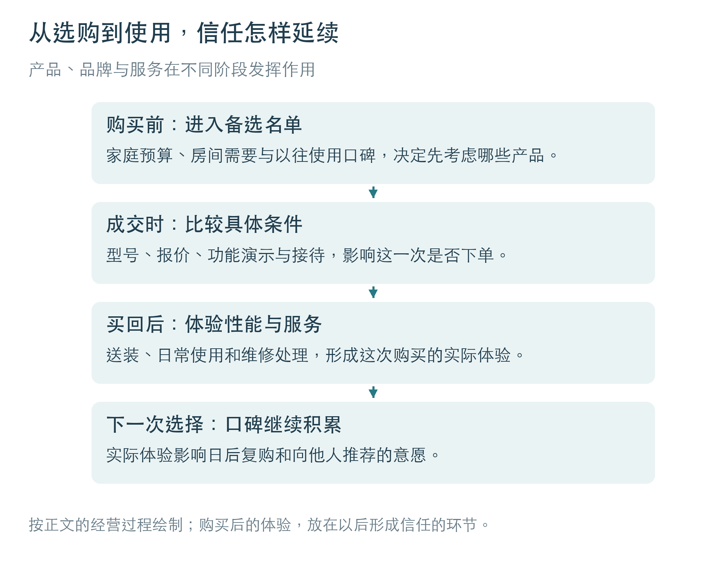

## 更多家庭在较低价格带作选择

2026年上半年，行业线上2100元以下空调占销量54.45%，比上年同期上升6.97个百分点。这个统计观察线上售出台数，显示较低价格产品在这一渠道中的分量增加。对于格力，能否在相应预算中提供产品，关系着能否参与这些订单。[2026中报：线上价格带 · 第10页](https://static.cninfo.com.cn/finalpage/2026-08-27/1225515004.PDF#page=10)

2026年5月业绩说明会上，管理层承认低价零售和工程机布局还有短板，并提出补齐。随后中报对产品的介绍更具体：悦清凉挂机以高质价比争取市场，悦清凉柜机、AI悦省电柜机则是将推出的产品；中高端还通过AI清凉王、月亮女神及冷静王柜机等产品争取客户。已经经营的挂机与尚待推出的柜机，处在不同阶段。[2025年度业绩说明会：产品布局短板 · 第1页](https://static.cninfo.com.cn/finalpage/2026-05-28/1225336605.PDF#page=1) [2026中报：产品系列与推出状态 · 第11页](https://static.cninfo.com.cn/finalpage/2026-08-27/1225515004.PDF#page=11)

这说明格力正在扩大产品覆盖，但还不能说较低预算的缺口已经补齐。中报没有给出这些型号的完整成交价、规格及优惠条件，不能把悦清凉直接放进前述2100元以下区间。前面的线上统计说明市场需求背景，公司的型号介绍说明正在采取什么行动，两者之间还缺实际价格和销售表现的对应。对家庭而言，只有具体型号的用途和到手价格都合适，新增型号才真正变成多一个可选产品。

较低价位同样要支付材料、制造和服务费用，产品设计需要让这些开支与价格相配。较高价位则需要让差价对顾客有意义。格力的任务是把不同需求变成能够持续经营的产品，而非只保留一个笼统的中高端定位。

## 京东合作把产品推向更多购买场景

2026年3月，格力与京东提出未来三年销售千万台AI空调的合作目标。合作提供了明确的销售方向，京东已有用户和销售场景，格力提供产品，交付又需要仓配和服务接续。[新华网：格力与京东合作发布](https://www.xinhuanet.com/tech/20260313/7fa42a7baef1446ba92e6851261d4ef3/c.html)

目标变成收益，要经过具体型号上架、促销、用户下单和实际交付。这些工作各有成本，平台活动与推广条件也会影响最后留给公司的收入。现有材料未单列合作净收益，这项合作目前说明公司正在怎样争取订单，不能由千万台目标直接推算新增利润。

## 产品调整还在等待经营结果

公司在2026年中报中引用奥维云网数据，披露格力品牌家用空调上半年全渠道零售份额为25.8%，表明仍有较大销售基础。这处披露没有进一步写明按金额还是台数，本书沿用“零售份额”，不将其与前述线上低价产品的销量占比混算。[2026中报：全渠道零售份额 · 第11页](https://static.cninfo.com.cn/finalpage/2026-08-27/1225515004.PDF#page=11)

同一时期，公司国内主营收入增长1.9%，毛利率降至31.94%、同比下降2.62个百分点。这是国内主营业务合计口径，包含的范围大于某款空调或某次销售合作；它说明国内业务取得更多收入时，每元收入留下的毛利反而减少。至于原因，售价、投入成本和产品组合都可能影响结果，需要继续分辨。[2026中报：内销收入与毛利 · 第24页](https://static.cninfo.com.cn/finalpage/2026-08-27/1225515004.PDF#page=24)

目前较有依据的方向，是维护能解决使用问题的性能与服务，同时扩大客户预算覆盖。以后同口径毛利恢复，能够说明国内业务的毛利表现改善；如果主要来自材料价格下降，就不能将改善全部归给新产品。要判断这些调整贡献多少，还需结合相应产品的售价、销量与成本变化解释。再扣除推广、售后和资产投入等必要支出，才接近这些新增收益能给股东留下多少现金的问题。

## 专题 · 格力怎样把零部件、整机和成本接起来

格力既生产空调整机，也通过凌达压缩机、凯邦电机、新元电子等专业公司生产关键部件，旗下盾安还经营制冷阀件。这些部件分别负责压缩制冷剂、驱动风扇、控制机器运行等工作，共同影响一台空调的制冷效果、耗电和噪声。

[2025年报：制造与关键部件体系 · 第12页](https://static.cninfo.com.cn/finalpage/2026-04-29/1225250396.PDF#page=12)

## 自己制造，把哪些工作留在了公司

空调让房间变凉，靠的是把室内的热量搬到室外。连接内外机的管道里流动着制冷剂，它在室内吸热，在室外放热，来回循环。

室内机的换热器由管道和许多薄金属片组成。温度较低的制冷剂从管道里流过，吸收空气中的热量，并逐渐变成气体。风扇不断让室内空气流过换热器，空气降温后再吹回房间。

吸热后的制冷剂以气体形式进入压缩机。压缩机提高它的压力和温度，让它比室外空气更热。随后，制冷剂进入室外机的换热器，把热量放给室外空气，并变回液体；室外风扇帮助带走热量。制冷剂再经过节流部件降低压力和温度，回到室内机，开始下一轮吸热。

[制冷循环原理：伊顿](https://www.eaton.com.cn/cn/zh-cn/products/thermal-management-solutions/chillers/compressor-based-refrigeration-basics.html)

电机带动风扇，控制器根据室温等信号调节压缩机和风机的运行，阀件则参与调节制冷剂的流量或流向。要让空调省电、安静，研发人员需要把压缩机、换热器、风扇和控制程序放在一起设计和调试。部件和整机都由内部团队开发，格力就可以根据整机的需要安排部件研发，再将新部件用到自己的产品中。

新一代家用空调电机就是一个具体例子。这个项目的目标是降低电机耗电、减小噪声，改善空调的使用体验。2025年报记载，产品已经上市，并在公司家用空调中批量应用。整机需要改善的问题，由此进入部件研发，再落实到实际产品。

[2025年报：研发表及家用空调电机应用（PDF第26—28页） · 第26页](https://static.cninfo.com.cn/finalpage/2026-04-29/1225250396.PDF#page=26)

设计也会改变工厂里的制造工作。2025年报介绍，格力在空调风道相关部件上采用一体化成型工艺，减少模具数量和生产环节，提高装配效率。原来需要更多模具和工序完成的工作，通过改变部件结构得到简化。公司报告，这项改进降低了综合制造成本。

[2025年报：模具与装配工艺 · 第23页](https://static.cninfo.com.cn/finalpage/2026-04-29/1225250396.PDF#page=23)

自制还意味着自己承担投入。对外采购时，格力向供应商买部件，供应商负责自己的厂房、设备和生产人员；自行制造后，格力需要购买设备、维护产线、安排人员，并持续投入部件研发。产线有充足订单，固定开支就能由更多产品分摊；订单不足，设备和团队的开支仍要承担。因此，自制是否划算，要把部件性能、采购价格、生产规模和设备利用放在一起看。格力已有内部开发和工艺改进的实际例子，全面成本领先的幅度还缺少同规格同行数据支持。

## 材料成本怎样影响每台机器的收益

2025年，原材料占家电制造营业成本87.52%，人工约占5.07%。铜等材料和部件是制造成本的大头。研发设计决定用什么、用多少，采购价格和生产良率决定实际付出，产品售价则决定这些开支之后留下多少毛利。

[2025年报：制造成本构成 · 第25页](https://static.cninfo.com.cn/finalpage/2026-04-29/1225250396.PDF#page=25)

雪球作者金色小路据此讨论过减产和降价对利润的不同影响。理解这一区别，要看机器是否已经生产出来。

[金色小路：报表与成本结构分析](https://www.xueqiu.com/2892426645/409943676)

对于还没有生产的机器，减少生产数量，可以相应减少后续材料采购，降低继续积压的风险。不过，若因此少接了本来能赚钱的订单，公司也会失去这些订单带来的收益；厂房设备、研发团队等持续开支，还需要由剩下的订单承担。实际能节省多少，取决于哪些采购和生产开支随之减少。全年材料成本占比87.52%，不能直接当作一次减产能够省回的现金比例。

对于已经做好的库存，材料和生产投入已经发生。降价出售同一台机器，通常会减少毛利，但也可能让原本卖不动的库存成交，提前收回资金，并减少仓储和继续积压的负担。决定是否降价时，需要比较降价后能卖出多少、收回多少资金，以及继续持有库存的代价。

需求较弱时，减少新增生产和处理已有库存可以同时进行。保住售价，要有足够的顾客愿意按这个价格购买；降价促销，则要看新增成交和资金回收是否值得付出较低毛利的代价。材料占比较高，使公司可以随未来产量调整较大一部分生产开支，而已经压在库存里的投入，需要通过销售逐步收回。

制造之外，研发、营销和售后也需要持续投入。2025年研发费用为64.63亿元，已经计入当期利润。格力需要继续开发型号、控制系统和部件，才能维持产品竞争力；分析持续盈利时，也需要判断维持这些工作所需的正常费用，不能因短期少花钱就认定可以永久节省。

[2025年报：研发费用 · 第26页](https://static.cninfo.com.cn/finalpage/2026-04-29/1225250396.PDF#page=26)

## 制造能力要经过订单和利用率检验

部件与整机共同开发、一体化工艺和采购安排，已经说明格力怎样组织制造。它们提供了改进性能与成本的途径，最终收益仍受订单量、售价和产线利用影响。需求转弱时，企业既要调整新增生产，也要让已有库存回到客户手中。

产品专题继续讨论不同预算下的型号与使用体验；这里保留制造的完整过程。判断这套能力的价值，应观察同等产品的成本、可靠性和持续投入，而不在整机收益之外再单列一笔未经测定的“自制优势”。

## 专题 · 格力的品牌：从愿意进店，到长期使用的信任

一位已经打算买格力的顾客，最后买了海尔。雪球用户“平均分”在2026年9月的文章里讲述，自己8月在重庆北碚选空调，持有格力股票，也选好了格力柜机；几次进店后，他觉得接待不佳，又去看了美的和海尔，最终选择海尔，并在使用后认可语音控制的便利。

这是作者自己的购买回忆，尚未取得订单和门店另一方的核实。它适合用来理解一次选购过程：顾客原先对格力有好感，愿意到店看产品；接触实际产品和销售人员以后，其他品牌又提供了吸引他的理由。品牌已经帮助格力取得这次接触机会，最后一笔成交仍经过门店和产品的比较。[平均分：选购空调的个人经历](https://www.xueqiu.com/3386549610/408120139)

## 买一台要用多年的机器，顾客在相信什么

空调装到家里以后，要在多个夏季和冬季反复使用。买的时候能够看外观、听介绍、比较能耗参数，几年后的故障和维修却要在使用中逐渐经历。家庭过去用过的产品、熟悉的品牌以及身边的评价，就成为提前作选择的依据。

金色小路在讨论格力生意时，将这种积累解释为长期使用形成的信任。对愿意购买格力的人而言，熟悉的品牌意味着可以较放心地选择一家自己了解的制造商。这种认知帮助公司进入顾客的购买名单，也让部分重视省心的家庭愿意接受一定差价。[金色小路：格力电器的经营与品牌解释](https://www.xueqiu.com/2892426645/410226845)

这笔差价是在具体购买中形成的。同样是空调，有人将购买预算放在首位，有人更关心夜间声音或送风，有人希望家中操作更方便。门店的作用是把具体机器与这些需要接起来。开头那位用户的叙述需要分成两个时点：购买前，他比较的是接待、产品外观等条件；买回以后，他才在实际使用中认可海尔语音控制的便利。后一个体验可能影响他今后对品牌的看法，不能倒过来当作已经证实的本次购买原因。品牌越熟悉，越有机会被比较；产品和服务仍需完成这次比较，并在使用中继续影响信任。

## 十年包修怎样落到实际服务

2021年，格力把家用空调免费包修由六年延长到十年。对准备长期使用的家庭而言，承诺范围内的维修责任有了明确承担者。2025年报继续披露这一安排，长期包修已经成为格力销售空调时提供的一部分条件。[2021社会责任报告：包修与服务资格 · 第21页](https://static.cninfo.com.cn/finalpage/2022-04-30/1213262527.PDF#page=21) [2025年报：渠道与包修 · 第11页](https://static.cninfo.com.cn/finalpage/2026-04-29/1225250396.PDF#page=11)

承担多年维修，需要配件和人员持续配合。格力2021年的披露介绍，销售公司储备维修配件，客服平台收集维修、库存和需求信息，服务网点及安装人员接受资格管理。用户报修以后，这套体系要安排人员、找到配件并完成处理。对消费者说“包修十年”，背后对应的是这些工作。[2021社会责任报告：配件储备与售后协作（PDF第20—21页） · 第20页](https://static.cninfo.com.cn/finalpage/2022-04-30/1213262527.PDF#page=20)

产品可靠，维修发生得少，公司履约负担较轻，顾客也更容易形成省心的体验；需要维修时得到及时处理，又能维护原来的信任。制造和服务因此在品牌上相遇。它们持续运行形成口碑，同时也需要格力支付人员、备件和结算费用。

现有报告介绍了怎样组织服务，还没有提供可比机型的长期故障率、各地响应质量或消费者愿付差价的完整数据。品牌研究据此保留明确的判断范围：格力拥有让顾客愿意考虑它的长期积累，尚未量化为所有产品统一适用的溢价比例。

## 信任怎样支持下一次购买

品牌在格力的价值，首先是帮助现有空调业务持续取得订单。过去积累的使用认知，让公司每次推出产品都能面对一批了解它的顾客；门店与服务则有机会将这种认知延续到下一次购买。公司仍要在具体价位提供合适的性能，并履行卖出时作出的承诺。

品牌因而关系到现有生意能否持续取得订单。它与产品、渠道共同支持同一门生意，已经反映在收入和利润里。后续若有同规格实际成交和服务成本资料，可以更清楚地解释品牌保护了多少收益；现有证据尚不能把这份积累换成一个适用于全部产品的溢价比例。

## 专题 · 格力渠道改革：进货、地方服务与交付怎样重新安排

格力把空调卖到全国，曾经依靠地方销售公司、代理商和门店共同铺开的网络。经销商先拿钱备货，工厂可以提前生产；地方团队组织销售，门店再把机器卖给家庭并联系安装。厂家较早收到货款，经销商从价差、返利和服务中取得收入。这套分工让格力扩大了销售，也把各地经营者的资金和生意同格力连接在一起。

网上买空调普及以后，消费者更容易比较价格，门店原来的价差受到挤压。格力开始调整进货层级、销售政策和交付方式。订货系统上线只是其中一步：谁继续垫资，谁安排库存，原有返利怎样接续，培训、促销和上门服务由谁完成，都需要重新安排。

## 淡季打款为什么能够吸引经销商

长江证券2024年的历史梳理记载，格力从1994年推行淡季销售政策，每年9月至次年4月，订货价格随时间逐步上调；1996年又采用年终返利和淡季贴息返利，按经销商提货额给予补贴。早订货的经营者得到较好的进货条件，格力则提前取得资金。 [长江证券：早期销售政策 · 第10页](https://pdf.dfcfw.com/pdf/H3_AP202409121639846051_1.pdf#page=10)

空调销售有淡旺季，夏季需要的机器，可以有一部分提前生产。这样能够更平稳地使用工厂的设备和人员，也给采购与运输留下时间。提前生产同样要支付材料款和工资，经销商提前打来的货款便能用于这些支出，减轻工厂在淡季回款少时的资金压力。

经销商把钱投进去以后，要等机器卖给消费者才能逐步收回。进货优惠和返利补偿了这段等待，也增加了日后卖货的收益。卖得顺时，较低的进货成本留下较好的差价；货积得久时，资金便继续占在库存里。厂家用部分销售收益换取较早回款，经销商用垫资和承担库存风险换取经营机会。

1997年，格力在湖北成立首家区域销售公司，随后向其他地区推广。总部按各地销售安排提货任务，区域组织管理打款、提货和市场工作，门店面对顾客销售。这让格力借助熟悉当地市场的经营者扩展网络，也让地方经营者有理由长期维护格力的生意。 [区域销售公司的形成 · 第10页](https://pdf.dfcfw.com/pdf/H3_AP202409121639846051_1.pdf#page=10) [原经销体系的分工 · 第16页](https://pdf.dfcfw.com/pdf/H3_AP202409121639846051_1.pdf#page=16)

厂家收到货款、厂家把货发给渠道、消费者买走机器，是不同的时点。货还在渠道仓库里，格力可能已经收到了钱；经销商要等零售发生后才收回投入。厂家回款良好与渠道库存压力，因此可能同时存在。

## 网上比价怎样改变了门店的收入

地方销售公司、代理商和门店，都要从空调售价里取得收入，支付人员、库存资金和服务费用。过去消费者主要在本地选购，报价比较不那么方便；电商让不同店铺和相近机型进入同一张比价单。门店要维持较高售价，就需要让顾客看见产品或服务上的差别。

第一财经2023年2月采访的一位华东代理商，回顾自己2022冷冻年的利润率已从过去约4%降至1.2%。他谈到价格透明、销售承压，以及更多机型改为进货时一次定价、减少后续返利；各项因素的影响没有单独拆分。采访还提到，2023年配送安装将由格力统一组织。这项后续安排，会继续改变代理商承接的工作和收入来源。 [第一财经2023年2月：华东代理商的经营变化](https://www.yicai.com/news/101665575.html)

经销商要重新计算一笔订单：进货时付多少钱，销售后还有没有返利，安装工作是否继续由自己承接，最后取得的收入能否覆盖店面和人员。少一层转手可以腾出一部分价差，但这部分钱怎样分配，仍要靠具体政策决定。它可以用于降低顾客的购买价格，也可以留给末端门店，使门店愿意继续销售和服务。

这也是格力改革需要兼顾的两端。终端价格缺乏竞争力，会失去顾客；门店长期挣不到钱，也会缩减经营或转向其他品牌。缩短交易链路的作用，要落实到顾客愿意买、门店愿意卖的进货和零售条件上。

## 河北改变下单方式，广州更换进货对方

各地改革并非同一时间改成同一种模式。2024年第一财经采访河北经销商时，当地已经由传真拿货转为线上办理，销售服务组织也更精简。另一位经销商同时指出，旧省代还承担培训、促销和价格协调，一些省代被削弱后，跨区低价货影响了门店收益。 [第一财经2024年5月：河北渠道变化](https://www.yicai.com/news/102105169.html)

这种跨区域流货在渠道中称为“串货”。门店按原有条件备下库存，其他地区的同类货却以更低价格进入当地，门店预计能取得的差价就会缩小。线上下单使信息传递更直接，地方的培训、推广和库存协调仍要由具体团队完成。原省代取得过交易收入，也做过这些工作，改革需要重新分配两者。

2025年9月的广州报道，则说明交易对方也在更换。“网批”是门店或经销商通过网上系统，向渠道供货方进货。一位华南零售商称，广州网批关联主体从盛世欣兴公司转向恒信智远公司，原有市场保证金和账上货款将迁移。报道同时记录，华南新旧系统仍在并行，旧返利和余额使一些门店继续使用传统系统。 [第一财经2025年9月：广州网批主体更换](https://www.yicai.com/news/102817963.html)

对这家门店来说，变化是向哪家公司进货、把钱留在哪套账户关系中；河北的线上订货，则首先改变办理方式。两类变化都能提高总部了解订单和价格的能力，具体省掉了哪一层交易、由谁收款，还要看当地实际安排。

报道给出的股权关系是：广东瑞格寰球持有这批恒信公司，瑞格寰球由八名自然人出资，这些人具有与格力相关的职业经历。该链条未显示上市公司持股，平台自己的进销差价先属于平台及其股东。对上市公司格力电器，改革的收益要从自身交易看：终端价格更合适可能带来更多供货订单，供货条件也可能改变；格力接手仓配和服务后，还要支付相应开支。平台与上市公司的收益通过生意联系起来，不能仅凭名称就合为一份利润。

## 仓库、运输和安装怎样接起来

一台空调售出以后，要找到对应型号，送到顾客家里，再安排人员安装。货物分散在不同仓库时，门店可能一边缺某个型号，另一处仓库却有积货。订单、库存和运输信息能够共同调度，才能更方便地把顾客需要的机器从合适位置发出。

长江证券2024年的报告记载，格力在2022年成立物流公司，采用干线自建物流、支线及城际运输外包的安排，并通过云网批衔接渠道、仓储、物流和派工系统。长途运输和地方配送由不同组织完成，格力开始更直接地协调从工厂到终端的交付。 [长江证券：格力物流与系统布局 · 第18页](https://pdf.dfcfw.com/pdf/H3_AP202409121639846051_1.pdf#page=18)

到2026年5月，格力在业绩说明会上披露，已建立基地仓、区域仓和前置微仓组成的三级仓网，订单、仓储和运输接入统一调度。基地仓靠近生产端，区域仓承接区域供给，前置微仓更靠近销售端。公司称流转周期缩短20%，2025年整体物流成本降低超过1亿元。 [2025年度业绩说明会：仓网与物流结果 · 第3页](https://static.cninfo.com.cn/finalpage/2026-05-28/1225336605.PDF#page=3)

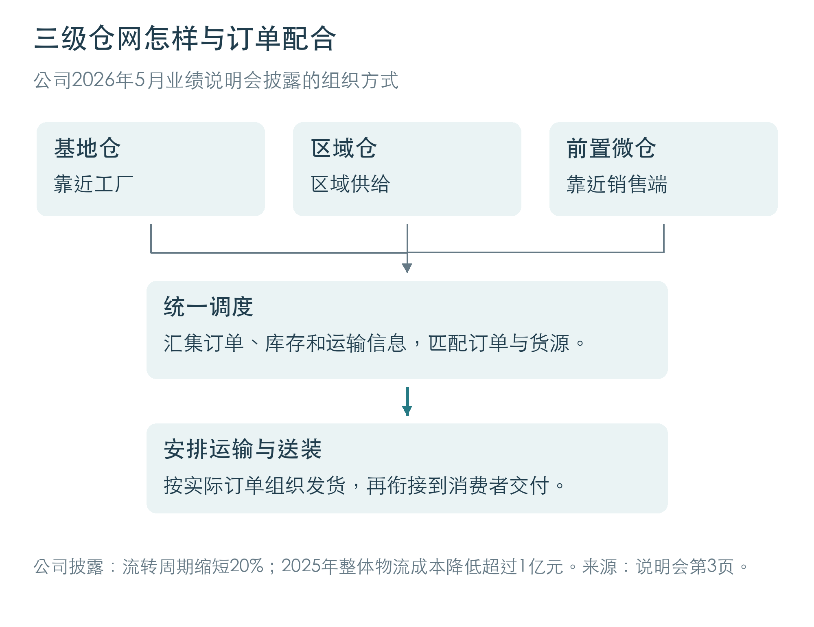

生产计划也在调整。公司介绍，需求判断按月修正，生产计划按周微调，并按产品处于上市、销售还是退出阶段精简型号。仓网解决已经做出的货从哪里发，生产计划决定接下来做什么、做多少。两者配合，目的是让工厂备货更贴近终端需要。

这种组织方式把一部分原来分散在地方的工作集中起来，也让格力承担更多协调责任。运输要有运力，安装维修要有人手，备件要提前准备。减少重复搬运可以节约费用，保证每笔订单按时装好则依赖持续的服务安排。

## 旧返利为什么还会影响切换

进货政策改了，过去交易形成的权益仍要结算。格力2025年末账上销售返利余额为485.71亿元。它记录的是尚待兑现的责任，不能从这个期末余额直接读出当年新增优惠或下一期要付出的现金。 [2025年报：销售返利余额 · 第167页](https://static.cninfo.com.cn/finalpage/2026-04-29/1225250396.PDF#page=167)

返利的作用是让经销商在达到销售政策条件后，获得价格优惠或补偿。兑现可能减少后续进货需要新付的钱，也可能涉及交付商品等安排。具体方式决定厂家何时收钱、交货或付款。返利既影响经销商最终留下的收益，也影响切换系统时需要结清什么；现有年报没有把2025年余额逐笔拆成兑现方式和时间。第五章及现金专题进一步解释它在报表与资金中的位置。

## 改革已经改变了什么

旧体系通过渠道提前付款支持生产，并借助地方经营者铺开销售。现在的改革把订单和库存信息集中起来，调整部分交易对方，重新组织仓配，也在改写门店取得收入和承担工作的方式。网上下单、主体切换和统一交付是不同环节，广州与河北的经历展示了它们怎样落到实际经营中。

公司披露的仓配周期和物流费用改善，是已经可以指出的具体成果。其他利益如何重新分配，则需要继续看各地交易条件与服务支出。渠道改革首先要解决的是空调怎样更顺畅地卖出、交付，以及各方怎样继续经营；它对集团利润的最终影响，在主营毛利与整体费用中一并观察。

## 研究依据

格力的再生产资源、剥离金融后的正常盈利和金融资本归属分别支持多少价值，新增增长是否有依据？

格力的成熟经营和大额金融资源都有价值。剥离金融收支后，正常经营现金约159亿元/年；按10%比较，保留500亿元资金时的条件价值约50.37元，主动保留约971亿元时约43.00元。可单独计价净本金再低息滞留10年，约38.39元，接近38.49元参考价。资产参照约24.6—32.9元，竞争压力情景约29.40元，均低于现价。现价有可能低于正常经营与有效用资支持的价值，但明显便宜的判断仍需经营恢复和资金用途共同支持；额外未计量资本损失L仍待扣。

正常经营并有效用资可支持高于现价的价值；持续竞争压力、长期低息持资和额外资本损失会消耗余量。

按实际经营、资本释放/滞留、少数权益和额外资本损失更新；新增业务有可核增量及投入证据后才采用增长回报。

## 公开来源目录

- [格力电器2025年度报告](https://static.cninfo.com.cn/finalpage/2026-04-29/1225250396.PDF)

- [格力电器2026半年度报告](https://static.cninfo.com.cn/finalpage/2026-08-27/1225515004.PDF)

- [格力电器2026第三季度报告](https://static.cninfo.com.cn/finalpage/2026-10-27/1225627217.PDF)

- [美的集团2026半年度报告](https://static.cninfo.com.cn/finalpage/2026-08-28/1225533135.PDF)

- [格力经销渠道转型采访](https://www.yicai.com/news/101907021.html)

- [河北渠道更替与销售组织采访](https://www.yicai.com/news/102105169.html)

- [格力与京东AI空调合作发布](https://www.xinhuanet.com/tech/20260313/7fa42a7baef1446ba92e6851261d4ef3/c.html)

- [2026年中期利润分配预案](https://vip.stock.finance.sina.com.cn/corp/view/vCB_AllBulletinDetail.php?id=12663747&stockid=000651)

- [回购比例达到1%进展](https://money.finance.sina.com.cn/corp/view/vCB_AllBulletinDetail.php?id=12672006&stockid=000651)

- [2025年度权益分派实施](https://static.cninfo.com.cn/finalpage/2026-08-21/1225487186.PDF)

- [格力历史收盘价快照](https://cn.investing.com/equities/gree-electric-a-historical-data)

- [格力电器2021年度企业社会责任报告](https://static.cninfo.com.cn/finalpage/2022-04-30/1213262527.PDF)

- [拆解报表，探索格力的真相（之一）](https://www.xueqiu.com/2892426645/409943676)

- [读财报探索格力管理层的陈述与资本配置](https://www.xueqiu.com/2892426645/410094925)

- [格力电器：是馅饼还是陷阱？](https://www.xueqiu.com/2892426645/410226845)

- [意难平：一个格力小散，三顾格力，最后无奈买了海尔空调](https://www.xueqiu.com/3386549610/408120139)

- [格力渠道变革之痛还会持续多久，线上线下如何发展考验董明珠](https://www.yicai.com/news/101665575.html)

- [王自如推进的格力电器渠道改革，进展怎样了？](https://www.yicai.com/news/101907021.html)

- [格力成立家用电器经营部 董明珠为渠道变革再引“外援”](https://www.yicai.com/news/102105169.html)

- [格力渠道大洗牌：核心代理商时代将落幕](https://www.yicai.com/news/102817963.html)

- [暖通行业承压 渠道提效缓解利润](https://stock.finance.sina.com.cn/stock/go.php/vReport_Show/kind/search/rptid/841219387495/index.phtml)

- [长江证券：初心如磐，奋楫笃行（2024-09-11）](https://pdf.dfcfw.com/pdf/H3_AP202409121639846051_1.pdf)

- [格力2025年度业绩说明会（2026-05-28）](https://static.cninfo.com.cn/finalpage/2026-05-28/1225336605.PDF)

- [格力2024年度业绩说明会（2025-06-09）](https://pdf.dfcfw.com/pdf/H2_AN202506091687837662_1.PDF)

- [伊顿：压缩机制冷基本循环](https://www.eaton.com.cn/cn/zh-cn/products/thermal-management-solutions/chillers/compressor-based-refrigeration-basics.html)

- [格力电器2025半年度报告](https://disc.static.szse.cn/disc/disk03/finalpage/2025-08-29/e433fd33-a08e-48eb-a15c-9d529c9ac12d.PDF)

- [格力2026-10-30收盘价核对记录](https://quote.cfi.cn/quote.aspx?stockcode=000651)

- [格力认购盾安新股完成公告（2023-002）](https://static.cninfo.com.cn/finalpage/2023-01-07/1215540028.PDF)

- [盾安发行情况暨上市公告书](https://static.cninfo.com.cn/finalpage/2023-01-05/1215526945.PDF)
