# 海尔智家 v2

研究时点 2026-11-10 · 本地发布版本 haier-codex-v2

海尔智家是一家以家电为主、在多地用本土品牌经营的上市公司。

## 海尔智家全貌

### 正文

海尔智家是一家以家电为主、在多地用本土品牌经营的上市公司。在国内，它销售海尔、卡萨帝和Leader。在美国，经营消费者熟悉的GE、GE Profile、Café等家电。在欧洲，有海尔、Candy及Hoover，并拓展暖通和商用制冷。公司把这些品牌和市场保留下来，同时让部分产品设计、采购和生产共用。海尔集团是实际控制人，上市公司A、H、D股所分享的业务以发行人及其并表公司的普通股权益为边界。 2025年报第9、16–18、37、105–107页

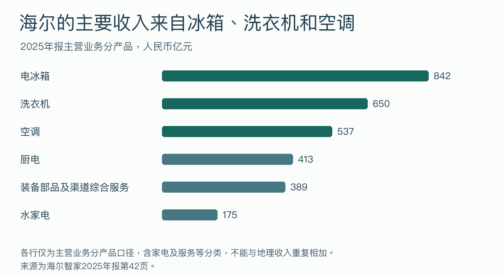

海尔智家2025年主营业务分产品收入

依据 · [海尔智家股份有限公司2025年年度报告 · 第16页](https://static.cninfo.com.cn/finalpage/2026-03-27/1225038336.PDF#page=16)

### 中国与美洲是大盘，欧洲和新兴区域贡献更多近期增量

按2025年报地区对外交易口径，集团收入3023.47亿元，其中中国大陆1465.55亿元、美洲798.71亿元、欧洲384.91亿元。南亚、东南亚和中东非合计258.87亿元。这些数字按地理列示，和冰箱、洗衣机等产品收入交叉。美洲比GEA单体大，欧洲也含多品牌、暖通和商用制冷。2016年并GEA、2019年并Candy先改变了集团所在的市场。2025年欧洲及三个新兴区域合计增加约114.57亿元，约占集团增量七成，其中含并购全年影响和汇率。 2025年报第17–18、26–27、225页

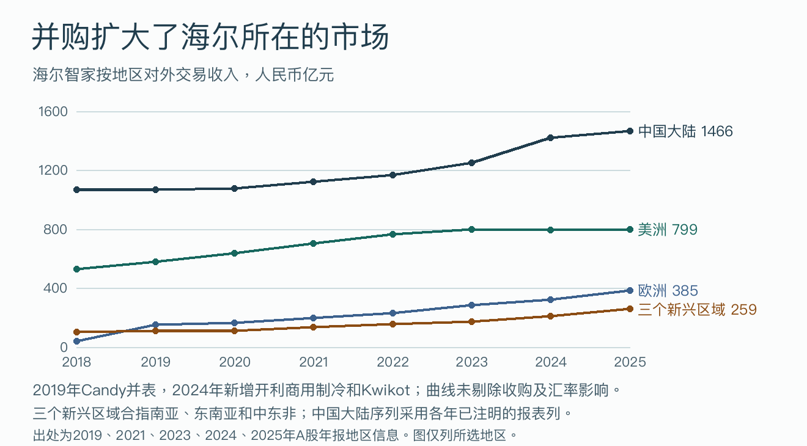

主要地区对外交易收入与并表变化

依据 · [海尔智家股份有限公司2025年年度报告 · 第225页](https://static.cninfo.com.cn/finalpage/2026-03-27/1225038336.PDF#page=225)

### 机器到家不等于海尔直接收零售价

国内卡萨帝要把嵌入尺寸和水电接到实际安装。买家可以向零售商付钱，再由日日顺等共用仓网送到家，零售商另向海尔结算进货款。2025年末全域TC配送单量占比57%，但全年国内主营的直销用户收入约13.2%。门店若预付，钱先压在门店。若海尔备货并给交付后账期，先压海尔的库存，之后可能压应收。英国海尔的具名贸易模板同样允许代贸易客户直送，默认发票日起30天付款。由谁送、谁收款、谁承担售后和退款，仍依具体交易。 2025年报第25、42、157–159页 · 海尔厨电收费表 · 英国供货条款第4–7页

开利商用制冷取得的客户需要现场能运行的冷链。法国Super U历史项目中，CCR供机组、MCI 34安装、Garcia Energy管理项目，后来海尔收购的是已有这些设备和工程合作能力的业务。设备、安装和后续维保可以由不同主体提供并各自结算。海尔也可提供工程与持续服务，成本会继续发生在现场人员、备件和响应上。 Carrier Super U项目 · CCR Performance · 2024年报第211–213页

依据 · [海尔智家股份有限公司2025年年度报告 · 第25页](https://static.cninfo.com.cn/finalpage/2026-03-27/1225038336.PDF#page=25)；[海尔厨电售后收费和交付条件](https://www.haier.com/support/charges/kitchen_appliances/)；[英国贸易客户通用供货条款 April25版 · 第4页](https://cms.candy-home.com/documents/d/global/legal_haiergeneralterms_apr25#page=4)；[CCR：Super U门店机组与独立安装角色](https://www.carrier.com/carrier/en/worldwide/news/news-article/carrier-commercial-refrigeration-delivers-20-000th-co2-refrigeration-system-in-europe.html)；[CCR Performance 三档维保协议（现行官网）](https://www.ccr.com/offerings/service-support/performance/)；[海尔智家股份有限公司2024年年度报告 · 第211页](https://static.cninfo.com.cn/finalpage/2025-03-28/1222926246.PDF#page=211)

### 三种经营能力要一起兑现为现金

品牌与产品要让顾客愿意选。从卡萨帝有明确价格门槛的冰箱、热水器、空调到GEA不同价位的厨房和洗护，市场份额支持已有成交，净收益还要扣促销、安装和保修。当地渠道和服务要把订单交付并收款。中国共享仓、美国品牌直购和工程、英国贸易商各有分工。制造与整合决定单位成本，欧洲迁产、泰国向美国供部分冰箱和美国扩建可同时发生。厂房、跨境运输和安全库存需要不同资金，最终要看实际成本和回款。 2025年报第25–30、37–38页 · 2026中报第14–19页

依据 · [海尔智家股份有限公司2025年年度报告 · 第25页](https://static.cninfo.com.cn/finalpage/2026-03-27/1225038336.PDF#page=25)；[海尔智家股份有限公司2026年半年度报告 · 第14页](https://static.cninfo.com.cn/finalpage/2026-08-28/1225522691.PDF#page=14)

### 当前规模较大，利润与回款正在承压

2026年前三季收入2218.19亿元、同比下降5.23%，扣非归母128.19亿元、下降24.11%，经营现金106.70亿元、下降39%。国内监测份额仍上升，国内毛利下降，海外毛利又含一次性退税。当前估计保留已有渠道与制造能力，在低需求稳定和现有融资安排下普通股正常年度现金约102亿元，稳定条件的参数敏感约90—116亿元。集团创造与母公司派出还要经过少数权益、实际回拨和分派程序。资产只提供部分账面参照，增长暂缓计价。10%机会成本下，若金融资源经回收和归属核对、留足正常经营资金后仍能覆盖对应融资，暂不给剩余部分计价，则为约10.81元人民币每股。覆盖条件尚待证明，GE续期及未计量净损失还需扣除。以1.82欧和7.5071元汇率作为买价情景，尚无足够证据支持明显便宜。 2026三季报第1–6、10–16页 · GE商标许可PDF第11–12页

依据 · [海尔智家股份有限公司2026年第三季度报告 · 第1页](https://static.cninfo.com.cn/finalpage/2026-10-30/1225641263.PDF#page=1)；[青岛海尔重大资产购买实施情况报告书 · 第11页](https://static.cninfo.com.cn/finalpage/2017-01-12/1203008866.PDF#page=11)

### 激励和回购改变的是哪一层现金

正常员工激励净成本按5亿元、第三季度同比费用差暂设零后，长期年度现金由约106亿元修正至约102亿元。实际购股可能提前付出数十亿元，因而近期分红还取决于存量、贷款与其他支出。假设每股0.9—1元派息、未来汇率7.5071元/欧元、扣10%中国预提且十年后仍以1.82欧元卖出，年化约5.93%—6.59%；每股1元但终值1.30欧元时约4.23%。D/H折价长期存在不保证终值。 2025港股年报附注37，印刷285—287页 · 2026中报股份支付及现金调节，第149、157、183页 · 中国外汇交易中心2026年11月10日中间价

依据 · [Haier Smart Home Co., Ltd. Annual Report 2025 (IFRS) · 第286页](https://www1.hkexnews.hk/listedco/listconews/sehk/2026/0427/2026042702192.pdf#page=286)；[海尔智家股份有限公司2026年半年度报告 · 第149页](https://static.cninfo.com.cn/finalpage/2026-08-28/1225522691.PDF#page=149)；[中国外汇交易中心2026-11-10人民币汇率中间价](https://www.chinamoney.com.cn/r/cms/www/chinamoney/data/fx/ccpr.json)

## 第1章 · 第一章 企业沿革与业务边界

### 正文

海尔智家在中国卖海尔和卡萨帝，在美国卖GE、Café等家电，在欧洲也经营Candy和Hoover。买美国灶具的家庭可以完全不认识海尔品牌，但这笔交易产生的经营结果仍进入海尔智家的合并报表。海尔把业务做到了海外，靠的是保留当地消费者认识的品牌、零售商和售后网络，再把这些经营公司接入同一个产品、采购和资金体系。如今它还在把这套办法用到商用制冷和暖通。 2025年报第9、16–18、37–38页

依据 · [海尔智家股份有限公司2025年年度报告 · 第16页](https://static.cninfo.com.cn/finalpage/2026-03-27/1225038336.PDF#page=16)

### 海尔集团与上市公司各自是什么

海尔智家原名青岛海尔。发行人的A股在上海交易，2018年在法兰克福挂牌D股，2020年在香港挂牌H股。三类股份对应同一家上市公司。海尔集团是实际控制人，海尔卡奥斯是控股股东。2026年三季末，海尔集团直接持有海尔智家11.53%，海尔卡奥斯直接持有13.53%，集团持有海尔卡奥斯51.20%，并有其他一致行动人。香港中央结算代理人的持股行归集多名投资者。购买海尔智家的普通股，投资者分享的是发行人及其子公司归属母公司的权益。海尔集团经营的其他上市业务须另看各自的股权和报表。 2025年报第9、105–107页 · 2026三季报第6–8页 · D股挂牌公告

在家电制造这一层，上市公司经营冰箱冷柜、洗护、厨房、家用空调、热水与净水，也做楼宇暖通和商用冷链。2025年报列的经营分部按这些产品和业务划分，另有地理收入表。地理表显示中国大陆收入1465.55亿元、境外1557.92亿元。境外包括美洲、欧洲、南亚、东南亚、中东非、澳洲、日本及其他市场。美洲收入里有美国之外的业务，欧洲也同时有Candy、海尔品牌、暖通及商用制冷。读品牌成绩、某家经营公司的利润或某地收入时，需要分别采用相应口径。 2025年报第16–18、223–225页

依据 · [海尔智家股份有限公司2025年年度报告 · 第105页](https://static.cninfo.com.cn/finalpage/2026-03-27/1225038336.PDF#page=105)；[海尔智家股份有限公司2026年第三季度报告 · 第6页](https://static.cninfo.com.cn/finalpage/2026-10-30/1225641263.PDF#page=6)；[青岛海尔法兰克福D股初始发行及挂牌公告](https://smart-home.haier.com/media/xahjxv5h/qingdao-haier-co-ltd-successfully-listed-on-the-ceinex-d-share-market-today.pdf)；[海尔智家股份有限公司2025年年度报告 · 第223页](https://static.cninfo.com.cn/finalpage/2026-03-27/1225038336.PDF#page=223)

### 从青岛冰箱到海外自有品牌

公司的经营前身是1984年成立的青岛电冰箱总厂，1989年在原厂改组基础上设立股份公司，1993年以青岛海尔电冰箱股份有限公司的身份在上交所上市。其后上市公司接入空调等白电业务，2010年取得海尔电器控制权，形成冰箱之外的洗衣机及热水器业务。2019年更名海尔智家，反映经营已覆盖多个品类和地区。 2025年报第135页 · H股上市历史文件PDF第1页

在上市公司接收集团海外业务以前，集团已经用海尔品牌在海外找经销商和建厂。集团沿革记载1999年设立美国南卡罗来纳生产基地，2000年产出首台美国制造的海尔冰箱。此前的自有品牌路径要自己建立渠道与服务，后来买入GEA和Candy则能接上当地已经熟悉的品牌和网络。集团的海外起步和上市公司后来何时将这些业务纳入报表，需要分开看。 海尔集团沿革1999–2000年 · 2025年报第17–18、37页

依据 · [海尔智家股份有限公司2025年年度报告 · 第135页](https://static.cninfo.com.cn/finalpage/2026-03-27/1225038336.PDF#page=135)；[H股介绍上市文件·历史和公司结构 · 第1页](https://www1.hkexnews.hk/listedco/listconews/sehk/2020/1116/9513606/2020111600097.pdf#page=1)；[海尔集团官网沿革](https://www.haier.com/global/about-haier/history/)；[海尔智家股份有限公司2025年年度报告 · 第17页](https://static.cninfo.com.cn/finalpage/2026-03-27/1225038336.PDF#page=17)

### 进入海外时，把厂、渠道和售后一起买下来

2015年，上市公司接收海尔集团的海外白色家电业务，包括从日本三洋取得的日本及东南亚白电业务。日本和东南亚已有面向当地用户的产品、品牌和经销关系。2018年，上市公司又取得此前已受托运营的Fisher & Paykel。它在澳新等地以嵌入式厨电见长，品牌原有的定制厨房和安装需求与标准家电不同。海外经营由此形成两条可并行的路径。一条在原有市场经营海尔自有品牌，一条从已积累用户和渠道的本地经营公司进入市场。 2025年报第9、17–18、37页

最大的一步是2016年在美国接手GE Appliances（GEA）。买方以股份和资产交易接收经营公司、相关库存、合同、知识产权及义务，并取得GEA持有的墨西哥Mabe权益。2016年6月交割时先付约55.80亿美元，按协议调整后的最终交易价为56.12亿美元。商标需要另看许可。原协议中，主要类别的GE商标使用起初20年免费，其后每次续展十年，排他、非排他类别按相关净销售额分别支付0.5%和0.25%。第二次续展届满以后，许可方有权按协议通知不再续展。这使海尔接手当地消费者熟悉的产品名和渠道，可以在原有GE工厂、经销关系和维修体系上继续销售，但许可期限和续期成本须随业务一同承担。 青岛海尔重大资产购买实施报告第7–12、17–18页 · GEA交割公告

在欧洲，海尔通过荷兰子公司于2019年1月4日取得Candy全部股权。Candy已经在欧洲销售洗衣机、厨电等产品，经营Candy、Hoover及地方品牌。欧委会审查在多个品类上看到了重叠，还区分了嵌入式和独立式产品及国别市场的竞争可能。海尔买下的价值，既有生产和产品开发资源，也包括货架、售后联系和当地顾客认识的品牌。上市文件载明股份购买协议金额为4.75亿欧元，港股2020年报购买会计列约4.67亿欧元、36.66亿元人民币，并确认商誉20.40亿元。两项欧元数字各自对应文件的交易或会计口径，资料没有给出两者之间的完整调整桥。2025年报披露Candy洗护业务语境下扭亏，经营跨过盈亏点，收购以来为这项业务投入和收回多少现金仍无完整披露。 欧委会Candy并购决定第2–6页 · 海尔智家H股上市文件历史章节印刷第151–152页 · 2020年港股年报PDF第267页 · 2025年报第26–30页

海尔智家各地对外收入及并表转折

2020年的海尔电器私有化解决的是另一类问题。海尔智家原已控制海尔电器，洗衣机、水家电等经营结果已进入合并报表，仍有一部分权益由海尔电器外部股东持有。安排完成后，每注销一股方案股，外部股东取得海尔智家新发1.60股H股，海尔电器另付1.95港元。海尔电器撤牌后成为全资子公司，原外部股东中的合资格股东转为海尔智家的股东。这一步让原来分在两个上市平台的产品、渠道和服务可以统一安排，原母公司股东也需与新增H股股东共同分享此后的权益。 H股上市文件股本章节印刷第288–289页 · 2020年港股年报PDF第96页

依据 · [海尔智家股份有限公司2025年年度报告 · 第37页](https://static.cninfo.com.cn/finalpage/2026-03-27/1225038336.PDF#page=37)；[青岛海尔重大资产购买实施情况报告书 · 第7页](https://static.cninfo.com.cn/finalpage/2017-01-12/1203008866.PDF#page=7)；[Qingdao Haier Acquires GE Appliances](https://pressroom.geappliances.com/news/qingdao-haier-acquires-ge-appliances)；[欧盟并购审查 M.9139 Haier/Candy · 第2页](https://ec.europa.eu/competition/mergers/cases/decisions/m9139_181_3.pdf#page=2)；[H股介绍上市文件·历史和公司结构 · 第7页](https://www1.hkexnews.hk/listedco/listconews/sehk/2020/1116/9513606/2020111600097.pdf#page=7)；[海尔智家2020年年度报告（港股英文） · 第267页](https://smart-home.haier.com/media/ou1gf1ma/2021042900711.pdf#page=267)；[海尔智家股份有限公司2025年年度报告 · 第26页](https://static.cninfo.com.cn/finalpage/2026-03-27/1225038336.PDF#page=26)；[H股介绍上市文件·股本 · 第1页](https://www1.hkexnews.hk/listedco/listconews/sehk/2020/1116/9513606/2020111600102.pdf#page=1)；[海尔智家2020年年度报告（港股英文） · 第96页](https://smart-home.haier.com/media/ou1gf1ma/2021042900711.pdf#page=96)

### 从卖家庭设备到给商家交付系统

2024年海尔收购Carrier的商用制冷业务，新增商超冷柜、冷库和对应的安装维修团队。商超客户关心的不只是买一台柜子的价格。门店营业时间内冷柜故障会影响食品保鲜，项目选择也要考虑整套冷媒和维修可用性。Carrier公布的约7.75亿美元企业价值含约2亿美元养老金义务，卖方报表另列实际取得现金，买方财报也按欧洲和印度标的分列对价及义务。这使海尔承担长期服务和资金责任，同时获得零售冷链客户及二氧化碳制冷能力。南非Kwikot的起点则是已有热水器品牌、安装关系和售后网，海尔在此基础上接着销售太阳能热水等产品。两项收购在2025年首次完整进入全年比较。 Carrier商用制冷交割公告 · 2024年报第211–213页 · 2025年业绩公告

同样在2024年末，公司通过表决权委托取得优瑾（上海）企业管理有限公司控制权，把相关物流业务作为同一控制下合并。年报追溯重列了比较期，因此后来的报表会把部分过去的收入和现金计进历史。这部分变动不对应当年新增的家庭订单。2026年印度交易又是另一种变化。港股半年报显示集团处置当地公司49%、保留51%并继续控制，收到约55.91亿元。交易律师按海尔与投资团各49%、2%员工计划描述。当地家电业务仍在合并范围，持有比例变化会影响股东之间怎样分配所得。 2024年报第12、214–215页 · 2026年港股中报PDF第41页 · 交易律师披露

2026年10月，海尔还完成Ferroli ASEAN 100%股权交割，取得越南本地热水器研发、制造和销售平台，交割在三季报期末之后。它延续了买现成产品、生产和服务能力的做法。历史上的并购已经把公司带到了新地区和新品类，后续要看这些新客户是不是愿意继续购买，以及当地经营所得是否足以支撑设备、渠道、售后和所承担的债务义务。 Ferroli ASEAN交割公告

依据 · [Carrier完成出售Carrier Commercial Refrigeration](https://www.carrier.com/refrigeration/en/worldwide/news/news-article/carrier-completes-775m-sale-of-its-commercial-refrigeration-business-to-haier.html)；[海尔智家股份有限公司2024年年度报告 · 第211页](https://static.cninfo.com.cn/finalpage/2025-03-28/1222926246.PDF#page=211)；[海尔智家2025年度结果公司新闻稿](https://www.haier.com/global/press-events/news/20260402_288863.shtml)；[海尔智家股份有限公司2024年年度报告 · 第214页](https://static.cninfo.com.cn/finalpage/2025-03-28/1222926246.PDF#page=214)；[Haier Smart Home Co., Ltd. Interim Report 2026 (IFRS) · 第41页](https://www1.hkexnews.hk/listedco/listconews/sehk/2026/0928/2026092801607.pdf#page=41)；[DLA Piper 海尔印度股权交易交割说明](https://www.dlapiper.com/en-us/news/2026/04/dla-piper-advises-haier-smart-home)；[海尔智家完成收购法罗力东南亚100%股权](https://www.haier.com/about_haier/xinwen/20261105_296189.shtml)

## 第2章 · 第二章 商业模式与价值链

### 正文

海尔智家卖出的多数产品，是买家要用多年的冰箱、洗衣机、空调和厨电。一台机器从工厂走到用户家里，海尔可能赚的是批发价和制造成本的差额，也可能直接收取零售价并承担获客、送装和退换。商用冷柜和暖通工程还增加了选型、施工和持续服务。三种生意都要回答同一问题，哪个主体下单，什么时候交付，以及海尔在付出采购、制造与履约成本之后，何时收得到钱。 2025年报第16–18、42、157–159页

依据 · [海尔智家股份有限公司2025年年度报告 · 第42页](https://static.cninfo.com.cn/finalpage/2026-03-27/1225038336.PDF#page=42)

### 机器要先做成，才谈得上销售

在冰箱业务里，产品团队先确定不同市场需要的容积、外形和功能，再把设计拆成可采购和可生产的零件、结构与配置。海尔2026年在欧洲销售的Horizon冰箱用多门和大容积满足储藏需求，又要通过超薄外形适配橱柜。在越南，Horizon系列还按当地需求陆续推出制冰、外取水和保鲜功能。共同的产品平台可以复用部分设计和零件，不同尺寸、能效和功能仍要各地测试与交付。海尔也采购材料、部件和部分成品，并自制部分暖通电脑板等关键件。自产提高了对供应和质量的掌控，也要提前投入设备并养足产量。 2025年报第36–38页 · 2026中报第17、19页

工厂支付或承诺材料、人工与制造费用后，把成品移到仓网。在一台设备销售前，这些成本有一部分压在存货里。供应商可以按采购合同到期收钱。海尔在2026中报披露的两类供应商融资说明，供应商提前或按时拿到钱，与海尔什么时候付款是两回事。有一种安排由海尔子公司申请，银行到期付供应商，子公司延后偿还银行，原应付转为借款。另一种由供应商自行选择提前拿款，海尔仍在原到期日足额支付，账上仍是经营应付。前者延后了海尔的实际付款，后者主要改变供应商拿钱的时间。 2026中报第158–159页

依据 · [海尔智家股份有限公司2025年年度报告 · 第36页](https://static.cninfo.com.cn/finalpage/2026-03-27/1225038336.PDF#page=36)；[海尔智家股份有限公司2026年半年度报告 · 第17页](https://static.cninfo.com.cn/finalpage/2026-08-28/1225522691.PDF#page=17)；[海尔智家股份有限公司2026年半年度报告 · 第158页](https://static.cninfo.com.cn/finalpage/2026-08-28/1225522691.PDF#page=158)

### 在中国，统仓可以改变送货路线，买卖仍看合同

顾客要把卡萨帝洗碗机装进厨房，通常要先确定柜体和给排水。海尔公开的收费表把基本送装、部分免费辅材和另外收费的材料区分开，工程和橱柜渠道专供型号的安装辅材规则另列。顾客愿意为能落地的设备付钱，海尔及合作商也要安排设计量尺、搬运、安装、试机和后续维修。顾客若从独立门店购买，门店收零售价，海尔供货主体从门店或相应渠道拿货款。柜体和家装若另签，则另依交付主体和合同。海尔自己是卖方时，集团内主体收零售价，并承担相应的营销、平台、履约和退换。 海尔厨电收费表 · 2020年港股年报PDF第68–69页 · 2025年报第25、42页

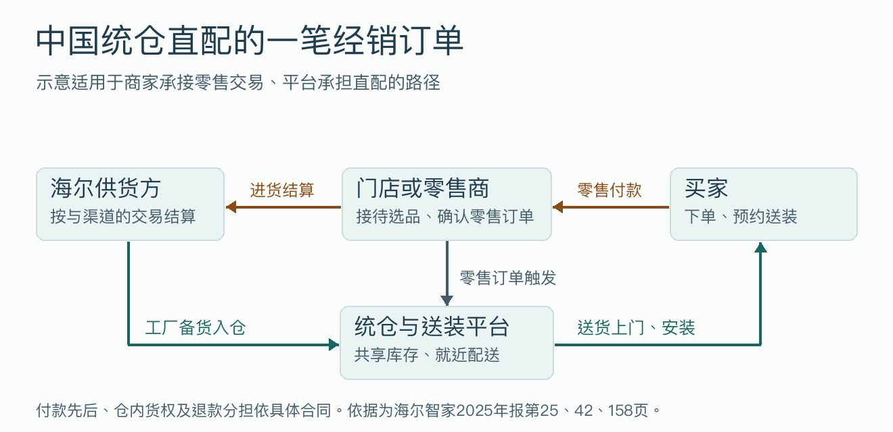

国内统仓经销订单的货物和款项路线

统仓让多个渠道使用共用库存，终端下单后可以就近送装。若商家先付进货款，海尔可先收到资金，未交货且仍有履约义务时账上留合同负债。若海尔控制仓货，门店按消费者订单进货并享有交货后账期，海尔要先垫存货，控制权转移后无条件可收而尚未收的款变为应收。两种路径都能用同一仓网。哪方最终垫了多久、承担退换或过季风险，取决于渠道合同。2025年末海尔所称全域TC配送单量占比为57%，全年国内主营业务中“直销用户”收入192.41亿元，约占13.2%，“经销及其他”为1267.95亿元。零售卖方和仓配组织能分别变化，这也是两个比例各有分母的原因。 2025年报第25、42、157–159页

依据 · [海尔厨电售后收费和交付条件](https://www.haier.com/support/charges/kitchen_appliances/)；[海尔智家2020年年度报告（港股英文） · 第68页](https://smart-home.haier.com/media/ou1gf1ma/2021042900711.pdf#page=68)；[海尔智家股份有限公司2025年年度报告 · 第25页](https://static.cninfo.com.cn/finalpage/2026-03-27/1225038336.PDF#page=25)

### 北美零售和工程订单怎样交付

美国顾客可以从GE Appliances直接购买，由品牌安排授权送装。以官网的缺货条款为例，直接下单会扣卡，等待时可以取消未交付的订单并退款，现金可能早于交付。走零售渠道时，顾客向零售商下单，海尔的经营主体按供货关系结算。以Costco渠道质保为例，GEA将其中一年有限保障部分延长到两年。品牌在出售设备后还要承担适用条款下的备件和服务，零售退货和品牌向渠道的结算各有依据。 GEA直购配送 · GEA缺货条款 · GEA Costco质保

同一品牌也把厨房和洗护设备卖给住宅工程。GEA Pro按项目用途和进度协助建商选品，可以从自有配送中心直送，也可以通过本地经销伙伴。建商先按房型统一定规格，住户可能在交房时才开始使用。工地进度变化则会改变发货安排。合同可能只包括设备供货，也可能约定进一步服务。海尔智家对通常的整机销售在客户获得控制权时确认收入。符合客户控制在建标的等条件的商用空调或智能家居建造合同，可以按投入进度确认。安装、调试、票据和付款时间应分别按实际合同辨认。 GEA Pro工程服务 · 2025年报第157–159页

依据 · [GEA直购送装及拆除](https://www.geappliances.com/appliance-delivery-installation)；[GEA直购缺货商品条款](https://www.geappliances.com/backorder-terms-conditions)；[GEA Costco渠道有限质保](https://www.geappliances.com/costco/ge-appliances-limited-product-warranty)；[GEA Pro建筑及工程供货能力](https://www.geappliances.com/pro/our-capabilities)；[海尔智家股份有限公司2025年年度报告 · 第157页](https://static.cninfo.com.cn/finalpage/2026-03-27/1225038336.PDF#page=157)

### 英国批发商可以在付清之前转售

Candy官网公布的Haier Smart Home UK & I Ltd供货模板显示，客户申请表加具体订单约定商品、数量和交付地。海尔把货置于约定地点、可由贸易客户支配时完成交付并移交货损风险。货权可留到包括其他供货欠款在内的有关款项付清，客户仍可在正常业务中转售。除书面另约外，买方自发票日起30天内付款。发生货损、短少或未交货，模板另设通知期限。即使订单注明由海尔代贸易客户直送终端，家庭和贸易客户之间的零售合同仍另行处理。因而海尔可能已送货、还没收款，零售商也可能需要先向家庭退款，再依据供货合同追偿。 英国供货条款PDF第1–7页

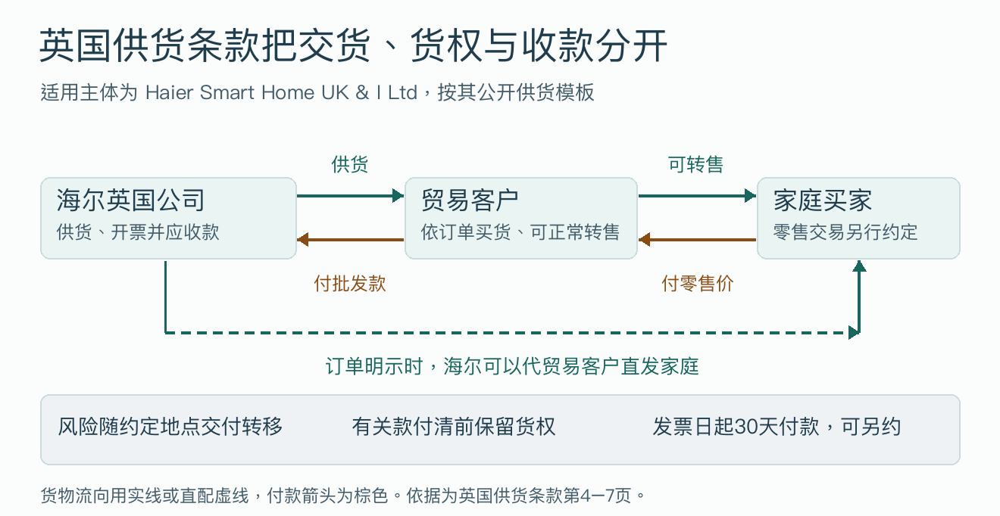

英国海尔贸易客户的交货、零售和付款安排

依据 · [英国贸易客户通用供货条款 April25版 · 第1页](https://cms.candy-home.com/documents/d/global/legal_haiergeneralterms_apr25#page=1)

### 商超制冷要交到现场能运行，设备款和安装款可以分别发生

法国食品零售商Super U翻修Aimargues门店时，需要为约1500平方米鲜品区配置冷链。2022年的具名案例中，开利商用制冷（CCR）提供MiniCO₂OL机组，MCI 34负责现场安装，Garcia Energy担任项目管理并提供二氧化碳制冷专业支持。该项目发生在海尔2024年取得CCR之前，说明买来的业务已能把机组交给当地工程伙伴。门店收到设备以后，还要由安装方把机组接入现场系统，项目才能实现制冷。2025年并入后的CCR还披露给巴黎一处餐饮客户交付两套机组，出厂时已预接气体冷却器，以减少现场安装工序。机器的制造、运到工地和接入制冷系统，可以由不同主体完成。 Super U具名项目 · CCR并入海尔 · 巴黎客户交付

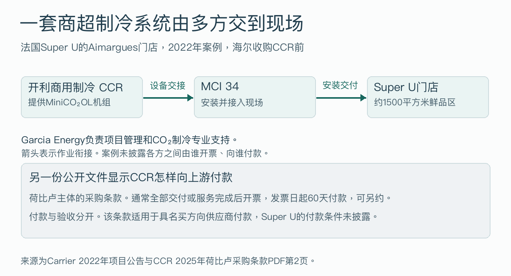

开利商用制冷具名项目交付角色与另一份具名采购条款

这类客户可以一起购买设备、安装和维保，也可以分别签约。CCR目前公开的Performance服务有不同档位，预防性保养、关键备件、维修人工、故障支持与远程监控可包括在套餐内、加购或按需收费，具体依国家和合同。设备运行后仍要准备工程师、备件和响应能力。公开方案说明CCR能提供哪些服务，Super U买了什么维保档位、CCR是否收取安装款并未披露。 欧委会同业交易决定第14页第62段 · CCR Performance服务档位

从采购付款一侧，可以看到CCR旗下荷比卢主体CO2OLTEC Commercial Refrigeration B.V.的一种实际安排。按2025年9月公开采购条款，上游供应商按订单定价，通常在货物全部交付或服务完成后开票，开票日起60天内支付，双方可另约。付款本身并不构成验收。这是该具名买方向上游付款的条款，Super U或其他商家何时付设备款、进度款和维保款没有披露。如果CCR要先付设备或安装商，而客户晚付款，差额会占用CCR资金。反之，先收款可减轻垫资。集团建造业务在符合条件时可随投入确认收入，实际收付款仍依两边合同。 CCR荷比卢采购条款PDF第2页第4–6条 · 2025年报第157–159页

依据 · [CCR：Super U门店机组与独立安装角色](https://www.carrier.com/carrier/en/worldwide/news/news-article/carrier-commercial-refrigeration-delivers-20-000th-co2-refrigeration-system-in-europe.html)；[CCR庆祝并入海尔智家](https://www.ccr.com/de/news/ccr-commercial-refrigeration-celebrates-day-1-as-part-of-haier-smart-home-2/)；[CCR 向巴黎餐饮客户交付两台GC5/MiniCO₂OL](https://www.ccr.com/fr/news/gc5-minico%e2%82%82ol-high-performance-refrigeration/)；[欧委会 Epta/Hauser 商用制冷并购决定 M.12094 · 第14页](https://ec.europa.eu/competition/mergers/cases1/202621/M_12094_805.pdf#page=14)；[CCR Performance 三档维保协议（现行官网）](https://www.ccr.com/offerings/service-support/performance/)；[CCR荷比卢采购通用条款（2025年9月） · 第2页](https://www.ccr.com/wp-content/uploads/2025/12/ccr-purchase-terms-and-conditions-benelux-september-2025-en.pdf#page=2)；[海尔智家股份有限公司2025年年度报告 · 第157页](https://static.cninfo.com.cn/finalpage/2026-03-27/1225038336.PDF#page=157)

### 收入怎样变成利润和现金

海尔在2025年报中列出电冰箱、洗衣机、厨电、空调、水家电和装备部品及渠道综合服务等主营业务。各类产品占用的设备、材料、服务能力不同。以国内为例，“直销用户”毛利率41.65%，“经销及其他”26.86%。价款是海尔对自己客户的交易金额，货品和渠道的结构本身也不同。毛利还要承担销售、研发和管理等开支。为家电质量保证预计的维修成本会在设备销售后持续发生，若是额外提供的服务类保证，则要从价款中分配一部分，按服务履行确认。 2025年报第41–42、158页

2026年前三季，海尔国内全渠道统仓To C客户上线率达85%，三季度日均直配订单同比增37%，集团前三季销售及劳务收款却由2463.00亿元降至2401.14亿元，经营活动现金净额由174.91亿元降至106.70亿元。公司把回款减少与国内销售走弱及海外保理节奏调整相联系。仓配更快有助于交货，收益还要经过价格、售后、库存、信用和付款。看懂一家家电公司的模式，最终要看从工厂出货到货款回来之间，渠道商、供应商和海尔各在什么时点出钱，以及共享仓配能否缩短整条链的占资。 2026三季报第3–5、15页

依据 · [海尔智家股份有限公司2025年年度报告 · 第41页](https://static.cninfo.com.cn/finalpage/2026-03-27/1225038336.PDF#page=41)；[海尔智家股份有限公司2026年第三季度报告 · 第3页](https://static.cninfo.com.cn/finalpage/2026-10-30/1225641263.PDF#page=3)

## 第3章 · 第三章 行业竞争与同行

### 正文

海尔争夺的是一户家庭或一个工程客户在特定时点的选择。买家要换掉一台坏洗衣机，会先问多久送到和能否装好。装修厨房的家庭会先看尺寸、门板和售后。建商定整栋楼的设备，会先问交期、配套和批量价格。在这些场合里，海尔遇到的对手和需要花的钱都不同。销量份额可以说明更多人选了它，但能否多赚钱，要看为这笔销量让掉多少价格，又负担了多少配送、服务和库存。 2025年报第19、25–30、42页

依据 · [海尔智家股份有限公司2025年年度报告 · 第19页](https://static.cninfo.com.cn/finalpage/2026-03-27/1225038336.PDF#page=19)

### 中国从普及转向换新，专业对手仍在

国内冰洗已有大量在用设备。居民换新时会比较能效、容量、安装便利和品牌口碑，需求也会在政策补贴期间提前释放。2025年以旧换新覆盖12类家电，符合二级能效或水效者按最终售价补贴15%，一级另加5%，每件最高2000元。2026年集中到六类一级能效或水效家电，补贴15%、每件最高1500元。两年比较时，一台机器即使挂牌价相近，家庭实付和渠道促销也可能不同。补贴发给谁、渠道是否先垫、厂商是否另给优惠，需要分别识别。2026年第三季，海尔援引奥维云网统计，国内家电零售额1791亿元、同比降10%。这说明份额是在缩小的市场里争夺。 2025以旧换新通知 · 2026以旧换新通知 · 2026三季报第2页

海尔以卡萨帝承接高端嵌入、成套和洗护升级，用海尔品牌服务主流需求，Leader以分区洗等具体场景触达年轻用户。对正装修的家庭，卡萨帝的机会是把洗碗机、冰箱和柜体在选型阶段一起确定。同一个家庭也可以比较方太的集成烹饪、水槽式或其他洗碗机方案，分别选择喜欢的设备。在暖通环节，格力等厂商的家用和中央空调产品也有各自专业的选型与安装渠道。美的同时经营COLMO和东芝两个高端品牌，并推进直接面向消费者的渠道运营，意味着套系体验、线上获客和高端标签本身都会被竞争。 海尔2025年报第25–30、37页 · 美的2025年报PDF第30、83页 · 方太产品目录 · 格力2025年度报告

2025年海尔披露卡萨帝万元以上冰箱市场份额44%，在该价带有实际销售基础。到了2026年前三季，公司援引奥维监测，集团国内线上、线下零售额份额分别升至20.6%和25.0%，同比增2.9和1.7个百分点，国内毛利率却下降。公司解释涉及原料上涨、行业结构和终端价格竞争。品牌份额较高，顾客也能以更低净价购得机器。原料涨价时，厂商还可能无法把成本完全转给渠道。判断高端产品能否持续赚钱，应比较同类净成交价、折扣、保内成本与返修，同时观察销量和市场份额。 2025年报第26、42页 · 2026三季报第3–4页

依据 · [2025以旧换新通知](https://www.ndrc.gov.cn/xwdt/ztzl/tddgmsbgxhxfpyjhx/gzdt/202501/t20250124_1395894.html)；[2026以旧换新通知](https://ltfzs.mofcom.gov.cn/xfpyjhx/zccs/art/2025/art_956880116ae74f37a080902359537989.html)；[海尔智家股份有限公司2026年第三季度报告 · 第2页](https://static.cninfo.com.cn/finalpage/2026-10-30/1225641263.PDF#page=2)；[海尔智家股份有限公司2025年年度报告 · 第25页](https://static.cninfo.com.cn/finalpage/2026-03-27/1225038336.PDF#page=25)；[美的集团2025年年度报告（港股中文） · 第30页](https://www1.hkexnews.hk/listedco/listconews/sehk/2026/0424/2026042400679_c.pdf#page=30)；[方太产品目录](https://www.fotile.com/h5/goods/all.html)；[格力电器2025年年度报告](https://static.cninfo.com.cn/finalpage/2026-04-29/1225250396.PDF)；[海尔智家股份有限公司2025年年度报告 · 第26页](https://static.cninfo.com.cn/finalpage/2026-03-27/1225038336.PDF#page=26)；[海尔智家股份有限公司2026年第三季度报告 · 第3页](https://static.cninfo.com.cn/finalpage/2026-10-30/1225641263.PDF#page=3)

### 北美的对手要争零售货架，也要争建商规格

GE Appliances在北美同时经营面向普通家庭的GE、面向功能升级的GE Profile、偏外观及成套的Café，以及高端嵌入式Monogram。零售商选择上架型号和促销窗口，需要供应商保证数量、交期和售后。家庭则会在不同品牌和价位之间比较。2025年GEA获Lowe’s评选的供应商合作奖，海尔称GE洗衣机在美国的份额达26.7%，并披露北美高端品牌收入增长7%。这些是已观察到的销售与渠道结果。同期竞争者Whirlpool披露Lowe’s占其集团净销售额15%，足以说明大型零售商对供应商具有实质影响，GEA自身的集中度及单客合同仍未披露。 海尔2025年报第26、29–30、37页 · Whirlpool 2025 Form 10-K PDF第12、104页

建筑工程的竞争点不同。GEA Pro可协助开发商、承包商选厨房、洗护及部分暖通设备，安排项目交期、直供或当地经销。产品能适配房型、现场可及时服务，关系到建商是否继续让它入选。住宅交易疲弱时，厂商既少卖部分工程订单，也可能面临终端延后更换。2026年第三季，海尔引述北美行业出货量约降4%，公司称价格体系、空气与水和小家电缓冲核心大家电的疲弱。Whirlpool同期在北美大家电披露剔除汇率净销售额下降8.2%，并称其提价和成本措施只部分抵消原料、燃料和物流上涨。两家公司采用的产品和统计范围不同。它们共同显示这个阶段的问题有需求和成本两个来源，单看谁的产品份额提升不能推定谁的可持续净利更高。 GEA Pro · 海尔2026三季报第2–4页 · Whirlpool 2026年三季度报告附件

依据 · [海尔智家股份有限公司2025年年度报告 · 第26页](https://static.cninfo.com.cn/finalpage/2026-03-27/1225038336.PDF#page=26)；[Whirlpool 2025 Form 10-K · 第104页](https://s202.q4cdn.com/229739679/files/doc_financials/2025/ar/Whirlpool-2025-10K.pdf#page=104)；[GEA Pro建筑及工程供货能力](https://www.geappliances.com/pro/our-capabilities)；[海尔智家股份有限公司2026年第三季度报告 · 第2页](https://static.cninfo.com.cn/finalpage/2026-10-30/1225641263.PDF#page=2)；[Whirlpool 2026第三季度业绩发布](https://whirlpool.mediaroom.com/2026-10-26-Whirlpool-Corporation-Announces-Third-Quarter-Results)

### 欧洲量与价背离，洗衣机卖得更多也可能少赚钱

在欧洲，Candy和Hoover已有洗护渠道，海尔品牌可用多门冰箱、高效洗护等切入更高价带。它要同时与BSH旗下Bosch、Siemens等嵌入和套系品牌竞争，也要面对覆盖主流及较低价带的Beko体系。2024年4月，Whirlpool把欧洲大家电业务并入Beko Europe。原有的Whirlpool、Beko品牌竞争仍在终端出现，背后的生产和销售资源已经合并。Electrolux还通过家电、厨房零售商和直接销售经营Electrolux及AEG等品牌。多品牌、渠道和区域工厂都已有竞争者在用。海尔要证明自己的优势，应看产品能否占到零售位置、是否有值得顾客付费的差异，以及销量增量能否分摊原有制造和服务成本。 欧委会Candy决定第3–6页 · BSH 2025业绩公告 · Arçelik投资者资料PDF第41页 · Electrolux经营区说明

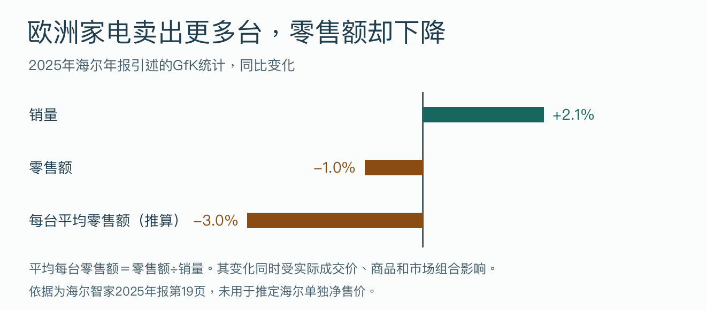

欧洲家电零售销量、销售额与每台平均销售额的2025年变化

海尔年报引述GfK数据，2025年欧洲家电销量增加2.1%，销额下降1.0%。用销额除以销量，样本内平均每台零售额约下降3.0%。这可能是同一机器促销变多，也可能是买家转向更便宜的款式，或增长来自低价市场。2026年前三季，海尔称英、法、意、西四个核心市场收入按本币实现中高单位数增长，制冷、洗涤零售额份额分别提高0.9和0.4个百分点。这个结果可以和具体产品及渠道一起检验，但欧洲全区域人民币收入、四国本币增长和零售份额各有分母。再加上2026前三季海外毛利改善含一次性退税，目前证据足以支持部分地区市场位置改善，对持久的利润提升仍要看成本与现金。 2025年报第19、26–30、225页 · 2026三季报第3–4页

依据 · [欧盟并购审查 M.9139 Haier/Candy · 第3页](https://ec.europa.eu/competition/mergers/cases/decisions/m9139_181_3.pdf#page=3)；[BSH 2025年年度经营结果](https://press.bsh-group.com/pressreleases/demonstrating-resilience-investing-in-the-future-bsh-asserts-itself-with-a-turnover-of-15-euro-billion-in-2025-in-a-challenging-environment-3439937)；[Arçelik 2025年3月投资者介绍 · 第41页](https://www.arcelikglobal.com/media/a1ch0qjl/ar%C3%A7elik-a%C5%9F-investor-presentation_mar25.pdf#page=41)；[Electrolux欧洲、亚太、中东及非洲分部](https://www.electroluxgroup.com/en/europe-asia-pacific-middle-east-and-africa-16576/)；[海尔智家股份有限公司2025年年度报告 · 第19页](https://static.cninfo.com.cn/finalpage/2026-03-27/1225038336.PDF#page=19)；[海尔智家股份有限公司2026年第三季度报告 · 第3页](https://static.cninfo.com.cn/finalpage/2026-10-30/1225641263.PDF#page=3)

### 新兴市场的同类需求，也有当地的使用条件

巴基斯坦买家会把电力可用性纳入选空调的条件，海尔针对当地推出太阳能空调，2026三季报说销量翻番，未披露基数。越南的洗护竞争里，海尔以新风、精华洗处理潮湿环境下的使用需求。印度在当地生产，仍要和当地及跨国品牌争连锁货架、能效价带和售后触达。海尔可把一个冰洗平台复用到几个国家，但规格、服务和经销付款仍需当地安排。三个区域合计2025年只占集团对外收入约8.6%，即使增长快，短期也难直接替代中国和北美的全部利润波动。 2025年报第27、225页 · 海尔印度扩建公告 · 2026三季报第4页

因此，三种可观察的能力需要连起来看。品牌和产品让用户愿意选，渠道和服务把意愿变成可交付订单，制造与整合决定每台设备全成本和现金占用。2026年海尔有若干份额提升，也有国内毛利和集团现金承压。两种结果并存，恰好说明竞争不能用单项市场份额概括。 2026三季报第2–5、15页

依据 · [海尔智家股份有限公司2025年年度报告 · 第225页](https://static.cninfo.com.cn/finalpage/2026-03-27/1225038336.PDF#page=225)；[海尔印度扩建Greater Noida空调和注塑工厂](https://www.haier.com/in/about-haier/news/with-a-focus-on-made-in-india-made-for-india-haier-expands-greater-noida-plant.shtml)；[海尔智家股份有限公司2026年第三季度报告 · 第4页](https://static.cninfo.com.cn/finalpage/2026-10-30/1225641263.PDF#page=4)；[海尔智家股份有限公司2026年第三季度报告 · 第2页](https://static.cninfo.com.cn/finalpage/2026-10-30/1225641263.PDF#page=2)

## 第4章 · 第四章 历史经营转折与当前阶段

### 正文

海尔智家的规模在过去十年明显扩大，变大的来源却在变。2016年前后，收购把新地区的整套经营纳入报表。此后，公司要在同一市场继续卖设备、扩大产品范围，并将多个品牌和工厂接入共同平台。2025年收入超过3000亿元，归母利润仍增长，经营现金已略降。2026年前三季，收入、利润和现金一起走弱，而部分地区零售份额继续提高。公司当前需要证明的，是在市场放缓时，份额和供应链改善能否变成可重复的收款和净收益。 2016年报第7–8、85–88页 · 2025年报第12、23–27、41页 · 2026三季报第1–5页

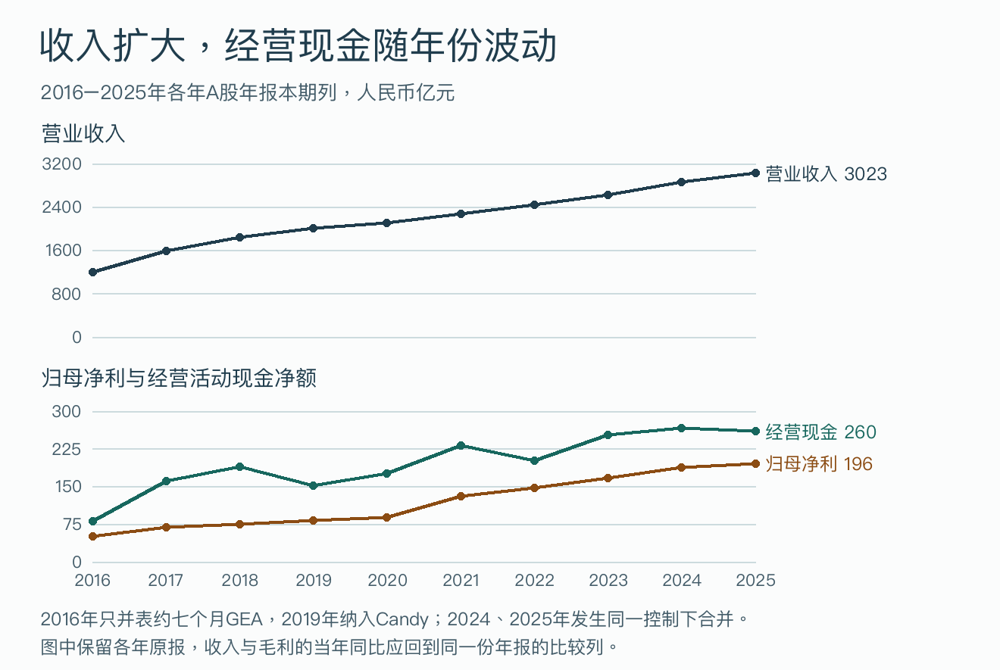

2016至2025年各年原报收入、归母净利与经营活动现金净额

依据 · [青岛海尔股份有限公司2016年年度报告 · 第7页](https://static.cninfo.com.cn/finalpage/2017-04-29/1203428901.PDF#page=7)；[海尔智家股份有限公司2025年年度报告 · 第12页](https://static.cninfo.com.cn/finalpage/2026-03-27/1225038336.PDF#page=12)；[海尔智家股份有限公司2026年第三季度报告 · 第1页](https://static.cninfo.com.cn/finalpage/2026-10-30/1225641263.PDF#page=1)

### 2016至2020年，新增的是经营边界

2016年海尔营业收入1190.66亿元，其中从6月起纳入合并的GEA贡献258.34亿元，约占全年收入22%。2017年，GEA首个完整会计年度在海尔年报披露收入458.94亿元。两期相差的金额中含了多并表的月份，不能直接当美国消费者多买的家电。2019年Candy交割，2019年报同表的欧洲对外收入从41.40亿元增至151.95亿元，也带有取得新业务的影响。两次交易先把海外订单、工厂和客户变成上市公司的经营范围，随后才谈在原有客户和产品之外增量。 2016年报第8、85页 · 2017年报第15、90页 · 2019年报第200页

2020年H股挂牌伴随海尔电器私有化。原来已经控制的洗护和水家电业务继续进入合并，变化在于海尔电器原外部股东转为上市母公司股东，原有子公司利润怎样分配、平台怎样调度资金随之改变。由此解释随后几年归母利润上行，需要分开看业务做大、利润率变化与少数权益变化。2021年原报收入2275.56亿元、归母130.67亿元，2023年原报分别2614.28亿元、165.97亿元。期间经营现金并非同步增长，2022年从2021年原报231.30亿元降到201.54亿元，2023年再升到252.62亿元。利润与现金需要各自核对，年度盈利改善并不会自动缩短账期。 2020年港股年报PDF第96页 · 2021年报第11、113–117页 · 2022年报第9、111–116页 · 2023年报第9、113–116页

整合后的变化也发生在门店和仓库。2021年海尔年报列三翼鸟已有1317家场景门店，覆盖逾1100个建材市场，消费者可通过应用交易和查询送装进度。门店可以在装修前一次协调机器和柜体。2022年公司继续推成套和场景方案，希望增加单客成交。到2023年，公司称国内营销配置、物流配送和仓储的数字化提高效率，国内销售费用率下降。海外则为终端、新品和门店升级增加开支，集团销售费用率净降0.2个百分点。2023年同一报告比较列的经营现金增加50.06亿元，公司归因于经营利润和运营效率改善。国内效率与海外投入的方向不同，不能把现金增加全算给一项整合或私有化。 2021年报第20页 · 2022年报第12页 · 2023年报第12页

依据 · [青岛海尔股份有限公司2016年年度报告 · 第8页](https://static.cninfo.com.cn/finalpage/2017-04-29/1203428901.PDF#page=8)；[青岛海尔股份有限公司2017年年度报告 · 第15页](https://static.cninfo.com.cn/finalpage/2018-04-26/1204797433.PDF#page=15)；[海尔智家股份有限公司2019年年度报告 · 第200页](https://static.cninfo.com.cn/finalpage/2020-04-30/1207693342.PDF#page=200)；[海尔智家2020年年度报告（港股英文） · 第96页](https://smart-home.haier.com/media/ou1gf1ma/2021042900711.pdf#page=96)；[海尔智家股份有限公司2021年年度报告 · 第113页](https://static.cninfo.com.cn/finalpage/2022-03-31/1212752481.PDF#page=113)；[海尔智家股份有限公司2022年年度报告 · 第111页](https://static.cninfo.com.cn/finalpage/2023-03-31/1216279243.PDF#page=111)；[海尔智家股份有限公司2023年年度报告 · 第113页](https://static.cninfo.com.cn/finalpage/2024-03-28/1219427279.PDF#page=113)；[海尔智家股份有限公司2021年年度报告 · 第20页](https://static.cninfo.com.cn/finalpage/2022-03-31/1212752481.PDF#page=20)；[海尔智家股份有限公司2022年年度报告 · 第12页](https://static.cninfo.com.cn/finalpage/2023-03-31/1216279243.PDF#page=12)；[海尔智家股份有限公司2023年年度报告 · 第12页](https://static.cninfo.com.cn/finalpage/2024-03-28/1219427279.PDF#page=12)

### 2024至2025年，地区增长和现金结果开始分开

2024年并入开利商用制冷、Kwikot，业务延伸到商超冷柜和当地热水器。物流业务同一控制下合并还改变了历史比较范围。2023年首发年报的营业收入是2614.28亿元，2024年报将同一年的比较数重列为2742.05亿元，主要因为相关物流业务纳入比较。增加的127.77亿元对应报表范围，不是一年新增的销售。在这个比较表里，2023年毛利率约27.48%，2024年约27.80%。若把2023年原报的31.51%直接拿来对比，反而会误读为2024年毛利率陡降。到2025年，卡奥斯模具同一控制下并表又对2024年的比较数据作了小幅调整。长期图保留各年原报，当年同比用同一份报告的比较列。 2023年报第113页 · 2024年报第10、12、121、214–215页 · 2025年报第12–13、122页

2025年的增量主要来自不同地区，不能用一个全球增长率讲完整。按年报地区表，欧洲增加约64.02亿元，南亚、东南亚和中东非合计增加约50.55亿元，合计约占集团收入增量的七成。美洲只增约3.42亿元。欧洲和中东非含新收购业务的全年影响，人民币换算也会改变增速。公司称欧洲整合改善、Candy扭亏，GEA高端品牌表现较强。集团当年收入3023.47亿元、同比增加5.71%，经营现金260.03亿元，反而比同表重列的上年少1.20%。销售规模扩大以后，收回的钱以及维持工厂和渠道的现金支出已成为更直接的检验。 2025年报第23–30、41、225页

依据 · [海尔智家股份有限公司2023年年度报告 · 第113页](https://static.cninfo.com.cn/finalpage/2024-03-28/1219427279.PDF#page=113)；[海尔智家股份有限公司2024年年度报告 · 第121页](https://static.cninfo.com.cn/finalpage/2025-03-28/1222926246.PDF#page=121)；[海尔智家股份有限公司2025年年度报告 · 第12页](https://static.cninfo.com.cn/finalpage/2026-03-27/1225038336.PDF#page=12)；[海尔智家股份有限公司2025年年度报告 · 第225页](https://static.cninfo.com.cn/finalpage/2026-03-27/1225038336.PDF#page=225)

### 2026年前三季，销量压力开始传到利润和周转

2026年前三季营业收入2218.19亿元、同比降5.23%，归母净利149.99亿元、降13.67%，扣除非经常性损益后的归母净利128.19亿元、降24.11%。第三季单季营业收入697.04亿元、同比降10.13%，扣非归母35.20亿元、降32.17%，降幅较累计更深。中国以旧换新政策力度变化、替换需求偏弱和北美行业出货承压，使公司即使在若干渠道提高份额，也可能少卖或需要更大让价。原料和交付成本上升又使收入压力传到利润。公司称前三季国内毛利率同比下降，海外毛利率受一次性退税等影响同比上升，集团毛利率约27.2%，两个地区的变化被合并值部分抵消。 2026三季报第1–6、12–14页

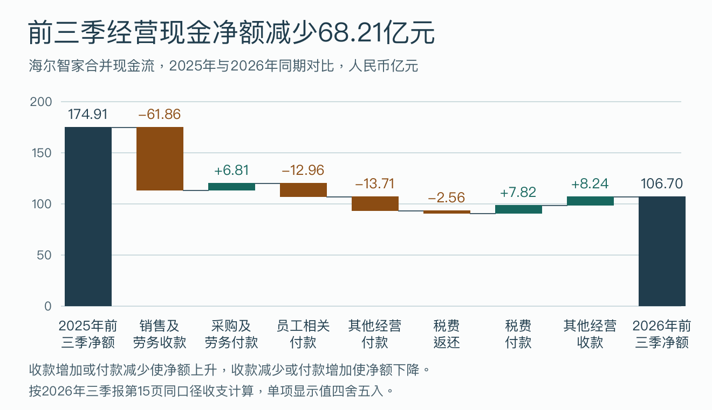

2026年前三季经营现金净额变化的七项收支

集团销售及劳务收款同比减少61.86亿元，采购及劳务付款少6.81亿元，其他经营收支合计减少约13.17亿元，经营活动现金净额由174.91亿元降到106.70亿元。第三季单季由累计减半年，经营现金约9.18亿元，上年同季63.52亿元。管理层将累计变化联系到国内销售走弱和海外保理节奏。保理可以提前取得应收款，公司只披露部分期末卖断余额，余额变化不能直接加回经营现金。三季末存货比上年末略降，但前三季存货周转天数却延长，说明存货金额也要结合销售规模和报告口径。当前现金压力同时涉及销量、收款、付款和周转，不能用单项资本动作解释。 2026三季报第4–5、10–11、15–16页 · 2026中报第73–75、119页 · 2025中报第73–75、120页

从2025年全年加上2026年前三季、减去2025年同期，得到截至2026年三季的滚动十二个月。该期经营现金191.82亿元，购建长期资产现金96.99亿元，两者相差94.83亿元。2025全年同一差额为171.51亿元。这个差额用来展示最近现金变化有多大，尚未分开设备维护与扩产、融资分类中的租赁和利息，以及少数股东所得。公司把国内外扩建、产能迁移和渠道改革放在同一时期推进，现金走弱如果只随行业需求恢复而逆转，近年的下降主要会体现为周期与周转波动。如果行业回升后还需持续更多促销、更慢回款和更高更新支出，才维持原有份额和交付，就要把压力计入长期经营能力。 2025年报第125–126页 · 2026三季报第15–16页

依据 · [海尔智家股份有限公司2026年第三季度报告 · 第1页](https://static.cninfo.com.cn/finalpage/2026-10-30/1225641263.PDF#page=1)；[海尔智家股份有限公司2026年第三季度报告 · 第15页](https://static.cninfo.com.cn/finalpage/2026-10-30/1225641263.PDF#page=15)；[海尔智家股份有限公司2026年半年度报告 · 第73页](https://static.cninfo.com.cn/finalpage/2026-08-28/1225522691.PDF#page=73)；[海尔智家股份有限公司2025年半年度报告 · 第73页](https://static.cninfo.com.cn/finalpage/2025-08-29/1224609917.PDF#page=73)；[海尔智家股份有限公司2025年年度报告 · 第125页](https://static.cninfo.com.cn/finalpage/2026-03-27/1225038336.PDF#page=125)

## 第5章 · 第五章 财务质量与现金归属

### 正文

海尔在2026年前三季取得149.99亿元归母净利，集团经营现金净额为106.70亿元。两个数各有用途。利润按当期完成的销售、服务和成本确认，经营现金按真正收付记录，合并现金还包含集团内非全资经营主体的活动。要估计普通股一年能创造多少现金，需要先弄清这一期少收了什么，再扣维持经营和不属于普通股的部分。 2026三季报第1–5、14–16页

依据 · [海尔智家股份有限公司2026年第三季度报告 · 第1页](https://static.cninfo.com.cn/finalpage/2026-10-30/1225641263.PDF#page=1)

### 回款下降先体现为真实收到的钱变少

2026年前三季，销售商品及提供劳务收款少61.86亿元，购买商品及接受劳务付款只少6.81亿元，二者使经营现金净额少55.05亿元。员工相关和其他经营付款增加，税费付款减少和其他经营收款增加抵消了一部分。七项收支净变动约−68.21亿元，经营现金由174.91亿元降至106.70亿元。用年初累计减上半年，2026第三季单季只有约9.18亿元，上年同季约63.52亿元。单季数字显示现金压力在下半年变重，不能直接乘四。 2026三季报第15–16页 · 2026中报第73–75页 · 2025中报第73–75页

2026年前三季集团经营活动现金净额的七项实际收支变化

管理层把少收款与国内销售下降及海外保理节奏联系起来。保理可能把客户原来以后才付的钱提前变成现金，但披露的是期末已终止确认余额。2026年中余额58.22亿元，较2025年末少5.21亿元、较上年同期少12.71亿元。期间新卖出的应收与到期消化的旧余额都会改变这两个差额。没有逐期实收，不能把余额差加回今年现金，也不能认定第三季少收的款以后都会回来。海尔的2026中报现金调节表还显示，应收多耗用资金的同时，存货和应付变化抵消了相当一部分，前三季没有同样明细。 2025年报第171页 · 2026中报第119、152–157页 · 2026三季报第4–5页

三季末存货由468.49亿元降到460.77亿元，报告的前三季存货周转天数反而由74.1天增加到79.7天。周转天数反映一段期间的销量和占用，期末金额只是一日。应付账款及票据周转增8.3天，也无法证明某批供应商延长信用。海尔披露，有些融资由子公司申请，银行到期先付供应商，公司延后还银行，原应付转借款。另有供应商自行选择提前收款，海尔仍原到期日支付，仍是经营应付。付钱晚会让当期现金看起来更多，但借款到期和正常采购还要用钱。 2026中报第158–159页 · 2026三季报第4–5、10–11页

依据 · [海尔智家股份有限公司2026年第三季度报告 · 第15页](https://static.cninfo.com.cn/finalpage/2026-10-30/1225641263.PDF#page=15)；[海尔智家股份有限公司2026年半年度报告 · 第73页](https://static.cninfo.com.cn/finalpage/2026-08-28/1225522691.PDF#page=73)；[海尔智家股份有限公司2025年半年度报告 · 第73页](https://static.cninfo.com.cn/finalpage/2025-08-29/1224609917.PDF#page=73)；[海尔智家股份有限公司2025年年度报告 · 第171页](https://static.cninfo.com.cn/finalpage/2026-03-27/1225038336.PDF#page=171)；[海尔智家股份有限公司2026年半年度报告 · 第119页](https://static.cninfo.com.cn/finalpage/2026-08-28/1225522691.PDF#page=119)；[海尔智家股份有限公司2026年第三季度报告 · 第4页](https://static.cninfo.com.cn/finalpage/2026-10-30/1225641263.PDF#page=4)；[海尔智家股份有限公司2026年半年度报告 · 第158页](https://static.cninfo.com.cn/finalpage/2026-08-28/1225522691.PDF#page=158)

### 经营现金后面还要付设备、租赁和融资

用2025全年加2026年前三季、减2025年同期，截至2026年三季度的滚动十二个月，集团经营现金191.82亿元，购建长期资产96.99亿元，两项相减为94.83亿元。这个差额尚未处理筹资分类里的租赁和借款利息，且购建支出包括更新和扩建。若要看完整历史现金，可以用项目列得更细的2025港股现金表。全年经营现金260.03亿元，扣购建约88.51亿元、租赁付款18.01亿元、借款现金利息22.94亿元，余约130.57亿元。原经营现金里含实收利息16.31亿元，另有联营分红4.66亿元列投资现金。两条历史桥的时间和项目不同，应分别使用。 2025年报第125–126页 · 2025年港股年报PDF第170–171页 · 2026三季报第15–16页

依据 · [海尔智家股份有限公司2025年年度报告 · 第125页](https://static.cninfo.com.cn/finalpage/2026-03-27/1225038336.PDF#page=125)；[Haier Smart Home Co., Ltd. Annual Report 2025 (IFRS) · 第170页](https://www1.hkexnews.hk/listedco/listconews/sehk/2026/0427/2026042702192.pdf#page=170)；[海尔智家股份有限公司2026年第三季度报告 · 第15页](https://static.cninfo.com.cn/finalpage/2026-10-30/1225641263.PDF#page=15)

### 经营现金要经过归属，才谈得上股东分配

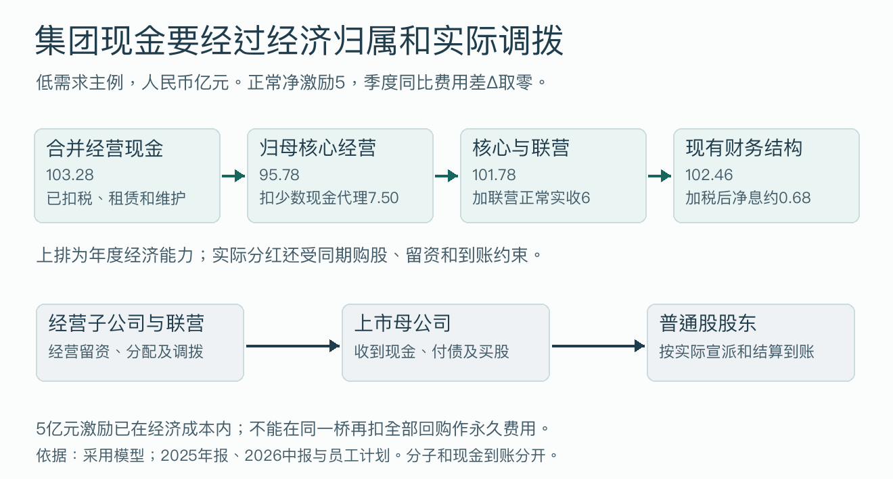

合并经营现金、普通股所得和母公司到账是不同层次

印度公司提供了可观察的例子。2026年3月当地股权交易完成后，海尔仍控制，故当地客户的销售和付款继续进入集团合并现金。港股中报按继续持有51%处理，其余权益所享利润不归上市母公司的普通股。出售取得的55.91亿元是一笔股权现金，进入筹资活动，未来不能每年重复。也不能拿集团已经给少数股东分了多少现金代替少数股东应享所得，分不分、何时分是另一项决定。 2026港股中报PDF第11、13、41页 · 2026中报第168页

依据 · [Haier Smart Home Co., Ltd. Interim Report 2026 (IFRS) · 第41页](https://www1.hkexnews.hk/listedco/listconews/sehk/2026/0928/2026092801607.pdf#page=41)；[海尔智家股份有限公司2026年半年度报告 · 第168页](https://static.cninfo.com.cn/finalpage/2026-08-28/1225522691.PDF#page=168)

### 员工激励是成本，购股、过户和归属各有时间

2026年A股回购方案拟用30—60亿元，期限为2026年3月26日至2027年3月25日，用于员工持股或股权激励；回购完成后36个月未使用的股份须注销。这个金额是跨年度买股预算，不能直接当成每年的薪酬费用。公司先付钱从市场买入股份，随后将部分库存股转给员工计划，员工还要满足服务与业绩条件才能归属。注销则消灭股份，注销当日不再付款。 2026年A股回购报告书

2026年度员工持股资金8.704亿元来自公司提取的激励基金，属于薪酬安排；7月向计划过户4156万股，按每股20.93元计价为8.698508亿元。既然资金由公司提供，就不能把过户对价当成员工自掏腰包给集团带来的新增现金，也不能把拨款与同批股份的市场买入再并列成两次经济成本。2026、2027、2028为考核年度，对应40%、30%、30%份额；最后一笔股份登记公告后锁定12个月，锁定期结束后由管委会确定满足条件的归属日。计划的法律资产隔离不自动证明合并报表的具体范围；披露未给出集团与计划逐笔银行划拨及抵销，实际现金以集团现金表为核对起点。 2026员工持股管理办法 · 过户计价公告 · 非交易过户公告

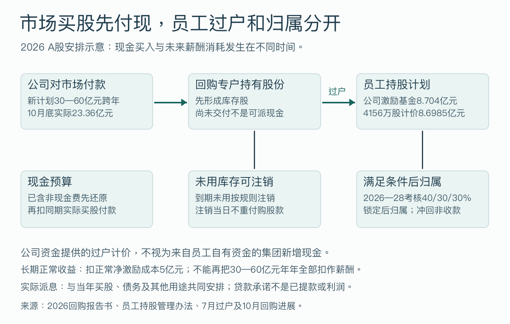

公司购股、计划过户、员工归属与现金分派的关系

股份支付费用随着服务及归属条件确认。2025年A/H员工持股、H股限制性单位、A股期权三类毛费用分别8.68、0.25、0.95，合计9.88；三类冲回2.23、0.15、2.60，合4.98，净费用约4.90。2024比较数的毛费用8.91、冲回5.17，净3.74。冲回来自失效、离职或业绩等条件变化；未归属股份还可转授符合条件者、用于后续计划或注销，所以冲回不证明股份最终一定未给员工，更不代表当期收到退款。2026上半年毛摊销4.5383、冲回6.7821，净费用为−2.2439。不能把最近的负费用永续化，也不能只删掉本期全部冲回、却忽略以前年份同样有较大冲回。 2025港股年报附注37，印刷285—287页 · 2026中报股份支付及现金调节，第149、157、183页

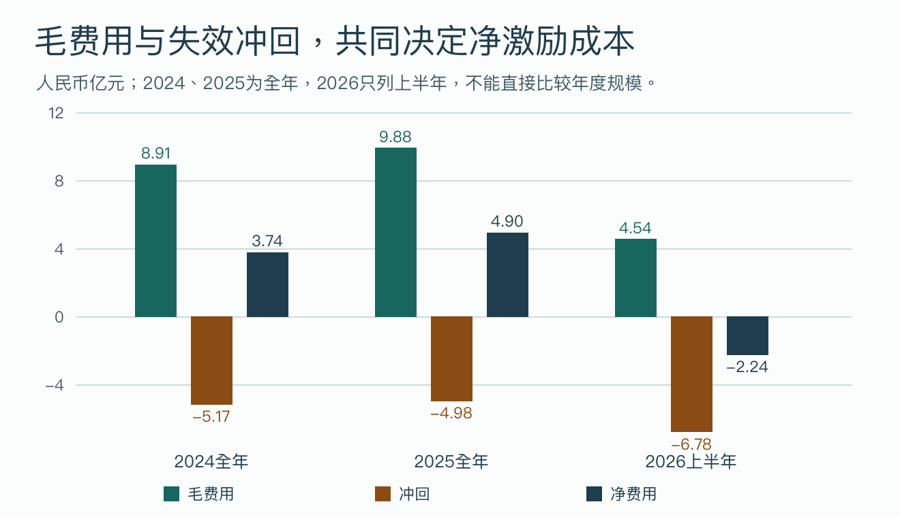

不同期间毛股份费用、冲回和净费用；2026只含半年

中国准则披露的2023、2024、2025年净费用为6.1061、3.7407、4.8966亿元。正常年度取5亿元，4—6亿元只用于激励成本的取值敏感；它代表近期净授予消耗的量级，不是承诺未来只花5亿元买股。如果业绩恢复、失效减少而实际负担接近8—10亿元毛费用尺度，同条件下普通股正常现金约98.36—100.00亿元。公司当年8.704亿元激励基金与集团跨计划、跨工具确认的费用不同，不能互相直接替代。 2025港股年报附注37，印刷285—287页 · 2026中报股份支付及现金调节，第149、157、183页

依据 · [海尔智家股份有限公司关于以集中竞价交易方式回购A股股份的方案暨回购报告书](https://static.cninfo.com.cn/finalpage/2026-03-27/1225038318.PDF)；[海尔智家股份有限公司2026年度A股核心员工持股计划管理办法](https://static.cninfo.com.cn/finalpage/2026-07-01/1225400707.PDF)；[海尔智家股份有限公司关于2026年度A股核心员工持股计划的进展公告](https://static.cninfo.com.cn/finalpage/2026-07-04/1225409669.PDF)；[2026年度A股核心员工持股计划非交易过户](https://static.cninfo.com.cn/finalpage/2026-07-11/1225418333.PDF)；[Haier Smart Home Co., Ltd. Annual Report 2025 (IFRS) · 第286页](https://www1.hkexnews.hk/listedco/listconews/sehk/2026/0427/2026042702192.pdf#page=286)；[海尔智家股份有限公司2026年半年度报告 · 第149页](https://static.cninfo.com.cn/finalpage/2026-08-28/1225522691.PDF#page=149)

### 将账面激励费用替换成正常成本

原165亿元税前经营收益包含账面股份支付，不能再直接减掉正常5亿元。2025年净费用4.896550、2026上半年−2.243855、2025上半年2.210739，组合得到截至2026年6月的滚动净费用 4.896550−2.243855−2.210739＝0.441956亿元。若Δ表示2026单三季度净费用减2025单三季度净费用，则9月滚动费用为0.441956＋Δ。三季报没有披露这两项，Δ仍未知；主例取Δ＝0表示两年单三季度净费用相同这一演算假设。 2025港股年报附注37，印刷285—287页 · 2026中报股份支付及现金调节，第149、157、183页

新的税前经营收益为 165＋0.441956＋Δ−5＝160.441956＋Δ亿元。按主例18%税，每增加1亿元Δ，修正后的正常现金增加0.82亿元，因为原利润已经多扣了这笔费用，替换时需要多还原。若本次净增加的激励经济成本4.558044亿元不能取得18%边际税抵、原费用税务处理保持，现金为102.455243−4.558044×18%＝101.634795亿元，约101.63亿元。旧约106亿元和单独剔除6.78亿元毛冲回得到的约100.6亿元，分别是修正前和单因素试算；当前采用逐年净成本替换，并保留季度未知。

依据 · [Haier Smart Home Co., Ltd. Annual Report 2025 (IFRS) · 第286页](https://www1.hkexnews.hk/listedco/listconews/sehk/2026/0427/2026042702192.pdf#page=286)；[海尔智家股份有限公司2026年半年度报告 · 第149页](https://static.cninfo.com.cn/finalpage/2026-08-28/1225522691.PDF#page=149)

### 从正常经营到普通股与到账

从合并经营走到普通股，先将原165亿元起点所含净激励费用还原，再以5亿元正常净成本替换，单三季度费用同比差暂取零，税前为160.441956亿元。主例扣经营税、正常租赁和维持投入后得合并经营现金103.28亿元，再扣少数经营现金代理7.5亿元、加联营正常实收6亿元，得101.78亿元。若维持当前金融和融资安排，再接回净税后利息约0.68亿元，普通股正常年度现金约102亿元。维护、税和少数权益按有据情景联动变化，保持同一稳定经营前提时约90—116亿元。继续恶化、净融资成本上升或额外占资时可以更低。这个演算回答集团在给定条件下能创造多少普通股现金。上市母公司能在当期派付多少，还要看子公司实际分配、内部资金上划、母公司自己的偿付和董事会程序。 2025年报第202–203、207、244–245页 · 2026三季报第16–21页

依据 · [海尔智家股份有限公司2025年年度报告 · 第202页](https://static.cninfo.com.cn/finalpage/2026-03-27/1225038336.PDF#page=202)；[海尔智家股份有限公司2026年第三季度报告 · 第16页](https://static.cninfo.com.cn/finalpage/2026-10-30/1225641263.PDF#page=16)

### 分红和回购的实际现金，不能按利润所属年度拼接

经营现金流已把非现金股份支付从利润调整出去。因此从现金表起步时，应扣实际购股付款，不再扣一次相同的报表费用。为比较过去三年，采用各年最近一次所读年报的可比口径：2023用2024年报重列，2024用2025年报重列，2025用本年报。先做“经营现金−全部购建−现金租赁−借款利息＋联营实收−少数股息实付”，得到下图分派前余额，再扣普通股息和集团全部股份购回。 2024港股年报现金表 · 2025港股年报现金表PDF第170—171页

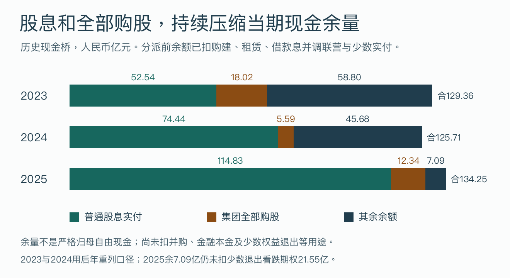

2023至2025年分派前历史现金由普通股息、集团购股和余量构成

计算逐项为：2023年 265.36−105.42−17.29−19.83＋6.84−0.30≈129.36；2024年 263.18−100.80−17.09−24.44＋5.79−0.93≈125.71；2025年 260.03−88.52−18.01−22.94＋4.66−0.97≈134.25。金额取整会有0.01亿元差异。这些历史余额尚含金融利息、全部扩建购建，少数只扣实付而非完整经济份额，也没有扣另列的并购和金融本金交易，故用于检查资金安排，不能直接认定为正常归母自由现金。各年现金表自身的期初期末已核对，不把不同重列版本的余额机械首尾累计。 2024港股年报现金表 · 2025港股年报现金表PDF第170—171页

2025年上述余量7.09亿元尚未扣少数股权相关退出看跌期权实付21.55亿元，单这项就超出余量。这笔筹资付款属于权益资本安排，与员工激励期权费用不同，也不是普通股分红。金融资产净买入92.47亿元、借还本金净流入约15.19亿元另列；不能据7.09亿元推定集团现金只变动这么多。 2025港股现金表

2025年现金表普通股股息实付114.83亿元，包含2024利润所属年度的末期及2025年中期。2025利润年度中期加末期每股1.16071元、合计约107.55亿元，则有末期在2026年8月支付。2025年两次宣派合计约115.03亿元与报表实付114.83亿元差约0.20亿元，公告金额和汇兑、结算时间没有完全拆齐，不把差额编成员工支出。2026上半年普通股股息实付为零；6月末应付的82.4832亿元，是8月实施2025末期的金额。应付、宣派与实际离开账户必须分开。 2025港股年报现金表PDF第170—171页 · 2026港股中报现金表PDF第12—13页 · 2025末期分派调整 · 2026年8月实施公告

发行人A股市场买入2023、2024、2025分别约14.32、4.67、10.80亿元；H股同期成交约1.9914亿、0.2707亿、0.9992亿港元。集团现金表全部股份购回分别18.02、5.59、12.34亿元，范围包括需另外核对的计划买入及结算。不能把集团回购行与A/H成交换算后的差额全判成员工成本。2025方案完成额12.0138亿元跨到2026年，2026年1月还有旧方案1.2155亿元，因此12.0138不能全记到2025。 2023方案实施结果 · 2025方案实施结果 · 2026年1月进展 · 2024港股年报现金表 · 2025港股年报现金表PDF第170—171页

2026年新A方案截至10月底实际成交23.3590亿元，加1月旧方案，日历年已执行A股约24.5745亿元。新方案累计买入11184.1989万股，7月转出4156万股，尚余7028.1989万股；按已披露成交价格和总额估计，尚未转出股份占用过的购买现金约14.05—15.21亿元。这是已花的钱形成的股份库存，不能再拿它作现金分红，也不等于今后每年要花同样金额。H股前三季成交9357.726万港元，10月30日及11月9日再成交935.27万港元；D股年初场内买入865,598股，含费用约179.22万欧元，10月要约另付1.484637亿欧元。A股2026年注销7454.1486万股、H股10月注销455万股，是早先买入股份的处理，不再新增相同金额付款。 D股要约实付 · A股截至10月末进展 · H股10月30日回购 · H股11月9日回购 · A股注销公告 · D股年初回购

2026前三季经营现金106.7005减实付购建74.2536，余 32.4469亿元，还没有扣同期租赁和借款现金利息、处理联营及少数实收实付。Q3没有这些完整明细，不能填出一个精确的全年可分数。现金等价物由462.6769降到396.5484，减少66.1284＝经营106.7005−投资109.7309−筹资52.7610−汇兑10.3370。印度股权收到55.91亿元为一次性筹资。当前回款疲弱时，分红与购股同时执行还依靠融资、金融资产变动及存量资金；正常年度102亿元不是2026已经实现的现金。 2026三季报第9—16页 · 2026港股中报现金表PDF第12—13页

依据 · [海尔智家2024港股年报](https://www1.hkexnews.hk/listedco/listconews/sehk/2025/0429/2025042903800.pdf)；[Haier Smart Home Co., Ltd. Annual Report 2025 (IFRS) · 第170页](https://www1.hkexnews.hk/listedco/listconews/sehk/2026/0427/2026042702192.pdf#page=170)；[Haier Smart Home Co., Ltd. Interim Report 2026 (IFRS) · 第12页](https://www1.hkexnews.hk/listedco/listconews/sehk/2026/0928/2026092801607.pdf#page=12)；[海尔智家2025年度利润分配现金红利调整公告](https://static.cninfo.com.cn/finalpage/2026-08-07/1225465164.PDF)；[2025年度A股权益分派实施](https://static.cninfo.com.cn/finalpage/2026-08-15/1225474603.PDF)；[2023方案A股回购实施结果](https://static.cninfo.com.cn/finalpage/2024-04-30/1219910885.PDF)；[2025方案A股回购实施结果](https://static.cninfo.com.cn/finalpage/2026-03-27/1225038099.PDF)；[2025方案2026年1月回购进展 · 第3页](https://www1.hkexnews.hk/listedco/listconews/sehk/2026/0202/2026020202812_c.pdf#page=3)；[D股公开回购要约翌日披露报表](https://static.cninfo.com.cn/finalpage/2026-10-02/1225593764.PDF)；[2026方案A股回购截至10月末](https://static.cninfo.com.cn/finalpage/2026-11-03/1225652209.PDF)；[H股10月30日回购翌日披露报表](https://www.hkexnews.hk/listedco/listconews/sehk/2026/1030/2026103001970.pdf)；[H股11月9日回购翌日披露报表](https://www1.hkexnews.hk/listedco/listconews/sehk/2026/1109/2026110900656.pdf)；[A股库存注销74,541,486股](https://static.cninfo.com.cn/finalpage/2026-09-01/1225538081.PDF)；[D股场内回购865,598股](https://static.cninfo.com.cn/finalpage/2026-02-28/1224986896.PDF)；[海尔智家股份有限公司2026年第三季度报告 · 第9页](https://static.cninfo.com.cn/finalpage/2026-10-30/1225641263.PDF#page=9)

### 2026年已识别用途，为什么需要存量及融资承接

2026上半年集团现金表已披露股份回购实付16.2470亿元，普通股息实付为零；这是已结算的集团半年度口径，不能再加到截至11月逐市场成交小计上。 2026中报第156页 · 2026港股中报现金表

截至11月9日已披露的发行人购股，A股日历年累计24.5745亿元、H股1.0292996亿港元、D股1.50255918亿欧元。为看规模，统一按11月10日中间价港元0.85642、欧元7.5071换算，约 36.74亿元；加8月实施的2025年度末期普通股息82.4832亿元，已识别用途示意约 119.22亿元。这里A截至10月底，H截至11月9日，D含年初场内和10月要约；成交金额及当下中间价换算不等于集团按结算日确认的全部人民币实付。 10月A股进展 · 11月9日H股披露 · D股年初成交 · D股10月结算 · 末期分派调整

相对地，前三季经营现金106.70亿元减购建74.25亿元只余32.45亿元，还未扣同期租赁与借款息；印度权益交易55.91亿元是一次性筹资；前三季借入269.82减偿还225.90，借还本金净流入43.92亿元，同期现金等价物仍实际下降66.13亿元。这些数的期间、主体和结算口径不同，119.22减32.45不是精确资金缺口。它们共同显示：近期分红、购股和其他用途不能仅依靠当期经营净流入，须由原有可用资金、金融资产变动、借还款及权益筹资承接。公开资料未逐笔指定哪笔印度款或贷款用于哪次回购，也未给出2026全年完整现金用途，保留这个边界。 2026三季报现金表 · 2026港股中报现金表与印度交易

依据 · [海尔智家股份有限公司2026年半年度报告 · 第156页](https://static.cninfo.com.cn/finalpage/2026-08-28/1225522691.PDF#page=156)；[Haier Smart Home Co., Ltd. Interim Report 2026 (IFRS) · 第13页](https://www1.hkexnews.hk/listedco/listconews/sehk/2026/0928/2026092801607.pdf#page=13)；[2026方案A股回购截至10月末](https://static.cninfo.com.cn/finalpage/2026-11-03/1225652209.PDF)；[H股11月9日回购翌日披露报表 · 第5页](https://www1.hkexnews.hk/listedco/listconews/sehk/2026/1109/2026110900656.pdf#page=5)；[D股场内回购865,598股](https://static.cninfo.com.cn/finalpage/2026-02-28/1224986896.PDF)；[D股公开回购要约翌日披露报表 · 第6页](https://static.cninfo.com.cn/finalpage/2026-10-02/1225593764.PDF#page=6)；[海尔智家2025年度利润分配现金红利调整公告 · 第3页](https://static.cninfo.com.cn/finalpage/2026-08-07/1225465164.PDF#page=3)；[海尔智家股份有限公司2026年第三季度报告 · 第15页](https://static.cninfo.com.cn/finalpage/2026-10-30/1225641263.PDF#page=15)；[Haier Smart Home Co., Ltd. Interim Report 2026 (IFRS) · 第12页](https://www1.hkexnews.hk/listedco/listconews/sehk/2026/0928/2026092801607.pdf#page=12)

## 第6章 · 第六章 资本配置与股东分配

### 正文

海尔智家的资本配置先把资金投到工厂、渠道和售后，再决定自己建还是并购，最后把有条件腾出的现金用于分红或回购。对普通股股东，每一项用途都要查两件事。集团花掉的钱能否带来长期可回收的现金，以及经营子公司取得的现金能否在支付债务和其他股东权益后回到上市母公司。 2025年报第17–18、37–38、79–80、125–128页

依据 · [海尔智家股份有限公司2025年年度报告 · 第79页](https://static.cninfo.com.cn/finalpage/2026-03-27/1225038336.PDF#page=79)

### 买来的市场，仍需要不断投入

2016年海尔为GEA最终支付约56.12亿美元，取得当地品牌使用权、渠道、制造和服务。美国的生产和销售平台是真实存在的，后来为维持及扩大它也继续投入。GEA称2016年以来在美国已投逾35亿美元，并在2025年宣布未来五年约30亿美元的投入。部分项目公告互相包含，不能加成一笔已付款。2025年美洲收入798.71亿元也比GEA单体范围宽。衡量这次配置，应在收购价之外纳入后续设备、交付服务、周转与商标续期，才能知道普通股股东收回多少。 GEA交易实施报告PDF第11–12、17–18页 · GEA路易斯维尔2026年公告 · 2025年报第225页

Candy带来欧洲的渠道和品牌，2025年扭亏显示经营跨过盈亏点，迁厂及整合代价仍需在多年现金里比较。收购开利商用制冷后，海尔进入超市冷柜、冷库和售后服务。卖方所称约7.75亿美元企业价值包含约2亿美元净养老金义务。现金买价与养老金支付分期发生，日后还要支出零件、维护和交付。Kwikot获得南非的热水器渠道，Ferroli ASEAN则在2026年10月才交割。过去的并购证明海尔有办法拿到产品和客户，现有披露还不足以复算完整的新增普通股回报。 2025年报第26–30、38页 · 2024年报第211–213页 · Carrier交割公告 · Ferroli ASEAN交割公告

依据 · [青岛海尔重大资产购买实施情况报告书 · 第11页](https://static.cninfo.com.cn/finalpage/2017-01-12/1203008866.PDF#page=11)；[GEA宣布Louisville新制造计划](https://pressroom.geappliances.com/news/ge-appliances-and-iue-cwa-announce-1-billion-investment-in-louisville-plant-creating-the-largest-home-appliance-manufacturing-site-in-the-u-s)；[海尔智家股份有限公司2025年年度报告 · 第225页](https://static.cninfo.com.cn/finalpage/2026-03-27/1225038336.PDF#page=225)；[海尔智家股份有限公司2025年年度报告 · 第26页](https://static.cninfo.com.cn/finalpage/2026-03-27/1225038336.PDF#page=26)；[海尔智家股份有限公司2024年年度报告 · 第211页](https://static.cninfo.com.cn/finalpage/2025-03-28/1222926246.PDF#page=211)；[Carrier完成出售Carrier Commercial Refrigeration](https://www.carrier.com/refrigeration/en/worldwide/news/news-article/carrier-completes-775m-sale-of-its-commercial-refrigeration-business-to-haier.html)；[海尔智家完成收购法罗力东南亚100%股权](https://www.haier.com/about_haier/xinwen/20261105_296189.shtml)

### 收到一笔印度股权现金，也让出了部分未来所得

2026年3月海尔印度引入Bharti及Warburg有关投资方。海尔港股中报按处置49%、持续51%且仍控制处理，收到现金约55.91亿元。账上把20.81亿元对应账面净资产份额转给少数股东，约35.10亿元差额计资本公积。公司律师按海尔、投资团各49%和2%员工计划描述交易完成后的安排，公开文件的权益口径有差异，具体协议权利需要进一步披露。合并范围没有因交易立即缩小，未来母公司可分享的现金份额已经变化。筹资收到的55.91亿元也不能替代每年制造和销售家电的现金。 2026港股中报PDF第11、13、41页 · 2026A股中报第168页 · 交易律师披露

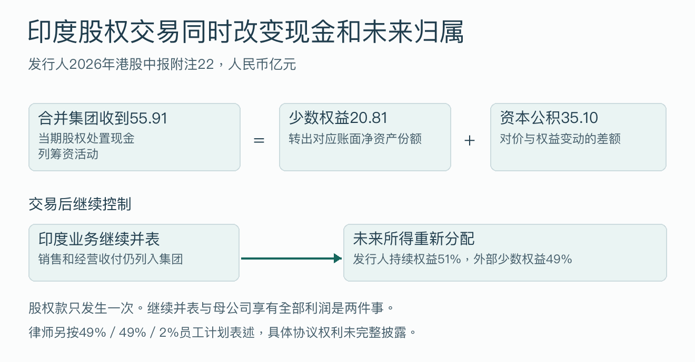

海尔印度交易的筹资现金、权益调整和后续分配

依据 · [Haier Smart Home Co., Ltd. Interim Report 2026 (IFRS) · 第41页](https://www1.hkexnews.hk/listedco/listconews/sehk/2026/0928/2026092801607.pdf#page=41)；[海尔智家股份有限公司2026年半年度报告 · 第168页](https://static.cninfo.com.cn/finalpage/2026-08-28/1225522691.PDF#page=168)；[DLA Piper 海尔印度股权交易交割说明](https://www.dlapiper.com/en-us/news/2026/04/dla-piper-advises-haier-smart-home)

### 钱在集团哪一层，决定它能不能拿来分配

2026年中，上市集团在关联的海尔集团财务公司有货币资金及各期限本金合计339.76亿元，约占所披露集团存款的39.69%。对财务公司的股权约85.58亿元另按权益法核算。存款的利息及取回本金是一条路，财务公司的股权收益和实际股息是另一条路。长期或未到期资金不一定能随时调回，日常采购、库存和收款之间的错位也需要留资。三季末合并货币资金约410.84亿元，母公司账面约51.86亿元，股份回购或派息需要看母公司如何取得资金。 2026中报第121、125、180页 · 财务公司风险评估 · 2026三季报第10、16–17页

2025利润年度中期加末期每股1.16071元、合约107.55亿元，末期跨到2026年支付。2026上半年未派中期；2026—2028现金分红率规划不低于各年归母利润58%、60%、60%，实际还取决于利润、回拨和资本用途。每股1元需约93.03亿元，正常102.46亿元主例只余9.42亿元，不能同时自给数十亿元额外买股。下文将公司购股、员工归属及同年资金预算接起来；历史留存和融资可以承接时点，但不增加正常经营利润。 分派调整 · 2026股东会决议

D股要约提供了另一个已发生的资金用途。按每股1.87欧元，公司接受约7939万股并于10月支付1.484637亿欧元。参与者已经收到要约交割的退出款，期末尚未完成注销，留下的投资者会经历交易股份减少和流动性变化。A、H、D回购还须区分实际付了多少钱、库存股、是否用于员工安排以及已经注销多少股。回购后每股权益是否改善，要看支付代价、原本可投的用途和取消股份后的分母。 D股要约结算公告PDF第1、6页 · 2026三季报第8–9页 · 2026年10月股本月报

现金变弱时，资本配置的分界尤其重要。正常更新和售后关系到已有客户，已签资本承诺也有时间和责任。额外收购、扩产或留存资金则要用能分回普通股的现金评价。现有资料支持海尔继续经营这些平台和保持一定分配能力。把未来每笔新增投资都按历史品牌扩张的成功来计价，会高估所能拿到的现金。 2026港股中报PDF第41页资本承诺 · 2026三季报第5页

依据 · [海尔智家股份有限公司2026年半年度报告 · 第180页](https://static.cninfo.com.cn/finalpage/2026-08-28/1225522691.PDF#page=180)；[海尔集团财务有限责任公司2026年半年度风险持续评估报告](https://ea-cdn.eurolandir.com/press-releases-attachments./4172296/600690_20260828_LEDC.pdf)；[海尔智家股份有限公司2026年第三季度报告 · 第16页](https://static.cninfo.com.cn/finalpage/2026-10-30/1225641263.PDF#page=16)；[海尔智家2025年度利润分配现金红利调整公告](https://static.cninfo.com.cn/finalpage/2026-08-07/1225465164.PDF)；[2025年度股东会及类别会议结果、末期股息](https://www.hkexnews.hk/listedco/listconews/sehk/2026/0624/2026062401928.pdf)；[D股公开回购要约翌日披露报表 · 第1页](https://static.cninfo.com.cn/finalpage/2026-10-02/1225593764.PDF#page=1)；[海尔智家股份有限公司2026年第三季度报告 · 第8页](https://static.cninfo.com.cn/finalpage/2026-10-30/1225641263.PDF#page=8)；[截至2026年10月31日股本变动月报](https://www1.hkexnews.hk/listedco/listconews/sehk/2026/1102/2026110203065.pdf)；[Haier Smart Home Co., Ltd. Interim Report 2026 (IFRS) · 第41页](https://www1.hkexnews.hk/listedco/listconews/sehk/2026/0928/2026092801607.pdf#page=41)；[海尔智家股份有限公司2026年第三季度报告 · 第5页](https://static.cninfo.com.cn/finalpage/2026-10-30/1225641263.PDF#page=5)

### 2026年已识别用途，为什么需要存量及融资承接

2026上半年集团现金表已披露股份回购实付16.2470亿元，普通股息实付为零；这是已结算的集团半年度口径，不能再加到截至11月逐市场成交小计上。 2026中报第156页 · 2026港股中报现金表

截至11月9日已披露的发行人购股，A股日历年累计24.5745亿元、H股1.0292996亿港元、D股1.50255918亿欧元。为看规模，统一按11月10日中间价港元0.85642、欧元7.5071换算，约 36.74亿元；加8月实施的2025年度末期普通股息82.4832亿元，已识别用途示意约 119.22亿元。这里A截至10月底，H截至11月9日，D含年初场内和10月要约；成交金额及当下中间价换算不等于集团按结算日确认的全部人民币实付。 10月A股进展 · 11月9日H股披露 · D股年初成交 · D股10月结算 · 末期分派调整

相对地，前三季经营现金106.70亿元减购建74.25亿元只余32.45亿元，还未扣同期租赁与借款息；印度权益交易55.91亿元是一次性筹资；前三季借入269.82减偿还225.90，借还本金净流入43.92亿元，同期现金等价物仍实际下降66.13亿元。这些数的期间、主体和结算口径不同，119.22减32.45不是精确资金缺口。它们共同显示：近期分红、购股和其他用途不能仅依靠当期经营净流入，须由原有可用资金、金融资产变动、借还款及权益筹资承接。公开资料未逐笔指定哪笔印度款或贷款用于哪次回购，也未给出2026全年完整现金用途，保留这个边界。 2026三季报现金表 · 2026港股中报现金表与印度交易

依据 · [海尔智家股份有限公司2026年半年度报告 · 第156页](https://static.cninfo.com.cn/finalpage/2026-08-28/1225522691.PDF#page=156)；[Haier Smart Home Co., Ltd. Interim Report 2026 (IFRS) · 第13页](https://www1.hkexnews.hk/listedco/listconews/sehk/2026/0928/2026092801607.pdf#page=13)；[2026方案A股回购截至10月末](https://static.cninfo.com.cn/finalpage/2026-11-03/1225652209.PDF)；[H股11月9日回购翌日披露报表 · 第5页](https://www1.hkexnews.hk/listedco/listconews/sehk/2026/1109/2026110900656.pdf#page=5)；[D股场内回购865,598股](https://static.cninfo.com.cn/finalpage/2026-02-28/1224986896.PDF)；[D股公开回购要约翌日披露报表 · 第6页](https://static.cninfo.com.cn/finalpage/2026-10-02/1225593764.PDF#page=6)；[海尔智家2025年度利润分配现金红利调整公告 · 第3页](https://static.cninfo.com.cn/finalpage/2026-08-07/1225465164.PDF#page=3)；[海尔智家股份有限公司2026年第三季度报告 · 第15页](https://static.cninfo.com.cn/finalpage/2026-10-30/1225641263.PDF#page=15)；[Haier Smart Home Co., Ltd. Interim Report 2026 (IFRS) · 第12页](https://www1.hkexnews.hk/listedco/listconews/sehk/2026/0928/2026092801607.pdf#page=12)

### 员工激励是成本，购股、过户和归属各有时间

2026年A股回购方案拟用30—60亿元，期限为2026年3月26日至2027年3月25日，用于员工持股或股权激励；回购完成后36个月未使用的股份须注销。这个金额是跨年度买股预算，不能直接当成每年的薪酬费用。公司先付钱从市场买入股份，随后将部分库存股转给员工计划，员工还要满足服务与业绩条件才能归属。注销则消灭股份，注销当日不再付款。 2026年A股回购报告书

2026年度员工持股资金8.704亿元来自公司提取的激励基金，属于薪酬安排；7月向计划过户4156万股，按每股20.93元计价为8.698508亿元。既然资金由公司提供，就不能把过户对价当成员工自掏腰包给集团带来的新增现金，也不能把拨款与同批股份的市场买入再并列成两次经济成本。2026、2027、2028为考核年度，对应40%、30%、30%份额；最后一笔股份登记公告后锁定12个月，锁定期结束后由管委会确定满足条件的归属日。计划的法律资产隔离不自动证明合并报表的具体范围；披露未给出集团与计划逐笔银行划拨及抵销，实际现金以集团现金表为核对起点。 2026员工持股管理办法 · 过户计价公告 · 非交易过户公告

公司购股、计划过户、员工归属与现金分派的关系

股份支付费用随着服务及归属条件确认。2025年A/H员工持股、H股限制性单位、A股期权三类毛费用分别8.68、0.25、0.95，合计9.88；三类冲回2.23、0.15、2.60，合4.98，净费用约4.90。2024比较数的毛费用8.91、冲回5.17，净3.74。冲回来自失效、离职或业绩等条件变化；未归属股份还可转授符合条件者、用于后续计划或注销，所以冲回不证明股份最终一定未给员工，更不代表当期收到退款。2026上半年毛摊销4.5383、冲回6.7821，净费用为−2.2439。不能把最近的负费用永续化，也不能只删掉本期全部冲回、却忽略以前年份同样有较大冲回。 2025港股年报附注37，印刷285—287页 · 2026中报股份支付及现金调节，第149、157、183页

不同期间毛股份费用、冲回和净费用；2026只含半年

中国准则披露的2023、2024、2025年净费用为6.1061、3.7407、4.8966亿元。正常年度取5亿元，4—6亿元只用于激励成本的取值敏感；它代表近期净授予消耗的量级，不是承诺未来只花5亿元买股。如果业绩恢复、失效减少而实际负担接近8—10亿元毛费用尺度，同条件下普通股正常现金约98.36—100.00亿元。公司当年8.704亿元激励基金与集团跨计划、跨工具确认的费用不同，不能互相直接替代。 2025港股年报附注37，印刷285—287页 · 2026中报股份支付及现金调节，第149、157、183页

依据 · [海尔智家股份有限公司关于以集中竞价交易方式回购A股股份的方案暨回购报告书](https://static.cninfo.com.cn/finalpage/2026-03-27/1225038318.PDF)；[海尔智家股份有限公司2026年度A股核心员工持股计划管理办法](https://static.cninfo.com.cn/finalpage/2026-07-01/1225400707.PDF)；[海尔智家股份有限公司关于2026年度A股核心员工持股计划的进展公告](https://static.cninfo.com.cn/finalpage/2026-07-04/1225409669.PDF)；[2026年度A股核心员工持股计划非交易过户](https://static.cninfo.com.cn/finalpage/2026-07-11/1225418333.PDF)；[Haier Smart Home Co., Ltd. Annual Report 2025 (IFRS) · 第286页](https://www1.hkexnews.hk/listedco/listconews/sehk/2026/0427/2026042702192.pdf#page=286)；[海尔智家股份有限公司2026年半年度报告 · 第149页](https://static.cninfo.com.cn/finalpage/2026-08-28/1225522691.PDF#page=149)

### 102亿元和30—60亿元回购怎样放进同一张资金预算

约102亿元已经扣了正常员工激励的经济成本，用于判断长期可以反复创造多少。做具体年度现金预算，要把其中尚未付现的费用还原，改扣同期实际买股款，并处理税差和结算时点。假设同一年达到主例经营、5亿元激励费用全属非现金，税与其他时点不变，A股实际买入30或60亿元，则 102.46＋5−30＝77.46，或 102.46＋5−60＝47.46亿元，供股息及其他用途。它们还未扣其他回购、并购或额外留资。按季末股数约为每股0.83或0.51元；若同时每股派1元，至少另找15.58或45.58亿元资金，其他用途尚在其外。

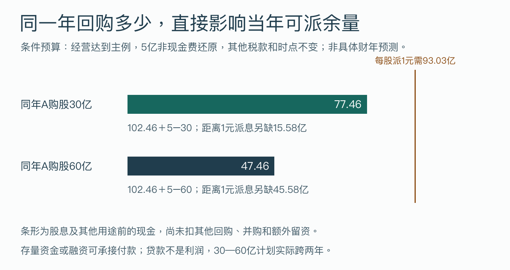

同一年度资金假设下，购股与每股1元分红的资金覆盖

这是把购股时点与长期成本接起来的条件预算，不是2026或2027全年预测。30—60亿元计划跨年，截至10月底新计划已付23.36亿元，要达到计划区间还余6.64—36.64亿元，不把已付款再从期末资金扣一遍。工行最高50亿元、期限3年的专项贷款承诺也不能当作已提款金额；贷款能缓解眼前付款，却带来利息和还本，不能增加经营创造的财富。若以后持续每年买30—60亿元，而净激励消耗只数亿元，就必须说明差额是不断堆库存、后续授予还是净注销，不能一边保留这些股份、一边把同一现金全部算作分红。 2026年A股回购报告书 · 截至10月回购进展

按93.03088164亿股，派0.9、1.0、1.1元分别需要83.73、93.03、102.33亿元。主例102.46亿元在1元分红后余9.42亿元；1.1元几乎耗尽余量。低需求稳定的保守情景90.35亿元已经比1元所需少2.68亿元；进一步恶化情景80.75亿元连0.9元也少2.97亿元。因而0.9—1元只能是经营与资本安排允许时的分配假设，近期大额回购若没有足够存量或融资补足，也会压低可派股息。

依据 · [海尔智家股份有限公司关于以集中竞价交易方式回购A股股份的方案暨回购报告书](https://static.cninfo.com.cn/finalpage/2026-03-27/1225038318.PDF)；[2026方案A股回购截至10月末](https://static.cninfo.com.cn/finalpage/2026-11-03/1225652209.PDF)

## 第7章 · 第七章 估值、价格与错误后果

### 正文

海尔智家在国内、北美和欧洲仍有能持续接单的品牌、渠道和服务网络。2026年前三季收入、扣非利润和经营现金同时下行。假设需求在低位稳定，规模与信用条件不再恶化，正常激励净成本每年5亿元，维持与必要升级97亿元，保持现有融资安排，普通股正常年度现金约 102亿元。这是可用于普通股分派或留存的经济能力；实际分红还要与当期回购、债务和其他付款一起安排。近期购股数十亿元时，不能仍将102亿元全部列作可派现金。 2026三季报第9—16页

本轮由原约106亿元向下修正，关键是把账上的净股份支付换成正常员工成本，并补齐实际购股与分红的时间。主例也依赖一个未披露参数：2026单三季度与2025单三季度净股份支付费用之差暂设为零。低需求稳定下联动经营、税、维护与少数权益参数，现金约90—116亿元；需求继续恶化时还会更低。按每股0.9—1元分红、汇率不变且十年后仍以1.82欧元卖出，买入的欧元年化回报约5.9%—6.6%。折价不收敛不保证原价退出。下面分别核对已经付出的钱、正常创造能力及投资人到账。金额除另注外均为人民币亿元。

依据 · [海尔智家股份有限公司2026年第三季度报告 · 第9页](https://static.cninfo.com.cn/finalpage/2026-10-30/1225641263.PDF#page=9)

### 第一步｜资产账面能告诉多少

三季末归母权益1230.6758。先扣账面的商誉260.1259和无形资产132.2172，剩838.3326。除以当时已发行93.03088164亿股，约9.01元人民币每股。这里用全部合并商誉和无形资产扣归母权益，作为偏保守的账面筛查，归属和公允价值还未逐项重估。GE商标许可、区域品牌、货架、安装服务、库存与工厂组织，要维持同等能力重新搭建需要多少钱，不能从历史商誉推出。应收回收、资产重置和税务影响也还没独立计量。 2026三季报第9–12页 · GEA实施报告第7–12页

三季末后已识别的回购现金包括D股要约1.4846371694亿欧元、10月A股0.4581907264亿元、10月30日及11月9日H股935.27万港元。统一按11月10日中间价欧元7.5071、港元0.85642换算，合 11.6836亿元。838.3326减该额约826.6490，仍用季末93.03088164亿股，约8.89元。由于9月归母账面权益是否已经确认D要约应付或库存扣减未被单列披露，8.89元是将全部已识别季后现金再扣的偏保守参照，存在D款最多约0.12元/股重复扣减的可能；不能声称这是核定的季后净资产。9.01及8.89元为部分账面筛查，不能当作清算下限或完整重建值。已在9月报表中的购股不重复扣，尚未注销的股份也不提前给缩股利益；未来换用已反映这些事项的新报表时须同步移除这项季后扣减。 D股要约实付 · A股截至10月末进展 · H股10月30日回购 · H股11月9日回购 · 中国外汇交易中心2026年11月10日中间价

依据 · [海尔智家股份有限公司2026年第三季度报告 · 第9页](https://static.cninfo.com.cn/finalpage/2026-10-30/1225641263.PDF#page=9)；[青岛海尔重大资产购买实施情况报告书 · 第7页](https://static.cninfo.com.cn/finalpage/2017-01-12/1203008866.PDF#page=7)；[D股公开回购要约翌日披露报表](https://static.cninfo.com.cn/finalpage/2026-10-02/1225593764.PDF)；[2026方案A股回购截至10月末](https://static.cninfo.com.cn/finalpage/2026-11-03/1225652209.PDF)；[H股10月30日回购翌日披露报表](https://www.hkexnews.hk/listedco/listconews/sehk/2026/1030/2026103001970.pdf)；[H股11月9日回购翌日披露报表](https://www1.hkexnews.hk/listedco/listconews/sehk/2026/1109/2026110900656.pdf)；[中国外汇交易中心2026-11-10人民币汇率中间价](https://www.chinamoney.com.cn/r/cms/www/chinamoney/data/fx/ccpr.json)

### 第二步｜从账上利润走到每年能留下的经营现金

先把金融收益和融资成本从经营起点剥开。滚动十二个月税前利润207.2449，加已扣的全部利息费用19.7069，减利息收入16.8904及投资收益14.5580，得195.5034。再将非经常性净额还原至合并税前，即归母26.4850，加相关税6.5662和少数份额0.3636，合计33.4148，粗扣后为162.0886。金融处置与先扣掉的投资收益可能交叉，非经常金融项目4.5738只帮助观察交叉规模，无法整项加回。累计披露的税收、会计等法律法规调整影响约20.05，报告未完整拆明税种及地区。另有约5亿元海外整合费用，项目可结束，类似迁产或整合仍可能发生，本轮没有全额加回。套保和汇兑以同一范围看。 2025年报第12–13、202–203、244–245页 · 2025三季报第8–9页 · 2026三季报第5–6、12–14页

激励单独正常化之前，采用162–167作为低需求工作区间，原始主例165，相当于滚动收入的5.69%。国内份额和海外服务网仍能维系成交，给主例略高于机械扣非结果的空间，三季销量、毛利和收款又没有支持一次完整复苏。这个起点先估现有业务能赚多少，尚没有换成每年实际收付。 2026三季报第2–6、12–14页

依据 · [海尔智家股份有限公司2025年年度报告 · 第202页](https://static.cninfo.com.cn/finalpage/2026-03-27/1225038336.PDF#page=202)；[海尔智家股份有限公司2025年第三季度报告 · 第8页](https://static.cninfo.com.cn/finalpage/2025-10-31/1224773819.PDF#page=8)；[海尔智家股份有限公司2026年第三季度报告 · 第5页](https://static.cninfo.com.cn/finalpage/2026-10-30/1225641263.PDF#page=5)；[海尔智家股份有限公司2026年第三季度报告 · 第2页](https://static.cninfo.com.cn/finalpage/2026-10-30/1225641263.PDF#page=2)

### 员工激励是成本，购股、过户和归属各有时间

2026年A股回购方案拟用30—60亿元，期限为2026年3月26日至2027年3月25日，用于员工持股或股权激励；回购完成后36个月未使用的股份须注销。这个金额是跨年度买股预算，不能直接当成每年的薪酬费用。公司先付钱从市场买入股份，随后将部分库存股转给员工计划，员工还要满足服务与业绩条件才能归属。注销则消灭股份，注销当日不再付款。 2026年A股回购报告书

2026年度员工持股资金8.704亿元来自公司提取的激励基金，属于薪酬安排；7月向计划过户4156万股，按每股20.93元计价为8.698508亿元。既然资金由公司提供，就不能把过户对价当成员工自掏腰包给集团带来的新增现金，也不能把拨款与同批股份的市场买入再并列成两次经济成本。2026、2027、2028为考核年度，对应40%、30%、30%份额；最后一笔股份登记公告后锁定12个月，锁定期结束后由管委会确定满足条件的归属日。计划的法律资产隔离不自动证明合并报表的具体范围；披露未给出集团与计划逐笔银行划拨及抵销，实际现金以集团现金表为核对起点。 2026员工持股管理办法 · 过户计价公告 · 非交易过户公告

公司购股、计划过户、员工归属与现金分派的关系

股份支付费用随着服务及归属条件确认。2025年A/H员工持股、H股限制性单位、A股期权三类毛费用分别8.68、0.25、0.95，合计9.88；三类冲回2.23、0.15、2.60，合4.98，净费用约4.90。2024比较数的毛费用8.91、冲回5.17，净3.74。冲回来自失效、离职或业绩等条件变化；未归属股份还可转授符合条件者、用于后续计划或注销，所以冲回不证明股份最终一定未给员工，更不代表当期收到退款。2026上半年毛摊销4.5383、冲回6.7821，净费用为−2.2439。不能把最近的负费用永续化，也不能只删掉本期全部冲回、却忽略以前年份同样有较大冲回。 2025港股年报附注37，印刷285—287页 · 2026中报股份支付及现金调节，第149、157、183页

不同期间毛股份费用、冲回和净费用；2026只含半年

中国准则披露的2023、2024、2025年净费用为6.1061、3.7407、4.8966亿元。正常年度取5亿元，4—6亿元只用于激励成本的取值敏感；它代表近期净授予消耗的量级，不是承诺未来只花5亿元买股。如果业绩恢复、失效减少而实际负担接近8—10亿元毛费用尺度，同条件下普通股正常现金约98.36—100.00亿元。公司当年8.704亿元激励基金与集团跨计划、跨工具确认的费用不同，不能互相直接替代。 2025港股年报附注37，印刷285—287页 · 2026中报股份支付及现金调节，第149、157、183页

依据 · [海尔智家股份有限公司关于以集中竞价交易方式回购A股股份的方案暨回购报告书](https://static.cninfo.com.cn/finalpage/2026-03-27/1225038318.PDF)；[海尔智家股份有限公司2026年度A股核心员工持股计划管理办法](https://static.cninfo.com.cn/finalpage/2026-07-01/1225400707.PDF)；[海尔智家股份有限公司关于2026年度A股核心员工持股计划的进展公告](https://static.cninfo.com.cn/finalpage/2026-07-04/1225409669.PDF)；[2026年度A股核心员工持股计划非交易过户](https://static.cninfo.com.cn/finalpage/2026-07-11/1225418333.PDF)；[Haier Smart Home Co., Ltd. Annual Report 2025 (IFRS) · 第286页](https://www1.hkexnews.hk/listedco/listconews/sehk/2026/0427/2026042702192.pdf#page=286)；[海尔智家股份有限公司2026年半年度报告 · 第149页](https://static.cninfo.com.cn/finalpage/2026-08-28/1225522691.PDF#page=149)

### 将账面激励费用替换成正常成本

原165亿元税前经营收益包含账面股份支付，不能再直接减掉正常5亿元。2025年净费用4.896550、2026上半年−2.243855、2025上半年2.210739，组合得到截至2026年6月的滚动净费用 4.896550−2.243855−2.210739＝0.441956亿元。若Δ表示2026单三季度净费用减2025单三季度净费用，则9月滚动费用为0.441956＋Δ。三季报没有披露这两项，Δ仍未知；主例取Δ＝0表示两年单三季度净费用相同这一演算假设。 2025港股年报附注37，印刷285—287页 · 2026中报股份支付及现金调节，第149、157、183页

新的税前经营收益为 165＋0.441956＋Δ−5＝160.441956＋Δ亿元。按主例18%税，每增加1亿元Δ，修正后的正常现金增加0.82亿元，因为原利润已经多扣了这笔费用，替换时需要多还原。若本次净增加的激励经济成本4.558044亿元不能取得18%边际税抵、原费用税务处理保持，现金为102.455243−4.558044×18%＝101.634795亿元，约101.63亿元。旧约106亿元和单独剔除6.78亿元毛冲回得到的约100.6亿元，分别是修正前和单因素试算；当前采用逐年净成本替换，并保留季度未知。

依据 · [Haier Smart Home Co., Ltd. Annual Report 2025 (IFRS) · 第286页](https://www1.hkexnews.hk/listedco/listconews/sehk/2026/0427/2026042702192.pdf#page=286)；[海尔智家股份有限公司2026年半年度报告 · 第149页](https://static.cninfo.com.cn/finalpage/2026-08-28/1225522691.PDF#page=149)

### 把正常经营收益换成持续现金

租赁换成付款。 使用权资产摊销17.81是账面费用，先加回，再扣对应资本化租赁正常付款19。参考港股报表2025年实付18.01及截至2026中报的滚动18.96。先前已加回全部息费，这里扣了租赁付款后不再单扣租赁利息。短租、低值及变动租赁仍留在经营费用。经营税取18%。 滚动报告税率约13.4%，剔除可辨非经常后的工作读数约12.2%，2026年半年约16.8%。18%为避免把近期较低税负当长期的重置，17%–20%用于试算。 2025年报第122–124、244–245页 · 2025港股年报PDF第170–171页 · 2026港股中报PDF第12–13页

设备折旧与更新分别处理。 其他折旧摊销按2025年中国准则53.02、14.13和2.54，合计69.69。它是历史成本摊销，先加回。维持和必要升级现金用97，接近滚动实付96.99，近年全部购建也有重列2024年的100.80和2025年的88.52作参照。工厂迁移、设备更新、扩产往往同期发生，目前无法可靠地将其中一块全部剔作可放弃的增长。若未来同样产量、质量和交付可以靠更少支出维持，97会偏高。年度新增周转资金主例取零。 只有在业务规模和信用条件稳定时成立。原本所需的备货、履约和日常付款仍要资金支持，旧库存释放也不能年年发生。 2025年报第125–126、244–245页 · 2026三季报第4–5、15–16页

按上述口径，正常合并经营现金 E＝(160.441956＋17.81−19)×(1−18%)＋69.69−97−0＝103.276604亿元。此处已经付过正常租金、经营税和维持投入。随后再看谁有权分享这笔现金。

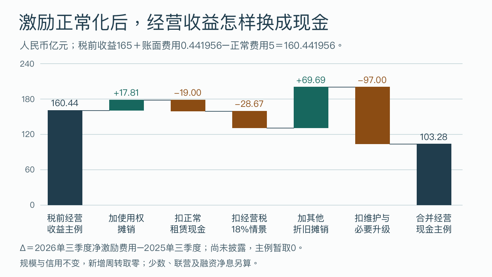

激励正常化后160.44亿元税前经营收益到103.28亿元合并经营现金

依据 · [海尔智家股份有限公司2025年年度报告 · 第244页](https://static.cninfo.com.cn/finalpage/2026-03-27/1225038336.PDF#page=244)；[Haier Smart Home Co., Ltd. Annual Report 2025 (IFRS) · 第170页](https://www1.hkexnews.hk/listedco/listconews/sehk/2026/0427/2026042702192.pdf#page=170)；[Haier Smart Home Co., Ltd. Interim Report 2026 (IFRS) · 第12页](https://www1.hkexnews.hk/listedco/listconews/sehk/2026/0928/2026092801607.pdf#page=12)；[海尔智家股份有限公司2026年第三季度报告 · 第15页](https://static.cninfo.com.cn/finalpage/2026-10-30/1225641263.PDF#page=15)

### 合并经营所得怎样归到普通股

少数股东先按7.5估计。滚动少数损益约7.67，去可辨认非经常因素约7.31，6–9作为情景。印度交易收到55.91现金，但在保留控制、继续合并的同时让出一部分未来经营所得，本滚动年度尚未覆盖一个完整的交易后年度。报表实际支付的少数股息约0.97只是已派款，不能替代这些股东完整的经济份额。由103.276604减7.5得95.776604。再加正常联营实收6，参考港股2025年4.66及2026年上半年4.98，避免将半年度直接翻倍，得剥离金融后的核心归母及联营现金101.776604。联营分派进入估值后，账面联营等权益266.88不再加回。 2025港股年报PDF第170–171页 · 2026港股中报PDF第12–13、41页 · 2026三季报第9–14页

若问题是维持现有存款和借款，每年会给普通股多留下多少，还要算净融资利息。滚动利息收入16.8904，减全部息费19.7069扣去租赁利息代理3.6441后的非租赁息费，税前净得0.8276，按18%税后约0.68。租赁利息代理截至半年，其他滚动数截至三季，现金和应计也有差别，合计约102.455亿元，正文取约102。若正常激励成本仅在4—6亿元变化、季度Δ取零，现金约101.64—103.28；这只是激励一项的敏感范围。沿同一桥改变经营及其他参数，低需求稳定保守/主例/较有利分别约90.35/102.46/116.22亿元；需求继续恶化的压力情景约80.75亿元，仍不代表风险下界。参数在下文展开。2025年净非租赁利息税后约−4.85，若净息回到−5而非＋0.68，正常现金还要再降约5.68亿元。

从集团经营现金到普通股经济归属与实际到账的两条路

依据 · [Haier Smart Home Co., Ltd. Annual Report 2025 (IFRS) · 第170页](https://www1.hkexnews.hk/listedco/listconews/sehk/2026/0427/2026042702192.pdf#page=170)；[Haier Smart Home Co., Ltd. Interim Report 2026 (IFRS) · 第12页](https://www1.hkexnews.hk/listedco/listconews/sehk/2026/0928/2026092801607.pdf#page=12)；[海尔智家股份有限公司2026年第三季度报告 · 第9页](https://static.cninfo.com.cn/finalpage/2026-10-30/1225641263.PDF#page=9)

### 金融本金要与融资债务配对

公司持有的金融资源可以支持经营、偿还债务，剩余部分才可能额外归股东。债权候选沿用报表分类，是否能按账面回收须另核。三季末候选四项为货币资金410.84、交易性金融资产35.15、一年内到期的非流动资产112.13、债权投资175.94，合计734.06。以现金等价物396.55替代全部货币资金，合计719.77。理财披露、财务公司存款及应计息可能已包含在候选行，不能另累加。2026年中报披露关联财务公司存款339.76，占全部存款约39.69%，仍要看实际期限、信用和能否从相关主体调回。 2026三季报第9–11、15–16页 · 2026中报第126–129、180页 · 财务公司风险评估

三季末短借、长借和债券合计389.98，一年内到期的非流动负债53.70另含融资、租赁和准备。将后一行全数暂扣作筛查，候选净额约276–290。若这行没有可另归融资的成分，则数学上约330–344。两种是账表范围测试。经营桥已按全额租赁现金计量，租赁项须在最终配对时分离，不能再当融资负债扣。上述数值还未扣正常经营留资，也未核实经济回收、税费、时点及普通股归属，不能直接当作可派本金。 2026三季报第9–12页 · 2026中报第138–142页

估值从不含净息的核心101.776604起步。金融资源须按经济可回收额、普通股归属、税费和收款时点折算，先留足经营所需资金，之后仍能覆盖对应全部融资债务，才适用主例。对于覆盖后未证实的正余资，暂不另计价值，额外净金融价值 X＝0。即便账面资源能还债，若同时留不足正常备资，就还有经济缺口。未反映在经营价值或其他损失中的部分应计入额外净损失 L，已经计入的部分只扣一次。年度新增周转资金为零是流量假设，不能由此把所需存量也取零。

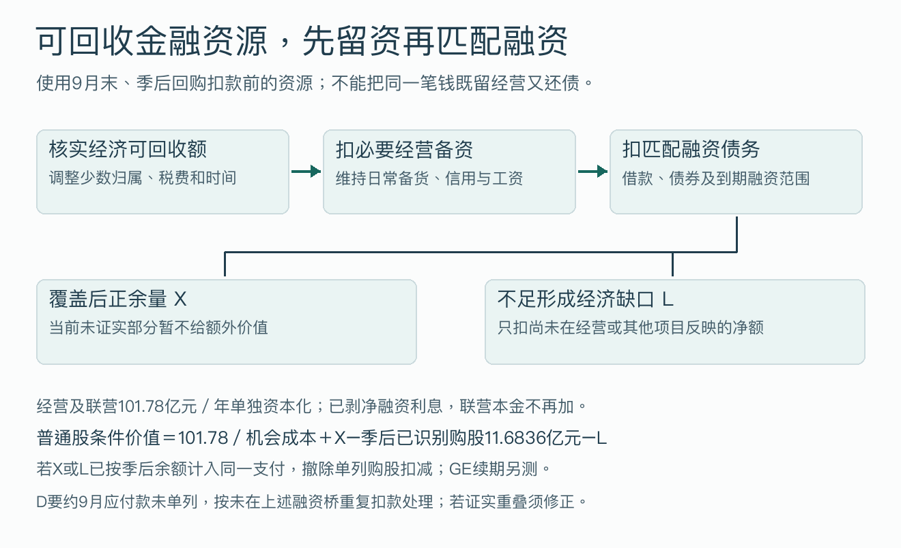

金融本金、收益与债务怎样在普通股估值中只计一次

依据 · [海尔智家股份有限公司2026年第三季度报告 · 第9页](https://static.cninfo.com.cn/finalpage/2026-10-30/1225641263.PDF#page=9)；[海尔智家股份有限公司2026年半年度报告 · 第126页](https://static.cninfo.com.cn/finalpage/2026-08-28/1225522691.PDF#page=126)；[海尔集团财务有限责任公司2026年半年度风险持续评估报告](https://ea-cdn.eurolandir.com/press-releases-attachments./4172296/600690_20260828_LEDC.pdf)；[海尔智家股份有限公司2026年半年度报告 · 第138页](https://static.cninfo.com.cn/finalpage/2026-08-28/1225522691.PDF#page=138)

### 现有经营每股值多少，买价需要什么支持

将能够重复取得的现金按人民币机会成本r折现。正常年度无增长时，经营及联营价值为101.776604÷r，普通股权益还要加经核实的额外净金融价值X、扣季后已识别现金11.683609及额外净损失L。故 V＝(103.276604−7.5＋6)÷r＋X−11.683609−L，单位亿元。它不保留已另行处理金融资源的净利息。分母保守用9月已发行93.03088164亿股，未预给注销缩股收益。 2026三季报第9—16页 · D股要约实付 · A股截至10月末进展 · H股10月30日回购 · H股11月9日回购

本式的金融覆盖与X测试统一站在 2026年9月30日、扣本式季后现金之前，采用的融资范围为短借、长借、债券及当前到期科目筛查；D要约买股义务不另塞入这组借款。D要约9月29日截止，翌日披露列10月2日购回及已付对价1.4846371694亿欧元。季末报表没有按D要约单独拆出应付、专户或库存，不能宣称已查明全部9月会计确认。若以后采用季后现金余额，或X/L已经反映同一付款，本式移除对应季后扣项，避免重扣。 D股翌日披露第6页 · 三季报第8—12页

目前季后A股已付0.4582亿元也先全扣，并沿用9月末全发行股数。如果证实这批库存股覆盖正常激励成本中已经计价的未来服务，应按实际批次和期间匹配，消除两边重复计入的部分；不能同时给它缩股收益，也不能把库存股加作金融资产。这笔A款潜在重叠上限约0.0049元/股，仅指该笔季后款，不代表全部库存或激励风险的上限。未获匹配证据前，所列部分EPV按较保守口径保留。

10%是本研究用于比较的人民币回报要求，并非已测定海尔的唯一资本成本；同时保留8%、9%以展示取值后果。取10%、X＝0且GE续期和L扣前，V＝1017.766042−11.683609＝1006.082433亿元，即 10.81元/股。其他条件不变，9%为12.03元，8%为13.55元。1.82欧元按7.5071元换算为13.662922元，乘股数约1271.07亿元；相对10%、9%、8%已计价值，分别还需264.99、151.91、10.55亿元额外净金融价值。X仍须先核经济回收、归属、税与时点、正常备资和融资覆盖，不能倒推经营留资为零。汇率由旧情景8改成7.5071对人民币买价有影响，不能把这一变化也归成员工成本。 中国外汇交易中心2026年11月10日中间价

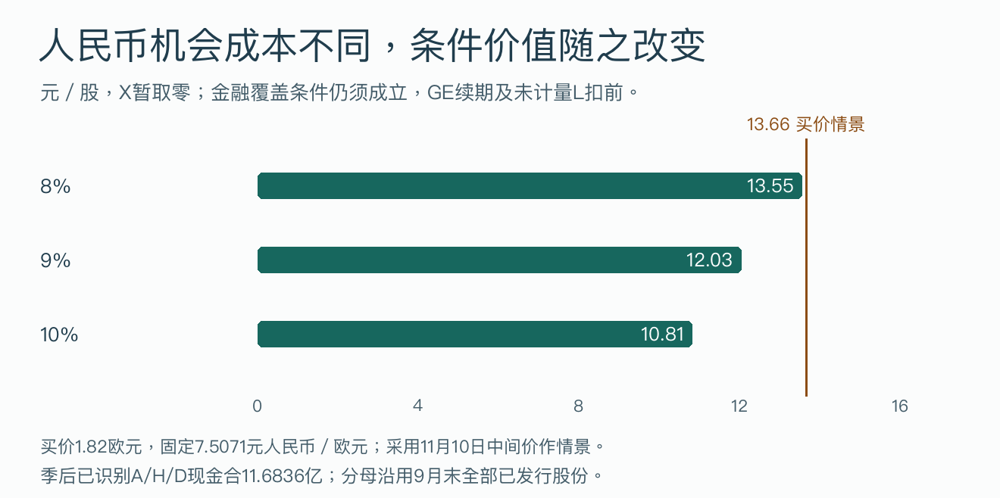

不同人民币机会成本下的部分盈利价值与买价比较

把机会成本固定10%，低需求稳定较有利情景采用激励调整前收益167、正常成本5、Δ＝0，调整后162.441956，税17%、维护89、少数6、联营7。核心现金 (162.441956＋17.81−19)×83%＋69.69−89−6＋7＝115.529124，每股部分EPV约12.29元。保守情景调整前162、调整后157.441956、税20%、维护101、少数9、联营5，核心现金89.691565，加该税率下净息约0.6621，得90.35亿元。若需求继续恶化，调整前收益155、调整后150.441956、税20%、维护105、少数9、联营5，核心 (150.441956＋17.81−19)×80%＋69.69−105−9＋5＝80.091565，部分EPV约8.48元，仍在GE及L扣前。

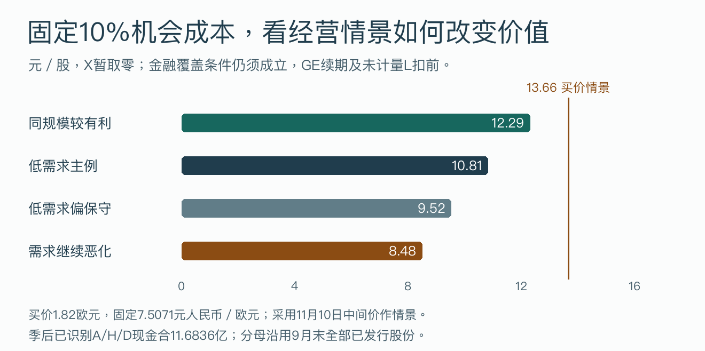

固定10%时，经营情景对每股部分盈利价值的影响

在10%、X＝0下，要支撑13.662922元，需要核心年现金 (13.662922×93.03088164＋11.683609)×10%＝128.28亿元，高于上述较有利情景；恶化情景则需约481.84亿元额外净金融价值。较高税、较高维护和暂不采用正余资都可能压低现值，但当前不能凭“现金多”认定这些条件已经解除。

GE Appliances主要类别的GE商标初始20年免费，之后约从2036年起按续展支付相应净销售额的0.5%或0.25%，经批准的其他类别另有1%安排。若用2025年整个美洲收入798.707按0.5%做压力试算，按18%税率，新增税后年费约3.27。视作十年后开始的永续负担，以10%折到今天，约少0.136元每股。整个美洲收入包含不适用该费率的市场和产品，这个金额仅用于理解估值对费率的敏感度。最早约2056年许可可能不续，届时若要迁移品牌，成本尚无法可靠计量。Ferroli等资本事项的L也按实际净损失计。对价中能由新增资产价值收回的部分不扣，已入报表资源或经营现金的部分不重扣。每额外10亿元净损失约减少0.1075元每股。 GE商标许可PDF第11–12页 · 2025年报第225页 · Ferroli ASEAN交割公告

要约付款的另一项敏感需要保留：如果之后证实D股11.1453亿元已在同一权益桥中全额扣过，撤掉重复项最多增加约0.1198元/股，10%部分EPV约10.93元，8%约13.67元。8%结果会略跨过13.6629元买价线，但GE续期和未计L仍在其外，金融覆盖条件也尚未获证，不能凭几分钱认定明显便宜。资产账面筛查若D义务已确认，仅补季后A/H，则约9.01元；与全额另扣所得8.89元的差异主要来自这一尚未拆明的会计时点。 三季报库存股与负债 · 10月D股回购翌日披露

依据 · [海尔智家股份有限公司2026年第三季度报告 · 第9页](https://static.cninfo.com.cn/finalpage/2026-10-30/1225641263.PDF#page=9)；[D股公开回购要约翌日披露报表](https://static.cninfo.com.cn/finalpage/2026-10-02/1225593764.PDF)；[2026方案A股回购截至10月末](https://static.cninfo.com.cn/finalpage/2026-11-03/1225652209.PDF)；[H股10月30日回购翌日披露报表](https://www.hkexnews.hk/listedco/listconews/sehk/2026/1030/2026103001970.pdf)；[H股11月9日回购翌日披露报表](https://www1.hkexnews.hk/listedco/listconews/sehk/2026/1109/2026110900656.pdf)；[D股公开回购要约翌日披露报表 · 第6页](https://static.cninfo.com.cn/finalpage/2026-10-02/1225593764.PDF#page=6)；[海尔智家股份有限公司2026年第三季度报告 · 第8页](https://static.cninfo.com.cn/finalpage/2026-10-30/1225641263.PDF#page=8)；[中国外汇交易中心2026-11-10人民币汇率中间价](https://www.chinamoney.com.cn/r/cms/www/chinamoney/data/fx/ccpr.json)；[青岛海尔重大资产购买实施情况报告书 · 第11页](https://static.cninfo.com.cn/finalpage/2017-01-12/1203008866.PDF#page=11)；[海尔智家股份有限公司2025年年度报告 · 第225页](https://static.cninfo.com.cn/finalpage/2026-03-27/1225038336.PDF#page=225)；[海尔智家完成收购法罗力东南亚100%股权](https://www.haier.com/about_haier/xinwen/20261105_296189.shtml)；[海尔智家股份有限公司2026年第三季度报告 · 第11页](https://static.cninfo.com.cn/finalpage/2026-10-30/1225641263.PDF#page=11)

### 第三步｜增长要靠新增投入之后的现金证明

GEA、Candy和商用制冷让海尔取得已有客户和当地服务能力。2025年报披露欧洲整合推进并称Candy业务扭亏，北美继续投资高端产品及本地生产。这些变化能支持经营存在和延续，增长价值要另算新增投入的回收。须把并购或建设对价、更新、库存和应收、养老金等义务，与相同业务和期间内新增的归属普通股现金配齐。2026年港股中报披露已签资本开支承诺约63.19亿元，不能一律取消，已在正常维持口径里的部分也不能重扣。现有资料没有支持持续新增回报的完整现金配对，本轮暂缓增长溢价。后续能查明新增现金超过全额投入成本，才为增长单独计值。 2025年报第25–30、37页 · 2026港股中报PDF第41页 · Carrier交割公告

依据 · [海尔智家股份有限公司2025年年度报告 · 第25页](https://static.cninfo.com.cn/finalpage/2026-03-27/1225038336.PDF#page=25)；[Haier Smart Home Co., Ltd. Interim Report 2026 (IFRS) · 第41页](https://www1.hkexnews.hk/listedco/listconews/sehk/2026/0928/2026092801607.pdf#page=41)；[Carrier完成出售Carrier Commercial Refrigeration](https://www.carrier.com/refrigeration/en/worldwide/news/news-article/carrier-completes-775m-sale-of-its-commercial-refrigeration-business-to-haier.html)

### 已经发生的分派，与未来年度能力分开

2023—2025按各年最新所读可比报表，以经营现金减全部购建、租赁与借款息，加联营实收、减少数股息实付，分派前历史余额约129.36、125.71、134.25亿元。下图显示它们如何被普通股息和集团全部购股使用。2025年实付114.83亿元股息、12.34亿元购股后余约7.09亿元，尚未扣少数股权退出看跌期权实付21.55亿元。该退出款属于权益资本安排，与员工期权费用不同。历史余额还含金融利息，少数只扣已派份额，也未扣并购及金融本金交易，不能当作可重复普通股自由现金。 2024港股年报现金表 · 2025港股年报现金表

历史分红和集团购股共同占用分派前现金

2025实付股息包括以前利润年度的末期及2025中期，而2025利润所属股息每股1.16071元的末期在2026年8月才付。2026半年末82.48亿元是应付而非半年已支付；上半年普通股实付为零。过去高派息与今年付款可以由以前留存承接，不能据利润年度分红率推定同一年的现金已经产生。 2026港股中报现金表 · 2025末期实施

依据 · [海尔智家2024港股年报 · 第166页](https://www1.hkexnews.hk/listedco/listconews/sehk/2025/0429/2025042903800.pdf#page=166)；[Haier Smart Home Co., Ltd. Annual Report 2025 (IFRS) · 第170页](https://www1.hkexnews.hk/listedco/listconews/sehk/2026/0427/2026042702192.pdf#page=170)；[Haier Smart Home Co., Ltd. Interim Report 2026 (IFRS) · 第12页](https://www1.hkexnews.hk/listedco/listconews/sehk/2026/0928/2026092801607.pdf#page=12)；[2025年度A股权益分派实施](https://static.cninfo.com.cn/finalpage/2026-08-15/1225474603.PDF)

### 2026年已识别用途，为什么需要存量及融资承接

2026上半年集团现金表已披露股份回购实付16.2470亿元，普通股息实付为零；这是已结算的集团半年度口径，不能再加到截至11月逐市场成交小计上。 2026中报第156页 · 2026港股中报现金表

截至11月9日已披露的发行人购股，A股日历年累计24.5745亿元、H股1.0292996亿港元、D股1.50255918亿欧元。为看规模，统一按11月10日中间价港元0.85642、欧元7.5071换算，约 36.74亿元；加8月实施的2025年度末期普通股息82.4832亿元，已识别用途示意约 119.22亿元。这里A截至10月底，H截至11月9日，D含年初场内和10月要约；成交金额及当下中间价换算不等于集团按结算日确认的全部人民币实付。 10月A股进展 · 11月9日H股披露 · D股年初成交 · D股10月结算 · 末期分派调整

相对地，前三季经营现金106.70亿元减购建74.25亿元只余32.45亿元，还未扣同期租赁与借款息；印度权益交易55.91亿元是一次性筹资；前三季借入269.82减偿还225.90，借还本金净流入43.92亿元，同期现金等价物仍实际下降66.13亿元。这些数的期间、主体和结算口径不同，119.22减32.45不是精确资金缺口。它们共同显示：近期分红、购股和其他用途不能仅依靠当期经营净流入，须由原有可用资金、金融资产变动、借还款及权益筹资承接。公开资料未逐笔指定哪笔印度款或贷款用于哪次回购，也未给出2026全年完整现金用途，保留这个边界。 2026三季报现金表 · 2026港股中报现金表与印度交易

依据 · [海尔智家股份有限公司2026年半年度报告 · 第156页](https://static.cninfo.com.cn/finalpage/2026-08-28/1225522691.PDF#page=156)；[Haier Smart Home Co., Ltd. Interim Report 2026 (IFRS) · 第13页](https://www1.hkexnews.hk/listedco/listconews/sehk/2026/0928/2026092801607.pdf#page=13)；[2026方案A股回购截至10月末](https://static.cninfo.com.cn/finalpage/2026-11-03/1225652209.PDF)；[H股11月9日回购翌日披露报表 · 第5页](https://www1.hkexnews.hk/listedco/listconews/sehk/2026/1109/2026110900656.pdf#page=5)；[D股场内回购865,598股](https://static.cninfo.com.cn/finalpage/2026-02-28/1224986896.PDF)；[D股公开回购要约翌日披露报表 · 第6页](https://static.cninfo.com.cn/finalpage/2026-10-02/1225593764.PDF#page=6)；[海尔智家2025年度利润分配现金红利调整公告 · 第3页](https://static.cninfo.com.cn/finalpage/2026-08-07/1225465164.PDF#page=3)；[海尔智家股份有限公司2026年第三季度报告 · 第15页](https://static.cninfo.com.cn/finalpage/2026-10-30/1225641263.PDF#page=15)；[Haier Smart Home Co., Ltd. Interim Report 2026 (IFRS) · 第12页](https://www1.hkexnews.hk/listedco/listconews/sehk/2026/0928/2026092801607.pdf#page=12)

### 普通股创造的钱和母公司实际派出的现金

经营子公司先付供应商和员工、补设备并留本地资金，再按当地公司安排分配或调拨。集团三季末货币资金410.84亿元，母公司单体约51.86亿元。两者不同，集团股东的经济权益还需经过到账和分配程序。印度让出权益取得55.91亿元是一次性筹资款，未来当地经营仍并表，但须与投资者分享权益。 2026三季报第9–12、17–18页 · 2026港股中报PDF第12–13、41页

2023、2024利润所属年度每股分派0.80131、0.96504元，2025中期加末期1.16071元；末期实际支付跨入下一日历年。公司规划2026—2028年现金分红率不低于各年归母利润的58%、60%、60%，这是利润比例规划，不是固定金额承诺。2026上半年未派中期。2025年度分派合计约107.55亿元，不能据此推定低需求下永远维持同额。 2023分派实施 · 2024分派实施 · 2025末期调整 · 2026股东会决议

依据 · [海尔智家股份有限公司2026年第三季度报告 · 第9页](https://static.cninfo.com.cn/finalpage/2026-10-30/1225641263.PDF#page=9)；[Haier Smart Home Co., Ltd. Interim Report 2026 (IFRS) · 第41页](https://www1.hkexnews.hk/listedco/listconews/sehk/2026/0928/2026092801607.pdf#page=41)；[2023年度A股权益分派实施](https://static.cninfo.com.cn/finalpage/2024-08-10/1220833309.PDF)；[2024年度A股权益分派实施](https://static.cninfo.com.cn/finalpage/2025-07-19/1224215236.PDF)；[海尔智家2025年度利润分配现金红利调整公告](https://static.cninfo.com.cn/finalpage/2026-08-07/1225465164.PDF)；[2025年度股东会及类别会议结果、末期股息](https://www.hkexnews.hk/listedco/listconews/sehk/2026/0624/2026062401928.pdf)

### 102亿元和30—60亿元回购怎样放进同一张资金预算

约102亿元已经扣了正常员工激励的经济成本，用于判断长期可以反复创造多少。做具体年度现金预算，要把其中尚未付现的费用还原，改扣同期实际买股款，并处理税差和结算时点。假设同一年达到主例经营、5亿元激励费用全属非现金，税与其他时点不变，A股实际买入30或60亿元，则 102.46＋5−30＝77.46，或 102.46＋5−60＝47.46亿元，供股息及其他用途。它们还未扣其他回购、并购或额外留资。按季末股数约为每股0.83或0.51元；若同时每股派1元，至少另找15.58或45.58亿元资金，其他用途尚在其外。

同一年度资金假设下，购股与每股1元分红的资金覆盖

这是把购股时点与长期成本接起来的条件预算，不是2026或2027全年预测。30—60亿元计划跨年，截至10月底新计划已付23.36亿元，要达到计划区间还余6.64—36.64亿元，不把已付款再从期末资金扣一遍。工行最高50亿元、期限3年的专项贷款承诺也不能当作已提款金额；贷款能缓解眼前付款，却带来利息和还本，不能增加经营创造的财富。若以后持续每年买30—60亿元，而净激励消耗只数亿元，就必须说明差额是不断堆库存、后续授予还是净注销，不能一边保留这些股份、一边把同一现金全部算作分红。 2026年A股回购报告书 · 截至10月回购进展

按93.03088164亿股，派0.9、1.0、1.1元分别需要83.73、93.03、102.33亿元。主例102.46亿元在1元分红后余9.42亿元；1.1元几乎耗尽余量。低需求稳定的保守情景90.35亿元已经比1元所需少2.68亿元；进一步恶化情景80.75亿元连0.9元也少2.97亿元。因而0.9—1元只能是经营与资本安排允许时的分配假设，近期大额回购若没有足够存量或融资补足，也会压低可派股息。

依据 · [海尔智家股份有限公司关于以集中竞价交易方式回购A股股份的方案暨回购报告书](https://static.cninfo.com.cn/finalpage/2026-03-27/1225038318.PDF)；[2026方案A股回购截至10月末](https://static.cninfo.com.cn/finalpage/2026-11-03/1225652209.PDF)

### D股回报还要走过换汇、扣税和退出

A、H、D是同一发行人的普通股。D股股息从同一人民币分派基数换成欧元，通过结算系统到账。2025末期0.89151元按公告7.81225元兑1欧元，约0.1141169欧元，扣该次中国预提10%后约0.1027052欧元。个人最终税、抵免及托管费用可能不同。D转H还需名册、权属和上市程序，不能预设随时按两地价差退出。 D股末期分派公告 · 上市文件股本第291—292页

以1.82欧元买入。采用2026年11月10日人民币中间价 7.5071元/欧元，并假设未来每年换汇及退出时不变；这不是汇率预测，也不是更新的D股买卖报价。按中国预提10%，不含额外税费，每股人民币0.9、1.0、1.1元分红净收约0.10790、0.11989、0.13188欧元。持有十年，每年末收息，第十年末同时出售；以同一个年率折现十笔股息和卖出款，令现值等于1.82，得到下图欧元内部回报率。 中国外汇交易中心2026年11月10日中间价

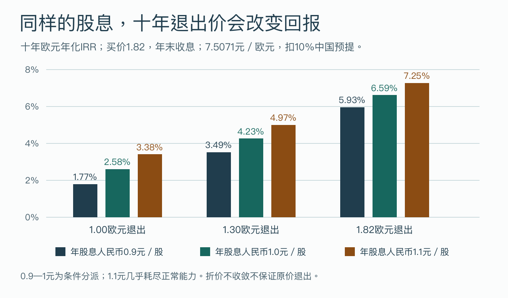

1.82欧买入，按分红和退出价分别计算十年欧元年化回报

每股1元、原价退出时，净股息率与该路径IRR均约6.59%；终值降到1.30或1欧元，同样股息的IRR降至4.23%或2.58%。0.9元、原价退出约5.93%；1.1元、原价退出约7.25%，但它几乎用光主例年度能力，不能又安排大额额外购股。若前3年每股0.8元，后7年1元，原价退出约6.11%；这条独立派息路径并不表示60亿元购股年度仍能自给派0.8元。若只第一年0.8元，后续1元，约6.42%。

把同年购股预算直接接到持有回报：假设第一年达到102.46亿元主例、5亿元非现金成本可还原，却只靠当年资金支付A股购股，且先不安排其他用途。买30亿元时，第一年股息示意上限77.46亿元÷93.03亿股≈0.833元；买60亿元时约0.510元。再假设以后九年均派1元、相同税汇且原价退出，十年IRR分别约 6.44%、6.17%。这是回购占款如何影响回报的演算，其他付款会继续压低股息；存量资金或融资可以提高首年派息，却须另外确认其成本。它不把跨年30—60亿元计划强塞入某个实际财年，也不保证后九年恢复。

汇率和税变化也会改答案：同为每股1元和原价退出，固定汇率8元/欧元时约6.18%；7.5071汇率但有效扣税20%时约5.86%。D/H折价比例不变，仍允许H股价格下跌，D股欧元终值也随之变化。因此“折价不收敛”只能排除一种上行来源，不能替代退出价假设。若要求10%的欧元年化、并原价退出，在同一税汇条件下需每股约1.518元股息，合全体普通股约141.23亿元；若始终每股1元，则十年后约需2.81欧元退出。两者均比主例要求更强。公司人民币EPV的10%机会成本与投资人税后欧元IRR的10%，不可以混用。

依据 · [德国D股2025末期股息派付公告](https://www.eqs-news.com/news/corporate/haier-smart-home-co-ltd-dividend-announcement/390e4135-387e-43c8-995e-2e6f1cae746d_en)；[H股介绍上市文件·股本 · 第4页](https://www1.hkexnews.hk/listedco/listconews/sehk/2020/1116/9513606/2020111600102.pdf#page=4)；[中国外汇交易中心2026-11-10人民币汇率中间价](https://www.chinamoney.com.cn/r/cms/www/chinamoney/data/fx/ccpr.json)

### 当前取舍

低需求稳定、每股0.9—1元分派与原价退出的条件下，1.82欧元主要提供约6%左右至6.6%的欧元回报，现有证据不足以称为可靠10%机会。员工激励修正使正常经济能力由约106亿元降至约102亿元，影响温和；近期购股与经营回款疲弱叠加，对真正能派出的现金影响更大。最强的有利解释是维护支出与税率保守、净余资尚未采用。最强的反面是需求尚未见底、维持和印度少数归属超过主例，以及实际回购继续消耗分配余量。后续用完整年度净激励、实际购股与归属、经营收款、资本支出和母公司到账逐项检验，再改变股息或价值判断。

## 第8章 · 第八章 经营跟踪与复盘

### 正文

海尔的海外品牌和渠道仍能拿到订单，2026年前三季的利润和现金却明显下行。当前用低需求下可以稳定经营作为主例，维持现有财务安排的普通股正常年度现金约102亿元。这个判断可以被推翻。如果同口径回款、扣非利润和周转恢复，且维护与增量投入能够拆明，当前取值可能偏保守。如果行业回升后仍须更多让价和占资才能保住份额，或利润持续流向非母公司权益，正常现金也可能更低。 2026三季报第1–6、10–16页

依据 · [海尔智家股份有限公司2026年第三季度报告 · 第1页](https://static.cninfo.com.cn/finalpage/2026-10-30/1225641263.PDF#page=1)

### 先判断终端卖得怎样，再看海尔有没有多赚

2026年前三季，海尔国内监测线上、线下零售额份额20.6%、25.0%，国内毛利率却同比下降。北美行业第三季出货约降4%，公司称高端、价格与其他品类缓冲压力。欧洲四个核心市场本币收入中高单位数增长，但海外毛利率受到一次性退税。2026年报与2027中报应尽量对齐地区、品类、渠道和货币。若同档净价、销量及扣除一次性因素的盈利共同改善，份额提升才更能支持现有收益。若份额仍增而毛利、促销成本和终端回款继续恶化，应降低对其盈利贡献的判断。 2025年报第25–30、225页 · 2026三季报第2–4页

依据 · [海尔智家股份有限公司2025年年度报告 · 第25页](https://static.cninfo.com.cn/finalpage/2026-03-27/1225038336.PDF#page=25)；[海尔智家股份有限公司2026年第三季度报告 · 第2页](https://static.cninfo.com.cn/finalpage/2026-10-30/1225641263.PDF#page=2)

### 看收款回到哪里，不预支保理回升

经营现金的历史变化，用于跟踪下一期收付而非预报

前三季销售与劳务现金少收61.86亿元，采购及劳务少付6.81亿元，七项经营净变动约−68.21亿元。管理层提到国内收入和海外保理，实际贡献未分拆。下一份年报要对照直接法现金、应收账龄、信用损失、卖断余额和可能披露的期间保理现金。若终端销售改善、经营收款也回升且账龄未拉长，错期和周期解释得到支持。若依靠更多保理提前取得钱，期末余额下降或反向变化仍无法独自证明客户及时付款。下一期信用条件更差时，正常化桥的年度新增周转取零需要修订。 2026中报第119、157–159页 · 2026三季报第4–5、15页

依据 · [海尔智家股份有限公司2026年半年度报告 · 第119页](https://static.cninfo.com.cn/finalpage/2026-08-28/1225522691.PDF#page=119)；[海尔智家股份有限公司2026年第三季度报告 · 第15页](https://static.cninfo.com.cn/finalpage/2026-10-30/1225641263.PDF#page=15)

### 工厂投产和现金收益要配对

路易斯维尔洗护项目计划2027年投产，欧洲关厂迁产后继续从其他基地供货。下一年度可先核对投产、资本支出与迁产和维修项目实际用途，再看新线利用率、交付和库存。若设备更新可以较少投入维持同样的产量和品质，97亿元维护及必要升级假设可能偏高。若同时需要更高物流和更新费，或Ferroli等并购出现不能由新资产价值覆盖的投入，不能借规模增长掩盖支出。GE主要商标免费期、后续费率及约2056年后的许可条件仍按合同核，不在经营改善时把它们永久化。 2026中报第14页 · GEA 2026年9月制造计划 · GE商标许可PDF第11–12页

依据 · [海尔智家股份有限公司2026年半年度报告 · 第14页](https://static.cninfo.com.cn/finalpage/2026-08-28/1225522691.PDF#page=14)；[GEA宣布Louisville新制造计划](https://pressroom.geappliances.com/news/ge-appliances-and-iue-cwa-announce-1-billion-investment-in-louisville-plant-creating-the-largest-home-appliance-manufacturing-site-in-the-u-s)；[青岛海尔重大资产购买实施情况报告书 · 第11页](https://static.cninfo.com.cn/finalpage/2017-01-12/1203008866.PDF#page=11)

### 复盘最终要回到普通股和真实到账

印度交易之后保留控制，但外部股东享有未来权益。下一个完整年度要用报表拆少数损益和分配，不能把过去的少数股息当全部经济份额。集团层金融资产也须按可回收、普通股归属、税费和到期、经营备资与偿债核实。若证明有能回拨的净余资，再增加额外金融价值X。若正常备资和融资债务无法同时覆盖，未计入经营现金或其他项目的净缺口计入L。D股则查看公司实际宣派、结算换汇和税，另核股份注销、成交深度与终值。股价变化只是后续结果，不能反过来说明海尔的经营假设是否正确。 2026港股中报PDF第41页 · 2026中报第180页 · D股分派公告 · D股要约结算

复盘以当前报告期和当时可见条件为起点，先写实际结果支持了哪条解释，再更新正常现金、资产归属或价格条件。未披露或未到期的命题继续等证据。未来有新预测时应另立时点，不把后来结果写回本轮。

依据 · [Haier Smart Home Co., Ltd. Interim Report 2026 (IFRS) · 第41页](https://www1.hkexnews.hk/listedco/listconews/sehk/2026/0928/2026092801607.pdf#page=41)；[海尔智家股份有限公司2026年半年度报告 · 第180页](https://static.cninfo.com.cn/finalpage/2026-08-28/1225522691.PDF#page=180)；[德国D股2025末期股息派付公告](https://www.eqs-news.com/news/corporate/haier-smart-home-co-ltd-dividend-announcement/390e4135-387e-43c8-995e-2e6f1cae746d_en)；[D股公开回购要约翌日披露报表](https://static.cninfo.com.cn/finalpage/2026-10-02/1225593764.PDF)

### 激励、购股和分红必须共同覆盖

以后按年度报告核对三类股份支付的毛费用、冲回及净额，补齐2025和2026单三季度净费用差Δ。当前5亿元正常成本、Δ＝0支持约102亿元，不能把未知差额视作已观测零。同时把发行人A/H/D逐笔成交与集团现金表购股付款、员工计划过户和最终归属分别核对，差额保留来源，不全归员工费用。

截至10月底，新A方案已付23.36亿元；到计划到期所需余款6.64—36.64亿元跨年度，不再重复扣已付金额。实际分红、其他回购、购建、贷款与母公司调资要放在同一期。若新增购股与收款疲弱同时持续，就下调近期分配路径；如果只是库存股先买、后续使用且新购股回落，才可能恢复稳定派息。未来核验尚未发生，不因本次修订而关闭旧预测。 2026年A股回购报告书 · D股要约实付 · A股截至10月末进展 · H股10月30日回购 · H股11月9日回购

依据 · [海尔智家股份有限公司关于以集中竞价交易方式回购A股股份的方案暨回购报告书](https://static.cninfo.com.cn/finalpage/2026-03-27/1225038318.PDF)；[D股公开回购要约翌日披露报表](https://static.cninfo.com.cn/finalpage/2026-10-02/1225593764.PDF)；[2026方案A股回购截至10月末](https://static.cninfo.com.cn/finalpage/2026-11-03/1225652209.PDF)；[H股10月30日回购翌日披露报表](https://www.hkexnews.hk/listedco/listconews/sehk/2026/1030/2026103001970.pdf)；[H股11月9日回购翌日披露报表](https://www1.hkexnews.hk/listedco/listconews/sehk/2026/1109/2026110900656.pdf)

## 现金与估值

### 正文

海尔智家在国内、北美和欧洲仍有能持续接单的品牌、渠道和服务网络。2026年前三季收入、扣非利润和经营现金同时下行。假设需求在低位稳定，规模与信用条件不再恶化，正常激励净成本每年5亿元，维持与必要升级97亿元，保持现有融资安排，普通股正常年度现金约 102亿元。这是可用于普通股分派或留存的经济能力；实际分红还要与当期回购、债务和其他付款一起安排。近期购股数十亿元时，不能仍将102亿元全部列作可派现金。 2026三季报第9—16页

本轮由原约106亿元向下修正，关键是把账上的净股份支付换成正常员工成本，并补齐实际购股与分红的时间。主例也依赖一个未披露参数：2026单三季度与2025单三季度净股份支付费用之差暂设为零。低需求稳定下联动经营、税、维护与少数权益参数，现金约90—116亿元；需求继续恶化时还会更低。按每股0.9—1元分红、汇率不变且十年后仍以1.82欧元卖出，买入的欧元年化回报约5.9%—6.6%。折价不收敛不保证原价退出。下面分别核对已经付出的钱、正常创造能力及投资人到账。金额除另注外均为人民币亿元。

依据 · [海尔智家股份有限公司2026年第三季度报告 · 第9页](https://static.cninfo.com.cn/finalpage/2026-10-30/1225641263.PDF#page=9)

### 现金事实｜近期已经少收到多少钱

国内终端需求走弱时，门店提货和用户收款会减少。海尔若照常生产及备货，或给零售商更长账期，现金下行可以比利润更快。海外把部分应收卖断，则能提前收钱，报告期末的卖断余额只记录某一时点。2026年前三季，集团经营现金由174.9113降至106.7005，少68.2108。销售和劳务少收61.8552，税费返还少2.5567，其他经营多收8.2419。采购和劳务少付6.8099，员工多付12.9605，税费少付7.8228，其他经营多付13.7130。销售收现下降是最大单项，采购少付对冲一部分，人员和其他经营付款又扩大了落差。用累计减半年，第三季单季经营现金约9.18，低于上年同季63.52，同季购建付现30.59。一个季度包含回款和建设时点，全年判断需要更长窗口。 2026三季报第4–5、15–16页 · 2026中报第74–75页 · 2025中报第74–75页

2026年前三季经营现金净额的七项同比变化

管理层把部分变化与国内收入和海外保理联系起来。2026中报披露终止确认应收账款58.22，比上年末少5.21，比上年同期少12.71。判断经营现金是否因保理错期，需要实际新卖断取得的现金和旧款到期滚动。现有余额不能用来把5.21或12.71直接加回现金。半年报间接法显示，应收较上年同期多耗78.38，存货和经营应付合计改善约88.78，三项合计反而改善约10.39。单看应收也解释不了净变动。三季报缺少同等明细，不能把半年的拆分套到三季。 2026中报第119、157–159页 · 2025中报第120、157–160页 · 2025年报第171页

取2025全年，加2026年前三季，减2025年前三季，得到截至三季末的滚动十二个月。收入2901.12，归母净利171.79，扣非归母145.30，利润总额207.24。经营现金191.82减购建长期资产现金96.99，余94.83。这个差额仍含后来要付的租赁和借款利息，也没有分少数股东。港股2025现金表把历史收付列得更细。经营现金260.03减约88.51购建、18.01租赁及22.94借款利息，按表内原精度约余130.57。经营现金已含实收利息16.31，实收联营分配4.66另列投资。94.83和130.57分别反映不同报告期和现金范围，判断正常股东所得需要再做一条桥。 2025年报第122–126页 · 2025三季报第2、16–18页 · 2026三季报第1、12–16页 · 2025港股年报PDF第170–171页

依据 · [海尔智家股份有限公司2026年第三季度报告 · 第15页](https://static.cninfo.com.cn/finalpage/2026-10-30/1225641263.PDF#page=15)；[海尔智家股份有限公司2026年半年度报告 · 第74页](https://static.cninfo.com.cn/finalpage/2026-08-28/1225522691.PDF#page=74)；[海尔智家股份有限公司2025年半年度报告 · 第74页](https://static.cninfo.com.cn/finalpage/2025-08-29/1224609917.PDF#page=74)；[海尔智家股份有限公司2026年半年度报告 · 第119页](https://static.cninfo.com.cn/finalpage/2026-08-28/1225522691.PDF#page=119)；[海尔智家股份有限公司2025年半年度报告 · 第120页](https://static.cninfo.com.cn/finalpage/2025-08-29/1224609917.PDF#page=120)；[海尔智家股份有限公司2025年年度报告 · 第171页](https://static.cninfo.com.cn/finalpage/2026-03-27/1225038336.PDF#page=171)；[海尔智家股份有限公司2025年年度报告 · 第122页](https://static.cninfo.com.cn/finalpage/2026-03-27/1225038336.PDF#page=122)；[海尔智家股份有限公司2025年第三季度报告 · 第16页](https://static.cninfo.com.cn/finalpage/2025-10-31/1224773819.PDF#page=16)；[海尔智家股份有限公司2026年第三季度报告 · 第12页](https://static.cninfo.com.cn/finalpage/2026-10-30/1225641263.PDF#page=12)；[Haier Smart Home Co., Ltd. Annual Report 2025 (IFRS) · 第170页](https://www1.hkexnews.hk/listedco/listconews/sehk/2026/0427/2026042702192.pdf#page=170)

### 分红和回购的实际现金，不能按利润所属年度拼接

经营现金流已把非现金股份支付从利润调整出去。因此从现金表起步时，应扣实际购股付款，不再扣一次相同的报表费用。为比较过去三年，采用各年最近一次所读年报的可比口径：2023用2024年报重列，2024用2025年报重列，2025用本年报。先做“经营现金−全部购建−现金租赁−借款利息＋联营实收−少数股息实付”，得到下图分派前余额，再扣普通股息和集团全部股份购回。 2024港股年报现金表 · 2025港股年报现金表PDF第170—171页

2023至2025年分派前历史现金由普通股息、集团购股和余量构成

计算逐项为：2023年 265.36−105.42−17.29−19.83＋6.84−0.30≈129.36；2024年 263.18−100.80−17.09−24.44＋5.79−0.93≈125.71；2025年 260.03−88.52−18.01−22.94＋4.66−0.97≈134.25。金额取整会有0.01亿元差异。这些历史余额尚含金融利息、全部扩建购建，少数只扣实付而非完整经济份额，也没有扣另列的并购和金融本金交易，故用于检查资金安排，不能直接认定为正常归母自由现金。各年现金表自身的期初期末已核对，不把不同重列版本的余额机械首尾累计。 2024港股年报现金表 · 2025港股年报现金表PDF第170—171页

2025年上述余量7.09亿元尚未扣少数股权相关退出看跌期权实付21.55亿元，单这项就超出余量。这笔筹资付款属于权益资本安排，与员工激励期权费用不同，也不是普通股分红。金融资产净买入92.47亿元、借还本金净流入约15.19亿元另列；不能据7.09亿元推定集团现金只变动这么多。 2025港股现金表

2025年现金表普通股股息实付114.83亿元，包含2024利润所属年度的末期及2025年中期。2025利润年度中期加末期每股1.16071元、合计约107.55亿元，则有末期在2026年8月支付。2025年两次宣派合计约115.03亿元与报表实付114.83亿元差约0.20亿元，公告金额和汇兑、结算时间没有完全拆齐，不把差额编成员工支出。2026上半年普通股股息实付为零；6月末应付的82.4832亿元，是8月实施2025末期的金额。应付、宣派与实际离开账户必须分开。 2025港股年报现金表PDF第170—171页 · 2026港股中报现金表PDF第12—13页 · 2025末期分派调整 · 2026年8月实施公告

发行人A股市场买入2023、2024、2025分别约14.32、4.67、10.80亿元；H股同期成交约1.9914亿、0.2707亿、0.9992亿港元。集团现金表全部股份购回分别18.02、5.59、12.34亿元，范围包括需另外核对的计划买入及结算。不能把集团回购行与A/H成交换算后的差额全判成员工成本。2025方案完成额12.0138亿元跨到2026年，2026年1月还有旧方案1.2155亿元，因此12.0138不能全记到2025。 2023方案实施结果 · 2025方案实施结果 · 2026年1月进展 · 2024港股年报现金表 · 2025港股年报现金表PDF第170—171页

2026年新A方案截至10月底实际成交23.3590亿元，加1月旧方案，日历年已执行A股约24.5745亿元。新方案累计买入11184.1989万股，7月转出4156万股，尚余7028.1989万股；按已披露成交价格和总额估计，尚未转出股份占用过的购买现金约14.05—15.21亿元。这是已花的钱形成的股份库存，不能再拿它作现金分红，也不等于今后每年要花同样金额。H股前三季成交9357.726万港元，10月30日及11月9日再成交935.27万港元；D股年初场内买入865,598股，含费用约179.22万欧元，10月要约另付1.484637亿欧元。A股2026年注销7454.1486万股、H股10月注销455万股，是早先买入股份的处理，不再新增相同金额付款。 D股要约实付 · A股截至10月末进展 · H股10月30日回购 · H股11月9日回购 · A股注销公告 · D股年初回购

2026前三季经营现金106.7005减实付购建74.2536，余 32.4469亿元，还没有扣同期租赁和借款现金利息、处理联营及少数实收实付。Q3没有这些完整明细，不能填出一个精确的全年可分数。现金等价物由462.6769降到396.5484，减少66.1284＝经营106.7005−投资109.7309−筹资52.7610−汇兑10.3370。印度股权收到55.91亿元为一次性筹资。当前回款疲弱时，分红与购股同时执行还依靠融资、金融资产变动及存量资金；正常年度102亿元不是2026已经实现的现金。 2026三季报第9—16页 · 2026港股中报现金表PDF第12—13页

依据 · [海尔智家2024港股年报](https://www1.hkexnews.hk/listedco/listconews/sehk/2025/0429/2025042903800.pdf)；[Haier Smart Home Co., Ltd. Annual Report 2025 (IFRS) · 第170页](https://www1.hkexnews.hk/listedco/listconews/sehk/2026/0427/2026042702192.pdf#page=170)；[Haier Smart Home Co., Ltd. Interim Report 2026 (IFRS) · 第12页](https://www1.hkexnews.hk/listedco/listconews/sehk/2026/0928/2026092801607.pdf#page=12)；[海尔智家2025年度利润分配现金红利调整公告](https://static.cninfo.com.cn/finalpage/2026-08-07/1225465164.PDF)；[2025年度A股权益分派实施](https://static.cninfo.com.cn/finalpage/2026-08-15/1225474603.PDF)；[2023方案A股回购实施结果](https://static.cninfo.com.cn/finalpage/2024-04-30/1219910885.PDF)；[2025方案A股回购实施结果](https://static.cninfo.com.cn/finalpage/2026-03-27/1225038099.PDF)；[2025方案2026年1月回购进展 · 第3页](https://www1.hkexnews.hk/listedco/listconews/sehk/2026/0202/2026020202812_c.pdf#page=3)；[D股公开回购要约翌日披露报表](https://static.cninfo.com.cn/finalpage/2026-10-02/1225593764.PDF)；[2026方案A股回购截至10月末](https://static.cninfo.com.cn/finalpage/2026-11-03/1225652209.PDF)；[H股10月30日回购翌日披露报表](https://www.hkexnews.hk/listedco/listconews/sehk/2026/1030/2026103001970.pdf)；[H股11月9日回购翌日披露报表](https://www1.hkexnews.hk/listedco/listconews/sehk/2026/1109/2026110900656.pdf)；[A股库存注销74,541,486股](https://static.cninfo.com.cn/finalpage/2026-09-01/1225538081.PDF)；[D股场内回购865,598股](https://static.cninfo.com.cn/finalpage/2026-02-28/1224986896.PDF)；[海尔智家股份有限公司2026年第三季度报告 · 第9页](https://static.cninfo.com.cn/finalpage/2026-10-30/1225641263.PDF#page=9)

### 2026年已识别用途，为什么需要存量及融资承接

2026上半年集团现金表已披露股份回购实付16.2470亿元，普通股息实付为零；这是已结算的集团半年度口径，不能再加到截至11月逐市场成交小计上。 2026中报第156页 · 2026港股中报现金表

截至11月9日已披露的发行人购股，A股日历年累计24.5745亿元、H股1.0292996亿港元、D股1.50255918亿欧元。为看规模，统一按11月10日中间价港元0.85642、欧元7.5071换算，约 36.74亿元；加8月实施的2025年度末期普通股息82.4832亿元，已识别用途示意约 119.22亿元。这里A截至10月底，H截至11月9日，D含年初场内和10月要约；成交金额及当下中间价换算不等于集团按结算日确认的全部人民币实付。 10月A股进展 · 11月9日H股披露 · D股年初成交 · D股10月结算 · 末期分派调整

相对地，前三季经营现金106.70亿元减购建74.25亿元只余32.45亿元，还未扣同期租赁与借款息；印度权益交易55.91亿元是一次性筹资；前三季借入269.82减偿还225.90，借还本金净流入43.92亿元，同期现金等价物仍实际下降66.13亿元。这些数的期间、主体和结算口径不同，119.22减32.45不是精确资金缺口。它们共同显示：近期分红、购股和其他用途不能仅依靠当期经营净流入，须由原有可用资金、金融资产变动、借还款及权益筹资承接。公开资料未逐笔指定哪笔印度款或贷款用于哪次回购，也未给出2026全年完整现金用途，保留这个边界。 2026三季报现金表 · 2026港股中报现金表与印度交易

依据 · [海尔智家股份有限公司2026年半年度报告 · 第156页](https://static.cninfo.com.cn/finalpage/2026-08-28/1225522691.PDF#page=156)；[Haier Smart Home Co., Ltd. Interim Report 2026 (IFRS) · 第13页](https://www1.hkexnews.hk/listedco/listconews/sehk/2026/0928/2026092801607.pdf#page=13)；[2026方案A股回购截至10月末](https://static.cninfo.com.cn/finalpage/2026-11-03/1225652209.PDF)；[H股11月9日回购翌日披露报表 · 第5页](https://www1.hkexnews.hk/listedco/listconews/sehk/2026/1109/2026110900656.pdf#page=5)；[D股场内回购865,598股](https://static.cninfo.com.cn/finalpage/2026-02-28/1224986896.PDF)；[D股公开回购要约翌日披露报表 · 第6页](https://static.cninfo.com.cn/finalpage/2026-10-02/1225593764.PDF#page=6)；[海尔智家2025年度利润分配现金红利调整公告 · 第3页](https://static.cninfo.com.cn/finalpage/2026-08-07/1225465164.PDF#page=3)；[海尔智家股份有限公司2026年第三季度报告 · 第15页](https://static.cninfo.com.cn/finalpage/2026-10-30/1225641263.PDF#page=15)；[Haier Smart Home Co., Ltd. Interim Report 2026 (IFRS) · 第12页](https://www1.hkexnews.hk/listedco/listconews/sehk/2026/0928/2026092801607.pdf#page=12)

### 第一步｜资产账面能告诉多少

三季末归母权益1230.6758。先扣账面的商誉260.1259和无形资产132.2172，剩838.3326。除以当时已发行93.03088164亿股，约9.01元人民币每股。这里用全部合并商誉和无形资产扣归母权益，作为偏保守的账面筛查，归属和公允价值还未逐项重估。GE商标许可、区域品牌、货架、安装服务、库存与工厂组织，要维持同等能力重新搭建需要多少钱，不能从历史商誉推出。应收回收、资产重置和税务影响也还没独立计量。 2026三季报第9–12页 · GEA实施报告第7–12页

三季末后已识别的回购现金包括D股要约1.4846371694亿欧元、10月A股0.4581907264亿元、10月30日及11月9日H股935.27万港元。统一按11月10日中间价欧元7.5071、港元0.85642换算，合 11.6836亿元。838.3326减该额约826.6490，仍用季末93.03088164亿股，约8.89元。由于9月归母账面权益是否已经确认D要约应付或库存扣减未被单列披露，8.89元是将全部已识别季后现金再扣的偏保守参照，存在D款最多约0.12元/股重复扣减的可能；不能声称这是核定的季后净资产。9.01及8.89元为部分账面筛查，不能当作清算下限或完整重建值。已在9月报表中的购股不重复扣，尚未注销的股份也不提前给缩股利益；未来换用已反映这些事项的新报表时须同步移除这项季后扣减。 D股要约实付 · A股截至10月末进展 · H股10月30日回购 · H股11月9日回购 · 中国外汇交易中心2026年11月10日中间价

依据 · [海尔智家股份有限公司2026年第三季度报告 · 第9页](https://static.cninfo.com.cn/finalpage/2026-10-30/1225641263.PDF#page=9)；[青岛海尔重大资产购买实施情况报告书 · 第7页](https://static.cninfo.com.cn/finalpage/2017-01-12/1203008866.PDF#page=7)；[D股公开回购要约翌日披露报表](https://static.cninfo.com.cn/finalpage/2026-10-02/1225593764.PDF)；[2026方案A股回购截至10月末](https://static.cninfo.com.cn/finalpage/2026-11-03/1225652209.PDF)；[H股10月30日回购翌日披露报表](https://www.hkexnews.hk/listedco/listconews/sehk/2026/1030/2026103001970.pdf)；[H股11月9日回购翌日披露报表](https://www1.hkexnews.hk/listedco/listconews/sehk/2026/1109/2026110900656.pdf)；[中国外汇交易中心2026-11-10人民币汇率中间价](https://www.chinamoney.com.cn/r/cms/www/chinamoney/data/fx/ccpr.json)

### 第二步｜从账上利润走到每年能留下的经营现金

先把金融收益和融资成本从经营起点剥开。滚动十二个月税前利润207.2449，加已扣的全部利息费用19.7069，减利息收入16.8904及投资收益14.5580，得195.5034。再将非经常性净额还原至合并税前，即归母26.4850，加相关税6.5662和少数份额0.3636，合计33.4148，粗扣后为162.0886。金融处置与先扣掉的投资收益可能交叉，非经常金融项目4.5738只帮助观察交叉规模，无法整项加回。累计披露的税收、会计等法律法规调整影响约20.05，报告未完整拆明税种及地区。另有约5亿元海外整合费用，项目可结束，类似迁产或整合仍可能发生，本轮没有全额加回。套保和汇兑以同一范围看。 2025年报第12–13、202–203、244–245页 · 2025三季报第8–9页 · 2026三季报第5–6、12–14页

激励单独正常化之前，采用162–167作为低需求工作区间，原始主例165，相当于滚动收入的5.69%。国内份额和海外服务网仍能维系成交，给主例略高于机械扣非结果的空间，三季销量、毛利和收款又没有支持一次完整复苏。这个起点先估现有业务能赚多少，尚没有换成每年实际收付。 2026三季报第2–6、12–14页

依据 · [海尔智家股份有限公司2025年年度报告 · 第202页](https://static.cninfo.com.cn/finalpage/2026-03-27/1225038336.PDF#page=202)；[海尔智家股份有限公司2025年第三季度报告 · 第8页](https://static.cninfo.com.cn/finalpage/2025-10-31/1224773819.PDF#page=8)；[海尔智家股份有限公司2026年第三季度报告 · 第5页](https://static.cninfo.com.cn/finalpage/2026-10-30/1225641263.PDF#page=5)；[海尔智家股份有限公司2026年第三季度报告 · 第2页](https://static.cninfo.com.cn/finalpage/2026-10-30/1225641263.PDF#page=2)

### 员工激励是成本，购股、过户和归属各有时间

2026年A股回购方案拟用30—60亿元，期限为2026年3月26日至2027年3月25日，用于员工持股或股权激励；回购完成后36个月未使用的股份须注销。这个金额是跨年度买股预算，不能直接当成每年的薪酬费用。公司先付钱从市场买入股份，随后将部分库存股转给员工计划，员工还要满足服务与业绩条件才能归属。注销则消灭股份，注销当日不再付款。 2026年A股回购报告书

2026年度员工持股资金8.704亿元来自公司提取的激励基金，属于薪酬安排；7月向计划过户4156万股，按每股20.93元计价为8.698508亿元。既然资金由公司提供，就不能把过户对价当成员工自掏腰包给集团带来的新增现金，也不能把拨款与同批股份的市场买入再并列成两次经济成本。2026、2027、2028为考核年度，对应40%、30%、30%份额；最后一笔股份登记公告后锁定12个月，锁定期结束后由管委会确定满足条件的归属日。计划的法律资产隔离不自动证明合并报表的具体范围；披露未给出集团与计划逐笔银行划拨及抵销，实际现金以集团现金表为核对起点。 2026员工持股管理办法 · 过户计价公告 · 非交易过户公告

公司购股、计划过户、员工归属与现金分派的关系

股份支付费用随着服务及归属条件确认。2025年A/H员工持股、H股限制性单位、A股期权三类毛费用分别8.68、0.25、0.95，合计9.88；三类冲回2.23、0.15、2.60，合4.98，净费用约4.90。2024比较数的毛费用8.91、冲回5.17，净3.74。冲回来自失效、离职或业绩等条件变化；未归属股份还可转授符合条件者、用于后续计划或注销，所以冲回不证明股份最终一定未给员工，更不代表当期收到退款。2026上半年毛摊销4.5383、冲回6.7821，净费用为−2.2439。不能把最近的负费用永续化，也不能只删掉本期全部冲回、却忽略以前年份同样有较大冲回。 2025港股年报附注37，印刷285—287页 · 2026中报股份支付及现金调节，第149、157、183页

不同期间毛股份费用、冲回和净费用；2026只含半年

中国准则披露的2023、2024、2025年净费用为6.1061、3.7407、4.8966亿元。正常年度取5亿元，4—6亿元只用于激励成本的取值敏感；它代表近期净授予消耗的量级，不是承诺未来只花5亿元买股。如果业绩恢复、失效减少而实际负担接近8—10亿元毛费用尺度，同条件下普通股正常现金约98.36—100.00亿元。公司当年8.704亿元激励基金与集团跨计划、跨工具确认的费用不同，不能互相直接替代。 2025港股年报附注37，印刷285—287页 · 2026中报股份支付及现金调节，第149、157、183页

依据 · [海尔智家股份有限公司关于以集中竞价交易方式回购A股股份的方案暨回购报告书](https://static.cninfo.com.cn/finalpage/2026-03-27/1225038318.PDF)；[海尔智家股份有限公司2026年度A股核心员工持股计划管理办法](https://static.cninfo.com.cn/finalpage/2026-07-01/1225400707.PDF)；[海尔智家股份有限公司关于2026年度A股核心员工持股计划的进展公告](https://static.cninfo.com.cn/finalpage/2026-07-04/1225409669.PDF)；[2026年度A股核心员工持股计划非交易过户](https://static.cninfo.com.cn/finalpage/2026-07-11/1225418333.PDF)；[Haier Smart Home Co., Ltd. Annual Report 2025 (IFRS) · 第286页](https://www1.hkexnews.hk/listedco/listconews/sehk/2026/0427/2026042702192.pdf#page=286)；[海尔智家股份有限公司2026年半年度报告 · 第149页](https://static.cninfo.com.cn/finalpage/2026-08-28/1225522691.PDF#page=149)

### 将账面激励费用替换成正常成本

原165亿元税前经营收益包含账面股份支付，不能再直接减掉正常5亿元。2025年净费用4.896550、2026上半年−2.243855、2025上半年2.210739，组合得到截至2026年6月的滚动净费用 4.896550−2.243855−2.210739＝0.441956亿元。若Δ表示2026单三季度净费用减2025单三季度净费用，则9月滚动费用为0.441956＋Δ。三季报没有披露这两项，Δ仍未知；主例取Δ＝0表示两年单三季度净费用相同这一演算假设。 2025港股年报附注37，印刷285—287页 · 2026中报股份支付及现金调节，第149、157、183页

新的税前经营收益为 165＋0.441956＋Δ−5＝160.441956＋Δ亿元。按主例18%税，每增加1亿元Δ，修正后的正常现金增加0.82亿元，因为原利润已经多扣了这笔费用，替换时需要多还原。若本次净增加的激励经济成本4.558044亿元不能取得18%边际税抵、原费用税务处理保持，现金为102.455243−4.558044×18%＝101.634795亿元，约101.63亿元。旧约106亿元和单独剔除6.78亿元毛冲回得到的约100.6亿元，分别是修正前和单因素试算；当前采用逐年净成本替换，并保留季度未知。

依据 · [Haier Smart Home Co., Ltd. Annual Report 2025 (IFRS) · 第286页](https://www1.hkexnews.hk/listedco/listconews/sehk/2026/0427/2026042702192.pdf#page=286)；[海尔智家股份有限公司2026年半年度报告 · 第149页](https://static.cninfo.com.cn/finalpage/2026-08-28/1225522691.PDF#page=149)

### 把正常经营收益换成持续现金

租赁换成付款。 使用权资产摊销17.81是账面费用，先加回，再扣对应资本化租赁正常付款19。参考港股报表2025年实付18.01及截至2026中报的滚动18.96。先前已加回全部息费，这里扣了租赁付款后不再单扣租赁利息。短租、低值及变动租赁仍留在经营费用。经营税取18%。 滚动报告税率约13.4%，剔除可辨非经常后的工作读数约12.2%，2026年半年约16.8%。18%为避免把近期较低税负当长期的重置，17%–20%用于试算。 2025年报第122–124、244–245页 · 2025港股年报PDF第170–171页 · 2026港股中报PDF第12–13页

设备折旧与更新分别处理。 其他折旧摊销按2025年中国准则53.02、14.13和2.54，合计69.69。它是历史成本摊销，先加回。维持和必要升级现金用97，接近滚动实付96.99，近年全部购建也有重列2024年的100.80和2025年的88.52作参照。工厂迁移、设备更新、扩产往往同期发生，目前无法可靠地将其中一块全部剔作可放弃的增长。若未来同样产量、质量和交付可以靠更少支出维持，97会偏高。年度新增周转资金主例取零。 只有在业务规模和信用条件稳定时成立。原本所需的备货、履约和日常付款仍要资金支持，旧库存释放也不能年年发生。 2025年报第125–126、244–245页 · 2026三季报第4–5、15–16页

按上述口径，正常合并经营现金 E＝(160.441956＋17.81−19)×(1−18%)＋69.69−97−0＝103.276604亿元。此处已经付过正常租金、经营税和维持投入。随后再看谁有权分享这笔现金。

激励正常化后160.44亿元税前经营收益到103.28亿元合并经营现金

依据 · [海尔智家股份有限公司2025年年度报告 · 第244页](https://static.cninfo.com.cn/finalpage/2026-03-27/1225038336.PDF#page=244)；[Haier Smart Home Co., Ltd. Annual Report 2025 (IFRS) · 第170页](https://www1.hkexnews.hk/listedco/listconews/sehk/2026/0427/2026042702192.pdf#page=170)；[Haier Smart Home Co., Ltd. Interim Report 2026 (IFRS) · 第12页](https://www1.hkexnews.hk/listedco/listconews/sehk/2026/0928/2026092801607.pdf#page=12)；[海尔智家股份有限公司2026年第三季度报告 · 第15页](https://static.cninfo.com.cn/finalpage/2026-10-30/1225641263.PDF#page=15)

### 合并经营所得怎样归到普通股

少数股东先按7.5估计。滚动少数损益约7.67，去可辨认非经常因素约7.31，6–9作为情景。印度交易收到55.91现金，但在保留控制、继续合并的同时让出一部分未来经营所得，本滚动年度尚未覆盖一个完整的交易后年度。报表实际支付的少数股息约0.97只是已派款，不能替代这些股东完整的经济份额。由103.276604减7.5得95.776604。再加正常联营实收6，参考港股2025年4.66及2026年上半年4.98，避免将半年度直接翻倍，得剥离金融后的核心归母及联营现金101.776604。联营分派进入估值后，账面联营等权益266.88不再加回。 2025港股年报PDF第170–171页 · 2026港股中报PDF第12–13、41页 · 2026三季报第9–14页

若问题是维持现有存款和借款，每年会给普通股多留下多少，还要算净融资利息。滚动利息收入16.8904，减全部息费19.7069扣去租赁利息代理3.6441后的非租赁息费，税前净得0.8276，按18%税后约0.68。租赁利息代理截至半年，其他滚动数截至三季，现金和应计也有差别，合计约102.455亿元，正文取约102。若正常激励成本仅在4—6亿元变化、季度Δ取零，现金约101.64—103.28；这只是激励一项的敏感范围。沿同一桥改变经营及其他参数，低需求稳定保守/主例/较有利分别约90.35/102.46/116.22亿元；需求继续恶化的压力情景约80.75亿元，仍不代表风险下界。参数在下文展开。2025年净非租赁利息税后约−4.85，若净息回到−5而非＋0.68，正常现金还要再降约5.68亿元。

从集团经营现金到普通股经济归属与实际到账的两条路

依据 · [Haier Smart Home Co., Ltd. Annual Report 2025 (IFRS) · 第170页](https://www1.hkexnews.hk/listedco/listconews/sehk/2026/0427/2026042702192.pdf#page=170)；[Haier Smart Home Co., Ltd. Interim Report 2026 (IFRS) · 第12页](https://www1.hkexnews.hk/listedco/listconews/sehk/2026/0928/2026092801607.pdf#page=12)；[海尔智家股份有限公司2026年第三季度报告 · 第9页](https://static.cninfo.com.cn/finalpage/2026-10-30/1225641263.PDF#page=9)

### 金融本金要与融资债务配对

公司持有的金融资源可以支持经营、偿还债务，剩余部分才可能额外归股东。债权候选沿用报表分类，是否能按账面回收须另核。三季末候选四项为货币资金410.84、交易性金融资产35.15、一年内到期的非流动资产112.13、债权投资175.94，合计734.06。以现金等价物396.55替代全部货币资金，合计719.77。理财披露、财务公司存款及应计息可能已包含在候选行，不能另累加。2026年中报披露关联财务公司存款339.76，占全部存款约39.69%，仍要看实际期限、信用和能否从相关主体调回。 2026三季报第9–11、15–16页 · 2026中报第126–129、180页 · 财务公司风险评估

三季末短借、长借和债券合计389.98，一年内到期的非流动负债53.70另含融资、租赁和准备。将后一行全数暂扣作筛查，候选净额约276–290。若这行没有可另归融资的成分，则数学上约330–344。两种是账表范围测试。经营桥已按全额租赁现金计量，租赁项须在最终配对时分离，不能再当融资负债扣。上述数值还未扣正常经营留资，也未核实经济回收、税费、时点及普通股归属，不能直接当作可派本金。 2026三季报第9–12页 · 2026中报第138–142页

估值从不含净息的核心101.776604起步。金融资源须按经济可回收额、普通股归属、税费和收款时点折算，先留足经营所需资金，之后仍能覆盖对应全部融资债务，才适用主例。对于覆盖后未证实的正余资，暂不另计价值，额外净金融价值 X＝0。即便账面资源能还债，若同时留不足正常备资，就还有经济缺口。未反映在经营价值或其他损失中的部分应计入额外净损失 L，已经计入的部分只扣一次。年度新增周转资金为零是流量假设，不能由此把所需存量也取零。

金融本金、收益与债务怎样在普通股估值中只计一次

依据 · [海尔智家股份有限公司2026年第三季度报告 · 第9页](https://static.cninfo.com.cn/finalpage/2026-10-30/1225641263.PDF#page=9)；[海尔智家股份有限公司2026年半年度报告 · 第126页](https://static.cninfo.com.cn/finalpage/2026-08-28/1225522691.PDF#page=126)；[海尔集团财务有限责任公司2026年半年度风险持续评估报告](https://ea-cdn.eurolandir.com/press-releases-attachments./4172296/600690_20260828_LEDC.pdf)；[海尔智家股份有限公司2026年半年度报告 · 第138页](https://static.cninfo.com.cn/finalpage/2026-08-28/1225522691.PDF#page=138)

### 现有经营每股值多少，买价需要什么支持

将能够重复取得的现金按人民币机会成本r折现。正常年度无增长时，经营及联营价值为101.776604÷r，普通股权益还要加经核实的额外净金融价值X、扣季后已识别现金11.683609及额外净损失L。故 V＝(103.276604−7.5＋6)÷r＋X−11.683609−L，单位亿元。它不保留已另行处理金融资源的净利息。分母保守用9月已发行93.03088164亿股，未预给注销缩股收益。 2026三季报第9—16页 · D股要约实付 · A股截至10月末进展 · H股10月30日回购 · H股11月9日回购

本式的金融覆盖与X测试统一站在 2026年9月30日、扣本式季后现金之前，采用的融资范围为短借、长借、债券及当前到期科目筛查；D要约买股义务不另塞入这组借款。D要约9月29日截止，翌日披露列10月2日购回及已付对价1.4846371694亿欧元。季末报表没有按D要约单独拆出应付、专户或库存，不能宣称已查明全部9月会计确认。若以后采用季后现金余额，或X/L已经反映同一付款，本式移除对应季后扣项，避免重扣。 D股翌日披露第6页 · 三季报第8—12页

目前季后A股已付0.4582亿元也先全扣，并沿用9月末全发行股数。如果证实这批库存股覆盖正常激励成本中已经计价的未来服务，应按实际批次和期间匹配，消除两边重复计入的部分；不能同时给它缩股收益，也不能把库存股加作金融资产。这笔A款潜在重叠上限约0.0049元/股，仅指该笔季后款，不代表全部库存或激励风险的上限。未获匹配证据前，所列部分EPV按较保守口径保留。

10%是本研究用于比较的人民币回报要求，并非已测定海尔的唯一资本成本；同时保留8%、9%以展示取值后果。取10%、X＝0且GE续期和L扣前，V＝1017.766042−11.683609＝1006.082433亿元，即 10.81元/股。其他条件不变，9%为12.03元，8%为13.55元。1.82欧元按7.5071元换算为13.662922元，乘股数约1271.07亿元；相对10%、9%、8%已计价值，分别还需264.99、151.91、10.55亿元额外净金融价值。X仍须先核经济回收、归属、税与时点、正常备资和融资覆盖，不能倒推经营留资为零。汇率由旧情景8改成7.5071对人民币买价有影响，不能把这一变化也归成员工成本。 中国外汇交易中心2026年11月10日中间价

不同人民币机会成本下的部分盈利价值与买价比较

把机会成本固定10%，低需求稳定较有利情景采用激励调整前收益167、正常成本5、Δ＝0，调整后162.441956，税17%、维护89、少数6、联营7。核心现金 (162.441956＋17.81−19)×83%＋69.69−89−6＋7＝115.529124，每股部分EPV约12.29元。保守情景调整前162、调整后157.441956、税20%、维护101、少数9、联营5，核心现金89.691565，加该税率下净息约0.6621，得90.35亿元。若需求继续恶化，调整前收益155、调整后150.441956、税20%、维护105、少数9、联营5，核心 (150.441956＋17.81−19)×80%＋69.69−105−9＋5＝80.091565，部分EPV约8.48元，仍在GE及L扣前。

固定10%时，经营情景对每股部分盈利价值的影响

在10%、X＝0下，要支撑13.662922元，需要核心年现金 (13.662922×93.03088164＋11.683609)×10%＝128.28亿元，高于上述较有利情景；恶化情景则需约481.84亿元额外净金融价值。较高税、较高维护和暂不采用正余资都可能压低现值，但当前不能凭“现金多”认定这些条件已经解除。

GE Appliances主要类别的GE商标初始20年免费，之后约从2036年起按续展支付相应净销售额的0.5%或0.25%，经批准的其他类别另有1%安排。若用2025年整个美洲收入798.707按0.5%做压力试算，按18%税率，新增税后年费约3.27。视作十年后开始的永续负担，以10%折到今天，约少0.136元每股。整个美洲收入包含不适用该费率的市场和产品，这个金额仅用于理解估值对费率的敏感度。最早约2056年许可可能不续，届时若要迁移品牌，成本尚无法可靠计量。Ferroli等资本事项的L也按实际净损失计。对价中能由新增资产价值收回的部分不扣，已入报表资源或经营现金的部分不重扣。每额外10亿元净损失约减少0.1075元每股。 GE商标许可PDF第11–12页 · 2025年报第225页 · Ferroli ASEAN交割公告

要约付款的另一项敏感需要保留：如果之后证实D股11.1453亿元已在同一权益桥中全额扣过，撤掉重复项最多增加约0.1198元/股，10%部分EPV约10.93元，8%约13.67元。8%结果会略跨过13.6629元买价线，但GE续期和未计L仍在其外，金融覆盖条件也尚未获证，不能凭几分钱认定明显便宜。资产账面筛查若D义务已确认，仅补季后A/H，则约9.01元；与全额另扣所得8.89元的差异主要来自这一尚未拆明的会计时点。 三季报库存股与负债 · 10月D股回购翌日披露

依据 · [海尔智家股份有限公司2026年第三季度报告 · 第9页](https://static.cninfo.com.cn/finalpage/2026-10-30/1225641263.PDF#page=9)；[D股公开回购要约翌日披露报表](https://static.cninfo.com.cn/finalpage/2026-10-02/1225593764.PDF)；[2026方案A股回购截至10月末](https://static.cninfo.com.cn/finalpage/2026-11-03/1225652209.PDF)；[H股10月30日回购翌日披露报表](https://www.hkexnews.hk/listedco/listconews/sehk/2026/1030/2026103001970.pdf)；[H股11月9日回购翌日披露报表](https://www1.hkexnews.hk/listedco/listconews/sehk/2026/1109/2026110900656.pdf)；[D股公开回购要约翌日披露报表 · 第6页](https://static.cninfo.com.cn/finalpage/2026-10-02/1225593764.PDF#page=6)；[海尔智家股份有限公司2026年第三季度报告 · 第8页](https://static.cninfo.com.cn/finalpage/2026-10-30/1225641263.PDF#page=8)；[中国外汇交易中心2026-11-10人民币汇率中间价](https://www.chinamoney.com.cn/r/cms/www/chinamoney/data/fx/ccpr.json)；[青岛海尔重大资产购买实施情况报告书 · 第11页](https://static.cninfo.com.cn/finalpage/2017-01-12/1203008866.PDF#page=11)；[海尔智家股份有限公司2025年年度报告 · 第225页](https://static.cninfo.com.cn/finalpage/2026-03-27/1225038336.PDF#page=225)；[海尔智家完成收购法罗力东南亚100%股权](https://www.haier.com/about_haier/xinwen/20261105_296189.shtml)；[海尔智家股份有限公司2026年第三季度报告 · 第11页](https://static.cninfo.com.cn/finalpage/2026-10-30/1225641263.PDF#page=11)

### 第三步｜增长要靠新增投入之后的现金证明

GEA、Candy和商用制冷让海尔取得已有客户和当地服务能力。2025年报披露欧洲整合推进并称Candy业务扭亏，北美继续投资高端产品及本地生产。这些变化能支持经营存在和延续，增长价值要另算新增投入的回收。须把并购或建设对价、更新、库存和应收、养老金等义务，与相同业务和期间内新增的归属普通股现金配齐。2026年港股中报披露已签资本开支承诺约63.19亿元，不能一律取消，已在正常维持口径里的部分也不能重扣。现有资料没有支持持续新增回报的完整现金配对，本轮暂缓增长溢价。后续能查明新增现金超过全额投入成本，才为增长单独计值。 2025年报第25–30、37页 · 2026港股中报PDF第41页 · Carrier交割公告

依据 · [海尔智家股份有限公司2025年年度报告 · 第25页](https://static.cninfo.com.cn/finalpage/2026-03-27/1225038336.PDF#page=25)；[Haier Smart Home Co., Ltd. Interim Report 2026 (IFRS) · 第41页](https://www1.hkexnews.hk/listedco/listconews/sehk/2026/0928/2026092801607.pdf#page=41)；[Carrier完成出售Carrier Commercial Refrigeration](https://www.carrier.com/refrigeration/en/worldwide/news/news-article/carrier-completes-775m-sale-of-its-commercial-refrigeration-business-to-haier.html)

### 普通股创造的钱和母公司实际派出的现金

经营子公司先付供应商和员工、补设备并留本地资金，再按当地公司安排分配或调拨。集团三季末货币资金410.84亿元，母公司单体约51.86亿元。两者不同，集团股东的经济权益还需经过到账和分配程序。印度让出权益取得55.91亿元是一次性筹资款，未来当地经营仍并表，但须与投资者分享权益。 2026三季报第9–12、17–18页 · 2026港股中报PDF第12–13、41页

2023、2024利润所属年度每股分派0.80131、0.96504元，2025中期加末期1.16071元；末期实际支付跨入下一日历年。公司规划2026—2028年现金分红率不低于各年归母利润的58%、60%、60%，这是利润比例规划，不是固定金额承诺。2026上半年未派中期。2025年度分派合计约107.55亿元，不能据此推定低需求下永远维持同额。 2023分派实施 · 2024分派实施 · 2025末期调整 · 2026股东会决议

依据 · [海尔智家股份有限公司2026年第三季度报告 · 第9页](https://static.cninfo.com.cn/finalpage/2026-10-30/1225641263.PDF#page=9)；[Haier Smart Home Co., Ltd. Interim Report 2026 (IFRS) · 第41页](https://www1.hkexnews.hk/listedco/listconews/sehk/2026/0928/2026092801607.pdf#page=41)；[2023年度A股权益分派实施](https://static.cninfo.com.cn/finalpage/2024-08-10/1220833309.PDF)；[2024年度A股权益分派实施](https://static.cninfo.com.cn/finalpage/2025-07-19/1224215236.PDF)；[海尔智家2025年度利润分配现金红利调整公告](https://static.cninfo.com.cn/finalpage/2026-08-07/1225465164.PDF)；[2025年度股东会及类别会议结果、末期股息](https://www.hkexnews.hk/listedco/listconews/sehk/2026/0624/2026062401928.pdf)

### 102亿元和30—60亿元回购怎样放进同一张资金预算

约102亿元已经扣了正常员工激励的经济成本，用于判断长期可以反复创造多少。做具体年度现金预算，要把其中尚未付现的费用还原，改扣同期实际买股款，并处理税差和结算时点。假设同一年达到主例经营、5亿元激励费用全属非现金，税与其他时点不变，A股实际买入30或60亿元，则 102.46＋5−30＝77.46，或 102.46＋5−60＝47.46亿元，供股息及其他用途。它们还未扣其他回购、并购或额外留资。按季末股数约为每股0.83或0.51元；若同时每股派1元，至少另找15.58或45.58亿元资金，其他用途尚在其外。

同一年度资金假设下，购股与每股1元分红的资金覆盖

这是把购股时点与长期成本接起来的条件预算，不是2026或2027全年预测。30—60亿元计划跨年，截至10月底新计划已付23.36亿元，要达到计划区间还余6.64—36.64亿元，不把已付款再从期末资金扣一遍。工行最高50亿元、期限3年的专项贷款承诺也不能当作已提款金额；贷款能缓解眼前付款，却带来利息和还本，不能增加经营创造的财富。若以后持续每年买30—60亿元，而净激励消耗只数亿元，就必须说明差额是不断堆库存、后续授予还是净注销，不能一边保留这些股份、一边把同一现金全部算作分红。 2026年A股回购报告书 · 截至10月回购进展

按93.03088164亿股，派0.9、1.0、1.1元分别需要83.73、93.03、102.33亿元。主例102.46亿元在1元分红后余9.42亿元；1.1元几乎耗尽余量。低需求稳定的保守情景90.35亿元已经比1元所需少2.68亿元；进一步恶化情景80.75亿元连0.9元也少2.97亿元。因而0.9—1元只能是经营与资本安排允许时的分配假设，近期大额回购若没有足够存量或融资补足，也会压低可派股息。

依据 · [海尔智家股份有限公司关于以集中竞价交易方式回购A股股份的方案暨回购报告书](https://static.cninfo.com.cn/finalpage/2026-03-27/1225038318.PDF)；[2026方案A股回购截至10月末](https://static.cninfo.com.cn/finalpage/2026-11-03/1225652209.PDF)

### D股回报还要走过换汇、扣税和退出

A、H、D是同一发行人的普通股。D股股息从同一人民币分派基数换成欧元，通过结算系统到账。2025末期0.89151元按公告7.81225元兑1欧元，约0.1141169欧元，扣该次中国预提10%后约0.1027052欧元。个人最终税、抵免及托管费用可能不同。D转H还需名册、权属和上市程序，不能预设随时按两地价差退出。 D股末期分派公告 · 上市文件股本第291—292页

以1.82欧元买入。采用2026年11月10日人民币中间价 7.5071元/欧元，并假设未来每年换汇及退出时不变；这不是汇率预测，也不是更新的D股买卖报价。按中国预提10%，不含额外税费，每股人民币0.9、1.0、1.1元分红净收约0.10790、0.11989、0.13188欧元。持有十年，每年末收息，第十年末同时出售；以同一个年率折现十笔股息和卖出款，令现值等于1.82，得到下图欧元内部回报率。 中国外汇交易中心2026年11月10日中间价

1.82欧买入，按分红和退出价分别计算十年欧元年化回报

每股1元、原价退出时，净股息率与该路径IRR均约6.59%；终值降到1.30或1欧元，同样股息的IRR降至4.23%或2.58%。0.9元、原价退出约5.93%；1.1元、原价退出约7.25%，但它几乎用光主例年度能力，不能又安排大额额外购股。若前3年每股0.8元，后7年1元，原价退出约6.11%；这条独立派息路径并不表示60亿元购股年度仍能自给派0.8元。若只第一年0.8元，后续1元，约6.42%。

把同年购股预算直接接到持有回报：假设第一年达到102.46亿元主例、5亿元非现金成本可还原，却只靠当年资金支付A股购股，且先不安排其他用途。买30亿元时，第一年股息示意上限77.46亿元÷93.03亿股≈0.833元；买60亿元时约0.510元。再假设以后九年均派1元、相同税汇且原价退出，十年IRR分别约 6.44%、6.17%。这是回购占款如何影响回报的演算，其他付款会继续压低股息；存量资金或融资可以提高首年派息，却须另外确认其成本。它不把跨年30—60亿元计划强塞入某个实际财年，也不保证后九年恢复。

汇率和税变化也会改答案：同为每股1元和原价退出，固定汇率8元/欧元时约6.18%；7.5071汇率但有效扣税20%时约5.86%。D/H折价比例不变，仍允许H股价格下跌，D股欧元终值也随之变化。因此“折价不收敛”只能排除一种上行来源，不能替代退出价假设。若要求10%的欧元年化、并原价退出，在同一税汇条件下需每股约1.518元股息，合全体普通股约141.23亿元；若始终每股1元，则十年后约需2.81欧元退出。两者均比主例要求更强。公司人民币EPV的10%机会成本与投资人税后欧元IRR的10%，不可以混用。

依据 · [德国D股2025末期股息派付公告](https://www.eqs-news.com/news/corporate/haier-smart-home-co-ltd-dividend-announcement/390e4135-387e-43c8-995e-2e6f1cae746d_en)；[H股介绍上市文件·股本 · 第4页](https://www1.hkexnews.hk/listedco/listconews/sehk/2020/1116/9513606/2020111600102.pdf#page=4)；[中国外汇交易中心2026-11-10人民币汇率中间价](https://www.chinamoney.com.cn/r/cms/www/chinamoney/data/fx/ccpr.json)

### 当前取舍

低需求稳定、每股0.9—1元分派与原价退出的条件下，1.82欧元主要提供约6%左右至6.6%的欧元回报，现有证据不足以称为可靠10%机会。员工激励修正使正常经济能力由约106亿元降至约102亿元，影响温和；近期购股与经营回款疲弱叠加，对真正能派出的现金影响更大。最强的有利解释是维护支出与税率保守、净余资尚未采用。最强的反面是需求尚未见底、维持和印度少数归属超过主例，以及实际回购继续消耗分配余量。后续用完整年度净激励、实际购股与归属、经营收款、资本支出和母公司到账逐项检验，再改变股息或价值判断。

## 企业生命周期

### 正文

海尔智家先在国内做好一类设备，再把产品扩大到全屋，随后接入海外已有的品牌、零售关系和工厂。今天，决定盈利的变化已更多发生在原有市场内部。卖给谁、以什么价格卖、为每笔交易多花多少钱，以及这些钱最终归谁，比再多一个并表地区更能解释普通股所得。 2025年报第16–18、37–42页 · 2026三季报第1–5页

依据 · [海尔智家股份有限公司2025年年度报告 · 第16页](https://static.cninfo.com.cn/finalpage/2026-03-27/1225038336.PDF#page=16)；[海尔智家股份有限公司2026年第三季度报告 · 第1页](https://static.cninfo.com.cn/finalpage/2026-10-30/1225641263.PDF#page=1)

### 下一阶段取决于原有业务能留下多少钱

当前主例按低需求下稳定经营来估。若同市场的销量和毛利恢复，销货现金跟上，并且美国新产线、欧洲迁产的现金节约可以观察，原有业务的长期收益可能更高。若需求恢复后，仍靠折价、较慢收款和更高维护支出留住货架，公司即使还有新增地区，原有业务的正常现金也要下调。下一段能否转为更高质量的增长，要以当地经营增量扣掉建设、周转、后续维护及外部股东所得来判断。

### 成熟阶段的资本安排也决定股东回收

2025年实际普通股息加集团购股后，历史现金桥余量约7.09亿元，尚未扣少数股权退出看跌期权21.55亿元，比2023、2024明显缩小；2026经营现金下行仍同时实施较大购股。进入成熟阶段，能保持全球经营并不等于每年可以把赚到的钱全部派出。公司购股后用于员工的部分支付薪酬，未用部分最终注销才永久减少这批股份；两者都要先有现金。低需求主例正常成本修正后约102亿元，近期回购预算与实际分红应共同核对。 2025港股年报现金表PDF第170—171页 · 2026年A股回购报告书

依据 · [Haier Smart Home Co., Ltd. Annual Report 2025 (IFRS) · 第170页](https://www1.hkexnews.hk/listedco/listconews/sehk/2026/0427/2026042702192.pdf#page=170)；[海尔智家股份有限公司关于以集中竞价交易方式回购A股股份的方案暨回购报告书](https://static.cninfo.com.cn/finalpage/2026-03-27/1225038318.PDF)

## 长期财务与经营解释

### 正文

海尔智家的十年财务有两种变化。买下经营公司时，订单、工厂、存货和债务进入同一张报表，规模会跳变。在原有经营范围内，销量、售价、成本、收付时点和权益归属则会分别改变利润和现金。长期图按当年原报画出公司当时报告的规模，某年同比用同一份报告的比较列，尤其要避开2024年物流和2025年模具业务的追溯调整。

2016至2025年首发年报收入、归母净利与经营现金

### 并表台阶之后，利润与现金各走自己的路

2016年营业收入1190.66亿元，GE Appliances自交割至年末贡献258.34亿元，约占全年22%。2017年全年纳入后，GEA收入458.94亿元。欧洲对外收入也在2019年Candy交割时从同表41.40亿元增至151.95亿元。这些台阶带进已有订单和客户，不能据此推断原有同地区门店的内生增幅。两笔收购交割付出的现金属于投资现金流，后续客户付款才进入经营现金。 2016年报第8、85–88页 · 2017年报第15、90页 · 2019年报第99、200页

2020年海尔电器退市并成为全资子公司，原外部股东取得上市公司新发H股及现金。洗护等业务原先就受海尔智家控制，交易主要改变原利润在上市公司和子公司外部股东之间的分配，以及母公司股数。之后归母利润由2021年130.67亿元增至2023年165.97亿元，但原报经营现金从2021年231.30亿元先降到2022年201.54亿元，再回到2023年252.62亿元。2023年公司一面压低国内仓配及营销费用率，一面增加海外终端与新品支出。同表经营现金增约50.06亿元，管理层归因于利润和运营效率，公开材料无法把回升分配给某一个渠道动作。 2020港股年报PDF第96页 · 2021年报第11、113–117页 · 2022年报第9、111–116页 · 2023年报第9、12、113–116页

依据 · [青岛海尔股份有限公司2016年年度报告 · 第85页](https://static.cninfo.com.cn/finalpage/2017-04-29/1203428901.PDF#page=85)；[青岛海尔股份有限公司2017年年度报告 · 第15页](https://static.cninfo.com.cn/finalpage/2018-04-26/1204797433.PDF#page=15)；[海尔智家股份有限公司2019年年度报告 · 第99页](https://static.cninfo.com.cn/finalpage/2020-04-30/1207693342.PDF#page=99)；[海尔智家2020年年度报告（港股英文） · 第96页](https://smart-home.haier.com/media/ou1gf1ma/2021042900711.pdf#page=96)；[海尔智家股份有限公司2021年年度报告 · 第113页](https://static.cninfo.com.cn/finalpage/2022-03-31/1212752481.PDF#page=113)；[海尔智家股份有限公司2022年年度报告 · 第111页](https://static.cninfo.com.cn/finalpage/2023-03-31/1216279243.PDF#page=111)；[海尔智家股份有限公司2023年年度报告 · 第9页](https://static.cninfo.com.cn/finalpage/2024-03-28/1219427279.PDF#page=9)

### 先调齐比较对象，再解释增长和毛利

2024年末，公司通过表决权委托取得优瑾（上海）的控制权，物流业务以同一控制下企业合并处理。2024年报比较列中，2023年收入由原报2614.28亿元调为2742.05亿元，经营现金由252.62亿元调为265.36亿元，归母净利仍为165.97亿元。相应地，2023年毛利率由原报约31.51%变成重列的27.48%，与2024年原报27.80%比较是小幅上升。原报的两个毛利率连起来则会看成大幅下降。开利商用制冷和Kwikot当年交割，按控制取得时间计入，2025年才有完整年度影响，这与物流追溯有别。 2023年报第113–116页 · 2024年报第10、12、121–125、211–215页

2025年卡奥斯模具同一控制下合并又调整了2024年的比较数。2024年经营现金原报265.43亿元，2025年报重列为263.18亿元。拿2025年260.03亿元与重列数相除，下降1.20%。同一份年报里的营业收入增长5.71%，归母净利增至195.53亿元。收入增量主要来自欧洲、南亚、东南亚和中东非，美洲仅略增。地区数据包含汇率、新并入业务与原有业务，2025年欧洲增长尤其不能整段归给Candy。购建长期资产现金由重列100.80亿元降至88.52亿元，经营现金减购建改善主要得到购建减少的支持，经营活动现金净额仍略降。 2025年报第12–13、25–30、122–126、225页

依据 · [海尔智家股份有限公司2023年年度报告 · 第113页](https://static.cninfo.com.cn/finalpage/2024-03-28/1219427279.PDF#page=113)；[海尔智家股份有限公司2024年年度报告 · 第121页](https://static.cninfo.com.cn/finalpage/2025-03-28/1222926246.PDF#page=121)；[海尔智家股份有限公司2025年年度报告 · 第12页](https://static.cninfo.com.cn/finalpage/2026-03-27/1225038336.PDF#page=12)

### 近期转折先发生在经营现金

2026年前三季收入2218.19亿元、同比降5.23%，归母149.99亿元、降13.67%，扣非归母128.19亿元、降24.11%。经营现金106.70亿元，较同期174.91亿元少68.21亿元。其中销售和劳务现金少收61.86亿元，采购和劳务少付6.81亿元，人员和其他付款增加。用同年累计减半年，单独第三季现金约9.18亿元，去年同季约63.52亿元。这一变化比收入更陡，说明不能只看需求同比。管理层提到国内收入和海外保理，报告尚未给出两个原因对现金的完整拆分。 2025三季报第2、16–18页 · 2025中报第74页 · 2026中报第74页 · 2026三季报第1–5、12–16页

经营现金的七项同比变化

滚动十二个月用2025年全年加2026年前三季、减2025年前三季，得到收入2901.12亿元、归母171.79亿元、扣非归母145.30亿元，经营现金191.82亿元，购建长期资产96.99亿元。经营现金减购建为94.83亿元，低于2025全年171.51亿元。购建支出既有更新也有扩建，租赁和债务利息有些列在筹资，少数股东又对当地经营有索取权。历史差额适合核对收款和投入的方向。估计普通股正常现金时，还需要另做正常利润、维持投入、财务安排和权益归属的计算。 2025年报第12、122–126页 · 2025三季报第2、16–18页 · 2026三季报第1、12–16页

依据 · [海尔智家股份有限公司2025年第三季度报告 · 第16页](https://static.cninfo.com.cn/finalpage/2025-10-31/1224773819.PDF#page=16)；[海尔智家股份有限公司2025年半年度报告 · 第74页](https://static.cninfo.com.cn/finalpage/2025-08-29/1224609917.PDF#page=74)；[海尔智家股份有限公司2026年半年度报告 · 第74页](https://static.cninfo.com.cn/finalpage/2026-08-28/1225522691.PDF#page=74)；[海尔智家股份有限公司2026年第三季度报告 · 第15页](https://static.cninfo.com.cn/finalpage/2026-10-30/1225641263.PDF#page=15)；[海尔智家股份有限公司2025年年度报告 · 第122页](https://static.cninfo.com.cn/finalpage/2026-03-27/1225038336.PDF#page=122)；[海尔智家股份有限公司2026年第三季度报告 · 第12页](https://static.cninfo.com.cn/finalpage/2026-10-30/1225641263.PDF#page=12)

### 分红和回购的实际现金，不能按利润所属年度拼接

经营现金流已把非现金股份支付从利润调整出去。因此从现金表起步时，应扣实际购股付款，不再扣一次相同的报表费用。为比较过去三年，采用各年最近一次所读年报的可比口径：2023用2024年报重列，2024用2025年报重列，2025用本年报。先做“经营现金−全部购建−现金租赁−借款利息＋联营实收−少数股息实付”，得到下图分派前余额，再扣普通股息和集团全部股份购回。 2024港股年报现金表 · 2025港股年报现金表PDF第170—171页

2023至2025年分派前历史现金由普通股息、集团购股和余量构成

计算逐项为：2023年 265.36−105.42−17.29−19.83＋6.84−0.30≈129.36；2024年 263.18−100.80−17.09−24.44＋5.79−0.93≈125.71；2025年 260.03−88.52−18.01−22.94＋4.66−0.97≈134.25。金额取整会有0.01亿元差异。这些历史余额尚含金融利息、全部扩建购建，少数只扣实付而非完整经济份额，也没有扣另列的并购和金融本金交易，故用于检查资金安排，不能直接认定为正常归母自由现金。各年现金表自身的期初期末已核对，不把不同重列版本的余额机械首尾累计。 2024港股年报现金表 · 2025港股年报现金表PDF第170—171页

2025年上述余量7.09亿元尚未扣少数股权相关退出看跌期权实付21.55亿元，单这项就超出余量。这笔筹资付款属于权益资本安排，与员工激励期权费用不同，也不是普通股分红。金融资产净买入92.47亿元、借还本金净流入约15.19亿元另列；不能据7.09亿元推定集团现金只变动这么多。 2025港股现金表

2025年现金表普通股股息实付114.83亿元，包含2024利润所属年度的末期及2025年中期。2025利润年度中期加末期每股1.16071元、合计约107.55亿元，则有末期在2026年8月支付。2025年两次宣派合计约115.03亿元与报表实付114.83亿元差约0.20亿元，公告金额和汇兑、结算时间没有完全拆齐，不把差额编成员工支出。2026上半年普通股股息实付为零；6月末应付的82.4832亿元，是8月实施2025末期的金额。应付、宣派与实际离开账户必须分开。 2025港股年报现金表PDF第170—171页 · 2026港股中报现金表PDF第12—13页 · 2025末期分派调整 · 2026年8月实施公告

发行人A股市场买入2023、2024、2025分别约14.32、4.67、10.80亿元；H股同期成交约1.9914亿、0.2707亿、0.9992亿港元。集团现金表全部股份购回分别18.02、5.59、12.34亿元，范围包括需另外核对的计划买入及结算。不能把集团回购行与A/H成交换算后的差额全判成员工成本。2025方案完成额12.0138亿元跨到2026年，2026年1月还有旧方案1.2155亿元，因此12.0138不能全记到2025。 2023方案实施结果 · 2025方案实施结果 · 2026年1月进展 · 2024港股年报现金表 · 2025港股年报现金表PDF第170—171页

2026年新A方案截至10月底实际成交23.3590亿元，加1月旧方案，日历年已执行A股约24.5745亿元。新方案累计买入11184.1989万股，7月转出4156万股，尚余7028.1989万股；按已披露成交价格和总额估计，尚未转出股份占用过的购买现金约14.05—15.21亿元。这是已花的钱形成的股份库存，不能再拿它作现金分红，也不等于今后每年要花同样金额。H股前三季成交9357.726万港元，10月30日及11月9日再成交935.27万港元；D股年初场内买入865,598股，含费用约179.22万欧元，10月要约另付1.484637亿欧元。A股2026年注销7454.1486万股、H股10月注销455万股，是早先买入股份的处理，不再新增相同金额付款。 D股要约实付 · A股截至10月末进展 · H股10月30日回购 · H股11月9日回购 · A股注销公告 · D股年初回购

2026前三季经营现金106.7005减实付购建74.2536，余 32.4469亿元，还没有扣同期租赁和借款现金利息、处理联营及少数实收实付。Q3没有这些完整明细，不能填出一个精确的全年可分数。现金等价物由462.6769降到396.5484，减少66.1284＝经营106.7005−投资109.7309−筹资52.7610−汇兑10.3370。印度股权收到55.91亿元为一次性筹资。当前回款疲弱时，分红与购股同时执行还依靠融资、金融资产变动及存量资金；正常年度102亿元不是2026已经实现的现金。 2026三季报第9—16页 · 2026港股中报现金表PDF第12—13页

依据 · [海尔智家2024港股年报](https://www1.hkexnews.hk/listedco/listconews/sehk/2025/0429/2025042903800.pdf)；[Haier Smart Home Co., Ltd. Annual Report 2025 (IFRS) · 第170页](https://www1.hkexnews.hk/listedco/listconews/sehk/2026/0427/2026042702192.pdf#page=170)；[Haier Smart Home Co., Ltd. Interim Report 2026 (IFRS) · 第12页](https://www1.hkexnews.hk/listedco/listconews/sehk/2026/0928/2026092801607.pdf#page=12)；[海尔智家2025年度利润分配现金红利调整公告](https://static.cninfo.com.cn/finalpage/2026-08-07/1225465164.PDF)；[2025年度A股权益分派实施](https://static.cninfo.com.cn/finalpage/2026-08-15/1225474603.PDF)；[2023方案A股回购实施结果](https://static.cninfo.com.cn/finalpage/2024-04-30/1219910885.PDF)；[2025方案A股回购实施结果](https://static.cninfo.com.cn/finalpage/2026-03-27/1225038099.PDF)；[2025方案2026年1月回购进展 · 第3页](https://www1.hkexnews.hk/listedco/listconews/sehk/2026/0202/2026020202812_c.pdf#page=3)；[D股公开回购要约翌日披露报表](https://static.cninfo.com.cn/finalpage/2026-10-02/1225593764.PDF)；[2026方案A股回购截至10月末](https://static.cninfo.com.cn/finalpage/2026-11-03/1225652209.PDF)；[H股10月30日回购翌日披露报表](https://www.hkexnews.hk/listedco/listconews/sehk/2026/1030/2026103001970.pdf)；[H股11月9日回购翌日披露报表](https://www1.hkexnews.hk/listedco/listconews/sehk/2026/1109/2026110900656.pdf)；[A股库存注销74,541,486股](https://static.cninfo.com.cn/finalpage/2026-09-01/1225538081.PDF)；[D股场内回购865,598股](https://static.cninfo.com.cn/finalpage/2026-02-28/1224986896.PDF)；[海尔智家股份有限公司2026年第三季度报告 · 第9页](https://static.cninfo.com.cn/finalpage/2026-10-30/1225641263.PDF#page=9)

### 2026年已识别用途，为什么需要存量及融资承接

2026上半年集团现金表已披露股份回购实付16.2470亿元，普通股息实付为零；这是已结算的集团半年度口径，不能再加到截至11月逐市场成交小计上。 2026中报第156页 · 2026港股中报现金表

截至11月9日已披露的发行人购股，A股日历年累计24.5745亿元、H股1.0292996亿港元、D股1.50255918亿欧元。为看规模，统一按11月10日中间价港元0.85642、欧元7.5071换算，约 36.74亿元；加8月实施的2025年度末期普通股息82.4832亿元，已识别用途示意约 119.22亿元。这里A截至10月底，H截至11月9日，D含年初场内和10月要约；成交金额及当下中间价换算不等于集团按结算日确认的全部人民币实付。 10月A股进展 · 11月9日H股披露 · D股年初成交 · D股10月结算 · 末期分派调整

相对地，前三季经营现金106.70亿元减购建74.25亿元只余32.45亿元，还未扣同期租赁与借款息；印度权益交易55.91亿元是一次性筹资；前三季借入269.82减偿还225.90，借还本金净流入43.92亿元，同期现金等价物仍实际下降66.13亿元。这些数的期间、主体和结算口径不同，119.22减32.45不是精确资金缺口。它们共同显示：近期分红、购股和其他用途不能仅依靠当期经营净流入，须由原有可用资金、金融资产变动、借还款及权益筹资承接。公开资料未逐笔指定哪笔印度款或贷款用于哪次回购，也未给出2026全年完整现金用途，保留这个边界。 2026三季报现金表 · 2026港股中报现金表与印度交易

依据 · [海尔智家股份有限公司2026年半年度报告 · 第156页](https://static.cninfo.com.cn/finalpage/2026-08-28/1225522691.PDF#page=156)；[Haier Smart Home Co., Ltd. Interim Report 2026 (IFRS) · 第13页](https://www1.hkexnews.hk/listedco/listconews/sehk/2026/0928/2026092801607.pdf#page=13)；[2026方案A股回购截至10月末](https://static.cninfo.com.cn/finalpage/2026-11-03/1225652209.PDF)；[H股11月9日回购翌日披露报表 · 第5页](https://www1.hkexnews.hk/listedco/listconews/sehk/2026/1109/2026110900656.pdf#page=5)；[D股场内回购865,598股](https://static.cninfo.com.cn/finalpage/2026-02-28/1224986896.PDF)；[D股公开回购要约翌日披露报表 · 第6页](https://static.cninfo.com.cn/finalpage/2026-10-02/1225593764.PDF#page=6)；[海尔智家2025年度利润分配现金红利调整公告 · 第3页](https://static.cninfo.com.cn/finalpage/2026-08-07/1225465164.PDF#page=3)；[海尔智家股份有限公司2026年第三季度报告 · 第15页](https://static.cninfo.com.cn/finalpage/2026-10-30/1225641263.PDF#page=15)；[Haier Smart Home Co., Ltd. Interim Report 2026 (IFRS) · 第12页](https://www1.hkexnews.hk/listedco/listconews/sehk/2026/0928/2026092801607.pdf#page=12)

### 现金能力的正常化

2023—2025净股份支付分别6.11、3.74、4.90亿元，2026上半年则因较多冲回变为−2.24亿元。当前用每年5亿元替换原滚动账面成本，季度同比差尚未知、主例设零；其他条件同前，正常普通股现金约102亿元。该调整不改变上文任何历史报表数。2025港股年报附注37，印刷285—287页 · 2026中报股份支付及现金调节，第149、157、183页

依据 · [Haier Smart Home Co., Ltd. Annual Report 2025 (IFRS) · 第286页](https://www1.hkexnews.hk/listedco/listconews/sehk/2026/0427/2026042702192.pdf#page=286)；[海尔智家股份有限公司2026年半年度报告 · 第149页](https://static.cninfo.com.cn/finalpage/2026-08-28/1225522691.PDF#page=149)

## 经营跟踪

### 正文

本轮判断以2026年三季报和已公开的季后事项为起点。主例采用需求低位、经营规模和信用条件能够稳定的情景，估计现有财务安排下普通股正常年度现金约102亿元。以下命题用来检验这个估计，实际发生后再更新。若暂未披露，延至能够验证的报告期。 2026三季报第1–6、10–16页

依据 · [海尔智家股份有限公司2026年第三季度报告 · 第1页](https://static.cninfo.com.cn/finalpage/2026-10-30/1225641263.PDF#page=1)

### 终端份额能否转成收入和净收益

国内前三季监测线上、线下零售额份额20.6%、25.0%，国内毛利率下降。北美第三季行业出货约降4%，高端和其他品类带来缓冲。欧洲四个核心市场的本币收入增长，集团披露海外毛利还受一次性退税。2026年报及2027中报可沿同一地区、同类产品和同一货币对照终端销量、成交价、收入与去一次性的毛利，同时看销售费用。若销量回升且同类产品净价和净收益改善，正常经营收益可向上修订。若份额上升仍伴随促销加深、净收益变差，则需要用更低的正常经营收益。 2025年报第25–30、225页 · 2026三季报第2–4页

依据 · [海尔智家股份有限公司2025年年度报告 · 第25页](https://static.cninfo.com.cn/finalpage/2026-03-27/1225038336.PDF#page=25)；[海尔智家股份有限公司2026年第三季度报告 · 第2页](https://static.cninfo.com.cn/finalpage/2026-10-30/1225641263.PDF#page=2)

### 经营收款能否追上销售，信用条件有无变化

前三季经营现金比同期少68.21亿元，销售与劳务收款少61.86亿元。2026年报先核对销售收款、账龄、信用损失及存货与应付周转，再看报告是否给出期间卖断回款。期末58.22亿元是中报披露的终止确认余额，可观察保理规模的截面，但不能用余额差还原提前收的现金。终端和收款一起回升、应收未老化，支持错期与周期解释。若账期拉长或库存上升导致资金占用持续增加，应增留正常经营资金，并在年度现金中扣除实际新增周转占用。若客户信用损失上升，也应下调预期可收回的现金。 2026中报第119、157–159页 · 2026三季报第4–5、15–16页

下一期对照使用的经营现金收支变化

依据 · [海尔智家股份有限公司2026年半年度报告 · 第119页](https://static.cninfo.com.cn/finalpage/2026-08-28/1225522691.PDF#page=119)；[海尔智家股份有限公司2026年第三季度报告 · 第15页](https://static.cninfo.com.cn/finalpage/2026-10-30/1225641263.PDF#page=15)

### 生产投入何时体现为交付和成本

路易斯维尔洗护项目计划2027年投产，欧洲迁产也需要验证现有订单能否照常交付。2026年报和2027年各期依次看购建金额、投产、利用率、运输和库存，再区分产能替换与新增。若同样的产品能力可用更少的维护现金保住，主例每年97亿元维护及必要升级可能高估。若迁产后需要更高物流、库存或设备投入，原有经营现金将更低。Ferroli另核交割对价、新投入、当地经营净现金及少数权益。只有这些能按相同范围配齐，才评价增长回报。 2026中报第14–19页 · GEA路易斯维尔制造计划 · Ferroli ASEAN交割公告

依据 · [海尔智家股份有限公司2026年半年度报告 · 第14页](https://static.cninfo.com.cn/finalpage/2026-08-28/1225522691.PDF#page=14)；[GEA宣布Louisville新制造计划](https://pressroom.geappliances.com/news/ge-appliances-and-iue-cwa-announce-1-billion-investment-in-louisville-plant-creating-the-largest-home-appliance-manufacturing-site-in-the-u-s)；[海尔智家完成收购法罗力东南亚100%股权](https://www.haier.com/about_haier/xinwen/20261105_296189.shtml)

### 钱能否归母，能否从当地回到上市公司

印度处置带来现金，剩余业务仍并表。2026年报核对交易后的少数损益和付款，2027年报可进一步对照完整经营年度。融资部分同时看金融资产到期、受限及信用状况，确认可归母的税后金额和可用时点。先留足现有经营资金，再看资金能否覆盖融资债务。若证实有能回拨的净余资，才可增加普通股额外金融价值。若两项需求不能同时覆盖，未进入其他项目的净缺口须扣除。母公司实际收款与集团利润分别核对。 2026港股中报PDF第41页 · 2026中报第180页 · 2026三季报第10–11、17–18页

依据 · [Haier Smart Home Co., Ltd. Interim Report 2026 (IFRS) · 第41页](https://www1.hkexnews.hk/listedco/listconews/sehk/2026/0928/2026092801607.pdf#page=41)；[海尔智家股份有限公司2026年半年度报告 · 第180页](https://static.cninfo.com.cn/finalpage/2026-08-28/1225522691.PDF#page=180)；[海尔智家股份有限公司2026年第三季度报告 · 第10页](https://static.cninfo.com.cn/finalpage/2026-10-30/1225641263.PDF#page=10)

### D股回报以实际到账和退出金额复核

本轮1.82欧买价、每欧元7.5071元人民币及10%中国预扣为持有回报情景；汇率采用11月10日中间价并假设未来不变，8元只保留为敏感性，非本轮基准。记录各次宣派、换汇结算、实际税和可实现的退出价，同时跟踪要约后股份是否注销、各市场交易和转换程序。用真实持有期现金计算回报，价格变化只检验当时的退出情景。GE商标初始期限后有续展费用，最早约2056年后存在不续展的合同安排。到能核实适用销售额或新协议时，再更新对价值的扣减。 D股分派公告 · D股要约结算 · GE商标许可PDF第11–12页

复盘时分别记下当时采用的条件、后来发生的事实、哪项解释得到支持，以及由此改变的现金或价值。只得到地区份额、市场报价或单季现金时，保留其能解释的范围。新一轮判断使用新时点，继续保留本轮当时可以知道的依据。

依据 · [德国D股2025末期股息派付公告](https://www.eqs-news.com/news/corporate/haier-smart-home-co-ltd-dividend-announcement/390e4135-387e-43c8-995e-2e6f1cae746d_en)；[D股公开回购要约翌日披露报表](https://static.cninfo.com.cn/finalpage/2026-10-02/1225593764.PDF)；[青岛海尔重大资产购买实施情况报告书 · 第11页](https://static.cninfo.com.cn/finalpage/2017-01-12/1203008866.PDF#page=11)

### 激励、购股和分红必须共同覆盖

以后按年度报告核对三类股份支付的毛费用、冲回及净额，补齐2025和2026单三季度净费用差Δ。当前5亿元正常成本、Δ＝0支持约102亿元，不能把未知差额视作已观测零。同时把发行人A/H/D逐笔成交与集团现金表购股付款、员工计划过户和最终归属分别核对，差额保留来源，不全归员工费用。

截至10月底，新A方案已付23.36亿元；到计划到期所需余款6.64—36.64亿元跨年度，不再重复扣已付金额。实际分红、其他回购、购建、贷款与母公司调资要放在同一期。若新增购股与收款疲弱同时持续，就下调近期分配路径；如果只是库存股先买、后续使用且新购股回落，才可能恢复稳定派息。未来核验尚未发生，不因本次修订而关闭旧预测。 2026年A股回购报告书 · D股要约实付 · A股截至10月末进展 · H股10月30日回购 · H股11月9日回购

依据 · [海尔智家股份有限公司关于以集中竞价交易方式回购A股股份的方案暨回购报告书](https://static.cninfo.com.cn/finalpage/2026-03-27/1225038318.PDF)；[D股公开回购要约翌日披露报表](https://static.cninfo.com.cn/finalpage/2026-10-02/1225593764.PDF)；[2026方案A股回购截至10月末](https://static.cninfo.com.cn/finalpage/2026-11-03/1225652209.PDF)；[H股10月30日回购翌日披露报表](https://www.hkexnews.hk/listedco/listconews/sehk/2026/1030/2026103001970.pdf)；[H股11月9日回购翌日披露报表](https://www1.hkexnews.hk/listedco/listconews/sehk/2026/1109/2026110900656.pdf)

## 专题 · 一台家电怎样变成海尔的收入和现金

设想一位顾客在卡萨帝门店选好洗碗机，再由日日顺送到家里。顾客看到的是同一笔订单，海尔却要分别回答三件事。谁把洗碗机卖给顾客，谁负责将机器送装到位，谁向海尔付货款。三者有时是同一个主体，有时要跨两笔买卖。英国海尔的贸易供货条款进一步把三个时点拆开，货损风险可以在交货时转移，货权可以留到付清款项，付款期限则从发票日计算，可以另约。看清这些区别，才能理解为什么海尔可以把更多家电直接送到家，同时仍将大部分国内主营收入列在“经销及其他”项下。 [海尔智家2025年报第25、42、158页 · 第25页](https://static.cninfo.com.cn/finalpage/2026-03-27/1225038336.PDF#page=25) · [海尔英国供货条款第4–7页 · 第4页](https://cms.candy-home.com/documents/d/global/legal_haiergeneralterms_apr25#page=4)

## 中国门店卖出一台洗碗机之后

在装修中的厨房，型号选得早晚会影响橱柜怎么做。嵌入式洗碗机要留宽度和深度，找好进出水口，定制面板还要配合固定位置。海尔公开的厨电收费表把这些工作拆到了进排水管、开孔和试机。部分卡萨帝洗碗机首装包含若干辅材，但有两款按海尔品牌政策执行，工程和橱柜渠道专供型号通常只免安装服务，机器自带材料之外的辅材另计。水龙头、特定排水接头等也有收费边界。卡萨帝公布的交付服务把量尺和交底放在施工之前，三翼鸟则让家电和橱柜方案一起选，再协调配送和安装。顾客付钱买到的使用效果，取决于机器、柜体和水电能否一次配合好。对海尔来说，这种服务有助于卖出嵌入式高价产品，也需要投入上门设计、安装排班和售后人手。 [海尔厨电收费表](https://www.haier.com/support/charges/kitchen_appliances/) · [卡萨帝交付服务](https://www.casarte.com/about/news/20260703_292807.shtml) · [三翼鸟与天猫零售合作](https://www.haier.com/group/tech/news/20240315_236326.shtml)

顾客可以从独立经营的卡萨帝门店下单。品牌官网把独立销售团队、配送能力和30万元以上周转资金列为加盟的优先条件，卡萨帝门头本身不能确定谁开零售发票。以由零售商签单的路径为例，顾客向零售商付零售价，零售商再依进货合同向海尔的供货主体结算。商家需要用进销价差覆盖门店、导购与获客等经营费用，海尔则从自己的供货价中承担机器成本和自己负责的履约。厨房若另有施工或橱柜合同，还要看谁交付、谁开票，不能把消费者支付的全屋合同金额都算作海尔家电收入。 [卡萨帝门店加盟](https://www.casarte.com/contact/) · [海尔智家2025年报第25、42、158页 · 第25页](https://static.cninfo.com.cn/finalpage/2026-03-27/1225038336.PDF#page=25)

2020年海尔智家披露，当时的独立加盟商、连锁零售商和相关平台自行决定向海尔订多少货，并自行向消费者销售，海尔不管理这些商家的日常运营和库存量。此后公司推行统仓，用共用仓网为多个渠道备货，按终端订单从合适的仓库发货。此前要各自准备的货可以共享，仓网也可以把同路线的订单合并安排。商家少囤一台机器就少压一笔自己的资金，但在集团层面，仍要判断共用仓里的货由谁控制、厂家能否减少总体库存，以及原来由商家承担的送装是否转由海尔付费。海尔年报披露2025年仓配网络降本3.4亿元，分别来自仓储1.1亿元和配送2.3亿元。这个数衡量公司所述的网络改善。判断这项改革净赚了多少，还要结合转到厂家承担的送装、结算、促销或退换责任。 [海尔智家2020年港股年报PDF第68–69页 · 第68页](https://smart-home.haier.com/media/ou1gf1ma/2021042900711.pdf#page=68) · [海尔智家2025年报第25页 · 第25页](https://static.cninfo.com.cn/finalpage/2026-03-27/1225038336.PDF#page=25) · [海尔智家2026中报第15–16页 · 第15页](https://static.cninfo.com.cn/finalpage/2026-08-28/1225522691.PDF#page=15)

同一条配送路线可以配上两种不同的结算。**如果门店预付货款**，例如为日后提货先交一笔钱，门店从付款到收到消费者货款之间需要占用自己的资金。只要海尔仍控制仓里的货、尚有供货义务，先收到的钱就先作为合同负债。若合同约定门店在共用仓中已取得指定机器的控制权，门店还要承担这台货未卖出的占资和按约应负的风险，即使它从未把货运进自己的仓库。海尔收到的预付款可以帮助周转，供货、约定的送装和可能的退款还在后面。 [海尔智家2025年报第25、157–159页 · 第25页](https://static.cninfo.com.cn/finalpage/2026-03-27/1225038336.PDF#page=25)

**如果门店按终端订单进货，海尔又允许它交货后付款**，未接单时海尔为自己控制的备货占用资金。交货且门店取得控制权后，若海尔已获得无条件收款权，库存成本随着销售结转，未收的钱留下应收款。若顾客先付给门店，门店可以用收到的零售价支付进货款，海尔则仍要等门店结算并承担账期内的信用风险。公司披露统仓优化了备货、交付、服务和结算，也公布了安装与辅材的收费办法，但各类渠道何时转移货物控制权、是否预付、实际账期以及退货后谁最终负担损失，取决于具体合同。两种结算说明了为什么仓配成本可能下降，海尔自己垫付的资金却仍有可能增加。 [海尔智家2025年报第25、157–159页 · 第25页](https://static.cninfo.com.cn/finalpage/2026-03-27/1225038336.PDF#page=25) · [海尔厨电收费表](https://www.haier.com/support/charges/kitchen_appliances/)

在海尔自己是卖方的订单里，零售价由集团内卖方收取，海尔也相应承担零售获客、平台、配送或退换的成本。2025年末，公司披露全域TC配送单量占比57%，日日顺日直配用户10万台。全年国内主营业务中，公司列作“直销用户”的收入约192亿元，占国内主营收入约1460亿元的13.2%，其余约1268亿元是经销及其他。57%按配送单量统计，13.2%按主营收入金额计算。它们描述的是运输组织和买卖渠道两个不同环节。直销用户毛利率41.65%，经销及其他为26.86%，前者既含可能较高的零售成交额，也混有产品结构差异。毛利仍要扣除相应的销售与经营费用。2025年国内直销收入增加42.9%，这部分的毛利率反而下降3.10个百分点。 [海尔智家2025年报第25、42页 · 第25页](https://static.cninfo.com.cn/finalpage/2026-03-27/1225038336.PDF#page=25)

## 英国供货的三只时钟

英国消费者可以在零售端按容量、嵌入方式、能效和价格挑选洗衣机，也会关心能否送装。零售商从供应商买进机器，也另与消费者签订销售合同。Candy网站公布的贸易供货模板列明了供货主体Haier Smart Home UK & I Ltd。采购方先签客户申请表，再按订单列商品、数量和交付地点。当机器送至约定地点、可由买方支配时，海尔完成交付，货损风险从海尔转到贸易客户。若发现短少、未交货或货损，模板要求在交货后24小时内通知海尔和承运方。风险落在哪一边，决定这一台机器是要向上游索赔、补送，还是由收到货物的一方承担损失。 [海尔英国供货条款第1–5页 · 第1页](https://cms.candy-home.com/documents/d/global/legal_haiergeneralterms_apr25#page=1)

货已交付，法定货权还可能留在海尔手里。模板要求贸易客户付清该批及其他供货欠款才转移货权，同时允许贸易客户在正常业务中转售或使用。在没有书面另约的情况下，买方在发票日起30天内付海尔，发票有争议须从发票日起七天内书面提出，未争议的部分仍须按时付。逾期时海尔可停供。因而可能发生这样一段时间，机器已离开海尔的仓库，贸易客户已承受货损风险，海尔虽有收款权却还未拿到现金。保留货权能提供部分追索手段，账款仍会受买方偿付能力和商品状态影响。 [海尔英国供货条款第4、6页 · 第4页](https://cms.candy-home.com/documents/d/global/legal_haiergeneralterms_apr25#page=4)

这份模板还给了一个更直观的例子。若订单明确指定由海尔直接送给消费者，海尔可以替贸易客户送到家里，双方同时按条款处理必要的个人信息。运输路线跳过贸易客户的仓库，海尔的批发客户仍是签订单的组织。30天只是这一具名主体模板的默认值。零售商面向顾客的取消和退费另有规则。即使零售商先把钱退给消费者，也要按自己与供货方的协议判断能否退货或取得抵扣。两笔交易间的时间差和责任差，决定谁先垫退款、谁最终承担损失。 [海尔英国供货条款第7页 · 第7页](https://cms.candy-home.com/documents/d/global/legal_haiergeneralterms_apr25#page=7)

安装有收费边界，质量保证也有期限。Candy英国公开保修通常包含首年上门、零件与人工，符合登记等条件的第二至第十年零件保证仍要求由Candy在英国或爱尔兰安装更换零件，消费者需付相关人工费。海尔智家的会计政策也区分两类责任。基本质保要为将来预期发生的维修计成本和负债。单独提供的质保服务，要从交易价中分出相应部分，随服务履行确认。机器卖出去之后，维修、备件和服务工程师的费用还可能在未来几年陆续付出。 [Candy英国保修](https://www.candy-home.com/en_GB/warranty/) · [海尔智家2025年报第158–159页 · 第158页](https://static.cninfo.com.cn/finalpage/2026-03-27/1225038336.PDF#page=158)

## 直配增加，集团经营现金为何减少

对海尔通常的整机买卖，收入在客户取得机器控制权时确认。判断时会看收款权、实物与风险转移和客户接受等条件。因此，经销订单的收入确认看海尔与渠道客户的交易，自营订单则看海尔与终端顾客的交易。先收到价款但还欠交付，会形成合同负债。已交付、款项只待时间到期，就形成应收。商用空调或智能家居若是由客户控制在建标的的施工合同，收入还可能按投入法随项目履约进度确认，回款另看付款节点。材料采购、备货和安装先后占用的资金，不能从一张利润表上看全。 [海尔智家2025年报第157–159页 · 第157页](https://static.cninfo.com.cn/finalpage/2026-03-27/1225038336.PDF#page=157)

2026年三季度末，海尔称全渠道统仓To C客户上线率达到85%，当季物流日均直配消费者订单同比增加37%。上线率数的是渠道客户，直配增速数的是订单。集团的销售及劳务收款则由2025年前三季的2463.00亿元降至2026年同期的2401.14亿元，少收61.86亿元。集团经营活动现金净额是把经营收到的钱扣除经营付出的钱，前三季从174.91亿元降到106.70亿元，少了68.21亿元。 [海尔智家2026三季报第1–5、15页 · 第1页](https://static.cninfo.com.cn/finalpage/2026-10-30/1225641263.PDF#page=1)

采购和劳务付款少了6.81亿元，抵消了一小部分收款减少，两项合计仍拖累经营现金净额55.05亿元。其余合计使净额再少约13.17亿元，主要是支付给职工及为职工支付的钱和其他经营付款增加，其他经营收款增加、税费净支出减少抵消了一部分。管理层解释，国内销售收入下降使回款减少，海外应收保理节奏也有调整。保理可让企业提前收回部分客户应收款，因此办理时间影响当期收现。前三季的应收账款及票据周转为47.5天，比2025年末长3.9天，存货周转为79.7天，长5.6天，应付账款及票据周转为134.5天，长8.3天。周转天数是资金占用的线索，图里的变化来自实际收付。公开资料未把销售走弱、保理和渠道改革各自对这笔变化的影响分开。集团经营现金之后还要支付设备与厂房等投入，部分子公司的现金收益还要在不同股东之间分配。 [海尔智家2026三季报第3–5、15页 · 第3页](https://static.cninfo.com.cn/finalpage/2026-10-30/1225641263.PDF#page=3)

目前能看到的变化是，海尔把更多货物从共用仓直接送到家，渠道商减轻了部分备货和送装工作，海尔也承担了更完整的履约。要确定这项改革最终增加多少利润和现金，需要看共享库存是否减少整个链条的占资，安装与退换的总成本是否下降，以及厂家是否在合理时间收回货款。2025年的仓配降本已经有公司披露，2026年的集团收现则受到终端需求和保理节奏等压力。以后即使直配仍在增加，若总库存和应收继续延长、节下的配送费又被促销与售后成本吃掉，这项改革对利润和资金的贡献就会小于送货数字显示的进展。 [海尔智家2025年报第25、42页 · 第25页](https://static.cninfo.com.cn/finalpage/2026-03-27/1225038336.PDF#page=25) · [海尔智家2026三季报第3–5页 · 第3页](https://static.cninfo.com.cn/finalpage/2026-10-30/1225641263.PDF#page=3)

## 专题 · 品牌与产品｜为什么家庭愿意多付钱

海尔智家给同一品类保留多个品牌，是为了应对不同的购买问题。要尽快换机的家庭，在意价钱、到货和基本功能。准备装修的家庭还在意设备能否和柜体配合、选装是否省事。开发商则在意一组设备能否在同一工程节奏内交齐。品牌让这些差异看得见，但制造商最后能留下多少，要看差异能否体现为扣掉折扣和服务成本后的成交价。 [2025年报第25–30、37页 · 第25页](https://static.cninfo.com.cn/finalpage/2026-03-27/1225038336.PDF#page=25) · [GEA工程供货](https://www.geappliances.com/pro/our-capabilities)

## 卡萨帝的高价产品，通常要在安装环节把差异交出来

嵌入式冰箱和洗碗机的尺寸与开门位置，要在做橱柜时提前决定。卡萨帝把高端卖点放在纯平嵌入、温区保鲜、分区洗或热泵洗烘，也提供量尺、交底和施工配合。以洗碗机为例，消费者可以把抽屉式洗碗机的上下分区、容量和柜体布置一起考虑。海尔公开的安装收费表又说明，顾客支付的设备价有时包含常用接头、进排水管等首装材料，其他材料、部分专供型号另有规则。同一台高价机器卖出以后，企业还要兑现安装方便和适配的承诺。 [2025年报第28–30页 · 第28页](https://static.cninfo.com.cn/finalpage/2026-03-27/1225038336.PDF#page=28) · [2026中报第17–18页 · 第17页](https://static.cninfo.com.cn/finalpage/2026-08-28/1225522691.PDF#page=17) · [卡萨帝送装流程](https://www.casarte.com/about/news/20260703_292807.shtml) · [海尔厨电安装收费表](https://www.haier.com/support/charges/kitchen_appliances/)

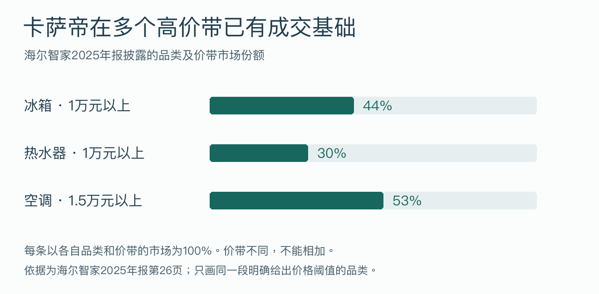

海尔披露卡萨帝2025年品牌收入实现双位数增长，卡萨帝厨电收入同比增加27%，冰箱、热水器和空调的几个高价带也已有实际份额。2026年上半年，搭载分区或全嵌功能的多种产品继续上市。公司引述奥维监测，卡萨帝致境全嵌油烟机在线上5500元以上价格带销额排名第一。这里能观察到的，是有消费者在这些价位选择海尔的产品。家装合作方是否另外收钱、促销由谁出、海尔为一次量尺和送装实际花多少钱，决定消费者愿付的高价能给海尔留下多少。 [2025年报第26、29页 · 第26页](https://static.cninfo.com.cn/finalpage/2026-03-27/1225038336.PDF#page=26) · [2026中报第18页 · 第18页](https://static.cninfo.com.cn/finalpage/2026-08-28/1225522691.PDF#page=18)

主流品牌的机会来自另一类需求。海尔用麦浪等套系覆盖品质型家庭，Leader用分区洗做更具体的产品。当使用者希望把内衣、婴童和外衣分开时，多筒能省去手洗或等待的步骤。公司披露2025年Leader收入首次超过百亿元、增30%，懒人三桶洗衣机销量超过30万台。爆款把具体需求转成销量，也会吸引同行做出类似规格。美的以COLMO和东芝同时覆盖高端，并推DTC渠道运营。海尔需要持续以新品、交付和服务获得订单。依靠补贴或让价推高份额时，即使更多家庭选择它，品牌净贡献也可能偏低。 [海尔2025年报第25–30页 · 第25页](https://static.cninfo.com.cn/finalpage/2026-03-27/1225038336.PDF#page=25) · [美的2025年报PDF第30、83页 · 第30页](https://www1.hkexnews.hk/listedco/listconews/sehk/2026/0424/2026042400679_c.pdf#page=30)

## 北美的品牌梯度保留了当地顾客熟悉的用途

北美GE、GE Profile、Café、Monogram等品牌覆盖了从普通替换到高端嵌入。2025年Monogram推出面板式饮料中心，适用于希望机器外观和柜体统一的家庭。Profile推出紧凑洗碗机，可按场地嵌入或放在台面。Café和Profile丰富了厨房设备规格，零售商可从同一家供应商采购多种价档，建商也能按房型采购有差异的组合。海尔披露2025年北美高端品牌收入增长7%，美国GE洗衣机份额26.7%来自公司引述AHAM，前者指收入、后者指特定品类和市场，不能用一个数字解释另一个。 [2025年报第26、29–30、37页 · 第26页](https://static.cninfo.com.cn/finalpage/2026-03-27/1225038336.PDF#page=26) · [GEA Pro](https://www.geappliances.com/pro/our-capabilities)

这种分层还有一个成本。型号多可以覆盖更多买家，制造、备件和库存管理也更复杂。多个品牌若只做不同外观、使用体验接近，顾客就容易在同一家族内改买打折的型号。反过来，配套产品为家庭省下反复选型和施工的成本，又可以共用不影响客户体验的部件，海尔就可能既保留价差也节约研发和采购。要区分这两种效果，需看同规格实际净售价、促销和售后，再看新品新增的销量是否来自新的客户或同一家族的换购。 [2025年报第37–38页 · 第37页](https://static.cninfo.com.cn/finalpage/2026-03-27/1225038336.PDF#page=37)

## 欧洲与新兴市场把共用平台变成不同产品

Candy和Hoover使海尔可以在已有洗护渠道继续经营主流家电。海尔品牌则用Horizon多门冰箱等产品向较高价带争取用户。2026年3月Horizon在欧洲上市，结合大容积、多门和薄嵌入设计。公司引述GfK，2026上半年海尔在西班牙和意大利的多门冰箱零售额份额分别为31.7%和30.5%。这是特定产品形态、特定两国的销售结果。与此同时，2025年欧洲家电行业样本销量增而销额减，消费者对价格和规格有取舍，Candy扭亏也不能仅从高端型号推得。 [欧委会Candy并购决定第3–6页 · 第3页](https://ec.europa.eu/competition/mergers/cases/decisions/m9139_181_3.pdf#page=3) · [2025年报第19、26–30页 · 第19页](https://static.cninfo.com.cn/finalpage/2026-03-27/1225038336.PDF#page=19) · [2026中报第17页 · 第17页](https://static.cninfo.com.cn/finalpage/2026-08-28/1225522691.PDF#page=17)

同一个冰箱平台在越南又陆续加入制冰、外取水等功能。巴基斯坦的太阳能空调针对供电条件，印度F9洗衣机面向12万卢比以上高端滚筒市场。海尔在2026三季报披露当地产品的销量或份额表现，这些是各自场景的初步证据。产品跨市场复制的经济结果，取决于复用了多少设计和部件，为当地做的改造及服务增加了多少费用，和终端所接受的价格。2026年前三季国内份额改善而毛利下降，正说明份额只能完成判断的一半。 [2026中报第17页 · 第17页](https://static.cninfo.com.cn/finalpage/2026-08-28/1225522691.PDF#page=17) · [2026三季报第3–4页 · 第3页](https://static.cninfo.com.cn/finalpage/2026-10-30/1225641263.PDF#page=3)

## 专题 · 当地渠道与服务｜订单从哪里来，出了问题谁负责

家电渠道的价值在订单之前和之后都能看到。顾客会因为门店能量尺、讲清型号和可用时间而下单，也会因为机器坏了能及时获得零件和维修而继续选择一个品牌。对海尔，渠道关系还决定谁负责货架、促销、库存、送装和坏账。公司既可自营销售，也可以借当地伙伴先取得用户，自己作为供货方和品牌服务方经营。 [2025年报第25–26、37–38、42页 · 第25页](https://static.cninfo.com.cn/finalpage/2026-03-27/1225038336.PDF#page=25)

## 中国把渠道商的仓配与获客分开

海尔的独立加盟商和零售商早已承担交易角色。2020年港股年报写明，这些独立商家按各自需要向海尔下单，自行卖给最终顾客，海尔不管理它们的日常运营或库存数量。它们可借门店试用、量尺及设计取得订单，也需要从进销价差承担门店和营销费用。卡萨帝官网的加盟材料列出销售团队、配送能力和周转资金等优先条件，单看品牌招牌不能确定零售付款归谁。 [2020年港股年报PDF第68–69页 · 第68页](https://smart-home.haier.com/media/ou1gf1ma/2021042900711.pdf#page=68) · [卡萨帝加盟说明](https://www.casarte.com/contact/)

统仓把更多备货和送装安排放到共用仓网，让不同门店不必各存一套类似型号。终端下单后，就近仓库可以直接送装，商家仍可负责选品、交易和部分服务。到2025年末，日日顺直配用户配送单量达日均10万台，海尔所称全域TC配送单量占比57%，送装一体率97%，24小时时效覆盖1944个区县。仓网和配送改善分别节省1.1亿元和2.3亿元。全年国内主营收入中，“直销用户”约占13.2%，其余列入“经销及其他”。送货数体现海尔掌握的交付，收入比重体现海尔与谁成交。 [2025年报第25、42页 · 第25页](https://static.cninfo.com.cn/finalpage/2026-03-27/1225038336.PDF#page=25)

决定资金收益的是具体安排。若门店在接消费者订单以前已经买货、付款，即便机器放在共用仓，等待零售收款期间仍占门店资金。若门店按终端订单才进货、海尔又给交付后账期，门店少承担备货，海尔先占存货资金，交货后还可能占应收。公司未披露各渠道普遍采用哪条路径。配送走得更短，能帮助减少仓配用工和时长。若被接回的信用、退换或安装成本上升，海尔获得的净收益还要重新算。 [2025年报第25、157–159页 · 第25页](https://static.cninfo.com.cn/finalpage/2026-03-27/1225038336.PDF#page=25) · [2026中报第15–16页 · 第15页](https://static.cninfo.com.cn/finalpage/2026-08-28/1225522691.PDF#page=15)

## 北美的大店、品牌直售和建商客户需要不同的服务

GEA直接面对家庭时，订单由GEA接收，按地区和现场条件安排授权人员搬运、安装或拆除旧机。对官网适用的缺货订单，公司说明下单扣卡，等货期间消费者可以取消并拿回钱，也可要求把有货部分先发。先收到的款对应尚未完成的交付，一旦退单还有返款。需要气管、电源、水源或机位改造的安装，则须按交付说明由相应主体完成，厂家并非包揽每个工序。 [GEA直购配送](https://www.geappliances.com/appliance-delivery-installation) · [GEA缺货条款](https://www.geappliances.com/backorder-terms-conditions)

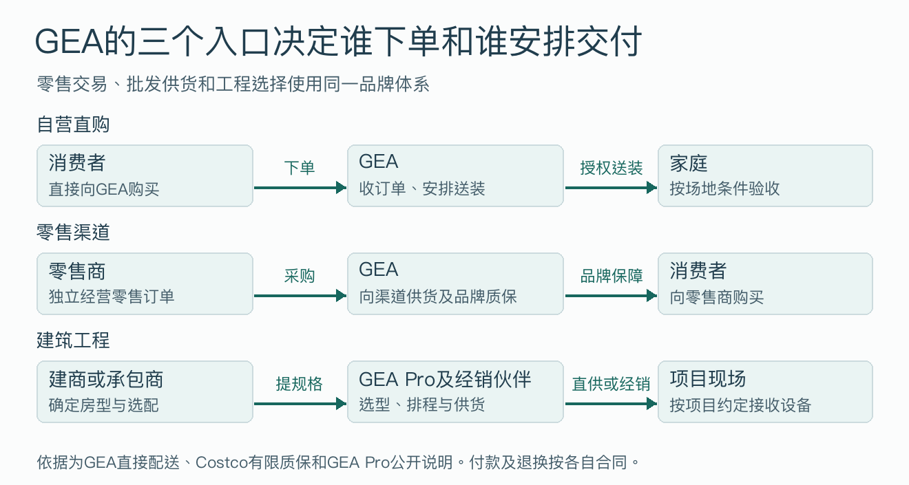

走大店时，零售商掌握消费者交易和货架，厂商要让畅销机型供应稳定，还要按合同承担服务。以Costco销售的GEA产品为例，GEA把适用的一年有限保修部分加长到两年。这个承诺有助于零售商向会员解释保障，也增加品牌方的潜在维修支出。GEA 2025年取得Lowe’s供应商合作奖。同行Whirlpool披露同一零售商占其集团销售15%，说明供应商能依托大店迅速覆盖买家，也会面临采购方在价格和售后的议价。GEA的大买家收入占比及各类优惠未披露。 [GEA Costco有限质保](https://www.geappliances.com/costco/ge-appliances-limited-product-warranty) · [海尔2025年报第26页 · 第26页](https://static.cninfo.com.cn/finalpage/2026-03-27/1225038336.PDF#page=26) · [Whirlpool 2025 Form 10-K PDF第104页 · 第104页](https://s202.q4cdn.com/229739679/files/doc_financials/2025/ar/Whirlpool-2025-10K.pdf#page=104)

面向建商，产品需先适合房型并能按施工进度交。GEA Pro可帮助选择厨房、洗衣及暖通设备，从区域配送中心直供，或交当地伙伴协调。一个工程会分批安装，住宅入住者不一定是付款人。当地分销与服务网能处理路线和现场问题，供货方也要判断工期延误、备货、付款和售后成本。GEA公开了项目服务路径，具体工程授信、分期和保留金仍取决于合同。 [GEA Pro工程能力](https://www.geappliances.com/pro/our-capabilities)

## 英国的供货模板显示本地直送与本地信用怎样共存

Haier Smart Home UK & I Ltd的供货模板要求贸易客户先签申请表，再依订单确定货品和交付地。约定地交货时转移货损风险，相关款清偿以前可保留货权，并允许买方在日常业务中转售。未另约时，贸易客户自发票日起30天内支付。若短少、未送达或货损，通知海尔和承运商的窗口为24小时。模板另允许明确约定后海尔替贸易客户直送终端。此时货物可以从品牌直接到家，供货方仍要向贸易客户收批发款，消费者退货也按另一个合同处理。 [英国贸易供货条款第1–7页 · 第1页](https://cms.candy-home.com/documents/d/global/legal_haiergeneralterms_apr25#page=1)

在这一套安排下，厂商让零售商保持获客和销售功能，同时掌握部分配送与服务。品牌可以在交付后用服务支撑渠道信誉。Candy英国保修通常提供首年上门、零件及人工，登记等条件下第2至第10年的零件保障仍要求Candy在英国或爱尔兰安装，相关人工费由消费者付。零售商需要回答顾客去哪里维修、维修是否收费，厂商则要准备配件和服务工程师。海尔2025年还称欧洲加强大客户经营、线上及DTC渠道，并新建或升级数百终端。各国的零售、保修和供货条件要分别看，英国模板只说明其中一种真实结构。 [Candy英国质保](https://www.candy-home.com/en_GB/warranty/) · [2025年报第26–27页 · 第26页](https://static.cninfo.com.cn/finalpage/2026-03-27/1225038336.PDF#page=26)

## 扩张终端覆盖，最后要用交付与回款检验

印度和东南亚渠道扩张涉及当地连锁、线上平台和售后点。海尔印度的官网可按服务请求查询进度、预约工程师并查服务中心。2026年中报称洗护业务通过重点连锁和门店运营增加覆盖。渠道端的投入需要本地组织、人员和备件支撑，不能按一次出货计算全部成效。对于海尔，越来越多的终端可以知道产品和得到服务，具有实际价值。这项能力最终能多赚多少，仍取决于订单转化、终端库存、交付的单位费用、退换与信用。在2026年前三季，国内直配和份额有所增长，集团经营现金却下行。海尔下一次验证渠道改善时，需要把两类结果接上，说明送得更快的订单能否更省钱、更及时收回货款。 [海尔印度服务](https://www.haier.com/in/service-support/) · [2026中报第17–18页 · 第17页](https://static.cninfo.com.cn/finalpage/2026-08-28/1225522691.PDF#page=17) · [2026三季报第3–5页 · 第3页](https://static.cninfo.com.cn/finalpage/2026-10-30/1225641263.PDF#page=3)

## 专题 · 制造与整合｜哪些工厂留在本地，哪些生产可以合并

海尔并购GEA和Candy后，面临的制造选择并不相同。美国市场保留并扩建本地工厂，泰国工厂同时向美国供应部分大冰箱。欧洲则关掉部分老工厂，把相应产能迁往中国，并在更广的范围使用土耳其、东南亚等基地。哪处值得生产，要比较机器在到达客户之前的全部成本，以及为交期、备货、保修和更新设备需要多占用多少资金。 [2025年报第26、38页 · 第26页](https://static.cninfo.com.cn/finalpage/2026-03-27/1225038336.PDF#page=26) · [2026中报第14页 · 第14页](https://static.cninfo.com.cn/finalpage/2026-08-28/1225522691.PDF#page=14)

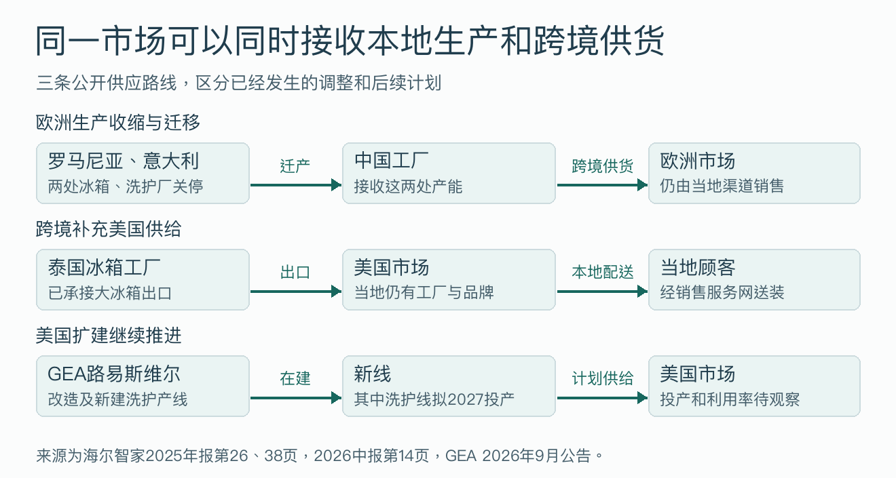

## 一套设计可以共用，实际生产仍要贴近使用场合

海尔建立全球产品和采购平台，在需求分析、试制、部件和供应商选择等环节共享资源。多门冰箱可以在两地用类似的基本结构，再按欧洲厨房的嵌入需求或越南用户的外取水、制冰需要作配置。暖通方面，2026中报称公司打通家用、商用部分内外机平台，暖通产品规格数减少18%，并在郑州、重庆、印度和泰国布局空调电脑板等物料自制。共有部件扩大采购或产量，可能减少分开开模、测试和备料。各地的安装、能效和维修条件仍会决定哪些差异不能省。 [2025年报第37–38页 · 第37页](https://static.cninfo.com.cn/finalpage/2026-03-27/1225038336.PDF#page=37) · [2026中报第17、19页 · 第17页](https://static.cninfo.com.cn/finalpage/2026-08-28/1225522691.PDF#page=17)

自产要把原先向供应商买部件的钱，部分换成设备、人工和在制品。产量足够，固定成本会分到更多台机器，零件断供和改型也较易控制。产量不足时，厂房和设备仍要维修、占资和计折旧。2026中报披露了采购和制造的内部改善指标，未披露由每项改善带来的合并净利润或现金。判断共用和自制是否赚钱，应同时看合格品的材料人工、厂房利用率、库存与品质售后，避免把内部降本指标当作最终利润。 [2026中报第19页 · 第19页](https://static.cninfo.com.cn/finalpage/2026-08-28/1225522691.PDF#page=19)

## GEA在美国扩建，也继续跨境采购

GEA有本地设计、制造和配送，能针对美式厨房和大容量洗护安排产品。GEA 2026年9月披露，自2016年以来已在美国投入超过35亿美元，2025年宣布未来五年再投入约30亿美元。2026年公布路易斯维尔约10亿美元项目，其中包含此前已宣布的约4.9亿美元前开式洗衣机与洗烘一体项目，计划2027年投产。已投金额、五年承诺和其中的单个项目需要分别看。厂房和产线要先用钱，生产启动后才有机会通过销量、交期或单位成本收回。 [GEA路易斯维尔2026年9月公告](https://pressroom.geappliances.com/news/ge-appliances-and-iue-cwa-announce-1-billion-investment-in-louisville-plant-creating-the-largest-home-appliance-manufacturing-site-in-the-u-s)

美国的零售与服务网可以接本地货，也可以接海外货。海尔2026中报说泰国冰箱工厂已承接向美国出口的大冰箱，美国本土洗衣机、热水器生产基地建设也在推进。跨境路线可以利用供应地的规模或较低出厂成本，但到岸还要付运费、跨境仓储和适用关税，多等一段时间就要准备更多安全库存。2025年美国曾将若干冰洗厨产品加入钢衍生品关税清单，按适用的钢含量价值计征。关税负担取决于具体商品、产地和当时规则。美国自制仍可能用进口零件，不能从工厂所在地推定完整关税差。 [2026中报第14页 · 第14页](https://static.cninfo.com.cn/finalpage/2026-08-28/1225522691.PDF#page=14) · [美国2025年关税通知PDF第2–3页 · 第2页](https://public-inspection.federalregister.gov/2025-11067.pdf#page=2)

## Candy保留市场，部分老厂退出

Haier Europe 2024年的地区报告列出意大利Brugherio洗护、罗马尼亚Ploiești冰箱、土耳其Eskişehir多品类生产等厂点。2025年报称罗马尼亚冰箱工厂和意大利洗涤工厂已经关停，两处相应产能整合到中国。欧洲整体供应优化还涉及土耳其、东南亚等基地。经销与安装可以继续在当地，由新的供应路线给原有品牌和渠道补货。迁产可能把订单集中到利用率较高的工厂，但要解决转产试制、劳动义务、交期、跨境存货以及零件维修。2026第三季集团披露全球供应链重塑与海外区域整合带来约5亿元一次性支出，没有按欧洲和各工厂分拆。 [Haier Europe 2024报告PDF第49页 · 第49页](https://corporate.haier-europe.com/wp-content/uploads/2025/08/Haier-Europe-Sustainability-Report-2024-3.pdf#page=49) · [2025年报第26、38页 · 第38页](https://static.cninfo.com.cn/finalpage/2026-03-27/1225038336.PDF#page=38) · [2026三季报第2页 · 第2页](https://static.cninfo.com.cn/finalpage/2026-10-30/1225641263.PDF#page=2)

公司2025年披露Candy扭亏，并把欧洲经营改善与产能、渠道和组织调整联系起来。当地冰洗份额和零售表现有实据，但欧洲对外交易收入同时含商用制冷等业务。关厂省下的厂内费用还要扣迁产和以后为欧洲发货的费用，调整完成后也要支付正常维护及当地售后。Candy单体的现金投入、租赁及资本支出未完整披露，扭亏足以表明当期经营有进展，收购和后续投资是否已回收仍需另证。 [2025年报第26–30、38、225页 · 第26页](https://static.cninfo.com.cn/finalpage/2026-03-27/1225038336.PDF#page=26)

## 新兴市场投资带来更近的供给，也需要实际销量支持

印度Greater Noida在原有生产体系上扩展空调生产和注塑，和Pune工厂一起服务本地市场。泰国既卖家电，又承担面向其他国家的供应。选择在当地制造，可缩短一些运输线路并适配当地尺寸、气候和部件，越南、印度等地终端能否把需求变成稳定订单，还要看渠道和售后。南非Kwikot把已有热水器、安装和售后系统带入集团，越南Ferroli ASEAN在2026年10月才交割。前者已有经营数据，后者的并表和资金投入尚待后续年报，适合分别观察。 [海尔印度扩产公告](https://www.haier.com/in/about-haier/news/with-a-focus-on-made-in-india-made-for-india-haier-expands-greater-noida-plant.shtml) · [2025年报第17–18、27页 · 第17页](https://static.cninfo.com.cn/finalpage/2026-03-27/1225038336.PDF#page=17) · [2026中报第14、19页 · 第14页](https://static.cninfo.com.cn/finalpage/2026-08-28/1225522691.PDF#page=14) · [Ferroli ASEAN交割](https://www.haier.com/about_haier/xinwen/20261105_296189.shtml)

2026年前三季海尔购建长期资产付现74.25亿元，较上年同期多8.47亿元，厂房、设备、数字化和其他经营投入混在其中。制造整合是否改善现金，最终要看分批投产后是否降低实际到岸或到户成本、能否按时足量交货、存货是否减少，以及节省是否覆盖更新、运输和售后。路易斯维尔洗护新线投产后要看利用率，欧洲迁产完成后要看供货费用和经营现金。如果供应路线更灵活，却要长期投入更多资本和库存才能维持同样的产品与交期，制造能力的规模还不能转化为同比例的收益。 [2026三季报第5、16页 · 第5页](https://static.cninfo.com.cn/finalpage/2026-10-30/1225641263.PDF#page=5) · [GEA路易斯维尔2026年9月公告](https://pressroom.geappliances.com/news/ge-appliances-and-iue-cwa-announce-1-billion-investment-in-louisville-plant-creating-the-largest-home-appliance-manufacturing-site-in-the-u-s)

## 专题 · 现金专题｜利润、回款和普通股现金之间差了什么

2026年前三季，海尔归母净利润149.99亿元，扣除非经常性损益后为128.19亿元。集团经营现金净额106.70亿元，同比下降39%。收入确认以交付或履约为基础，采购和工资按实际付款进入现金表。普通股能够分享的长期现金还要扣维护与外部股东所得。三个层次混在一起，就容易把这一期的现金波动错当作长期盈利，或把集团账上有的钱错当作可以马上派出。 [2026三季报第1、12–16页 · 第12页](https://static.cninfo.com.cn/finalpage/2026-10-30/1225641263.PDF#page=12)

## 先用真正收到和付出的钱解释这一期

经营现金变化先来自回款。销售和劳务现金少收61.86亿元，采购和劳务付款少付6.81亿元，两项净影响−55.05亿元。其他收支再减少约13.17亿元，主要是员工相关付款与其他经营付款增加。用未舍入金额加总，经营现金少68.21亿元。年初累计减上半年，第三季度净额约9.18亿元，上年同季63.52亿元。第三季购建长期资产付现约30.59亿元，单季现金已低于这一支出。年度现金在不同季节受备货、促销和结算影响，单季波动显示压力，不能当作长期每年重复的数字。 [2025中报第73–75页 · 第73页](https://static.cninfo.com.cn/finalpage/2025-08-29/1224609917.PDF#page=73) · [2026中报第73–75页 · 第73页](https://static.cninfo.com.cn/finalpage/2026-08-28/1225522691.PDF#page=73) · [2026三季报第15–16页 · 第15页](https://static.cninfo.com.cn/finalpage/2026-10-30/1225641263.PDF#page=15)

管理层指出国内销售下降、海外应收保理节奏调整。所谓卖断保理，是把应收款转让给金融机构，符合条件后从账上移出，公司可能提前取得现金。2025年中、2025年末、2026年中已终止确认余额分别70.93、63.43、58.22亿元。后两点相差5.21亿元，与上年同期相差12.71亿元，都是两日余额比较。期间可能卖出新应收，也可能原有应收到期，余额减少与本期少收多少没有一一对应。公开资料未提供期间新卖断实际收款和到期结算的完整滚动，所以没有把这两个差额加回。 [2025中报第120页 · 第120页](https://static.cninfo.com.cn/finalpage/2025-08-29/1224609917.PDF#page=120) · [2025年报第171页 · 第171页](https://static.cninfo.com.cn/finalpage/2026-03-27/1225038336.PDF#page=171) · [2026中报第119页 · 第119页](https://static.cninfo.com.cn/finalpage/2026-08-28/1225522691.PDF#page=119)

同一份半年报另从净利润调到经营现金。和2025上半年比较，2026上半年经营性应收多耗用78.38亿元，存货与应付合计缓解约88.78亿元，三项净影响改善约10.39亿元。它解释为什么应收走弱时不能只看一行。海尔在这半年仍少了经营现金约13.87亿元，利润及其他非现金或结算变化也起作用。三季度缺同样的调节表，所以不能用这个半年间接结果代替前三季直接收付。 [2026中报第157页 · 第157页](https://static.cninfo.com.cn/finalpage/2026-08-28/1225522691.PDF#page=157)

## 经营付钱和融资付钱各有时点

供应商可以通过融资先拿钱。海尔披露，若子公司申请银行代付，并在原应付到期之后向银行偿还，形成新的融资借款。2026年中此类余额约1.17亿元。另一种安排由供应商选择先收银行款，海尔仍按原到期日全额付款且不加利息，相关款仍是应付，期末约77.40亿元。二者有相同的银行付款外观，却只有前者延长海尔自身付款。集团应付周转天数增加8.3天，公司同时提到采购模式和原料价格，不能只从天数判断某笔订单延付。 [2026中报第158–159页 · 第158页](https://static.cninfo.com.cn/finalpage/2026-08-28/1225522691.PDF#page=158) · [2026三季报第4–5页 · 第4页](https://static.cninfo.com.cn/finalpage/2026-10-30/1225641263.PDF#page=4)

用2025全年加2026年前三季减2025年前三季，得到截至2026年三季度的滚动十二个月。集团归母净利171.79亿元，扣非归母145.30亿元，经营现金191.82亿元，购建长期资产付现96.99亿元。经营现金减购建是94.83亿元。2025年同项差额171.51亿元，但其中也还有后续现金。港股2025年现金表详细列明经营现金260.03亿元、购建约88.51亿元、租赁付款18.01亿元、借款现金利息22.94亿元。按该表相减，合并历史余额约130.57亿元，且经营现金含实收利息16.31亿元，联营分红4.66亿元在投资现金。现金表分类不同会使某项义务出现在不同位置，不能拿一个未扣租赁、利息和少数份额的差额当成可分给股东的自由现金。 [2025年报第125–126页 · 第125页](https://static.cninfo.com.cn/finalpage/2026-03-27/1225038336.PDF#page=125) · [2025港股年报PDF第170–171页 · 第170页](https://www1.hkexnews.hk/listedco/listconews/sehk/2026/0427/2026042702192.pdf#page=170) · [2025三季报第2、16–18页 · 第16页](https://static.cninfo.com.cn/finalpage/2025-10-31/1224773819.PDF#page=16) · [2026三季报第12–16页 · 第12页](https://static.cninfo.com.cn/finalpage/2026-10-30/1225641263.PDF#page=12)

## 分红和回购的实际现金，不能按利润所属年度拼接

经营现金流已把非现金股份支付从利润调整出去。因此从现金表起步时，应扣实际购股付款，不再扣一次相同的报表费用。为比较过去三年，采用各年最近一次所读年报的可比口径：2023用2024年报重列，2024用2025年报重列，2025用本年报。先做“经营现金−全部购建−现金租赁−借款利息＋联营实收−少数股息实付”，得到下图分派前余额，再扣普通股息和集团全部股份购回。 [2024港股年报现金表](https://www1.hkexnews.hk/listedco/listconews/sehk/2025/0429/2025042903800.pdf) · [2025港股年报现金表PDF第170—171页 · 第170页](https://www1.hkexnews.hk/listedco/listconews/sehk/2026/0427/2026042702192.pdf#page=170)

计算逐项为：2023年 **265.36−105.42−17.29−19.83＋6.84−0.30≈129.36**；2024年 **263.18−100.80−17.09−24.44＋5.79−0.93≈125.71**；2025年 **260.03−88.52−18.01−22.94＋4.66−0.97≈134.25**。金额取整会有0.01亿元差异。这些历史余额尚含金融利息、全部扩建购建，少数只扣实付而非完整经济份额，也没有扣另列的并购和金融本金交易，故用于检查资金安排，不能直接认定为正常归母自由现金。各年现金表自身的期初期末已核对，不把不同重列版本的余额机械首尾累计。 [2024港股年报现金表](https://www1.hkexnews.hk/listedco/listconews/sehk/2025/0429/2025042903800.pdf) · [2025港股年报现金表PDF第170—171页 · 第170页](https://www1.hkexnews.hk/listedco/listconews/sehk/2026/0427/2026042702192.pdf#page=170)

2025年上述余量7.09亿元尚未扣少数股权相关退出看跌期权实付21.55亿元，单这项就超出余量。这笔筹资付款属于权益资本安排，与员工激励期权费用不同，也不是普通股分红。金融资产净买入92.47亿元、借还本金净流入约15.19亿元另列；不能据7.09亿元推定集团现金只变动这么多。 [2025港股现金表 · 第170页](https://www1.hkexnews.hk/listedco/listconews/sehk/2026/0427/2026042702192.pdf#page=170)

2025年现金表普通股股息实付114.83亿元，包含2024利润所属年度的末期及2025年中期。2025利润年度中期加末期每股1.16071元、合计约107.55亿元，则有末期在2026年8月支付。2025年两次宣派合计约115.03亿元与报表实付114.83亿元差约0.20亿元，公告金额和汇兑、结算时间没有完全拆齐，不把差额编成员工支出。2026上半年普通股股息实付为零；6月末应付的82.4832亿元，是8月实施2025末期的金额。应付、宣派与实际离开账户必须分开。 [2025港股年报现金表PDF第170—171页 · 第170页](https://www1.hkexnews.hk/listedco/listconews/sehk/2026/0427/2026042702192.pdf#page=170) · [2026港股中报现金表PDF第12—13页 · 第12页](https://www1.hkexnews.hk/listedco/listconews/sehk/2026/0928/2026092801607.pdf#page=12) · [2025末期分派调整](https://static.cninfo.com.cn/finalpage/2026-08-07/1225465164.PDF) · [2026年8月实施公告](https://static.cninfo.com.cn/finalpage/2026-08-15/1225474603.PDF)

发行人A股市场买入2023、2024、2025分别约14.32、4.67、10.80亿元；H股同期成交约1.9914亿、0.2707亿、0.9992亿港元。集团现金表全部股份购回分别18.02、5.59、12.34亿元，范围包括需另外核对的计划买入及结算。不能把集团回购行与A/H成交换算后的差额全判成员工成本。2025方案完成额12.0138亿元跨到2026年，2026年1月还有旧方案1.2155亿元，因此12.0138不能全记到2025。 [2023方案实施结果](https://static.cninfo.com.cn/finalpage/2024-04-30/1219910885.PDF) · [2025方案实施结果](https://static.cninfo.com.cn/finalpage/2026-03-27/1225038099.PDF) · [2026年1月进展 · 第3页](https://www1.hkexnews.hk/listedco/listconews/sehk/2026/0202/2026020202812_c.pdf#page=3) · [2024港股年报现金表](https://www1.hkexnews.hk/listedco/listconews/sehk/2025/0429/2025042903800.pdf) · [2025港股年报现金表PDF第170—171页 · 第170页](https://www1.hkexnews.hk/listedco/listconews/sehk/2026/0427/2026042702192.pdf#page=170)

2026年新A方案截至10月底实际成交23.3590亿元，加1月旧方案，日历年已执行A股约24.5745亿元。新方案累计买入11184.1989万股，7月转出4156万股，尚余7028.1989万股；按已披露成交价格和总额估计，尚未转出股份占用过的购买现金约14.05—15.21亿元。这是已花的钱形成的股份库存，不能再拿它作现金分红，也不等于今后每年要花同样金额。H股前三季成交9357.726万港元，10月30日及11月9日再成交935.27万港元；D股年初场内买入865,598股，含费用约179.22万欧元，10月要约另付1.484637亿欧元。A股2026年注销7454.1486万股、H股10月注销455万股，是早先买入股份的处理，不再新增相同金额付款。 [D股要约实付](https://static.cninfo.com.cn/finalpage/2026-10-02/1225593764.PDF) · [A股截至10月末进展](https://static.cninfo.com.cn/finalpage/2026-11-03/1225652209.PDF) · [H股10月30日回购](https://www.hkexnews.hk/listedco/listconews/sehk/2026/1030/2026103001970.pdf) · [H股11月9日回购](https://www1.hkexnews.hk/listedco/listconews/sehk/2026/1109/2026110900656.pdf) · [A股注销公告](https://static.cninfo.com.cn/finalpage/2026-09-01/1225538081.PDF) · [D股年初回购](https://static.cninfo.com.cn/finalpage/2026-02-28/1224986896.PDF)

2026前三季经营现金106.7005减实付购建74.2536，余 **32.4469亿元**，还没有扣同期租赁和借款现金利息、处理联营及少数实收实付。Q3没有这些完整明细，不能填出一个精确的全年可分数。现金等价物由462.6769降到396.5484，减少66.1284＝经营106.7005−投资109.7309−筹资52.7610−汇兑10.3370。印度股权收到55.91亿元为一次性筹资。当前回款疲弱时，分红与购股同时执行还依靠融资、金融资产变动及存量资金；正常年度102亿元不是2026已经实现的现金。 [2026三季报第9—16页 · 第9页](https://static.cninfo.com.cn/finalpage/2026-10-30/1225641263.PDF#page=9) · [2026港股中报现金表PDF第12—13页 · 第12页](https://www1.hkexnews.hk/listedco/listconews/sehk/2026/0928/2026092801607.pdf#page=12)

## 2026年已识别用途，为什么需要存量及融资承接

2026上半年集团现金表已披露股份回购实付16.2470亿元，普通股息实付为零；这是已结算的集团半年度口径，不能再加到截至11月逐市场成交小计上。 [2026中报第156页 · 第156页](https://static.cninfo.com.cn/finalpage/2026-08-28/1225522691.PDF#page=156) · [2026港股中报现金表 · 第13页](https://www1.hkexnews.hk/listedco/listconews/sehk/2026/0928/2026092801607.pdf#page=13)

截至11月9日已披露的发行人购股，A股日历年累计24.5745亿元、H股1.0292996亿港元、D股1.50255918亿欧元。为看规模，统一按11月10日中间价港元0.85642、欧元7.5071换算，约 **36.74亿元**；加8月实施的2025年度末期普通股息82.4832亿元，已识别用途示意约 **119.22亿元**。这里A截至10月底，H截至11月9日，D含年初场内和10月要约；成交金额及当下中间价换算不等于集团按结算日确认的全部人民币实付。 [10月A股进展](https://static.cninfo.com.cn/finalpage/2026-11-03/1225652209.PDF) · [11月9日H股披露 · 第5页](https://www1.hkexnews.hk/listedco/listconews/sehk/2026/1109/2026110900656.pdf#page=5) · [D股年初成交](https://static.cninfo.com.cn/finalpage/2026-02-28/1224986896.PDF) · [D股10月结算 · 第6页](https://static.cninfo.com.cn/finalpage/2026-10-02/1225593764.PDF#page=6) · [末期分派调整 · 第3页](https://static.cninfo.com.cn/finalpage/2026-08-07/1225465164.PDF#page=3)

相对地，前三季经营现金106.70亿元减购建74.25亿元只余32.45亿元，还未扣同期租赁与借款息；印度权益交易55.91亿元是一次性筹资；前三季借入269.82减偿还225.90，借还本金净流入43.92亿元，同期现金等价物仍实际下降66.13亿元。这些数的期间、主体和结算口径不同，**119.22减32.45不是精确资金缺口**。它们共同显示：近期分红、购股和其他用途不能仅依靠当期经营净流入，须由原有可用资金、金融资产变动、借还款及权益筹资承接。公开资料未逐笔指定哪笔印度款或贷款用于哪次回购，也未给出2026全年完整现金用途，保留这个边界。 [2026三季报现金表 · 第15页](https://static.cninfo.com.cn/finalpage/2026-10-30/1225641263.PDF#page=15) · [2026港股中报现金表与印度交易 · 第12页](https://www1.hkexnews.hk/listedco/listconews/sehk/2026/0928/2026092801607.pdf#page=12)

## 员工激励是成本，购股、过户和归属各有时间

2026年A股回购方案拟用30—60亿元，期限为2026年3月26日至2027年3月25日，用于员工持股或股权激励；回购完成后36个月未使用的股份须注销。这个金额是跨年度买股预算，不能直接当成每年的薪酬费用。公司先付钱从市场买入股份，随后将部分库存股转给员工计划，员工还要满足服务与业绩条件才能归属。注销则消灭股份，注销当日不再付款。 [2026年A股回购报告书](https://static.cninfo.com.cn/finalpage/2026-03-27/1225038318.PDF)

2026年度员工持股资金8.704亿元来自公司提取的激励基金，属于薪酬安排；7月向计划过户4156万股，按每股20.93元计价为8.698508亿元。既然资金由公司提供，就不能把过户对价当成员工自掏腰包给集团带来的新增现金，也不能把拨款与同批股份的市场买入再并列成两次经济成本。2026、2027、2028为考核年度，对应40%、30%、30%份额；最后一笔股份登记公告后锁定12个月，锁定期结束后由管委会确定满足条件的归属日。计划的法律资产隔离不自动证明合并报表的具体范围；披露未给出集团与计划逐笔银行划拨及抵销，实际现金以集团现金表为核对起点。 [2026员工持股管理办法](https://static.cninfo.com.cn/finalpage/2026-07-01/1225400707.PDF) · [过户计价公告](https://static.cninfo.com.cn/finalpage/2026-07-04/1225409669.PDF) · [非交易过户公告](https://static.cninfo.com.cn/finalpage/2026-07-11/1225418333.PDF)

股份支付费用随着服务及归属条件确认。2025年A/H员工持股、H股限制性单位、A股期权三类毛费用分别8.68、0.25、0.95，合计9.88；三类冲回2.23、0.15、2.60，合4.98，净费用约4.90。2024比较数的毛费用8.91、冲回5.17，净3.74。冲回来自失效、离职或业绩等条件变化；未归属股份还可转授符合条件者、用于后续计划或注销，所以冲回不证明股份最终一定未给员工，更不代表当期收到退款。2026上半年毛摊销4.5383、冲回6.7821，净费用为−2.2439。不能把最近的负费用永续化，也不能只删掉本期全部冲回、却忽略以前年份同样有较大冲回。 [2025港股年报附注37，印刷285—287页 · 第286页](https://www1.hkexnews.hk/listedco/listconews/sehk/2026/0427/2026042702192.pdf#page=286) · [2026中报股份支付及现金调节，第149、157、183页 · 第149页](https://static.cninfo.com.cn/finalpage/2026-08-28/1225522691.PDF#page=149)

中国准则披露的2023、2024、2025年净费用为6.1061、3.7407、4.8966亿元。正常年度取5亿元，4—6亿元只用于激励成本的取值敏感；它代表近期净授予消耗的量级，不是承诺未来只花5亿元买股。如果业绩恢复、失效减少而实际负担接近8—10亿元毛费用尺度，同条件下普通股正常现金约98.36—100.00亿元。公司当年8.704亿元激励基金与集团跨计划、跨工具确认的费用不同，不能互相直接替代。 [2025港股年报附注37，印刷285—287页 · 第286页](https://www1.hkexnews.hk/listedco/listconews/sehk/2026/0427/2026042702192.pdf#page=286) · [2026中报股份支付及现金调节，第149、157、183页 · 第149页](https://static.cninfo.com.cn/finalpage/2026-08-28/1225522691.PDF#page=149)

## 将账面激励费用替换成正常成本

原165亿元税前经营收益包含账面股份支付，不能再直接减掉正常5亿元。2025年净费用4.896550、2026上半年−2.243855、2025上半年2.210739，组合得到截至2026年6月的滚动净费用 **4.896550−2.243855−2.210739＝0.441956亿元**。若Δ表示2026单三季度净费用减2025单三季度净费用，则9月滚动费用为0.441956＋Δ。三季报没有披露这两项，Δ仍未知；主例取Δ＝0表示两年单三季度净费用相同这一演算假设。 [2025港股年报附注37，印刷285—287页 · 第286页](https://www1.hkexnews.hk/listedco/listconews/sehk/2026/0427/2026042702192.pdf#page=286) · [2026中报股份支付及现金调节，第149、157、183页 · 第149页](https://static.cninfo.com.cn/finalpage/2026-08-28/1225522691.PDF#page=149)

新的税前经营收益为 **165＋0.441956＋Δ−5＝160.441956＋Δ亿元**。按主例18%税，每增加1亿元Δ，修正后的正常现金增加0.82亿元，因为原利润已经多扣了这笔费用，替换时需要多还原。若本次净增加的激励经济成本4.558044亿元不能取得18%边际税抵、原费用税务处理保持，现金为102.455243−4.558044×18%＝101.634795亿元，约101.63亿元。旧约106亿元和单独剔除6.78亿元毛冲回得到的约100.6亿元，分别是修正前和单因素试算；当前采用逐年净成本替换，并保留季度未知。

## 稳定年度创造多少

在主例税前160.441956亿元之上，先加使用权摊销17.81、扣正常租赁19，按18%经营税；再加其他折摊69.69、扣维护与必要升级97，年度新增周转资金为零。得到 **(160.441956＋17.81−19)×82%＋69.69−97＝103.276604亿元** 合并经营现金。97接近滚动实际购建96.99，租赁参考2025实付18.01及滚动18.96；规模和信用稳定才允许新增周转为零。这些取值保留必要更新，不把建设都当成可取消增长。

## 合并经营所得怎样归到普通股

少数股东先按7.5估计。滚动少数损益约7.67，去可辨认非经常因素约7.31，6–9作为情景。印度交易收到55.91现金，但在保留控制、继续合并的同时让出一部分未来经营所得，本滚动年度尚未覆盖一个完整的交易后年度。报表实际支付的少数股息约0.97只是已派款，不能替代这些股东完整的经济份额。由103.276604减7.5得95.776604。再加正常联营实收6，参考港股2025年4.66及2026年上半年4.98，避免将半年度直接翻倍，得剥离金融后的核心归母及联营现金101.776604。联营分派进入估值后，账面联营等权益266.88不再加回。 [2025港股年报PDF第170–171页 · 第170页](https://www1.hkexnews.hk/listedco/listconews/sehk/2026/0427/2026042702192.pdf#page=170) · [2026港股中报PDF第12–13、41页 · 第12页](https://www1.hkexnews.hk/listedco/listconews/sehk/2026/0928/2026092801607.pdf#page=12) · [2026三季报第9–14页 · 第9页](https://static.cninfo.com.cn/finalpage/2026-10-30/1225641263.PDF#page=9)

若问题是维持现有存款和借款，每年会给普通股多留下多少，还要算净融资利息。滚动利息收入16.8904，减全部息费19.7069扣去租赁利息代理3.6441后的非租赁息费，税前净得0.8276，按18%税后约0.68。租赁利息代理截至半年，其他滚动数截至三季，现金和应计也有差别，合计约102.455亿元，正文取约102。若正常激励成本仅在4—6亿元变化、季度Δ取零，现金约101.64—103.28；这只是激励一项的敏感范围。沿同一桥改变经营及其他参数，低需求稳定保守/主例/较有利分别约90.35/102.46/116.22亿元；需求继续恶化的压力情景约80.75亿元，仍不代表风险下界。本篇展开主例；保守/较有利/恶化三情景的激励调整前收益依次162/167/155，税20%/17%/20%，维护101/89/105，少数9/6/9，联营5/7/5；其他输入沿用主例，净息按各自税率调整，可沿上述公式复算。2025年净非租赁利息税后约−4.85，若净息回到−5而非＋0.68，正常现金还要再降约5.68亿元。

## 102亿元和30—60亿元回购怎样放进同一张资金预算

约102亿元已经扣了正常员工激励的经济成本，用于判断长期可以反复创造多少。做具体年度现金预算，要把其中尚未付现的费用还原，改扣同期实际买股款，并处理税差和结算时点。假设同一年达到主例经营、5亿元激励费用全属非现金，税与其他时点不变，A股实际买入30或60亿元，则 **102.46＋5−30＝77.46**，或 **102.46＋5−60＝47.46亿元**，供股息及其他用途。它们还未扣其他回购、并购或额外留资。按季末股数约为每股0.83或0.51元；若同时每股派1元，至少另找15.58或45.58亿元资金，其他用途尚在其外。

这是把购股时点与长期成本接起来的条件预算，不是2026或2027全年预测。30—60亿元计划跨年，截至10月底新计划已付23.36亿元，要达到计划区间还余6.64—36.64亿元，不把已付款再从期末资金扣一遍。工行最高50亿元、期限3年的专项贷款承诺也不能当作已提款金额；贷款能缓解眼前付款，却带来利息和还本，不能增加经营创造的财富。若以后持续每年买30—60亿元，而净激励消耗只数亿元，就必须说明差额是不断堆库存、后续授予还是净注销，不能一边保留这些股份、一边把同一现金全部算作分红。 [2026年A股回购报告书](https://static.cninfo.com.cn/finalpage/2026-03-27/1225038318.PDF) · [截至10月回购进展](https://static.cninfo.com.cn/finalpage/2026-11-03/1225652209.PDF)

按93.03088164亿股，派0.9、1.0、1.1元分别需要83.73、93.03、102.33亿元。主例102.46亿元在1元分红后余9.42亿元；1.1元几乎耗尽余量。低需求稳定的保守情景90.35亿元已经比1元所需少2.68亿元；进一步恶化情景80.75亿元连0.9元也少2.97亿元。因而0.9—1元只能是经营与资本安排允许时的分配假设，近期大额回购若没有足够存量或融资补足，也会压低可派股息。

## 从创造能力到母公司账户

子公司留着现金，上市母公司不一定同期收到。2025年母公司确认对子公司的成本法投资收益134.42亿元，母公司现金流中取得投资收益收到的现金约1.29亿元，同时另有122.89亿元其他筹资收款。已读披露没有把内部冲抵、上划与股息到账逐笔连起来，不能把其他筹资收款全当股息。2026三季末集团货币资金410.84亿元，母公司约51.86亿元。股东到账需看子公司及联营实际分配、母公司付债和其他用途，以及实际派息。以季末已发行93.03亿股计，若分每股1元需要约93.03亿元，接近但低于102亿元主例。创造能力若落在低端或母公司不能及时调资，覆盖空间就很窄。 [2025年报第120–121、127–128、244页 · 第127页](https://static.cninfo.com.cn/finalpage/2026-03-27/1225038336.PDF#page=127) · [2026三季报第10、16–21页 · 第16页](https://static.cninfo.com.cn/finalpage/2026-10-30/1225641263.PDF#page=16)

## 专题 · 资本专题｜并购、留资、股东分配怎样接到一起

海尔智家能买到海外品牌和客户，也能扩大本地制造。但扩张所得需要经市场检验，已经赚到的现金还要在经营主体、债权人、少数股东和上市母公司之间分配。并购价值、账上金融资产和普通股分红可以相互影响，三项不能简单相加。 [2025年报第17–18、37–38、79–80页 · 第37页](https://static.cninfo.com.cn/finalpage/2026-03-27/1225038336.PDF#page=37)

## 并购带来收入以后，原股东靠什么收回投入

2016年青岛海尔从GE取得家电业务，基础价54亿美元，交割时已按调整付55.80亿美元，最终约56.12亿美元。买方取得现有渠道、工厂、研发和售后，还接手合同约定的相关义务。GE商标权依许可，主要类别初期免费，续期后的净销售额收费要从未来现金扣。后来GEA在美国投入逾35亿美元，又宣布未来五年约30亿美元。2026年路易斯维尔约10亿美元的项目包含先前公告的约4.9亿美元洗护线，投资计划与已支付资本开支不能累加。大型渠道能持续销售、多个品牌能协同供货，是获得经营平台的实际证据。至今公开数据仍不能把GEA经营净现金、后续设备更新与收购总支出按同范围接成一条普通股回报记录。 [GEA购买实施报告PDF第7–12、17–18页 · 第11页](https://static.cninfo.com.cn/finalpage/2017-01-12/1203008866.PDF#page=11) · [GEA 2026年9月制造计划](https://pressroom.geappliances.com/news/ge-appliances-and-iue-cwa-announce-1-billion-investment-in-louisville-plant-creating-the-largest-home-appliance-manufacturing-site-in-the-u-s)

Candy原股东把全部股权卖给海尔欧洲持股公司，股份购买协议金额4.75亿欧元，购买会计约4.67亿欧元。2025年公司披露Candy扭亏，也关闭了意大利洗涤与罗马尼亚冰箱工厂。若当地产销协同使工厂利用率提高、服务仍能维持，这笔投资的长期收益会改善。为此已投入的改造、搬迁和组织成本以及未来的跨境配送，还需从长期现金扣。只比较收购当年的亏损与现在跨过盈亏点，无法得知何时收回收购款。 [H股上市历史文件印刷第151–152页 · 第7页](https://www1.hkexnews.hk/listedco/listconews/sehk/2020/1116/9513606/2020111600097.pdf#page=7) · [2020港股年报PDF第267页 · 第267页](https://smart-home.haier.com/media/ou1gf1ma/2021042900711.pdf#page=267) · [2025年报第26–30、38页 · 第26页](https://static.cninfo.com.cn/finalpage/2026-03-27/1225038336.PDF#page=26)

开利商用制冷的资金结构更复杂。卖方7.75亿美元企业价值含约2亿美元净养老金义务，不能再把养老金当作另一笔全新的收购价加上去。2024年报将欧洲标的合并现金成本与此前持有权益分开，欧洲Benelux对应现金5.77亿欧元、原持权益约0.51亿欧元，另列印度资产收购27.58亿卢比。并表后的短期利润包含转型和整合，2025年公司说首个完整年销售改善。要知道这类商超客户能给股东带来多少，需继续观察设备、部件和工地资金、保修服务、养老金后实际能回多少现金。南非Kwikot购得现成安装与经销关系，2025年公司称较收购前利润增加约10%。Ferroli ASEAN到2026年10月才交割，尚未披露完整价款与资金后果。 [2024年报第211–213页 · 第211页](https://static.cninfo.com.cn/finalpage/2025-03-28/1222926246.PDF#page=211) · [Carrier卖方交割稿](https://www.carrier.com/refrigeration/en/worldwide/news/news-article/carrier-completes-775m-sale-of-its-commercial-refrigeration-business-to-haier.html) · [海尔2025业绩公告](https://www.haier.com/global/press-events/news/20260402_288863.shtml) · [Ferroli ASEAN交割](https://www.haier.com/about_haier/xinwen/20261105_296189.shtml)

## 印度收款交换的是股权，不是多卖了一批货

印度交易中，当地业务继续并表，港股中报以集团处置49%、保留51%计，收到55.91亿元现金。相关账面权益20.81亿元移交少数股东，差额约35.10亿元记资本公积。资本公积变化没有形成额外的销售利润，55.91亿元股权款也只发生一次。律师披露交易含股权转让和增发，描述海尔与投资团各49%和2%员工计划。普通股估值沿发行人持续控制与51%权益的报表口径处理，2%的具体权利待披露。印度经营仍可扩张，但新增利润要按新的归属分给各方。 [2026港股中报PDF第11、13、41页 · 第41页](https://www1.hkexnews.hk/listedco/listconews/sehk/2026/0928/2026092801607.pdf#page=41) · [2026A股中报第168页 · 第168页](https://static.cninfo.com.cn/finalpage/2026-08-28/1225522691.PDF#page=168) · [交易律师披露](https://www.dlapiper.com/en-us/news/2026/04/dla-piper-advises-haier-smart-home)

## 金融资产有价值，哪些能回拨仍需看债务和期限

海尔集团财务公司由海尔智家持有42%，作为联营公司按权益法核算。2026年中相关股权账面约85.58亿元。合并范围内各公司另把货币资金、短长期款存入财务公司。按中报四类本金，106.82亿元货币资金、109.18亿元长期、10.63亿元其他流动和113.13亿元一年内到期，合计339.76亿元，另列相关应计利息。同期借款37.97亿元、票据开立85.52亿元各有用途。股权收益不等于到账，存款与相应贷款、票据也不是同一合同，余额不能直接抵销。2027–2029年新框架披露每年最高存款限额340亿元，额度并不决定资金能否立刻取回。 [2026中报第121、125、180页 · 第180页](https://static.cninfo.com.cn/finalpage/2026-08-28/1225522691.PDF#page=180) · [财务公司风险评估](https://ea-cdn.eurolandir.com/press-releases-attachments./4172296/600690_20260828_LEDC.pdf) · [2026股东会通函印刷第20页 · 第20页](https://www1.hkexnews.hk/listedco/listconews/sehk/2026/0603/2026060300001.pdf#page=20)

季末集团报表上的货币资金410.84亿元和现金等价物396.55亿元已有14.29亿元口径差。股东可用的金融价值还要在候选资源里扣融资负债，给日常备货、工资和渠道信用留资，并按实际归属和收回时点计量。期末未到期理财披露、关联存款和报表金融资产可能指向同一笔资源，只有独立项目才能相加。经营价值若采用剥金融口径，可把经查明的净余资另加，前提是已扣掉相应融资且没有保留它的利息收益。 [2026三季报第8、10–12、16页 · 第10页](https://static.cninfo.com.cn/finalpage/2026-10-30/1225641263.PDF#page=10)

## 普通股创造的钱和母公司实际派出的现金

经营子公司先付供应商和员工、补设备并留本地资金，再按当地公司安排分配或调拨。集团三季末货币资金410.84亿元，母公司单体约51.86亿元。两者不同，集团股东的经济权益还需经过到账和分配程序。印度让出权益取得55.91亿元是一次性筹资款，未来当地经营仍并表，但须与投资者分享权益。 [2026三季报第9–12、17–18页 · 第9页](https://static.cninfo.com.cn/finalpage/2026-10-30/1225641263.PDF#page=9) · [2026港股中报PDF第12–13、41页 · 第41页](https://www1.hkexnews.hk/listedco/listconews/sehk/2026/0928/2026092801607.pdf#page=41)

2023、2024利润所属年度每股分派0.80131、0.96504元，2025中期加末期1.16071元；末期实际支付跨入下一日历年。公司规划2026—2028年现金分红率不低于各年归母利润的58%、60%、60%，这是利润比例规划，不是固定金额承诺。2026上半年未派中期。2025年度分派合计约107.55亿元，不能据此推定低需求下永远维持同额。 [2023分派实施](https://static.cninfo.com.cn/finalpage/2024-08-10/1220833309.PDF) · [2024分派实施](https://static.cninfo.com.cn/finalpage/2025-07-19/1224215236.PDF) · [2025末期调整](https://static.cninfo.com.cn/finalpage/2026-08-07/1225465164.PDF) · [2026股东会决议](https://www.hkexnews.hk/listedco/listconews/sehk/2026/0624/2026062401928.pdf)

## 员工激励是成本，购股、过户和归属各有时间

2026年A股回购方案拟用30—60亿元，期限为2026年3月26日至2027年3月25日，用于员工持股或股权激励；回购完成后36个月未使用的股份须注销。这个金额是跨年度买股预算，不能直接当成每年的薪酬费用。公司先付钱从市场买入股份，随后将部分库存股转给员工计划，员工还要满足服务与业绩条件才能归属。注销则消灭股份，注销当日不再付款。 [2026年A股回购报告书](https://static.cninfo.com.cn/finalpage/2026-03-27/1225038318.PDF)

2026年度员工持股资金8.704亿元来自公司提取的激励基金，属于薪酬安排；7月向计划过户4156万股，按每股20.93元计价为8.698508亿元。既然资金由公司提供，就不能把过户对价当成员工自掏腰包给集团带来的新增现金，也不能把拨款与同批股份的市场买入再并列成两次经济成本。2026、2027、2028为考核年度，对应40%、30%、30%份额；最后一笔股份登记公告后锁定12个月，锁定期结束后由管委会确定满足条件的归属日。计划的法律资产隔离不自动证明合并报表的具体范围；披露未给出集团与计划逐笔银行划拨及抵销，实际现金以集团现金表为核对起点。 [2026员工持股管理办法](https://static.cninfo.com.cn/finalpage/2026-07-01/1225400707.PDF) · [过户计价公告](https://static.cninfo.com.cn/finalpage/2026-07-04/1225409669.PDF) · [非交易过户公告](https://static.cninfo.com.cn/finalpage/2026-07-11/1225418333.PDF)

股份支付费用随着服务及归属条件确认。2025年A/H员工持股、H股限制性单位、A股期权三类毛费用分别8.68、0.25、0.95，合计9.88；三类冲回2.23、0.15、2.60，合4.98，净费用约4.90。2024比较数的毛费用8.91、冲回5.17，净3.74。冲回来自失效、离职或业绩等条件变化；未归属股份还可转授符合条件者、用于后续计划或注销，所以冲回不证明股份最终一定未给员工，更不代表当期收到退款。2026上半年毛摊销4.5383、冲回6.7821，净费用为−2.2439。不能把最近的负费用永续化，也不能只删掉本期全部冲回、却忽略以前年份同样有较大冲回。 [2025港股年报附注37，印刷285—287页 · 第286页](https://www1.hkexnews.hk/listedco/listconews/sehk/2026/0427/2026042702192.pdf#page=286) · [2026中报股份支付及现金调节，第149、157、183页 · 第149页](https://static.cninfo.com.cn/finalpage/2026-08-28/1225522691.PDF#page=149)

中国准则披露的2023、2024、2025年净费用为6.1061、3.7407、4.8966亿元。正常年度取5亿元，4—6亿元只用于激励成本的取值敏感；它代表近期净授予消耗的量级，不是承诺未来只花5亿元买股。如果业绩恢复、失效减少而实际负担接近8—10亿元毛费用尺度，同条件下普通股正常现金约98.36—100.00亿元。公司当年8.704亿元激励基金与集团跨计划、跨工具确认的费用不同，不能互相直接替代。 [2025港股年报附注37，印刷285—287页 · 第286页](https://www1.hkexnews.hk/listedco/listconews/sehk/2026/0427/2026042702192.pdf#page=286) · [2026中报股份支付及现金调节，第149、157、183页 · 第149页](https://static.cninfo.com.cn/finalpage/2026-08-28/1225522691.PDF#page=149)

2026年7月的归属公告给出一个实际例子：2024计划按2025业绩计算的综合完成率为0.79，部分指定人员当期不归属；2024 H股本次应归属仅4.0911万股，2025 H股本次不归属。2026 A股单期基金已达8.704亿元，管理办法对指定人员按调整ROE达到17%全归属、16%至17%由管委会判断，其他人员另按考核。旧期权陆续退出、授予规模及考核规则又会变化，因此低需求不能自动推出以后继续有同样冲回。5亿元只是净成本主情景，8—10亿元负担压力继续保留。 [2026权益归属公告](https://static.cninfo.com.cn/finalpage/2026-07-04/1225409663.PDF) · [2026计划管理办法 · 第4页](https://static.cninfo.com.cn/finalpage/2026-07-01/1225400707.PDF#page=4)

## 分红和回购的实际现金，不能按利润所属年度拼接

经营现金流已把非现金股份支付从利润调整出去。因此从现金表起步时，应扣实际购股付款，不再扣一次相同的报表费用。为比较过去三年，采用各年最近一次所读年报的可比口径：2023用2024年报重列，2024用2025年报重列，2025用本年报。先做“经营现金−全部购建−现金租赁−借款利息＋联营实收−少数股息实付”，得到下图分派前余额，再扣普通股息和集团全部股份购回。 [2024港股年报现金表](https://www1.hkexnews.hk/listedco/listconews/sehk/2025/0429/2025042903800.pdf) · [2025港股年报现金表PDF第170—171页 · 第170页](https://www1.hkexnews.hk/listedco/listconews/sehk/2026/0427/2026042702192.pdf#page=170)

计算逐项为：2023年 **265.36−105.42−17.29−19.83＋6.84−0.30≈129.36**；2024年 **263.18−100.80−17.09−24.44＋5.79−0.93≈125.71**；2025年 **260.03−88.52−18.01−22.94＋4.66−0.97≈134.25**。金额取整会有0.01亿元差异。这些历史余额尚含金融利息、全部扩建购建，少数只扣实付而非完整经济份额，也没有扣另列的并购和金融本金交易，故用于检查资金安排，不能直接认定为正常归母自由现金。各年现金表自身的期初期末已核对，不把不同重列版本的余额机械首尾累计。 [2024港股年报现金表](https://www1.hkexnews.hk/listedco/listconews/sehk/2025/0429/2025042903800.pdf) · [2025港股年报现金表PDF第170—171页 · 第170页](https://www1.hkexnews.hk/listedco/listconews/sehk/2026/0427/2026042702192.pdf#page=170)

2025年上述余量7.09亿元尚未扣少数股权相关退出看跌期权实付21.55亿元，单这项就超出余量。这笔筹资付款属于权益资本安排，与员工激励期权费用不同，也不是普通股分红。金融资产净买入92.47亿元、借还本金净流入约15.19亿元另列；不能据7.09亿元推定集团现金只变动这么多。 [2025港股现金表 · 第170页](https://www1.hkexnews.hk/listedco/listconews/sehk/2026/0427/2026042702192.pdf#page=170)

2025年现金表普通股股息实付114.83亿元，包含2024利润所属年度的末期及2025年中期。2025利润年度中期加末期每股1.16071元、合计约107.55亿元，则有末期在2026年8月支付。2025年两次宣派合计约115.03亿元与报表实付114.83亿元差约0.20亿元，公告金额和汇兑、结算时间没有完全拆齐，不把差额编成员工支出。2026上半年普通股股息实付为零；6月末应付的82.4832亿元，是8月实施2025末期的金额。应付、宣派与实际离开账户必须分开。 [2025港股年报现金表PDF第170—171页 · 第170页](https://www1.hkexnews.hk/listedco/listconews/sehk/2026/0427/2026042702192.pdf#page=170) · [2026港股中报现金表PDF第12—13页 · 第12页](https://www1.hkexnews.hk/listedco/listconews/sehk/2026/0928/2026092801607.pdf#page=12) · [2025末期分派调整](https://static.cninfo.com.cn/finalpage/2026-08-07/1225465164.PDF) · [2026年8月实施公告](https://static.cninfo.com.cn/finalpage/2026-08-15/1225474603.PDF)

发行人A股市场买入2023、2024、2025分别约14.32、4.67、10.80亿元；H股同期成交约1.9914亿、0.2707亿、0.9992亿港元。集团现金表全部股份购回分别18.02、5.59、12.34亿元，范围包括需另外核对的计划买入及结算。不能把集团回购行与A/H成交换算后的差额全判成员工成本。2025方案完成额12.0138亿元跨到2026年，2026年1月还有旧方案1.2155亿元，因此12.0138不能全记到2025。 [2023方案实施结果](https://static.cninfo.com.cn/finalpage/2024-04-30/1219910885.PDF) · [2025方案实施结果](https://static.cninfo.com.cn/finalpage/2026-03-27/1225038099.PDF) · [2026年1月进展 · 第3页](https://www1.hkexnews.hk/listedco/listconews/sehk/2026/0202/2026020202812_c.pdf#page=3) · [2024港股年报现金表](https://www1.hkexnews.hk/listedco/listconews/sehk/2025/0429/2025042903800.pdf) · [2025港股年报现金表PDF第170—171页 · 第170页](https://www1.hkexnews.hk/listedco/listconews/sehk/2026/0427/2026042702192.pdf#page=170)

2026年新A方案截至10月底实际成交23.3590亿元，加1月旧方案，日历年已执行A股约24.5745亿元。新方案累计买入11184.1989万股，7月转出4156万股，尚余7028.1989万股；按已披露成交价格和总额估计，尚未转出股份占用过的购买现金约14.05—15.21亿元。这是已花的钱形成的股份库存，不能再拿它作现金分红，也不等于今后每年要花同样金额。H股前三季成交9357.726万港元，10月30日及11月9日再成交935.27万港元；D股年初场内买入865,598股，含费用约179.22万欧元，10月要约另付1.484637亿欧元。A股2026年注销7454.1486万股、H股10月注销455万股，是早先买入股份的处理，不再新增相同金额付款。 [D股要约实付](https://static.cninfo.com.cn/finalpage/2026-10-02/1225593764.PDF) · [A股截至10月末进展](https://static.cninfo.com.cn/finalpage/2026-11-03/1225652209.PDF) · [H股10月30日回购](https://www.hkexnews.hk/listedco/listconews/sehk/2026/1030/2026103001970.pdf) · [H股11月9日回购](https://www1.hkexnews.hk/listedco/listconews/sehk/2026/1109/2026110900656.pdf) · [A股注销公告](https://static.cninfo.com.cn/finalpage/2026-09-01/1225538081.PDF) · [D股年初回购](https://static.cninfo.com.cn/finalpage/2026-02-28/1224986896.PDF)

2026前三季经营现金106.7005减实付购建74.2536，余 **32.4469亿元**，还没有扣同期租赁和借款现金利息、处理联营及少数实收实付。Q3没有这些完整明细，不能填出一个精确的全年可分数。现金等价物由462.6769降到396.5484，减少66.1284＝经营106.7005−投资109.7309−筹资52.7610−汇兑10.3370。印度股权收到55.91亿元为一次性筹资。当前回款疲弱时，分红与购股同时执行还依靠融资、金融资产变动及存量资金；正常年度102亿元不是2026已经实现的现金。 [2026三季报第9—16页 · 第9页](https://static.cninfo.com.cn/finalpage/2026-10-30/1225641263.PDF#page=9) · [2026港股中报现金表PDF第12—13页 · 第12页](https://www1.hkexnews.hk/listedco/listconews/sehk/2026/0928/2026092801607.pdf#page=12)

## 2026年已识别用途，为什么需要存量及融资承接

2026上半年集团现金表已披露股份回购实付16.2470亿元，普通股息实付为零；这是已结算的集团半年度口径，不能再加到截至11月逐市场成交小计上。 [2026中报第156页 · 第156页](https://static.cninfo.com.cn/finalpage/2026-08-28/1225522691.PDF#page=156) · [2026港股中报现金表 · 第13页](https://www1.hkexnews.hk/listedco/listconews/sehk/2026/0928/2026092801607.pdf#page=13)

截至11月9日已披露的发行人购股，A股日历年累计24.5745亿元、H股1.0292996亿港元、D股1.50255918亿欧元。为看规模，统一按11月10日中间价港元0.85642、欧元7.5071换算，约 **36.74亿元**；加8月实施的2025年度末期普通股息82.4832亿元，已识别用途示意约 **119.22亿元**。这里A截至10月底，H截至11月9日，D含年初场内和10月要约；成交金额及当下中间价换算不等于集团按结算日确认的全部人民币实付。 [10月A股进展](https://static.cninfo.com.cn/finalpage/2026-11-03/1225652209.PDF) · [11月9日H股披露 · 第5页](https://www1.hkexnews.hk/listedco/listconews/sehk/2026/1109/2026110900656.pdf#page=5) · [D股年初成交](https://static.cninfo.com.cn/finalpage/2026-02-28/1224986896.PDF) · [D股10月结算 · 第6页](https://static.cninfo.com.cn/finalpage/2026-10-02/1225593764.PDF#page=6) · [末期分派调整 · 第3页](https://static.cninfo.com.cn/finalpage/2026-08-07/1225465164.PDF#page=3)

相对地，前三季经营现金106.70亿元减购建74.25亿元只余32.45亿元，还未扣同期租赁与借款息；印度权益交易55.91亿元是一次性筹资；前三季借入269.82减偿还225.90，借还本金净流入43.92亿元，同期现金等价物仍实际下降66.13亿元。这些数的期间、主体和结算口径不同，**119.22减32.45不是精确资金缺口**。它们共同显示：近期分红、购股和其他用途不能仅依靠当期经营净流入，须由原有可用资金、金融资产变动、借还款及权益筹资承接。公开资料未逐笔指定哪笔印度款或贷款用于哪次回购，也未给出2026全年完整现金用途，保留这个边界。 [2026三季报现金表 · 第15页](https://static.cninfo.com.cn/finalpage/2026-10-30/1225641263.PDF#page=15) · [2026港股中报现金表与印度交易 · 第12页](https://www1.hkexnews.hk/listedco/listconews/sehk/2026/0928/2026092801607.pdf#page=12)

## 102亿元和30—60亿元回购怎样放进同一张资金预算

约102亿元已经扣了正常员工激励的经济成本，用于判断长期可以反复创造多少。做具体年度现金预算，要把其中尚未付现的费用还原，改扣同期实际买股款，并处理税差和结算时点。假设同一年达到主例经营、5亿元激励费用全属非现金，税与其他时点不变，A股实际买入30或60亿元，则 **102.46＋5−30＝77.46**，或 **102.46＋5−60＝47.46亿元**，供股息及其他用途。它们还未扣其他回购、并购或额外留资。按季末股数约为每股0.83或0.51元；若同时每股派1元，至少另找15.58或45.58亿元资金，其他用途尚在其外。

这是把购股时点与长期成本接起来的条件预算，不是2026或2027全年预测。30—60亿元计划跨年，截至10月底新计划已付23.36亿元，要达到计划区间还余6.64—36.64亿元，不把已付款再从期末资金扣一遍。工行最高50亿元、期限3年的专项贷款承诺也不能当作已提款金额；贷款能缓解眼前付款，却带来利息和还本，不能增加经营创造的财富。若以后持续每年买30—60亿元，而净激励消耗只数亿元，就必须说明差额是不断堆库存、后续授予还是净注销，不能一边保留这些股份、一边把同一现金全部算作分红。 [2026年A股回购报告书](https://static.cninfo.com.cn/finalpage/2026-03-27/1225038318.PDF) · [截至10月回购进展](https://static.cninfo.com.cn/finalpage/2026-11-03/1225652209.PDF)

按93.03088164亿股，派0.9、1.0、1.1元分别需要83.73、93.03、102.33亿元。主例102.46亿元在1元分红后余9.42亿元；1.1元几乎耗尽余量。低需求稳定的保守情景90.35亿元已经比1元所需少2.68亿元；进一步恶化情景80.75亿元连0.9元也少2.97亿元。因而0.9—1元只能是经营与资本安排允许时的分配假设，近期大额回购若没有足够存量或融资补足，也会压低可派股息。

## 专题 · D股专题｜同一家公司的分派权怎样变成欧元回报

海尔智家的A、H、D股是同一发行人的普通股，章程规定不同类别普通股享有平等分派。股东买到的是海尔智家的剩余权益，交易和收款却走各自市场。A股在上海以人民币交易，H股在香港以港元交易，D股690D在法兰克福以欧元交易，证券识别号CNE1000031C1。股息可由同一人民币基数出发，投资人取得的欧元、港元或人民币不同。市场交易、税务和未来出售价格也不同。 [海尔智家现行章程第17–23条](https://www1.hkexnews.hk/listedco/listconews/sehk/2026/0624/2026062402028.pdf) · [D股挂牌公告](https://smart-home.haier.com/media/xahjxv5h/qingdao-haier-co-ltd-successfully-listed-on-the-ceinex-d-share-market-today.pdf)

## D股分派从公司人民币金额到投资人到账

2025年度末期分红调整后为每股0.89151元人民币。按公司披露的换算率1欧元兑7.81225元人民币，D股税前每股约0.1141169欧元。公司公告列明经Clearstream支付，扣本次中国预提税10%后每股约0.1027052欧元，2026年8月20日登记、21日支付。税前金额反映公司分派，税后公告金额只扣了指定预提税。投资人实际到账还会受税籍、抵免、托管及账户费用影响，不能把公司公告的10%当作所有人的最终有效税率。实际派息汇率也与投资人买入、出售或换回人民币时的汇率分开。 [D股2025末期分派公告](https://www.eqs-news.com/news/corporate/haier-smart-home-co-ltd-dividend-announcement/390e4135-387e-43c8-995e-2e6f1cae746d_en) · [2026年股东会决议](https://www.hkexnews.hk/listedco/listconews/sehk/2026/0624/2026062401928.pdf)

低需求稳定且正常激励净成本5亿元、季度同比差暂设零时，普通股正常年度现金约102亿元。每股0.9、1、1.1元需要83.73、93.03、102.33亿元；1.1元几乎耗尽主例。较保守经营情景90.35亿元已不足每股1元，实际购股还会占用近期现金。因此以下股息只是可核验的情景，不是以分红率规划推定的固定承诺。

## 两个市场的价差能否转化成退出收益

上市文件的股本章节把D转H列为需要权属文件、D股名册变更及港交所批准相关股份上市的安排。公司和过户机构要完成相应程序，H股还要符合登记和交易条件。公开资料没有提供给普通持有人一项随时按价差换股的承诺。Clearstream在回购要约中给待交收权益安排的临时识别号，只为结算要约，不是换成H股。投资人若不能用同一价格从另一市场退出，D股的价差就可能长期保留。 [H股上市文件股本章节印刷第291–292页 · 第4页](https://www1.hkexnews.hk/listedco/listconews/sehk/2020/1116/9513606/2020111600102.pdf#page=4) · [Clearstream要约结算安排](https://www.clearstream.com/clearstream-en/res-library/settlement/registered-shares-announcements/rs26042-5538086)

2026年D股要约在9月4日至29日接受，价格1.87欧元，接受约7939万股，约为当时D股发行数量的29.29%。实际支付1.4846371694亿欧元，月末公告仍列为拟注销而尚未注销。若将要约7939.2362万股与年初场内已购865,598股均注销，原271,013,973股D股将余190,756,013股；注销进度与付款各自核对。要约让接受者收到实际退出现金，也可能改变剩余交易量和深度。以后买卖要看真实盘口和规模，不能把已经结束的要约当作随时可行的退出价。 [D股要约公告](https://www.eqs-news.com/news/corporate/haier-smart-home-co-ltd-launches-voluntary-public-share-buy-back-offer-for-up-to-81044512-d-shares-at-eur-1-87/bb7a9a48-8c24-407b-b16c-863d0a4bad4e_en) · [要约支付翌日披露第1、3、6页 · 第3页](https://static.cninfo.com.cn/finalpage/2026-10-02/1225593764.PDF#page=3) · [2026年10月股本月报](https://www1.hkexnews.hk/listedco/listconews/sehk/2026/1102/2026110203065.pdf)

## 102亿元和30—60亿元回购怎样放进同一张资金预算

约102亿元已经扣了正常员工激励的经济成本，用于判断长期可以反复创造多少。做具体年度现金预算，要把其中尚未付现的费用还原，改扣同期实际买股款，并处理税差和结算时点。假设同一年达到主例经营、5亿元激励费用全属非现金，税与其他时点不变，A股实际买入30或60亿元，则 **102.46＋5−30＝77.46**，或 **102.46＋5−60＝47.46亿元**，供股息及其他用途。它们还未扣其他回购、并购或额外留资。按季末股数约为每股0.83或0.51元；若同时每股派1元，至少另找15.58或45.58亿元资金，其他用途尚在其外。

这是把购股时点与长期成本接起来的条件预算，不是2026或2027全年预测。30—60亿元计划跨年，截至10月底新计划已付23.36亿元，要达到计划区间还余6.64—36.64亿元，不把已付款再从期末资金扣一遍。工行最高50亿元、期限3年的专项贷款承诺也不能当作已提款金额；贷款能缓解眼前付款，却带来利息和还本，不能增加经营创造的财富。若以后持续每年买30—60亿元，而净激励消耗只数亿元，就必须说明差额是不断堆库存、后续授予还是净注销，不能一边保留这些股份、一边把同一现金全部算作分红。 [2026年A股回购报告书](https://static.cninfo.com.cn/finalpage/2026-03-27/1225038318.PDF) · [截至10月回购进展](https://static.cninfo.com.cn/finalpage/2026-11-03/1225652209.PDF)

按93.03088164亿股，派0.9、1.0、1.1元分别需要83.73、93.03、102.33亿元。主例102.46亿元在1元分红后余9.42亿元；1.1元几乎耗尽余量。低需求稳定的保守情景90.35亿元已经比1元所需少2.68亿元；进一步恶化情景80.75亿元连0.9元也少2.97亿元。因而0.9—1元只能是经营与资本安排允许时的分配假设，近期大额回购若没有足够存量或融资补足，也会压低可派股息。

## 以1.82欧元买入，怎样从股息和终值复算回报

以1.82欧元买入。采用2026年11月10日人民币中间价 **7.5071元/欧元**，并假设未来每年换汇及退出时不变；这不是汇率预测，也不是更新的D股买卖报价。按中国预提10%，不含额外税费，每股人民币0.9、1.0、1.1元分红净收约0.10790、0.11989、0.13188欧元。持有十年，每年末收息，第十年末同时出售；以同一个年率折现十笔股息和卖出款，令现值等于1.82，得到下图欧元内部回报率。 [中国外汇交易中心2026年11月10日中间价](https://www.chinamoney.com.cn/r/cms/www/chinamoney/data/fx/ccpr.json)

每股1元、原价退出时，净股息率与该路径IRR均约6.59%；终值降到1.30或1欧元，同样股息的IRR降至4.23%或2.58%。0.9元、原价退出约5.93%；1.1元、原价退出约7.25%，但它几乎用光主例年度能力，不能又安排大额额外购股。若前3年每股0.8元，后7年1元，原价退出约6.11%；这条独立派息路径并不表示60亿元购股年度仍能自给派0.8元。若只第一年0.8元，后续1元，约6.42%。

把同年购股预算直接接到持有回报：假设第一年达到102.46亿元主例、5亿元非现金成本可还原，却只靠当年资金支付A股购股，且先不安排其他用途。买30亿元时，第一年股息示意上限77.46亿元÷93.03亿股≈0.833元；买60亿元时约0.510元。再假设以后九年均派1元、相同税汇且原价退出，十年IRR分别约 **6.44%、6.17%**。这是回购占款如何影响回报的演算，其他付款会继续压低股息；存量资金或融资可以提高首年派息，却须另外确认其成本。它不把跨年30—60亿元计划强塞入某个实际财年，也不保证后九年恢复。

汇率和税变化也会改答案：同为每股1元和原价退出，固定汇率8元/欧元时约6.18%；7.5071汇率但有效扣税20%时约5.86%。D/H折价比例不变，仍允许H股价格下跌，D股欧元终值也随之变化。因此“折价不收敛”只能排除一种上行来源，不能替代退出价假设。若要求10%的欧元年化、并原价退出，在同一税汇条件下需每股约1.518元股息，合全体普通股约141.23亿元；若始终每股1元，则十年后约需2.81欧元退出。两者均比主例要求更强。公司人民币EPV的10%机会成本与投资人税后欧元IRR的10%，不可以混用。

## 专题 · 估值专题｜把激励、年度现金和资本支出放进同一套判断

海尔智家在国内、北美和欧洲仍有能持续接单的品牌、渠道和服务网络。2026年前三季收入、扣非利润和经营现金同时下行。假设需求在低位稳定，规模与信用条件不再恶化，正常激励净成本每年5亿元，维持与必要升级97亿元，保持现有融资安排，普通股正常年度现金约 **102亿元**。这是可用于普通股分派或留存的经济能力；实际分红还要与当期回购、债务和其他付款一起安排。近期购股数十亿元时，不能仍将102亿元全部列作可派现金。 [2026三季报第9—16页 · 第9页](https://static.cninfo.com.cn/finalpage/2026-10-30/1225641263.PDF#page=9)

本轮由原约106亿元向下修正，关键是把账上的净股份支付换成正常员工成本，并补齐实际购股与分红的时间。主例也依赖一个未披露参数：2026单三季度与2025单三季度净股份支付费用之差暂设为零。低需求稳定下联动经营、税、维护与少数权益参数，现金约90—116亿元；需求继续恶化时还会更低。按每股0.9—1元分红、汇率不变且十年后仍以1.82欧元卖出，买入的欧元年化回报约5.9%—6.6%。折价不收敛不保证原价退出。下面分别核对已经付出的钱、正常创造能力及投资人到账。金额除另注外均为人民币亿元。

## 第一步｜资产账面能告诉多少

三季末归母权益1230.6758。先扣账面的商誉260.1259和无形资产132.2172，剩838.3326。除以当时已发行93.03088164亿股，约9.01元人民币每股。这里用全部合并商誉和无形资产扣归母权益，作为偏保守的账面筛查，归属和公允价值还未逐项重估。GE商标许可、区域品牌、货架、安装服务、库存与工厂组织，要维持同等能力重新搭建需要多少钱，不能从历史商誉推出。应收回收、资产重置和税务影响也还没独立计量。 [2026三季报第9–12页 · 第9页](https://static.cninfo.com.cn/finalpage/2026-10-30/1225641263.PDF#page=9) · [GEA实施报告第7–12页 · 第7页](https://static.cninfo.com.cn/finalpage/2017-01-12/1203008866.PDF#page=7)

三季末后已识别的回购现金包括D股要约1.4846371694亿欧元、10月A股0.4581907264亿元、10月30日及11月9日H股935.27万港元。统一按11月10日中间价欧元7.5071、港元0.85642换算，合 **11.6836亿元**。838.3326减该额约826.6490，仍用季末93.03088164亿股，约8.89元。由于9月归母账面权益是否已经确认D要约应付或库存扣减未被单列披露，8.89元是将全部已识别季后现金再扣的偏保守参照，存在D款最多约0.12元/股重复扣减的可能；不能声称这是核定的季后净资产。9.01及8.89元为部分账面筛查，不能当作清算下限或完整重建值。已在9月报表中的购股不重复扣，尚未注销的股份也不提前给缩股利益；未来换用已反映这些事项的新报表时须同步移除这项季后扣减。 [D股要约实付](https://static.cninfo.com.cn/finalpage/2026-10-02/1225593764.PDF) · [A股截至10月末进展](https://static.cninfo.com.cn/finalpage/2026-11-03/1225652209.PDF) · [H股10月30日回购](https://www.hkexnews.hk/listedco/listconews/sehk/2026/1030/2026103001970.pdf) · [H股11月9日回购](https://www1.hkexnews.hk/listedco/listconews/sehk/2026/1109/2026110900656.pdf) · [中国外汇交易中心2026年11月10日中间价](https://www.chinamoney.com.cn/r/cms/www/chinamoney/data/fx/ccpr.json)

## 第二步｜从账上利润走到每年能留下的经营现金

先把金融收益和融资成本从经营起点剥开。滚动十二个月税前利润207.2449，加已扣的全部利息费用19.7069，减利息收入16.8904及投资收益14.5580，得195.5034。再将非经常性净额还原至合并税前，即归母26.4850，加相关税6.5662和少数份额0.3636，合计33.4148，粗扣后为162.0886。金融处置与先扣掉的投资收益可能交叉，非经常金融项目4.5738只帮助观察交叉规模，无法整项加回。累计披露的税收、会计等法律法规调整影响约20.05，报告未完整拆明税种及地区。另有约5亿元海外整合费用，项目可结束，类似迁产或整合仍可能发生，本轮没有全额加回。套保和汇兑以同一范围看。 [2025年报第12–13、202–203、244–245页 · 第202页](https://static.cninfo.com.cn/finalpage/2026-03-27/1225038336.PDF#page=202) · [2025三季报第8–9页 · 第8页](https://static.cninfo.com.cn/finalpage/2025-10-31/1224773819.PDF#page=8) · [2026三季报第5–6、12–14页 · 第5页](https://static.cninfo.com.cn/finalpage/2026-10-30/1225641263.PDF#page=5)

激励单独正常化之前，采用162–167作为低需求工作区间，原始主例165，相当于滚动收入的5.69%。国内份额和海外服务网仍能维系成交，给主例略高于机械扣非结果的空间，三季销量、毛利和收款又没有支持一次完整复苏。这个起点先估现有业务能赚多少，尚没有换成每年实际收付。 [2026三季报第2–6、12–14页 · 第2页](https://static.cninfo.com.cn/finalpage/2026-10-30/1225641263.PDF#page=2)

## 员工激励是成本，购股、过户和归属各有时间

2026年A股回购方案拟用30—60亿元，期限为2026年3月26日至2027年3月25日，用于员工持股或股权激励；回购完成后36个月未使用的股份须注销。这个金额是跨年度买股预算，不能直接当成每年的薪酬费用。公司先付钱从市场买入股份，随后将部分库存股转给员工计划，员工还要满足服务与业绩条件才能归属。注销则消灭股份，注销当日不再付款。 [2026年A股回购报告书](https://static.cninfo.com.cn/finalpage/2026-03-27/1225038318.PDF)

2026年度员工持股资金8.704亿元来自公司提取的激励基金，属于薪酬安排；7月向计划过户4156万股，按每股20.93元计价为8.698508亿元。既然资金由公司提供，就不能把过户对价当成员工自掏腰包给集团带来的新增现金，也不能把拨款与同批股份的市场买入再并列成两次经济成本。2026、2027、2028为考核年度，对应40%、30%、30%份额；最后一笔股份登记公告后锁定12个月，锁定期结束后由管委会确定满足条件的归属日。计划的法律资产隔离不自动证明合并报表的具体范围；披露未给出集团与计划逐笔银行划拨及抵销，实际现金以集团现金表为核对起点。 [2026员工持股管理办法](https://static.cninfo.com.cn/finalpage/2026-07-01/1225400707.PDF) · [过户计价公告](https://static.cninfo.com.cn/finalpage/2026-07-04/1225409669.PDF) · [非交易过户公告](https://static.cninfo.com.cn/finalpage/2026-07-11/1225418333.PDF)

股份支付费用随着服务及归属条件确认。2025年A/H员工持股、H股限制性单位、A股期权三类毛费用分别8.68、0.25、0.95，合计9.88；三类冲回2.23、0.15、2.60，合4.98，净费用约4.90。2024比较数的毛费用8.91、冲回5.17，净3.74。冲回来自失效、离职或业绩等条件变化；未归属股份还可转授符合条件者、用于后续计划或注销，所以冲回不证明股份最终一定未给员工，更不代表当期收到退款。2026上半年毛摊销4.5383、冲回6.7821，净费用为−2.2439。不能把最近的负费用永续化，也不能只删掉本期全部冲回、却忽略以前年份同样有较大冲回。 [2025港股年报附注37，印刷285—287页 · 第286页](https://www1.hkexnews.hk/listedco/listconews/sehk/2026/0427/2026042702192.pdf#page=286) · [2026中报股份支付及现金调节，第149、157、183页 · 第149页](https://static.cninfo.com.cn/finalpage/2026-08-28/1225522691.PDF#page=149)

中国准则披露的2023、2024、2025年净费用为6.1061、3.7407、4.8966亿元。正常年度取5亿元，4—6亿元只用于激励成本的取值敏感；它代表近期净授予消耗的量级，不是承诺未来只花5亿元买股。如果业绩恢复、失效减少而实际负担接近8—10亿元毛费用尺度，同条件下普通股正常现金约98.36—100.00亿元。公司当年8.704亿元激励基金与集团跨计划、跨工具确认的费用不同，不能互相直接替代。 [2025港股年报附注37，印刷285—287页 · 第286页](https://www1.hkexnews.hk/listedco/listconews/sehk/2026/0427/2026042702192.pdf#page=286) · [2026中报股份支付及现金调节，第149、157、183页 · 第149页](https://static.cninfo.com.cn/finalpage/2026-08-28/1225522691.PDF#page=149)

## 将账面激励费用替换成正常成本

原165亿元税前经营收益包含账面股份支付，不能再直接减掉正常5亿元。2025年净费用4.896550、2026上半年−2.243855、2025上半年2.210739，组合得到截至2026年6月的滚动净费用 **4.896550−2.243855−2.210739＝0.441956亿元**。若Δ表示2026单三季度净费用减2025单三季度净费用，则9月滚动费用为0.441956＋Δ。三季报没有披露这两项，Δ仍未知；主例取Δ＝0表示两年单三季度净费用相同这一演算假设。 [2025港股年报附注37，印刷285—287页 · 第286页](https://www1.hkexnews.hk/listedco/listconews/sehk/2026/0427/2026042702192.pdf#page=286) · [2026中报股份支付及现金调节，第149、157、183页 · 第149页](https://static.cninfo.com.cn/finalpage/2026-08-28/1225522691.PDF#page=149)

新的税前经营收益为 **165＋0.441956＋Δ−5＝160.441956＋Δ亿元**。按主例18%税，每增加1亿元Δ，修正后的正常现金增加0.82亿元，因为原利润已经多扣了这笔费用，替换时需要多还原。若本次净增加的激励经济成本4.558044亿元不能取得18%边际税抵、原费用税务处理保持，现金为102.455243−4.558044×18%＝101.634795亿元，约101.63亿元。旧约106亿元和单独剔除6.78亿元毛冲回得到的约100.6亿元，分别是修正前和单因素试算；当前采用逐年净成本替换，并保留季度未知。

## 把正常经营收益换成持续现金

**租赁换成付款。** 使用权资产摊销17.81是账面费用，先加回，再扣对应资本化租赁正常付款19。参考港股报表2025年实付18.01及截至2026中报的滚动18.96。先前已加回全部息费，这里扣了租赁付款后不再单扣租赁利息。短租、低值及变动租赁仍留在经营费用。**经营税取18%。** 滚动报告税率约13.4%，剔除可辨非经常后的工作读数约12.2%，2026年半年约16.8%。18%为避免把近期较低税负当长期的重置，17%–20%用于试算。 [2025年报第122–124、244–245页 · 第244页](https://static.cninfo.com.cn/finalpage/2026-03-27/1225038336.PDF#page=244) · [2025港股年报PDF第170–171页 · 第170页](https://www1.hkexnews.hk/listedco/listconews/sehk/2026/0427/2026042702192.pdf#page=170) · [2026港股中报PDF第12–13页 · 第12页](https://www1.hkexnews.hk/listedco/listconews/sehk/2026/0928/2026092801607.pdf#page=12)

**设备折旧与更新分别处理。** 其他折旧摊销按2025年中国准则53.02、14.13和2.54，合计69.69。它是历史成本摊销，先加回。维持和必要升级现金用97，接近滚动实付96.99，近年全部购建也有重列2024年的100.80和2025年的88.52作参照。工厂迁移、设备更新、扩产往往同期发生，目前无法可靠地将其中一块全部剔作可放弃的增长。若未来同样产量、质量和交付可以靠更少支出维持，97会偏高。**年度新增周转资金主例取零。** 只有在业务规模和信用条件稳定时成立。原本所需的备货、履约和日常付款仍要资金支持，旧库存释放也不能年年发生。 [2025年报第125–126、244–245页 · 第244页](https://static.cninfo.com.cn/finalpage/2026-03-27/1225038336.PDF#page=244) · [2026三季报第4–5、15–16页 · 第15页](https://static.cninfo.com.cn/finalpage/2026-10-30/1225641263.PDF#page=15)

按上述口径，正常合并经营现金 **E＝(160.441956＋17.81−19)×(1−18%)＋69.69−97−0＝103.276604亿元**。此处已经付过正常租金、经营税和维持投入。随后再看谁有权分享这笔现金。

## 合并经营所得怎样归到普通股

少数股东先按7.5估计。滚动少数损益约7.67，去可辨认非经常因素约7.31，6–9作为情景。印度交易收到55.91现金，但在保留控制、继续合并的同时让出一部分未来经营所得，本滚动年度尚未覆盖一个完整的交易后年度。报表实际支付的少数股息约0.97只是已派款，不能替代这些股东完整的经济份额。由103.276604减7.5得95.776604。再加正常联营实收6，参考港股2025年4.66及2026年上半年4.98，避免将半年度直接翻倍，得剥离金融后的核心归母及联营现金101.776604。联营分派进入估值后，账面联营等权益266.88不再加回。 [2025港股年报PDF第170–171页 · 第170页](https://www1.hkexnews.hk/listedco/listconews/sehk/2026/0427/2026042702192.pdf#page=170) · [2026港股中报PDF第12–13、41页 · 第12页](https://www1.hkexnews.hk/listedco/listconews/sehk/2026/0928/2026092801607.pdf#page=12) · [2026三季报第9–14页 · 第9页](https://static.cninfo.com.cn/finalpage/2026-10-30/1225641263.PDF#page=9)

若问题是维持现有存款和借款，每年会给普通股多留下多少，还要算净融资利息。滚动利息收入16.8904，减全部息费19.7069扣去租赁利息代理3.6441后的非租赁息费，税前净得0.8276，按18%税后约0.68。租赁利息代理截至半年，其他滚动数截至三季，现金和应计也有差别，合计约102.455亿元，正文取约102。若正常激励成本仅在4—6亿元变化、季度Δ取零，现金约101.64—103.28；这只是激励一项的敏感范围。沿同一桥改变经营及其他参数，低需求稳定保守/主例/较有利分别约90.35/102.46/116.22亿元；需求继续恶化的压力情景约80.75亿元，仍不代表风险下界。参数在下文展开。2025年净非租赁利息税后约−4.85，若净息回到−5而非＋0.68，正常现金还要再降约5.68亿元。

## 经营参数联动

以下保留每个情景独有参数。所有情景正常净激励5亿元、季度同比差Δ＝0、使用权折摊17.81、租赁19、其他折摊69.69、新增周转资金零。金额亿元，净息随各行税率变化；不是统计置信区间。

| 情景 | 激励调整后税前收益 | 税率 | 维护 | 少数 | 联营 |
|---|---:|---:|---:|---:|---:|
| 低需求保守 | 157.44 | 20% | 101 | 9 | 5 |
| 主例 | 160.44 | 18% | 97 | 7.5 | 6 |
| 较有利 | 162.44 | 17% | 89 | 6 | 7 |
| 进一步恶化 | 150.44 | 20% | 105 | 9 | 5 |

## 金融本金要与融资债务配对

公司持有的金融资源可以支持经营、偿还债务，剩余部分才可能额外归股东。债权候选沿用报表分类，是否能按账面回收须另核。三季末候选四项为货币资金410.84、交易性金融资产35.15、一年内到期的非流动资产112.13、债权投资175.94，合计734.06。以现金等价物396.55替代全部货币资金，合计719.77。理财披露、财务公司存款及应计息可能已包含在候选行，不能另累加。2026年中报披露关联财务公司存款339.76，占全部存款约39.69%，仍要看实际期限、信用和能否从相关主体调回。 [2026三季报第9–11、15–16页 · 第9页](https://static.cninfo.com.cn/finalpage/2026-10-30/1225641263.PDF#page=9) · [2026中报第126–129、180页 · 第126页](https://static.cninfo.com.cn/finalpage/2026-08-28/1225522691.PDF#page=126) · [财务公司风险评估](https://ea-cdn.eurolandir.com/press-releases-attachments./4172296/600690_20260828_LEDC.pdf)

三季末短借、长借和债券合计389.98，一年内到期的非流动负债53.70另含融资、租赁和准备。将后一行全数暂扣作筛查，候选净额约276–290。若这行没有可另归融资的成分，则数学上约330–344。两种是账表范围测试。经营桥已按全额租赁现金计量，租赁项须在最终配对时分离，不能再当融资负债扣。上述数值还未扣正常经营留资，也未核实经济回收、税费、时点及普通股归属，不能直接当作可派本金。 [2026三季报第9–12页 · 第9页](https://static.cninfo.com.cn/finalpage/2026-10-30/1225641263.PDF#page=9) · [2026中报第138–142页 · 第138页](https://static.cninfo.com.cn/finalpage/2026-08-28/1225522691.PDF#page=138)

估值从不含净息的核心101.776604起步。金融资源须按经济可回收额、普通股归属、税费和收款时点折算，先留足经营所需资金，之后仍能覆盖对应全部融资债务，才适用主例。对于覆盖后未证实的正余资，暂不另计价值，额外净金融价值 **X＝0**。即便账面资源能还债，若同时留不足正常备资，就还有经济缺口。未反映在经营价值或其他损失中的部分应计入额外净损失 **L**，已经计入的部分只扣一次。年度新增周转资金为零是流量假设，不能由此把所需存量也取零。

## 现有经营每股值多少，买价需要什么支持

将能够重复取得的现金按人民币机会成本r折现。正常年度无增长时，经营及联营价值为101.776604÷r，普通股权益还要加经核实的额外净金融价值X、扣季后已识别现金11.683609及额外净损失L。故 **V＝(103.276604−7.5＋6)÷r＋X−11.683609−L**，单位亿元。它不保留已另行处理金融资源的净利息。分母保守用9月已发行93.03088164亿股，未预给注销缩股收益。 [2026三季报第9—16页 · 第9页](https://static.cninfo.com.cn/finalpage/2026-10-30/1225641263.PDF#page=9) · [D股要约实付](https://static.cninfo.com.cn/finalpage/2026-10-02/1225593764.PDF) · [A股截至10月末进展](https://static.cninfo.com.cn/finalpage/2026-11-03/1225652209.PDF) · [H股10月30日回购](https://www.hkexnews.hk/listedco/listconews/sehk/2026/1030/2026103001970.pdf) · [H股11月9日回购](https://www1.hkexnews.hk/listedco/listconews/sehk/2026/1109/2026110900656.pdf)

本式的金融覆盖与X测试统一站在 **2026年9月30日、扣本式季后现金之前**，采用的融资范围为短借、长借、债券及当前到期科目筛查；D要约买股义务不另塞入这组借款。D要约9月29日截止，翌日披露列10月2日购回及已付对价1.4846371694亿欧元。季末报表没有按D要约单独拆出应付、专户或库存，不能宣称已查明全部9月会计确认。若以后采用季后现金余额，或X/L已经反映同一付款，本式移除对应季后扣项，避免重扣。 [D股翌日披露第6页 · 第6页](https://static.cninfo.com.cn/finalpage/2026-10-02/1225593764.PDF#page=6) · [三季报第8—12页 · 第8页](https://static.cninfo.com.cn/finalpage/2026-10-30/1225641263.PDF#page=8)

目前季后A股已付0.4582亿元也先全扣，并沿用9月末全发行股数。如果证实这批库存股覆盖正常激励成本中已经计价的未来服务，应按实际批次和期间匹配，消除两边重复计入的部分；不能同时给它缩股收益，也不能把库存股加作金融资产。这笔A款潜在重叠上限约0.0049元/股，仅指该笔季后款，不代表全部库存或激励风险的上限。未获匹配证据前，所列部分EPV按较保守口径保留。

10%是本研究用于比较的人民币回报要求，并非已测定海尔的唯一资本成本；同时保留8%、9%以展示取值后果。取10%、X＝0且GE续期和L扣前，**V＝1017.766042−11.683609＝1006.082433亿元**，即 **10.81元/股**。其他条件不变，9%为12.03元，8%为13.55元。1.82欧元按7.5071元换算为13.662922元，乘股数约1271.07亿元；相对10%、9%、8%已计价值，分别还需264.99、151.91、10.55亿元额外净金融价值。X仍须先核经济回收、归属、税与时点、正常备资和融资覆盖，不能倒推经营留资为零。汇率由旧情景8改成7.5071对人民币买价有影响，不能把这一变化也归成员工成本。 [中国外汇交易中心2026年11月10日中间价](https://www.chinamoney.com.cn/r/cms/www/chinamoney/data/fx/ccpr.json)

把机会成本固定10%，低需求稳定较有利情景采用激励调整前收益167、正常成本5、Δ＝0，调整后162.441956，税17%、维护89、少数6、联营7。核心现金 **(162.441956＋17.81−19)×83%＋69.69−89−6＋7＝115.529124**，每股部分EPV约12.29元。保守情景调整前162、调整后157.441956、税20%、维护101、少数9、联营5，核心现金89.691565，加该税率下净息约0.6621，得90.35亿元。若需求继续恶化，调整前收益155、调整后150.441956、税20%、维护105、少数9、联营5，核心 **(150.441956＋17.81−19)×80%＋69.69−105−9＋5＝80.091565**，部分EPV约8.48元，仍在GE及L扣前。

在10%、X＝0下，要支撑13.662922元，需要核心年现金 **(13.662922×93.03088164＋11.683609)×10%＝128.28亿元**，高于上述较有利情景；恶化情景则需约481.84亿元额外净金融价值。较高税、较高维护和暂不采用正余资都可能压低现值，但当前不能凭“现金多”认定这些条件已经解除。

GE Appliances主要类别的GE商标初始20年免费，之后约从2036年起按续展支付相应净销售额的0.5%或0.25%，经批准的其他类别另有1%安排。若用2025年整个美洲收入798.707按0.5%做压力试算，按18%税率，新增税后年费约3.27。视作十年后开始的永续负担，以10%折到今天，约少0.136元每股。整个美洲收入包含不适用该费率的市场和产品，这个金额仅用于理解估值对费率的敏感度。最早约2056年许可可能不续，届时若要迁移品牌，成本尚无法可靠计量。Ferroli等资本事项的L也按实际净损失计。对价中能由新增资产价值收回的部分不扣，已入报表资源或经营现金的部分不重扣。每额外10亿元净损失约减少0.1075元每股。 [GE商标许可PDF第11–12页 · 第11页](https://static.cninfo.com.cn/finalpage/2017-01-12/1203008866.PDF#page=11) · [2025年报第225页 · 第225页](https://static.cninfo.com.cn/finalpage/2026-03-27/1225038336.PDF#page=225) · [Ferroli ASEAN交割公告](https://www.haier.com/about_haier/xinwen/20261105_296189.shtml)

要约付款的另一项敏感需要保留：如果之后证实D股11.1453亿元已在同一权益桥中全额扣过，撤掉重复项最多增加约0.1198元/股，10%部分EPV约10.93元，8%约13.67元。8%结果会略跨过13.6629元买价线，但GE续期和未计L仍在其外，金融覆盖条件也尚未获证，不能凭几分钱认定明显便宜。资产账面筛查若D义务已确认，仅补季后A/H，则约9.01元；与全额另扣所得8.89元的差异主要来自这一尚未拆明的会计时点。 [三季报库存股与负债 · 第11页](https://static.cninfo.com.cn/finalpage/2026-10-30/1225641263.PDF#page=11) · [10月D股回购翌日披露 · 第6页](https://static.cninfo.com.cn/finalpage/2026-10-02/1225593764.PDF#page=6)

## 第三步｜增长要靠新增投入之后的现金证明

GEA、Candy和商用制冷让海尔取得已有客户和当地服务能力。2025年报披露欧洲整合推进并称Candy业务扭亏，北美继续投资高端产品及本地生产。这些变化能支持经营存在和延续，增长价值要另算新增投入的回收。须把并购或建设对价、更新、库存和应收、养老金等义务，与相同业务和期间内新增的归属普通股现金配齐。2026年港股中报披露已签资本开支承诺约63.19亿元，不能一律取消，已在正常维持口径里的部分也不能重扣。现有资料没有支持持续新增回报的完整现金配对，本轮暂缓增长溢价。后续能查明新增现金超过全额投入成本，才为增长单独计值。 [2025年报第25–30、37页 · 第25页](https://static.cninfo.com.cn/finalpage/2026-03-27/1225038336.PDF#page=25) · [2026港股中报PDF第41页 · 第41页](https://www1.hkexnews.hk/listedco/listconews/sehk/2026/0928/2026092801607.pdf#page=41) · [Carrier交割公告](https://www.carrier.com/refrigeration/en/worldwide/news/news-article/carrier-completes-775m-sale-of-its-commercial-refrigeration-business-to-haier.html)

## 已经发生的分派，与未来年度能力分开

2023—2025按各年最新所读可比报表，以经营现金减全部购建、租赁与借款息，加联营实收、减少数股息实付，分派前历史余额约129.36、125.71、134.25亿元。下图显示它们如何被普通股息和集团全部购股使用。2025年实付114.83亿元股息、12.34亿元购股后余约7.09亿元，尚未扣少数股权退出看跌期权实付21.55亿元。该退出款属于权益资本安排，与员工期权费用不同。历史余额还含金融利息，少数只扣已派份额，也未扣并购及金融本金交易，不能当作可重复普通股自由现金。 [2024港股年报现金表 · 第166页](https://www1.hkexnews.hk/listedco/listconews/sehk/2025/0429/2025042903800.pdf#page=166) · [2025港股年报现金表 · 第170页](https://www1.hkexnews.hk/listedco/listconews/sehk/2026/0427/2026042702192.pdf#page=170)

2025实付股息包括以前利润年度的末期及2025中期，而2025利润所属股息每股1.16071元的末期在2026年8月才付。2026半年末82.48亿元是应付而非半年已支付；上半年普通股实付为零。过去高派息与今年付款可以由以前留存承接，不能据利润年度分红率推定同一年的现金已经产生。 [2026港股中报现金表 · 第12页](https://www1.hkexnews.hk/listedco/listconews/sehk/2026/0928/2026092801607.pdf#page=12) · [2025末期实施](https://static.cninfo.com.cn/finalpage/2026-08-15/1225474603.PDF)

## 2026年已识别用途，为什么需要存量及融资承接

2026上半年集团现金表已披露股份回购实付16.2470亿元，普通股息实付为零；这是已结算的集团半年度口径，不能再加到截至11月逐市场成交小计上。 [2026中报第156页 · 第156页](https://static.cninfo.com.cn/finalpage/2026-08-28/1225522691.PDF#page=156) · [2026港股中报现金表 · 第13页](https://www1.hkexnews.hk/listedco/listconews/sehk/2026/0928/2026092801607.pdf#page=13)

截至11月9日已披露的发行人购股，A股日历年累计24.5745亿元、H股1.0292996亿港元、D股1.50255918亿欧元。为看规模，统一按11月10日中间价港元0.85642、欧元7.5071换算，约 **36.74亿元**；加8月实施的2025年度末期普通股息82.4832亿元，已识别用途示意约 **119.22亿元**。这里A截至10月底，H截至11月9日，D含年初场内和10月要约；成交金额及当下中间价换算不等于集团按结算日确认的全部人民币实付。 [10月A股进展](https://static.cninfo.com.cn/finalpage/2026-11-03/1225652209.PDF) · [11月9日H股披露 · 第5页](https://www1.hkexnews.hk/listedco/listconews/sehk/2026/1109/2026110900656.pdf#page=5) · [D股年初成交](https://static.cninfo.com.cn/finalpage/2026-02-28/1224986896.PDF) · [D股10月结算 · 第6页](https://static.cninfo.com.cn/finalpage/2026-10-02/1225593764.PDF#page=6) · [末期分派调整 · 第3页](https://static.cninfo.com.cn/finalpage/2026-08-07/1225465164.PDF#page=3)

相对地，前三季经营现金106.70亿元减购建74.25亿元只余32.45亿元，还未扣同期租赁与借款息；印度权益交易55.91亿元是一次性筹资；前三季借入269.82减偿还225.90，借还本金净流入43.92亿元，同期现金等价物仍实际下降66.13亿元。这些数的期间、主体和结算口径不同，**119.22减32.45不是精确资金缺口**。它们共同显示：近期分红、购股和其他用途不能仅依靠当期经营净流入，须由原有可用资金、金融资产变动、借还款及权益筹资承接。公开资料未逐笔指定哪笔印度款或贷款用于哪次回购，也未给出2026全年完整现金用途，保留这个边界。 [2026三季报现金表 · 第15页](https://static.cninfo.com.cn/finalpage/2026-10-30/1225641263.PDF#page=15) · [2026港股中报现金表与印度交易 · 第12页](https://www1.hkexnews.hk/listedco/listconews/sehk/2026/0928/2026092801607.pdf#page=12)

## 102亿元和30—60亿元回购怎样放进同一张资金预算

约102亿元已经扣了正常员工激励的经济成本，用于判断长期可以反复创造多少。做具体年度现金预算，要把其中尚未付现的费用还原，改扣同期实际买股款，并处理税差和结算时点。假设同一年达到主例经营、5亿元激励费用全属非现金，税与其他时点不变，A股实际买入30或60亿元，则 **102.46＋5−30＝77.46**，或 **102.46＋5−60＝47.46亿元**，供股息及其他用途。它们还未扣其他回购、并购或额外留资。按季末股数约为每股0.83或0.51元；若同时每股派1元，至少另找15.58或45.58亿元资金，其他用途尚在其外。

这是把购股时点与长期成本接起来的条件预算，不是2026或2027全年预测。30—60亿元计划跨年，截至10月底新计划已付23.36亿元，要达到计划区间还余6.64—36.64亿元，不把已付款再从期末资金扣一遍。工行最高50亿元、期限3年的专项贷款承诺也不能当作已提款金额；贷款能缓解眼前付款，却带来利息和还本，不能增加经营创造的财富。若以后持续每年买30—60亿元，而净激励消耗只数亿元，就必须说明差额是不断堆库存、后续授予还是净注销，不能一边保留这些股份、一边把同一现金全部算作分红。 [2026年A股回购报告书](https://static.cninfo.com.cn/finalpage/2026-03-27/1225038318.PDF) · [截至10月回购进展](https://static.cninfo.com.cn/finalpage/2026-11-03/1225652209.PDF)

按93.03088164亿股，派0.9、1.0、1.1元分别需要83.73、93.03、102.33亿元。主例102.46亿元在1元分红后余9.42亿元；1.1元几乎耗尽余量。低需求稳定的保守情景90.35亿元已经比1元所需少2.68亿元；进一步恶化情景80.75亿元连0.9元也少2.97亿元。因而0.9—1元只能是经营与资本安排允许时的分配假设，近期大额回购若没有足够存量或融资补足，也会压低可派股息。

## D股回报还要走过换汇、扣税和退出

A、H、D是同一发行人的普通股。D股股息从同一人民币分派基数换成欧元，通过结算系统到账。2025末期0.89151元按公告7.81225元兑1欧元，约0.1141169欧元，扣该次中国预提10%后约0.1027052欧元。个人最终税、抵免及托管费用可能不同。D转H还需名册、权属和上市程序，不能预设随时按两地价差退出。 [D股末期分派公告](https://www.eqs-news.com/news/corporate/haier-smart-home-co-ltd-dividend-announcement/390e4135-387e-43c8-995e-2e6f1cae746d_en) · [上市文件股本第291—292页 · 第4页](https://www1.hkexnews.hk/listedco/listconews/sehk/2020/1116/9513606/2020111600102.pdf#page=4)

以1.82欧元买入。采用2026年11月10日人民币中间价 **7.5071元/欧元**，并假设未来每年换汇及退出时不变；这不是汇率预测，也不是更新的D股买卖报价。按中国预提10%，不含额外税费，每股人民币0.9、1.0、1.1元分红净收约0.10790、0.11989、0.13188欧元。持有十年，每年末收息，第十年末同时出售；以同一个年率折现十笔股息和卖出款，令现值等于1.82，得到下图欧元内部回报率。 [中国外汇交易中心2026年11月10日中间价](https://www.chinamoney.com.cn/r/cms/www/chinamoney/data/fx/ccpr.json)

每股1元、原价退出时，净股息率与该路径IRR均约6.59%；终值降到1.30或1欧元，同样股息的IRR降至4.23%或2.58%。0.9元、原价退出约5.93%；1.1元、原价退出约7.25%，但它几乎用光主例年度能力，不能又安排大额额外购股。若前3年每股0.8元，后7年1元，原价退出约6.11%；这条独立派息路径并不表示60亿元购股年度仍能自给派0.8元。若只第一年0.8元，后续1元，约6.42%。

把同年购股预算直接接到持有回报：假设第一年达到102.46亿元主例、5亿元非现金成本可还原，却只靠当年资金支付A股购股，且先不安排其他用途。买30亿元时，第一年股息示意上限77.46亿元÷93.03亿股≈0.833元；买60亿元时约0.510元。再假设以后九年均派1元、相同税汇且原价退出，十年IRR分别约 **6.44%、6.17%**。这是回购占款如何影响回报的演算，其他付款会继续压低股息；存量资金或融资可以提高首年派息，却须另外确认其成本。它不把跨年30—60亿元计划强塞入某个实际财年，也不保证后九年恢复。

汇率和税变化也会改答案：同为每股1元和原价退出，固定汇率8元/欧元时约6.18%；7.5071汇率但有效扣税20%时约5.86%。D/H折价比例不变，仍允许H股价格下跌，D股欧元终值也随之变化。因此“折价不收敛”只能排除一种上行来源，不能替代退出价假设。若要求10%的欧元年化、并原价退出，在同一税汇条件下需每股约1.518元股息，合全体普通股约141.23亿元；若始终每股1元，则十年后约需2.81欧元退出。两者均比主例要求更强。公司人民币EPV的10%机会成本与投资人税后欧元IRR的10%，不可以混用。

## 当前取舍

低需求稳定、每股0.9—1元分派与原价退出的条件下，1.82欧元主要提供约6%左右至6.6%的欧元回报，现有证据不足以称为可靠10%机会。员工激励修正使正常经济能力由约106亿元降至约102亿元，影响温和；近期购股与经营回款疲弱叠加，对真正能派出的现金影响更大。最强的有利解释是维护支出与税率保守、净余资尚未采用。最强的反面是需求尚未见底、维持和印度少数归属超过主例，以及实际回购继续消耗分配余量。后续用完整年度净激励、实际购股与归属、经营收款、资本支出和母公司到账逐项检验，再改变股息或价值判断。

## 研究依据

需求低位稳定、D股折价不收敛时，扣员工激励并核对实际回购分红后，正常股东现金与1.82欧持有回报是什么？

低需求稳定、正常净激励5亿元、单三季度费用同比差Δ暂取零，现有财务结构下普通股正常年度现金约102亿元；稳定联动情景90—116亿元。每股0.9—1元分派、固定7.5071元/欧元、10%中国预提并十年原价退出时，1.82欧买入IRR约5.93%—6.59%；实际购股可挤压近期派息。10%人民币部分EPV约10.81元，金融资源留足正常经营备资后仍覆盖融资为条件，GE及L扣前。

近期考核失效较多使净激励低于毛授予，若将来充分归属、负担接近8—10亿元，主例现金约98—100亿元。维护及税率可能偏保守、余资可能有值；但当前回款弱、大额购股、少数权益及融资变化也能进一步降低股息覆盖。

2026年报补全年净股份支付与季度差，核A/H/D实际购股、员工过户/归属与集团现金表；共同核对实际股息、维护、租赁息费、贷款、母公司到账和期后注销，仍保留旧预测。

## 公开来源目录

- [青岛海尔股份有限公司2016年年度报告](https://static.cninfo.com.cn/finalpage/2017-04-29/1203428901.PDF)

- [青岛海尔股份有限公司2017年年度报告](https://static.cninfo.com.cn/finalpage/2018-04-26/1204797433.PDF)

- [青岛海尔股份有限公司2018年年度报告](https://static.cninfo.com.cn/finalpage/2019-04-30/1206167384.PDF)

- [海尔智家股份有限公司2019年年度报告](https://static.cninfo.com.cn/finalpage/2020-04-30/1207693342.PDF)

- [海尔智家股份有限公司2020年年度报告](https://static.cninfo.com.cn/finalpage/2021-03-31/1209489942.PDF)

- [海尔智家股份有限公司2021年年度报告](https://static.cninfo.com.cn/finalpage/2022-03-31/1212752481.PDF)

- [海尔智家股份有限公司2022年年度报告](https://static.cninfo.com.cn/finalpage/2023-03-31/1216279243.PDF)

- [海尔智家股份有限公司2023年年度报告](https://static.cninfo.com.cn/finalpage/2024-03-28/1219427279.PDF)

- [海尔智家股份有限公司2024年年度报告](https://static.cninfo.com.cn/finalpage/2025-03-28/1222926246.PDF)

- [海尔智家股份有限公司2025年年度报告](https://static.cninfo.com.cn/finalpage/2026-03-27/1225038336.PDF)

- [海尔智家股份有限公司2025年半年度报告](https://static.cninfo.com.cn/finalpage/2025-08-29/1224609917.PDF)

- [海尔智家股份有限公司2025年第三季度报告](https://static.cninfo.com.cn/finalpage/2025-10-31/1224773819.PDF)

- [海尔智家股份有限公司2026年半年度报告](https://static.cninfo.com.cn/finalpage/2026-08-28/1225522691.PDF)

- [海尔智家股份有限公司2026年第三季度报告](https://static.cninfo.com.cn/finalpage/2026-10-30/1225641263.PDF)

- [Haier Smart Home Co., Ltd. Annual Report 2025 (IFRS)](https://www1.hkexnews.hk/listedco/listconews/sehk/2026/0427/2026042702192.pdf)

- [Haier Smart Home Co., Ltd. Interim Report 2026 (IFRS)](https://www1.hkexnews.hk/listedco/listconews/sehk/2026/0928/2026092801607.pdf)

- [海尔集团财务有限责任公司2026年半年度风险持续评估报告](https://ea-cdn.eurolandir.com/press-releases-attachments./4172296/600690_20260828_LEDC.pdf)

- [海尔智家2026年修订公司章程](https://www1.hkexnews.hk/listedco/listconews/sehk/2026/0624/2026062402028.pdf)

- [H股介绍上市文件·股本](https://www1.hkexnews.hk/listedco/listconews/sehk/2020/1116/9513606/2020111600102.pdf)

- [H股介绍上市文件·历史和公司结构](https://www1.hkexnews.hk/listedco/listconews/sehk/2020/1116/9513606/2020111600097.pdf)

- [H股介绍上市文件·介绍上市及私有化的益处](https://www1.hkexnews.hk/listedco/listconews/sehk/2020/1116/9513606/2020111600098.pdf)

- [H股介绍上市文件·风险因素](https://www1.hkexnews.hk/listedco/listconews/sehk/2020/1116/9513606/2020111600090.pdf)

- [2025股东会及类别股东会通函（含金融框架、D股专项要约）](https://www1.hkexnews.hk/listedco/listconews/sehk/2026/0603/2026060300001.pdf)

- [2025年度股东会及类别会议结果、末期股息](https://www.hkexnews.hk/listedco/listconews/sehk/2026/0624/2026062401928.pdf)

- [D股公开回购要约翌日披露报表](https://static.cninfo.com.cn/finalpage/2026-10-02/1225593764.PDF)

- [H股10月30日回购翌日披露报表](https://www.hkexnews.hk/listedco/listconews/sehk/2026/1030/2026103001970.pdf)

- [H股11月9日回购翌日披露报表](https://www1.hkexnews.hk/listedco/listconews/sehk/2026/1109/2026110900656.pdf)

- [截至2026年10月31日股本变动月报](https://www1.hkexnews.hk/listedco/listconews/sehk/2026/1102/2026110203065.pdf)

- [青岛海尔法兰克福D股初始发行及挂牌公告](https://smart-home.haier.com/media/xahjxv5h/qingdao-haier-co-ltd-successfully-listed-on-the-ceinex-d-share-market-today.pdf)

- [德国D股2025末期股息派付公告](https://www.eqs-news.com/news/corporate/haier-smart-home-co-ltd-dividend-announcement/390e4135-387e-43c8-995e-2e6f1cae746d_en)

- [D股回购要约公告（EQS英文）](https://www.eqs-news.com/news/corporate/haier-smart-home-co-ltd-launches-voluntary-public-share-buy-back-offer-for-up-to-81044512-d-shares-at-eur-1-87/bb7a9a48-8c24-407b-b16c-863d0a4bad4e_en)

- [德国市场2026年10月16日投票权总数](https://www.eqs-news.com/news/total-voting-rights/haier-smart-home-co-ltd-release-according-to-article-41-of-the-wphg-the-german-securities-trading-act-with-the-objective-of-europe-wide-distribution/880b9b79-b605-4a9e-9836-252c7329c4c7_en)

- [Clearstream D股回购要约交收通知RS26042](https://www.clearstream.com/clearstream-en/res-library/settlement/registered-shares-announcements/rs26042-5538086)

- [GE完成出售GE Appliances](https://pressroom.geappliances.com/news/ge-completes-sale-of-appliances-business-to-haier)

- [Carrier完成出售Carrier Commercial Refrigeration](https://www.carrier.com/refrigeration/en/worldwide/news/news-article/carrier-completes-775m-sale-of-its-commercial-refrigeration-business-to-haier.html)

- [海尔智家完成收购Carrier Commercial Refrigeration](https://www.haier.com/global/press-events/news/20241002_251570.shtml)

- [CCR商用制冷与Profroid沿革](https://www.ccr.com/es/wp-content/uploads/2025/06/ccr-our-legacy_profroid.pdf)

- [海尔智家完成收购法罗力东南亚100%股权](https://www.haier.com/about_haier/xinwen/20261105_296189.shtml)

- [海尔开利从海尔产业发展收购海云联的关联交易公告](https://smart-home.haier.com/media/0qqh0pf1/p020250829839419691383.pdf)

- [GE Appliances路易维尔洗衣机厂4.9亿美元投资](https://www.haier.com/global/press-events/news/20250627_266217.shtml)

- [海尔智家2025年度结果公司新闻稿](https://www.haier.com/global/press-events/news/20260402_288863.shtml)

- [英国贸易客户通用供货条款 April25版](https://cms.candy-home.com/documents/d/global/legal_haiergeneralterms_apr25)

- [欧盟并购审查 M.9139 Haier/Candy](https://ec.europa.eu/competition/mergers/cases/decisions/m9139_181_3.pdf)

- [海尔智家2020年年度报告（港股英文）](https://smart-home.haier.com/media/ou1gf1ma/2021042900711.pdf)

- [青岛海尔重大资产购买实施情况报告书](https://static.cninfo.com.cn/finalpage/2017-01-12/1203008866.PDF)

- [青岛海尔重大资产购买报告书（草案）](https://static.cninfo.com.cn/finalpage/2016-03-15/1202044981.PDF)

- [Haier Europe Sustainability Report 2024](https://corporate.haier-europe.com/wp-content/uploads/2025/08/Haier-Europe-Sustainability-Report-2024-3.pdf)

- [美的集团2025年年度报告（港股中文）](https://www1.hkexnews.hk/listedco/listconews/sehk/2026/0424/2026042400679_c.pdf)

- [Whirlpool 2025 Form 10-K](https://s202.q4cdn.com/229739679/files/doc_financials/2025/ar/Whirlpool-2025-10K.pdf)

- [Arçelik 2025年3月投资者介绍](https://www.arcelikglobal.com/media/a1ch0qjl/ar%C3%A7elik-a%C5%9F-investor-presentation_mar25.pdf)

- [EU Regulation 2024/573 含氟温室气体法规](https://eur-lex.europa.eu/legal-content/EN/TXT/PDF/?uri=CELEX%3A32024R0573)

- [美国钢衍生品家电关税清单2025-11067](https://public-inspection.federalregister.gov/2025-11067.pdf)

- [Haier India拟议交易摘要](https://www.cci.gov.in/public/images/summaryorders/en/summary1769599197.pdf)

- [Qingdao Haier Acquires GE Appliances](https://pressroom.geappliances.com/news/qingdao-haier-acquires-ge-appliances)

- [青岛海尔宣布收购GE Appliances](https://www.haier.com/global/press-events/news/20160115_142609.shtml)

- [GEA宣布Louisville新制造计划](https://pressroom.geappliances.com/news/ge-appliances-and-iue-cwa-announce-1-billion-investment-in-louisville-plant-creating-the-largest-home-appliance-manufacturing-site-in-the-u-s)

- [GEA Pro建筑及工程供货能力](https://www.geappliances.com/pro/our-capabilities)

- [GEA直购送装及拆除](https://www.geappliances.com/appliance-delivery-installation)

- [GEA直购缺货商品条款](https://www.geappliances.com/backorder-terms-conditions)

- [GEA Costco渠道有限质保](https://www.geappliances.com/costco/ge-appliances-limited-product-warranty)

- [海尔厨电售后收费和交付条件](https://www.haier.com/support/charges/kitchen_appliances/)

- [卡萨帝门店加盟及联系](https://www.casarte.com/contact/)

- [卡萨帝交底、施工、交付三段式服务](https://www.casarte.com/about/news/20260703_292807.shtml)

- [三翼鸟与天猫发布新零售模式](https://www.haier.com/group/tech/news/20240315_236326.shtml)

- [Candy英国质保条件](https://www.candy-home.com/en_GB/warranty/)

- [青岛海尔宣布完成Candy收购](https://www.haier.com/my/about-haier/news/20250324_258074.shtml)

- [海尔印度扩建Greater Noida空调和注塑工厂](https://www.haier.com/in/about-haier/news/with-a-focus-on-made-in-india-made-for-india-haier-expands-greater-noida-plant.shtml)

- [海尔印度服务及保修入口](https://www.haier.com/in/service-support/)

- [Bharti和Warburg投资Haier India](https://warburgpincus.com/2025/12/24/bharti-enterprises-and-warburg-pincus-announce-strategic-investment-in-haier-india/)

- [日日顺供应链和马士基宣布合作](https://www.haier.com/about_haier/xinwen/20260325_288219.shtml)

- [CCR：Super U门店机组与独立安装角色](https://www.carrier.com/carrier/en/worldwide/news/news-article/carrier-commercial-refrigeration-delivers-20-000th-co2-refrigeration-system-in-europe.html)

- [CCR商超制冷设计、安装与持续服务](https://www.carrier.com/commercial-refrigeration/en/uk/solutions/)

- [CCR维护与性能服务协议](https://www.carrier.com/commercial-refrigeration/en/uk/service/performance/)

- [CCR Performance 三档维保协议（现行官网）](https://www.ccr.com/offerings/service-support/performance/)

- [CCR荷比卢采购通用条款（2025年9月）](https://www.ccr.com/wp-content/uploads/2025/12/ccr-purchase-terms-and-conditions-benelux-september-2025-en.pdf)

- [CCR 向巴黎餐饮客户交付两台GC5/MiniCO₂OL](https://www.ccr.com/fr/news/gc5-minico%e2%82%82ol-high-performance-refrigeration/)

- [CCR Refrigeration as a Service](https://www.ccr.com/offerings/solutions/raas/)

- [CCR庆祝并入海尔智家](https://www.ccr.com/de/news/ccr-commercial-refrigeration-celebrates-day-1-as-part-of-haier-smart-home-2/)

- [欧委会 Epta/Hauser 商用制冷并购决定 M.12094](https://ec.europa.eu/competition/mergers/cases1/202621/M_12094_805.pdf)

- [DLA Piper 海尔印度股权交易交割说明](https://www.dlapiper.com/en-us/news/2026/04/dla-piper-advises-haier-smart-home)

- [格力电器2025年年度报告](https://static.cninfo.com.cn/finalpage/2026-04-29/1225250396.PDF)

- [Whirlpool 2026第三季度业绩发布](https://whirlpool.mediaroom.com/2026-10-26-Whirlpool-Corporation-Announces-Third-Quarter-Results)

- [BSH 2025年年度经营结果](https://press.bsh-group.com/pressreleases/demonstrating-resilience-investing-in-the-future-bsh-asserts-itself-with-a-turnover-of-15-euro-billion-in-2025-in-a-challenging-environment-3439937)

- [Electrolux欧洲、亚太、中东及非洲分部](https://www.electroluxgroup.com/en/europe-asia-pacific-middle-east-and-africa-16576/)

- [方太官网：业务和产品线](https://www.fotile.com/h5/brand/about.html)

- [海尔集团官网沿革](https://www.haier.com/global/about-haier/history/)

- [海尔智家2025年度利润分配现金红利调整公告](https://static.cninfo.com.cn/finalpage/2026-08-07/1225465164.PDF)

- [海尔智家2025年半年度A股权益分派实施公告](https://static.cninfo.com.cn/finalpage/2025-11-01/1224780765.PDF)

- [海尔智家2023港股年报](https://www1.hkexnews.hk/listedco/listconews/sehk/2024/0429/2024042902858.pdf)

- [海尔智家2024港股年报](https://www1.hkexnews.hk/listedco/listconews/sehk/2025/0429/2025042903800.pdf)

- [2023方案A股回购实施结果](https://static.cninfo.com.cn/finalpage/2024-04-30/1219910885.PDF)

- [2025方案A股回购实施结果](https://static.cninfo.com.cn/finalpage/2026-03-27/1225038099.PDF)

- [2025方案2026年1月回购进展](https://www1.hkexnews.hk/listedco/listconews/sehk/2026/0202/2026020202812_c.pdf)

- [2026方案A股回购截至6月末](https://static.cninfo.com.cn/finalpage/2026-07-01/1225400701.PDF)

- [2026方案A股回购截至10月末](https://static.cninfo.com.cn/finalpage/2026-11-03/1225652209.PDF)

- [A股库存注销74,541,486股](https://static.cninfo.com.cn/finalpage/2026-09-01/1225538081.PDF)

- [2024年H股回购及注销](https://static.cninfo.com.cn/finalpage/2024-11-02/1221603297.PDF)

- [2025年H股回购及注销](https://static.cninfo.com.cn/finalpage/2025-12-18/1224882614.PDF)

- [H股注销4,550,000股](https://static.cninfo.com.cn/finalpage/2026-10-17/1225608094.PDF)

- [D股场内回购865,598股](https://static.cninfo.com.cn/finalpage/2026-02-28/1224986896.PDF)

- [2022年度A股权益分派实施](https://static.cninfo.com.cn/finalpage/2023-08-19/1217576800.PDF)

- [2023年度A股权益分派实施](https://static.cninfo.com.cn/finalpage/2024-08-10/1220833309.PDF)

- [2024年度A股权益分派实施](https://static.cninfo.com.cn/finalpage/2025-07-19/1224215236.PDF)

- [2025年度A股权益分派实施](https://static.cninfo.com.cn/finalpage/2026-08-15/1225474603.PDF)

- [2023年度A股核心员工持股计划非交易过户](https://static.cninfo.com.cn/finalpage/2023-07-19/1217322414.PDF)

- [2024年度A股核心员工持股计划非交易过户](https://static.cninfo.com.cn/finalpage/2024-07-13/1220626598.PDF)

- [2025年度A股核心员工持股计划非交易过户](https://static.cninfo.com.cn/finalpage/2025-06-21/1223951491.PDF)

- [2026年度A股核心员工持股计划非交易过户](https://static.cninfo.com.cn/finalpage/2026-07-11/1225418333.PDF)

- [中国外汇交易中心2026-11-10人民币汇率中间价](https://www.chinamoney.com.cn/r/cms/www/chinamoney/data/fx/ccpr.json)

- [海尔智家股份有限公司关于以集中竞价交易方式回购A股股份的方案暨回购报告书](https://static.cninfo.com.cn/finalpage/2026-03-27/1225038318.PDF)

- [海尔智家股份有限公司关于回购A股股份取得融资承诺函的公告](https://static.cninfo.com.cn/finalpage/2026-03-27/1225038300.PDF)

- [海尔智家股份有限公司2026年度A股核心员工持股计划（草案）](https://static.cninfo.com.cn/finalpage/2026-04-28/1225215702.PDF)

- [海尔智家股份有限公司2026年度A股核心员工持股计划管理办法](https://static.cninfo.com.cn/finalpage/2026-07-01/1225400707.PDF)

- [海尔智家股份有限公司核心员工持股计划权益归属的公告](https://static.cninfo.com.cn/finalpage/2026-07-04/1225409663.PDF)

- [海尔智家股份有限公司关于2026年度A股核心员工持股计划的进展公告](https://static.cninfo.com.cn/finalpage/2026-07-04/1225409669.PDF)

- [海尔智家股份有限公司关于以集中竞价交易方式回购A股股份的进展公告（截至7月17日）](https://static.cninfo.com.cn/finalpage/2026-07-20/1225431572.PDF)

- [2025以旧换新通知](https://www.ndrc.gov.cn/xwdt/ztzl/tddgmsbgxhxfpyjhx/gzdt/202501/t20250124_1395894.html)

- [2026以旧换新通知](https://ltfzs.mofcom.gov.cn/xfpyjhx/zccs/art/2025/art_956880116ae74f37a080902359537989.html)

- [方太产品目录](https://www.fotile.com/h5/goods/all.html)
