# 新希望服务 v1

研究时点 2026-11-10 · 本地发布版本 newhope-codex-v1

新希望服务（03658.HK）从成都新希望地产项目起家，今天为住宅、商业、办公、产业园和机构等客户提供物业服务。

## 公司全貌

### 正文

新希望服务（03658.HK）从成都新希望地产项目起家，今天为住宅、商业、办公、产业园和机构等客户提供物业服务。交付前，它可以向开发商销售案场和交付配套。交房后，基础物业通过值守、清洁、维护和处理住户需求持续收费。居民可以另外购买生活服务，商业业主可以委托运营或把空间租给公司再经营，外部企业也可以通过独立采购购买团餐或物业。上市主体通过境内经营子公司组织这些业务，关联开发商是项目来源和采购方之一。 招股书，PDF第158—165、201—233页 · 2025年报，PDF第50页

依据 · [新希望服務控股有限公司招股章程 · 第158页](https://www1.hkexnews.hk/listedco/listconews/sehk/2021/0511/2021051100022_c.pdf#page=158)；[新希望服務控股有限公司招股章程 · 第165页](https://www1.hkexnews.hk/listedco/listconews/sehk/2021/0511/2021051100022_c.pdf#page=165)；[新希望服務控股有限公司招股章程 · 第201页](https://www1.hkexnews.hk/listedco/listconews/sehk/2021/0511/2021051100022_c.pdf#page=201)；[新希望服務控股有限公司招股章程 · 第233页](https://www1.hkexnews.hk/listedco/listconews/sehk/2021/0511/2021051100022_c.pdf#page=233)；[2025年度報告 · 第50页](https://www1.hkexnews.hk/listedco/listconews/sehk/2026/0430/2026043004377_c.pdf#page=50)

### 公司的收入与毛利从哪里来

2025年集团收入15.40亿元、毛利4.57亿元，基础物业约占收入六成、毛利一半。生活服务中的代理与自营、商运中的受托和转租、开发商交付配套，体量较小但共同影响近一半毛利。2026年上半年基础物业收入增到5.04亿元，仍是主要收入来源，板块毛利却比去年同期少约195万元。生活服务与商业运营各少约640万元毛利，集团毛利由2.34亿降至2.20亿元。 2025年报，PDF第13、85页 · 2026中报，PDF第12—13、34页

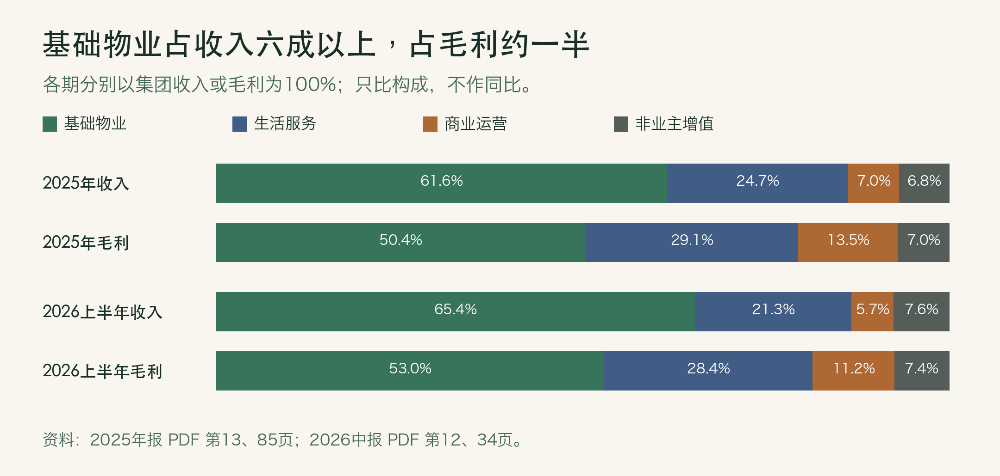

2025和2026年上半年四种业务的收入及毛利贡献

依据 · [2025年度報告 · 第13页](https://www1.hkexnews.hk/listedco/listconews/sehk/2026/0430/2026043004377_c.pdf#page=13)；[2025年度報告 · 第85页](https://www1.hkexnews.hk/listedco/listconews/sehk/2026/0430/2026043004377_c.pdf#page=85)；[2026中期報告 · 第12页](https://www1.hkexnews.hk/listedco/listconews/sehk/2026/0930/2026093002812_c.pdf#page=12)；[2026中期報告 · 第13页](https://www1.hkexnews.hk/listedco/listconews/sehk/2026/0930/2026093002812_c.pdf#page=13)；[2026中期報告 · 第34页](https://www1.hkexnews.hk/listedco/listconews/sehk/2026/0930/2026093002812_c.pdf#page=34)

### 经营要看三件事

项目获取与收费权。 开发商选聘、业主或机构付费、业委会续聘分别在不同环节。2026年6月底已订约4344.6万平方米、已在管4002.2万平方米，独立第三方开发的项目贡献42.6%基础物业收入。按开发来源划分与按收入付款人划分不同，签约后还要进场、履约和回款。 招股书，PDF第202、206—216页 · 2026中报，PDF第5—8页

城市密度与履约经济性。 武侯15平方公里已有20余个项目，吴江也披露一单带来周边项目。邻近使工程、培训和监督有共用机会，但保安、保洁和维修仍须依约交付。人均管理面积增长与总员工成本提高、基础物业毛利率下降并存。密度最终能省多少，要看同类项目含外包的实际成本和实收。 2025年报，PDF第7页 · 2026中报，PDF第5—8、12、19、34页

衍生场景收益及资金承担。 同一个物业触点可以提供佣金、上门服务或商品销售，持有车位和商品库存则要垫钱。租户付给房东的租金可能由物业代处理，转租则由公司自己承担上游租金。医院团餐另有采购，三六三医院的候选报价还显示经营方向院方按营业收入付费。每种合同在风险和现金占用上有区别。 招股书，PDF第220—233页 · 三六三医院采购公示，第一、二节

依据 · [新希望服務控股有限公司招股章程 · 第202页](https://www1.hkexnews.hk/listedco/listconews/sehk/2021/0511/2021051100022_c.pdf#page=202)；[新希望服務控股有限公司招股章程 · 第206页](https://www1.hkexnews.hk/listedco/listconews/sehk/2021/0511/2021051100022_c.pdf#page=206)；[新希望服務控股有限公司招股章程 · 第216页](https://www1.hkexnews.hk/listedco/listconews/sehk/2021/0511/2021051100022_c.pdf#page=216)；[2026中期報告 · 第5页](https://www1.hkexnews.hk/listedco/listconews/sehk/2026/0930/2026093002812_c.pdf#page=5)；[2026中期報告 · 第8页](https://www1.hkexnews.hk/listedco/listconews/sehk/2026/0930/2026093002812_c.pdf#page=8)；[2025年度報告 · 第7页](https://www1.hkexnews.hk/listedco/listconews/sehk/2026/0430/2026043004377_c.pdf#page=7)；[2026中期報告 · 第12页](https://www1.hkexnews.hk/listedco/listconews/sehk/2026/0930/2026093002812_c.pdf#page=12)；[2026中期報告 · 第19页](https://www1.hkexnews.hk/listedco/listconews/sehk/2026/0930/2026093002812_c.pdf#page=19)；[2026中期報告 · 第34页](https://www1.hkexnews.hk/listedco/listconews/sehk/2026/0930/2026093002812_c.pdf#page=34)；[新希望服務控股有限公司招股章程 · 第220页](https://www1.hkexnews.hk/listedco/listconews/sehk/2021/0511/2021051100022_c.pdf#page=220)；[新希望服務控股有限公司招股章程 · 第233页](https://www1.hkexnews.hk/listedco/listconews/sehk/2021/0511/2021051100022_c.pdf#page=233)；[三六三医院武侯院区食堂外包服务采购项目（第二次）中标候选人公示](https://cg.gt.cn/zbxx/026004/20250611/a1385430-e996-4cc6-b3cb-0b5393457865.html)

### 当前判断如何形成

2026年上半年集团收入继续增长，但毛利率、税前经营现金与老账表现均有压力。集团六月现金约9.62亿元，账上同时有待履约预收、代收、按金和租赁等义务。以当前规模和稳定周转作条件，年度普通股经济现金约1.40亿元，经营承压则约1.00亿元。按10%人民币机会成本，已计量经营价值分别约1.720和1.226元/股，前者假设估值时点已进入稳态、首笔稳定现金在一年末形成，暂不加未证明的正净余资，额外净缺口仍须扣。2026年11月6日1.49港元收盘按同日参考汇率折约1.268人民币元，位于这两个条件结果之间。待确认回款、实际成本和可取用资金前，历史价格尚不能认定有安全边际。增长暂不另付溢价。 2026中报，PDF第25—30、34—44页 · 历史收盘价 · 欧洲央行历史参考汇率

依据 · [2026中期報告 · 第25页](https://www1.hkexnews.hk/listedco/listconews/sehk/2026/0930/2026093002812_c.pdf#page=25)；[2026中期報告 · 第30页](https://www1.hkexnews.hk/listedco/listconews/sehk/2026/0930/2026093002812_c.pdf#page=30)；[2026中期報告 · 第34页](https://www1.hkexnews.hk/listedco/listconews/sehk/2026/0930/2026093002812_c.pdf#page=34)；[2026中期報告 · 第44页](https://www1.hkexnews.hk/listedco/listconews/sehk/2026/0930/2026093002812_c.pdf#page=44)；[东方财富03658.HK未复权收盘 · 2026-11-06](https://push2his.eastmoney.com/api/qt/stock/kline/get?secid=116.03658&klt=101&fqt=0&lmt=1000000&beg=20190101&end=20261109&fields1=f1%2Cf2%2Cf3%2Cf4%2Cf5%2Cf6&fields2=f51%2Cf52%2Cf53%2Cf54%2Cf55%2Cf56%2Cf57)；[欧洲央行欧元参考汇率 · 2026-11-06](https://www.ecb.europa.eu/stats/eurofxref/eurofxref-hist.zip)

## 第1章 · 第一章　企业沿革与业务边界

### 正文

新希望服务的起点是一批即将交付的住宅。2010年，境内经营主体开始管理新希望地产在成都开发的项目。开发商交付一栋楼，需要有人接管设备、保安和公共区域，住户搬入后还需要持续清洁、维修和处理投诉。开发商在交付前选定物业，住户随后成为物业服务的使用者与缴费人。地产开发给公司提供了第一批项目，也让它可以在成都积累排班、工程和现场管理经验。住宅交付后的服务一旦形成规模，收入便不全取决于当年又交了多少新房。已有住区继续缴费，新楼盘则影响新增项目。 招股书，PDF第158—159、202、206—212页

今天挂牌的是新希望服务控股有限公司，上市主体设在开曼，通过境内经营子公司接合同、组织项目。最早开展物业的境内公司后来成为境内运营的集中管理平台。提供早期项目的地产公司原名四川新希望房地产开发有限公司，现为新希望五新实业集团有限公司，由刘永好间接控制，是上市公司的关连人士。两边的合同分别记录采购方与服务方。上市公司合并的是受它控制的经营主体，五新实业的开发项目属于物业服务的来源。 招股书，PDF第158、160—165页 · 2025年报，PDF第50页

依据 · [新希望服務控股有限公司招股章程 · 第158页](https://www1.hkexnews.hk/listedco/listconews/sehk/2021/0511/2021051100022_c.pdf#page=158)；[新希望服務控股有限公司招股章程 · 第159页](https://www1.hkexnews.hk/listedco/listconews/sehk/2021/0511/2021051100022_c.pdf#page=159)；[新希望服務控股有限公司招股章程 · 第202页](https://www1.hkexnews.hk/listedco/listconews/sehk/2021/0511/2021051100022_c.pdf#page=202)；[新希望服務控股有限公司招股章程 · 第206页](https://www1.hkexnews.hk/listedco/listconews/sehk/2021/0511/2021051100022_c.pdf#page=206)；[新希望服務控股有限公司招股章程 · 第212页](https://www1.hkexnews.hk/listedco/listconews/sehk/2021/0511/2021051100022_c.pdf#page=212)；[新希望服務控股有限公司招股章程 · 第160页](https://www1.hkexnews.hk/listedco/listconews/sehk/2021/0511/2021051100022_c.pdf#page=160)；[新希望服務控股有限公司招股章程 · 第165页](https://www1.hkexnews.hk/listedco/listconews/sehk/2021/0511/2021051100022_c.pdf#page=165)；[2025年度報告 · 第50页](https://www1.hkexnews.hk/listedco/listconews/sehk/2026/0430/2026043004377_c.pdf#page=50)

### 从住宅服务到多种物业

2014年，公司在温州建立业务，2016年进入上海等城市，2017年成立商业运营公司。两年后开始为温州新希望·立体城提供商运服务。住宅的工作围绕住户长期居住，购物中心则要招揽商户、组织开业、处理租金和推广。同一地点可以同时有物业和商业运营，如温州立体城也出现在在管商业物业披露中。两种服务各有合同，服务商承担的费用和收益归属也随合同变化。2019年第四季度，公司又开始经营线上线下零售和餐饮，开始把既有住区和企业客户接触到的需求转成新的订单。 招股书，PDF第158—159、220—232、251页

2018年底，公司管理33个项目、约502万平方米。2020年底有65个、约1024万平方米，已覆盖住宅、商业、办公以及医疗等业态。上市前公司也开始主动找开发商以外的机会，2020年在总部设合作开发中心，在各区设合作开发部。招股书披露，当年独立开发商项目投了26次、取得8份合同，和新希望地产及其合联营开发项目的胜率差异很大。近几年谈“外拓”，指的就是通过竞标、商务谈判等途径取得原有地产关系之外的项目。这类获单需要把物业方案、报价和过往履约记录放在买方面前接受比较。 招股书，PDF第192—194、204—208页

依据 · [新希望服務控股有限公司招股章程 · 第158页](https://www1.hkexnews.hk/listedco/listconews/sehk/2021/0511/2021051100022_c.pdf#page=158)；[新希望服務控股有限公司招股章程 · 第159页](https://www1.hkexnews.hk/listedco/listconews/sehk/2021/0511/2021051100022_c.pdf#page=159)；[新希望服務控股有限公司招股章程 · 第220页](https://www1.hkexnews.hk/listedco/listconews/sehk/2021/0511/2021051100022_c.pdf#page=220)；[新希望服務控股有限公司招股章程 · 第232页](https://www1.hkexnews.hk/listedco/listconews/sehk/2021/0511/2021051100022_c.pdf#page=232)；[新希望服務控股有限公司招股章程 · 第251页](https://www1.hkexnews.hk/listedco/listconews/sehk/2021/0511/2021051100022_c.pdf#page=251)；[新希望服務控股有限公司招股章程 · 第192页](https://www1.hkexnews.hk/listedco/listconews/sehk/2021/0511/2021051100022_c.pdf#page=192)；[新希望服務控股有限公司招股章程 · 第194页](https://www1.hkexnews.hk/listedco/listconews/sehk/2021/0511/2021051100022_c.pdf#page=194)；[新希望服務控股有限公司招股章程 · 第204页](https://www1.hkexnews.hk/listedco/listconews/sehk/2021/0511/2021051100022_c.pdf#page=204)；[新希望服務控股有限公司招股章程 · 第208页](https://www1.hkexnews.hk/listedco/listconews/sehk/2021/0511/2021051100022_c.pdf#page=208)

### 上市后，面积增长中有一部分是买来的

2021年5月，公司在香港上市，年底在管104个项目、1621万平方米。2022年4月，公司购入明宇环球51%股权并取得控制。收购带来一个现成的物业及商业运营团队、已有合同和业务资产，明宇自并表日至当年年底贡献收入1.17亿元、净利润0.39亿元。到2022年底，新希望服务已在管191个项目、2883万平方米，独立第三方开发的在管面积占46.5%。年报把当年独立第三方开发的1340.8万平方米拆为市场外拓1017.5万和收并购323.3万。2021年的464.8万均列市场外拓，因此这一组别增加的876.0万平方米中，外拓净增552.7万，收并购贡献323.3万。这项拆分适用于独立第三方组，集团全部面积的逐项目来源未披露。 2021年报，PDF第16—18页 · 明宇首次收购公告，PDF第1—6页 · 2022年报，PDF第5、8—9、117—118页

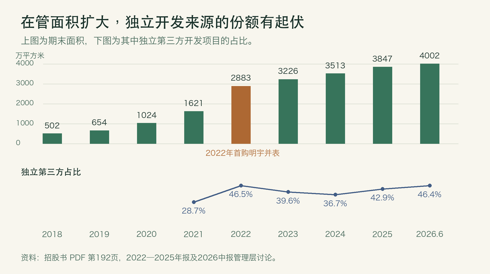

从地产起步到外拓与并购，新希望服务在管面积与独立开发来源的历史变化

2023年以后，在管面积继续扩大，但新增的途径变了。公司公布了阳光城檀悦、滨江九里和广发银行昆明等外拓案例，也收购原已持有20%的成都锦官新城物业其余股权，将三个住宅及一个商业项目所在的经营主体纳入全资控制。2025年，公司所报第三方各类项目签约7.26亿元，深耕城市占95%，合同还包含物业以外的业务及可能分期执行的服务。2026年上半年再购明宇45.5%时，明宇早已并表，变化主要是利润和资产权益在集团与原下层股东之间重新分配。本次以服务费债权抵销对价，和2022年首次把明宇经营并入集团的效果不同。 2023年报，PDF第9—11页 · 锦官新城收购公告，PDF第1—5页 · 2025年报，PDF第6—7页 · 明宇追加收购公告，PDF第1—5页 · 2026中报，PDF第43页

依据 · [2021年度報告 · 第16页](https://www1.hkexnews.hk/listedco/listconews/sehk/2022/0429/2022042901435_c.pdf#page=16)；[2021年度報告 · 第18页](https://www1.hkexnews.hk/listedco/listconews/sehk/2022/0429/2022042901435_c.pdf#page=18)；[須予披露交易收購目標公司51%股權 · 第1页](https://www1.hkexnews.hk/listedco/listconews/sehk/2022/0411/2022041101089_c.pdf#page=1)；[須予披露交易收購目標公司51%股權 · 第6页](https://www1.hkexnews.hk/listedco/listconews/sehk/2022/0411/2022041101089_c.pdf#page=6)；[2022年度報告 · 第5页](https://www1.hkexnews.hk/listedco/listconews/sehk/2023/0428/2023042802852_c.pdf#page=5)；[2022年度報告 · 第8页](https://www1.hkexnews.hk/listedco/listconews/sehk/2023/0428/2023042802852_c.pdf#page=8)；[2022年度報告 · 第9页](https://www1.hkexnews.hk/listedco/listconews/sehk/2023/0428/2023042802852_c.pdf#page=9)；[2022年度報告 · 第117页](https://www1.hkexnews.hk/listedco/listconews/sehk/2023/0428/2023042802852_c.pdf#page=117)；[2022年度報告 · 第118页](https://www1.hkexnews.hk/listedco/listconews/sehk/2023/0428/2023042802852_c.pdf#page=118)；[2023年度報告 · 第9页](https://www1.hkexnews.hk/listedco/listconews/sehk/2024/0419/2024041901761_c.pdf#page=9)；[2023年度報告 · 第11页](https://www1.hkexnews.hk/listedco/listconews/sehk/2024/0419/2024041901761_c.pdf#page=11)；[關連交易 收購目標公司的80%股權 · 第1页](https://www1.hkexnews.hk/listedco/listconews/sehk/2023/1103/2023110302081_c.pdf#page=1)；[關連交易 收購目標公司的80%股權 · 第5页](https://www1.hkexnews.hk/listedco/listconews/sehk/2023/1103/2023110302081_c.pdf#page=5)；[2025年度報告 · 第6页](https://www1.hkexnews.hk/listedco/listconews/sehk/2026/0430/2026043004377_c.pdf#page=6)；[2025年度報告 · 第7页](https://www1.hkexnews.hk/listedco/listconews/sehk/2026/0430/2026043004377_c.pdf#page=7)；[有關收購目標公司45.5%的股權之
須予披露及關連交易 · 第1页](https://www1.hkexnews.hk/listedco/listconews/sehk/2026/0417/2026041700002_c.pdf#page=1)；[有關收購目標公司45.5%的股權之
須予披露及關連交易 · 第5页](https://www1.hkexnews.hk/listedco/listconews/sehk/2026/0417/2026041700002_c.pdf#page=5)；[2026中期報告 · 第43页](https://www1.hkexnews.hk/listedco/listconews/sehk/2026/0930/2026093002812_c.pdf#page=43)

### 今天主要靠什么赚钱

到2025年，集团收入约15.40亿元，其中基础物业9.48亿元，约占六成。基础物业是持续巡检、值守和维护换来的收费。生活服务约3.80亿元，里面有上门服务、停车、经纪、零售和团餐，收入可能是服务费、佣金或商品货款。商业运营约1.08亿元，可以由业主买招商、经营服务，也可以由公司先承租再出租。非业主增值约1.04亿元，主要由开发商为案场、交付准备和工程配套买单。四条业务在不同的时候接触到同一批住户、业主或机构，也会通过各自采购渠道接触新客户。经营专题沿合同和收付进一步展开。 2025年报，PDF第6、9—13、85页

公司过去的增长表现为面积增加、城市增多，收入中来自基础物业的比重也持续上升。2026年上半年，在管面积约4002万平方米，基础物业收入5.04亿元、同比增长7.9%，毛利却少约195万元。该期整体收入上升而归母净利下降。地产起家的经验帮助公司走向外部客户，买到、签下和管好更多项目之后，还要看实际收费、成本和收款才能理解这家公司的增长。 2026中报，PDF第5—8、12、25、34页

依据 · [2025年度報告 · 第6页](https://www1.hkexnews.hk/listedco/listconews/sehk/2026/0430/2026043004377_c.pdf#page=6)；[2025年度報告 · 第9页](https://www1.hkexnews.hk/listedco/listconews/sehk/2026/0430/2026043004377_c.pdf#page=9)；[2025年度報告 · 第13页](https://www1.hkexnews.hk/listedco/listconews/sehk/2026/0430/2026043004377_c.pdf#page=13)；[2025年度報告 · 第85页](https://www1.hkexnews.hk/listedco/listconews/sehk/2026/0430/2026043004377_c.pdf#page=85)；[2026中期報告 · 第5页](https://www1.hkexnews.hk/listedco/listconews/sehk/2026/0930/2026093002812_c.pdf#page=5)；[2026中期報告 · 第8页](https://www1.hkexnews.hk/listedco/listconews/sehk/2026/0930/2026093002812_c.pdf#page=8)；[2026中期報告 · 第12页](https://www1.hkexnews.hk/listedco/listconews/sehk/2026/0930/2026093002812_c.pdf#page=12)；[2026中期報告 · 第25页](https://www1.hkexnews.hk/listedco/listconews/sehk/2026/0930/2026093002812_c.pdf#page=25)；[2026中期報告 · 第34页](https://www1.hkexnews.hk/listedco/listconews/sehk/2026/0930/2026093002812_c.pdf#page=34)

## 第2章 · 第二章　商业模式与价值链

### 正文

一栋住宅交给物业，开发商、住户和业委会并不总在同一时点作决定。楼未交付时，开发商通常先选物业，之后住户按约缴费，未售单元仍通常由开发商付费。业主大会日后可以决定续聘或更换物业。公司已经在小区做保洁、工程和维修，住户更容易找到它另买一次家政或经纪服务。写字楼、公建、医院等项目，采购人可能是一家机构。机构会把需要的值守、清洁和工程支持列入采购范围，再同供方签约。判断客户为什么愿意买，得先知道客户在解决什么问题，以及新希望服务拿到的是服务合同、经营场地还是租赁权。 招股书，PDF第202、206—212、229—232页 · 南国置业问询回复，PDF第54页

开发商也可以另聘新希望服务做售楼案场、验房和交付前清洁。招股书举例，案场先由物业派员工或分包商负责接待、安保等工作，再按服务成本加成向开发商结算，季度结束后20日内付款。这是开发商另购的非业主增值服务。未售单元的物业费则对应前期合同下的日常管理，付费人可以相同，购买的工作和付款节点不同。 招股书，PDF第209、216—218页

依据 · [新希望服務控股有限公司招股章程 · 第202页](https://www1.hkexnews.hk/listedco/listconews/sehk/2021/0511/2021051100022_c.pdf#page=202)；[新希望服務控股有限公司招股章程 · 第206页](https://www1.hkexnews.hk/listedco/listconews/sehk/2021/0511/2021051100022_c.pdf#page=206)；[新希望服務控股有限公司招股章程 · 第212页](https://www1.hkexnews.hk/listedco/listconews/sehk/2021/0511/2021051100022_c.pdf#page=212)；[新希望服務控股有限公司招股章程 · 第229页](https://www1.hkexnews.hk/listedco/listconews/sehk/2021/0511/2021051100022_c.pdf#page=229)；[新希望服務控股有限公司招股章程 · 第232页](https://www1.hkexnews.hk/listedco/listconews/sehk/2021/0511/2021051100022_c.pdf#page=232)；[南国置业重大资产出售暨关联交易问询函回复 · 第54页](https://static.cninfo.com.cn/finalpage/2025-10-16/1224714999.PDF#page=54)；[新希望服務控股有限公司招股章程 · 第209页](https://www1.hkexnews.hk/listedco/listconews/sehk/2021/0511/2021051100022_c.pdf#page=209)；[新希望服務控股有限公司招股章程 · 第216页](https://www1.hkexnews.hk/listedco/listconews/sehk/2021/0511/2021051100022_c.pdf#page=216)；[新希望服務控股有限公司招股章程 · 第218页](https://www1.hkexnews.hk/listedco/listconews/sehk/2021/0511/2021051100022_c.pdf#page=218)

### 项目获取与收费权

开发商需要有人接手新楼，业主需要有人把共有部位长期管好，机构则要找到能在指定人员配置和服务标准下履约的团队。上市前依靠开发商批量交付，公司有机会在同一个城市形成在管项目。外部客户的项目机会更分散，要通过投标、谈判、接场和续约取得。武侯高新的年报把新希望物业列为非关联供应商，全年采购金额约749万元。买方披露确认了客户关系和采购规模，付款时点和供应商最终留下的利润还要看合同和收付。 招股书，PDF第204—212页 · 武侯高新2025年报，PDF第10页

图中的五新实业即原四川新希望房地产开发有限公司。“五新实业”组包含它独立开发或持控制权共同开发的项目，“五新实业合联营”组则是它没有控股权的合联营企业开发的项目。 2025年报，PDF第50页 · 2026中报，PDF第7页

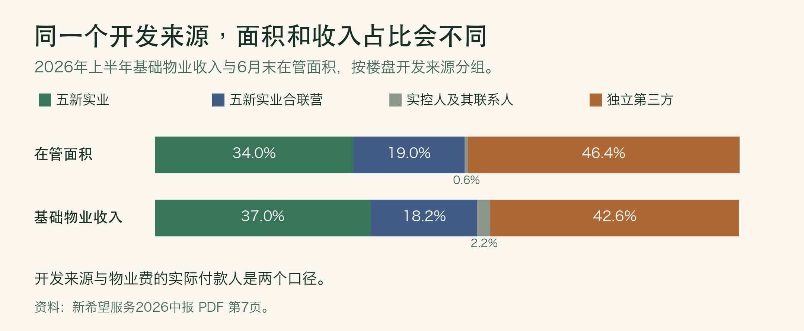

2026年上半年基础物业按开发来源的在管面积和收入构成

2026年上半年，独立第三方开发项目贡献42.6%的基础物业收入，较去年同期38.0%更高。这是按楼盘开发来源分组，付款的人可能是交房后的业主、租户或机构。也因此，同一时期所说的“第三方收入”必须先辨口径。公司在2025年报给出的集团全口径第三方收入占84%，覆盖的业务和分组不同；同一份年报里，独立第三方开发项目只占基础物业收入39.6%。即使在同一集团内，两个数字也回答不同的问题。 2025年报，PDF第6、9页 · 2026中报，PDF第6—8页

依据 · [新希望服務控股有限公司招股章程 · 第204页](https://www1.hkexnews.hk/listedco/listconews/sehk/2021/0511/2021051100022_c.pdf#page=204)；[新希望服務控股有限公司招股章程 · 第212页](https://www1.hkexnews.hk/listedco/listconews/sehk/2021/0511/2021051100022_c.pdf#page=212)；[成都武侯高新技术产业发展股份有限公司2025年度报告 · 第10页](https://pdf.dfcfw.com/pdf/H2_AN202601271818462952_1.pdf?1769527931000.pdf=#page=10)；[2025年度報告 · 第50页](https://www1.hkexnews.hk/listedco/listconews/sehk/2026/0430/2026043004377_c.pdf#page=50)；[2026中期報告 · 第7页](https://www1.hkexnews.hk/listedco/listconews/sehk/2026/0930/2026093002812_c.pdf#page=7)；[2025年度報告 · 第6页](https://www1.hkexnews.hk/listedco/listconews/sehk/2026/0430/2026043004377_c.pdf#page=6)；[2025年度報告 · 第9页](https://www1.hkexnews.hk/listedco/listconews/sehk/2026/0430/2026043004377_c.pdf#page=9)；[2026中期報告 · 第6页](https://www1.hkexnews.hk/listedco/listconews/sehk/2026/0930/2026093002812_c.pdf#page=6)；[2026中期報告 · 第8页](https://www1.hkexnews.hk/listedco/listconews/sehk/2026/0930/2026093002812_c.pdf#page=8)

### 城市密度与履约经济性

客户选择物业时，能否在需要的时间找到人，与宣传的服务标准同样重要。老楼出故障要有人到场，产业园要保障不同企业的办公和出入，医疗机构还会要求团队熟悉特定场景。公司在武侯披露15平方公里内累计落地20余个项目；苏州吴江中标一处项目后，又获得周边三个项目。相邻项目给工程人员、培训和管理提供共用机会，也使附近客户更容易查看已在管项目。保安、清洁和维修的服务底线仍由每处合同决定。面积多一倍，所需岗位未必少，也未必按面积同比例增加。 招股书，PDF第203、244—248页 · 2025年报，PDF第7页 · 2026中报，PDF第7页

中报披露，公司在人均管面积和人均创收上都有增长。同期员工人数减少，员工总成本上升，基础物业毛利下降。这使“靠密度形成成本优势”仍需项目证据。项目能否共用管理和工程人员，应该看同类合同在成熟期的人员加外包支出、响应水平和收款表现。第三章把这项结果与新项目收费放在一起看。 2026中报，PDF第5—8、12、19、34页

依据 · [新希望服務控股有限公司招股章程 · 第203页](https://www1.hkexnews.hk/listedco/listconews/sehk/2021/0511/2021051100022_c.pdf#page=203)；[新希望服務控股有限公司招股章程 · 第244页](https://www1.hkexnews.hk/listedco/listconews/sehk/2021/0511/2021051100022_c.pdf#page=244)；[新希望服務控股有限公司招股章程 · 第248页](https://www1.hkexnews.hk/listedco/listconews/sehk/2021/0511/2021051100022_c.pdf#page=248)；[2025年度報告 · 第7页](https://www1.hkexnews.hk/listedco/listconews/sehk/2026/0430/2026043004377_c.pdf#page=7)；[2026中期報告 · 第7页](https://www1.hkexnews.hk/listedco/listconews/sehk/2026/0930/2026093002812_c.pdf#page=7)；[2026中期報告 · 第5页](https://www1.hkexnews.hk/listedco/listconews/sehk/2026/0930/2026093002812_c.pdf#page=5)；[2026中期報告 · 第8页](https://www1.hkexnews.hk/listedco/listconews/sehk/2026/0930/2026093002812_c.pdf#page=8)；[2026中期報告 · 第12页](https://www1.hkexnews.hk/listedco/listconews/sehk/2026/0930/2026093002812_c.pdf#page=12)；[2026中期報告 · 第19页](https://www1.hkexnews.hk/listedco/listconews/sehk/2026/0930/2026093002812_c.pdf#page=19)；[2026中期報告 · 第34页](https://www1.hkexnews.hk/listedco/listconews/sehk/2026/0930/2026093002812_c.pdf#page=34)

### 衍生场景收益及资金承担

新希望服务的物业人员每天接触住户。住户需要维修、保洁时可以另下单，公司也可以帮业主找租客并取佣金。车位自购和社区商品销售还要先支出购置款或备货款。团餐则可以靠外部机构采购独立取得，食堂经营合同有时甚至要求经营方从营业额中付管理费。商业楼宇能另聘招商服务；公司如果租下空间再转租，客户退租也会留下对房东的付款义务。公司拓展的是多个交易机会，各自能留下多少要用相应成本、投资和收款判断。 招股书，PDF第219—233页 · 三六三医院采购公示，第一、二节

2025年，生活服务、商业运营、非业主增值合计约占集团收入38%、毛利约50%。这些业务规模合在一起小于基础物业，但变化足以左右全集团毛利。住宅项目中多拿一份生活服务订单、在外部市场拿下团餐经营权、为商场承租固定空间，对公司的资金需要完全不同。下文看客户选择能不能成为有利润的合同，再分别比较几种生意的实际结果。 2025年报，PDF第11—13、85页

依据 · [新希望服務控股有限公司招股章程 · 第219页](https://www1.hkexnews.hk/listedco/listconews/sehk/2021/0511/2021051100022_c.pdf#page=219)；[新希望服務控股有限公司招股章程 · 第233页](https://www1.hkexnews.hk/listedco/listconews/sehk/2021/0511/2021051100022_c.pdf#page=233)；[三六三医院武侯院区食堂外包服务采购项目（第二次）中标候选人公示](https://cg.gt.cn/zbxx/026004/20250611/a1385430-e996-4cc6-b3cb-0b5393457865.html)；[2025年度報告 · 第11页](https://www1.hkexnews.hk/listedco/listconews/sehk/2026/0430/2026043004377_c.pdf#page=11)；[2025年度報告 · 第13页](https://www1.hkexnews.hk/listedco/listconews/sehk/2026/0430/2026043004377_c.pdf#page=13)；[2025年度報告 · 第85页](https://www1.hkexnews.hk/listedco/listconews/sehk/2026/0430/2026043004377_c.pdf#page=85)

## 第3章 · 第三章　行业、竞争与同行

### 正文

物业管理有两类增长机会。一类来自新楼交付，开发商需要有人接手公共区域和设备，能随开发商走的物业公司容易较早取得这一批项目。另一类来自已经有人使用的楼宇和场地，包括业委会换聘、园区和机构采购、商业楼宇更换供方。后者要求物业拿一份人员安排、服务范围和报价去和现有供方竞争。地产新增放慢时，外拓的重要性提高。新希望服务在2025年报提到地产调整对新增面积、收缴和盈利的影响，这个判断与本公司当年开发商服务收入下滑、基础物业更多依靠已进场及外拓项目相符。 招股书，PDF第204—212页 · 2025年报，PDF第5—13页

依据 · [新希望服務控股有限公司招股章程 · 第204页](https://www1.hkexnews.hk/listedco/listconews/sehk/2021/0511/2021051100022_c.pdf#page=204)；[新希望服務控股有限公司招股章程 · 第212页](https://www1.hkexnews.hk/listedco/listconews/sehk/2021/0511/2021051100022_c.pdf#page=212)；[2025年度報告 · 第5页](https://www1.hkexnews.hk/listedco/listconews/sehk/2026/0430/2026043004377_c.pdf#page=5)；[2025年度報告 · 第13页](https://www1.hkexnews.hk/listedco/listconews/sehk/2026/0430/2026043004377_c.pdf#page=13)

### 同场报价告诉了什么

成都商业项目的买方南国置业披露，在同场报价里，新希望物业报每平方米每月5.77元，中电建物业5.55元，成都诚悦时代5.36元。采购方讨论的是向中电建物业采购，并说明由综合评审确定供应商。新希望进入了比选，报得较高；这份披露没有给出三家的技术得分，因而无法确定报价差背后的岗位、质量或采购取舍。武侯高新的年度采购则从另一个方向印证，新希望物业确实拿到过外部机构业务。它2025年在该客户列示的采购中占15.93%，当地其他供方也有实际采购。这里的竞争是一份份服务合同，不同买方对保洁频次、工程人员和夜间值守的要求可以不同。 南国置业问询回复，PDF第54页 · 武侯高新2025年报，PDF第10页

公司2025年报提到康郡项目中标后提价30.4%，也曾在2023年报列举阳光城檀悦、滨江九里等外拓项目。具名案例表明公司有取得不同来源项目的能力。康郡的涨价还需要用变更前后的服务范围、收缴与续约判断能否变成可持续收益。2026年上半年，公司披露外拓物业费2.43元/平方米/月，综合为3.08元/平方米/月。外拓样本有不同城市、不同物业类型，也包含不同时点进场项目，综合价本身又包含外拓。两数能揭示当期组合的价格压力，不能直接用作同一合同的折价率。 2023年报，PDF第10页 · 2025年报，PDF第7页 · 2026中报，PDF第5—8页

依据 · [南国置业重大资产出售暨关联交易问询函回复 · 第54页](https://static.cninfo.com.cn/finalpage/2025-10-16/1224714999.PDF#page=54)；[成都武侯高新技术产业发展股份有限公司2025年度报告 · 第10页](https://pdf.dfcfw.com/pdf/H2_AN202601271818462952_1.pdf?1769527931000.pdf=#page=10)；[2023年度報告 · 第10页](https://www1.hkexnews.hk/listedco/listconews/sehk/2024/0419/2024041901761_c.pdf#page=10)；[2025年度報告 · 第7页](https://www1.hkexnews.hk/listedco/listconews/sehk/2026/0430/2026043004377_c.pdf#page=7)；[2026中期報告 · 第5页](https://www1.hkexnews.hk/listedco/listconews/sehk/2026/0930/2026093002812_c.pdf#page=5)；[2026中期報告 · 第8页](https://www1.hkexnews.hk/listedco/listconews/sehk/2026/0930/2026093002812_c.pdf#page=8)

### 把项目集中在近处，哪些成本会变

武侯项目集群覆盖公园、产业园及商业综合体，苏州吴江一处项目中标后带动附近三处项目，公司披露相关合同额超过7000万元。空间接近会改变一些工作安排，例如负责设备的技术人员可以服务若干项目，主管可以在较短时间内巡场，备件和培训也更容易集中。每处的常驻门岗、保洁和故障响应仍要按合同配置。要判断密度的作用，关键在于共用岗位和日常响应能减少多少完整履约成本，以及客户是否愿意续约和按期缴费。 招股书，PDF第203、244—248页 · 2025年报，PDF第7页 · 2026中报，PDF第7—8页

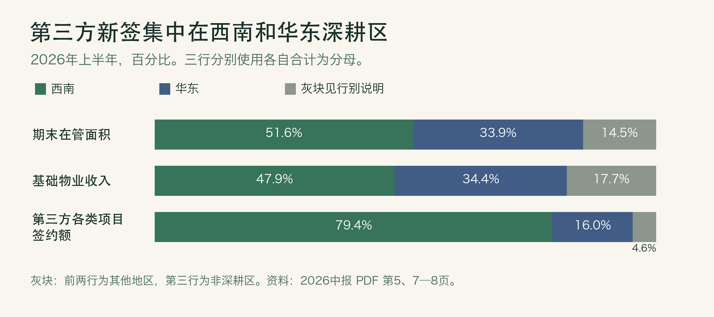

2026年上半年按地区对比基础物业收入、在管面积和深耕区签约份额

2026年上半年，深耕区在第三方各类项目签约额中占95.4%，比去年同期高4.4个百分点。图前两行按地区统计在管面积及基础物业收入，灰块为其他地区。签约一行按是否处于深耕区统计，灰块为非深耕区。该行只反映获单金额的去向，签约可含多类业务和未开始履约的项目。 2026中报，PDF第5、7—8页

2026年上半年，集团员工数的期末对比从3904降至3476，人均管面积上升，集团员工成本仍增加约600万元。基础物业毛利率也由25.3%降至23.1%。这些数说明自有员工的人均覆盖增长和当期毛利下滑可以同时发生。公司把毛利率下降主要归因于第三方收入占比提高。新增合同价格、服务强度及外包费用没有按同类成熟项目配对，现阶段还不能判断密度节省被较低收费抵消了多少。 2026中报，PDF第5—8、12、19、34页

依据 · [新希望服務控股有限公司招股章程 · 第203页](https://www1.hkexnews.hk/listedco/listconews/sehk/2021/0511/2021051100022_c.pdf#page=203)；[新希望服務控股有限公司招股章程 · 第244页](https://www1.hkexnews.hk/listedco/listconews/sehk/2021/0511/2021051100022_c.pdf#page=244)；[新希望服務控股有限公司招股章程 · 第248页](https://www1.hkexnews.hk/listedco/listconews/sehk/2021/0511/2021051100022_c.pdf#page=248)；[2025年度報告 · 第7页](https://www1.hkexnews.hk/listedco/listconews/sehk/2026/0430/2026043004377_c.pdf#page=7)；[2026中期報告 · 第7页](https://www1.hkexnews.hk/listedco/listconews/sehk/2026/0930/2026093002812_c.pdf#page=7)；[2026中期報告 · 第8页](https://www1.hkexnews.hk/listedco/listconews/sehk/2026/0930/2026093002812_c.pdf#page=8)；[2026中期報告 · 第5页](https://www1.hkexnews.hk/listedco/listconews/sehk/2026/0930/2026093002812_c.pdf#page=5)；[2026中期報告 · 第12页](https://www1.hkexnews.hk/listedco/listconews/sehk/2026/0930/2026093002812_c.pdf#page=12)；[2026中期報告 · 第19页](https://www1.hkexnews.hk/listedco/listconews/sehk/2026/0930/2026093002812_c.pdf#page=19)；[2026中期報告 · 第34页](https://www1.hkexnews.hk/listedco/listconews/sehk/2026/0930/2026093002812_c.pdf#page=34)

### 同行差异要从项目构成看

保利物业2025年披露第三方占在管面积66.0%，占基础物业收入44.6%。新希望服务同期独立第三方开发项目占在管面积42.9%，占基础物业收入39.6%。两家各自的面积占比都高于收入占比。保利的全国规模、保利发展项目口径、公建和其他非住宅组合与新希望服务不同，因此这组数字主要说明，同一家公司面积和收入的独立程度也可能相差很大。真要比较新希望在成都一个园区是否有定价能力，南国同场报价和武侯买方采购比集团面积排名更接近该问题。若要比较运营结果，还要跟到接场后的价款、成本、实收和续约。 保利物业2025年报，PDF第16页 · 新希望服务2025年报，PDF第7—9页

依据 · [保利物业2025年度报告 · 第16页](https://www1.hkexnews.hk/listedco/listconews/sehk/2026/0430/2026043001633_c.pdf#page=16)；[2025年度報告 · 第7页](https://www1.hkexnews.hk/listedco/listconews/sehk/2026/0430/2026043004377_c.pdf#page=7)；[2025年度報告 · 第9页](https://www1.hkexnews.hk/listedco/listconews/sehk/2026/0430/2026043004377_c.pdf#page=9)

## 第4章 · 第四章　历史经营、转折与当前阶段

### 正文

新希望服务规模扩大了，收入和毛利的来源也变了。2018年集团收入2.58亿元、毛利1.10亿元，商业运营贡献约43%的集团毛利。到2025年，收入15.40亿元、毛利4.57亿元，基础物业贡献约一半的集团毛利。集团毛利额上升，但每一元收入能留下的毛利由约43分降到约30分。规模大了之后，账上更倚重持续管理物业的收入，也更容易受到人工、外包和项目报价变化的影响。 招股书，PDF第447、472页 · 2025年报，PDF第13、85页

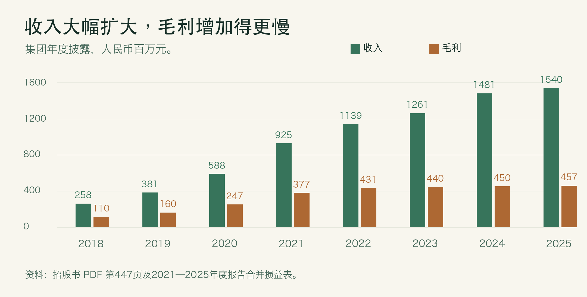

2018至2025年集团年度收入和毛利

依据 · [新希望服務控股有限公司招股章程 · 第447页](https://www1.hkexnews.hk/listedco/listconews/sehk/2021/0511/2021051100022_c.pdf#page=447)；[新希望服務控股有限公司招股章程 · 第472页](https://www1.hkexnews.hk/listedco/listconews/sehk/2021/0511/2021051100022_c.pdf#page=472)；[2025年度報告 · 第13页](https://www1.hkexnews.hk/listedco/listconews/sehk/2026/0430/2026043004377_c.pdf#page=13)；[2025年度報告 · 第85页](https://www1.hkexnews.hk/listedco/listconews/sehk/2026/0430/2026043004377_c.pdf#page=85)

### 管理面积增加后，基础物业成了利润底盘

2018至2020年，在管面积从约502万平方米增到1024万，集团同时扩展商业和非业主服务，生活服务也开始从社区现场长出零售、餐饮。2021年上市时，基础物业收入约3.17亿元，非业主增值和生活服务也各超过2亿元。2022年买入明宇后规模再上一个台阶，物业收入增至4.88亿元，集团营业收入超过11亿元。随后基础物业在集团收入中的占比继续提高，非业主收入则从2022年的2.29亿元降到2025年的1.04亿元。两类合同的收入走势分开了。已进场项目的日常物业收费扩大，开发商另行采购的交付前及工程配套服务收缩，集团收入中基础物业的权重因此提高。 招股书，PDF第192、472页 · 2021年报，PDF第24—25页 · 2022年报，PDF第8—13、117—118页 · 2025年报，PDF第11—13、85页

这一变化没有阻止物业自己的毛利率走低。2020年基础物业毛利率31.2%，2023年约27.0%，2025年24.3%。公司在不同阶段接进了新的城市和业态、引入并购团队，价格、人工和外包都会随合同组合改变。长序列说明每元物业收入的剩余空间变小，无法单独说明某个住区调低过价格，或已经续约多年的项目也同步走弱。 招股书，PDF第472页 · 2023年报，PDF第17—18页 · 2025年报，PDF第13页

依据 · [新希望服務控股有限公司招股章程 · 第192页](https://www1.hkexnews.hk/listedco/listconews/sehk/2021/0511/2021051100022_c.pdf#page=192)；[新希望服務控股有限公司招股章程 · 第472页](https://www1.hkexnews.hk/listedco/listconews/sehk/2021/0511/2021051100022_c.pdf#page=472)；[2021年度報告 · 第24页](https://www1.hkexnews.hk/listedco/listconews/sehk/2022/0429/2022042901435_c.pdf#page=24)；[2021年度報告 · 第25页](https://www1.hkexnews.hk/listedco/listconews/sehk/2022/0429/2022042901435_c.pdf#page=25)；[2022年度報告 · 第8页](https://www1.hkexnews.hk/listedco/listconews/sehk/2023/0428/2023042802852_c.pdf#page=8)；[2022年度報告 · 第13页](https://www1.hkexnews.hk/listedco/listconews/sehk/2023/0428/2023042802852_c.pdf#page=13)；[2022年度報告 · 第117页](https://www1.hkexnews.hk/listedco/listconews/sehk/2023/0428/2023042802852_c.pdf#page=117)；[2022年度報告 · 第118页](https://www1.hkexnews.hk/listedco/listconews/sehk/2023/0428/2023042802852_c.pdf#page=118)；[2025年度報告 · 第11页](https://www1.hkexnews.hk/listedco/listconews/sehk/2026/0430/2026043004377_c.pdf#page=11)；[2025年度報告 · 第13页](https://www1.hkexnews.hk/listedco/listconews/sehk/2026/0430/2026043004377_c.pdf#page=13)；[2025年度報告 · 第85页](https://www1.hkexnews.hk/listedco/listconews/sehk/2026/0430/2026043004377_c.pdf#page=85)；[2023年度報告 · 第17页](https://www1.hkexnews.hk/listedco/listconews/sehk/2024/0419/2024041901761_c.pdf#page=17)；[2023年度報告 · 第18页](https://www1.hkexnews.hk/listedco/listconews/sehk/2024/0419/2024041901761_c.pdf#page=18)

### 2025年还能靠物业和生活服务抵消，2026年上半年出现分叉

2025年，基础物业毛利比上年增加2645万元，生活服务增加1535万元。两项共同抵消了商业运营和非业主增值的毛利下降，集团全年毛利仍多726万元。公司解释了商业地产下行、部分项目退出、地产增值服务收缩等因素。到了2026年上半年，基础物业依旧增收，但直接成本增得更多。生活服务的经纪减少，商业运营又受部分项目出租率下降影响，两个分部各少约640万元毛利。非业主增值虽然收入回升，毛利只增加约74万元。 2025年报，PDF第9—14、85页 · 2026中报，PDF第9—13、34页

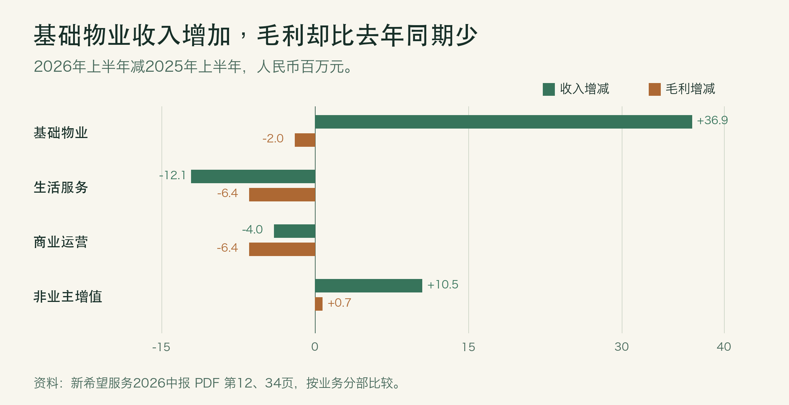

2026年上半年相对去年同期各分部收入和毛利的变化

报告期整体收入同比增加3130万元，毛利少1404万元。再往下，其他收支净额改善约1260万元，但销售和行政合计开支多1827万元、信用损失多418万元，经营利润最后少2389万元。其他收支改善中有物业估值亏损缩小及金融资产估值收益。公司把行政开支上升主要归因于汇兑损失增加；净汇兑的披露差额只解释了部分合计费用增量。毛利减少与信用损失增加都是另外可见的经营压力。所得税及下层股东分占再变化后，归母利润从1.21亿元降到1.00亿元。 2026中报，PDF第12—13、25、34—36页

依据 · [2025年度報告 · 第9页](https://www1.hkexnews.hk/listedco/listconews/sehk/2026/0430/2026043004377_c.pdf#page=9)；[2025年度報告 · 第14页](https://www1.hkexnews.hk/listedco/listconews/sehk/2026/0430/2026043004377_c.pdf#page=14)；[2025年度報告 · 第85页](https://www1.hkexnews.hk/listedco/listconews/sehk/2026/0430/2026043004377_c.pdf#page=85)；[2026中期報告 · 第9页](https://www1.hkexnews.hk/listedco/listconews/sehk/2026/0930/2026093002812_c.pdf#page=9)；[2026中期報告 · 第13页](https://www1.hkexnews.hk/listedco/listconews/sehk/2026/0930/2026093002812_c.pdf#page=13)；[2026中期報告 · 第34页](https://www1.hkexnews.hk/listedco/listconews/sehk/2026/0930/2026093002812_c.pdf#page=34)；[2026中期報告 · 第12页](https://www1.hkexnews.hk/listedco/listconews/sehk/2026/0930/2026093002812_c.pdf#page=12)；[2026中期報告 · 第25页](https://www1.hkexnews.hk/listedco/listconews/sehk/2026/0930/2026093002812_c.pdf#page=25)；[2026中期報告 · 第36页](https://www1.hkexnews.hk/listedco/listconews/sehk/2026/0930/2026093002812_c.pdf#page=36)

### 接下来需要观察合同兑现

公司已有一批长期物业合同，也仍取得外部项目，规模在2026年上半年继续增长。收入放大的来源却更倚重盈利空间较薄的基础物业，原来提供较多毛利的商运和生活服务同时受压。判断这一阶段是否能改善，要看新项目进入稳定履约后能否把收入变成毛利、住户和机构有没有按时交款，以及商场新签约何时能弥补存量收入下降。接下来还要把利润确认与收付时点拆开。即便物业按合同完成了服务，延期付款也会在排班、外包和维修的日常支出之外形成资金压力。 2026中报，PDF第5—13、32—34、40—42页

依据 · [2026中期報告 · 第5页](https://www1.hkexnews.hk/listedco/listconews/sehk/2026/0930/2026093002812_c.pdf#page=5)；[2026中期報告 · 第13页](https://www1.hkexnews.hk/listedco/listconews/sehk/2026/0930/2026093002812_c.pdf#page=13)；[2026中期報告 · 第32页](https://www1.hkexnews.hk/listedco/listconews/sehk/2026/0930/2026093002812_c.pdf#page=32)；[2026中期報告 · 第34页](https://www1.hkexnews.hk/listedco/listconews/sehk/2026/0930/2026093002812_c.pdf#page=34)；[2026中期報告 · 第40页](https://www1.hkexnews.hk/listedco/listconews/sehk/2026/0930/2026093002812_c.pdf#page=40)；[2026中期報告 · 第42页](https://www1.hkexnews.hk/listedco/listconews/sehk/2026/0930/2026093002812_c.pdf#page=42)

## 第5章 · 第五章　财务质量与现金归属

### 正文

新希望服务在2026年上半年确认7.71亿元收入、1.00亿元归母利润，集团经营活动净收现约2060万元。两种数字回答的问题不同。物业已经按约履约，即使住户还未缴费，公司也可能确认收入；预缴物业费时，收钱又可以先于交付。每笔钱还要分清是公司可以用于自身经营的收入、将来要履约的预收，还是替住户和租户暂时经手的钱。 2026中报，PDF第25、30、32、40—42页

依据 · [2026中期報告 · 第25页](https://www1.hkexnews.hk/listedco/listconews/sehk/2026/0930/2026093002812_c.pdf#page=25)；[2026中期報告 · 第30页](https://www1.hkexnews.hk/listedco/listconews/sehk/2026/0930/2026093002812_c.pdf#page=30)；[2026中期報告 · 第32页](https://www1.hkexnews.hk/listedco/listconews/sehk/2026/0930/2026093002812_c.pdf#page=32)；[2026中期報告 · 第40页](https://www1.hkexnews.hk/listedco/listconews/sehk/2026/0930/2026093002812_c.pdf#page=40)；[2026中期報告 · 第42页](https://www1.hkexnews.hk/listedco/listconews/sehk/2026/0930/2026093002812_c.pdf#page=42)

### 回款拖慢，净应收未必明显变大

2024年末贸易净应收4.49亿元，2025年末增加到5.04亿元。2025年现金流调节表列贸易应收占用6952万元，比净应收增幅多1490万元，差额与拨备存量上升一致。净额先扣了预计损失，账面净额的变化会掩盖部分尚未收回的金额。同期外部毛应收由3.32亿元增至4.04亿元，关联毛应收略降。外部客户扩张和信用风险可以同时发生，判断应回到各批应收能否收回。 2025年报，PDF第102、104、113—114页

2026年6月末，贸易应收毛额增加约1035万元，拨备多约1156万元，净额反少约121万元。一年以上的已扣拨备净应收却从1965万元升到3389万元。年末拨备率由一年内3.42%升到一年至两年44.16%，老账风险随账龄增长。已提的拨备反映预计损失，剩余净额代表仍需回收的债权。明宇还发生以债权抵销股权价款，因此净余额下降本身既不能证明旧账已经收到现金，也不能用作明宇这笔债权实际损失的金额。 2025年报，PDF第102、113页 · 2026中报，PDF第40、43页 · 明宇追加收购公告，PDF第1—5页

依据 · [2025年度報告 · 第102页](https://www1.hkexnews.hk/listedco/listconews/sehk/2026/0430/2026043004377_c.pdf#page=102)；[2025年度報告 · 第104页](https://www1.hkexnews.hk/listedco/listconews/sehk/2026/0430/2026043004377_c.pdf#page=104)；[2025年度報告 · 第113页](https://www1.hkexnews.hk/listedco/listconews/sehk/2026/0430/2026043004377_c.pdf#page=113)；[2025年度報告 · 第114页](https://www1.hkexnews.hk/listedco/listconews/sehk/2026/0430/2026043004377_c.pdf#page=114)；[2026中期報告 · 第40页](https://www1.hkexnews.hk/listedco/listconews/sehk/2026/0930/2026093002812_c.pdf#page=40)；[2026中期報告 · 第43页](https://www1.hkexnews.hk/listedco/listconews/sehk/2026/0930/2026093002812_c.pdf#page=43)；[有關收購目標公司45.5%的股權之
須予披露及關連交易 · 第1页](https://www1.hkexnews.hk/listedco/listconews/sehk/2026/0417/2026041700002_c.pdf#page=1)；[有關收購目標公司45.5%的股權之
須予披露及關連交易 · 第5页](https://www1.hkexnews.hk/listedco/listconews/sehk/2026/0417/2026041700002_c.pdf#page=5)

### 预缴、代收和押金各有后续用途

2025年初合同负债2.09亿元，其中2.08亿元在当年交付服务后确认为收入。年内新增预收约2.48亿元，年底余额2.50亿元。预收把资金提前送到公司，但接下来要继续派人、分包、维护。2026年上半年外部客户合同负债由2.45亿元减至2.05亿元，关联预收增加，合计余额少约1777万元。预收减少表示期末可见的提前收款与待交付规模变了，半年附注没有把现金变化逐项拆出来。 2025年报，PDF第106—107页 · 2026中报，PDF第41—42页

公司还可能代住户和租户收款，以及收取依约处理或退回的押金。六月末两项约5723万元和5417万元，和履约预收承担不同义务。其余额已进入负债，不能一边把账面现金全部看成普通股闲钱，一边忽略这些款项的用途。对不同付款周期的项目，稳定经营需要预留发薪、分包、维修和租赁款，即使账上暂时没有有息借款也一样。 2026中报，PDF第14、26—27、41—42页

依据 · [2025年度報告 · 第106页](https://www1.hkexnews.hk/listedco/listconews/sehk/2026/0430/2026043004377_c.pdf#page=106)；[2025年度報告 · 第107页](https://www1.hkexnews.hk/listedco/listconews/sehk/2026/0430/2026043004377_c.pdf#page=107)；[2026中期報告 · 第41页](https://www1.hkexnews.hk/listedco/listconews/sehk/2026/0930/2026093002812_c.pdf#page=41)；[2026中期報告 · 第42页](https://www1.hkexnews.hk/listedco/listconews/sehk/2026/0930/2026093002812_c.pdf#page=42)；[2026中期報告 · 第14页](https://www1.hkexnews.hk/listedco/listconews/sehk/2026/0930/2026093002812_c.pdf#page=14)；[2026中期報告 · 第26页](https://www1.hkexnews.hk/listedco/listconews/sehk/2026/0930/2026093002812_c.pdf#page=26)；[2026中期報告 · 第27页](https://www1.hkexnews.hk/listedco/listconews/sehk/2026/0930/2026093002812_c.pdf#page=27)

### 季节性可以解释一部分，税前变化仍需跟踪

2025年有一条可以完整复算的桥。集团税前利润279.209百万元，按现金流附注净加非现金及非经营等调整64.443。其中折旧摊销29.552、信用损失21.400、投资物业估值亏损19.830和汇兑损失11.144加回，另移出利息收入17.527及其他项目。信用损失在这一步加回，是因为它是当期确认的估计，实际占用从营运资金找。营运资金净占87.785，其中贸易应收69.517、其他应收与预付8.482、存货0.078，贸易应付减少19.354、其他应付及应计费用减少30.650，合同负债增加补回40.296。279.209＋64.443−87.785＝255.867，扣当年实付所得税44.133后，得净经营现金211.734百万元。 2025年报，PDF第65、104页

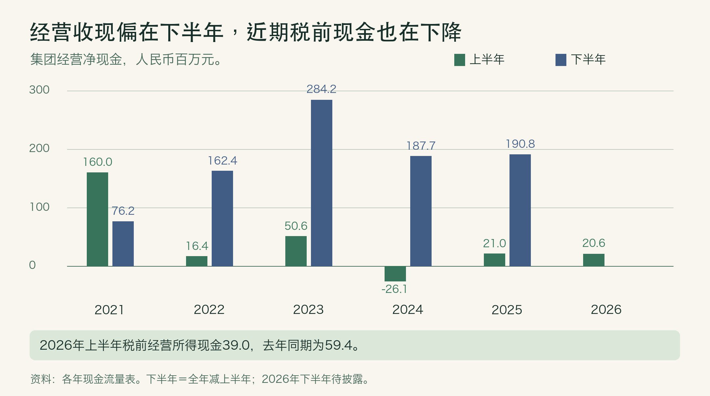

新希望服务上、下半年经营现金及近期税前变化

2022年以来，经营现金主要在下半年取得，2024年上半年甚至净流出，直接把最新半年翻倍会丢掉季节性。比较相同半年还有一层信息。2026年上半年税前利润135.412百万元，税前经营所得现金38.959百万元，差额96.453百万元在半年简明现金表未逐项展开。2026年上半年税前经营所得现金从5941万元降至3896万元，少2045万元；同期实际支付所得税少2007万元，于是税后经营现金仅少约38万元。税后的近似持平主要受到实际纳税金额变化的缓冲。2025年全年经营净现金从1.62亿元回升至2.12亿元，也有营运资金拖累比前一年减少的影响，尚不能据此确认收款质量转好。 2024年报，PDF第67、103页 · 2025年报，PDF第65、104页 · 2026中报，PDF第30页

即使经营现金已收，仍需支付设备、软件和长期租约。2026年上半年从2058.8万元经营净现金扣物业及设备1355.1万元、无形资产144.9万元（当期为软件投入）、长期租赁本金和利息265.4万元，余额293.4万元。这个历史结果受半年收付时点影响；它说明现金实际用到哪里，而全年的维持投入还要结合2025年设备和软件4497.5万元、合同租金安排及后续更新需求理解。经营实体与上市主体的现金再分配，在下一章接着看。 2025年报，PDF第65、92—97页 · 2026中报，PDF第30、38页

依据 · [2025年度報告 · 第65页](https://www1.hkexnews.hk/listedco/listconews/sehk/2026/0430/2026043004377_c.pdf#page=65)；[2025年度報告 · 第104页](https://www1.hkexnews.hk/listedco/listconews/sehk/2026/0430/2026043004377_c.pdf#page=104)；[2024年度報告 · 第67页](https://www1.hkexnews.hk/listedco/listconews/sehk/2025/0429/2025042903823_c.pdf#page=67)；[2024年度報告 · 第103页](https://www1.hkexnews.hk/listedco/listconews/sehk/2025/0429/2025042903823_c.pdf#page=103)；[2026中期報告 · 第30页](https://www1.hkexnews.hk/listedco/listconews/sehk/2026/0930/2026093002812_c.pdf#page=30)；[2025年度報告 · 第92页](https://www1.hkexnews.hk/listedco/listconews/sehk/2026/0430/2026043004377_c.pdf#page=92)；[2025年度報告 · 第97页](https://www1.hkexnews.hk/listedco/listconews/sehk/2026/0430/2026043004377_c.pdf#page=97)；[2026中期報告 · 第38页](https://www1.hkexnews.hk/listedco/listconews/sehk/2026/0930/2026093002812_c.pdf#page=38)

## 第6章 · 第六章　资本配置与股东分配

### 正文

物业公司的资本选择会改变未来的收费权，也会改变手中现金的用途。新希望服务上市时把较大一部分募集资金留给收购，后来更多拨给系统、人员和营运。明宇的两次交易展示了两种投入。首次收购用现金买控制权，第二次在已经并表的情况下以历史服务费债权换取原少数股东持有的股份。 2026中报，PDF第16—18、43页 · 明宇首次收购公告，PDF第1—6页 · 明宇追加收购公告，PDF第1—5页

依据 · [2026中期報告 · 第16页](https://www1.hkexnews.hk/listedco/listconews/sehk/2026/0930/2026093002812_c.pdf#page=16)；[2026中期報告 · 第18页](https://www1.hkexnews.hk/listedco/listconews/sehk/2026/0930/2026093002812_c.pdf#page=18)；[2026中期報告 · 第43页](https://www1.hkexnews.hk/listedco/listconews/sehk/2026/0930/2026093002812_c.pdf#page=43)；[須予披露交易收購目標公司51%股權 · 第1页](https://www1.hkexnews.hk/listedco/listconews/sehk/2022/0411/2022041101089_c.pdf#page=1)；[須予披露交易收購目標公司51%股權 · 第6页](https://www1.hkexnews.hk/listedco/listconews/sehk/2022/0411/2022041101089_c.pdf#page=6)；[有關收購目標公司45.5%的股權之
須予披露及關連交易 · 第1页](https://www1.hkexnews.hk/listedco/listconews/sehk/2026/0417/2026041700002_c.pdf#page=1)；[有關收購目標公司45.5%的股權之
須予披露及關連交易 · 第5页](https://www1.hkexnews.hk/listedco/listconews/sehk/2026/0417/2026041700002_c.pdf#page=5)

### 上市募资后来用于怎样的工作

按公司募资用途表，IPO及超额配售净额约7.90亿港元。原先的大项是战略收购及投资。2022年公司先腾出部分资金用于生活服务和营运，2025年再将收购资金调给人才、系统和营运，解释是合适收购目标有限、扩大后的项目有日常需要。到2026年6月底，募资剩余8988万港元，拟用于收购及投资6075万、系统2913万。留在持牌机构的资金有披露用途和计划时间，未披露这些余额对应多少已签不可撤销支出。 2026中报，PDF第16—18页

营运资金累计使用3.15亿港元，其中约2.46亿是员工成本，其余含外包、水电、租金和行政费用。资金来源是募资，支出的经济用途仍是实际履约。一笔工资支出可能支持新增项目，也可能用于现有合同。仅凭预算拨完，无法分辨投进去的钱创造了多少额外收入，或日常业务需要永久由股东补贴。实际新增收益要看相应合同的毛利、实收和长期投入。 2026中报，PDF第17—18页

依据 · [2026中期報告 · 第16页](https://www1.hkexnews.hk/listedco/listconews/sehk/2026/0930/2026093002812_c.pdf#page=16)；[2026中期報告 · 第18页](https://www1.hkexnews.hk/listedco/listconews/sehk/2026/0930/2026093002812_c.pdf#page=18)；[2026中期報告 · 第17页](https://www1.hkexnews.hk/listedco/listconews/sehk/2026/0930/2026093002812_c.pdf#page=17)

### 两次明宇交易分别买到了什么

2022年，新希望物业和成都星泛分别买入明宇49%和2%，上市集团取得控制。总对价人民币1.8014亿元，按交割、现金底线及后续条件分期。2022年实际付现1.6213亿元，取得目标公司现金1183万元，净流出1.5029亿元。可辨认净资产包括客户关系、投资物业和应收；按收购日可辨认净资产公允价值确认下层股东权益，扣除后，对价中有1.334亿元记为商誉，体现公司为已有经营体系多付的部分。未来是否收回投入，要看原有客户能否续约、交付与收款能否覆盖成本。 明宇首次收购公告，PDF第1—10页 · 2022年报，PDF第117—118页

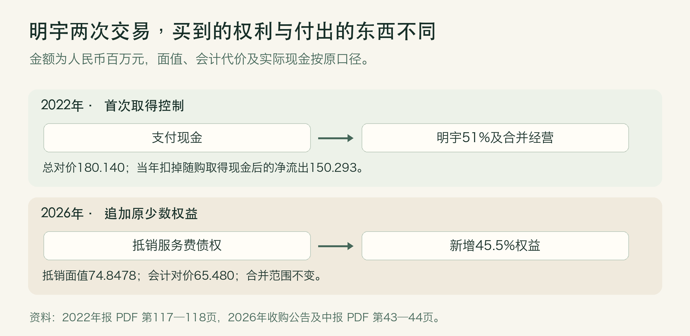

明宇首次收购和第二次以债权换权益

2026年，卖方成都明晟商服将45.5%再卖给新希望物业。明宇曾向卖方的关联客户提供服务，明宇是债权人，这些客户欠物业服务费。买方新希望物业则应向卖方成都明晟支付股权价款。经各方同意，明宇的原债权与买方应付股权价款按7484.78万元面值等额抵销，集团持股由51%升至96.5%。合并范围没有因此扩大，集团换到的是对已经在报表里的经营资产及未来收益更大的份额。公告的抵销面值和中报确认的会计对价6548万元相差936.78万元，附注没有给出债权毛额、旧拨备和终止确认的完整勾稽。中报列会计代价6548万元，扣取得的少数权益账面值4236.2万元，差额2311.8万元减少归母资本储备，已反映在六月归母权益。 明宇追加收购公告，PDF第1—7页 · 明宇补充公告，PDF第7—8页 · 2026中报，PDF第43—44页

这笔交易的经济结果取决于两个替代路径。如果原债本可收现，公司放弃了现金回收权；若原债回收困难，换得有持续可分配现金的权益可能挽回一部分价值。2025年明宇在集团抵销前口径的持续经营利润由5067万元降至3383万元，也因此不能拿当期多出的权益比例直接视作可取现金增加。2022年原交易承诺期为2022—2024年，现有披露没有三年合同口径的完整实现及补偿结算，2025年利润回落与原承诺的履行应分开。 明宇首次收购公告，PDF第6—10页 · 2025年报，PDF第95—99页

依据 · [須予披露交易收購目標公司51%股權 · 第1页](https://www1.hkexnews.hk/listedco/listconews/sehk/2022/0411/2022041101089_c.pdf#page=1)；[須予披露交易收購目標公司51%股權 · 第10页](https://www1.hkexnews.hk/listedco/listconews/sehk/2022/0411/2022041101089_c.pdf#page=10)；[2022年度報告 · 第117页](https://www1.hkexnews.hk/listedco/listconews/sehk/2023/0428/2023042802852_c.pdf#page=117)；[2022年度報告 · 第118页](https://www1.hkexnews.hk/listedco/listconews/sehk/2023/0428/2023042802852_c.pdf#page=118)；[有關收購目標公司45.5%的股權之
須予披露及關連交易 · 第1页](https://www1.hkexnews.hk/listedco/listconews/sehk/2026/0417/2026041700002_c.pdf#page=1)；[有關收購目標公司45.5%的股權之
須予披露及關連交易 · 第7页](https://www1.hkexnews.hk/listedco/listconews/sehk/2026/0417/2026041700002_c.pdf#page=7)；[有關須予披露及關連交易
之補充公告 · 第7页](https://www1.hkexnews.hk/listedco/listconews/sehk/2026/0529/2026052901354_c.pdf#page=7)；[有關須予披露及關連交易
之補充公告 · 第8页](https://www1.hkexnews.hk/listedco/listconews/sehk/2026/0529/2026052901354_c.pdf#page=8)；[2026中期報告 · 第43页](https://www1.hkexnews.hk/listedco/listconews/sehk/2026/0930/2026093002812_c.pdf#page=43)；[2026中期報告 · 第44页](https://www1.hkexnews.hk/listedco/listconews/sehk/2026/0930/2026093002812_c.pdf#page=44)；[須予披露交易收購目標公司51%股權 · 第6页](https://www1.hkexnews.hk/listedco/listconews/sehk/2022/0411/2022041101089_c.pdf#page=6)；[2025年度報告 · 第95页](https://www1.hkexnews.hk/listedco/listconews/sehk/2026/0430/2026043004377_c.pdf#page=95)；[2025年度報告 · 第99页](https://www1.hkexnews.hk/listedco/listconews/sehk/2026/0430/2026043004377_c.pdf#page=99)

### 经营现金到普通股要走过法人和分派程序

2025年末集团现金9.58亿元，开曼上市母公司单体现金64万元、应收子公司6.45亿元。运营子公司先处理员工、税费、租赁和客户履约。可分资金再通过子公司股息、内部应收结算等方式回到上市主体，并经宣派和结算向普通股东支付。2023—2025年集团现金流列已付上市股东约1.49亿至1.52亿元每年，说明历史上已有分派通路。年底母公司时点余额不能说明资金永远无法调拨，历史派息也不足以证明集团余额当下都可动用。 2023年报，PDF第72页 · 2024年报，PDF第67页 · 2025年报，PDF第65、110—117页

公司2026年4月更新股息政策，拟每年分配不少于归母净利润的60%，董事会仍要看现金、业务与资本需求。2026年6月已批准的上一年度末期股息和当期负债余额是应付口径，半年现金流还未记录上市股东股息付款。6月16日股息更新公告列2025年末期每股人民币0.077元、默认港币0.08857元，公告派付日7月7日。8月28日中期公告列每股0.096港元，公告派付日10月30日。两笔实际支付仍须通过之后的现金披露或账户记录核实。 2025年末期股息更新公告，PDF第1—2页 · 2026年中期股息公告，PDF第1—2页评价普通股回报时，要分别看经营赚到的现金、当期能上划的款、实际派现与未来卖价。 股息政策公告，PDF第1—2页 · 2026中报，PDF第30、42—43页

依据 · [2023年度報告 · 第72页](https://www1.hkexnews.hk/listedco/listconews/sehk/2024/0419/2024041901761_c.pdf#page=72)；[2024年度報告 · 第67页](https://www1.hkexnews.hk/listedco/listconews/sehk/2025/0429/2025042903823_c.pdf#page=67)；[2025年度報告 · 第65页](https://www1.hkexnews.hk/listedco/listconews/sehk/2026/0430/2026043004377_c.pdf#page=65)；[2025年度報告 · 第110页](https://www1.hkexnews.hk/listedco/listconews/sehk/2026/0430/2026043004377_c.pdf#page=110)；[2025年度報告 · 第117页](https://www1.hkexnews.hk/listedco/listconews/sehk/2026/0430/2026043004377_c.pdf#page=117)；[截至2025年12月31日止年度的末期股息(更新) · 第1页](https://www1.hkexnews.hk/listedco/listconews/sehk/2026/0616/2026061601179_c.pdf#page=1)；[截至2025年12月31日止年度的末期股息(更新) · 第2页](https://www1.hkexnews.hk/listedco/listconews/sehk/2026/0616/2026061601179_c.pdf#page=2)；[截至2026年6月30日止六個月之中期股息 · 第1页](https://www1.hkexnews.hk/listedco/listconews/sehk/2026/0828/2026082800644_c.pdf#page=1)；[截至2026年6月30日止六個月之中期股息 · 第2页](https://www1.hkexnews.hk/listedco/listconews/sehk/2026/0828/2026082800644_c.pdf#page=2)；[內幕消息 採納經修訂股息政策 · 第1页](https://www1.hkexnews.hk/listedco/listconews/sehk/2026/0408/2026040802395_c.pdf#page=1)；[內幕消息 採納經修訂股息政策 · 第2页](https://www1.hkexnews.hk/listedco/listconews/sehk/2026/0408/2026040802395_c.pdf#page=2)；[2026中期報告 · 第30页](https://www1.hkexnews.hk/listedco/listconews/sehk/2026/0930/2026093002812_c.pdf#page=30)；[2026中期報告 · 第42页](https://www1.hkexnews.hk/listedco/listconews/sehk/2026/0930/2026093002812_c.pdf#page=42)；[2026中期報告 · 第43页](https://www1.hkexnews.hk/listedco/listconews/sehk/2026/0930/2026093002812_c.pdf#page=43)

## 第7章 · 第七章　估值、价格与错误后果

### 正文

2026年11月6日，新希望服务未复权收盘价为1.49港元。按同日欧洲央行公布的两种欧元参考汇率交叉换算，1人民币元约合1.1748港元，历史价格约合1.2683人民币元。这里用固定历史价格比较经营条件，汇率并非港股收盘即期。公司的物业合同有持续收费基础，也有真实外拓记录。能否据此认为价格便宜，要先问现有资产能回收多少、业务还能赚多少、扩张还要投多少。 历史收盘价 · 欧洲央行历史参考汇率

依据 · [东方财富03658.HK未复权收盘 · 2026-11-06](https://push2his.eastmoney.com/api/qt/stock/kline/get?secid=116.03658&klt=101&fqt=0&lmt=1000000&beg=20190101&end=20261109&fields1=f1%2Cf2%2Cf3%2Cf4%2Cf5%2Cf6&fields2=f51%2Cf52%2Cf53%2Cf54%2Cf55%2Cf56%2Cf57)；[欧洲央行欧元参考汇率 · 2026-11-06](https://www.ecb.europa.eu/stats/eurofxref/eurofxref-hist.zip)

### 先辨认买到的资源

六月合并总资产21.04亿元，包括现金、证券、应收、房产及承租权、设备、商誉和软件等。剔除账面商誉和整项无形资产，再扣全部列示负债与下层少数股东权益，剩余可计量资源约10.72亿元，即每股1.316元人民币。它反映保留其余资产当前账面或更新公允值的计算。软件、获客、组织和资质的重建成本尚未量化，老账回收、租约及递延税等也可能要求调整。因此约1.316元是有明确边界的资源参照，不能据此设定清算所得。 2026中报，PDF第26—27、38—43页

依据 · [2026中期報告 · 第26页](https://www1.hkexnews.hk/listedco/listconews/sehk/2026/0930/2026093002812_c.pdf#page=26)；[2026中期報告 · 第27页](https://www1.hkexnews.hk/listedco/listconews/sehk/2026/0930/2026093002812_c.pdf#page=27)；[2026中期報告 · 第38页](https://www1.hkexnews.hk/listedco/listconews/sehk/2026/0930/2026093002812_c.pdf#page=38)；[2026中期報告 · 第43页](https://www1.hkexnews.hk/listedco/listconews/sehk/2026/0930/2026093002812_c.pdf#page=43)

### 现有业务在什么条件下能留下1.40亿元

从最近十二个月毛利443.263百万元起，扣销售和行政176.974、正常信用损耗30、已单列的投资物业净租金6.514，服务税前盈利约229.775百万元。用25%经营税，保留已有折旧摊销，再另留9.926百万元更新差额，得到合并经营经济现金约162.405百万元。扣子公司下层股东年度份额15.038百万元，再按鼎晟发展收取中国附属公司股息适用的5%，对上市普通股应上划余额作条件折减，约为139.999百万元。实际全组上划是否都适用这一税率仍待核。这一计算要求现有规模下毛利与信用成本停止恶化、可收回的营运占款最终稳定。年报和中报记录了既有盈利与实际收付，约1.40亿元是根据这些记录建立的稳态条件。 2025年报，PDF第60、85—87、92—97、108、114页 · 2026中报，PDF第25、34—38页

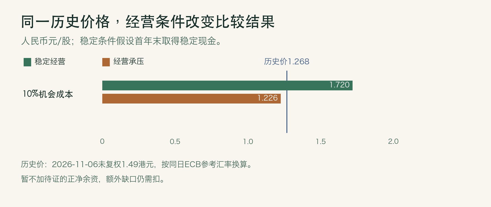

稳定和经营承压两种条件下的每股价值与历史价格

按10%人民币机会成本、不加入未证明的正净余资、额外补资等缺口扣除前，从估值时点起即按稳定经营、首笔年度现金在一年末形成时，每股约1.720元人民币。若仅作过渡演示，头两年均只赚经营反方的约1.00亿元，第三年起达到约1.40亿元，按同一机会成本得约1.634元。实际何时达到稳定仍未知。若毛利率比最近十二个月再低两个百分点、销售及行政多500万元、信用损耗增到5000万元，普通股年现金约1.00亿元，10%下每股约1.226元。反方把费率、现场费用和信用损耗放进同一结果，单靠经营走弱就能使条件价值低于历史价，无需把所有旧账假设为全损。账面银行资金只能在核实相关义务、正常留资、税与权益归属后再看可分余额；如果这项核对发现实际资金缺口，核心经营价值还须扣减。 2025年报，PDF第102、106—107、113—117页 · 2026中报，PDF第26—27、40—44页

依据 · [2025年度報告 · 第60页](https://www1.hkexnews.hk/listedco/listconews/sehk/2026/0430/2026043004377_c.pdf#page=60)；[2025年度報告 · 第85页](https://www1.hkexnews.hk/listedco/listconews/sehk/2026/0430/2026043004377_c.pdf#page=85)；[2025年度報告 · 第87页](https://www1.hkexnews.hk/listedco/listconews/sehk/2026/0430/2026043004377_c.pdf#page=87)；[2025年度報告 · 第92页](https://www1.hkexnews.hk/listedco/listconews/sehk/2026/0430/2026043004377_c.pdf#page=92)；[2025年度報告 · 第97页](https://www1.hkexnews.hk/listedco/listconews/sehk/2026/0430/2026043004377_c.pdf#page=97)；[2025年度報告 · 第108页](https://www1.hkexnews.hk/listedco/listconews/sehk/2026/0430/2026043004377_c.pdf#page=108)；[2025年度報告 · 第114页](https://www1.hkexnews.hk/listedco/listconews/sehk/2026/0430/2026043004377_c.pdf#page=114)；[2026中期報告 · 第25页](https://www1.hkexnews.hk/listedco/listconews/sehk/2026/0930/2026093002812_c.pdf#page=25)；[2026中期報告 · 第34页](https://www1.hkexnews.hk/listedco/listconews/sehk/2026/0930/2026093002812_c.pdf#page=34)；[2026中期報告 · 第38页](https://www1.hkexnews.hk/listedco/listconews/sehk/2026/0930/2026093002812_c.pdf#page=38)；[2025年度報告 · 第102页](https://www1.hkexnews.hk/listedco/listconews/sehk/2026/0430/2026043004377_c.pdf#page=102)；[2025年度報告 · 第106页](https://www1.hkexnews.hk/listedco/listconews/sehk/2026/0430/2026043004377_c.pdf#page=106)；[2025年度報告 · 第107页](https://www1.hkexnews.hk/listedco/listconews/sehk/2026/0430/2026043004377_c.pdf#page=107)；[2025年度報告 · 第113页](https://www1.hkexnews.hk/listedco/listconews/sehk/2026/0430/2026043004377_c.pdf#page=113)；[2025年度報告 · 第117页](https://www1.hkexnews.hk/listedco/listconews/sehk/2026/0430/2026043004377_c.pdf#page=117)；[2026中期報告 · 第26页](https://www1.hkexnews.hk/listedco/listconews/sehk/2026/0930/2026093002812_c.pdf#page=26)；[2026中期報告 · 第27页](https://www1.hkexnews.hk/listedco/listconews/sehk/2026/0930/2026093002812_c.pdf#page=27)；[2026中期報告 · 第40页](https://www1.hkexnews.hk/listedco/listconews/sehk/2026/0930/2026093002812_c.pdf#page=40)；[2026中期報告 · 第44页](https://www1.hkexnews.hk/listedco/listconews/sehk/2026/0930/2026093002812_c.pdf#page=44)

### 增长要通过下一批项目证明

在管面积和签约增长已经发生。现在看到的是外拓提高基础物业收入，同时直接成本增量更大，生活服务和商运毛利减少。公司还将IPO资金转作工资、外包、系统等，明宇追加收购又把债权换成股权。以上事实说明新投入确有用途，但不足以分出新增合同的持续现金回报，因此估值暂不给增长溢价。资产参照回答资源问题，正常盈利估值回答现有经营问题，增长另需新增投入与回报证据。 2026中报，PDF第5—13、16—18、34、43页

历史1.49港元位于上述两种经营结果之间。目前能确认的收费基础支持继续比较这家公司；能否确认安全边际，仍取决于新项目成本、实收和资金用途是否转好。股息还要看上市公司实际支付，不能和已包含股息来源的经营收益率相加。 股息政策公告，PDF第1—2页

依据 · [2026中期報告 · 第5页](https://www1.hkexnews.hk/listedco/listconews/sehk/2026/0930/2026093002812_c.pdf#page=5)；[2026中期報告 · 第13页](https://www1.hkexnews.hk/listedco/listconews/sehk/2026/0930/2026093002812_c.pdf#page=13)；[2026中期報告 · 第16页](https://www1.hkexnews.hk/listedco/listconews/sehk/2026/0930/2026093002812_c.pdf#page=16)；[2026中期報告 · 第18页](https://www1.hkexnews.hk/listedco/listconews/sehk/2026/0930/2026093002812_c.pdf#page=18)；[2026中期報告 · 第34页](https://www1.hkexnews.hk/listedco/listconews/sehk/2026/0930/2026093002812_c.pdf#page=34)；[2026中期報告 · 第43页](https://www1.hkexnews.hk/listedco/listconews/sehk/2026/0930/2026093002812_c.pdf#page=43)；[內幕消息 採納經修訂股息政策 · 第1页](https://www1.hkexnews.hk/listedco/listconews/sehk/2026/0408/2026040802395_c.pdf#page=1)；[內幕消息 採納經修訂股息政策 · 第2页](https://www1.hkexnews.hk/listedco/listconews/sehk/2026/0408/2026040802395_c.pdf#page=2)

## 第8章 · 第八章　预测、跟踪与复盘

### 正文

本书采用的是条件比较。2026年上半年新希望服务的物业面积和物业收入继续增长，基础物业毛利率下降，税前经营所得现金减少。若单位经营和回款最终稳定，现有业务可以支持约1.40亿元年度普通股经济现金；若毛利、信用损耗和费用继续承压，主反方给出的现金约为1.00亿元。这两组是用同一规模作的检验条件。约1.720元的稳定估值假设估值时点已进入稳态，首笔现金在一年末取得；应按后续事实判断是否需要加入过渡期、过渡现金与资金占用。未来披露先用于确认经营发生了什么，再用来判断该保留还是修改相应假设。 2025年报，PDF第60、85—87、102—104页 · 2026中报，PDF第5—13、25、30、34—42页

依据 · [2025年度報告 · 第60页](https://www1.hkexnews.hk/listedco/listconews/sehk/2026/0430/2026043004377_c.pdf#page=60)；[2025年度報告 · 第85页](https://www1.hkexnews.hk/listedco/listconews/sehk/2026/0430/2026043004377_c.pdf#page=85)；[2025年度報告 · 第87页](https://www1.hkexnews.hk/listedco/listconews/sehk/2026/0430/2026043004377_c.pdf#page=87)；[2025年度報告 · 第102页](https://www1.hkexnews.hk/listedco/listconews/sehk/2026/0430/2026043004377_c.pdf#page=102)；[2025年度報告 · 第104页](https://www1.hkexnews.hk/listedco/listconews/sehk/2026/0430/2026043004377_c.pdf#page=104)；[2026中期報告 · 第5页](https://www1.hkexnews.hk/listedco/listconews/sehk/2026/0930/2026093002812_c.pdf#page=5)；[2026中期報告 · 第13页](https://www1.hkexnews.hk/listedco/listconews/sehk/2026/0930/2026093002812_c.pdf#page=13)；[2026中期報告 · 第25页](https://www1.hkexnews.hk/listedco/listconews/sehk/2026/0930/2026093002812_c.pdf#page=25)；[2026中期報告 · 第30页](https://www1.hkexnews.hk/listedco/listconews/sehk/2026/0930/2026093002812_c.pdf#page=30)；[2026中期報告 · 第34页](https://www1.hkexnews.hk/listedco/listconews/sehk/2026/0930/2026093002812_c.pdf#page=34)；[2026中期報告 · 第42页](https://www1.hkexnews.hk/listedco/listconews/sehk/2026/0930/2026093002812_c.pdf#page=42)

### 先跟新项目交付后的效果

2026年上半年外拓项目收费低于综合费率，基础物业收入多3686万元而毛利少约195万元。下一次查看2026年度报告及之前的业绩公告时，应先核基础物业毛利和外拓费率，再看进场后的清洁、值守和外包怎样安排。若费用率仍上升、毛利率继续下滑，就应下调毛利、上调相应费用，重新估计普通股现金。若同类项目收费、成本和续约均稳住，才有依据把签约增长转成现金预期。管理层披露的人均覆盖还须与总员工和分包费用同看。 2026中报，PDF第5—8、12—13、19、34页

生活服务要看高毛利经纪及其他业务结构、商运要看新项目开业和持续运营收入。不同客户的合同权利不能互换。商运收入恢复时还要核其是否伴随新增上游租约和营运占用；否则相同收入的现金后果可能不同。披露只有集团增量时，项目利润仍保留为未知。 2025年报，PDF第9—11、92—94页 · 2026中报，PDF第9—13、38页

依据 · [2026中期報告 · 第5页](https://www1.hkexnews.hk/listedco/listconews/sehk/2026/0930/2026093002812_c.pdf#page=5)；[2026中期報告 · 第8页](https://www1.hkexnews.hk/listedco/listconews/sehk/2026/0930/2026093002812_c.pdf#page=8)；[2026中期報告 · 第12页](https://www1.hkexnews.hk/listedco/listconews/sehk/2026/0930/2026093002812_c.pdf#page=12)；[2026中期報告 · 第13页](https://www1.hkexnews.hk/listedco/listconews/sehk/2026/0930/2026093002812_c.pdf#page=13)；[2026中期報告 · 第19页](https://www1.hkexnews.hk/listedco/listconews/sehk/2026/0930/2026093002812_c.pdf#page=19)；[2026中期報告 · 第34页](https://www1.hkexnews.hk/listedco/listconews/sehk/2026/0930/2026093002812_c.pdf#page=34)；[2025年度報告 · 第9页](https://www1.hkexnews.hk/listedco/listconews/sehk/2026/0430/2026043004377_c.pdf#page=9)；[2025年度報告 · 第11页](https://www1.hkexnews.hk/listedco/listconews/sehk/2026/0430/2026043004377_c.pdf#page=11)；[2025年度報告 · 第92页](https://www1.hkexnews.hk/listedco/listconews/sehk/2026/0430/2026043004377_c.pdf#page=92)；[2025年度報告 · 第94页](https://www1.hkexnews.hk/listedco/listconews/sehk/2026/0430/2026043004377_c.pdf#page=94)；[2026中期報告 · 第9页](https://www1.hkexnews.hk/listedco/listconews/sehk/2026/0930/2026093002812_c.pdf#page=9)；[2026中期報告 · 第38页](https://www1.hkexnews.hk/listedco/listconews/sehk/2026/0930/2026093002812_c.pdf#page=38)

### 回款好转要在现金与账龄同时看到

半年税后经营现金较接近，税前所得现金实际下降；六月超一年净贸易应收增加，外部预收余额减少。到年报时，先比全年税前经营现金和贸易应收变动，再看超一年账龄、增计拨备、撇销和外部预收。若收入增而应收继续占用、旧账迁入更长账龄，稳定条件的周转与信用支出应重新估计。若税前现金和账龄改善由收回货款支持，才有理由降低对现金兑现的顾虑。明宇抵债属于非现金权益交易，追踪原债权时要看面值、净账面、旧拨备和转出分录。 2025年报，PDF第102—104、106—107、113—114页 · 2026中报，PDF第30、40—44页

依据 · [2025年度報告 · 第102页](https://www1.hkexnews.hk/listedco/listconews/sehk/2026/0430/2026043004377_c.pdf#page=102)；[2025年度報告 · 第104页](https://www1.hkexnews.hk/listedco/listconews/sehk/2026/0430/2026043004377_c.pdf#page=104)；[2025年度報告 · 第106页](https://www1.hkexnews.hk/listedco/listconews/sehk/2026/0430/2026043004377_c.pdf#page=106)；[2025年度報告 · 第107页](https://www1.hkexnews.hk/listedco/listconews/sehk/2026/0430/2026043004377_c.pdf#page=107)；[2025年度報告 · 第113页](https://www1.hkexnews.hk/listedco/listconews/sehk/2026/0430/2026043004377_c.pdf#page=113)；[2025年度報告 · 第114页](https://www1.hkexnews.hk/listedco/listconews/sehk/2026/0430/2026043004377_c.pdf#page=114)；[2026中期報告 · 第30页](https://www1.hkexnews.hk/listedco/listconews/sehk/2026/0930/2026093002812_c.pdf#page=30)；[2026中期報告 · 第40页](https://www1.hkexnews.hk/listedco/listconews/sehk/2026/0930/2026093002812_c.pdf#page=40)；[2026中期報告 · 第44页](https://www1.hkexnews.hk/listedco/listconews/sehk/2026/0930/2026093002812_c.pdf#page=44)

### 股东真正取得的资金另记

下一次可核年度现金流将检验2026年下半年股息实际支付，以及经营主体向母公司调拨的能力。需要一起看明宇新增权益的分占、上划税、余下8988万港元募资实际去向，以及设备与软件投入是否恢复。若取得的净现金被新增租赁或应收持续占用，单靠股息政策无法提高可持续可分金额。若普通股实际到账且公司保持足够的正常留资，则应保留这条正面证据，并区分它来自经营收现、往年现金或其他资本用途改变。 股息政策公告，PDF第1—2页 · 2026中报，PDF第16—18、30、36—37、42—44页

复盘沿用当时的判断和条件，后来的财报只能用于验证或更正，不能替换当时的输入。股价上涨或下跌是市场结果；判断记录要先回答当时的项目与现金假设是否有根据、后来哪项发生了变化，以及重算会怎样改变相对价格的余量。公司经营、账面资源与普通股实际所得这三部分，都应有自己的证据。

依据 · [內幕消息 採納經修訂股息政策 · 第1页](https://www1.hkexnews.hk/listedco/listconews/sehk/2026/0408/2026040802395_c.pdf#page=1)；[內幕消息 採納經修訂股息政策 · 第2页](https://www1.hkexnews.hk/listedco/listconews/sehk/2026/0408/2026040802395_c.pdf#page=2)；[2026中期報告 · 第16页](https://www1.hkexnews.hk/listedco/listconews/sehk/2026/0930/2026093002812_c.pdf#page=16)；[2026中期報告 · 第18页](https://www1.hkexnews.hk/listedco/listconews/sehk/2026/0930/2026093002812_c.pdf#page=18)；[2026中期報告 · 第30页](https://www1.hkexnews.hk/listedco/listconews/sehk/2026/0930/2026093002812_c.pdf#page=30)；[2026中期報告 · 第36页](https://www1.hkexnews.hk/listedco/listconews/sehk/2026/0930/2026093002812_c.pdf#page=36)；[2026中期報告 · 第37页](https://www1.hkexnews.hk/listedco/listconews/sehk/2026/0930/2026093002812_c.pdf#page=37)；[2026中期報告 · 第42页](https://www1.hkexnews.hk/listedco/listconews/sehk/2026/0930/2026093002812_c.pdf#page=42)；[2026中期報告 · 第44页](https://www1.hkexnews.hk/listedco/listconews/sehk/2026/0930/2026093002812_c.pdf#page=44)

## 现金与估值｜新增规模为何还不能确认更便宜

### 正文

新希望服务的基础物业有持续收费合同，也确实从独立客户取得业务。但2026年上半年，基础物业收入多36.858百万元，直接成本多38.811百万元，毛利反少1.953百万元。生活服务与商运各少约6.4百万元毛利；其他业务增量未能抵消。税后经营现金表面大致持平，税前经营所得现金却少20.451百万元。在这种情况下，账上现金和当期股息是重要证据，仍需分清哪些钱用于日常履约、回款及资本投入，哪些才是普通股实际所得。除特别注明，以下金额为人民币百万元。 2026中报，PDF第5—13、25、30、34页

本报告比较的是2026年11月6日未复权收盘价1.49港元。欧洲央行同日每欧元参考价为7.4485人民币元、8.7505港元，交叉折算为1人民币元约合1.1748003港元，历史报价约1.268301人民币元。这个汇率不是港股收盘即期。以2026年10月底已发普通股814.126百万股、库存股为零作分母。在外期权为零，仍可授予的80百万份是额度。Golden Rose持有544.8百万股、占约66.92%，信托和中间主体披露的是同一控制链上的股份。控制方的决策会影响留资和分派，每股经济价值仍以现有全体普通股为分母。 历史收盘价 · 欧洲央行历史参考汇率 · 2026中报，PDF第20—23页 · 十月股份月报，PDF第2—3页

依据 · [2026中期報告 · 第5页](https://www1.hkexnews.hk/listedco/listconews/sehk/2026/0930/2026093002812_c.pdf#page=5)；[2026中期報告 · 第13页](https://www1.hkexnews.hk/listedco/listconews/sehk/2026/0930/2026093002812_c.pdf#page=13)；[2026中期報告 · 第25页](https://www1.hkexnews.hk/listedco/listconews/sehk/2026/0930/2026093002812_c.pdf#page=25)；[2026中期報告 · 第30页](https://www1.hkexnews.hk/listedco/listconews/sehk/2026/0930/2026093002812_c.pdf#page=30)；[2026中期報告 · 第34页](https://www1.hkexnews.hk/listedco/listconews/sehk/2026/0930/2026093002812_c.pdf#page=34)；[东方财富03658.HK未复权收盘 · 2026-11-06](https://push2his.eastmoney.com/api/qt/stock/kline/get?secid=116.03658&klt=101&fqt=0&lmt=1000000&beg=20190101&end=20261109&fields1=f1%2Cf2%2Cf3%2Cf4%2Cf5%2Cf6&fields2=f51%2Cf52%2Cf53%2Cf54%2Cf55%2Cf56%2Cf57)；[欧洲央行欧元参考汇率 · 2026-11-06](https://www.ecb.europa.eu/stats/eurofxref/eurofxref-hist.zip)；[2026中期報告 · 第20页](https://www1.hkexnews.hk/listedco/listconews/sehk/2026/0930/2026093002812_c.pdf#page=20)；[2026中期報告 · 第23页](https://www1.hkexnews.hk/listedco/listconews/sehk/2026/0930/2026093002812_c.pdf#page=23)；[截至二零二六年十月三十一日止股份發行人的證券變動月報表 · 第2页](https://www1.hkexnews.hk/listedco/listconews/sehk/2026/1104/2026110400647_c.pdf#page=2)；[截至二零二六年十月三十一日止股份發行人的證券變動月報表 · 第3页](https://www1.hkexnews.hk/listedco/listconews/sehk/2026/1104/2026110400647_c.pdf#page=3)

### 一、先看已经取得的钱和还承担的事

客户可以在物业开始工作前预缴，也可能在发票到期后仍未支付。2025年初合同负债209.342，当年期初款中207.692在交付后确认为收入，年内又新增预收247.988，年底249.638。预收能减轻周转，但后续仍需派人、分包和维护。到2026年6月外部预收减少、关联预收增加，合计余额降17.774。同期集团代住户及租户收款57.231、按金54.166，这些负债对应交付、转交或按合同退回义务。 2025年报，PDF第106—107页 · 2026中报，PDF第41—42页

2025年集团税前利润279.209。将折旧摊销、信用损失、物业公允价值、利息、汇兑等非现金及经营现金分类调整净加64.443，扣营运资金占用87.785，得税前经营所得现金255.867；实付税44.133后，净经营现金211.734。占用最明显的是贸易应收69.517，其他应收预付8.482、存货0.078也用钱，贸易及其他应付减少占19.354和30.650，合同负债增加40.296起到缓冲。合计用款已经反映在上述经营现金，不能再从211.734扣同一轮。 2025年报，PDF第65、104页

2026年上半年税前利润135.412、税前经营所得现金38.959，两者净差96.453。半年报未按全年调节表逐项拆这一差额。税前经营所得现金同比由59.410降至38.959，实际所得税则由38.438降至18.371，税后经营净现金只从20.972降至20.588。用20.588扣物业及设备13.551、无形资产1.449（当期为软件）和长期租赁本金利息2.654，得2.934；再扣实际下层股息0.024，剩2.910。加投资项实收利息0.382、减另一项少数权益购买2.100、加受限款释放3.192，得到4.384。其他投资、处置、下层注资与汇兑净影响−0.344，故现金净增4.040。4.384是这段时间的一组实收实付，正常盈利还需从全年经营的现金需求估计。 2026中报，PDF第25、30、38、43—44页

从2022至2025年，经营现金大多在下半年取得，且年度波动较大。按2025全年加2026上半年减2025上半年的方法，最近十二个月净经营现金211.350。扣全部现金购置设备和无形资产、长期租赁本金利息，剩154.487；再扣已付下层股息3.309，得151.178。这个历史对照含特定税款时点和长期租赁付款波动，无法把未拆银行利息排净，也不能代替年度经济现金。 2022年报，PDF第70页 · 2023年报，PDF第72页 · 2024年报，PDF第67页 · 2025年报，PDF第65页 · 2026中报，PDF第30页

依据 · [2025年度報告 · 第106页](https://www1.hkexnews.hk/listedco/listconews/sehk/2026/0430/2026043004377_c.pdf#page=106)；[2025年度報告 · 第107页](https://www1.hkexnews.hk/listedco/listconews/sehk/2026/0430/2026043004377_c.pdf#page=107)；[2026中期報告 · 第41页](https://www1.hkexnews.hk/listedco/listconews/sehk/2026/0930/2026093002812_c.pdf#page=41)；[2026中期報告 · 第42页](https://www1.hkexnews.hk/listedco/listconews/sehk/2026/0930/2026093002812_c.pdf#page=42)；[2025年度報告 · 第65页](https://www1.hkexnews.hk/listedco/listconews/sehk/2026/0430/2026043004377_c.pdf#page=65)；[2025年度報告 · 第104页](https://www1.hkexnews.hk/listedco/listconews/sehk/2026/0430/2026043004377_c.pdf#page=104)；[2026中期報告 · 第25页](https://www1.hkexnews.hk/listedco/listconews/sehk/2026/0930/2026093002812_c.pdf#page=25)；[2026中期報告 · 第30页](https://www1.hkexnews.hk/listedco/listconews/sehk/2026/0930/2026093002812_c.pdf#page=30)；[2026中期報告 · 第38页](https://www1.hkexnews.hk/listedco/listconews/sehk/2026/0930/2026093002812_c.pdf#page=38)；[2026中期報告 · 第43页](https://www1.hkexnews.hk/listedco/listconews/sehk/2026/0930/2026093002812_c.pdf#page=43)；[2026中期報告 · 第44页](https://www1.hkexnews.hk/listedco/listconews/sehk/2026/0930/2026093002812_c.pdf#page=44)；[2022年度報告 · 第70页](https://www1.hkexnews.hk/listedco/listconews/sehk/2023/0428/2023042802852_c.pdf#page=70)；[2023年度報告 · 第72页](https://www1.hkexnews.hk/listedco/listconews/sehk/2024/0419/2024041901761_c.pdf#page=72)；[2024年度報告 · 第67页](https://www1.hkexnews.hk/listedco/listconews/sehk/2025/0429/2025042903823_c.pdf#page=67)

### 二、资产再生产，能计量的资源和仍待补的费用

2026年6月合并资产2103.767，全部负债722.956、少数权益47.820，归母账面净资产1332.991。重建一家类似服务公司需要有工资和周转资金、设备、系统、资质及合同关系；历史收购产生的商誉不能直接代表今天重新取得这些能力的费用。下面先以当期账面净额或披露公允价值计出有数字的资源，再保留重建和回收差异。 2026中报，PDF第26—27、38—43页

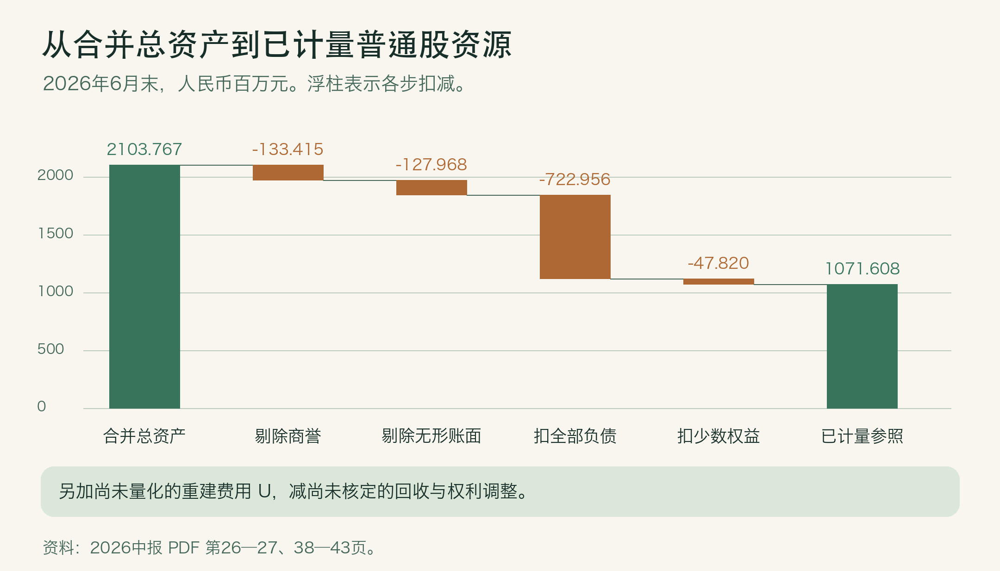

资产项目的已计量资源参照与待验证的权利、义务

金融与资金资源。 现金及现金等价物961.848，受限银行存款4.695单列，受限项仅在本步以已报告账面金额观察。证券及基金64.868，其中美国国债48.456、有限合伙基金16.412。国债和基金与日常物业现金不同；有限合伙的剩余出资义务与可变现时间没有完整明细。按账面计资源可以复算，仍须核实际回收及资金可分性。 2026中报，PDF第26、39页

经营流动资源。 净贸易应收502.311已经扣62.451拨备。其他预付、按金、应收及相应税项合计142.771，包括已扣拨备的其他金融应收79.181、预付55.127、可抵税8.463。存货0.544。预付主要代表向供应商等取得后续履约的权利，未必直接换回现金，故当前保留账面作参照、追加调整仍待证。 2026中报，PDF第26、40页

物业、设备与其他。 投资物业103.809包括自有资产和承租再出租权；2025年末有自有停车场及企业物业45.128、承租后出租物业58.714，六月没有单列拆分。已入账主租赁负债39.719保留在总负债。2025年末未贴现租金应收43.516与应付43.748分属不同合同集合，期限接近但不能当法律抵销，也不保证租户付款。设备42.477含使用权，联营5.695、递延税资产13.366均先按当期账面。递延税可否实现取决于相应主体以后的税务利润。明宇公告中的长春办公室23.100不另加到现有账面。 2025年报，PDF第92—94、114—115页 · 2026中报，PDF第26—27、38—43页 · 明宇补充公告，PDF第4—8页

没有采用原账面代替的资源。 商誉133.415、软件和客户关系等无形资产127.968从已计量项目剔除。收购商誉不等于今天重建运营能力的报价，旧软件和旧客户合同的账面净额也不等于今天重新开发、招投标与组织现场的费用。可辩护的现时重建费用记为U，尚未量化。应收回收、有限租期权利和递延税实现等追加净调整记为L_A，也未核定。 2025年报，PDF第95—97页 · 2026中报，PDF第26、38页

计算为 2103.767−133.415−127.968−722.956−47.820＝1071.608，除814.126得每股1.3163元，完整资源参照还应再加U、减L_A。所有已列负债和少数权益均保留，明宇交易已入账的23.118资本储备扣减无需再扣。若额外损失全由普通股承担且没有税益，超一年净贸易应收33.892全损、其他金融净应收79.181全损、基金16.412全损分别对应每股少0.04163、0.09726、0.02016元。这是三项各自的压力。关联毛应收156.590未单列拨备，净暴露算术区间为94.139至156.590，与账龄压力有重叠。各情景不能相加为所谓底价。 2026中报，PDF第26—27、39—44页

依据 · [2026中期報告 · 第26页](https://www1.hkexnews.hk/listedco/listconews/sehk/2026/0930/2026093002812_c.pdf#page=26)；[2026中期報告 · 第27页](https://www1.hkexnews.hk/listedco/listconews/sehk/2026/0930/2026093002812_c.pdf#page=27)；[2026中期報告 · 第38页](https://www1.hkexnews.hk/listedco/listconews/sehk/2026/0930/2026093002812_c.pdf#page=38)；[2026中期報告 · 第43页](https://www1.hkexnews.hk/listedco/listconews/sehk/2026/0930/2026093002812_c.pdf#page=43)；[2026中期報告 · 第39页](https://www1.hkexnews.hk/listedco/listconews/sehk/2026/0930/2026093002812_c.pdf#page=39)；[2026中期報告 · 第40页](https://www1.hkexnews.hk/listedco/listconews/sehk/2026/0930/2026093002812_c.pdf#page=40)；[2025年度報告 · 第92页](https://www1.hkexnews.hk/listedco/listconews/sehk/2026/0430/2026043004377_c.pdf#page=92)；[2025年度報告 · 第94页](https://www1.hkexnews.hk/listedco/listconews/sehk/2026/0430/2026043004377_c.pdf#page=94)；[2025年度報告 · 第114页](https://www1.hkexnews.hk/listedco/listconews/sehk/2026/0430/2026043004377_c.pdf#page=114)；[2025年度報告 · 第115页](https://www1.hkexnews.hk/listedco/listconews/sehk/2026/0430/2026043004377_c.pdf#page=115)；[有關須予披露及關連交易
之補充公告 · 第4页](https://www1.hkexnews.hk/listedco/listconews/sehk/2026/0529/2026052901354_c.pdf#page=4)；[有關須予披露及關連交易
之補充公告 · 第8页](https://www1.hkexnews.hk/listedco/listconews/sehk/2026/0529/2026052901354_c.pdf#page=8)；[2025年度報告 · 第95页](https://www1.hkexnews.hk/listedco/listconews/sehk/2026/0430/2026043004377_c.pdf#page=95)；[2025年度報告 · 第97页](https://www1.hkexnews.hk/listedco/listconews/sehk/2026/0430/2026043004377_c.pdf#page=97)；[2026中期報告 · 第44页](https://www1.hkexnews.hk/listedco/listconews/sehk/2026/0930/2026093002812_c.pdf#page=44)

### 三、让现有规模稳定，每年能留多少普通股经济现金

从历史报表出发。 最近十二个月取2025全年加2026上半年、减2025上半年，得到收入1571.766、毛利443.263、销售及行政176.974、信用损失25.576，其他净额−1.090，经营利润239.623。两期销售、行政的列示曾重分类，合计保持可比。最近一年归母195.505仍包括应计、税率、估值和下层归属等差异。估计稳定条件时，需要逐步改变哪些项目沿用、哪些不能外推。 2025年报，PDF第60、85—87页 · 2026中报，PDF第25、34—36、44页

毛利和费用。 沿用最近十二个月毛利443.263，约占收入28.2%。基础物业收入增长但毛利减少，生活服务与商运还在走弱，所以不把过去更高的毛利率当恢复结果，也不把新签合同额直接算入盈利。销售及行政176.974全部保留，包括滚动期净汇兑损失20.192。该损失可能大部分与外币资金、国债和锁汇相关，但尚无各工具分项。保留它反映谨慎费用条件；日后若证明确归单列金融本金，可以另外测试加回，同时按实际可用资源重新计本金。 2025年报，PDF第14—15、86—87页 · 2026中报，PDF第12—15、25、34—36页

信用成本与非服务项目。 取年度信用损耗30，约收入1.91%，高于最近十二个月1.63%、最新半年1.84%。依据是一年以上净应收由19.648升至33.892，且此前外部毛应收显著增加。30是工作假设，50用于压力；已计的正常信用损耗与旧账额外跌价各守边界。其他净额中的物业及证券估值、补助、押金等不进入稳定服务盈利。应计金融利息17.219和联营2.026本来在经营利润以下。将滚动投资物业租金净额 6.069＋3.478−3.033＝6.514 从服务利润单列，与房产、承租权及相应负债一起研究。保留自用小额租赁已入的日常费用，避免同时算入资本化租金与同一资产。 2025年报，PDF第85—87、92—94、102、113—114页 · 2026中报，PDF第34—40页

税、更新与归属。 服务税前为 443.263−176.974−30−6.514＝229.775。一般企业税率按25%，对应57.44375。西部部分企业15%优惠至2030年，小微5%亦有资格要求，暂不把这些较低税率延伸到长期。财务已扣设备折旧15.867、无形摊销19.207，共35.074，全部保留，再留9.926更新差额，等价年度更新和持续获客投入45。依据是2025实际购置设备35.525、软件9.450，合计44.975，最近十二个月两项现金41.765。45采用近期较高完整投入作为条件，现有公开账未拆维护与增长，客户关系摊销保留也可能与已在费用的部分获客成本相重。主例不再扣一次软件现金或历史大笔长期租赁本金。 2025年报，PDF第65、87、96—97、108页 · 2026中报，PDF第30、36—38页

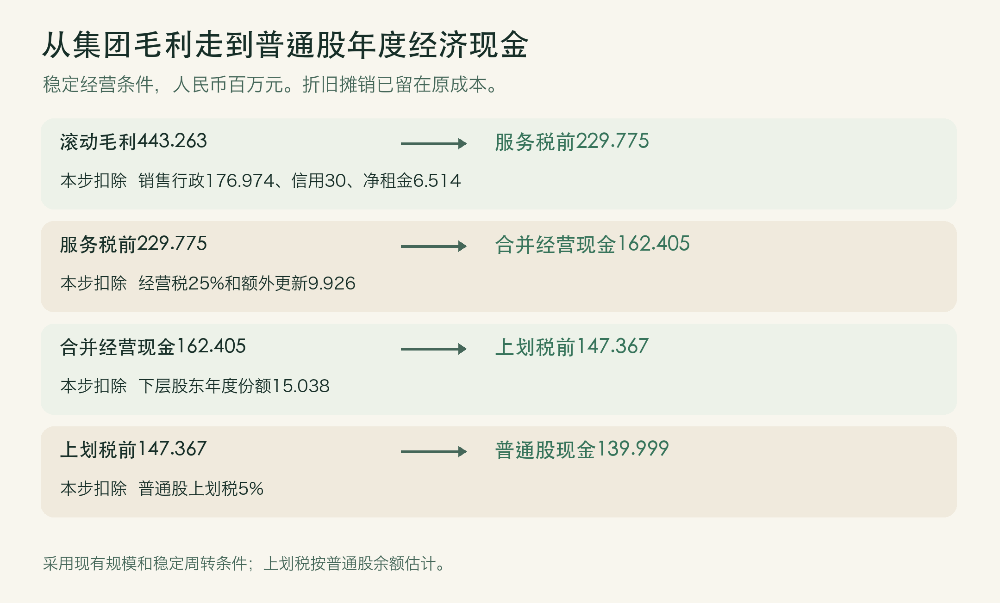

从最近一年毛利到年度普通股经济现金

合并经营经济现金为 229.775×75%−9.926＝162.40525。扣下层年度份额15.038，这是最近十二个月的权责利润分占；明宇增持可能减少该份额，但还有其他子公司及其下层权益，主例暂不给改善信用。实际已付下层股息3.309不能替代其经济权利。税前可上划普通股余额为147.36725。中报披露，集团附属公司鼎晟发展有限公司收取中国附属公司股息适用5%预扣税，未获宽减的非居民投资者一般适用10%。主例以鼎晟发展的已披露税率对普通股余额作条件折减，147.36725×5%＝7.3683625，得到普通股经济现金 139.9988875。经营税与股息上划税作用于不同层次，集团未披露每一笔可上划现金的税基与路径。另一种等价算法是从合并162.40525只扣同一笔普通股上划税7.3683625，得到仍含下层份额的155.0368875，资本化后再扣下层年度份额15.038的现值。对合并现金全额扣5%会把下层份额也计入上市普通股的上划税。 2025年报，PDF第65、99、108、114、117页 · 2026中报，PDF第30、36—37、43—44页

若仅测试税率，把同一普通股余额147.36725全按10%折减，每年比主例少7.3683625，10%机会成本下每股少约0.0905064元。此项只衡量上划税差异。

主例约1.40亿元还要求在现有规模下，可回收营运资金停止净增加。在当前收入水平上，这意味着新增应收占款和预收变化不再持续恶化，无法用2026年半年现金直接证明。税额以账面税基近似，若年报客户关系摊销6.439全不能抵税，单项演示使年度普通股现金少约1.529，10%下每股少约0.0188元；近期非租财务费用0.497若全部持续，按同样税层每股另有约0.00435元量级。两项不当作已知付款。 2025年报，PDF第87、97、108页 · 2026中报，PDF第35—38页

依据 · [2025年度報告 · 第60页](https://www1.hkexnews.hk/listedco/listconews/sehk/2026/0430/2026043004377_c.pdf#page=60)；[2025年度報告 · 第85页](https://www1.hkexnews.hk/listedco/listconews/sehk/2026/0430/2026043004377_c.pdf#page=85)；[2025年度報告 · 第87页](https://www1.hkexnews.hk/listedco/listconews/sehk/2026/0430/2026043004377_c.pdf#page=87)；[2026中期報告 · 第25页](https://www1.hkexnews.hk/listedco/listconews/sehk/2026/0930/2026093002812_c.pdf#page=25)；[2026中期報告 · 第34页](https://www1.hkexnews.hk/listedco/listconews/sehk/2026/0930/2026093002812_c.pdf#page=34)；[2026中期報告 · 第36页](https://www1.hkexnews.hk/listedco/listconews/sehk/2026/0930/2026093002812_c.pdf#page=36)；[2026中期報告 · 第44页](https://www1.hkexnews.hk/listedco/listconews/sehk/2026/0930/2026093002812_c.pdf#page=44)；[2025年度報告 · 第14页](https://www1.hkexnews.hk/listedco/listconews/sehk/2026/0430/2026043004377_c.pdf#page=14)；[2025年度報告 · 第15页](https://www1.hkexnews.hk/listedco/listconews/sehk/2026/0430/2026043004377_c.pdf#page=15)；[2025年度報告 · 第86页](https://www1.hkexnews.hk/listedco/listconews/sehk/2026/0430/2026043004377_c.pdf#page=86)；[2026中期報告 · 第12页](https://www1.hkexnews.hk/listedco/listconews/sehk/2026/0930/2026093002812_c.pdf#page=12)；[2026中期報告 · 第15页](https://www1.hkexnews.hk/listedco/listconews/sehk/2026/0930/2026093002812_c.pdf#page=15)；[2025年度報告 · 第92页](https://www1.hkexnews.hk/listedco/listconews/sehk/2026/0430/2026043004377_c.pdf#page=92)；[2025年度報告 · 第94页](https://www1.hkexnews.hk/listedco/listconews/sehk/2026/0430/2026043004377_c.pdf#page=94)；[2025年度報告 · 第102页](https://www1.hkexnews.hk/listedco/listconews/sehk/2026/0430/2026043004377_c.pdf#page=102)；[2025年度報告 · 第113页](https://www1.hkexnews.hk/listedco/listconews/sehk/2026/0430/2026043004377_c.pdf#page=113)；[2025年度報告 · 第114页](https://www1.hkexnews.hk/listedco/listconews/sehk/2026/0430/2026043004377_c.pdf#page=114)；[2026中期報告 · 第40页](https://www1.hkexnews.hk/listedco/listconews/sehk/2026/0930/2026093002812_c.pdf#page=40)；[2025年度報告 · 第65页](https://www1.hkexnews.hk/listedco/listconews/sehk/2026/0430/2026043004377_c.pdf#page=65)；[2025年度報告 · 第96页](https://www1.hkexnews.hk/listedco/listconews/sehk/2026/0430/2026043004377_c.pdf#page=96)；[2025年度報告 · 第97页](https://www1.hkexnews.hk/listedco/listconews/sehk/2026/0430/2026043004377_c.pdf#page=97)；[2025年度報告 · 第108页](https://www1.hkexnews.hk/listedco/listconews/sehk/2026/0430/2026043004377_c.pdf#page=108)；[2026中期報告 · 第30页](https://www1.hkexnews.hk/listedco/listconews/sehk/2026/0930/2026093002812_c.pdf#page=30)；[2026中期報告 · 第38页](https://www1.hkexnews.hk/listedco/listconews/sehk/2026/0930/2026093002812_c.pdf#page=38)；[2025年度報告 · 第99页](https://www1.hkexnews.hk/listedco/listconews/sehk/2026/0430/2026043004377_c.pdf#page=99)；[2025年度報告 · 第117页](https://www1.hkexnews.hk/listedco/listconews/sehk/2026/0430/2026043004377_c.pdf#page=117)；[2026中期報告 · 第37页](https://www1.hkexnews.hk/listedco/listconews/sehk/2026/0930/2026093002812_c.pdf#page=37)；[2026中期報告 · 第43页](https://www1.hkexnews.hk/listedco/listconews/sehk/2026/0930/2026093002812_c.pdf#page=43)；[2026中期報告 · 第35页](https://www1.hkexnews.hk/listedco/listconews/sehk/2026/0930/2026093002812_c.pdf#page=35)

### 四、价格比较，先看经营差异再核余资与缺口

主例从估值时点起即采用稳定经营，第一笔139.9988875在一年末形成，此后保持同额。将年度现金除以人民币名义机会成本10%，再除814.126百万股，得已计量经营价值约1.71962187元/股。现有证据还无法确定何时达到稳态。10%是比较小型服务公司经营、治理和兑现风险的条件，另看8%与12%。计算暂不给尚未核实的正净余资加值。金融本金、房产及租赁、联营等既已与服务收益分开，只能将其可回收额扣对应义务、少数、税及维持基准经营所需留资后，确定是否有剩余。银行现金961.848即使简单减全部负债722.956与少数47.820只余191.072，且没有留下日常备用金，这只是静态覆盖量级，不能当普通股余资。若同一口径出现净缺口，仍须从普通股价值扣除。旧资产跌价若仅侵蚀本来没有加价的余资，只有超出到需要补资、形成净义务或损害已计价经营权利时，才改变核心价值。已在信用成本或资源中计算的损失不重复扣。 2026中报，PDF第26—27、38—44页

经营反方。 收入仍取1571.766，综合毛利率再少2个百分点，毛利降至411.82768。销售行政从176.974加5至181.974，反映履约和总部成本不能随盈利下降立即缩减；信用损耗50，相当于收入3.18%。仍剥净租金6.514，税前服务盈利 411.82768−181.974−50−6.514＝173.33968。用相同税与更新假设，普通股经济现金 (173.33968×75%−9.926−15.038)×95%＝99.788722。10%每股1.225716元，低于历史1.268301元。外拓价格、完整成本与拖欠如果同时继续恶化，单靠经营即可消耗主条件的折价。 2026中报，PDF第5—13、34、40页

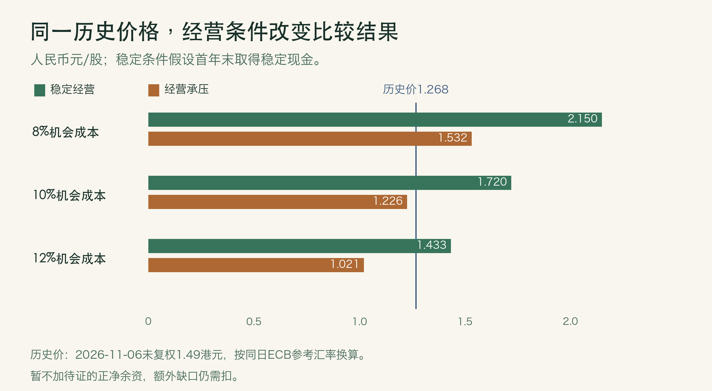

稳定经营、经营压力与历史报价在三档机会成本下的比较

按8%、10%、12%的顺序，稳定条件人民币每股约2.150、1.720、1.433，对应固定汇率港元约2.525、2.020、1.684；经营反方人民币约1.532、1.226、1.021，对应港元约1.800、1.440、1.200。所有数都不加待证的正余资，且仍需扣额外缺口。图以人民币比较，港元是固定参考换算。

达到稳态之前少赚的钱。 仅作过渡演示，假设第一、二年末各取得99.788722，第三年末起才每年取得139.9988875。按10%，前两年少赚的每股现值是 (139.9988875−99.788722)×(1/1.10＋1/1.10²)÷814.126＝0.08571921元，经营价值由1.71962187降至1.63390266元/股。这是给定现金和时点的算式，实际恢复年份仍未知。在10%且净余资和额外缺口都取零的比较条件下，1.49港元历史价隐含年普通股现金 1.49÷1.1748002953614822×814.126×10%＝103.255655，落在99.788722与139.9988875之间。这只用于定位历史价，前述经营参数仍由披露和假设形成。

周转延迟与永久损失。 假设基准留资之外的普通股资金于第一年末再付40，第二年末收回40，10%折现成本 40/1.10−40/1.10²＝3.305785，每股0.004061元。若第1、2年末各付40，到第3年末才收回80，成本 40/1.10＋40/1.10²−80/1.10³＝9.316304，每股0.011443元。若不能收回，两例现值成本变为36.363636与69.421488，分别每股0.044666与0.085271元。这只比较确定时点下的周转与损失，与前两年经营少赚是不同机制。只有两笔影响各自成立、且没有重叠时，才可合并计入同一情景。未收回的那部分不能再纳入同一经营情景的50信用损耗；若资金只是使用本来未计价的富余款，亦需回到同一净资源口径判断。

依据 · [2026中期報告 · 第26页](https://www1.hkexnews.hk/listedco/listconews/sehk/2026/0930/2026093002812_c.pdf#page=26)；[2026中期報告 · 第27页](https://www1.hkexnews.hk/listedco/listconews/sehk/2026/0930/2026093002812_c.pdf#page=27)；[2026中期報告 · 第38页](https://www1.hkexnews.hk/listedco/listconews/sehk/2026/0930/2026093002812_c.pdf#page=38)；[2026中期報告 · 第44页](https://www1.hkexnews.hk/listedco/listconews/sehk/2026/0930/2026093002812_c.pdf#page=44)；[2026中期報告 · 第5页](https://www1.hkexnews.hk/listedco/listconews/sehk/2026/0930/2026093002812_c.pdf#page=5)；[2026中期報告 · 第13页](https://www1.hkexnews.hk/listedco/listconews/sehk/2026/0930/2026093002812_c.pdf#page=13)；[2026中期報告 · 第34页](https://www1.hkexnews.hk/listedco/listconews/sehk/2026/0930/2026093002812_c.pdf#page=34)；[2026中期報告 · 第40页](https://www1.hkexnews.hk/listedco/listconews/sehk/2026/0930/2026093002812_c.pdf#page=40)

### 五、增长需要有自己的投入和回款证据

第三步检验增长值不值得付钱。项目扩张须能找到新增业务收入、完整履约成本、所需设备及营运资金，并知道新增现金何时可以上划。2026年上半年第三方各类项目签约460，基础物业实际增收，但分部毛利反降。IPO资金用在工资、分包和系统，说明经营活动实际用了资金；仍缺对应新增项目能留下多少现金。明宇的服务费债权原向卖方成都明晟的关联客户收取，新希望物业买股应向成都明晟付款。各方同意以74.8478面值抵销两笔权利义务。股权增加，不新增合并经营或现金。中报会计对价65.480扣取得的少数权益账面值42.362，归母资本储备减少23.118；会计对价和债权面值差9.3678仍待勾稽。未来分配要与原债本可收回的金额比较。因此增长暂不付溢价。资产再生产参照、现有经营盈利价值和未来扩张回报各回答自己的问题。 2026中报，PDF第5—13、16—18、34、43页 · 明宇补充公告，PDF第7—8页

依据 · [2026中期報告 · 第5页](https://www1.hkexnews.hk/listedco/listconews/sehk/2026/0930/2026093002812_c.pdf#page=5)；[2026中期報告 · 第13页](https://www1.hkexnews.hk/listedco/listconews/sehk/2026/0930/2026093002812_c.pdf#page=13)；[2026中期報告 · 第16页](https://www1.hkexnews.hk/listedco/listconews/sehk/2026/0930/2026093002812_c.pdf#page=16)；[2026中期報告 · 第18页](https://www1.hkexnews.hk/listedco/listconews/sehk/2026/0930/2026093002812_c.pdf#page=18)；[2026中期報告 · 第34页](https://www1.hkexnews.hk/listedco/listconews/sehk/2026/0930/2026093002812_c.pdf#page=34)；[2026中期報告 · 第43页](https://www1.hkexnews.hk/listedco/listconews/sehk/2026/0930/2026093002812_c.pdf#page=43)；[有關須予披露及關連交易
之補充公告 · 第7页](https://www1.hkexnews.hk/listedco/listconews/sehk/2026/0529/2026052901354_c.pdf#page=7)；[有關須予披露及關連交易
之補充公告 · 第8页](https://www1.hkexnews.hk/listedco/listconews/sehk/2026/0529/2026052901354_c.pdf#page=8)

### 六、股东真正能拿到的回报如何随卖价变化

2025年集团账上现金957.808，上市主体单体0.640，另有对子公司应收645.400。经营法人要先维持履约、租赁、税、周转及下层权益。经内部股息或应收结算上划，再按宣派、批准和结算程序进入普通股账户。2023至2025年集团记录实际支付上市股东约149至152每年，说明分派路径曾兑现。2026年4月政策以不少于归母净利润的60%为意向，现金和资本需要仍由董事会考虑。 2023年报，PDF第72页 · 2024年报，PDF第67页 · 2025年报，PDF第65、110—117页 · 股息政策公告，PDF第1—2页

6月16日公告2025年末期每股人民币0.077元、预设港元0.08857，派付日7月7日；8月28日公告2026中期每股0.096港元，派付日10月30日。两项公告港元金额加总0.18457，除历史价格1.49得12.39%，这是公告金额对历史价的比率。实际到账仍待年度现金流或付款记录核对，这个比率也没有设定未来派息。 2025年末期股息更新公告，PDF第1—2页 · 2026年中期股息公告，PDF第1—2页

十年比较采用第一年起即稳定的条件，普通股年度经济现金取139.9988875，假设只将60%在每年末派出。每股年派为 139.9988875×60%÷814.126×1.1748003＝0.121213港元。60%在这里乘的是经济现金，和公司以归母净利润为基数的分派意向有别。用1.49港元买入，连续十年每年末收0.121213港元，第十年还按给定卖价退出。若第十年原价1.49卖出，年化回报约8.135%；半价0.745卖出约3.963%；1.5倍价2.235卖出约11.109%。每个年化数按同一式子求解：令r为年化回报、P为给定卖价，1.49＝Σ［0.121213÷(1＋r)^t］（t＝1至10）＋P÷(1＋r)^10。留存的40%没有另加增长或末期返还，卖价在例中给定，汇率固定，未计个人税费和交易成本。

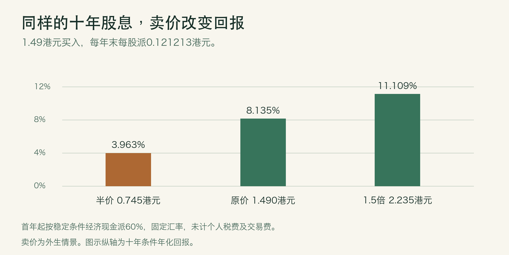

十年条件股东现金流随退出价格变化

历史价格在稳定与经营承压的10%结果之间。公司有真实服务费和分派历史，当前规模稳定时可以出现条件折价；若毛利继续减少、旧账拖长或运营需要额外留资，折价可能先被经营本身消耗。下一次年报要看基础物业毛利与完整成本、税前经营现金、实际应收和外部预收，以及明宇权益分配和股息结算。到这些证据可核之前，历史1.49港元仍不能确认为安全买价。 2026中报，PDF第5—13、30、34、40—44页

依据 · [2023年度報告 · 第72页](https://www1.hkexnews.hk/listedco/listconews/sehk/2024/0419/2024041901761_c.pdf#page=72)；[2024年度報告 · 第67页](https://www1.hkexnews.hk/listedco/listconews/sehk/2025/0429/2025042903823_c.pdf#page=67)；[2025年度報告 · 第65页](https://www1.hkexnews.hk/listedco/listconews/sehk/2026/0430/2026043004377_c.pdf#page=65)；[2025年度報告 · 第110页](https://www1.hkexnews.hk/listedco/listconews/sehk/2026/0430/2026043004377_c.pdf#page=110)；[2025年度報告 · 第117页](https://www1.hkexnews.hk/listedco/listconews/sehk/2026/0430/2026043004377_c.pdf#page=117)；[內幕消息 採納經修訂股息政策 · 第1页](https://www1.hkexnews.hk/listedco/listconews/sehk/2026/0408/2026040802395_c.pdf#page=1)；[內幕消息 採納經修訂股息政策 · 第2页](https://www1.hkexnews.hk/listedco/listconews/sehk/2026/0408/2026040802395_c.pdf#page=2)；[截至2025年12月31日止年度的末期股息(更新) · 第1页](https://www1.hkexnews.hk/listedco/listconews/sehk/2026/0616/2026061601179_c.pdf#page=1)；[截至2025年12月31日止年度的末期股息(更新) · 第2页](https://www1.hkexnews.hk/listedco/listconews/sehk/2026/0616/2026061601179_c.pdf#page=2)；[截至2026年6月30日止六個月之中期股息 · 第1页](https://www1.hkexnews.hk/listedco/listconews/sehk/2026/0828/2026082800644_c.pdf#page=1)；[截至2026年6月30日止六個月之中期股息 · 第2页](https://www1.hkexnews.hk/listedco/listconews/sehk/2026/0828/2026082800644_c.pdf#page=2)；[2026中期報告 · 第5页](https://www1.hkexnews.hk/listedco/listconews/sehk/2026/0930/2026093002812_c.pdf#page=5)；[2026中期報告 · 第13页](https://www1.hkexnews.hk/listedco/listconews/sehk/2026/0930/2026093002812_c.pdf#page=13)；[2026中期報告 · 第30页](https://www1.hkexnews.hk/listedco/listconews/sehk/2026/0930/2026093002812_c.pdf#page=30)；[2026中期報告 · 第34页](https://www1.hkexnews.hk/listedco/listconews/sehk/2026/0930/2026093002812_c.pdf#page=34)；[2026中期報告 · 第40页](https://www1.hkexnews.hk/listedco/listconews/sehk/2026/0930/2026093002812_c.pdf#page=40)；[2026中期報告 · 第44页](https://www1.hkexnews.hk/listedco/listconews/sehk/2026/0930/2026093002812_c.pdf#page=44)

## 生命周期

### 正文

新希望服务的成长动力变过几次。早期是开发商有楼要交付，物业有人和流程可接。上市前后，城市和服务种类增加，首次并购又把已有的经营主体纳入集团。如今项目仍在增加，价值要更多靠外部合同的成熟利润和收款来确认。 招股书，PDF第158—159、192—208页 · 2022年报，PDF第5、8—9、117—118页 · 2026中报，PDF第5—13页

依据 · [新希望服務控股有限公司招股章程 · 第158页](https://www1.hkexnews.hk/listedco/listconews/sehk/2021/0511/2021051100022_c.pdf#page=158)；[新希望服務控股有限公司招股章程 · 第159页](https://www1.hkexnews.hk/listedco/listconews/sehk/2021/0511/2021051100022_c.pdf#page=159)；[新希望服務控股有限公司招股章程 · 第192页](https://www1.hkexnews.hk/listedco/listconews/sehk/2021/0511/2021051100022_c.pdf#page=192)；[新希望服務控股有限公司招股章程 · 第208页](https://www1.hkexnews.hk/listedco/listconews/sehk/2021/0511/2021051100022_c.pdf#page=208)；[2022年度報告 · 第5页](https://www1.hkexnews.hk/listedco/listconews/sehk/2023/0428/2023042802852_c.pdf#page=5)；[2022年度報告 · 第8页](https://www1.hkexnews.hk/listedco/listconews/sehk/2023/0428/2023042802852_c.pdf#page=8)；[2022年度報告 · 第9页](https://www1.hkexnews.hk/listedco/listconews/sehk/2023/0428/2023042802852_c.pdf#page=9)；[2022年度報告 · 第117页](https://www1.hkexnews.hk/listedco/listconews/sehk/2023/0428/2023042802852_c.pdf#page=117)；[2022年度報告 · 第118页](https://www1.hkexnews.hk/listedco/listconews/sehk/2023/0428/2023042802852_c.pdf#page=118)；[2026中期報告 · 第5页](https://www1.hkexnews.hk/listedco/listconews/sehk/2026/0930/2026093002812_c.pdf#page=5)；[2026中期報告 · 第13页](https://www1.hkexnews.hk/listedco/listconews/sehk/2026/0930/2026093002812_c.pdf#page=13)

### 起步与成形，地产交付带来第一批长期关系

2010年开始管理成都新希望地产项目。物业接到前期聘用机会后，要在交房时接管现场，住户搬入才形成持续缴费和续约关系。公司随后在温州、上海等城市拓展，早期复用的是项目接管、班组配置和住宅服务。2017年成立商业运营公司、2019年为温州立体城提供商运，开业准备、招商和运营由此成为另一类合同。2019年末起经营零售和餐饮，服务对象也扩展到住户与企业。 招股书，PDF第158—159、206—212、220—233页

依据 · [新希望服務控股有限公司招股章程 · 第158页](https://www1.hkexnews.hk/listedco/listconews/sehk/2021/0511/2021051100022_c.pdf#page=158)；[新希望服務控股有限公司招股章程 · 第159页](https://www1.hkexnews.hk/listedco/listconews/sehk/2021/0511/2021051100022_c.pdf#page=159)；[新希望服務控股有限公司招股章程 · 第206页](https://www1.hkexnews.hk/listedco/listconews/sehk/2021/0511/2021051100022_c.pdf#page=206)；[新希望服務控股有限公司招股章程 · 第212页](https://www1.hkexnews.hk/listedco/listconews/sehk/2021/0511/2021051100022_c.pdf#page=212)；[新希望服務控股有限公司招股章程 · 第220页](https://www1.hkexnews.hk/listedco/listconews/sehk/2021/0511/2021051100022_c.pdf#page=220)；[新希望服務控股有限公司招股章程 · 第233页](https://www1.hkexnews.hk/listedco/listconews/sehk/2021/0511/2021051100022_c.pdf#page=233)

### 从有外拓组织到买入现成的经营能力

2020年设总部及区域拓展组织，当年独立开发商项目26投8中，仍和关联来源有明显区别。2021年上市后，2022年首购明宇51%，在管面积从1620.9万升至2882.6万平方米。年报把2022年底独立第三方在管1340.8万平方米拆为市场外拓1017.5万和收并购323.3万；上一年独立第三方464.8万均为市场外拓。收购增加已在经营的客户、团队和收入，独立外拓也在增长。两条路径需要不同的资金，后续盈利要分别看项目经营和收购对价能否回收。 招股书，PDF第204—208页 · 2022年报，PDF第8—9、117—118页

新希望服务历年在管面积及独立第三方开发来源

依据 · [新希望服務控股有限公司招股章程 · 第204页](https://www1.hkexnews.hk/listedco/listconews/sehk/2021/0511/2021051100022_c.pdf#page=204)；[新希望服務控股有限公司招股章程 · 第208页](https://www1.hkexnews.hk/listedco/listconews/sehk/2021/0511/2021051100022_c.pdf#page=208)；[2022年度報告 · 第8页](https://www1.hkexnews.hk/listedco/listconews/sehk/2023/0428/2023042802852_c.pdf#page=8)；[2022年度報告 · 第9页](https://www1.hkexnews.hk/listedco/listconews/sehk/2023/0428/2023042802852_c.pdf#page=9)；[2022年度報告 · 第117页](https://www1.hkexnews.hk/listedco/listconews/sehk/2023/0428/2023042802852_c.pdf#page=117)；[2022年度報告 · 第118页](https://www1.hkexnews.hk/listedco/listconews/sehk/2023/0428/2023042802852_c.pdf#page=118)

### 转向城市密集经营，规模还在增长

2023至2025年面积平稳增加，苏州吴江、成都武侯等城市项目向相邻范围聚集。开发商购买的非业主增值服务收入同期回落，基础物业在集团收入里的权重升高。2025年物业和生活服务增加的毛利，尚能抵消商业和非业主毛利下降。2026年上半年，基础物业仍增加收入，却没有增加毛利；生活和商运同步走弱。2026年对明宇的追加股权是债权抵偿，不再带来首次并表增长。 2023年报，PDF第9—13页 · 2025年报，PDF第7—13页 · 2026中报，PDF第5—13、34、43页

依据 · [2023年度報告 · 第9页](https://www1.hkexnews.hk/listedco/listconews/sehk/2024/0419/2024041901761_c.pdf#page=9)；[2023年度報告 · 第13页](https://www1.hkexnews.hk/listedco/listconews/sehk/2024/0419/2024041901761_c.pdf#page=13)；[2025年度報告 · 第7页](https://www1.hkexnews.hk/listedco/listconews/sehk/2026/0430/2026043004377_c.pdf#page=7)；[2025年度報告 · 第13页](https://www1.hkexnews.hk/listedco/listconews/sehk/2026/0430/2026043004377_c.pdf#page=13)；[2026中期報告 · 第5页](https://www1.hkexnews.hk/listedco/listconews/sehk/2026/0930/2026093002812_c.pdf#page=5)；[2026中期報告 · 第13页](https://www1.hkexnews.hk/listedco/listconews/sehk/2026/0930/2026093002812_c.pdf#page=13)；[2026中期報告 · 第34页](https://www1.hkexnews.hk/listedco/listconews/sehk/2026/0930/2026093002812_c.pdf#page=34)；[2026中期報告 · 第43页](https://www1.hkexnews.hk/listedco/listconews/sehk/2026/0930/2026093002812_c.pdf#page=43)

### 当前有哪些顺风和逆风

顺风来自既有物业持续履约收费，外部机构采购已经有买方证据，武侯和吴江的邻近项目还有共用工程和管理资源的可能。逆风是外拓组合收费低于综合价，人均指标上升但员工成本也上升，旧账余额变大，商业新签未立刻抵消存量经营下滑。公司并未回到上市前高毛利结构。现有证据还不能确定何时进入估值采用的稳定阶段。下一次阶段变化若要由事实确认，应看到新项目在稳定期覆盖完整成本、真实回款改善、商运恢复对应可收服务费或有充分覆盖的租约，以及这些收入不再需要持续新增垫资。 武侯高新2025年报，PDF第10页 · 2025年报，PDF第7—10页 · 2026中报，PDF第5—13、19、34、40—43页

依据 · [成都武侯高新技术产业发展股份有限公司2025年度报告 · 第10页](https://pdf.dfcfw.com/pdf/H2_AN202601271818462952_1.pdf?1769527931000.pdf=#page=10)；[2025年度報告 · 第7页](https://www1.hkexnews.hk/listedco/listconews/sehk/2026/0430/2026043004377_c.pdf#page=7)；[2025年度報告 · 第10页](https://www1.hkexnews.hk/listedco/listconews/sehk/2026/0430/2026043004377_c.pdf#page=10)；[2026中期報告 · 第5页](https://www1.hkexnews.hk/listedco/listconews/sehk/2026/0930/2026093002812_c.pdf#page=5)；[2026中期報告 · 第13页](https://www1.hkexnews.hk/listedco/listconews/sehk/2026/0930/2026093002812_c.pdf#page=13)；[2026中期報告 · 第19页](https://www1.hkexnews.hk/listedco/listconews/sehk/2026/0930/2026093002812_c.pdf#page=19)；[2026中期報告 · 第34页](https://www1.hkexnews.hk/listedco/listconews/sehk/2026/0930/2026093002812_c.pdf#page=34)；[2026中期報告 · 第40页](https://www1.hkexnews.hk/listedco/listconews/sehk/2026/0930/2026093002812_c.pdf#page=40)；[2026中期報告 · 第43页](https://www1.hkexnews.hk/listedco/listconews/sehk/2026/0930/2026093002812_c.pdf#page=43)

## 长期财务

### 正文

新希望服务的长期财务变化有三条线。第一是物业规模扩大后，基础物业取代商运成为最大的毛利来源。第二是收入和毛利额增加，但每一元收入留下的毛利变少。第三是营业收入确认与实际收款有间隔，后来更多现金留在应收与经营周转中。以下以人民币百万元计，年末余额和期间流量分开。 招股书，PDF第447—448、472页 · 2025年报，PDF第60—65、85、102—104页

依据 · [新希望服務控股有限公司招股章程 · 第447页](https://www1.hkexnews.hk/listedco/listconews/sehk/2021/0511/2021051100022_c.pdf#page=447)；[新希望服務控股有限公司招股章程 · 第448页](https://www1.hkexnews.hk/listedco/listconews/sehk/2021/0511/2021051100022_c.pdf#page=448)；[新希望服務控股有限公司招股章程 · 第472页](https://www1.hkexnews.hk/listedco/listconews/sehk/2021/0511/2021051100022_c.pdf#page=472)；[2025年度報告 · 第60页](https://www1.hkexnews.hk/listedco/listconews/sehk/2026/0430/2026043004377_c.pdf#page=60)；[2025年度報告 · 第65页](https://www1.hkexnews.hk/listedco/listconews/sehk/2026/0430/2026043004377_c.pdf#page=65)；[2025年度報告 · 第85页](https://www1.hkexnews.hk/listedco/listconews/sehk/2026/0430/2026043004377_c.pdf#page=85)；[2025年度報告 · 第102页](https://www1.hkexnews.hk/listedco/listconews/sehk/2026/0430/2026043004377_c.pdf#page=102)；[2025年度報告 · 第104页](https://www1.hkexnews.hk/listedco/listconews/sehk/2026/0430/2026043004377_c.pdf#page=104)

### 收入增长并未保持早期毛利结构

2018年收入257.964、毛利109.929；商业运营以62.373收入产生46.999毛利，提供集团约43%的毛利。2025年集团收入1540.464、毛利457.298；基础物业以948.243收入产生230.440毛利，提供集团约50%的毛利。集团毛利率由42.6%降至29.7%，基础物业自身也由2020年31.2%降至2025年24.3%。2026年上半年基础物业进一步至23.1%。较低毛利的业务权重提高及物业业务自身盈利空间变薄同时发生，不能仅由业务规模扩大推导出更强的定价和成本优势。 招股书，PDF第447、472页 · 2025年报，PDF第13、85页 · 2026中报，PDF第12、34页

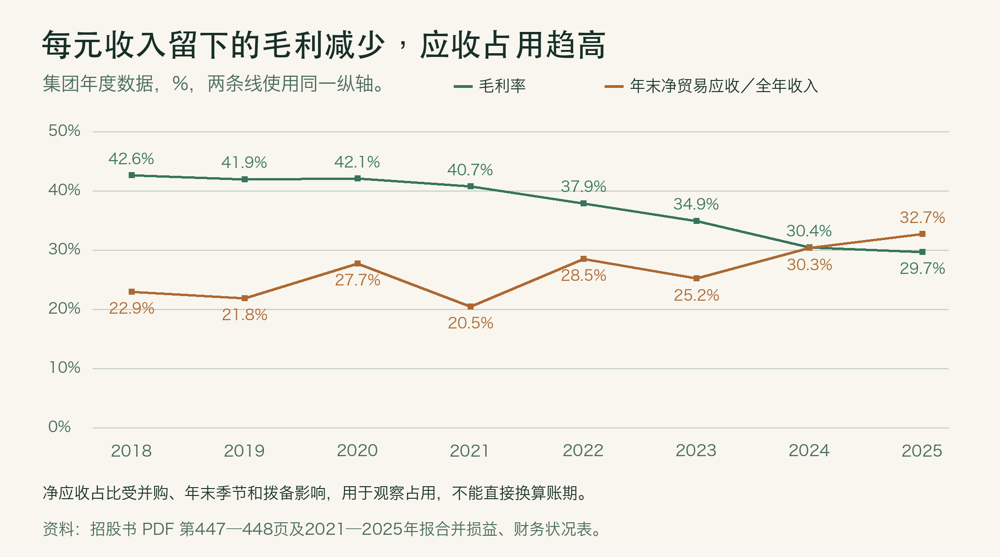

长期集团毛利率与净贸易应收占当年收入的变化

依据 · [新希望服務控股有限公司招股章程 · 第447页](https://www1.hkexnews.hk/listedco/listconews/sehk/2021/0511/2021051100022_c.pdf#page=447)；[新希望服務控股有限公司招股章程 · 第472页](https://www1.hkexnews.hk/listedco/listconews/sehk/2021/0511/2021051100022_c.pdf#page=472)；[2025年度報告 · 第13页](https://www1.hkexnews.hk/listedco/listconews/sehk/2026/0430/2026043004377_c.pdf#page=13)；[2025年度報告 · 第85页](https://www1.hkexnews.hk/listedco/listconews/sehk/2026/0430/2026043004377_c.pdf#page=85)；[2026中期報告 · 第12页](https://www1.hkexnews.hk/listedco/listconews/sehk/2026/0930/2026093002812_c.pdf#page=12)；[2026中期報告 · 第34页](https://www1.hkexnews.hk/listedco/listconews/sehk/2026/0930/2026093002812_c.pdf#page=34)

### 应收增加以后，经营现金没有跟收入平顺上升

2018年末净贸易应收59.153，占当年收入22.9%；2025年末为503.520，占当年收入32.7%。这个比率按期末余额除全年收入，受业务组合、并购、季节和拨备影响，不能换算成客户实际账期。2024年现金对账中贸易应收占用143.591，2025年仍占69.517，较低的占用是2025经营净现金由161.589回升至211.734的重要原因。2026年上半年税前经营所得现金同比由59.410降至38.959，实际缴税减少令税后经营净额更接近。超一年净应收升至33.892，也说明当期收款质量还需继续核验。 招股书，PDF第447—448页 · 2024年报，PDF第67、103页 · 2025年报，PDF第65、102—104页 · 2026中报，PDF第30、40页

现金横向比较要对齐原表。2023年同期年报列经营净现金334.781，收息20.929列投资活动；2024年报的2023比较列将等额列示移至经营现金，比较净额变成355.710，期末总现金不变。本书长期半年度图采用2023同期年报口径。另一个差异在2025年度现金流表期初1053.751，与同一报告资产表及附注的期初银行和手头现金1053.051相差0.700。年末957.808一致，报告的变动−95.243可从1053.051勾到957.808；不将0.700自作现金流调整。2024原报期末1057.754包含受限4.703，和之后拆列的1053.051银行手头现金口径有别。 2023年报，PDF第72、108页 · 2024年报，PDF第67、103页 · 2025年报，PDF第61、65、103—104页

依据 · [新希望服務控股有限公司招股章程 · 第447页](https://www1.hkexnews.hk/listedco/listconews/sehk/2021/0511/2021051100022_c.pdf#page=447)；[新希望服務控股有限公司招股章程 · 第448页](https://www1.hkexnews.hk/listedco/listconews/sehk/2021/0511/2021051100022_c.pdf#page=448)；[2024年度報告 · 第67页](https://www1.hkexnews.hk/listedco/listconews/sehk/2025/0429/2025042903823_c.pdf#page=67)；[2024年度報告 · 第103页](https://www1.hkexnews.hk/listedco/listconews/sehk/2025/0429/2025042903823_c.pdf#page=103)；[2025年度報告 · 第65页](https://www1.hkexnews.hk/listedco/listconews/sehk/2026/0430/2026043004377_c.pdf#page=65)；[2025年度報告 · 第102页](https://www1.hkexnews.hk/listedco/listconews/sehk/2026/0430/2026043004377_c.pdf#page=102)；[2025年度報告 · 第104页](https://www1.hkexnews.hk/listedco/listconews/sehk/2026/0430/2026043004377_c.pdf#page=104)；[2026中期報告 · 第30页](https://www1.hkexnews.hk/listedco/listconews/sehk/2026/0930/2026093002812_c.pdf#page=30)；[2026中期報告 · 第40页](https://www1.hkexnews.hk/listedco/listconews/sehk/2026/0930/2026093002812_c.pdf#page=40)；[2023年度報告 · 第72页](https://www1.hkexnews.hk/listedco/listconews/sehk/2024/0419/2024041901761_c.pdf#page=72)；[2023年度報告 · 第108页](https://www1.hkexnews.hk/listedco/listconews/sehk/2024/0419/2024041901761_c.pdf#page=108)；[2025年度報告 · 第61页](https://www1.hkexnews.hk/listedco/listconews/sehk/2026/0430/2026043004377_c.pdf#page=61)；[2025年度報告 · 第103页](https://www1.hkexnews.hk/listedco/listconews/sehk/2026/0430/2026043004377_c.pdf#page=103)

### 设备、软件、租约与股东分配

2025年的经营净现金211.734扣设备35.525、软件9.450和长期租赁本息43.454后剩123.305。2026年上半年同样路径只剩2.934，不能简单翻倍。租赁实际支付受合同到期分布影响，年末还有尚未支付的义务。软件和设备投入会形成多年使用的资源，历史支出也含更新和扩张，尚未按项目拆开。长期现金质量要同时看发生的收支、更新需要和合同资金占用，再看公司有多少可以实际分配。历史现金序列用于核对经营条件，尚不能确定何时达到估值采用的稳定水平。 2025年报，PDF第65、92—97、105、107页 · 2026中报，PDF第30、38页

2023、2024、2025年集团现金流所列向上市股东实付的股息分别为152.445、148.984、151.787。账面留存与实际现金支付不在同一时点。2025年末上市主体单体现金0.640，集团957.808，两者差异说明现金主要在运营法人内；已有分派说明其中一部分经过了内部回流。随着新项目收付和资本用途变化，不能用集团余额或历史分派单独推断未来普通股所得。 2023年报，PDF第72页 · 2024年报，PDF第67页 · 2025年报，PDF第65、110—117页

依据 · [2025年度報告 · 第65页](https://www1.hkexnews.hk/listedco/listconews/sehk/2026/0430/2026043004377_c.pdf#page=65)；[2025年度報告 · 第92页](https://www1.hkexnews.hk/listedco/listconews/sehk/2026/0430/2026043004377_c.pdf#page=92)；[2025年度報告 · 第97页](https://www1.hkexnews.hk/listedco/listconews/sehk/2026/0430/2026043004377_c.pdf#page=97)；[2025年度報告 · 第105页](https://www1.hkexnews.hk/listedco/listconews/sehk/2026/0430/2026043004377_c.pdf#page=105)；[2025年度報告 · 第107页](https://www1.hkexnews.hk/listedco/listconews/sehk/2026/0430/2026043004377_c.pdf#page=107)；[2026中期報告 · 第30页](https://www1.hkexnews.hk/listedco/listconews/sehk/2026/0930/2026093002812_c.pdf#page=30)；[2026中期報告 · 第38页](https://www1.hkexnews.hk/listedco/listconews/sehk/2026/0930/2026093002812_c.pdf#page=38)；[2023年度報告 · 第72页](https://www1.hkexnews.hk/listedco/listconews/sehk/2024/0419/2024041901761_c.pdf#page=72)；[2024年度報告 · 第67页](https://www1.hkexnews.hk/listedco/listconews/sehk/2025/0429/2025042903823_c.pdf#page=67)；[2025年度報告 · 第110页](https://www1.hkexnews.hk/listedco/listconews/sehk/2026/0430/2026043004377_c.pdf#page=110)；[2025年度報告 · 第117页](https://www1.hkexnews.hk/listedco/listconews/sehk/2026/0430/2026043004377_c.pdf#page=117)

## 跟踪

### 正文

本页跟的是2026年11月10日形成的条件判断。基础物业收入和面积已经扩大，项目收益、回款和可分资源尚未稳定。下一主要窗口是2026年度报告及其前的业绩或重大事项披露。未公布的披露日期保持待定。每次更新要写清经营期间、公开日期、原表口径及哪一个假设会变。 2026中报，PDF第5—13、25、30、34—44页

依据 · [2026中期報告 · 第5页](https://www1.hkexnews.hk/listedco/listconews/sehk/2026/0930/2026093002812_c.pdf#page=5)；[2026中期報告 · 第13页](https://www1.hkexnews.hk/listedco/listconews/sehk/2026/0930/2026093002812_c.pdf#page=13)；[2026中期報告 · 第25页](https://www1.hkexnews.hk/listedco/listconews/sehk/2026/0930/2026093002812_c.pdf#page=25)；[2026中期報告 · 第30页](https://www1.hkexnews.hk/listedco/listconews/sehk/2026/0930/2026093002812_c.pdf#page=30)；[2026中期報告 · 第34页](https://www1.hkexnews.hk/listedco/listconews/sehk/2026/0930/2026093002812_c.pdf#page=34)；[2026中期報告 · 第44页](https://www1.hkexnews.hk/listedco/listconews/sehk/2026/0930/2026093002812_c.pdf#page=44)

### 第一项，新增物业项目有没有守住毛利

当期基点是2026上半年基础物业收入增长7.9%，毛利率25.3%降至23.1%，外拓整体物业费2.43元/平方米/月，综合3.08元。下一报告先核全年分部毛利及收入来源，再问新增与成熟的项目各有何收费、人员和外包成本。若可比项目在质量和收缴稳定时守住毛利，稳定条件更可信。若毛利率继续下行、人员和外包费用率继续上升，就要降低毛利、提高相应费用并重算普通股现金。若只披露综合人效，没有全员工时或成本配对，密度优势仍待核。 2026中报，PDF第5—8、12、19、34页

依据 · [2026中期報告 · 第5页](https://www1.hkexnews.hk/listedco/listconews/sehk/2026/0930/2026093002812_c.pdf#page=5)；[2026中期報告 · 第8页](https://www1.hkexnews.hk/listedco/listconews/sehk/2026/0930/2026093002812_c.pdf#page=8)；[2026中期報告 · 第12页](https://www1.hkexnews.hk/listedco/listconews/sehk/2026/0930/2026093002812_c.pdf#page=12)；[2026中期報告 · 第19页](https://www1.hkexnews.hk/listedco/listconews/sehk/2026/0930/2026093002812_c.pdf#page=19)；[2026中期報告 · 第34页](https://www1.hkexnews.hk/listedco/listconews/sehk/2026/0930/2026093002812_c.pdf#page=34)

### 第二项，已经履约的账款有没有收回来

当前锚点是2026年上半年税前经营所得现金38.959百万元、去年同期59.410，一年以上净应收从2025年末19.648升到33.892。年报出来先核经营所得现金调节、贸易应收现金变动和外部预收，再看账龄迁移、拨备及撇销。若收现和旧账账龄同时改善，并能剥离非现金抵债，才支持稳定的年度周转和信用成本。若只是减税、增加应付或拨备压低净额，应分别保留各自解释。若信用损耗继续增加或可回收占款延长，要调整年度信用成本及相应周转时点。若经营尚需过渡，则先估各年的普通股现金，再把过渡期现金与稳定后的价值分别折回估值时点。过渡年数目前待证。 2025年报，PDF第102—104、106—107、113—114页 · 2026中报，PDF第30、40—43页

依据 · [2025年度報告 · 第102页](https://www1.hkexnews.hk/listedco/listconews/sehk/2026/0430/2026043004377_c.pdf#page=102)；[2025年度報告 · 第104页](https://www1.hkexnews.hk/listedco/listconews/sehk/2026/0430/2026043004377_c.pdf#page=104)；[2025年度報告 · 第106页](https://www1.hkexnews.hk/listedco/listconews/sehk/2026/0430/2026043004377_c.pdf#page=106)；[2025年度報告 · 第107页](https://www1.hkexnews.hk/listedco/listconews/sehk/2026/0430/2026043004377_c.pdf#page=107)；[2025年度報告 · 第113页](https://www1.hkexnews.hk/listedco/listconews/sehk/2026/0430/2026043004377_c.pdf#page=113)；[2025年度報告 · 第114页](https://www1.hkexnews.hk/listedco/listconews/sehk/2026/0430/2026043004377_c.pdf#page=114)；[2026中期報告 · 第30页](https://www1.hkexnews.hk/listedco/listconews/sehk/2026/0930/2026093002812_c.pdf#page=30)；[2026中期報告 · 第40页](https://www1.hkexnews.hk/listedco/listconews/sehk/2026/0930/2026093002812_c.pdf#page=40)；[2026中期報告 · 第43页](https://www1.hkexnews.hk/listedco/listconews/sehk/2026/0930/2026093002812_c.pdf#page=43)

### 第三项，生活服务和商运能否恢复毛利

2026年上半年生活服务毛利同比少约640万元，公司提到高毛利经纪业务减少。下次需核经纪与零售餐饮收入结构、实收及费用。若收入恢复依靠零售而经纪仍弱，应按实际商品、用工与库存成本重估贡献。 2026中报，PDF第9—13、34页

公司披露新增通锦中心、昆明西山万达等项目，但2026H1商运收入和毛利率继续下降。后续先核新项目开业、按约收入及实收，区分委托收费、直接经营、承租后转租；如有新租约，还需看未贴现付款期、免租、空置及可回收租金。轻资产服务回款改善可支持经营现金。转租若需新增固定上游义务，要连同承租权回收和额外营运留资核对。 2025年报，PDF第9—10、92—94、114—115页 · 2026中报，PDF第9、12—13、38页

依据 · [2026中期報告 · 第9页](https://www1.hkexnews.hk/listedco/listconews/sehk/2026/0930/2026093002812_c.pdf#page=9)；[2026中期報告 · 第13页](https://www1.hkexnews.hk/listedco/listconews/sehk/2026/0930/2026093002812_c.pdf#page=13)；[2026中期報告 · 第34页](https://www1.hkexnews.hk/listedco/listconews/sehk/2026/0930/2026093002812_c.pdf#page=34)；[2025年度報告 · 第9页](https://www1.hkexnews.hk/listedco/listconews/sehk/2026/0430/2026043004377_c.pdf#page=9)；[2025年度報告 · 第10页](https://www1.hkexnews.hk/listedco/listconews/sehk/2026/0430/2026043004377_c.pdf#page=10)；[2025年度報告 · 第92页](https://www1.hkexnews.hk/listedco/listconews/sehk/2026/0430/2026043004377_c.pdf#page=92)；[2025年度報告 · 第94页](https://www1.hkexnews.hk/listedco/listconews/sehk/2026/0430/2026043004377_c.pdf#page=94)；[2025年度報告 · 第114页](https://www1.hkexnews.hk/listedco/listconews/sehk/2026/0430/2026043004377_c.pdf#page=114)；[2025年度報告 · 第115页](https://www1.hkexnews.hk/listedco/listconews/sehk/2026/0430/2026043004377_c.pdf#page=115)；[2026中期報告 · 第12页](https://www1.hkexnews.hk/listedco/listconews/sehk/2026/0930/2026093002812_c.pdf#page=12)；[2026中期報告 · 第38页](https://www1.hkexnews.hk/listedco/listconews/sehk/2026/0930/2026093002812_c.pdf#page=38)

### 第四项，资本和分派能否兑现到普通股

追踪明宇原债权面值74.8478与会计对价65.480的9.3678差额、所获利润分占和实际现金分配。原债换股的事实已经记录，新取得的经济权利还要看持有后经营和上划。核对2026年下半年两笔公告派息是否进年度现金流，经营实体向上市母公司调拨的金额、适用税率及是否经鼎晟发展的股息路径，以及剩余8988万港元募资是实际投了何处。若资源核对后出现可自由分派余量，才可进一步计入权益；若必须新增留资或履约义务大于可回收资产，则扣缺口。把宣派日期、公司实付和账户到账分别记录。 2025年报，PDF第65、99、108、117页 · 明宇补充公告，PDF第7—8页 · 2026中报，PDF第16—18、30、36—37、42—44页 · 2025年末期股息更新公告，PDF第1—2页 · 2026年中期股息公告，PDF第1—2页

这些条件用于判断经营和现金，不由股价单独结算。原判断、后来的事实和重新估计的价值分别留存。倘若价格先变而经营信息未变，先更新价格比较；倘若事实改变，回到被影响的毛利、费用、信用、税、留资或权益归属重算。

依据 · [2025年度報告 · 第65页](https://www1.hkexnews.hk/listedco/listconews/sehk/2026/0430/2026043004377_c.pdf#page=65)；[2025年度報告 · 第99页](https://www1.hkexnews.hk/listedco/listconews/sehk/2026/0430/2026043004377_c.pdf#page=99)；[2025年度報告 · 第108页](https://www1.hkexnews.hk/listedco/listconews/sehk/2026/0430/2026043004377_c.pdf#page=108)；[2025年度報告 · 第117页](https://www1.hkexnews.hk/listedco/listconews/sehk/2026/0430/2026043004377_c.pdf#page=117)；[有關須予披露及關連交易
之補充公告 · 第7页](https://www1.hkexnews.hk/listedco/listconews/sehk/2026/0529/2026052901354_c.pdf#page=7)；[有關須予披露及關連交易
之補充公告 · 第8页](https://www1.hkexnews.hk/listedco/listconews/sehk/2026/0529/2026052901354_c.pdf#page=8)；[2026中期報告 · 第16页](https://www1.hkexnews.hk/listedco/listconews/sehk/2026/0930/2026093002812_c.pdf#page=16)；[2026中期報告 · 第18页](https://www1.hkexnews.hk/listedco/listconews/sehk/2026/0930/2026093002812_c.pdf#page=18)；[2026中期報告 · 第30页](https://www1.hkexnews.hk/listedco/listconews/sehk/2026/0930/2026093002812_c.pdf#page=30)；[2026中期報告 · 第36页](https://www1.hkexnews.hk/listedco/listconews/sehk/2026/0930/2026093002812_c.pdf#page=36)；[2026中期報告 · 第37页](https://www1.hkexnews.hk/listedco/listconews/sehk/2026/0930/2026093002812_c.pdf#page=37)；[2026中期報告 · 第42页](https://www1.hkexnews.hk/listedco/listconews/sehk/2026/0930/2026093002812_c.pdf#page=42)；[2026中期報告 · 第44页](https://www1.hkexnews.hk/listedco/listconews/sehk/2026/0930/2026093002812_c.pdf#page=44)；[截至2025年12月31日止年度的末期股息(更新) · 第1页](https://www1.hkexnews.hk/listedco/listconews/sehk/2026/0616/2026061601179_c.pdf#page=1)；[截至2025年12月31日止年度的末期股息(更新) · 第2页](https://www1.hkexnews.hk/listedco/listconews/sehk/2026/0616/2026061601179_c.pdf#page=2)；[截至2026年6月30日止六個月之中期股息 · 第1页](https://www1.hkexnews.hk/listedco/listconews/sehk/2026/0828/2026082800644_c.pdf#page=1)；[截至2026年6月30日止六個月之中期股息 · 第2页](https://www1.hkexnews.hk/listedco/listconews/sehk/2026/0828/2026082800644_c.pdf#page=2)

## 专题 · 一份物业关系，怎样变成四种生意

三六三医院在成都武侯院区选食堂运营方时，招标公示列出了三家候选人。新希望服务旗下的新食主义排第一，另外两家是四川众旺达和成都泰丰元。三家报出的分成比例一样，都是把食堂和小卖部营业收入的5%交给医院。医院提供的是一个可供经营的场景，餐饮公司要靠经营收入覆盖食材、用工和付给医院的管理费。公示给出了评审排序和报价，最终合同、实收流水和付款还要从后续文件确认。 [三六三医院采购公示，第一、二节](https://cg.gt.cn/zbxx/026004/20250611/a1385430-e996-4cc6-b3cb-0b5393457865.html)

同在成都，如果一家商业公司聘请新希望服务做楼里的保安、保洁和工程维护，费用的方向就反过来了。商业公司买日常服务，由物业公司组织人手、接受验收。在新希望服务的四条业务线上，这两笔交易分别落在生活服务和基础物业。住宅从建设到交付，物业团队会接触到开发商和住户，因而有机会承接交付服务、住宅管理和入户订单。医院食堂与商场运营则要分别经过机构采购、业主委托或租约谈判。每笔生意能收到什么钱、要先花什么钱，由各自的合同决定。 [南国置业问询回复，PDF第54页 · 第54页](https://static.cninfo.com.cn/finalpage/2025-10-16/1224714999.PDF#page=54)

## 房子交付前，开发商先买人手和交付服务

新希望服务2010年在成都为新希望地产开发的项目做物业。地产公司要同时处理工地、售楼现场和交房准备。售楼处与样板间需要接待、保安和保洁，交房前需要有人检查房屋、报告缺陷并做清洁。新希望服务可以按不同的合同接下这些工作。接待的对象是到访客户，最终住进房子的也是购房人，这一阶段付服务费的主要是开发商。公司将它计入非业主增值服务。 [招股书，PDF第158、216—218页 · 第158页](https://www1.hkexnews.hk/listedco/listconews/sehk/2021/0511/2021051100022_c.pdf#page=158)

招股书披露了几种典型的付款安排。案场一般按服务成本加成，季度结束后20日内付费，物业公司已经在季度内派了人。交付前验房、清洁一般按面积收费，完成后付款。规划设计咨询的收款节点更靠后，主体结构验收后付70%，余款在竣工并交付后一个月付。质保期内，住户提出维修，新希望服务先到现场评估，再联系施工方处理，遇到对方无法及时处理也可能自己做。招股时期的典型维修合同在交付后六个月内收一半，一年内收另一半。工程拖延或开发商晚付，都可能拉长工资和分包费已经支出、服务费仍未到账的时间。 [招股书，PDF第216—218页 · 第216页](https://www1.hkexnews.hk/listedco/listconews/sehk/2021/0511/2021051100022_c.pdf#page=216)

2025年这一业务的收入由1.42亿元降到1.04亿元，规划、设计及交付前服务的收入降幅最大，从8265万元降到4003万元。2026年上半年，外拓案场、工程改造等增加，板块收入同比回升21.9%至5840万元，毛利只从1559万元增到1632万元。案场增加带来新的工作量和收入，当期留下的毛利增幅小得多。现有披露没有把每一份新合同的收费、履约成本和实收拆开。 [2025年报，PDF第11—13页 · 第11页](https://www1.hkexnews.hk/listedco/listconews/sehk/2026/0430/2026043004377_c.pdf#page=11) · [2026中报，PDF第10—13、34页 · 第10页](https://www1.hkexnews.hk/listedco/listconews/sehk/2026/0930/2026093002812_c.pdf#page=10)

## 交房以后，谁选物业与谁交物业费分开了

开发商在交付前聘请物业，物业团队随交付进场。交房后前期协议可以继续。开发商通常仍付未售单元的物业费，已交付的住户则按约缴费。团队每天要巡检设备、维持出入口秩序、安排保洁和园艺，还要处理公共区域维修。住宅成立业委会后，业主可以通过业主大会选择物业，由业委会与选定公司签约。招股时期披露的前期协议通常在新物业协议生效时终止，业委会签的新协议通常为三年。商业楼宇和机构项目也可以由业主、租户或机构采购方签约，收款对象随具体合同而定。 [招股书，PDF第202、206—212、216页 · 第202页](https://www1.hkexnews.hk/listedco/listconews/sehk/2021/0511/2021051100022_c.pdf#page=202)

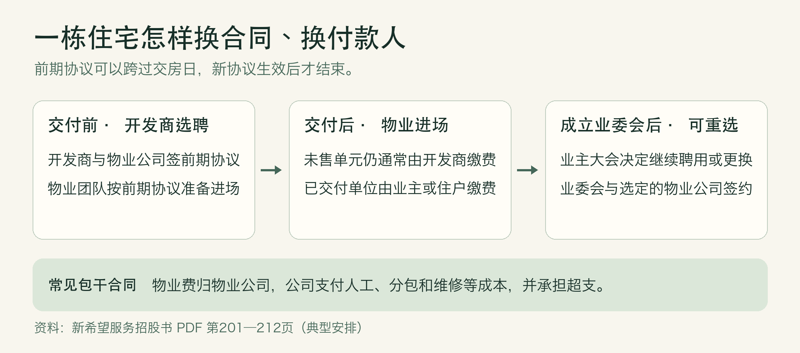

这笔生意最常见的收费办法叫包干。物业费按合同收，收入归物业公司，排班、分包、维修和水电的成本也由公司负担。招股书披露2020年99.2%的物业管理收入来自包干；一个面积较小的住宅项目曾因物业费盖不住服务成本而亏损，公司首个医疗设施项目也曾因需要额外投入人员和供应而亏损。酬金制则先形成一笔用于项目的资金，物业公司按约定取得酬金，剩余款项用于业主的项目费用。酬金制项目一时钱不够、公司先替项目付出时，可能形成应收。两个项目收了相同金额，物业公司能留下多少、手中的资金归谁，可能很不一样。 [招股书，PDF第201—204页 · 第201页](https://www1.hkexnews.hk/listedco/listconews/sehk/2021/0511/2021051100022_c.pdf#page=201)

招股书披露，包干物业费通常按合同约定的月、季或年收取，一般发出缴款通知即到期。公司通常按月向分包商付款，服务不达标可扣费。收到预缴款时，现金可以先于后续服务到账。客户逾期时，现场仍要值守、清洁，公司也要支付到期的分包费。往绩中，未付超过三个月会跟进，超过一年可能诉讼。现有披露未逐项目列出现行缴费周期、实收和分包付款的先后。 [招股书，PDF第202、216、248页 · 第202页](https://www1.hkexnews.hk/listedco/listconews/sehk/2021/0511/2021051100022_c.pdf#page=202)

外拓要求物业先说服买方，再把合同做出利润。南国置业披露的2025年成都商业项目采购里，新希望物业报价每平方米每月5.77元，中电建物业5.55元，成都诚悦时代5.36元。南国披露的是向中电建物业采购的情况，这组数字记录了新希望参加的同场竞争。另一家买方武侯高新的2025年报披露，全年向新希望物业采购749万元，将其列为非关联供应商，同表还有重庆新东原和四川华玮。买方披露的采购金额说明外部机构确实购买服务，付款时点仍需合同或收款记录才能看清。 [南国置业问询回复，PDF第54页 · 第54页](https://static.cninfo.com.cn/finalpage/2025-10-16/1224714999.PDF#page=54) · [武侯高新2025年报，PDF第10页 · 第10页](https://pdf.dfcfw.com/pdf/H2_AN202601271818462952_1.pdf?1769527931000.pdf=#page=10)

新希望服务在成都武侯15平方公里内累计落地20余个项目。工程巡检、培训和管理人员有机会在相邻项目之间共用，但每栋楼仍要满足各自的值守和响应要求。到2026年上半年，公司披露期末员工从上年同期3904人降到3476人，人均管理面积增加17.8%，半年员工总成本却从1.81亿元升到1.87亿元。基础物业的外拓项目收费为每平方米每月2.43元，集团综合为3.08元，两种口径都包括不同类型的项目。同期基础物业收入增加3686万元，直接成本增加3881万元，毛利反而少195万元。新项目已经贡献收入，能否通过密度和服务效率留下更多钱，要看项目收缴与包括外包在内的实际成本。 [2026中报，PDF第5—8、12、19、34页 · 第5页](https://www1.hkexnews.hk/listedco/listconews/sehk/2026/0930/2026093002812_c.pdf#page=5)

## 同一社区能卖生活服务，卖法决定公司要垫多少钱

住户日常接触物业，有需要时可以另行下单，购买家电清洗、保洁和维修。物业安排员工或分包人员入户，再按次数、类型收费。装修和家具家电有另一种办法，由合作商家接单和发货，物业从合作费和超额销售抽成中获得收入。帮开发商出售车位或帮业主找租客时，物业拿的是佣金，成交款归产权人。客户关系可以共用，公司的工作从派人上门变成了介绍交易。 [招股书，PDF第229—231页 · 第229页](https://www1.hkexnews.hk/listedco/listconews/sehk/2021/0511/2021051100022_c.pdf#page=229)

物业也可以自己买下车位。2020年，新希望服务以302.3万元向开发商买入堤亚纳河谷74个车位，当年卖出，取得432万元销售款。它必须先把车位买到手，承担车位卖不掉或低价卖出的后果。两数相减约130万元，是扣除购置价的价差，税费和其他支出还要另算。若买下车位后出租，资金要留在车位里，随每月租金逐步收回。 [招股书，PDF第230—231页 · 第230页](https://www1.hkexnews.hk/listedco/listconews/sehk/2021/0511/2021051100022_c.pdf#page=230)

零售的资金路径和自购车位更接近。新希望服务先采购乳品、粮油等，再通过门店或小程序卖给住户，货品要经过采购、备货、交付和收款。商品价差还要负担损耗、店员和配送。它也把供货和餐饮能力带到物业社区以外，给企业做福利采购、给机构经营食堂。新食主义2022年底运营14个团餐项目，2025年底为33个，公司披露其中97%是第三方项目。三六三医院的投标把这一变化讲得很具体，餐饮团队要和另外两家专业供方竞争，取得经营机会后要让销售收入覆盖食材、人手及按流水计算的费用。 [招股书，PDF第231—232、244—246页 · 第231页](https://www1.hkexnews.hk/listedco/listconews/sehk/2021/0511/2021051100022_c.pdf#page=231) · [2022年报，PDF第11页 · 第11页](https://www1.hkexnews.hk/listedco/listconews/sehk/2023/0428/2023042802852_c.pdf#page=11) · [2025年报，PDF第10—11页 · 第10页](https://www1.hkexnews.hk/listedco/listconews/sehk/2026/0430/2026043004377_c.pdf#page=10) · [三六三医院采购公示，第二节](https://cg.gt.cn/zbxx/026004/20250611/a1385430-e996-4cc6-b3cb-0b5393457865.html)

生活服务的总收入不一定和某一项订单同向。2026年上半年，保洁、家电清洗订单量同比增56%，包含这些业务的社区生活服务收入却下降12.5%。同一时期社区资产服务收入增长19.2%，生活服务板块的毛利率仍从38.9%降到37.9%，公司提到高毛利的经纪业务减少。保洁订单、临时停车、自购商品和经纪佣金是不同的收入来源，哪项增长、哪项退出，决定留下多少利润。 [2026中报，PDF第9—13页 · 第9页](https://www1.hkexnews.hk/listedco/listconews/sehk/2026/0930/2026093002812_c.pdf#page=9)

## 到了商场和写字楼，房东还可以买一项招商经营服务

新希望服务2017年成立商业运营公司，2019年开始为温州新希望·立体城提供商运服务。温州立体城也在公司基础物业的在管项目之中，两项服务在这里并存。商业业主还需另行委托经营或签订租约，公开披露没有说明立体城哪项服务促成了另一项。购物中心开门前，业主要确定定位、招哪些商家、何时交场和开业。公司可以接受业主委托，组织开业准备、寻找商户、跟进租金并策划推广。租户管理可以包括跟进、处理租金付款，租金最终归业主。按招股书的典型安排，业主可在招入租户后第二个月第五日前支付招商费，金额相当于两个月租金。另一项租户管理费按业主开票租金约10%计算，季后五日内支付。租户也可另向新希望服务购买运营支持和推广。 [招股书，PDF第159、220—227、251页 · 第159页](https://www1.hkexnews.hk/listedco/listconews/sehk/2021/0511/2021051100022_c.pdf#page=159)

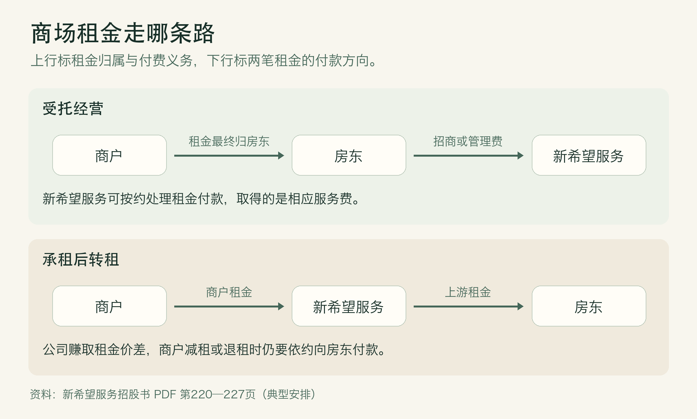

换成先承租再出租，房东先把一段时间的使用权租给新希望服务，新希望服务再与商户签约。此时租户的租金是公司自己的收入，付给上游房东的租金也是自己的现金义务。招股书举过租户按季度预付的条款，上游付款日还要看各自租约。商户退租或减租时，收入先降，上游付款照约执行。成都希望汇就是历史上披露的承租项目，疫情时期公司给其租户减免过一个月租金。2025年底，集团投资物业账面值1.04亿元，其中约4513万元是自有停车场及企业物业，约5871万元是承租后出租的商业物业。后者的价值来自一段使用权和未来可获得的租金，需要连同租约义务一起看。 [招股书，PDF第223—227、251页 · 第223页](https://www1.hkexnews.hk/listedco/listconews/sehk/2021/0511/2021051100022_c.pdf#page=223) · [2025年报，PDF第92—94页 · 第92页](https://www1.hkexnews.hk/listedco/listconews/sehk/2026/0430/2026043004377_c.pdf#page=92)

2025年公司报告新获成都通锦中心和昆明西山万达等商运项目，当年商运收入仍下降25.9%，公司提到市场走弱及部分项目退出。2026年上半年，开业准备及定位业务收入增加约428万元，持续商运收入少约826万元，整体商运收入继续下降，毛利率由64.3%降到55.6%。从新获合同到开业收费有时间差，存量项目出租率变化却会当期反映出来。新项目采用委托还是转租、分别要承担怎样的付款责任，还要看各项目的实际合同。 [2025年报，PDF第9—10页 · 第9页](https://www1.hkexnews.hk/listedco/listconews/sehk/2026/0430/2026043004377_c.pdf#page=9) · [2026中报，PDF第9、12—13页 · 第9页](https://www1.hkexnews.hk/listedco/listconews/sehk/2026/0930/2026093002812_c.pdf#page=9)

## 管了多少楼，和从这些楼收到多少钱

到2026年6月底，新希望服务已签物业合同面积4344.6万平方米，其中4002.2万平方米已经进场管理。独立第三方开发项目占在管面积46.4%、占基础物业收入42.6%。从开发商给的新楼盘，走到住宅业主、机构采购方和商场业主手里，公司获得项目的途径已经变多。进场以后，每条业务仍要回到自己的收费权和成本。业主续聘与缴费决定物业费能持续多久，社区零售看商品卖出后留下多少，商业转租看扣掉上游租金后的收入，开发商业务则看验收款能否如期到账。物业触点让住户更容易找到公司，收入仍要靠住户下单。商场业主和医院也各有自己的采购与签约过程。经营机会兑现多少，要分别看公司取得的合同权利、实收和承担的成本。 [2026中报，PDF第5—13页 · 第5页](https://www1.hkexnews.hk/listedco/listconews/sehk/2026/0930/2026093002812_c.pdf#page=5)

## 专题 · 项目获取与收费权

2020年，新希望服务在独立开发商项目中参加26次投标，获得8份合同。招股书同时披露，新希望地产及其合联营公司开发项目的中标率为100%。早期开发商关系给了公司一批可以直接积累经验的项目。走向外部之后，物业服务方案和报价要经过更多竞争。判断公司拿到一单的意义，还要沿着合同走到交付、收费与续约，才能看出合同能留下多少经济收益。 [招股书，PDF第204—212页 · 第204页](https://www1.hkexnews.hk/listedco/listconews/sehk/2021/0511/2021051100022_c.pdf#page=204)

## 开发来源、付款人和关联收入是三件事

地产开发商在交付前选定物业，按前期协议管理的楼盘可能由开发商付未售单元的物业费，交房后已售单元则由业主或住户依约缴费。以后业主大会可以另行选聘。同一处项目由五新实业开发，物业费完全可能来自分散住户。相反，另一家独立开发商开发的楼盘，如果由其自身采购案场服务，开发商仍是该笔服务费的付款人。理解物业收费要从合同与服务对象开始，开发商来源描述的是项目怎么来。 [招股书，PDF第202、206—218页 · 第202页](https://www1.hkexnews.hk/listedco/listconews/sehk/2021/0511/2021051100022_c.pdf#page=202)

2025年集团按会计关联方披露，向最终拥有人控制的公司及该等公司的联营公司提供服务合计约2.52亿元，占集团收入约16.4%。同年按开发来源分类，独立第三方开发项目占基础物业收入39.6%，2026年上半年升至42.6%。集团全口径第三方收入84%与会计关联交易比例、基础物业的开发来源分布，各自有分母和分类。通过独立项目取得物业费，并不能直接证明公司减少了所有关联采购或信用暴露，年度关联应收也要按实际债务人看。 [2025年报，PDF第6、9、116—117页 · 第6页](https://www1.hkexnews.hk/listedco/listconews/sehk/2026/0430/2026043004377_c.pdf#page=6) · [2026中报，PDF第7、40、44页 · 第7页](https://www1.hkexnews.hk/listedco/listconews/sehk/2026/0930/2026093002812_c.pdf#page=7)

## 从拿到合同到拥有持续收费权

新希望服务2026年6月底已签合同的项目有276个、4344.6万平方米，已在管262个、4002.2万平方米。新建项目可能签约后尚未交房，存量项目则要等待原供应商退出和管理交接。签约额还可能覆盖多期，并含商运、团餐等不同收入方式。即使已经进场，基本服务是否开始收费、业主多久缴费、机构验收后多久付款，分别由合同决定。项目从签约走向收现时，班组、备件、供应商和客服通常已经需要配置。 [2026中报，PDF第5—7、32页 · 第5页](https://www1.hkexnews.hk/listedco/listconews/sehk/2026/0930/2026093002812_c.pdf#page=5) · [招股书，PDF第202、216、244—248页 · 第202页](https://www1.hkexnews.hk/listedco/listconews/sehk/2021/0511/2021051100022_c.pdf#page=202)

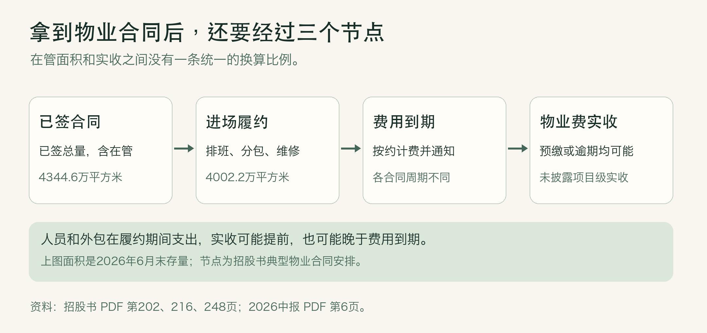

存量项目的续聘是一场新的选择。典型历史前期协议到新协议生效后结束；业委会签订的新协议一般为三年。现有物业有现场经验和客户熟悉度，竞争方也可以提出另一套人员、维修和收费安排。公司报告康郡项目中标后提价30.4%，这个案例说明个别项目有调价空间。未来要以实际调价后交付标准、收缴和再次续聘检验提价留下的利润。 [招股书，PDF第209—212页 · 第209页](https://www1.hkexnews.hk/listedco/listconews/sehk/2021/0511/2021051100022_c.pdf#page=209) · [2025年报，PDF第7页 · 第7页](https://www1.hkexnews.hk/listedco/listconews/sehk/2026/0430/2026043004377_c.pdf#page=7)

## 同场比较和组合平均各回答什么

南国置业的成都商业项目报价中，新希望物业的5.77元/平方米/月高于中电建物业的5.55元及成都诚悦时代的5.36元。南国置业披露的是向中电建物业采购，不能从参与投标推到新希望已获这份订单。另一个客户武侯高新在年度报告确认向新希望物业采购749万元，说明外部客户实际购买服务，但采购额和收款日期不同。招标结果和采购额都很具体，也都需要后续合同和结算才能回答价格是否能留下毛利。 [南国置业问询回复，PDF第54页 · 第54页](https://static.cninfo.com.cn/finalpage/2025-10-16/1224714999.PDF#page=54) · [武侯高新2025年报，PDF第10页 · 第10页](https://pdf.dfcfw.com/pdf/H2_AN202601271818462952_1.pdf?1769527931000.pdf=#page=10)

2026年上半年新希望服务披露外拓项目费率2.43元/平方米/月，低于集团综合3.08元。外拓的面积占比和收入增长都提高，同时基础物业当期毛利率从25.3%降至23.1%。公司把当期毛利率下降主要归因于独立第三方收入占比提高。外拓整体费率和分部毛利都已有记录，各批新签合同的费率和毛利尚未单列。要分清公司是不是为了低价拿单、客户是不是要求更多现场工时，得把同城、同业态、同服务标准的报价和实际支出摆在一起。若成熟后仍只能通过低价续约，新增面积对利润和现金的贡献会比当初签约显示的弱。若续约、收费和完整履约成本都改善，才更能说明市场拓展形成了持续收益。 [2026中报，PDF第5—8、12、34页 · 第5页](https://www1.hkexnews.hk/listedco/listconews/sehk/2026/0930/2026093002812_c.pdf#page=5)

## 专题 · 城市密度与履约经济性

一个小区出入口需要按合同值守，设备故障要有人处理，绿化和公共区域需要维护。相隔几条街的另一处项目也有类似需求。新希望服务在成都武侯15平方公里内累计落地20余个项目，也在苏州吴江由一处中标项目取得周边三个项目。要理解密度为什么可能有价值，需要把哪些岗位能共用、哪些必须留在现场，以及回款如何影响周转分开。 [招股书，PDF第203、244—248页 · 第203页](https://www1.hkexnews.hk/listedco/listconews/sehk/2021/0511/2021051100022_c.pdf#page=203) · [2025年报，PDF第7页 · 第7页](https://www1.hkexnews.hk/listedco/listconews/sehk/2026/0430/2026043004377_c.pdf#page=7) · [2026中报，PDF第7页 · 第7页](https://www1.hkexnews.hk/listedco/listconews/sehk/2026/0930/2026093002812_c.pdf#page=7)

## 把现场工作拆开

工程人员在相邻项目之间赶场，较短的路程可增加实际维修时间；片区主管可以把检查路线和培训放到几个站点一起安排。供应商也可能以较密的项目部署保洁、绿化及耗材。但有些工作不能靠距离消除。需要常驻的岗位有固定班次，保洁要完成约定频次，专业设施还要有合格人员。武侯项目跨公园、产业园和商业综合体，地理距离近并不意味着工作可以互换。2019年，公司首次管理医疗设施就曾额外投入人员和供应，项目当年亏损约50万元，后来才改善。新项目在启动期要先承担现场配置，能否形成有效密度通常要到合同稳定履约后才能判断。 [招股书，PDF第203、244—248页 · 第203页](https://www1.hkexnews.hk/listedco/listconews/sehk/2021/0511/2021051100022_c.pdf#page=203) · [2026中报，PDF第7—8页 · 第7页](https://www1.hkexnews.hk/listedco/listconews/sehk/2026/0930/2026093002812_c.pdf#page=7)

招股时披露的分包通常为期一至两年，物业负责监督履约并按月付款，发现服务达不到约定可以扣费。外包商组织员工、采购约定范围内的工具和物料，物业仍负责交付整套管理服务。包干合同把物业费和全部履约成本都留在公司，月度分包付款不随客户拖欠而自动推迟。酬金合同把项目费用留在客户项目资金池，物业可按约取酬，项目资金不足且公司先垫，也会产生需要收回的款项。 [招股书，PDF第201—204、244—248页 · 第201页](https://www1.hkexnews.hk/listedco/listconews/sehk/2021/0511/2021051100022_c.pdf#page=201)

## 人均管理面积大了，完整成本如何变化

2026年上半年披露人均在管面积1.15万平方米，同比提高17.8%，期末员工从3904降到3476。集团员工总成本却从1.81亿元升到1.87亿元。这里把期末人数和期间成本放在一起，只能看出两者方向不同，不能用总成本除以期末人数来断定工资涨幅。另一方面，常驻服务也可能由分包商承担，分包工时没有被披露为相同口径的人数。因此，人均覆盖增长可以来自岗位整合、业务组合、人手替换或真实效率改善。 [2026中报，PDF第5、12、19页 · 第5页](https://www1.hkexnews.hk/listedco/listconews/sehk/2026/0930/2026093002812_c.pdf#page=5)

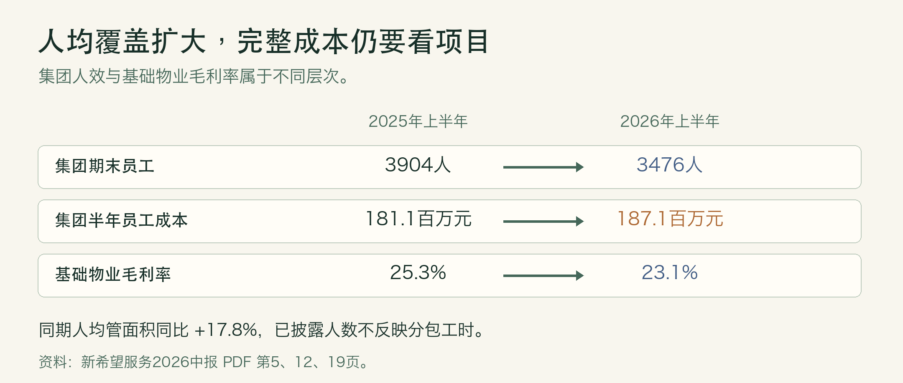

同一时期基础物业收入增3686万元，成本多3881万元。全部外拓项目的平均物业费率低于集团综合价，公司把板块毛利率下降主要归因于第三方收入占比增加。披露没有单列这一期新签项目的费率和全成本。密度可能提高效率，也可能让公司在市场上愿意承接费率更低的项目。两种解释会给出不同结果。若成熟项目在相同服务等级下总成本下降、续约和收款也不恶化，集中布局才显示出独立贡献。若毛利率提高只是退出低价项目，或将工时从自有人员移到外包，收益来源就不同。 [2026中报，PDF第6—8、12、34页 · 第6页](https://www1.hkexnews.hk/listedco/listconews/sehk/2026/0930/2026093002812_c.pdf#page=6)

## 服务做完了，资金还可能留在项目上

物业费按合同可能月付、季付或年付。提前缴费时，公司先拿到钱，随后交付服务。逾期缴费时，公司仍要支付用工、分包和维修。半年收缴率71.1%比去年同期增加1.1个百分点，是集团管理口径；原件未拆开它对应的旧欠款、当期应缴和预收。应收账款和预付款又涵盖物业以外业务。只有跟到同一片区、同一批项目的账单和实收，再扣自有员工、分包和维修支出，才能判断地理密度究竟释放了多少经营资金。 [招股书，PDF第202、216、248页 · 第202页](https://www1.hkexnews.hk/listedco/listconews/sehk/2021/0511/2021051100022_c.pdf#page=202) · [2026中报，PDF第5、32、40—42页 · 第5页](https://www1.hkexnews.hk/listedco/listconews/sehk/2026/0930/2026093002812_c.pdf#page=5)

## 专题 · 衍生场景收益及资金承担

社区停车场旁边，一笔车位成交可能为物业带来佣金，也可能使物业承担一段时间的车位投资。新希望服务都做过。代销时，开发商或业主拥有车位，物业促成交易，向授权方收取约定佣金。自营时，物业先向开发商买车位，再出租或卖给业主。两种交易都发生在物业触点周围，公司先付的钱和以后能留下的钱却不同。 [招股书，PDF第229—231页 · 第229页](https://www1.hkexnews.hk/listedco/listconews/sehk/2021/0511/2021051100022_c.pdf#page=229)

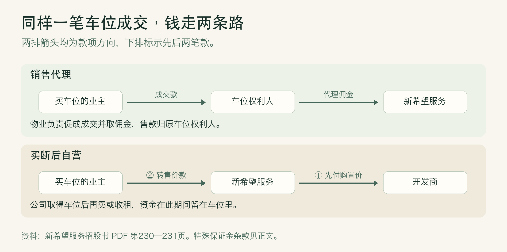

## 买断和代理的差异有多大

2018年，新希望服务以822万元购入锦官红南港180个车位，并持有收租。2020年又以302.3万元买入堤亚纳河谷74个车位，当年卖出，售款432万元。后一单先占用购置资金，扣购置价的差额为129.7万元，还要负担交易和相关成本。第一单则要逐月收租，回收期取决于出租及定价。物业本身接触住户有助于获得需求信息，买断是否值得仍取决于购置价格和出售价或租金。 [招股书，PDF第230—231页 · 第230页](https://www1.hkexnews.hk/listedco/listconews/sehk/2021/0511/2021051100022_c.pdf#page=230)

还有一份没实施的代理方案说明，“代理”这个词也不能直接判断资金需要。2022年，关联地产方拟把店铺、商务办公室和停车场交给新希望服务独家销售代理。每服务期目标物业总底价不超过7.67亿元，拟付保证金最多为总底价的30%，公告列上限2.30亿元，适用于全部目标物业。地产方收到买方款后按月结算代理费，已售且结算标的对应的保证金按月末返还，期满或终止后一个月内退还余额。按拟议条款，物业须先拿出资金，回收再取决于成交和地产方履约。9月双方终止框架，独立股东审议会被取消，框架未生效，项下拟交易未实施。公开披露未给出前置款项逐笔付退明细，2.30亿元只用于说明原方案拟承担的资金规模。 [独家物业销售代理框架，PDF第3—4、9、11页 · 第3页](https://www1.hkexnews.hk/listedco/listconews/sehk/2022/0510/2022051001395_c.pdf#page=3) · [终止公告，PDF第1—2页 · 第1页](https://www1.hkexnews.hk/listedco/listconews/sehk/2022/0916/2022091601121_c.pdf#page=1)

## 食品、零售和餐饮靠什么留下毛利

2019年第四季度开始运营零售和餐饮后，公司逐渐通过门店、小程序和企业客户卖乳品、食品等。自营模式先购货、再销售，营业额扣商品、配送、损耗及店员成本才形成剩余。企业福利采购让物业关系之外的企业成为客户。公司年报披露，2025年企业客户1094家，复购率超过60%，定制牛奶全年销售1073万元。关联乳品采购也有框架条款和年度上限，2025年和2026年分别为1400万元和1800万元。框架给出了供货渠道和交易限制，集团没有披露逐品类可比采购净价、店铺经营费及库存周转，无法由供应链背景直接得出成本优势。 [招股书，PDF第231—232、244—246页 · 第231页](https://www1.hkexnews.hk/listedco/listconews/sehk/2021/0511/2021051100022_c.pdf#page=231) · [乳品采购公告，PDF第2—7页 · 第2页](https://www1.hkexnews.hk/listedco/listconews/sehk/2025/0124/2025012400918_c.pdf#page=2) · [2025年报，PDF第10—11页 · 第10页](https://www1.hkexnews.hk/listedco/listconews/sehk/2026/0430/2026043004377_c.pdf#page=10)

团餐更像一套生产及现场交付：采购食材，安排加工、出餐和食品安全管理，最终从合同约定的收费方式中取得经营收入。三六三医院武侯院区采购公示里，新食主义等三家候选人的报价都是向医院缴食堂与小卖部营业额的5%，新食主义排名第一。即便最终合同采用这一分成，仍须看谁承担厨具、耗材、人工和未卖出的餐品，才能判断剩余。2025年底，公司披露33个团餐运营项目，第三方占97%。项目数反映外部经营机会，不能由此补出单店的毛利和回款。 [招股书，PDF第231页 · 第231页](https://www1.hkexnews.hk/listedco/listconews/sehk/2021/0511/2021051100022_c.pdf#page=231) · [三六三医院采购公示，第一、二节](https://cg.gt.cn/zbxx/026004/20250611/a1385430-e996-4cc6-b3cb-0b5393457865.html) · [2025年报，PDF第11页 · 第11页](https://www1.hkexnews.hk/listedco/listconews/sehk/2026/0430/2026043004377_c.pdf#page=11)

## 商场扩张还要问公司是否签下租约

受托经营时，公司可以为房东做定位、招商、管理和推广，业主租金按权利归业主，服务商收的是自身服务费。先承租再出租时，公司必须向房东付租金，租客租金进公司，空置会压缩价差。2025年末承租后转租的投资物业账面价值5871万元，另一组4513万元是自有停车场及企业物业。公司披露2025年第三方商运新签合同额2.33亿元，但当年商运收入同比下降25.9%。从签约到开业和收款可以相隔数期，旧项目空置和退出已经会减少当年收入。成都通锦中心、昆明西山万达等新获项目的租赁义务与现金节奏未逐项披露，合同额能说明业务取得，经济价值要看合同具体权利。 [招股书，PDF第220—227、251页 · 第220页](https://www1.hkexnews.hk/listedco/listconews/sehk/2021/0511/2021051100022_c.pdf#page=220) · [2025年报，PDF第9—10、92—94页 · 第9页](https://www1.hkexnews.hk/listedco/listconews/sehk/2026/0430/2026043004377_c.pdf#page=9)

2026年上半年，物业以外的三项业务合计约占收入35%、毛利47%。它们能显著影响集团毛利。判断物业触点带来的附加收益，需要追到哪一批业主实际下单、代理抽佣和自营商品分别留下多少、租约与经营权又占了多少资金。若新增项目的销售规模扩大却伴随库存、保证金和固定租金持续增加，利润增长要经过更久才能成为现金。 [2026中报，PDF第9—13、34、38—42页 · 第9页](https://www1.hkexnews.hk/listedco/listconews/sehk/2026/0930/2026093002812_c.pdf#page=9)

## 专题 · 收款跨了期，为什么利润与现金会分开

物业合同交付的服务可以按期确认，钱却可能在之前预收，也可能晚于发票到期。新希望服务的房屋现场每天要有人值守，分包、维修和公用支出也有自己的付款安排。拖欠如果只是跨期，占用的是时间和资金；拖欠最终收不回，损失的是这次服务能为股东留下的现金。2025至2026年上半年的账龄变化，使两者都值得分开核对。 [招股书，PDF第202、216、248页 · 第202页](https://www1.hkexnews.hk/listedco/listconews/sehk/2021/0511/2021051100022_c.pdf#page=202) · [2025年报，PDF第102—104、113—114页 · 第102页](https://www1.hkexnews.hk/listedco/listconews/sehk/2026/0430/2026043004377_c.pdf#page=102) · [2026中报，PDF第40页 · 第40页](https://www1.hkexnews.hk/listedco/listconews/sehk/2026/0930/2026093002812_c.pdf#page=40)

## 从贸易应收毛额开始

2025年初外部与关联毛应收合计484.899百万元，年底554.416百万元，差69.517百万元。全年现金流对账将这部分列为贸易应收占款。净额只多54.613百万元，因为贸易拨备存量由35.992升到50.896百万元，少掉的14.904就是拨备存量增加。损益表确认的贸易信用损失和撇销亦各有时点。理解现金占用要看毛应收和现金表调节，理解剩余可回收资产要看扣拨备的净额。 [2025年报，PDF第102、104、113—114页 · 第102页](https://www1.hkexnews.hk/listedco/listconews/sehk/2026/0430/2026043004377_c.pdf#page=102)

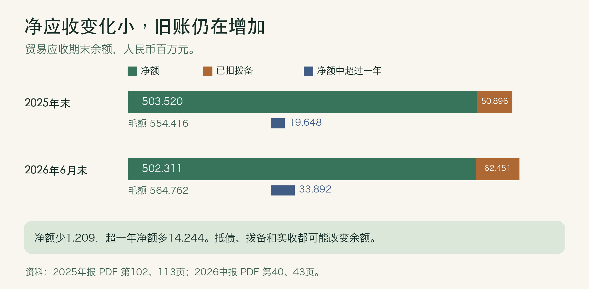

2026年6月末毛应收564.762百万元，扣62.451百万元拨备后剩502.311百万元。其中超过一年的33.892百万元已扣拨备。2025年末这个净余额是19.648百万元。2025年报的不同账龄拨备率从一年内3.42%跃升到一至两年44.16%，再到两至三年67.52%。六月净应收略少、旧账明显增加，说明总量不能替代账龄。另有明宇历史应收通过权益收购抵销，存量减少也可能来自非现金处置。外部毛应收和关联毛应收目前分别408.172、156.590百万元，年报及中报没有把拨备按两类债务人完全拆开。 [2025年报，PDF第102、113—114页 · 第102页](https://www1.hkexnews.hk/listedco/listconews/sehk/2026/0430/2026043004377_c.pdf#page=102) · [2026中报，PDF第40、43页 · 第40页](https://www1.hkexnews.hk/listedco/listconews/sehk/2026/0930/2026093002812_c.pdf#page=40)

## 现金先到也要看要交付什么

2025年期初合同负债209.342百万元，当年由期初转入收入207.692百万元，又新增预收247.988百万元，期末249.638百万元。客户先付款，物业后续仍要提供约定服务，这笔预收的好处是降低当时周转占用。若公司继续履约并能收到下一批预收，运营可维持较低占款；若外部预收减少，原来先收到的款又随履约消耗，就可能需要补资金。2026上半年合计合同负债少17.774百万元，外部预收减少而关联预收增加。代业主或租户收款与押金是另两类义务，不能拿其中的余额推演长期可派现金。 [2025年报，PDF第106—107页 · 第106页](https://www1.hkexnews.hk/listedco/listconews/sehk/2026/0430/2026043004377_c.pdf#page=106) · [2026中报，PDF第41—42页 · 第41页](https://www1.hkexnews.hk/listedco/listconews/sehk/2026/0930/2026093002812_c.pdf#page=41)

## 经营活动净现金还没有扣完设备与租赁

2026上半年税前经营所得38.959百万元，付所得税18.371百万元，留下20.588百万元经营净现金。再扣现金设备13.551、软件1.449、租赁本金2.221及利息0.433，剩2.934百万元。扣实付下层股息0.024后是2.910。另加投资现金中收到的利息0.382、扣另一项少数权益购买2.100、加受限资金释放3.192，得4.384。金融投资买卖净额、出售联营和设备、下层注资及汇兑合计另减0.344，期末现金净增加4.040。半年每项实际现金都受时点影响，不能把剩余4.384百万元当作年度经营能力。 [2026中报，PDF第30、38、43—44页 · 第30页](https://www1.hkexnews.hk/listedco/listconews/sehk/2026/0930/2026093002812_c.pdf#page=30)

2025年全年的实际经营净现金211.734百万元，扣设备35.525、软件9.450及长期租赁本金利息43.454，剩123.305百万元。2025年归母利润216.075百万元在另一个口径，差距包含收现、资本和租赁的实际支付时点。2025年租赁本金较大，与年初较多短期到期义务相符，半年低支付额也不能视为长期固定水平。未来估值若已经在年度信用损耗计了可能收不回的款，就不能同时把同一笔款当额外永久补资再扣。可回收的周转占款需要把付出日和收回日分开计算。如果达到稳态前经营本身少赚，应逐期折现这部分现金差；只有它与额外垫资各自成立且没有重叠，才计入同一情景。 [2025年报，PDF第60、65、105、107页 · 第60页](https://www1.hkexnews.hk/listedco/listconews/sehk/2026/0430/2026043004377_c.pdf#page=60) · [2026中报，PDF第30、35—38页 · 第30页](https://www1.hkexnews.hk/listedco/listconews/sehk/2026/0930/2026093002812_c.pdf#page=30)

## 专题 · 资本怎样从募资、项目与应收走向普通股

同是投入经营，支付给设备供应商、拿钱买子公司与拿旧应收换股权，给股东留下的权利不同。新希望服务经历了上市募资、明宇两次股权交易和多年的实际分红。沿资金和权利的路径看，几种业务最终都要经过履约、回款和上市主体的分配。 [2022年报，PDF第117—118页 · 第117页](https://www1.hkexnews.hk/listedco/listconews/sehk/2023/0428/2023042802852_c.pdf#page=117) · [2026中报，PDF第16—18、30、43页 · 第16页](https://www1.hkexnews.hk/listedco/listconews/sehk/2026/0930/2026093002812_c.pdf#page=16)

## 募资预算从并购移向日常营运

IPO及超额配售的募资用途表采用净额约7.90亿港元。2025年7月调整前，战略收购及投资尚余4.29亿港元，调整后该类分配6075万港元。营运资金、人才和系统获得更多分配。至2026年上半年末，累计动用约7.00亿港元，剩余8988万。其间使用在营运资金的3.15亿港元主要是员工成本2.46亿，也包括外包、公共事业和行政开支。资金确实支付给运营，是否形成新增资产或更高毛利，需从相应项目持续收入、回款和更新成本验证。 [2026中报，PDF第16—18页 · 第16页](https://www1.hkexnews.hk/listedco/listconews/sehk/2026/0930/2026093002812_c.pdf#page=16)

## 债权、股权和公司实际收到的现金

2022年首次买明宇，集团支付对价取得控制，报表将其可辨认资产和商誉并入，原其他股东仍分享少数权益。年报披露对价180.140百万元，明宇可辨认净资产102.055，按收购日可辨认净资产公允价值确认的少数权益为55.330，扣后净计46.725，剩余133.415记商誉。原协议对2022至2024年设收入、利润目标及补偿机制。实际是否完成承诺，仍缺统一合同口径的对账与最终补偿结算。2025年明宇披露的利润下降发生在承诺期之后。 [明宇首次收购公告，PDF第1—10页 · 第1页](https://www1.hkexnews.hk/listedco/listconews/sehk/2022/0411/2022041101089_c.pdf#page=1) · [2022年报，PDF第117—118页 · 第117页](https://www1.hkexnews.hk/listedco/listconews/sehk/2023/0428/2023042802852_c.pdf#page=117) · [2025年报，PDF第95—99页 · 第95页](https://www1.hkexnews.hk/listedco/listconews/sehk/2026/0430/2026043004377_c.pdf#page=95)

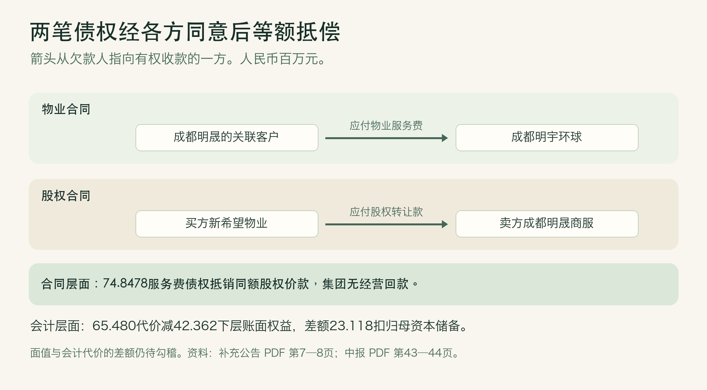

2026年补充公告分别说明债权方和负债方。已在集团内的明宇为卖方的关联客户履约，明宇是原债权人，这些客户欠物业服务费。上市集团内的新希望物业买股权，应向成都明晟商服付股权对价。各方以1比1抵销74.8478百万元面值，集团取得原卖方45.5%股权。中报列会计代价65.480，所购少数账面权益42.362，差额23.118减集团资本储备。面值与会计代价的9.3678差额未获完整对账，不能将它直接解释为新拨备、拨备转回或收到现金。另有2.100百万元少数权益购买出现在现金流，与明宇抵销另列。 [明宇追加收购公告，PDF第1—8页 · 第1页](https://www1.hkexnews.hk/listedco/listconews/sehk/2026/0417/2026041700002_c.pdf#page=1) · [明宇补充公告，PDF第7—8页 · 第7页](https://www1.hkexnews.hk/listedco/listconews/sehk/2026/0529/2026052901354_c.pdf#page=7) · [2026中报，PDF第29—30、43—44页 · 第29页](https://www1.hkexnews.hk/listedco/listconews/sehk/2026/0930/2026093002812_c.pdf#page=29)

从投出资产看，原应收如果能按期收现，换股要用未来分配弥补放弃的现金；若债权本来就难收，换得的权益仍可能提供更好的回收方式。明宇2025年持续经营利润为33.829百万元，乘追加45.5%约为15.392百万元，只是用历史利润与权益比例演示增量归属，不能代替往后每年分配。明宇还有下层非全资经营主体，集团也有其他子公司的少数股东。权益增加之后，需要继续跟踪业绩、真实回款、上划和普通股分派。 [2025年报，PDF第98—99页 · 第98页](https://www1.hkexnews.hk/listedco/listconews/sehk/2026/0430/2026043004377_c.pdf#page=98) · [2026中报，PDF第27、29—30、43—44页 · 第27页](https://www1.hkexnews.hk/listedco/listconews/sehk/2026/0930/2026093002812_c.pdf#page=27)

## 为什么不能用母公司某天的现金直接推断分红

Golden Rose持有上市公司544.8百万股、占约66.92%，信托及中间公司披露的是同一控制链，不能把这些股份逐项相加。至2026年10月末，公司有814.126百万已发普通股、无库存股。在外期权为零，80百万份是仍可授出的额度，尚未稀释现有普通股。控股方影响留资与分派决策，股息按普通股及适用条款分配。 [2026中报，PDF第20—23页 · 第20页](https://www1.hkexnews.hk/listedco/listconews/sehk/2026/0930/2026093002812_c.pdf#page=20) · [十月股份月报，PDF第2—3页 · 第2页](https://www1.hkexnews.hk/listedco/listconews/sehk/2026/1104/2026110400647_c.pdf#page=2)

2025年末集团现金957.808百万元，上市母公司单体只有0.640百万元现金，却有645.400百万元应收子公司。运营资金在经营法人中维持工资、分包、押金及租赁义务，利润还可能受少数权益和当地储备、上划税约束。子公司分红或清偿内部应收可将资金送到上市母公司。中报披露鼎晟发展收中国附属公司股息适用5%预扣税，实际可上划的各笔资金是否都经过这一股息路径仍待核。 [2026中报，PDF第37页 · 第37页](https://www1.hkexnews.hk/listedco/listconews/sehk/2026/0930/2026093002812_c.pdf#page=37)2025年集团现金流记录上市普通股实付151.787百万元、下层股东实付14.394百万元，这两笔钱分别归不同股东，不能相互替代。 [2025年报，PDF第65、99、108、110—117页 · 第65页](https://www1.hkexnews.hk/listedco/listconews/sehk/2026/0430/2026043004377_c.pdf#page=65)

2026年股息政策以归母净利润不少于60%为目标，仍受现金、经营和董事会决定约束。已宣派、财务报表列为应付及实际入账是不同阶段。公司2026年上半年未列向上市股东支付股息的现金流；下半年两份公告分别列港币每股0.08857和0.096，公告派付日7月7日和10月30日；实际付款仍要与之后的现金披露核对。 [2025年末期股息更新公告，PDF第1—2页 · 第1页](https://www1.hkexnews.hk/listedco/listconews/sehk/2026/0616/2026061601179_c.pdf#page=1) · [2026年中期股息公告，PDF第1—2页 · 第1页](https://www1.hkexnews.hk/listedco/listconews/sehk/2026/0828/2026082800644_c.pdf#page=1)

普通股取得的回报最终是实际到手的股息及卖出所得。账面现金和分红历史帮助判断路径，但每个付款阶段仍有自身条件。 [股息政策公告，PDF第1—2页 · 第1页](https://www1.hkexnews.hk/listedco/listconews/sehk/2026/0408/2026040802395_c.pdf#page=1) · [2026中报，PDF第30、42—43页 · 第30页](https://www1.hkexnews.hk/listedco/listconews/sehk/2026/0930/2026093002812_c.pdf#page=30)

## 专题 · 估值依据｜三步分别回答资源、盈利和增长

同一家物业公司，可以从取得同等经营资源的费用出发，也可以从现有客户和合同还能留下多少现金出发。新希望服务还有扩张计划，但新增合同赚多少、要预先投多少、多久收回尚未配对。三个问题使用了不同的事实与条件。账面资源与现有盈利不直接相加，扩张的可能性也不自动变成第三个估值数。 [2025年报，PDF第7—13、92—99页 · 第7页](https://www1.hkexnews.hk/listedco/listconews/sehk/2026/0430/2026043004377_c.pdf#page=7) · [2026中报，PDF第5—13、26—27、34—44页 · 第5页](https://www1.hkexnews.hk/listedco/listconews/sehk/2026/0930/2026093002812_c.pdf#page=5)

## 资产再生产的参照为什么保留未知

2026年6月末从合并总资产2103.767百万元中剔除商誉133.415和账面无形127.968，再扣负债722.956和少数权益47.820，得1071.608百万元。以814.126百万股计算，每股1.3163元人民币。保留的资产使用账面净额或最近公允值。原账面商誉是收购剩余价值，无法直接作为重新招募人员、建立客户关系与完成系统建设的费用。软件、资质、获客和组织的再生产费用仍未知。原资产质量或权利期限若低于目前入账，需另作净调整。 [2025年报，PDF第95—97页 · 第95页](https://www1.hkexnews.hk/listedco/listconews/sehk/2026/0430/2026043004377_c.pdf#page=95) · [2026中报，PDF第26—27、38—43页 · 第26页](https://www1.hkexnews.hk/listedco/listconews/sehk/2026/0930/2026093002812_c.pdf#page=26)

账面资源中，已提拨备的一年以上净贸易应收为33.892百万元。若该部分全损且全部归母、无税益，每股资源参照减少0.0416元。这个压力用于说明旧账量级。它与关联欠款风险会重叠，也不同于以后每年正常信用损耗。租赁的权利与义务也配对看，承租空间不能当自有楼，主租负债已进集团负债。 [2025年报，PDF第92—94、113—115页 · 第92页](https://www1.hkexnews.hk/listedco/listconews/sehk/2026/0430/2026043004377_c.pdf#page=92) · [2026中报，PDF第26—27、38—42页 · 第26页](https://www1.hkexnews.hk/listedco/listconews/sehk/2026/0930/2026093002812_c.pdf#page=26)

## 盈利的资本化应从普通股能分到什么出发

当前稳定条件下，服务经营税前229.775百万元，经营税25%、净更新9.926后为162.405百万元。再扣下层经济权益15.038，按鼎晟发展收取中国附属公司股息适用的5%作条件折减，普通股税前上划余额147.36725百万元对应税7.3683625，剩约139.999百万元。实际全部上划路径尚未证实。按同一顺序，经营反方给99.789百万元。等价做法是先从合并162.40525只扣这笔普通股上划税7.3683625，资本化后再扣下层年度份额15.038的现值。历史现金流中的少数股息金额会受实际宣派影响，不能直接替代少数经济权利。 [2025年报，PDF第65、99、108、114页 · 第65页](https://www1.hkexnews.hk/listedco/listconews/sehk/2026/0430/2026043004377_c.pdf#page=65) · [2026中报，PDF第30、36—37、43—44页 · 第30页](https://www1.hkexnews.hk/listedco/listconews/sehk/2026/0930/2026093002812_c.pdf#page=30)

主例取10%人民币机会成本作比较，观察8%和12%两端。10%下，从估值时点即进入稳态、第一笔现金在一年末形成时，已计量经营价值约1.720元/股，经营反方约1.226元/股。若仅假设前两年均按反方取得现金、第三年起稳定，约1.634元/股。实际恢复时间尚待证，过渡期少赚与可收回的垫资要按各自现金及日期处理。待核的正净余资暂不加；若在相同净资源口径下，资产、义务、税、少数权益与维持经营的留资合起来为负，缺口仍需从普通股价值中扣除。已在经营现金中计的信用损耗或成本不重复扣，已剥离的利息、房产净租金和联营收益也不能连同相应资产重复计入。 [2026中报，PDF第26—27、35—44页 · 第26页](https://www1.hkexnews.hk/listedco/listconews/sehk/2026/0930/2026093002812_c.pdf#page=26)

## 哪些新增证据才能支持增长

新希望服务2026年上半年第三方各类项目签约4.60亿元，基础物业费收入增长，但项目新签、在管和实收分别发生在不同时间。若同类成熟项目的服务毛利能保持、客户按期付款，新增资金又有明确投入与回收记录，可以逐批算新增资本回报。若需要继续预付外包、补应收、支付上游租金或为并购追加资本，增长对普通股的好处就可能小得多。现有资料不能将这些环节按新增项目配对，因此增长暂不付溢价，仍观察项目兑现。 [2026中报，PDF第5—13、16—18、34、38—43页 · 第5页](https://www1.hkexnews.hk/listedco/listconews/sehk/2026/0930/2026093002812_c.pdf#page=5)

## 研究依据

外拓规模增加之后，真实履约和回款能够给普通股留下多少，账面资源能否形成安全边际？

真实收费基础与账面资源支持持续经营，但外拓收入没有守住单位利润、回款尚未稳定。估值时点即按当前规模稳定、首笔现金一年末形成的条件下普通股年度经济现金约1.40亿元；综合经营反方约1.00亿元。10%下已计量经营价值分别约1.720/1.226元人民币每股，正净余资不加信用，额外资金缺口L尚待扣。资产1.316元仅为已计量资源参照，增长暂不付溢价。历史1.49港元不能据此确认为安全买价。

已保留较高汇兑费、投入和历史少数分占，优惠税及可分正余资未计价，若真能回款并稳定毛利则可能过于保守；相反低收费扩张、费用刚性和账龄恶化可使稳态仍被高估。

以2026年报及其前正式公告核毛利与信用成本、税前经营现金及外部预收、明宇现金归属、股息实际支付和剩余募资用途；公告日期未定不虚构，股价变化不替代经营检验。

## 公开来源目录

- [2021年度報告](https://www1.hkexnews.hk/listedco/listconews/sehk/2022/0429/2022042901435_c.pdf)

- [2022中期報告](https://www1.hkexnews.hk/listedco/listconews/sehk/2022/0926/2022092600661_c.pdf)

- [2022年度報告](https://www1.hkexnews.hk/listedco/listconews/sehk/2023/0428/2023042802852_c.pdf)

- [2023中期報告](https://www1.hkexnews.hk/listedco/listconews/sehk/2023/0927/2023092701171_c.pdf)

- [2023年度報告](https://www1.hkexnews.hk/listedco/listconews/sehk/2024/0419/2024041901761_c.pdf)

- [2024中期報告](https://www1.hkexnews.hk/listedco/listconews/sehk/2024/0925/2024092500535_c.pdf)

- [2024年度報告](https://www1.hkexnews.hk/listedco/listconews/sehk/2025/0429/2025042903823_c.pdf)

- [2025中期報告](https://www1.hkexnews.hk/listedco/listconews/sehk/2025/0926/2025092601263_c.pdf)

- [2025年度報告](https://www1.hkexnews.hk/listedco/listconews/sehk/2026/0430/2026043004377_c.pdf)

- [2026中期報告](https://www1.hkexnews.hk/listedco/listconews/sehk/2026/0930/2026093002812_c.pdf)

- [2021中期報告](https://www1.hkexnews.hk/listedco/listconews/sehk/2021/0929/2021092900410_c.pdf)

- [新希望服務控股有限公司招股章程](https://www1.hkexnews.hk/listedco/listconews/sehk/2021/0511/2021051100022_c.pdf)

- [截至2026年6月30日止六個月之中期股息](https://www1.hkexnews.hk/listedco/listconews/sehk/2026/0828/2026082800644_c.pdf)

- [截至2025年12月31日止年度的末期股息(更新)](https://www1.hkexnews.hk/listedco/listconews/sehk/2026/0616/2026061601179_c.pdf)

- [於2026年6月16日舉行的股東週年大會投票結果](https://www1.hkexnews.hk/listedco/listconews/sehk/2026/0616/2026061601169_c.pdf)

- [截至2025年6月30日止六個月之中期股息](https://www1.hkexnews.hk/listedco/listconews/sehk/2025/0828/2025082801903_c.pdf)

- [變更未動用所得款項用途](https://www1.hkexnews.hk/listedco/listconews/sehk/2025/0715/2025071500827_c.pdf)

- [截至2024年12月31日止年度的末期股息(更新)](https://www1.hkexnews.hk/listedco/listconews/sehk/2025/0616/2025061600907_c.pdf)

- [持續關連交易 重續於2024年12月31日屆滿的持續關連交易協議](https://www1.hkexnews.hk/listedco/listconews/sehk/2025/0124/2025012400918_c.pdf)

- [截至2024年6月30日止六個月之中期股息(更新)](https://www1.hkexnews.hk/listedco/listconews/sehk/2024/0906/2024090600290_c.pdf)

- [截至2023年12月31日止年度的末期股息](https://www1.hkexnews.hk/listedco/listconews/sehk/2024/0513/2024051301253_c.pdf)

- [持續關連交易 重續於2023年12月31日屆滿的持續關連交易協議 及 股東特別大會的通告](https://www1.hkexnews.hk/listedco/listconews/sehk/2024/0228/2024022800824_c.pdf)

- [關連交易 收購目標公司的80%股權](https://www1.hkexnews.hk/listedco/listconews/sehk/2023/1103/2023110302081_c.pdf)

- [截至2023年6月30日止六個月之中期股息(更新)](https://www1.hkexnews.hk/listedco/listconews/sehk/2023/0913/2023091300328_c.pdf)

- [截至2022年12月31日止年度的末期股息 (更新)](https://www1.hkexnews.hk/listedco/listconews/sehk/2023/0616/2023061600711_c.pdf)

- [終止須予披露及持續關連交易](https://www1.hkexnews.hk/listedco/listconews/sehk/2022/0916/2022091601121_c.pdf)

- [截至2021年12月31日止年度的末期股息 (更新)](https://www1.hkexnews.hk/listedco/listconews/sehk/2022/0616/2022061600258_c.pdf)

- [持續關連交易集採供應鏈服務框架協議及更改全球發售所得款項用途](https://www1.hkexnews.hk/listedco/listconews/sehk/2022/0525/2022052500078_c.pdf)

- [須予披露及持續關連交易](https://www1.hkexnews.hk/listedco/listconews/sehk/2022/0510/2022051001395_c.pdf)

- [須予披露交易收購目標公司51%股權](https://www1.hkexnews.hk/listedco/listconews/sehk/2022/0411/2022041101089_c.pdf)

- [翌日披露報表](https://www1.hkexnews.hk/listedco/listconews/sehk/2021/0621/2021062100915_c.pdf)

- [部分行使超額配股權、穩定價格行動及穩定價格期結束](https://www1.hkexnews.hk/listedco/listconews/sehk/2021/0615/2021061500077_c.pdf)

- [發售價及分配結果公告](https://www.hkexnews.hk/listedco/listconews/sehk/2021/0524/9774216/2021052400018_c.pdf)

- [新希望服务官网物业服务与代表项目](https://www.newhopeservice.com.cn/c/wuyefuwu.html)

- [新希望服务官网公司简介](https://www.newhopeservice.com.cn/c/gsjj.html)

- [三六三医院武侯院区食堂外包服务采购项目（第二次）中标候选人公示](https://cg.gt.cn/zbxx/026004/20250611/a1385430-e996-4cc6-b3cb-0b5393457865.html)

- [南国置业重大资产出售暨关联交易问询函回复](https://static.cninfo.com.cn/finalpage/2025-10-16/1224714999.PDF)

- [成都武侯高新技术产业发展股份有限公司2025年度报告](https://pdf.dfcfw.com/pdf/H2_AN202601271818462952_1.pdf?1769527931000.pdf=)

- [內幕消息 採納經修訂股息政策](https://www1.hkexnews.hk/listedco/listconews/sehk/2026/0408/2026040802395_c.pdf)

- [有關收購目標公司45.5%的股權之
須予披露及關連交易](https://www1.hkexnews.hk/listedco/listconews/sehk/2026/0417/2026041700002_c.pdf)

- [有關須予披露及關連交易
之補充公告](https://www1.hkexnews.hk/listedco/listconews/sehk/2026/0529/2026052901354_c.pdf)

- [截至二零二六年十月三十一日止股份發行人的證券變動月報表](https://www1.hkexnews.hk/listedco/listconews/sehk/2026/1104/2026110400647_c.pdf)

- [保利物业2025年度报告](https://www1.hkexnews.hk/listedco/listconews/sehk/2026/0430/2026043001633_c.pdf)

- [东方财富03658.HK未复权收盘 · 2026-11-06](https://push2his.eastmoney.com/api/qt/stock/kline/get?secid=116.03658&klt=101&fqt=0&lmt=1000000&beg=20190101&end=20261109&fields1=f1%2Cf2%2Cf3%2Cf4%2Cf5%2Cf6&fields2=f51%2Cf52%2Cf53%2Cf54%2Cf55%2Cf56%2Cf57)

- [欧洲央行欧元参考汇率 · 2026-11-06](https://www.ecb.europa.eu/stats/eurofxref/eurofxref-hist.zip)
