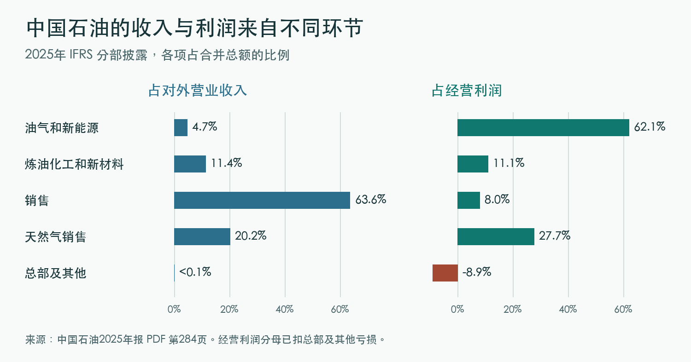
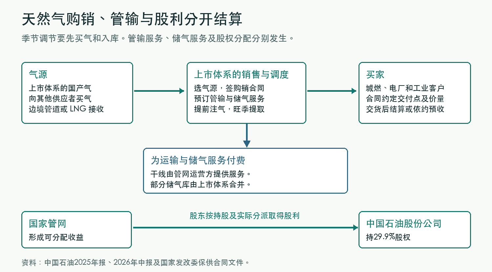
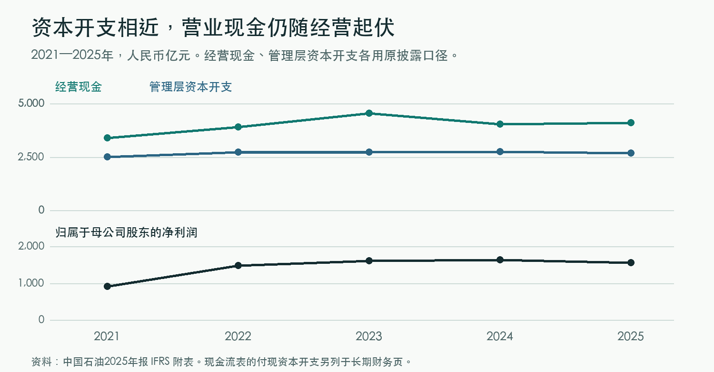
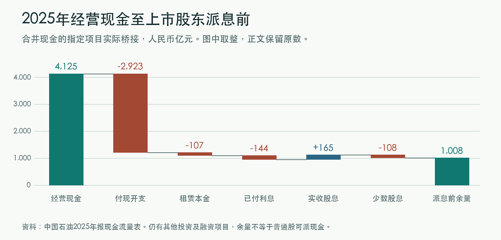
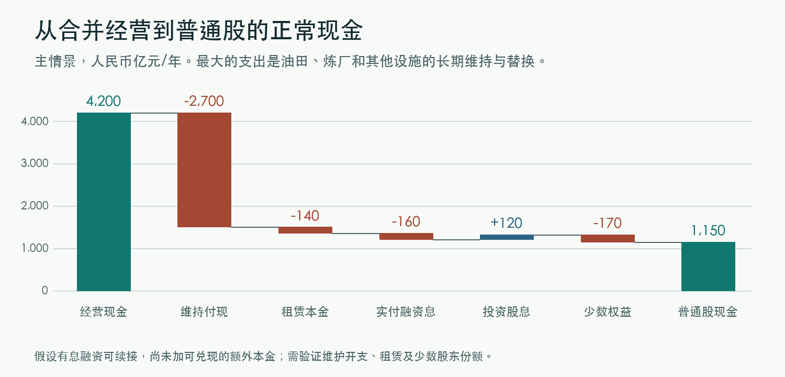
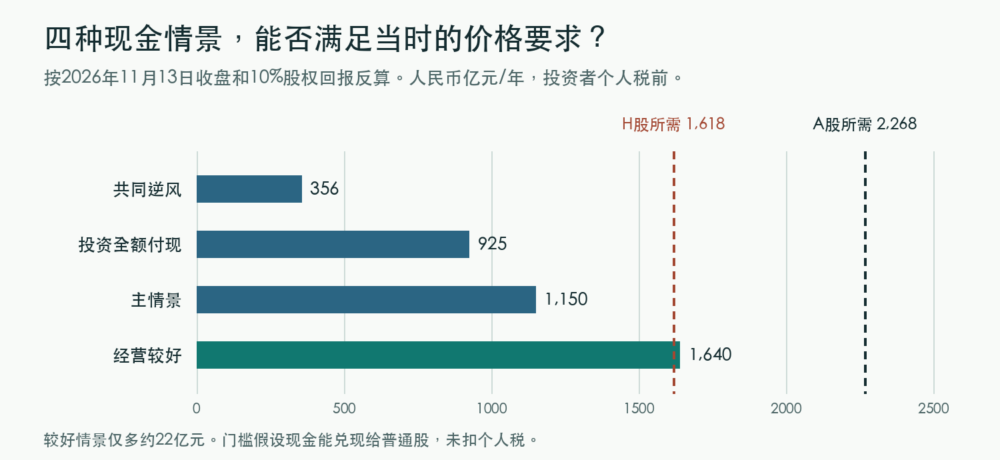

# 中国石油 v2

研究时点 2026-11-13 · 本地发布版本 84029c690b284d30

## 油气怎样成为商品，利润留在哪个环节

中国石油天然气股份有限公司（601857.SH、00857.HK）在长庆、大庆、塔里木、川渝等地区开采原油和天然气，也经营海外油气项目。原油可以卖给外部，也可以供给自己的炼厂。炼出的汽油、柴油和航空煤油经批发、加油站和贸易渠道销售，化工装置则向制造企业供应乙烯下游产品和各类材料。天然气销售使用自产气、进口管道气和液化天然气，向城市燃气公司、电厂和工业客户交付。2025年公司产油9.48亿桶、炼厂加工13.76亿桶原油、在国内销售天然气2,475亿立方米，年末有22,127座加油站。采油、炼油和气源销售各有外购、运输、库存和交货安排。 [主要油气区与产量 · 第23页](https://www.hkexnews.hk/listedco/listconews/sehk/2026/0423/2026042301797.pdf#page=23) [生产数据 · 第24页](https://www.hkexnews.hk/listedco/listconews/sehk/2026/0423/2026042301797.pdf#page=24) [加工及化工 · 第25页](https://www.hkexnews.hk/listedco/listconews/sehk/2026/0423/2026042301797.pdf#page=25) [加油站与天然气销量 · 第27页](https://www.hkexnews.hk/listedco/listconews/sehk/2026/0423/2026042301797.pdf#page=27)

## 销售分部的对外收入最大，油气开采贡献最多利润

2025年，销售分部贡献约64%的合并对外收入，主要经过成品油销售和国际贸易。采购、加工已经在前面的环节发生，最后一环对外卖出的金额很大，销售分部自身留下的经营利润约175亿元。油气和新能源分部的对外收入只占约5%，因为大量原油和天然气先供给本公司的炼化、气销等分部。内部销售在合并收入里抵销，分部经营利润仍反映公司如何在各环节记录收益。该分部经营利润约1,361亿元，是最大的经营利润来源。天然气销售另贡献约608亿元。炼化及新材料分部约242亿元，总部及其他亏损约194亿元。 [IFRS分部收入、内部交易和经营利润 · 第284页](https://www.hkexnews.hk/listedco/listconews/sehk/2026/0423/2026042301797.pdf#page=284)

气销能赚多少，取决于供气合同收入能否覆盖采购、运输和调峰成本。冬季交气前，已有一部分气要买入、注库，因而气量增长与现金变好可能发生在不同时间。炼化看原料和产品的价差及开工率，成品油销售看批发零售和国际贸易各自留下多少。油气开采则同时受实现油价、产量和稳产成本影响。把这些环节连在一起，才能解释同一轮油价变化为何对各分部影响不同。

## 上市公司拥有主业，干线运营及部分服务由别的主体承担

1999年，中国石油集团发起设立股份公司，随后在香港和上海上市。2026年9月末，集团直接和间接合计持有约82.5%的股份。集团下属工程企业可为股份公司提供钻井、建设等服务并据约收款。上市公司也通过非全资子公司经营城燃和部分海外油气资产，合作股东对相应子公司的利润和分配享有权益。 [上市主体及其业务 · 第5页](https://www.hkexnews.hk/listedco/listconews/sehk/2026/0423/2026042301797.pdf#page=5) [控股股东权益 · 第4页](https://www.petrochina.com.cn/petrochina/jdbg/202610/ed4e45a0d81149dab4549bd4cc570db4/files/e054e03d628b46588536bf47673d167f.pdf#page=4) [集团互供关系 · 第152页](https://www1.hkexnews.hk/listedco/listconews/sehk/2026/0918/2026091800441.pdf#page=152)

2020年，股份公司向国家管网集团移交主要油气干线等资产，取得现金并持有国家管网集团29.9%股权。现在公司为干线运输服务付费，2025年从国家管网集团收到股息56.28亿元。2026年，上市体系又通过三个受控合资载体向中国石油集团所属企业购买三座储气库。储气有助于平衡淡旺季，合并报表包含这三库，合作方仍保留各自权益。干线服务、参股收息和储气经营是三种不同安排。 [管网交割 · 第43页](https://www1.hkexnews.hk/listedco/listconews/sehk/2021/0421/2021042100427_c.pdf#page=43) [国家管网分配 · 第163页](https://www.hkexnews.hk/listedco/listconews/sehk/2026/0423/2026042301797.pdf#page=163) [三库购买和权益结构 · 第190页](https://www1.hkexnews.hk/listedco/listconews/sehk/2026/0918/2026091800441.pdf#page=190)

## 现在的经营位置

2025年公司收入2.86万亿元、归母净利润1,573亿元、经营现金流4,125亿元，当年实际支付资本性支出2,923亿元。受油价下跌影响，油气和新能源分部经营利润同比少约237亿元，气销、炼化和销售增利，缓冲了部分下降。2026年前三季度，公司原油实现价同比升18.5%，油气和新能源分部增利约250亿元，占合并经营利润净增量约八成。前三季度同比使用按控股储气库交易重列后的上年同期数，经营范围调整和当期业务变化不能混为一谈。[比较列重列说明 · 第23页](https://www.petrochina.com.cn/petrochina/jdbg/202610/ed4e45a0d81149dab4549bd4cc570db4/files/e054e03d628b46588536bf47673d167f.pdf#page=23) 同一期间国内汽煤柴油销量下降5.7%，销售分部仍因国际贸易等增利。当前是一家上游主导利润、天然气提供第二个利润来源、下游正在调整产品与渠道的成熟企业。 [全年合并业绩 · 第8页](https://www.hkexnews.hk/listedco/listconews/sehk/2026/0423/2026042301797.pdf#page=8) [年度上游经营变化 · 第31页](https://www.hkexnews.hk/listedco/listconews/sehk/2026/0423/2026042301797.pdf#page=31) [资本性支出付现 · 第221页](https://www.hkexnews.hk/listedco/listconews/sehk/2026/0423/2026042301797.pdf#page=221) [油价与油气产量 · 第5页](https://www.petrochina.com.cn/petrochina/jdbg/202610/ed4e45a0d81149dab4549bd4cc570db4/files/e054e03d628b46588536bf47673d167f.pdf#page=5) [油品销量及贸易 · 第7页](https://www.petrochina.com.cn/petrochina/jdbg/202610/ed4e45a0d81149dab4549bd4cc570db4/files/e054e03d628b46588536bf47673d167f.pdf#page=7) [分部增减 · 第23页](https://www.petrochina.com.cn/petrochina/jdbg/202610/ed4e45a0d81149dab4549bd4cc570db4/files/e054e03d628b46588536bf47673d167f.pdf#page=23)

接下来读商业模式和竞争两章，可以看清三件事。老油田要花多少钱接替产量，天然气合同的售价与气源成本如何联动，化工产品能否在燃油需求回落时补上利润。从经营转到股东分配时，再进入「现金与估值」。

## 第1章 · 沿革与上市公司的业务边界

## 从产、炼、销一体化到干线独立

1998年石油石化企业重组后，中国石油集团整合了北方和西部重要的陆上油气资源及配套炼厂、销售企业。1999年11月，中国石油集团独家发起设立股份公司。油气勘探开发、炼化和销售业务进入上市主体，集团体系仍有钻井、物探、工程和金融供应商。股份公司在2000年赴香港和美国上市，2007年发行40亿股A股，每股16.70元。美国存托股后来退市，沪、港普通股仍交易。 [公司沿革及业务 · 第5页](https://www.hkexnews.hk/listedco/listconews/sehk/2026/0423/2026042301797.pdf#page=5) [公司2020年报告中的发行历史](https://www.petrochina.com.cn/petrochina/rdxx/202104/31c88dc7378d4367bc0a58c79033a1c5/files/046ae20530f44c66978aa3f685458a3a.pdf)

2020年9月30日交割时，中国石油把主要油气干线、部分储气库、LNG接收站及铺底油气移交国家管网集团，标的资产的所有权、义务和风险随之转移。交易价值2,474.71亿元，股份公司确认国家管网长期股权投资1,495.00亿元，取得现金对价979.71亿元，确认税前收益469.46亿元。交割前通函中的价格与最终值不同，年报解释了铺底油气量价及部分管道公司提前分红的影响。此后股份公司作为托运方使用干线服务，并作为联营股东取得股利。 [交易交割及最终对价 · 第43页](https://www1.hkexnews.hk/listedco/listconews/sehk/2021/0421/2021042100427_c.pdf#page=43)

## 集团、联营企业与非全资子公司

2026年9月末，中国石油集团直接持A股1,505.83亿股，通过境外子公司间接持H股约3.99亿股，合计约82.50%。香港中央结算（代理人）名下主要是代持的H股，里面有许多不同的最终持有人。持股集中与真实可交易数量要分别判断。 [持股及代持附注 · 第4页](https://www.petrochina.com.cn/petrochina/jdbg/202610/ed4e45a0d81149dab4549bd4cc570db4/files/e054e03d628b46588536bf47673d167f.pdf#page=4)

主要产油气的企业或分公司在上市体系内，但需要逐个看法律主体。股份公司控制并合并中油勘探，持股50%，对方分享剩余权益。昆仑能源亦为非全资子公司，经营城燃、LNG等业务，子公司赚到的钱要留足当地经营和债务需求，分红时再按权益分配。国家管网和中油财务分别持股29.9%和32%，作为联营处理。集团经营的钻井与工程队伍提供服务，上市公司按约付工程、物料和生产服务费。集团还出租经营用地和房产，其中截至2026年中的现有土地租赁安排年租约57.24亿元，租地面积和租金可按约调整。 [重要子公司及参股公司 · 第41页](https://www.hkexnews.hk/listedco/listconews/sehk/2026/0423/2026042301797.pdf#page=41) [产品服务协议和关联方 · 第152页](https://www1.hkexnews.hk/listedco/listconews/sehk/2026/0918/2026091800441.pdf#page=152) [土地及房屋合同 · 第153页](https://www1.hkexnews.hk/listedco/listconews/sehk/2026/0918/2026091800441.pdf#page=153)

2024—2026年互供协议下，有政府定价的按规定定价，其余依市场或依合同成本、协议定价。已公告续签的2027—2029年协议仍允许在条件更优时向第三方采购或供货。对股东而言，程序和报价条款提供可核查的比较点。储气库交易近400亿元的实际支付说明，股东还要独立核验每项资产收购的现金回报。 [续签的定价顺序 · 第5页](https://www1.hkexnews.hk/listedco/listconews/sehk/2026/0329/2026032900155.pdf#page=5) [期限和外部选择权 · 第11页](https://www1.hkexnews.hk/listedco/listconews/sehk/2026/0329/2026032900155.pdf#page=11)

## 第2章 · 一桶油、一方气怎样变成收入

## 油田出油后，炼厂和销售公司继续做什么

油田先投入勘探、钻井、完井、集输和地面设施。出井后还需处理和运输。对外销售时购方按合同结算。进入同一上市合并范围的炼厂时，上游和炼化分别核算内部价，合并层抵销该笔内部交易。2025年公司产油9.48亿桶，其中境内7.803亿桶，炼厂加工13.759亿桶。炼厂也会购买外部原油。自产油会对外销售，集团炼厂实际吃到多少自产油要看内部转供量。 [油气产量表 · 第24页](https://www.hkexnews.hk/listedco/listconews/sehk/2026/0423/2026042301797.pdf#page=24) [原油加工与成品油 · 第25页](https://www.hkexnews.hk/listedco/listconews/sehk/2026/0423/2026042301797.pdf#page=25) [内部和外部销售 · 第23页](https://www.petrochina.com.cn/petrochina/jdbg/202610/ed4e45a0d81149dab4549bd4cc570db4/files/e054e03d628b46588536bf47673d167f.pdf#page=23)

炼厂在产品卖出前已为原油、工艺能源和装置运行付出成本。它把原油加工为汽柴油、煤油和化工原料，一部分产品经销售公司走向加油站、批发商或工业客户。集团内部移储时存货仍在，站点交货给车主或批发商接货后，外部款项才依零售结算或合同约定回到上市体系。财报未给各渠道实际信用期。油价下跌，经使用较低采购价的新库存后可能使炼厂成本下降，最终利润取决于成品售价跌多少、库存跌价和开工情况。2025年上游少赚236.80亿元，炼化和销售合计多赚39.14亿元，抵销了其中一部分。2026年前三季度销售分部增利24.7%主要来自国际贸易利润增加，同时国内汽煤柴油销量下降5.7%，零售和贸易要各看现金。 [上游和炼化利润变化 · 第31页](https://www.hkexnews.hk/listedco/listconews/sehk/2026/0423/2026042301797.pdf#page=31) [销售分部业绩 · 第33页](https://www.hkexnews.hk/listedco/listconews/sehk/2026/0423/2026042301797.pdf#page=33) [炼化利润 · 第6页](https://www.petrochina.com.cn/petrochina/jdbg/202610/ed4e45a0d81149dab4549bd4cc570db4/files/e054e03d628b46588536bf47673d167f.pdf#page=6) [销售量和利润变化 · 第7页](https://www.petrochina.com.cn/petrochina/jdbg/202610/ed4e45a0d81149dab4549bd4cc570db4/files/e054e03d628b46588536bf47673d167f.pdf#page=7)

## 天然气的交货约定与采购风险

国内油气田把可销售气交进入网体系，进口气从边境管道或LNG接收站进入。销售分部按市场和客户配置气源，向城燃企业、电厂和工业客户供气。城燃再以当地核准或市场规则约定的价格卖给居民与工商用户。购销合同和运输合同分别约定价格、用量、交气点与交付计划。储气服务可由外部企业提供，也可使用上市公司控制的储气库。部分国内业务的合同负债来自收款后还要交货的安排，账上多了现金时仍负有供货义务。海外逐笔气源成本、预提比例和买方结算周期未完整公开。

上游基准门站价格和下游的居民配气价分属不同定价环节。2018年居民用气改按基准门站价格管理并鼓励季节差价，当地联动的幅度和时间仍会影响下游采购成本传递。2026年10月公布、12月1日起实施的中长期保供合同办法，按政府指导价和市场调节价安排门站价格并允许供暖季调峰价格。它给出定价与履约框架，实际采购与销售价格仍需看具体合同和气源组合。 [居民门站价通知](https://zfxxgk.ndrc.gov.cn/web/iteminfo.jsp?id=14165) [保供合同办法](https://zfxxgk.ndrc.gov.cn/web/iteminfo.jsp?id=20668)

2025年天然气销售分部经营利润608.02亿元，国内销量2,475.28亿方。2026年前三季度国内销量1,787.35亿方，同比只增1.0%，分部利润332.93亿元，同比增6.4%。公司将增利归于销量与气源、客户结构优化，单凭分部披露还无法拆出顺价、采购降价和调峰的各自贡献。以2025年国内销量计，每方毛差少0.06元，税前就少约148.5亿元。这正是为何良好的销售网络仍需承受采购与销售之间的价差波动。 [国内销量 · 第27页](https://www.hkexnews.hk/listedco/listconews/sehk/2026/0423/2026042301797.pdf#page=27) [天然气经营利润 · 第33页](https://www.hkexnews.hk/listedco/listconews/sehk/2026/0423/2026042301797.pdf#page=33) [前三季销量与利润 · 第7页](https://www.petrochina.com.cn/petrochina/jdbg/202610/ed4e45a0d81149dab4549bd4cc570db4/files/e054e03d628b46588536bf47673d167f.pdf#page=7)

## 第3章 · 和中国石化、中国海油比较

中国石油的竞争力来自上游资源与气源调度。2025年末合并口径证实储量182.36亿桶油当量，年产18.42亿桶油当量。照当年产量静态算约9.9年，其中油约6.4年、气约13.6年。储采比会随新增储量、经济性和产量更新。它表示按当期数字的静态年数，价值仍取决于地质开发、获批接替与未来成本。气田增储可能掩盖原油接替偏慢。 [油气储量及产量滚动表 · 第106页](https://www.hkexnews.hk/listedco/listconews/sehk/2026/0423/2026042301797.pdf#page=106)

| 同行 | 业务暴露 | 2025年经营参照 | 对中国石油的检验 |
| --- | --- | --- | --- |
| 中国石油 | 陆上油气、炼化、零售、天然气销售 | IFRS归母1,573.18亿元。单位油气操作成本12.04美元/桶油当量 | 上游成本低，只能说明井已投产后的部分费用低。稳产还需勘探开发。 |
| 中国石化 | 炼化和成品油渠道权重大，也有油气生产 | 中国准则归母318.09亿元，2025年加权ROE 3.86% | 中国石油的上游能在高油价时抵销下游挤压。炼化价差下行与销量减少仍须承担。 |
| 中国海油 | 海上勘探开发权重大 | 净产7.773亿桶油当量，净证实储量77.73亿桶油当量，桶油主要成本27.90美元 | 主要成本含折耗及其他费用。不能与中国石油仅含生产作业的12.04直接比较。 |

[中国石油上游成本 · 第31页](https://www.hkexnews.hk/listedco/listconews/sehk/2026/0423/2026042301797.pdf#page=31) [中国石化经营结果 · 第3页](https://static.cninfo.com.cn/finalpage/2026-03-23/1225024100.PDF#page=3) [中国石化ROE · 第4页](https://static.cninfo.com.cn/finalpage/2026-03-23/1225024100.PDF#page=4) [中国海油产储与主要成本 · 第13页](https://www.cnoocltd.com/tzzgx/dqbg/nb/material/c00883-2025AnnualResults-cn.pdf#page=13)

中国石油可以将自身产气、进口长协和储气配合使用，冬季需求高时比只靠现买现卖更有安排余地。境内天然气销量包含批发和直供，把该量除以全国终端消费量仅能给出规模对照。上下游可能转售，不能据此认定公司控制近六成终端消费者。干线公平开放规则也使交易对手有依法申请运输服务的途径。国际一体化同行在LNG、海上资源和回购方式上能提供比较问题，地区、税制与储量成本各异，本版没有将其倍数移植到中国石油。 [公平开放监管办法](https://zfxxgk.ndrc.gov.cn/web/iteminfo.jsp?id=20553)

成本和需求两端同时变化。成熟陆上区块需要持续稳产投入。东北、西北等基地有原料与存量装置基础，燃油需求回落时要面对开工率、运输半径和单位固定成本。化工产品能使用部分原料和设施，也受其他炼厂、民营装置及进口品的价格竞争。2026年前三季度新材料产量增58.5%，同时炼厂原油加工量降3.7%。应以新装置的销售毛差、利用率与实收现金检验项目。 [炼厂加工与化工产量 · 第6页](https://www.petrochina.com.cn/petrochina/jdbg/202610/ed4e45a0d81149dab4549bd4cc570db4/files/e054e03d628b46588536bf47673d167f.pdf#page=6)

## 第4章 · 从高开支走到当前现金流

2012年前后，公司同时扩张上游、长输管网和炼化设施。高油价带来利润，但项目先付钱，售油收入要等完工才来。2012年IFRS归母约1,153亿元，经营净现金约2,393亿元，低于当年管理层披露的约3,525亿元资本支出。高盈利并不能说明增建的产能都给普通股带来现金。 [2016年20-F跨年数据及经营讨论](https://www.sec.gov/Archives/edgar/data/1108329/000119312517141187/d369285d20f.htm)

2014年后油价下跌。2016年IFRS归母只有78.57亿元。公司压减投资以保留现金，下调开支可以推迟现金压力，却要看之后的产量、储量和维修。该期现金仍远高于净利润，原因包括大额非付现折耗。历史后来发生同一控制下重述，复盘2016年低谷使用当年披露范围。 [2016年20-F公司披露](https://www.sec.gov/Archives/edgar/data/1108329/000119312517141187/d369285d20f.htm)

2020年疫情压低油品需求，归母190.06亿元包含管网相关的收益影响。一次性税前收益469.46亿元大于当年归母，两个数的税与权益口径不同，不能直接相减当作经常性归母利润。交易改善融资和未来资本开支的结构，随后气源、成本、销量和油价也变动。以此不能把2021年后盈利的全部改善归给管网改革。 [该年IFRS业绩 · 第9页](https://www1.hkexnews.hk/listedco/listconews/sehk/2021/0421/2021042100427_c.pdf#page=9) [交割结果 · 第43页](https://www1.hkexnews.hk/listedco/listconews/sehk/2021/0421/2021042100427_c.pdf#page=43)

2024到2025年，布伦特期货均价79.86降至68.19美元，公司实现油价74.70降至64.11美元。上游经营利润减236.80亿元，气销增67.92亿元、炼化增28.61亿元、销售增10.53亿元。四分部增减相抵，加总部及其他变化，合并经营利润由2,339.54降到2,192.41亿元。2025年石油特别收益金支出较上年少119.58亿元，也缓冲了油价冲击。该专项按国产原油月度加权价格计征，不能用集团全年实现油价判断是否缴纳。 [市场回顾 · 第21页](https://www.hkexnews.hk/listedco/listconews/sehk/2026/0423/2026042301797.pdf#page=21) [特别收益金变化 · 第30页](https://www.hkexnews.hk/listedco/listconews/sehk/2026/0423/2026042301797.pdf#page=30) [上游变化 · 第31页](https://www.hkexnews.hk/listedco/listconews/sehk/2026/0423/2026042301797.pdf#page=31) [销售与气销 · 第33页](https://www.hkexnews.hk/listedco/listconews/sehk/2026/0423/2026042301797.pdf#page=33)

2026年前三季度布伦特期货均价88.86美元、实现油价77.65美元，合并经营利润同比增313.81亿元。其中油气和新能源增250.14亿元，约为净增量的八成。其余分部也增利，总部及其他亏损扩大54.13亿元。储气库已追溯进入比较期。当前阶段更接近**重资产成熟经营、天然气和材料逐步换挡**。高油价有弹性，油价回落遇上低投资回报仍会压缩普通股现金。 [公司实现油价及产量 · 第5页](https://www.petrochina.com.cn/petrochina/jdbg/202610/ed4e45a0d81149dab4549bd4cc570db4/files/e054e03d628b46588536bf47673d167f.pdf#page=5) [分部净增量 · 第23页](https://www.petrochina.com.cn/petrochina/jdbg/202610/ed4e45a0d81149dab4549bd4cc570db4/files/e054e03d628b46588536bf47673d167f.pdf#page=23)

## 第5章 · 合并现金到了哪里

## 先看2025年普通股现金的来路

2025年合并经营现金流4,125.10亿元。利润表扣掉的折旧折耗及摊销2,481.25亿元在现金流表被加回，当期真正付出去的资本开支是2,923.21亿元。两者的时间和经济身份不同。公司列报的1,201.89亿元自由现金流来自4,125.10减2,923.21。用管理层口径的2,690.89亿元会得到1,434.21亿元，多出232.32亿元。这里应按现金表看当年付现，资本预算则用来理解投向和后续付款。

继续从1,201.89出发，付租赁本金107.48、付利息143.84、收到股息165.00、付少数股东股息107.95，得到1,007.62亿元。这是指定项目桥接后、派付上市股东股息前的合并现金。扣当年实付上市股东860.20亿元后余147.42亿元。尚有联营和合营购款123.68亿元、已收利息74.46亿元及其他投资融资流量。少数股东还有留在子公司内的权益，因此1,007.62亿元不能直接当作普通股可派现金。 [审计现金表经营部分 · 第220页](https://www.hkexnews.hk/listedco/listconews/sehk/2026/0423/2026042301797.pdf#page=220) [投资与融资现金 · 第221页](https://www.hkexnews.hk/listedco/listconews/sehk/2026/0423/2026042301797.pdf#page=221)

## 母公司、联营权益和集团司库

母公司2026年前三季经营现金2,749.75亿元，期末货币资金1,656.06亿元。现金在母公司有利于依法分配，但支付税款、付工程进度款、用款受约束及子公司上划等时间仍须核对。中油财务处2025年末存款637.76亿元、贷款777.74亿元，2026年6月末分别639.19亿元、840.61亿元。两笔有各自到期和结算条款。净借入表明它也是公司融资方，存款集中度、可提取与续贷风险仍要分开看。 [母公司货币资金 · 第10页](https://www.petrochina.com.cn/petrochina/jdbg/202610/ed4e45a0d81149dab4549bd4cc570db4/files/e054e03d628b46588536bf47673d167f.pdf#page=10) [母公司现金流 · 第17页](https://www.petrochina.com.cn/petrochina/jdbg/202610/ed4e45a0d81149dab4549bd4cc570db4/files/e054e03d628b46588536bf47673d167f.pdf#page=17) [关联存贷 · 第57页](https://www.hkexnews.hk/listedco/listconews/sehk/2026/0423/2026042301797.pdf#page=57) [中期关联存贷 · 第45页](https://www1.hkexnews.hk/listedco/listconews/sehk/2026/0918/2026091800441.pdf#page=45)

国家管网2025年权益法收益92.91亿元，中国石油实际取得股利56.28亿元，账面投资1,675.89亿元。规则允许两家公司分别经营，上市股东无法把这92.91亿元当期全部收进来。现金模型用已经收到的投资股息作为年流入的参照。如果另给联营股权独立估值，应从经营现金中移出同一股利，以免重复计价。 [国家管网收益与股利附注 · 第163页](https://www.hkexnews.hk/listedco/listconews/sehk/2026/0423/2026042301797.pdf#page=163)

2026年9月末合并现金及等价物2,638.62亿元，三个月以上定存478.00亿元，合计3,116.62亿元。借款2,418.57亿元、租赁负债1,638.58亿元，含租赁比较的差额为负940.53亿元，较追溯2025年末的负1,147.45亿元收窄。借款与租赁余额上升和本期净额改善同时发生。衍生品还牵涉交易和套保，不能只拿表内金融资产加到股东可分配资金里。现金模型对本金兑现暂不计额外价值，长期必要留资与季节性还本金额待核。 [IFRS财务状况表 · 第20页](https://www.petrochina.com.cn/petrochina/jdbg/202610/ed4e45a0d81149dab4549bd4cc570db4/files/e054e03d628b46588536bf47673d167f.pdf#page=20)

## 第6章 · 哪些资本支出以后还要付

## 稳产、转型和租赁

2025年管理层报告资本开支2,690.89亿元，其中油气与新能源2,050.94亿元、炼油化工与新材料477.72亿元。2026年预算2,794.00亿元，其中油气与新能源2,208.00亿元。油气业务同时在维护老井、建设新井补自然衰减和扩大部分产能。即使用新井替代当前产量，仍属于维持。新化工线若负责承接燃油需求减少和淘汰的旧产能，也可能是维持盈利的一部分。预算表将这些开支归在同一分部，现有披露不足以把每个项目按维护或增长可靠归类。 [资本支出与预算 · 第37页](https://www.hkexnews.hk/listedco/listconews/sehk/2026/0423/2026042301797.pdf#page=37) [各分部投资说明 · 第39页](https://www.hkexnews.hk/listedco/listconews/sehk/2026/0423/2026042301797.pdf#page=39)

2025年生产作业成本12.04美元/桶油当量，2026年上半年10.68美元。它描述生产作业，稳产还需要取得资源、钻完井、设施投入和未来弃置。2025年报披露弃置义务本年结算53.39亿元，2026年9月末预计余额1,760.16亿元。会计折现还原、本期结算和未来新义务各有含义。现金流表未单列弃置款，尚未证实历史经营和维护付现覆盖了多少常态结算。若每年另需负担相当于53.39亿元、且未在本版现金中计入，10%下每股再少约0.29元。集中退出要按时点另算。第一步的账面负债已经包含该项余额。 [上半年作业成本 · 第25页](https://www1.hkexnews.hk/listedco/listconews/sehk/2026/0918/2026091800441.pdf#page=25) [弃置义务滚动 · 第277页](https://www.hkexnews.hk/listedco/listconews/sehk/2026/0423/2026042301797.pdf#page=277) [季度期末义务 · 第20页](https://www.petrochina.com.cn/petrochina/jdbg/202610/ed4e45a0d81149dab4549bd4cc570db4/files/e054e03d628b46588536bf47673d167f.pdf#page=20)

## 储气库出资和普通股回报

中石油太湖（北京）投资与国家管网系储能公司、盘锦地方国资合作设立三个受控的买方，股份公司间接权益分别为51.00%、51.00%、50.49%。买方分别向集团所属的原持有人买入新疆、相国寺和辽河储气库100%股权。协议公布的评估定价合计400.16亿元。初始方案由太湖投入160.42亿元、其他股东另出资，差额拟由买方贷款。2026年1月取得控制，其后中报列最终对价分别169.37、99.18、128.78亿元，合计397.33亿元，合并报表在融资现金流列示并按同一控制合并重列比较。资金支付给集团体系原卖方，项目以后从库容、注采等服务与优化调峰获得收益。库容有助于淡季进气、旺季交付，是否有上市普通股增量现金，还要看实际出资、借款、未来成本和共同股东分配。 [买方、出资与贷款安排 · 第8页](https://www1.hkexnews.hk/listedco/listconews/sehk/2025/1204/2025120402102.pdf#page=8) [库容及交易目的 · 第13页](https://www1.hkexnews.hk/listedco/listconews/sehk/2025/1204/2025120402102.pdf#page=13) [实际对价和持股 · 第190页](https://www1.hkexnews.hk/listedco/listconews/sehk/2026/0918/2026091800441.pdf#page=190) [上市合并口径的付款 · 第22页](https://www.petrochina.com.cn/petrochina/jdbg/202610/ed4e45a0d81149dab4549bd4cc570db4/files/e054e03d628b46588536bf47673d167f.pdf#page=22)

三库2024年合计目标公司净利润18.58亿元，按最终整项对价粗比约4.7%。这个数只说明购买价格与旧盈利的关系。买方债务、目标的新增投入和调峰带来的补充收益均需再核，不能因已并表就把全部收益计入普通股。 [新疆及相国寺财务 · 第11页](https://www1.hkexnews.hk/listedco/listconews/sehk/2025/1204/2025120402102.pdf#page=11) [相国寺财务 · 第12页](https://www1.hkexnews.hk/listedco/listconews/sehk/2025/1204/2025120402102.pdf#page=12) [辽河财务 · 第13页](https://www1.hkexnews.hk/listedco/listconews/sehk/2025/1204/2025120402102.pdf#page=13)

2023年度每股分红0.44元，2024及2025年度分别0.47元，2026中期单次0.26元。公司近年去杠杆有实效，2025年末未追溯借款2,275.63亿元，低于2024年2,368.55亿元。看最新同范围，追溯2025末借款和租赁分列为2,301.65和1,259.17亿元，2026年9月末升至2,418.57和1,638.58亿元。第五章列示同口径净额已改善，能否持续仍取决于后续现金、借款和租赁。分红授权、控股股东增持与上市公司自己出资回购是三种资金动作。回购贡献按零处理，等有实际注销、价格与资金来源可核再计。 [年度分红 · 第42页](https://www.hkexnews.hk/listedco/listconews/sehk/2026/0423/2026042301797.pdf#page=42) [原年报借款余额 · 第219页](https://www.hkexnews.hk/listedco/listconews/sehk/2026/0423/2026042301797.pdf#page=219) [追溯后借款和租赁 · 第20页](https://www.petrochina.com.cn/petrochina/jdbg/202610/ed4e45a0d81149dab4549bd4cc570db4/files/e054e03d628b46588536bf47673d167f.pdf#page=20) [2026中期股息 · 第1页](https://www1.hkexnews.hk/listedco/listconews/sehk/2026/0830/2026083000031.pdf#page=1)

2026年8月，公司公告向昆仑资本增资，上市公司约定以自有资金出资42.05亿元，合同分别在2026、2027和2028年末前缴21.025、12.615和8.41亿元，持股拟由29%增至32.16%，继续作为联营。三季现金流只有合并收购联营和合营的总额，当前无法从该行识别这项已付款多少。仍待支付的约定额、后续分配与退出回收要按各自日期核算。维持付款之外如果长期新增低回报投入，普通股价值还要扣去相应的资金消耗。 [昆仑资本增资承诺 · 第191页](https://www1.hkexnews.hk/listedco/listconews/sehk/2026/0918/2026091800441.pdf#page=191) [增资合同和缴款安排](https://www1.hkexnews.hk/listedco/listconews/sehk/2026/0830/2026083000003.pdf)

## 第7章 · 估值、A/H价格与看错的代价

## 当前价格要求公司每年留下多少

同一上市主体的A股和H股享有按股分红的现金权利。11月13日收盘A股12.39元，H股10.33港元。按1港元兑0.85604元的中间价，H股折合8.8429元人民币，较A股低28.6%。两边股价由各自的投资者、流动性及交易和税务条件影响，价差可以持续。现有材料尚无法把折价拆成市场分割、投资者对长期盈利的判断和短期资金需求各占多少。 [A股收盘](https://cn.investing.com/equities/petrochina-ss-historical-data) [H股收盘](https://markets.ft.markitdigital.com/data/equities/tearsheet/historical?s=857%3AHKG.HS) [同日汇率](https://www.chinamoney.com.cn/chinese/bkccpr/index.html?tab=2)

以1,830.2098亿股计，若买价要靠每年同额普通股现金、不增长且不另加可回收本金支持，10%股权回报率对应H股每年约1,618亿元，A股约2,268亿元。H股在8%下也需约1,295亿元。这是个人税前、普通股份额足额兑现的反算。对内地个人经港股通持有，若所有现金都以20%扣税股息派发，要拿到10%税后回报，H股反算需派约2,023亿元。持续持有的税后回报与派息、留存用途和最终卖价有关。

## 第一步：账面上有哪些资源

2026年9月末IFRS流动、非流动资产分别8,091.93和22,969.49亿元，合计31,061.42亿元。减全口径负债12,603.90亿元、非控制权益2,136.95亿元，归母账面净资产16,320.57亿元，约每股8.92元。油气和炼化资产受未来产品价格、矿权期限、退出成本及装置利用率制约。当前净资产只比折算后的H股价格高约0.07元，相对于资产重估的不确定性很小。 [同口径资产、负债及权益 · 第20页](https://www.petrochina.com.cn/petrochina/jdbg/202610/ed4e45a0d81149dab4549bd4cc570db4/files/e054e03d628b46588536bf47673d167f.pdf#page=20)

分项取舍如下。货币资金及定存先扣除借款、租赁负债与必要留资才谈可兑现余资。应收、存货和衍生品按结算与经营需要判断，不把账面流动资产直接当作可分现金。油气资产保留账面和证实储量作参照，矿权取得条件、开发工程、地区成本未知。用发现开发历史支出乘储量会漏掉资源权利和继续投资，还可能把既有生产设施价值重复计入。炼厂、站点和土地要看产能利用率、租赁权和退出义务，本版没有依据统一加成。商誉与递延税资产也需要未来收益实现。

国家管网是可单独复算的一项。2025年末股份公司持股账面1,675.89亿元，按原稿提到的1.25倍账面是2,094.86亿元；按当年权益法收益92.91亿元乘13是1,207.83亿元；实际收到股息56.28亿元。三个量级不同，反映其利润、账面与可取得现金的差别。无可比交易或明确退出价格时，不将这两个倍数的较高结果确认为资产增值。其他联营公司也保留单独现金出处。本版保留资产参照，完整再生产价值仍待证明。 [联营投资账面、权益法收益及股利 · 第163页](https://www.hkexnews.hk/listedco/listconews/sehk/2026/0423/2026042301797.pdf#page=163)

## 第二步：用普通股现金而非集团利润估值

2024、2025年合并经营现金分别4,065.32和4,125.10亿元。暂把现金流表四项营运资金的当期变动移出，两年为4,377.80和4,362.02亿元。2023年为4,440.68亿元，景气和收付节奏都有贡献。主例取4,200亿元税后经营现金，低于移出周转后的两年观测，但仍比实际分别高134.68亿元和74.90亿元。如果库存、应收或其他周转占款持续增长，现金可能达不到4,200亿元。接着要为资产更新、租赁本金和融资利息付钱。 [2023年营运资金及经营现金 · 第229页](https://www1.hkexnews.hk/listedco/listconews/sehk/2025/0423/2025042301248.pdf#page=229) [2024和2025年同口径 · 第220页](https://www.hkexnews.hk/listedco/listconews/sehk/2026/0423/2026042301797.pdf#page=220)

维护性付款缺少井组、装置和项目明细。2025年付现开支2,923.21亿元，2024年3,021.80亿元。保留2025年量级的2,925亿元作全投参照。主例每年留2,700亿元，是测试从2025年付款拿走223.21亿元、约7.6%的情况。已披露分部投向，还不能证明具体哪些付款能省下。只有在稳住产量、储量和更新能力，同时证实可减约423亿元当年投入时，才适用2,500亿元有利情景。 [实际付现投资 · 第221页](https://www.hkexnews.hk/listedco/listconews/sehk/2026/0423/2026042301797.pdf#page=221)

主例另扣租赁本金140亿元，参照两年实付107—120亿元和2026年前三季134亿元。付现利息取160亿元，参照2023至2025年约128—185亿元。投资股息加120亿元，近三年实收约97—165亿元，以在现金表中投资活动可收到的股份收益为参照。最后留170亿元给非控制权益，约在完整年度少数股东损益147—191亿元之间，高于付给少数股东的现金股利，避免把留在相关子公司的现金也归给母公司。170亿元仍是权益份额近似，重要子公司全口径正常现金需继续核定。

普通股年度现金为4,200－2,700－140－160＋120－170＝1,150亿元，约每股0.628元。这是公司层估计的普通股现金能力。表中的资本化假设融资规模可以稳定续接，现金从第一年末起可为股东兑现，金额是投资者个人税前。已派的股息才直接到账，其余现金能否通过日后分红、回购或有回报的投入兑现，还要查明用途和时间。租赁本金和现金利息作为年度流量进入计算，存量借款及租赁负债不重复扣减。额外强制净偿债和未涵盖的弃置支出，应按其时点扣。联营股份通过股息计入。暂未加入可取回余资。

| 持续情景 | 每股条件价值，8% | 每股条件价值，10% | 每股条件价值，12% |
| --- | ---: | ---: | ---: |
| 主例 | 7.85元 | 6.28元 | 5.24元 |
| 投资付款维持约2,925亿元 | 6.32元 | 5.05元 | 4.21元 |
| 经营较好、可节省维护投入 | 11.20元 | 8.96元 | 7.47元 |
| 长期共同逆风 | 2.43元 | 1.94元 | 1.62元 |

全投参照的价值约5.05元，主例约6.28元。同样选10%，要令主例覆盖H股价格，若只动一项，维护付现需降至约2,232亿元，或持续税后经营现金需提高到约4,668亿元。较好情景用4,400－2,500－120－140＋150－150＝1,640亿元，10%个人税前约10.47港元。120亿元的租赁本金假设低于2026年前三季实付，须看到新增租赁到期、付款减少或其他付现能相应节省。较好情景只比10.33港元的现金要求多约22亿元一年，价值余量约1.3%。若1,640亿元全部以需扣20%税的股息派发，10%税后条件值约8.37港元。8%、10%、12%是股权要求回报的比较档。

## 第三步：增量投入能提高多少分配

2026年前三季度化工业务经营利润由17.87增至51.05亿元。对应的新材料增产部分仍需对原料、维护、销量、周转和投建全价逐项算回报。储气库的成本和旧利润有披露，增量调峰收益与需要保留的资金尚未有足够证据。油气增长还包含为现有产量接替的支出。在这三个项目方向上，现有资料不足以给持续增长单独加价。

## 个人持有期间能收到多少

沿用2025年度每股0.47元，A股税前股息率约3.79%，H股税前约5.32%。按内地个人由港股通持有的20%股息税场景，H股约4.25%。具体账户与税务身份须按实际规则。以同样股息持有五年，假定汇率不变、每年年末收息、第五年以原买价卖出，H股该场景年化约4.25%。若仍收到该股息而卖价低25%，五年年化约负0.83%。股息若降到每股0.18元并维持、第五年卖价低25%，约负3.76%。卖价下调为独立压力情景，不含折价收敛或未兑现的增长。 [公告所载港股通个人扣税规则 · 第3页](https://www1.hkexnews.hk/listedco/listconews/sehk/2026/0830/2026083000031.pdf#page=3) [A股个人股息差别化税率](https://www.chinatax.gov.cn/chinatax/n810341/n810755/c1797427/content.html)

## 看错以后，股息也会变

发改委的每桶40美元调控下限用于挂靠油价对应的汽柴油最高零售限价。低于下限时，未调金额纳入风险准备金并全额上缴中央国库。挂靠价格在50美元的情景还在调控下限上方。这个政策不能给上市公司贡献确定的额外炼销利润。2026年11月12日，发改委按国际油价回落，将汽、柴油标准品价格分别每吨下调645元和625元。炼销毛差还取决于原料采购、库存价格及实际成交。 [发改委风险准备金解读](https://www.ndrc.gov.cn/fggz/fgzy/shgqhy/202003/t20200321_1223854.html) [财政部征收办法](https://www.mof.gov.cn/gkml/caizhengwengao/2017wg/wg201703/201707/t20170707_2641255.htm) [发改委11月调价](https://www.ndrc.gov.cn/xwdt/xwfb/202611/t20261112_1408795.html)

共同逆风从主例经营现金4,200亿元出发。以2025年产油9.48亿桶、假设实现价每桶少12美元计算，按同日汇率折合税费前约764亿元毛敞口。分成、套保、炼厂成本缓冲和特别收益金会改变集团净损失。国产原油特别收益金按月加权价格计征，起征点每桶65美元，和成品油调价下限分属两项制度。2024、2025年公司相关税费由143.18降至23.60亿元。119.58亿元是历史观测，不能套到未来情景。 [特别收益金起征点](https://m.mof.gov.cn/czxw/201412/t20141226_1172974.htm) [特别收益金及油价 · 第30页](https://www.hkexnews.hk/listedco/listconews/sehk/2026/0423/2026042301797.pdf#page=30)

气销每方净价差收窄0.06元，少约149亿元税前经营利润。炼销因需求和产品毛差再少100亿元，单列需求冲击，原油采购同一变化不计入第二次。取原油净抵销为零、无额外存货损失的组合条件，三项按76%作税后近似，经营现金约3,431亿元。维持付款2,700亿元、租赁150亿元、利息175亿元、投资股息90亿元、少数权益140亿元，普通股约356亿元。如果当年实付所得税没有相应少付，按相同其他输入约剩113亿元。

若每年约356亿元的逆风情景持续两年，第三年恢复主例1,150亿元，以10%折现每股约5.53元。表中1.94元展示共同逆风长期延续的后果。油价下降可能有税费和下游缓冲，流量和到期债务也可能恶化。用这两种持续时间说明永久损失从哪里产生，所列数值没有给出最小损失或最大损失。

要使H股的折价有买入价值，需要能观察到两类事实。一是维护投入真正下降且资源可接替，气销毛差或子公司、联营到手现金上升。二是在折价长期不变时，现金分配本身足以补偿共担风险。折价收窄可以来自持续的分配、可核实的注销式回购或投资者预期改变，现阶段未确认一项足以依赖的催化。普通股现金的证据离10%情景的1,618亿元还有距离，故等待年报验证；A股所需现金更高。

## 第8章 · 用下一份报告检验判断

2026年前三季IFRS归母1,557.76亿元、资本性支出付现1,594.40亿元。比较期前九月已重述纳入三库，仍要在全年报告确认第四季工程支出、库存结算、联营分红和年末债务。2025年全年付现2,923.21亿元，即使仅粗比2025年追溯前三季1,775.05亿元也有超过1,100亿元的差距。前三季的现金不能直接乘4/3。2026年已经披露的中期派息为0.26元，全年末期息由后续正式方案确定。 [同比追溯范围 · 第2页](https://www.petrochina.com.cn/petrochina/jdbg/202610/ed4e45a0d81149dab4549bd4cc570db4/files/e054e03d628b46588536bf47673d167f.pdf#page=2) [前三季付现 · 第22页](https://www.petrochina.com.cn/petrochina/jdbg/202610/ed4e45a0d81149dab4549bd4cc570db4/files/e054e03d628b46588536bf47673d167f.pdf#page=22) [全年付现 · 第221页](https://www.hkexnews.hk/listedco/listconews/sehk/2026/0423/2026042301797.pdf#page=221)

| 下一步问什么 | 从哪里找证据 | 证据改变判断的方式 |
| --- | --- | --- |
| 当油价没有顺风，油田还要投多少钱稳产 | 年报油气储量增减、已开发储量、境内外产量、分部资本支出和集团付现 | 若停支后储量替代、有效产能或井组成本恶化，将部分所谓增长支出恢复为维持。 |
| 天然气销售增长为何能变成净现金 | 国内销售量、实际销售价、购气成本、季节性管输和储库负荷、分部利润 | 采购价随油价快涨而售价延后，或利润改善没有带来实际收款时，下调气销现金。 |
| 新材料能否接替炼销利润 | 乙烯等装置开工、售出量、单位毛差、追加改造与存货 | 产量大增而单位毛差、实际收款和投入回报偏低时，不给增长溢价。 |
| 联营和子公司的钱是否到了普通股 | 已收股息、少数权益、母公司现金、储气库融资、租赁与弃置付款 | 以已到账、应留的资金修正普通股份额；现金继续沉淀则推迟兑现。 |
| H股何时值得投入 | 同日两地价格和汇率、派息及实质回购、普通股现金反算 | 重算零重估回报及价格要求。能证明可分现金持续高于价格所要求的水平并能覆盖反方损失时，再比较资金用途。 |

原稿的2026—2028年利润及股息数字保存在原始文档快照。它们在本版不作为已确认公司预测。跟踪的第一次集中验证在完整2026年报披露后。判断是否正确时，先看观察和解释是否检查了上述事实，再看维持投入、气销和现金分配是否走向预设条件。H股涨跌只记录为结果。

## 天然气销量增加，毛差为何仍会压缩

天然气销售分部把自家上游的国内气、外购管道气及LNG组合供给城燃、电厂和工业用户。自家气通过内部价格在分部间结算，中国石油为托运方，管网提供运输服务并收费。季节性调峰需要先买入并注气。冬季交付取得销售收入，仍要支付采购、运输、仓储和必要损耗。2025年报分部收入与国内销量的地域、内外部边界不同，统一价格要用分母相同的披露。 [对外销量和定价表 · 第27页](https://www.hkexnews.hk/listedco/listconews/sehk/2026/0423/2026042301797.pdf#page=27) [分部内外部交易 · 第23页](https://www.petrochina.com.cn/petrochina/jdbg/202610/ed4e45a0d81149dab4549bd4cc570db4/files/e054e03d628b46588536bf47673d167f.pdf#page=23)

2025气销利润608.02亿元。2026年前三季利润增6.4%而国内量只增1.0%。公司称气源和客户结构优化改善效益，现有资料无法力证未来每年保持600亿元。以2025年国内量2,475.28亿方、每方毛差减少6分钱推演，少148.52亿元税前贡献，约占2025分部经营利润四分之一。这里的毛差包括综合供气和运输成本，保持销量与固定费用不变，意在测量影响大小。 [全年经营利润 · 第33页](https://www.hkexnews.hk/listedco/listconews/sehk/2026/0423/2026042301797.pdf#page=33) [同比及公司解释 · 第7页](https://www.petrochina.com.cn/petrochina/jdbg/202610/ed4e45a0d81149dab4549bd4cc570db4/files/e054e03d628b46588536bf47673d167f.pdf#page=7)

考察2026年12月起实施的保供合同框架时，要看签了多少量、市场价如何约定、政府指导部分怎样联动以及实际开始结算时间。气源成本与售价调整错期，现金和利润都可能受到压缩。后续核对同口径单位售气收入、购气成本、管输储气及结算变化，再判断改善能否转成长期现金。 [保供合同办法](https://zfxxgk.ndrc.gov.cn/web/iteminfo.jsp?id=20668)

## 老油田的稳产开支如何看

油田地面设备、勘探和新井需要持续消耗资本。老井降产时，将新发现资源变为有产量的井，要先有开发方案、完成钻完井、建集输和处理设施再销售。把新井投入-投产都称为增长，会夸大既有产量的自由现金。按2025报告期末，证实储量182.36亿桶油当量，其中已开发115.44亿桶，未开发66.92亿桶。未开发部分还要付开发钱。取得储量还受价格、开发批准、资源权有效期和修订影响。 [油气储量分解 · 第106页](https://www.hkexnews.hk/listedco/listconews/sehk/2026/0423/2026042301797.pdf#page=106)

2025年油气新能源分部预算口径支出2,050.94亿元，分部同时含勘探、增储稳产、储气设施和风光等。2026预算2,208亿元。12.04美元的生产作业成本属于已经在产后的部分费用。将它用作全周期盈亏平衡会低估未投产井已付的工程、获取资源、税费与结束开采时的责任。2025年弃置义务结算53.39亿元，为长期项目现金约束提供观测点。 [操作成本 · 第31页](https://www.hkexnews.hk/listedco/listconews/sehk/2026/0423/2026042301797.pdf#page=31) [资本开支投向 · 第37页](https://www.hkexnews.hk/listedco/listconews/sehk/2026/0423/2026042301797.pdf#page=37) [本年弃置结算 · 第277页](https://www.hkexnews.hk/listedco/listconews/sehk/2026/0423/2026042301797.pdf#page=277)

把将来可推迟的投资逐项分出来后，再问省下钱会不会少产、成本更高或提前形成退出负担。本版2,700亿元是假设集团长期付现，比2025少约223亿元；2,925亿元相近全投，2,500亿元需更强证据。单独多付300亿元，10%下每股条件价值减少约1.64元（300÷1,830.21÷10%）。在没有区块资本数据前，这个影响比估一个小数点后的精确开支更有用。

## 干线移交和三库收购的钱归谁

2020年9月向国家管网集团移交主要干线及其他标的时，中国石油取得979.71亿元现金、确认1,495亿元股权。此后托运业务发生的定价和付款影响日常气销利润，持股则按权益法入账并在收到分配时变成现金。2025年确认92.91亿元相关收益，现金收到56.28亿元，账面股权1,675.89亿元。现金的期间和归属与出售时的2,474.71亿元总对价不同。 [资产移交和对价 · 第43页](https://www1.hkexnews.hk/listedco/listconews/sehk/2021/0421/2021042100427_c.pdf#page=43) [参股持有期间的利润与实收 · 第163页](https://www.hkexnews.hk/listedco/listconews/sehk/2026/0423/2026042301797.pdf#page=163)

到2026年，换成上市体系与外部合作方设立三个受控载体，从集团取得三库、支付397.33亿元。项目用途是储气和注采，可增加冬季交付的调节能力。约一半权益属于合资的合作方，取得标的股权、上市合并现金支出和最终普通股所得是三件事。按2024年标的净利润18.58亿元与实际购买价比较，约4.7%。这只刻画收购时的利润基础。进一步应从项目本身的经营现金扣改造、租赁、买方利息与还本，再加能核证的调峰节约，确认普通股新增多少现金。 [资金安排 · 第8页](https://www1.hkexnews.hk/listedco/listconews/sehk/2025/1204/2025120402102.pdf#page=8) [标的历史财务 · 第11页](https://www1.hkexnews.hk/listedco/listconews/sehk/2025/1204/2025120402102.pdf#page=11) [项目效益和政策用途 · 第13页](https://www1.hkexnews.hk/listedco/listconews/sehk/2025/1204/2025120402102.pdf#page=13) [实际持股与支付 · 第190页](https://www1.hkexnews.hk/listedco/listconews/sehk/2026/0918/2026091800441.pdf#page=190)

续签关联互供协议给出政府定价、市场、成本等顺序，有条件使用第三方。财务公司同时持有上市公司存款并提供贷款，存贷期限和计息分开。看资本配置，应对照真正合同和付款、后续经营所得和回款分配，再决定给项目怎样的价值。 [定价原则 · 第5页](https://www1.hkexnews.hk/listedco/listconews/sehk/2026/0329/2026032900155.pdf#page=5) [存贷款利率条款 · 第10页](https://www1.hkexnews.hk/listedco/listconews/sehk/2026/0329/2026032900155.pdf#page=10)

## 生命周期与接替路径

中国石油在扩建阶段需要先支付大量勘探、炼厂和长输管网资金，高油价也曾无法覆盖资本开支。低谷期经营现金好于利润，最多能说明有现金缓冲与开支调整弹性。2016年利润大降展示了成熟油田和市场油价共同恶化时的风险。

2020年干线移交后，一部分原来的管网支出与所有权转给国家管网，交付依靠对方提供干线服务，中国石油保留联营股权和主要气源销售体系。近几年年化经营现金好于低谷，2025年低于上年的油价下仍能保持利润与派息。不过2026前三季利润净增量约八成来自油气与新能源分部，仍处在一个受上游价差主导的周期。 [管网交割 · 第43页](https://www1.hkexnews.hk/listedco/listconews/sehk/2021/0421/2021042100427_c.pdf#page=43) [现金流 · 第220页](https://www.hkexnews.hk/listedco/listconews/sehk/2026/0423/2026042301797.pdf#page=220) [当前分部增量 · 第23页](https://www.petrochina.com.cn/petrochina/jdbg/202610/ed4e45a0d81149dab4549bd4cc570db4/files/e054e03d628b46588536bf47673d167f.pdf#page=23)

增加廉价气源、改善旺季调度和压低老井稳产成本，会提高下行油价中的现金。如果气价联动变慢、油田接替变贵、炼销盈利被化工供给和成品油减量夹压，投产规模可能扩张，而股东能拿到的现金反而下降。每年跟踪三项投向及其相应回款，才能确定换挡是否完成。

## 长期财务与付款口径

下表为合并IFRS，金额人民币亿元。资本开支的两列分别来自管理层讨论和现金流量表。前三季同比另列，避免与全年直接相加。

| 年度 | 合并经营利润 | 归母净利润 | 经营现金 | 管理层资本开支 | 现金表资本开支 | 税后经营现金移出当年周转变化 |
| --- | ---: | ---: | ---: | ---: | ---: | ---: |
| 2021 | 1,612.41 | 921.29 | 3,414.24 | 2,513.23 | — | — |
| 2022 | 2,168.88 | 1,488.88 | 3,932.46 | 2,744.94 | — | — |
| 2023 | 2,358.62 | 1,614.16 | 4,568.47 | 2,753.93 | 2,804.63 | 4,440.68 |
| 2024 | 2,339.54 | 1,646.84 | 4,065.32 | 2,758.49 | 3,021.80 | 4,377.80 |
| 2025 | 2,192.41 | 1,573.18 | 4,125.10 | 2,690.89 | 2,923.21 | 4,362.02 |

[五年IFRS摘要 · 第8页](https://www.hkexnews.hk/listedco/listconews/sehk/2026/0423/2026042301797.pdf#page=8) [现金流与周转 · 第229页](https://www1.hkexnews.hk/listedco/listconews/sehk/2025/0423/2025042301248.pdf#page=229) [2023付现 · 第230页](https://www1.hkexnews.hk/listedco/listconews/sehk/2025/0423/2025042301248.pdf#page=230) [2024及2025付现 · 第221页](https://www.hkexnews.hk/listedco/listconews/sehk/2026/0423/2026042301797.pdf#page=221)

| 前三季 | 合并经营利润 | 归母净利润 | 经营现金 | 现金表资本开支 | 税后经营现金移出当期周转变化 |
| --- | ---: | ---: | ---: | ---: | ---: |
| 2025（重述） | 1,769.59 | 1,278.33 | 3,433.66 | 1,775.05 | 3,218.00 |
| 2026 | 2,083.40 | 1,557.76 | 3,735.39 | 1,594.40 | 3,592.56 |

比较前三季时采用2026三季报中的追溯列。2025全年历史保留原年报的已审计列。2026年三季报同时展示会计准则和国际准则，营业利润和经营利润不能互换。结算周转调整只加减现金流四个披露项目，便于比较期内波动。它不能单独证明未来没有周转占用或客户资金可拨出。 [前三季主要财务数据 · 第2页](https://www.petrochina.com.cn/petrochina/jdbg/202610/ed4e45a0d81149dab4549bd4cc570db4/files/e054e03d628b46588536bf47673d167f.pdf#page=2) [IFRS经营利润 · 第19页](https://www.petrochina.com.cn/petrochina/jdbg/202610/ed4e45a0d81149dab4549bd4cc570db4/files/e054e03d628b46588536bf47673d167f.pdf#page=19) [周转分项 · 第21页](https://www.petrochina.com.cn/petrochina/jdbg/202610/ed4e45a0d81149dab4549bd4cc570db4/files/e054e03d628b46588536bf47673d167f.pdf#page=21)

2023、2024、2025年，按合并经营现金减付现开支、租赁本金、实付利息和少数股息，加投资收到股息，派息前指定项合计分别1,494.89、820.57、1,007.62亿元。观察年度中国石油有利润留得住，也会有年份在处理其余投资、融资或留存前已接近用完。原稿将年度资本配置表中的归属年度股息和当年实际付款作同一指标，本页使用现金流实际支付。2024年实际付上市股东823.60亿元，2025年为860.20亿元。

## 下一次核验从哪几个数开始

等待2026年完整年报时，先读现金流表，今年合并已实际支付哪些资本开支、租赁本金和利息，收到了多少投资股息，再到附注核对少数股东未分配现金和弃置义务。然后比较油气储量接替和原油单位成本，下游观察实际销售和边际毛差。用同口径结果更新正常普通股现金。

如果付现开支接近或高于近年2,900—3,000亿元且大部分延续，先用925亿元的年度现金情景检验股价，再核实额外融资负担。如果开支持续下降，同时产量和经营现金维持，应比较节省的金额和两道门槛。一道是普通股份额足额兑现时的个人税前要求，另一道看实际分配方式与税务。若毛差短期回落，先判断是气源和库存导致的时差还是长期价格机制改变，再决定只改过渡期还是下调稳态。

观察股价折让时同收盘日及币种配对。回购依据上市公司实际的成交、资金和注销公告。储气库观察项目收益、可分得的经营现金及关联交易资金流。新增披露前，继续将A/H价格结论登记为待观察。

## 同一企业两种价格，先看现金要求

中国石油当前强于历史低谷的证据在于较低的借款负担、较厚的经营现金以及天然气供给、调度和销售能力。2025年油价回落而派息未减，2026年前三季高油价带来的增利则提醒，当前盈利仍受周期推动。

2026年11月13日H股折8.84元人民币，比A股低约28.6%。在相同现金权利下，H股价格更节制。长期价差也可能保持，现有派息折合内地个人港股通税后现金约4.25%，从派息出发的回报需要增长、返还或更低买价补足。主例普通股条件现金1,150亿元，在10%股权回报率下值6.28元人民币/股，低于两地当时价格。有利情景值8.96元，H股仅略低于该值。

反方是老油田的替代投入和炼化改造持续消耗现金，天然气采购价差随政策或季节收窄。两者叠加会明显削弱可分配能力。第七章的6.28元和8.96元均为个人税前且可兑现的情景。获得新资料后，若可验证的常态普通股现金持续超过按实际分配与税负反推的水平，且留资和分配路径明确，才重新评价安全边际。

## 条件取值及其依据

研究固定在2026年11月13日收盘，经营证据主要截至2026年9月末。年度金额为人民币亿元，股权价值为人民币每股，H股才另换算港元。用实际支付现金和年度IFRS记录建立正常化情景。集团资产和利润按合并口径，估值最后以全部上市普通股为分母。

| 输入 | 主例 | 较好情景 | 取值理由 |
| --- | ---: | ---: | --- |
| 税后经营现金 | 4,200 | 4,400 | 2024、2025年加回当年四项周转净占用后为4,377.80和4,362.02亿元。主例留收付和成本波动余量。较好假设接近常见观测量级，未将2026年高油价季节年化。 |
| 维护及替代支出 | 2,700 | 2,500 | 2025付现2,923.21亿元。主例检验约223亿元可省；较好需验证约423亿元。全投参照2,925亿元。 |
| 租赁本金 / 付息 | 140 / 160 | 120 / 140 | 参考实际付款和租赁余额。现金利息含已经列报的融资付息。 |
| 实收投资股息 | 120 | 150 | 2023—2025年96.66、135.91和165.00亿元。股权价值只通过年股息计入。 |
| 非控制权益现金留用 | 170 | 150 | 参考近年非控制性收益规模，扣除包括留在子公司中的近似份额。没有将一律按同一持股率切分全部子公司。 |
| 本金与负债 | 暂不计额外余资 | 暂不计额外余资 | 条件是有息借款可续接、租赁现金已留足。额外净还本或弃置义务须按时间另折现。 |

股权要求回报8%至12%用于考察风险，10%为比较档。估值列示个人税前普通股条件价值，须有股东兑现能力。名义零增长近似隐含公司能以给定投入接替储量、保持名义现金水平。储量期限和永久衰减仍需核验。五年持有场景因此固定起始价差构造不同卖价，并用已披露年度股息作现金参照。增长需要项目投入、现金回收和少数权益依据才可计价。

## 计算与复算路径

## 已发生现金桥

在这里 C 为税后合并经营现金，I 为现金流量表中资本性支出，L 为实付租赁本金，J 为已付利息，D 为投资收到的股息，N 为非控制性权益实际股利。派息前指定项剩余为 C－I－L－J＋D－N。经营现金表已扣除权益法收益并在投资现金见已收股息。下表逐项保留，可与长表的合成结果对照。除了普通股现金分配，这些项目只覆盖指定现金用途。

| 期间 | C | I | L | J | D | N | 派普通股股息前指定项余量 |
| --- | ---: | ---: | ---: | ---: | ---: | ---: | ---: |
| 2023全年 | 4,568.47 | 2,804.63 | 89.56 | 185.20 | 96.66 | 90.85 | 1,494.89 |
| 2024全年 | 4,065.32 | 3,021.80 | 119.87 | 127.60 | 135.91 | 111.39 | 820.57 |
| 2025全年 | 4,125.10 | 2,923.21 | 107.48 | 143.84 | 165.00 | 107.95 | 1,007.62 |
| 2025前三季追溯 | 3,433.66 | 1,775.05 | 87.25 | 109.43 | 131.22 | 74.33 | 1,518.82 |
| 2026前三季 | 3,735.39 | 1,594.40 | 133.93 | 115.05 | 41.71 | 82.51 | 1,851.21 |

2026前三季普通股已付878.55亿元，另为同控储气库付397.33亿元。上表从1,851.21减去这两项得到575.33亿元，尚未净额计入借款变化及其他投资。2025前三季（追溯）周转四项净增现金215.66亿元，2026前三季为142.83亿元。分红到账时间差也大，不能把当期投资股息低于上年简单视为全年永久下降。 [2023年已付与实收 · 第230页](https://www1.hkexnews.hk/listedco/listconews/sehk/2025/0423/2025042301248.pdf#page=230) [2024—2025经营表 · 第220页](https://www.hkexnews.hk/listedco/listconews/sehk/2026/0423/2026042301797.pdf#page=220) [2024—2025现金支付 · 第221页](https://www.hkexnews.hk/listedco/listconews/sehk/2026/0423/2026042301797.pdf#page=221) [前三季现金流 · 第22页](https://www.petrochina.com.cn/petrochina/jdbg/202610/ed4e45a0d81149dab4549bd4cc570db4/files/e054e03d628b46588536bf47673d167f.pdf#page=22)

## 估值和五年持有人演算

正常情景保留公式，用常态留给少数股东的现金替换实际净派息，并用维持投入替换全部已付开支。公司税后、投资者个人税前的普通股现金 E 按1,830.20977818亿股分摊。假设可兑现，每股持续经营条件价值＝E÷股本÷股权回报率。H股换算为人民币价值÷0.85604。主例现金1,150亿元÷1,830.2098亿股÷10%≈6.28元。反过来，H股报价10.33×0.85604×1,830.2098×10%≈1,618亿元，若足额以扣税20%的股息派现，税后10%要求对应约2,023亿元。

长期共同逆风中的量级推演为9.48亿桶×12美元×6.7152元/美元＋2,475.28亿方×0.06元/方＋100亿元≈1,012.44亿元。按24%税率近似，税后少769.45亿元。约3,430.55亿元税后经营现金减2,700、150、175亿元，加90亿元再减140亿元，得355.55亿元。检验两年后恢复主例时，股权现值为355.55÷1.10＋355.55÷1.10²＋(1,150÷10%)÷1.10²，再除以股本，约每股5.53元。集中还本与额外资金流失须按时间另算。

五年股东回报场景从每股负8.8429元出发，年末净股息分别按0.47×80%或0.18×80%，第五年另加8.8429元或其75%卖价，求令六期现金折现合计等于零的收益率。按固定汇率计算，未计交易费用。该收益率观察实际派现和卖价的共同作用。

## 原件与市场坐标

主体、治理和现金流使用中国石油正式披露。经常使用的原件入口包括 [2025年报 · 第5页](https://www.hkexnews.hk/listedco/listconews/sehk/2026/0423/2026042301797.pdf#page=5)、[2024年报现金流 · 第229页](https://www1.hkexnews.hk/listedco/listconews/sehk/2025/0423/2025042301248.pdf#page=229)、[2026年三季报 · 第2页](https://www.petrochina.com.cn/petrochina/jdbg/202610/ed4e45a0d81149dab4549bd4cc570db4/files/e054e03d628b46588536bf47673d167f.pdf#page=2)、[2026年中报储气库 · 第190页](https://www1.hkexnews.hk/listedco/listconews/sehk/2026/0918/2026091800441.pdf#page=190)、[2020年交易 · 第43页](https://www1.hkexnews.hk/listedco/listconews/sehk/2021/0421/2021042100427_c.pdf#page=43)、[储气库交易公告 · 第8页](https://www1.hkexnews.hk/listedco/listconews/sehk/2025/1204/2025120402102.pdf#page=8)、[续签关联交易 · 第5页](https://www1.hkexnews.hk/listedco/listconews/sehk/2026/0329/2026032900155.pdf#page=5)、[2026年中期派息公告 · 第1页](https://www1.hkexnews.hk/listedco/listconews/sehk/2026/0830/2026083000031.pdf#page=1)。

竞争用两家同行原披露 [中国石化2025年报摘要 · 第3页](https://static.cninfo.com.cn/finalpage/2026-03-23/1225024100.PDF#page=3) [中国海油2025年报 · 第13页](https://www.cnoocltd.com/tzzgx/dqbg/nb/material/c00883-2025AnnualResults-cn.pdf#page=13)。长期历史见 [2016年20-F](https://www.sec.gov/Archives/edgar/data/1108329/000119312517141187/d369285d20f.htm)。成品油用 [定价机制](https://zfxxgk.ndrc.gov.cn/web/iteminfo.jsp?id=2371) 与 [风险准备金](https://www.mof.gov.cn/gkml/caizhengwengao/2017wg/wg201703/201707/t20170707_2641255.htm)，气销用 [门站价](https://zfxxgk.ndrc.gov.cn/web/iteminfo.jsp?id=14165)、[开放监管](https://zfxxgk.ndrc.gov.cn/web/iteminfo.jsp?id=20553) 和 [中长期合同](https://zfxxgk.ndrc.gov.cn/web/iteminfo.jsp?id=20668)。

行情统一为11月13日收盘，上海证券交易所和香港交易所数据的转报分别见 [A股历史行情](https://cn.investing.com/equities/petrochina-ss-historical-data) 和 [H股历史行情](https://markets.ft.markitdigital.com/data/equities/tearsheet/historical?s=857%3AHKG.HS)。汇率取同日中间价，来源 [中国货币网](https://www.chinamoney.com.cn/chinese/bkccpr/index.html?tab=2)。H股收盘还对照了另一行情转报，10.33港元。中间价用于同币比较，实际换汇及派息各有执行汇率。

## 哪些缺口会改变定价

维持性投入缺少按油田和装置的实际年度现金。全投、主例和较好档给出可检验的金额，不能从利润表扣折旧推算。储采比显示接替难度，须读下一期储量滚动、开发井效率及弃置负债变动。没有可靠的区块开发成本和同等矿权成交，完整再生产值未知。

气源价、管输费、储气费、居民和市场合同销量占比、保障合同结算日期和子公司少数权益现金都缺完整公开数据。不能从产量增长或联营收益推断每年的分配到账。留资问题要等月内或分部资金波动、受限或抵质押性质、租赁与债务期限得到证实时再收窄。

年度分红历史和中期公告已获取，未来分配能力还取决于资本配置及未发生的关联交易。价差形成的定量归因、资金行为与催化未被辨认，估值不依赖收敛。原稿较长的海外个案、同行倍数和机构预测记录保留在来源稿，本版采用已核实、对解释和结论有用的事实。
