# 保利物业 v7

研究时点 2026-10-30 · 本地发布版本 poly-codex-v7

保利物业从管理保利发展的住宅，扩展到外部住宅、企业和公共服务项目。外部收入继续增长，每百元基础物业收入留下的毛利却减少了，客户欠款也在增加。公司还用保证金做车位代理、先付租金再经营写字楼；账上的钱需要先支撑这些业务，才能谈给股东多少。

## 第1章 · 企业沿革与业务边界

从开发商配套，走向外部综合服务

### 从开发商配套，走向外部综合服务

保利物业今天的业务有两种来源：一部分项目由保利发展开发，交付后继续由保利物业管理；另一部分来自外部客户选聘，涵盖住宅、企业园区、写字楼、学校和公共空间。2025年基础物业收入131.50亿元，其中第三方项目58.60亿元，占44.6%。这家公司已经有相当规模的外部业务，但集团来源项目仍提供过半基础物业收入。把它理解成只靠母公司输送，或者已经完全摆脱地产关系，都会漏掉另一半。

依据 · [保利物业2025年度报告 · 第16页](https://www1.hkexnews.hk/listedco/listconews/sehk/2026/0430/2026043001633_c.pdf#page=16)

### 第一批项目如何变成全国网络

公司1996年在广州成立。2005年设上海分公司，承接上海保利十二橡树园庄，是跟随开发商走出广州的具体一步。开发商先提供项目机会，公司再把招聘、设备巡检、客户沟通和供应商组织复制到新城市。这使早期全国布局有了起点，也让物业与保利住宅品牌联系起来。到2016年底，集团来源仍占在管面积91.9%。这里的优势首先是进入项目的机会，并不能据此推导外部招标的胜率。

2018年，公司用7,800万元收购湖南保利天创60%股权，目的包括建立校园物业平台。它买到的是现有组织、服务经验和客户合同，而非学校土地。同期，公司开始把服务延伸到城镇公共治理。外拓非住宅面积从2016年的366.1万平方米增加到2018年的6,986.7万平方米，改变了公司的业务边界。不过，公共空间的平方米与住宅的平方米，服务内容和收费方式不同；面积跃升不能等比例换算收入和利润。

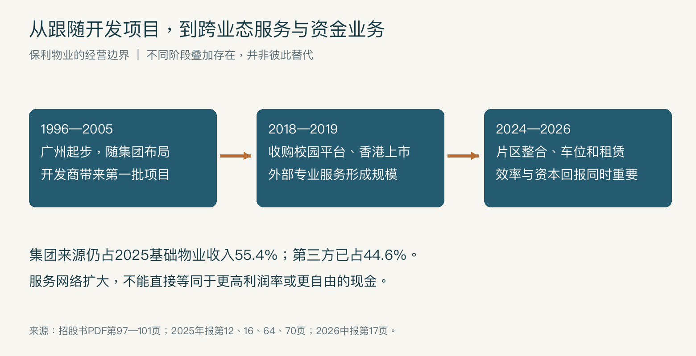

保利的经营边界经历三次扩展：集团项目、外部专业服务、需要占用资金的增值业务。

依据 · [保利物业2019招股章程 · 第97页](https://www1.hkexnews.hk/listedco/listconews/sehk/2019/1209/2019120900028_c.pdf#page=97)；[保利物业2019招股章程 · 第126页](https://www1.hkexnews.hk/listedco/listconews/sehk/2019/1209/2019120900028_c.pdf#page=126)；[保利物业2019招股章程 · 第98页](https://www1.hkexnews.hk/listedco/listconews/sehk/2019/1209/2019120900028_c.pdf#page=98)；[保利物业2019招股章程 · 第101页](https://www1.hkexnews.hk/listedco/listconews/sehk/2019/1209/2019120900028_c.pdf#page=101)

### 上市带来了资金，也带来了新的用款方式

2019年，保利物业在香港首次公开发行新股并上市。投资者出钱认购新股，取得公司的一部分所有权；2019年上市及随后在2020年1月完成的超额配股，扣掉发行费用后合计收到约52.18亿港元。这就是“上市募集资金”。钱到账时，公司资产中的现金增加，股东投入形成的所有者权益也增加。它是一笔融资，不计入卖服务的营业收入，也不是公司当年赚到的利润。

收到的钱随后可以变成其他资产：交出可退保证金，现金减少，换成按合同收回保证金的权利；预付租金，现金减少，换成未来一段时间使用和经营物业的权利。因此，上市募集的52.18亿港元是历史上收到的资金，不能在今天的现金、保证金和其他资产之外再加一次。公司用了多少钱、现在还拥有什么、这些资产能否赚回投入，需要接着看。

车位代理是其中一种用途。开发商委托保利物业寻找买家或租户、促成车位交易。买方把成交款付给开发商，开发商收到后再按月向保利物业结算代理服务费。保利物业需要先交保证金，保证金按合同可以退回，但占用期间不能用于别的业务。收回保证金只是拿回原先交出的钱；代理费扣除获客和服务成本后，才形成这笔生意的经营收益。

写字楼租赁运营则要先取得一段时间的经营权。2024年，子公司保利商业物业向保利发展及其子公司续租广州四处写字楼，先付约8.4亿元人民币租金，租期到2027年5月。楼宇产权仍属于原业主；保利商业物业在租期内与租户订立分租合同、收取租金并组织经营。租户中也包括租回部分办公室自用的保利发展集团。第六章会沿这笔交易说明收入、成本和现金怎样发生。

这些扩展让保利物业同时承担了几种用款责任：基础物业要在客户付款之前支付人员和供应商，车位代理要占用保证金，租赁运营还要提前支付多年的租金。新业务带来的收入，需要与它占住的资金和承担的成本一起评价。

到2026年中，上市募集资金累计已使用约42.59亿港元。其中，分配给“增值服务”并已使用的约32.61亿港元，占募集净额62.5%。这个大类还包括社区、商办和城市管理等服务，并非全部用于车位和写字楼。用途表说明资金投向，后面的合同与经营结果才说明这些投入赚得怎样。

2019至2025年，公司收入由59.67亿元增至171.26亿元，归属于上市公司股东的净利润由4.91亿元增至15.49亿元。近期增长的构成却变了：基础物业继续扩张，开发商销售现场等服务和部分社区业务收缩；总毛利2023至2025年接近停在30亿元，2025年利润增长更多依靠行政开支下降。公司又把管理资源集中到核心50城，截至2025年报披露累计完成141个片区整合。它现在需要让已扩大的服务网络留下更多利润并收到钱。

本书用“拓展、履约、回款”六个字串起这条经营链：拓展决定获得什么合同，履约决定服务成本和客户是否继续选择，回款决定确认的利润能否成为可用资金。三者之外，还要独立判断谁控制资本、资金投向哪里，以及上市公司股东最终可以取得什么回报。

依据 · [保利物业2026中期报告 · 第17页](https://www1.hkexnews.hk/listedco/listconews/sehk/2026/0916/2026091600311_c.pdf#page=17)；[保利物业2025年度报告 · 第64页](https://www1.hkexnews.hk/listedco/listconews/sehk/2026/0430/2026043001633_c.pdf#page=64)；[保利物业2025年度报告 · 第70页](https://www1.hkexnews.hk/listedco/listconews/sehk/2026/0430/2026043001633_c.pdf#page=70)；[保利物业2019年度报告 · 第80页](https://www1.hkexnews.hk/listedco/listconews/sehk/2020/0422/2020042201147_c.pdf#page=80)；[保利物业2023年度报告 · 第75页](https://www1.hkexnews.hk/listedco/listconews/sehk/2024/0425/2024042503584_c.pdf#page=75)；[保利物业2025年度报告 · 第12页](https://www1.hkexnews.hk/listedco/listconews/sehk/2026/0430/2026043001633_c.pdf#page=12)；[保利物业2025年度报告 · 第81页](https://www1.hkexnews.hk/listedco/listconews/sehk/2026/0430/2026043001633_c.pdf#page=81)；[保利物业2025年度报告 · 第11页](https://www1.hkexnews.hk/listedco/listconews/sehk/2026/0430/2026043001633_c.pdf#page=11)；[保利物业2025年度报告 · 第21页](https://www1.hkexnews.hk/listedco/listconews/sehk/2026/0430/2026043001633_c.pdf#page=21)；[保利物业2025年度报告 · 第27页](https://www1.hkexnews.hk/listedco/listconews/sehk/2026/0430/2026043001633_c.pdf#page=27)；[保利物业2024年物业租赁协议公告 · 第3页](https://www.hkexnews.hk/listedco/listconews/sehk/2024/0422/2024042201952_c.pdf#page=3)；[保利物业2024年物业租赁协议公告 · 第4页](https://www.hkexnews.hk/listedco/listconews/sehk/2024/0422/2024042201952_c.pdf#page=4)；[保利物业2024年物业租赁协议公告 · 第6页](https://www.hkexnews.hk/listedco/listconews/sehk/2024/0422/2024042201952_c.pdf#page=6)；[保利物业2019年度报告 · 第31页](https://www1.hkexnews.hk/listedco/listconews/sehk/2020/0422/2020042201147_c.pdf#page=31)；[保利物业2019年度报告 · 第140页](https://www1.hkexnews.hk/listedco/listconews/sehk/2020/0422/2020042201147_c.pdf#page=140)；[保利物业2019年度报告 · 第167页](https://www1.hkexnews.hk/listedco/listconews/sehk/2020/0422/2020042201147_c.pdf#page=167)；[2026车位代理第二期续约通函 · 第9页](https://www1.hkexnews.hk/listedco/listconews/sehk/2026/0209/2026020900306.pdf#page=9)

集团项目提供起点，外部专业服务已形成规模；车位与租赁又引入新的资金责任。

## 第2章 · 商业模式与价值链

合同、现场与付款人

### 合同、现场与付款人

保利物业最主要的生意，是受业主或机构客户委托管理项目，按合同提供服务并收费。保利支付现场员工、外包商和材料等直接成本，服务收入减去这些成本后留下的部分，叫毛利；此后还要扣总部管理、坏账损失、税等，才能形成净利润。

2025年，基础物业占公司收入76.7%，贡献毛利59.0%；社区增值只占收入13.7%，却贡献毛利32.3%。这不是说每一项社区服务都特别赚钱。一笔商品销售可能把整个售价计作收入，一笔代理业务却只计服务费；各自要先垫的钱也不同。下面把这几种交易分开。

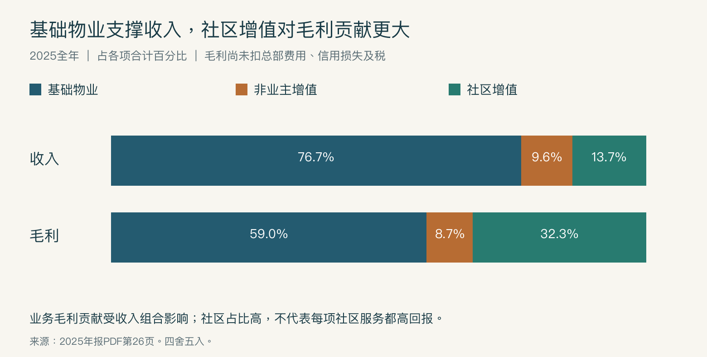

基础物业提供大部分收入，社区增值对毛利的贡献更高；毛利尚未扣总部、信用损失和税。

依据 · [保利物业2025年度报告 · 第26页](https://www1.hkexnews.hk/listedco/listconews/sehk/2026/0430/2026043001633_c.pdf#page=26)

### 谁选服务商，谁付钱

集团开发的新住宅，开发商在交付前参与选聘物业；入住后的日常物业费主要由业主缴纳。因而“集团来源项目收入”不能当作向母公司开出的账单。2025年集团来源基础物业收入72.90亿元，而各类业务直接向保利发展及其附属公司取得的收入为20.25亿元，两项统计回答不同问题。前者说明项目从哪里来，后者说明交易对手是谁。

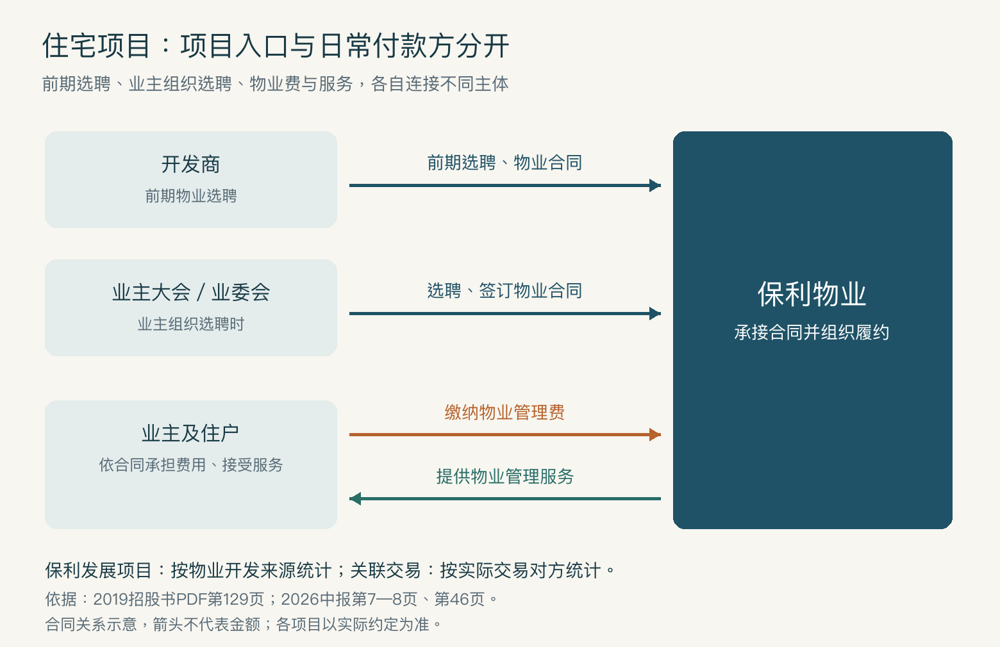

住宅的项目入口、选聘与付款分属不同主体。历史合同安排示意，各项目按实际约定；集团来源不等于关联方付款。

住宅通常按面积和约定费率收费，公共项目则经常按整项服务范围报价：需要多少人、哪些设备、开放多久、有什么响应要求，都会进入成本预算。公司早期主要采用包干制，意味着约定收费下的成本超支由物业企业承担；最新报告仍呈现收入减服务成本的经营结果，但没有更新全公司的包干占比，不能把招股时99.3%的比例直接搬到今天。

学校、写字楼和公共空间由机构采购，合同往往带验收、服务考核和续期条件。哈尔滨理工大学2026项目的约定是“1+1+1”，逐年考核后决定是否继续。合同名义上能做三年，并不等于未来三年的现金已经锁定。项目收款还要等开票、验收及付款流程；公司对多数公共及商业项目给30—90日信用期，员工和外包商却需要持续支付。

依据 · [保利物业2025年度报告 · 第16页](https://www1.hkexnews.hk/listedco/listconews/sehk/2026/0430/2026043001633_c.pdf#page=16)；[保利物业2025年度报告 · 第121页](https://www1.hkexnews.hk/listedco/listconews/sehk/2026/0430/2026043001633_c.pdf#page=121)；[保利物业2019招股章程 · 第127页](https://www1.hkexnews.hk/listedco/listconews/sehk/2019/1209/2019120900028_c.pdf#page=127)；[保利物业2019招股章程 · 第128页](https://www1.hkexnews.hk/listedco/listconews/sehk/2019/1209/2019120900028_c.pdf#page=128)；[保利物业2019招股章程 · 第129页](https://www1.hkexnews.hk/listedco/listconews/sehk/2019/1209/2019120900028_c.pdf#page=129)；[哈尔滨理工大学物业服务中标结果公告](https://gzc.hrbust.edu.cn/2026/0430/c1291a104627/pagem.htm)；[保利物业2026中期报告 · 第38页](https://www1.hkexnews.hk/listedco/listconews/sehk/2026/0916/2026091600311_c.pdf#page=38)

### 三类收费，背后是不同交易

基础物业的项目团队负责客户、现场组织和巡检，清洁绿化、专业维保等可由供应商执行。保利向客户承担服务责任，再支付员工工资和供应商费用，所以需要检查供应商是否到岗、异常是否处理。合同若禁止分包，就必须按该项目条件组织人员。2025年报告明确分包规模增加：公司自己雇的人减少，可能同时意味着更多工作由外包人员完成。

非业主增值服务主要服务于开发商等机构客户。以售楼现场为例，保利安排访客接待、清洁、安保检查和维护，帮助开发商维持销售现场运转；开发商按事先约定的价格和当月实际服务量付费，保利承担相应人员和服务成本。交付前的清洁、维保以及前期规划咨询，也是类似的机构采购。楼盘减少，所需案场团队和服务量就会缩减。2025年案场收入下降约27%，是这条交易链受房地产开发周期影响的具体结果。

社区增值则面向住户的额外需求。家政等业务按约提供服务、向客户收服务费；商品销售在交货后确认销售收入，同时把购进商品的成本扣掉。公司也会为其他供应方促成交易，按收入政策只确认有权收取的费用或佣金。年报列有自营商品成本，也明确区分直接供货与代理，不能把整个社区板块当成同一种收费方式。

车位代理能把这种区别说得更清楚。车位属于开发商，保利物业取得独家代理机会，协助销售或出租；客户把成交款付给开发商，开发商收款后按月结算，向保利物业支付实际成交价超过约定基准价的部分作为代理费。保利确认的是这笔代理费收入，不是车位的全部成交金额。促成交易需要人员和营销等服务投入，此外还要先向开发商交保证金。保证金可退与代理收入多少，是两件需要分别计算的事。

写字楼租赁也列在非业主增值中，但经营方式已经变成先向房东租入、再向租户出租，保利承担租金和运营费用。2025年该项收入下降约24%，年报归因于商办租赁市场调整。因此，基础物业的持续收费、商品和代理交易、租入再出租三类生意，受需求变化影响的方式并不相同。

依据 · [保利物业2025年度报告 · 第29页](https://www1.hkexnews.hk/listedco/listconews/sehk/2026/0430/2026043001633_c.pdf#page=29)；[保利物业2019招股章程 · 第127页](https://www1.hkexnews.hk/listedco/listconews/sehk/2019/1209/2019120900028_c.pdf#page=127)；[2025环境、社会及管治报告 · 第95页](https://www1.hkexnews.hk/listedco/listconews/sehk/2026/0430/2026043001880.pdf#page=95)；[2025环境、社会及管治报告 · 第96页](https://www1.hkexnews.hk/listedco/listconews/sehk/2026/0430/2026043001880.pdf#page=96)；[保利物业2025年度报告 · 第21页](https://www1.hkexnews.hk/listedco/listconews/sehk/2026/0430/2026043001633_c.pdf#page=21)；[保利物业2025年度报告 · 第98页](https://www1.hkexnews.hk/listedco/listconews/sehk/2026/0430/2026043001633_c.pdf#page=98)；[保利物业2025年度报告 · 第99页](https://www1.hkexnews.hk/listedco/listconews/sehk/2026/0430/2026043001633_c.pdf#page=99)；[2026车位代理第二期续约通函 · 第8页](https://www1.hkexnews.hk/listedco/listconews/sehk/2026/0209/2026020900306.pdf#page=8)；[保利物业2024年物业租赁协议公告 · 第4页](https://www.hkexnews.hk/listedco/listconews/sehk/2024/0422/2024042201952_c.pdf#page=4)；[2026车位代理第二期续约通函 · 第9页](https://www1.hkexnews.hk/listedco/listconews/sehk/2026/0209/2026020900306.pdf#page=9)

基础物业承担持续服务，增值业务带来不同利润与用款；项目来源和付款人必须分开。

## 第3章 · 行业、竞争与同行

拓展：品牌能帮助进入竞争，报价与交付决定结果

### 拓展：品牌能帮助进入竞争，报价与交付决定结果

外部项目不是靠“保利”两个字自动落袋。保利的有利条件包括集团信誉、跨地区服务网络、学校和公共项目经验，以及能为大型企业提供多地服务的组织。它们可以降低采购方寻找和评估供应商的成本，也有助于进入候选名单；最终合同仍要满足资格、方案、人员、业绩和价格要求。

2025年第三方物业收入58.60亿元，比上年增长17.5%；2026上半年32.90亿元，同比增长18.4%。这些收入来自本期实际提供的服务，包括以前拿到并继续执行的合同。另一个指标“新拓展第三方项目单年合同额”，衡量的是报告期内拓展项目按一整年服务计算的合同金额；新项目可能分批进场，不会全部在签约当期成为收入。该指标2024、2025年约30.05亿、29.30亿元，2025和2026上半年均约14.06亿元。两项放在一起看，说明旧项目执行和新增项目进场仍在推高收入，新拓展的年度金额却已趋稳。2024年另披露“不含续签的新签约”口径，尚无完整对照，因此不把这里的全部新拓展都称为首次获客。

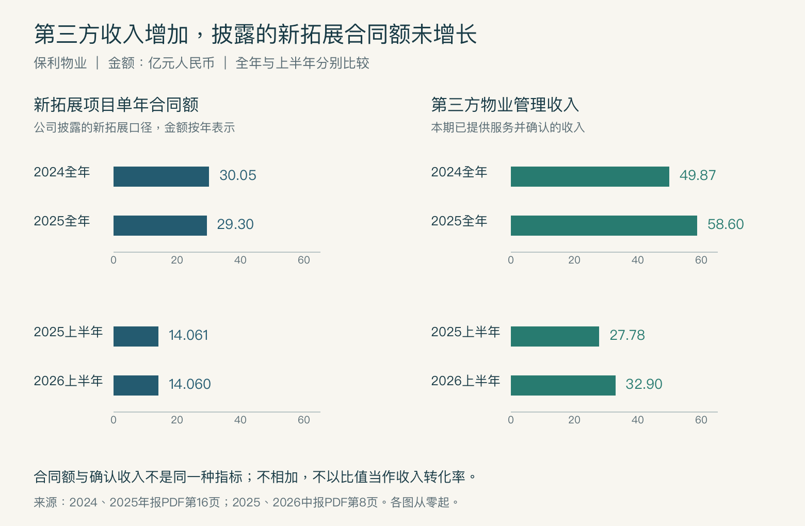

合同额与收入分开观察：前者描述披露的新拓展规模，后者已经确认了本期服务。

依据 · [保利物业2025年度报告 · 第16页](https://www1.hkexnews.hk/listedco/listconews/sehk/2026/0430/2026043001633_c.pdf#page=16)；[保利物业2026中期报告 · 第8页](https://www1.hkexnews.hk/listedco/listconews/sehk/2026/0916/2026091600311_c.pdf#page=8)；[保利物业2024年度报告 · 第16页](https://www1.hkexnews.hk/listedco/listconews/sehk/2025/0428/2025042802401_c.pdf#page=16)

### 不同客户的采购方式，决定品牌怎样起作用

存量住宅需要取得业主认可。服务口碑、收费透明和接管安排有用，但原物业退出、业主决策和服务承诺都影响落地。2025年新增33个存量住宅项目，年合同额1.799亿元，证明保利能从市场拿到住宅项目；平均费率2.9元/平方米/月，没有同地区、同品质的对照，不能单凭这个数认定品牌溢价。

商业客户更关注营业和生产能否连续运行。设备、餐饮、能源管理等服务可以扩展采购关系，但每增加一种服务，就多一组能力和成本要求。公共采购往往把这些要求写成正式资格和评分。哈尔滨理工项目保利总分96.28、丹田96.13，差距只有0.15分；保利技术分反而少0.10，价格分多0.25。这个结果说明信誉和服务方案可以让公司有竞争力，也说明价格仍足以改变接近的竞赛。

中南大学另一个2025项目，绿城得97.60分，保利天创93.74；山东财经大学一项采购中，保利主公司未通过符合性评审，公开结果未说明具体哪一条不符。这些失败不能算成公司的整体败率，却能纠正“央企品牌足以保证拿单”的想象。

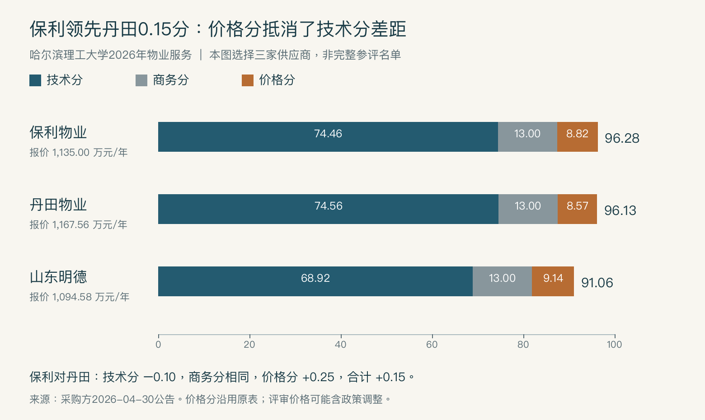

哈尔滨理工大学的公开评分说明方案与价格共同决定结果；个案不代表整体中标率。价格分采用原公告，不能以最终报价自行重算。

依据 · [保利物业2025年度报告 · 第17页](https://www1.hkexnews.hk/listedco/listconews/sehk/2026/0430/2026043001633_c.pdf#page=17)；[哈尔滨理工大学物业服务中标结果公告](https://gzc.hrbust.edu.cn/2026/0430/c1291a104627/pagem.htm)；[中南大学校本部、新南校区2025—2026年物业服务中标公告](https://www.ccgp.gov.cn/cggg/zygg/zbgg/202501/t20250116_24078107.htm)；[山东财经大学2025年度物业管理服务项目中标结果公告](https://zcb.sdufe.edu.cn/index/article/announcement_detail/id/1545.html)

### 有哪些能力已得到证明

第三方收入、跨业态客户和持续获得大项目，支持“保利具备规模化外部获客能力”。核心50城贡献2025年80.4%的新拓展合同额，集中布局有望让管理、采购和专业人员共享，经济方向合理。但集中度本身还不是节约金额；新合同利润、同项目续留和回款没有完整批次数据，也尚未证明长期提价能力。

因此本书承认品牌与组织的作用，但不把它们直接换成高增长估值。更有决定性的下一步，是新拿项目在履约后保留多少利润、占用多少资金、到期能否以合理价格留下。拓展专题保留了完整胜败案例和规则解释；下章把收入增长接到实际毛利变化。

品牌与组织支持获客，真实竞争仍受资格、方案及报价影响；新增项目回报尚未完整证明。

## 第4章 · 历史经营、转折与当前阶段

收入还在增加，利润的来源已改变

### 收入还在增加，利润的来源已改变

保利物业的增长经历了明显换挡。2019—2023年收入和利润都快速增加；2024—2025年收入仍增长，总毛利却几乎原地不动。2025年归母利润增长5.1%，不能只解释为“多管了项目”：行政开支下降、业务组合变化和信用损失都参与了结果。

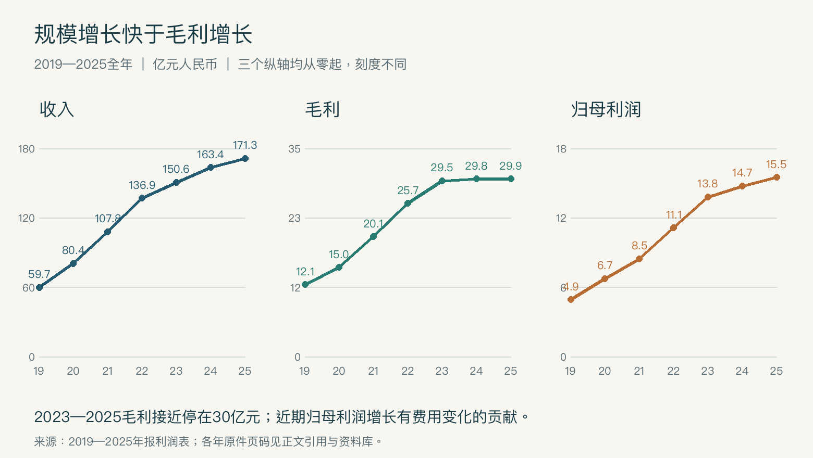

收入、毛利与归母利润各自从零起；规模扩大和利润扩张并非同一速度。

依据 · [保利物业2019年度报告 · 第80页](https://www1.hkexnews.hk/listedco/listconews/sehk/2020/0422/2020042201147_c.pdf#page=80)；[保利物业2023年度报告 · 第75页](https://www1.hkexnews.hk/listedco/listconews/sehk/2024/0425/2024042503584_c.pdf#page=75)；[保利物业2025年度报告 · 第81页](https://www1.hkexnews.hk/listedco/listconews/sehk/2026/0430/2026043001633_c.pdf#page=81)

### 基础物业：多做的收入，有一部分被较低毛利率抵消

2025年基础物业收入增加14.75亿元，毛利只增加0.88亿元。毛利率从14.33%降到13.39%，意思是平均每收100元服务费，扣现场直接成本后留下的钱从约14.33元降到13.39元。若单位毛利维持上年水平，多做的收入原可带来约2.11亿元毛利，实际只增加0.88亿元。新增项目确实贡献了生意，但较低的单位毛利抵消了其中约1.23亿元。新项目结构、竞价、启动成本和服务投入都可能影响这个结果，公司尚未逐项拆分。

2026上半年仍出现类似组合：基础物业收入增11.9%，毛利增约6.8%，同季毛利率从16.59%降至15.82%。不能拿半年15.82%与2025全年13.39%直接比较后宣布恢复；上、下半年收入和费用确认不同，应优先同季比较。

依据 · [保利物业2025年度报告 · 第26页](https://www1.hkexnews.hk/listedco/listconews/sehk/2026/0430/2026043001633_c.pdf#page=26)；[保利物业2026中期报告 · 第13页](https://www1.hkexnews.hk/listedco/listconews/sehk/2026/0916/2026091600311_c.pdf#page=13)

### 组织整合帮了忙，但不能把所有变化都叫降本

2025年行政开支由11.22亿元降到9.93亿元，公司将其归因于区域合并和效率改善。片区整合可以让多个项目共用管理人员和资源，减少各自重复设置的管理工作；年报披露累计完成141个片区整合，费用下降是已经发生的结果。利润中还存在另一项影响：员工股权激励原先需要计入费用，2025年相关估计调整使一部分已记费用被转回。股份支付由上年费用0.26亿元变成当年净转回0.17亿元，改善了账面利润，却没有因此收到客户付来的一笔新现金。年报未把这项变化按费用类别完全拆开，不能把行政费降幅全部当作今后每年都能重复的节约。

员工从2024年底30,125人降至2025年底28,692人，同时报告称分包规模增加。服务质量需要看实际工作怎样被组织，而不是人数越少越好。2025上线工单中心和远程巡检，天津一个环卫项目报告处理工单平均时间缩短33%；这能说明调度有改善，但还不能推出全公司人工成本同幅下降。履约专题进一步区分流程改进、质量反馈和已兑现节约。

依据 · [保利物业2025年度报告 · 第12页](https://www1.hkexnews.hk/listedco/listconews/sehk/2026/0430/2026043001633_c.pdf#page=12)；[保利物业2025年度报告 · 第27页](https://www1.hkexnews.hk/listedco/listconews/sehk/2026/0430/2026043001633_c.pdf#page=27)；[保利物业2025年度报告 · 第124页](https://www1.hkexnews.hk/listedco/listconews/sehk/2026/0430/2026043001633_c.pdf#page=124)；[保利物业2025年度报告 · 第29页](https://www1.hkexnews.hk/listedco/listconews/sehk/2026/0430/2026043001633_c.pdf#page=29)；[保利物业2025年度报告 · 第72页](https://www1.hkexnews.hk/listedco/listconews/sehk/2026/0430/2026043001633_c.pdf#page=72)；[2025环境、社会及管治报告 · 第71页](https://www1.hkexnews.hk/listedco/listconews/sehk/2026/0430/2026043001880.pdf#page=71)；[2025环境、社会及管治报告 · 第72页](https://www1.hkexnews.hk/listedco/listconews/sehk/2026/0430/2026043001880.pdf#page=72)

### 增值服务：收入收缩不一定对应等幅毛利收缩

2025年非业主增值收入减少16.5%，毛利减少17.6%，压力主要来自开发商案场与写字楼租赁。社区增值收入也减少13.6%，毛利却只减少约3.2%，所以综合毛利率从36.82%升到41.25%。商品销售要从售价中扣除进货成本；当较低毛利的商品生意收缩，它在板块中的比重下降，即使其他业务没有一齐变好，剩余业务的平均毛利率也可能上升。同期已售商品成本由7.27亿元降到3.11亿元，支持这一解释。社区总毛利仍在减少，子业务的完整毛利又未披露，不能把平均毛利率上升说成所有社区生意都更赚钱。

2026上半年，社区收入继续下降14.4%，毛利仍约4.82亿元；非业主毛利约0.92亿元。基础物业带来的新增毛利支撑了总利润，但基础物业毛利率与收款仍需观察。当前经营阶段可概括为：外部服务规模扩张，地产与部分消费业务退潮，组织整合托住利润。估值据此采用当前业务组合和保守费用，不沿用早期高速增长，也不预设科技一定释放大量利润。

依据 · [保利物业2025年度报告 · 第26页](https://www1.hkexnews.hk/listedco/listconews/sehk/2026/0430/2026043001633_c.pdf#page=26)；[保利物业2025年度报告 · 第124页](https://www1.hkexnews.hk/listedco/listconews/sehk/2026/0430/2026043001633_c.pdf#page=124)

基础物业扩张支撑收入，总毛利近年趋平；费用调整托住利润，回款转弱。

## 第5章 · 财务质量与现金归属

利润怎样变成现金，现金又属于谁

### 利润怎样变成现金，现金又属于谁

2025归母利润15.49亿元，经营现金净额18.27亿元，看上去现金足以覆盖利润。但同一个指标2023年是24.16亿元、2024年23.03亿元；2024至2026年各上半年则分别从流入4.27亿元，变成流出2.00亿元和4.82亿元。全年及同季的经营现金都走弱，单说“物业下半年集中收款”解释不了这种变化。

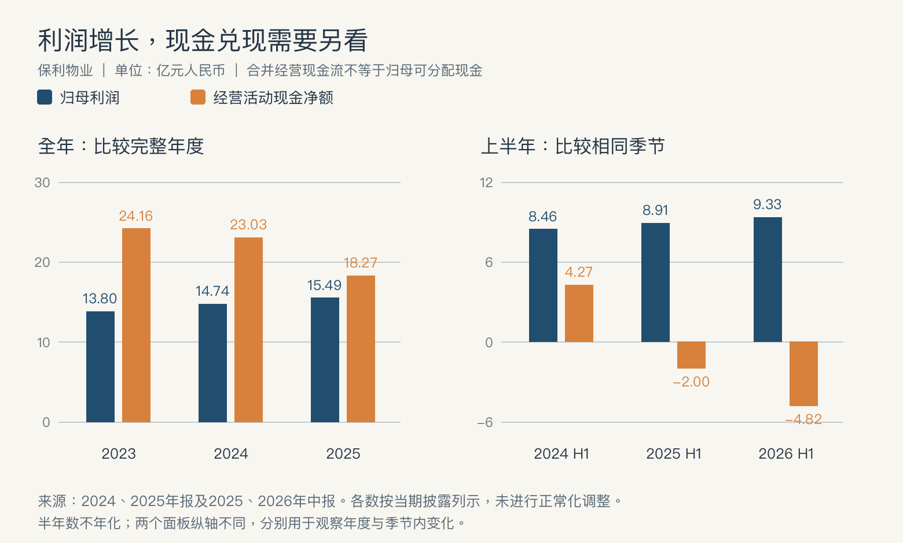

完整年度与同季半年分别比较：利润增长、经营现金走弱。归母利润与合并现金的归属范围不同，不以两者之差算股东自由现金。

经营现金由客户付款和公司对外付款共同决定。这个结果本身不能把全部变化归给客户违约；较长账龄和代垫增加才是另一组收款压力证据，供应商结算加快则改变付款时点。合并经营现金还含子公司其他股东对应业务，与归母利润的差额不能直接叫普通股自由现金。

依据 · [保利物业2023年度报告 · 第79页](https://www1.hkexnews.hk/listedco/listconews/sehk/2024/0425/2024042503584_c.pdf#page=79)；[保利物业2025年度报告 · 第85页](https://www1.hkexnews.hk/listedco/listconews/sehk/2026/0430/2026043001633_c.pdf#page=85)；[保利物业2025中期报告 · 第30页](https://www1.hkexnews.hk/listedco/listconews/sehk/2025/0925/2025092500521_c.pdf#page=30)；[保利物业2026中期报告 · 第29页](https://www1.hkexnews.hk/listedco/listconews/sehk/2026/0916/2026091600311_c.pdf#page=29)

### 应收增长在哪里

保利已经提供服务、按合同确认收入，客户还没付的钱就形成应收款。这是公司向客户收钱的权利，列在资产里。公司还要估计其中可能收不回的部分，先从账面价值中扣掉；这项估计叫坏账准备或拨备。合同尚欠的金额是原值，扣除拨备后是净额。净额仍是预计能收回的债权，只有客户实际付款才变成现金。

到2026年6月底，贸易应收及票据净额44.33亿元，比2025年底增加9.89亿元。若看尚未扣拨备的原值，第三方客户欠款增加9.40亿元，关联方增加1.01亿元，新增欠款主要来自第三方。这组原值与上面的净额口径不同，不能直接相加核对；而“第三方”包含住宅、企业和公共机构，也不能全部称为政府欠款。

发票开出超过一年的净应收，从2024年底1.94亿元增至2025年底3.64亿元，再到2026年中5.19亿元。发票账龄说明这笔应收已存在多久，是否逾期还要对照合同付款日。公司另外代业主垫付了水电等款项，2026年中尚待收回6.20亿元。已经垫出钱、暂时还没收回，会占用公司资金；拖得更久又会增加最终收不回的风险。

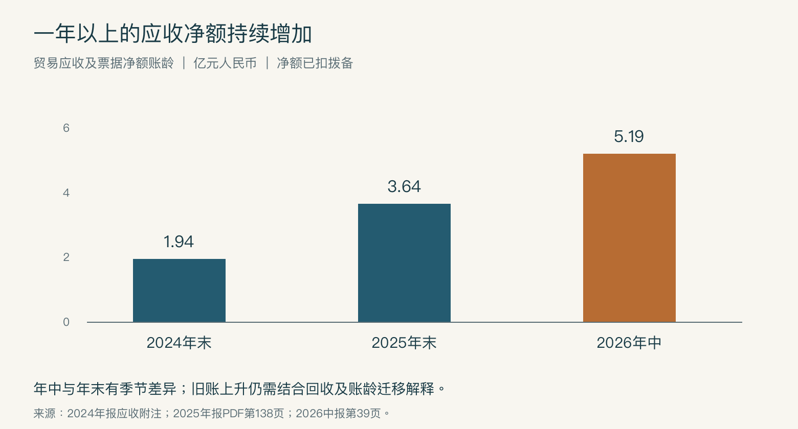

发票超过一年的净应收在增加；账龄不等于逾期天数，净额已经扣除拨备。

另一头是向供应商付款。保利收到外包服务后，可以按合同约定晚些结算，期间账上的应付款让它暂时少支出一些现金。2026上半年应付外包商等款项减少3.85亿元，公司解释为付款进度加快：供应商的钱先付出去，客户欠款却未同时收回，现金就更紧。

2025年的现金流附注已经显示了这个过程。把应收、应付等收付时间差放进去之前，经营产生的现金为23.94亿元，比上年更高；但应付款增加所暂时留在公司的钱，从2024年的4.59亿元降到2025年的0.76亿元。这是两年经营现金变化中最大的不利项目。它指结算时间提供的周转，不是供应商向公司发放了一笔贷款。

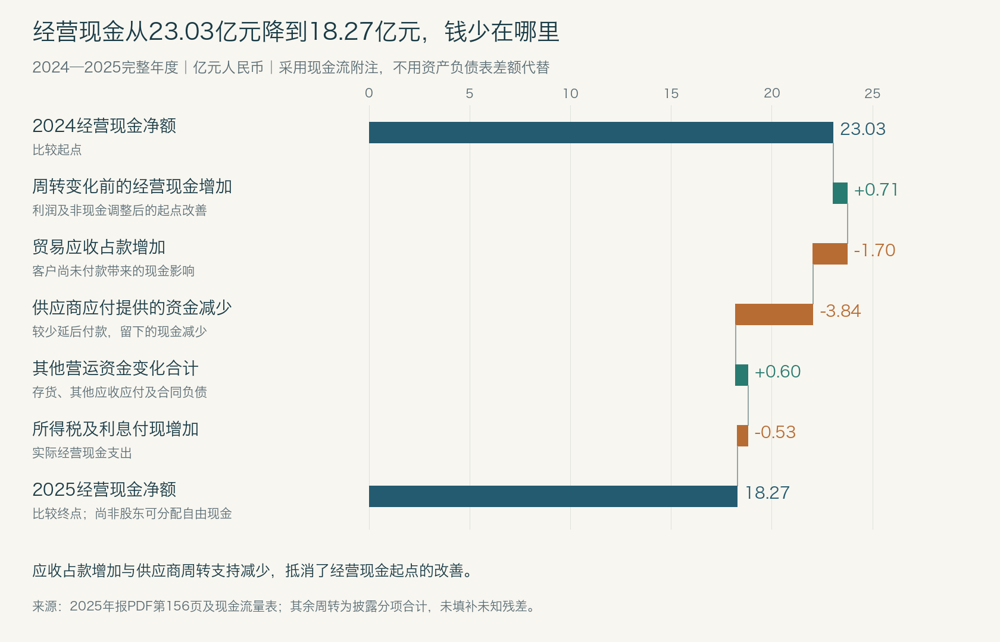

按2025年报现金流附注，从2024经营现金逐项接到2025结果。供应商周转支持减少是主要拖累；不把2026半年余额差拼成同样的完整桥。

2026上半年经营现金比上年同期又少2.82亿元。年内应收净额的增加比上年同期少一些，但付款更快，客户预付服务费带来的新增资金更少，代业主垫款又增加更多。这些因素共同影响现金，不能只看应收。中报未给完整调节表；期初期末应收还受拨备等非现金变化影响，余额的简单相减不足以逐项还原实际收付。

依据 · [保利物业2026中期报告 · 第38页](https://www1.hkexnews.hk/listedco/listconews/sehk/2026/0916/2026091600311_c.pdf#page=38)；[保利物业2025年度报告 · 第138页](https://www1.hkexnews.hk/listedco/listconews/sehk/2026/0430/2026043001633_c.pdf#page=138)；[保利物业2026中期报告 · 第39页](https://www1.hkexnews.hk/listedco/listconews/sehk/2026/0916/2026091600311_c.pdf#page=39)；[保利物业2026中期报告 · 第16页](https://www1.hkexnews.hk/listedco/listconews/sehk/2026/0916/2026091600311_c.pdf#page=16)；[保利物业2025年度报告 · 第156页](https://www1.hkexnews.hk/listedco/listconews/sehk/2026/0430/2026043001633_c.pdf#page=156)；[保利物业2026中期报告 · 第29页](https://www1.hkexnews.hk/listedco/listconews/sehk/2026/0916/2026091600311_c.pdf#page=29)；[保利物业2025中期报告 · 第26页](https://www1.hkexnews.hk/listedco/listconews/sehk/2025/0925/2025092500521_c.pdf#page=26)；[保利物业2026中期报告 · 第25页](https://www1.hkexnews.hk/listedco/listconews/sehk/2026/0916/2026091600311_c.pdf#page=25)

### 拨备怎样影响利润，收款怎样改变现金

拨备先改变利润和资产的账面估计：预计收不回的金额增加，公司当期利润和应收净额相应减少；预计损失减少，则可能转回以前计入的费用。这一步本身没有再付出一笔现金，也不是把现金存进专用账户。后续客户付款才带来现金；确实无法收回而核销，则要结合原来已经计提的准备判断是否还有新增损失。

2025年，第三方客户发票超过一年的欠款原值超过上年两倍，但一至两年及两年以上欠款所提的拨备比例下降。公司认为客户记录仍然良好。其含义是，对这些较旧欠款，公司预计会损失的比例反而较低；这个估计会影响当前利润和净资产，最终仍要由实际收款检验。2026上半年贸易及其他应收的减值损失合计0.76亿元，已经影响当期利润。

估值把以后持续做生意可能产生的正常坏账损耗，计入每年费用；对已经形成的旧账，另留超出现有拨备的损失压力。两者针对不同期间的欠款，同一笔损失只能扣一次。当前采用的年度1.2亿元及旧账额外2亿元均是研究假设，后者还没有被证实为实际损失。

现金也有不同归属。公司2026年中现金及存单本金合计123.37亿元，但其中还包括暂时代收的业主款，客户预付的钱也对应未来服务责任。下一章先留足这些款项和业务运行资金，再估计还剩多少可能交给股东；资金余额本身不能回答可分配多少。

依据 · [保利物业2025年度报告 · 第153页](https://www1.hkexnews.hk/listedco/listconews/sehk/2026/0430/2026043001633_c.pdf#page=153)；[保利物业2026中期报告 · 第33页](https://www1.hkexnews.hk/listedco/listconews/sehk/2026/0916/2026091600311_c.pdf#page=33)；[保利物业2026中期报告 · 第40页](https://www1.hkexnews.hk/listedco/listconews/sehk/2026/0916/2026091600311_c.pdf#page=40)；[保利物业2026中期报告 · 第41页](https://www1.hkexnews.hk/listedco/listconews/sehk/2026/0916/2026091600311_c.pdf#page=41)；[保利物业2026中期报告 · 第42页](https://www1.hkexnews.hk/listedco/listconews/sehk/2026/0916/2026091600311_c.pdf#page=42)

经营现金在完整年度和同季比较中走弱：客户欠款和代垫占用资金，供应商较快收款也减少账上现金；收款风险与付款节奏需要分别判断。

## 第6章 · 资本配置与股东分配

资本配置：现金多，资金自由度却要另算

### 资本配置：现金多，资金自由度却要另算

保利物业由保利发展及其关联持股主体控制，合计持有72.289%股份。2026年中董事长为吴兰玉，总经理为当年1月接任的王英男。普通股投资者分享经营成果，但不能独自决定现金是否分配、是否继续投向集团相关业务。董事和审计程序能够约束交易方式，并不自动证明一项投资的回报足够高。

依据 · [保利物业2026中期报告 · 第20页](https://www1.hkexnews.hk/listedco/listconews/sehk/2026/0916/2026091600311_c.pdf#page=20)；[保利物业2026中期报告 · 第21页](https://www1.hkexnews.hk/listedco/listconews/sehk/2026/0916/2026091600311_c.pdf#page=21)；[保利物业2026中期报告 · 第22页](https://www1.hkexnews.hk/listedco/listconews/sehk/2026/0916/2026091600311_c.pdf#page=22)

### 车位保证金，把“轻资产”变成全年资金问题

两期车位代理安排分别有30亿元和20亿元保证金额度，2025各自实际最高余额都达到上限。合计代理费2.255亿元。保证金不是购买车位的价款，公司按成交价超过基准价的部分收取代理费，并不自动承接所有卖不掉的车位；但是它先交出资金，再等待合同约定的归还。

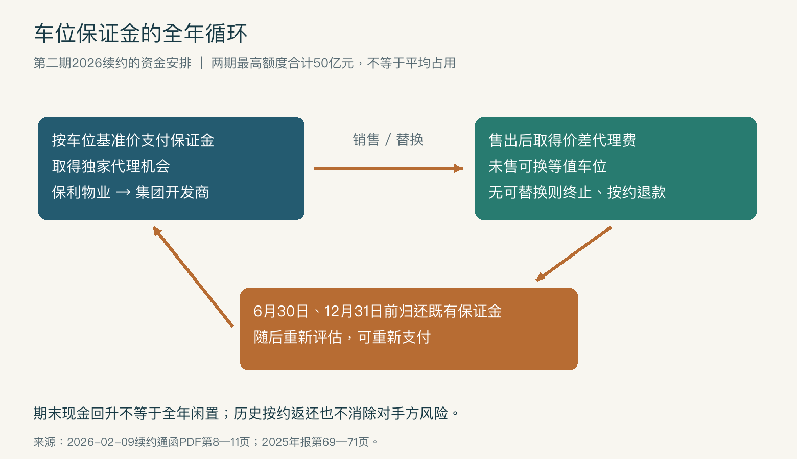

半年末和年末归还保证金，再评估重新支付：报表日余额不能代表全年最高用款。

2026第二期续约明确，每年6月30日和12月31日前归还既有保证金，随后可按评估结果重新支付。未售车位可换同值车位，无可替换则终止并退还；历史按约归还，是重要正面证据。与此同时，合同权利仍需要对手方履行。50亿元是两项峰值/额度的合计，未证明实际最高值发生在同一天，也不是平均资本；本书用它规划经营储备，不用2.255/50算成真实投资回报率。

两期代理费合计从2023年3.890亿元降至2024年2.376亿元、2025年2.255亿元，各年两项最高保证金合计仍为50亿元。不能据此算准确回报率，但它表明同样规模的资金峰值没有换来同样多的代理收入。当前估值不恢复2023高点，也不因保证金可退就把这项资本使用当成没有机会成本。

依据 · [保利物业2025年度报告 · 第70页](https://www1.hkexnews.hk/listedco/listconews/sehk/2026/0430/2026043001633_c.pdf#page=70)；[保利物业2025年度报告 · 第71页](https://www1.hkexnews.hk/listedco/listconews/sehk/2026/0430/2026043001633_c.pdf#page=71)；[2026车位代理第二期续约通函 · 第10页](https://www1.hkexnews.hk/listedco/listconews/sehk/2026/0209/2026020900306.pdf#page=10)；[2026车位代理第二期续约通函 · 第11页](https://www1.hkexnews.hk/listedco/listconews/sehk/2026/0209/2026020900306.pdf#page=11)；[保利物业2023年度报告 · 第62页](https://www1.hkexnews.hk/listedco/listconews/sehk/2024/0425/2024042503584_c.pdf#page=62)；[保利物业2023年度报告 · 第63页](https://www1.hkexnews.hk/listedco/listconews/sehk/2024/0425/2024042503584_c.pdf#page=63)；[保利物业2024年度报告 · 第68页](https://www1.hkexnews.hk/listedco/listconews/sehk/2025/0428/2025042802401_c.pdf#page=68)；[保利物业2024年度报告 · 第70页](https://www1.hkexnews.hk/listedco/listconews/sehk/2025/0428/2025042802401_c.pdf#page=70)

### 写字楼是租进来再出租，钱和成本分期发生

以2024年续签协议为例，房东是保利发展及广州睿驰、广州瑞富、广州瑞咨三家子公司；承租并经营的是保利物业全资子公司保利商业物业。标的位于广州，包括保利天慕广场东、西塔、保利国际广场和广州保利中心。保利物业取得的是2024年5月28日至2027年5月27日期间的使用与经营权，没有买下这四处楼宇的产权。

保利商业物业再与租户签分租合同，把办公空间租出去并收租。它要承接现有租约、处理到期续租和新租合同；新的关联租约由其运营、财务、法务及管理层审批，并按市场原则定价。原房东集团也租回部分空间自用，因此同一集团一方面作为房东向保利商业物业收租，另一方面作为租户向它付租金。2025年这项协议下的关联分租收入为0.63亿元。

向房东付款分两部分：先一次付约8.4亿元，另有随实际收租情况调整的剩余租金。协议起初预计后三年剩余租金合计约1.03亿元；实际收到的租金高于或低于约定基准时，按差额的50%相应上调或下调这部分付款。经营方与房东由此分担部分收租波动，但前面的大笔预付款已经交出，空置或收租不佳仍会压缩经营方的回报。

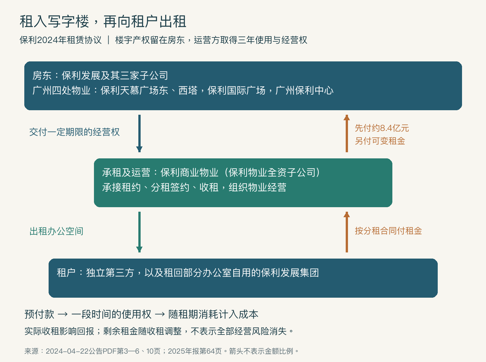

房东、运营方和租户的关系：运营方取得租期内经营权，再分租收款；保利发展集团同时可能是房东和租户。

预付的8.4亿元换来的是未来三年的使用权。付款时现金先减少，账上保留尚未使用的租赁权利作为资产；随后随租期经过，把这一权利的消耗逐期计入成本，年报称为折旧。所以，资产表里出现“租赁资产”并不表示公司拥有楼宇产权；2025年扣了折旧，也不表示2025年又支付一次同额租金。

公司还租用其他物业供自己办公或分租。2025年全部租赁现金流出约0.60亿元，远低于2024年集中付款时的9.16亿元；同年出租用途的租赁资产及投资物业折旧约2.76亿元。钱在哪一年付出去，与使用权在哪一年被消耗不同。若2027年继续经营到期项目，通常还需为新的租期付费，不能拿2025年的低付款额当作永久维持这门生意的成本。

2025年披露写字楼租赁收入约2.37亿元，出租资产及投资物业的相关直接经营开支约2.36亿元。报告没有把这两项与全部折旧、各楼宇现金收支接成完整项目利润表，因此不能靠两个接近的数字精算回报；现有披露也不足以支持高回报的判断。本书估值在全公司层面保留维持租赁所需的完整年度成本，第七章说明替换方法。

依据 · [保利物业2024年物业租赁协议公告 · 第3页](https://www.hkexnews.hk/listedco/listconews/sehk/2024/0422/2024042201952_c.pdf#page=3)；[保利物业2024年物业租赁协议公告 · 第4页](https://www.hkexnews.hk/listedco/listconews/sehk/2024/0422/2024042201952_c.pdf#page=4)；[保利物业2024年物业租赁协议公告 · 第6页](https://www.hkexnews.hk/listedco/listconews/sehk/2024/0422/2024042201952_c.pdf#page=6)；[保利物业2024年物业租赁协议公告 · 第10页](https://www.hkexnews.hk/listedco/listconews/sehk/2024/0422/2024042201952_c.pdf#page=10)；[保利物业2025年度报告 · 第64页](https://www1.hkexnews.hk/listedco/listconews/sehk/2026/0430/2026043001633_c.pdf#page=64)；[保利物业2025年度报告 · 第131页](https://www1.hkexnews.hk/listedco/listconews/sehk/2026/0430/2026043001633_c.pdf#page=131)；[保利物业2025年度报告 · 第132页](https://www1.hkexnews.hk/listedco/listconews/sehk/2026/0430/2026043001633_c.pdf#page=132)；[保利物业2025年度报告 · 第21页](https://www1.hkexnews.hk/listedco/listconews/sehk/2026/0430/2026043001633_c.pdf#page=21)；[保利物业2025年度报告 · 第134页](https://www1.hkexnews.hk/listedco/listconews/sehk/2026/0430/2026043001633_c.pdf#page=134)

### 集团财务公司存款

2026年中有20.23亿元存放集团财务公司，已经包含在123.37亿元资金总额中。现行框架允许公司自主选择存款机构、要求时当日提现，并与国有银行利率比较，因此本书不把它写成已冻结资金。它仍是对集团金融机构的存款债权；机构的偿付能力以及公司是否继续集中存放，会影响这笔钱的可用性。

依据 · [保利物业2026中期报告 · 第41页](https://www1.hkexnews.hk/listedco/listconews/sehk/2026/0916/2026091600311_c.pdf#page=41)；[2026—2028财务公司存款服务框架通函 · 第10页](https://www1.hkexnews.hk/listedco/listconews/sehk/2025/1215/2025121500486.pdf#page=10)

### 普通股能拿走多少

2025年度分红每股人民币1.401元，约7.75亿元，已于2026年7月支付，约为当年归母利润一半。它说明公司确实向股东分配了现金；没有公告的特别分红则不能预先当作必得。

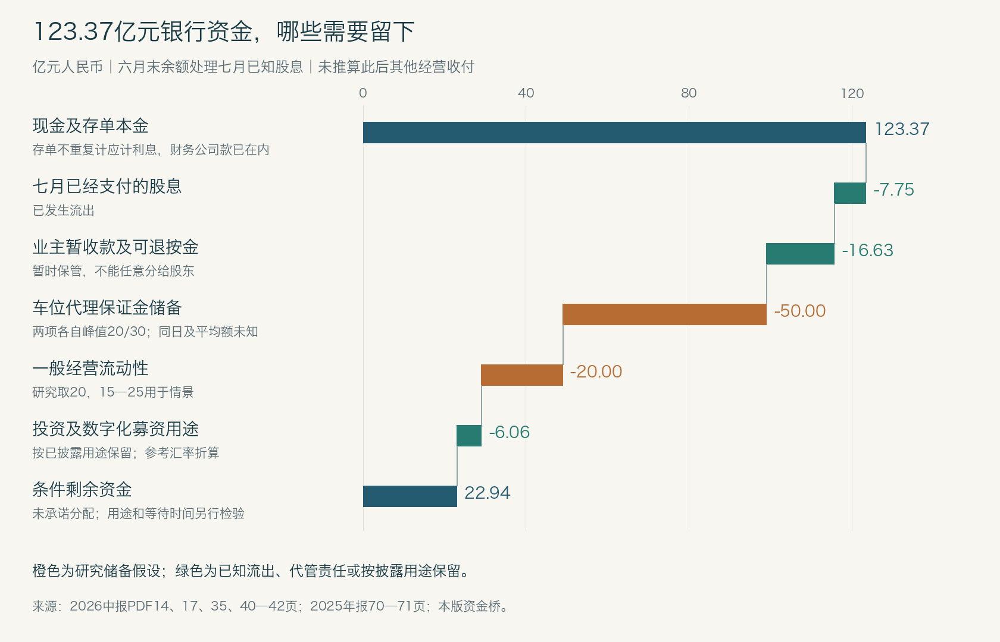

从报表日资金到条件剩余资金：事实余额与研究储备分开标示，约22.94亿元仍非已公告派发。

本书先从123.37亿元中扣已付股息、业主暂收及可退按金，再为车位安排保留50亿元、一般履约周转保留20亿元、未用募资中的投资和数字化用途保留约6.06亿元，得到约22.94亿元条件剩余资金。一般周转采用15—25亿元作范围，承担预收服务成本、应付结算与净账期波动；它是研究估计，不是法定最低。未用募资中的一般营运部分已包含其中，不再次扣除。

这条桥比“现金减银行借款”更接近普通股实际处境，却仍需要时间判断：剩余资金若五年以后才释放，今天的价值就低于立即交付。公司扩张、资金占用和股东分配需要一起审视，不能只凭高现金余额认定低风险。

依据 · [保利物业2026中期报告 · 第35页](https://www1.hkexnews.hk/listedco/listconews/sehk/2026/0916/2026091600311_c.pdf#page=35)

账面资金需要覆盖业主款、全年车位、履约和既定用途；普通股剩余现金还取决于分配时点。

## 第7章 · 估值、价格与错误后果

前六章把合同、服务成本、收款和用款拆开。本章将它们接成同一判断：现有业务能持续留下多少收益，需要留住多少资金，买入价格又能承受多大的判断错误。金额除特别注明外为亿元人民币，每股金额为人民币元；财务至2026年中，价格及汇率沿用2026年10月30日历史参考。

### 当前判断：盈利可以估计，折扣还不够稳固

保利物业已经能从市场获取项目，也具备跨地区组织服务的能力。它还没有证明的是：新增规模能否同时稳住单位利润、及时收回服务费，并让不再需要的钱真正交给股东。因此，本章固定当前收入规模，暂不另付未来增长的溢价。

在下述毛利、信用损耗、租金和维护条件下，正常年度合并经营收益约13.31亿元。经营用款留足后，采用10%的人民币回报要求，每股条件价值约27.30元。2026年10月30日历史收盘26.44港元，按0.85594折合22.6310536元人民币，表面折扣约17.1%。但单位利润和收款共同恶化的情景只有17.05元，低于这一参考价；这就是尚不认定已有稳健安全边际的主要理由。它不是对今日行情的判断。

依据 · [保利物业历史股价（已核验2026-10-30收盘）](https://cn.investing.com/equities/poly-property-development-co-ltd-historical-data)；[外汇局人民币汇率中间价](https://www.safe.gov.cn/AppStructured/hlw/RMBQuery.do?COLLCC=546877760)

### 资产参照先回答：现有收益背后压着什么资源

2026年中总资产188.09796亿元，减全部负债79.00474亿元，再减子公司其他股东净资产1.92182亿元，归上市公司普通股股东的账面净资产为107.17140亿元。除以5.533334亿股，约19.37元。把七月已付7.75220亿元股息同时从现金和应付股息扣掉，不会再减少一次净资产。

账面金额还要逐项检查。应收已经扣过报表拨备，仍可能发生额外旧账损失；设备账面受折旧影响，重建能力可能高于净值；租赁权有期限，不能按房东楼宇产权估价。下表从调整后的账面项目列到研究区间，已经扣过七月股息。

现金少计0.90581亿元，是把存单应计利息排除、只计本金，不是认定利息损失。旧应收再承受1—3亿元压力，约为一年以上净应收5.19亿元的19%—58%；这显示压力大小，不是已测得的坏账率。其他应收、预付及存货约11.715亿元，既有能退的钱，也有只能通过以后服务消耗的权利，取9.5—11.5亿元是尚未逐笔核实前的折价。设备及自用权取3.5—5.5亿元，以2025年底原值5.94350亿元约束数量级，缺少当前重置报价；出租权益取2.5—3.5亿元，围绕现有使用权净值估计，不包含楼宇所有权。已购无形和递延税资产未另加价。

中间估计的调整合计为－0.90581－2－1.21496＋1.83746－0.30721－0.82185－0.72105＝－4.13342亿元。107.17140－4.13342＝103.03798亿元，除股数为18.62元；上下两端分别99.53798、106.53798亿元，即17.99—19.25元。全国项目关系、人员组织及合同网络尚未可靠计量，所以这不是完整再生产价值，更不是清算回收底价。下面计算盈利价值时，不能再把这份净资产加上去。

资产与责任（亿元人民币，比例及每股值另注明）

| 资产与责任 | 账面起点 | 较低估计 | 中间估计 | 较高估计 |
| --- | --- | --- | --- | --- |
| 现金与存单 | 116.528 | 115.622 | 115.622 | 115.622 |
| 贸易应收净额 | 44.332 | 41.332 | 42.332 | 43.332 |
| 其他应收、预付、按金、存货等 | 11.715 | 9.500 | 10.500 | 11.500 |
| 设备及自用租赁权 | 2.663 | 3.500 | 4.500 | 5.500 |
| 出租物业租赁权益等 | 3.307 | 2.500 | 3.000 | 3.500 |
| 联营合营投资 | 0.259 | 0.259 | 0.259 | 0.259 |
| 已购无形资产及递延税资产 | 1.543 | 0 | 0 | 0 |
| 合计资产 | 180.346 | 172.712 | 176.212 | 179.712 |
| 减：全部已知负债 | 71.253 | 71.253 | 71.253 | 71.253 |
| 减：子公司其他股东净资产 | 1.922 | 1.922 | 1.922 | 1.922 |
| 普通股净资源 | 107.171 | 99.538 | 103.038 | 106.538 |
| 除以5.533334亿股：元/股 | 19.37 | 17.99 | 18.62 | 19.25 |

表中约数便于比较；复算采用相邻正文的完整小数。

依据 · [保利物业2026中期报告 · 第25页](https://www1.hkexnews.hk/listedco/listconews/sehk/2026/0916/2026091600311_c.pdf#page=25)；[保利物业2026中期报告 · 第26页](https://www1.hkexnews.hk/listedco/listconews/sehk/2026/0916/2026091600311_c.pdf#page=26)；[保利物业2026中期报告 · 第39页](https://www1.hkexnews.hk/listedco/listconews/sehk/2026/0916/2026091600311_c.pdf#page=39)；[保利物业2026中期报告 · 第40页](https://www1.hkexnews.hk/listedco/listconews/sehk/2026/0916/2026091600311_c.pdf#page=40)；[保利物业2025年度报告 · 第130页](https://www1.hkexnews.hk/listedco/listconews/sehk/2026/0430/2026043001633_c.pdf#page=130)；[2026年9月股份变动月报 · 第2页](https://www1.hkexnews.hk/listedco/listconews/sehk/2026/1005/2026100500994.pdf#page=2)

### 从现有收入走到13.31亿元，哪些取值最重要

最近四季收入采用2025全年加2026上半年、减2025上半年。它既纳入最新业务组合，也避免把有季节性的半年直接翻倍。三类业务的接续和采用毛利如下；车位和写字楼已在披露分类中，不另加一次收入。

基础物业占最近四季收入约79%，取13%最影响结果。它略低于最近四季13.18%，也低于2025全年13.39%，不预先把规模扩大或数字化当作利润率反弹。非业主增值受开发商活动和项目组合影响，2026上半年仅12.78%，最近四季约17%；取15%是两者之间的工作判断，不是假定重返高峰。社区业务低毛利商品收缩后，组合毛利率提高，取43%低于最近四季44.61%和最新半年46.78%，为组合能否持续留余量。三项正常毛利为18.0768341＋2.2377225＋9.3146944＝29.629251亿元。

毛利还要支付总部、销售、坏账和税。行政费用取10亿元，贴近2025实际9.93亿元；销售0.2亿元、其他经营费用0.1亿元，维持服务仍需培训、续约和管理。正常信用损耗每年扣1.2亿元，高于2025约0.46亿元及最近四季约0.65亿元，也没有简单把2026半年0.76亿元翻倍。旧账增加说明不能只照搬过去低费用；1.2亿元仍是工作估计，未来证据可能要求改变。利息、补贴和杂项不混入核心服务盈利，联营合营另估。

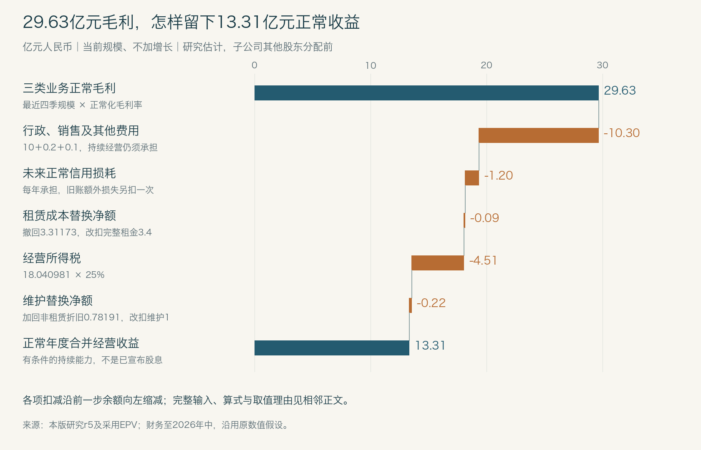

从正常毛利累计扣到年度合并经营收益；它已承担持续成本，仍在子公司其他股东分配之前，不是承诺股息。

租赁要先解决成本与付钱年份不同的问题。2024预付8.4亿元换取至2027年5月的租期，账上逐年计使用权折旧；2025现金付得少，不能理解为以后不用交租。撤回已扣自用、出租使用权折旧合计3.00811亿元和短租0.30362亿元，统一改扣完整年度租金3.4亿元。该数略高于现有年度消耗及短租合计3.31173亿元；合同另有随收租变化的剩余租金，2025实际支付为零，因此3.4并非永久合同固定价。若浮动付款或续约条件变化，应连同收入重估。

税率取25%，略高于近期约24%。税后再加回非租赁折旧摊销0.78191亿元，以每年1亿元维护投入替代；2025设备付现约0.45亿元，2026半年约0.63亿元，不能拿低支出的一年作永续需要。于是完整算式为：［29.629251－10－0.2－0.1－1.2＋3.00811＋0.30362－3.4］×75%＋0.78191－1＝13.31264575亿元。完整租金已经承担租赁义务，后面不再重复扣同一租赁债务，也不另加支撑这些收益的预付使用权。

收入与毛利率（亿元人民币，比例及每股值另注明）

| 收入与毛利率 | 基础物业 | 非业主增值 | 社区增值 |
| --- | --- | --- | --- |
| 2025全年收入 | 131.49815 | 16.36115 | 23.40138 |
| 加：2026上半年 | 70.80193 | 7.18781 | 10.30203 |
| 减：2025上半年 | 63.24751 | 8.63081 | 12.04133 |
| 最近四季收入 | 139.05257 | 14.91815 | 21.66208 |
| 最近四季实际毛利率，约 | 13.18% | 17.00% | 44.61% |
| 本章采用毛利率 | 13% | 15% | 43% |
| 收入乘采用毛利率 | 18.07683 | 2.23772 | 9.31469 |

表中约数便于比较；复算采用相邻正文的完整小数。

依据 · [保利物业2025年度报告 · 第26页](https://www1.hkexnews.hk/listedco/listconews/sehk/2026/0430/2026043001633_c.pdf#page=26)；[保利物业2026中期报告 · 第13页](https://www1.hkexnews.hk/listedco/listconews/sehk/2026/0916/2026091600311_c.pdf#page=13)；[保利物业2025年度报告 · 第123页](https://www1.hkexnews.hk/listedco/listconews/sehk/2026/0430/2026043001633_c.pdf#page=123)；[保利物业2025年度报告 · 第124页](https://www1.hkexnews.hk/listedco/listconews/sehk/2026/0430/2026043001633_c.pdf#page=124)；[保利物业2025年度报告 · 第130页](https://www1.hkexnews.hk/listedco/listconews/sehk/2026/0430/2026043001633_c.pdf#page=130)；[保利物业2025年度报告 · 第131页](https://www1.hkexnews.hk/listedco/listconews/sehk/2026/0430/2026043001633_c.pdf#page=131)；[保利物业2025年度报告 · 第132页](https://www1.hkexnews.hk/listedco/listconews/sehk/2026/0430/2026043001633_c.pdf#page=132)；[保利物业2024年物业租赁协议公告 · 第4页](https://www.hkexnews.hk/listedco/listconews/sehk/2024/0422/2024042201952_c.pdf#page=4)；[保利物业2026中期报告 · 第29页](https://www1.hkexnews.hk/listedco/listconews/sehk/2026/0916/2026091600311_c.pdf#page=29)

### 银行里123.37亿元，为什么只剩22.94亿元可另计

上述年度收益以当前规模维持、净周转需求不持续扩大为前提。第五章已经看到，客户迟付、代垫和更快结算供应商会占住钱；第六章又表明车位保证金在报表日退回后可能重新交出。维持已经计入盈利的业务，需要把这些资金留在公司。六月末现金及存单本金123.37405亿元，财务公司存款已经包含其中；七月至十一月其他经营收付没有另作推算。

已付股息、代管责任、经营储备和已安排用途逐步扣留。橙色为研究储备，22.94亿元仍不是已宣布的特别分红。

七月已付股息扣7.75220093亿元；业主暂收款及可退按金扣16.62531亿元，它们不属于可以随意分配的资金。车位两项各自最高保证金为20和30亿元，未披露是否同日达到，也缺平均占款。为维持已计入收益的代理业务，基准保守留50亿元，不认定全年都占用50，也不把这笔可退本金当费用。

一般经营流动性留20亿元，范围15—25亿元。2025服务及行政支出每月约12.61亿元，20亿元约相当于1.6个月，承担客户晚付、预收服务责任和供应商结算；2027若集中续租，仍须检验它是否够用。未使用募资的收购与数字化用途合计7.078亿港元，按参考汇率折6.05834332亿元另留；一般营运募资已经包括在20亿元中，不重复扣。公司既没有承诺马上释放这些储备，也没有承诺把剩余款全数派出。

资金计算为123.37405－7.75220093－16.62531－50－20－6.05834332＝22.93819575亿元。这里把经营资产和责任留在持续经营中，只另计可脱离业务的资源；它与资产参照扣全部负债的算法不同，不能再把所有经营负债完整扣一次。

依据 · [保利物业2026中期报告 · 第35页](https://www1.hkexnews.hk/listedco/listconews/sehk/2026/0916/2026091600311_c.pdf#page=35)；[保利物业2026中期报告 · 第40页](https://www1.hkexnews.hk/listedco/listconews/sehk/2026/0916/2026091600311_c.pdf#page=40)；[保利物业2026中期报告 · 第41页](https://www1.hkexnews.hk/listedco/listconews/sehk/2026/0916/2026091600311_c.pdf#page=41)；[保利物业2026中期报告 · 第42页](https://www1.hkexnews.hk/listedco/listconews/sehk/2026/0916/2026091600311_c.pdf#page=42)；[保利物业2025年度报告 · 第70页](https://www1.hkexnews.hk/listedco/listconews/sehk/2026/0430/2026043001633_c.pdf#page=70)；[保利物业2025年度报告 · 第71页](https://www1.hkexnews.hk/listedco/listconews/sehk/2026/0430/2026043001633_c.pdf#page=71)；[2026车位代理第二期续约通函 · 第10页](https://www1.hkexnews.hk/listedco/listconews/sehk/2026/0209/2026020900306.pdf#page=10)；[保利物业2026中期报告 · 第17页](https://www1.hkexnews.hk/listedco/listconews/sehk/2026/0916/2026091600311_c.pdf#page=17)

### 从持续收益接到普通股：27.30元还包含哪些条件

每年13.31264575亿元持续、不增长，采用10%人民币回报要求，经营价值为13.31264575÷10%＝133.1264575亿元，即十倍年度收益。10%是本次比较服务竞争、收款和资金用途风险的投资要求，不是利润增长率、已测融资成本或统一买入门槛。经营价值已经包含产生这些收益的服务资源，资产参照不能再加。

在此之上加22.93819575亿元条件剩余资金和0.5亿元联营合营价值，再扣3.5亿元子公司其他股东价值及2亿元旧账额外压力。联营合营约0.05亿元年度收益已排除在核心盈利外，按10%资本化支持0.5亿元量级。合并收益包括受控子公司全部业务，一部分归子公司其他股东；2024、2025他们分得的年度利润分别0.15586、0.18407亿元，10%资本化约1.56—1.84亿元。基准扣3.5亿元是进一步保守的工作估计，尚非精确市场评估；每改变0.5亿元，每股影响约0.09元。不能把他们的全额净资产和资本化利润再相加。

旧账压力2亿元针对今天已经形成、扣过报表拨备的净应收，一次性扣；前面1.2亿元年度信用成本针对以后服务中的正常损失。两者不能覆盖同一笔损失。由此，普通股权益为133.1264575＋22.93819575＋0.5－3.5－2＝151.06465325亿元；除以5.533334亿股，得到27.30083766元。参考价22.63元低约4.67元，但这个差额要由前面各项条件共同支撑。

剩余钱何时交给股东也有成本。假如22.93820亿元只产生1%税后收益、收益逐年派发而本金五年后交付，按10%折现，收益现值约0.22938196×［1－1.1的负五次方］÷10%＝0.86954亿元，本金现值约22.93819575÷1.1的五次方＝14.24281亿元，合计15.11235亿元。用它替换立即计入的22.93820亿元，其他条件不变，每股降到25.89元。这是等待后果，不是公司承诺五年后派款。

依据 · [保利物业2025年度报告 · 第81页](https://www1.hkexnews.hk/listedco/listconews/sehk/2026/0430/2026043001633_c.pdf#page=81)；[保利物业2026中期报告 · 第24页](https://www1.hkexnews.hk/listedco/listconews/sehk/2026/0916/2026091600311_c.pdf#page=24)；[保利物业2025年度报告 · 第159页](https://www1.hkexnews.hk/listedco/listconews/sehk/2026/0430/2026043001633_c.pdf#page=159)

### 先检查错误后果，再决定是否为增长多付钱

若报价竞争压低毛利，客户又付得更慢，公司会同时少赚利润、多留资金。下面把这些变化放在同一种经营状态里；较稳情景则让组合、收款和用款共同改善。三列收入均固定当前规模，不偷偷加入面积增长。

销售0.2亿元、其他费用0.1亿元、税率25%和撤回原折旧等与基准相同。不利情景毛利26.7080768亿元，年度收益为［26.7080768－10.5－0.2－0.1－1.8＋3.00811＋0.30362－3.6］×75%＋0.78191－1.2＝9.9467651亿元；权益为［9.9467651÷12%＋17.93819575＋0.5－4－3］÷5.533334＝17.05元。较稳情景毛利30.69031615亿元，年度收益为［30.69031615－9.8－0.2－0.1－0.8＋3.00811＋0.30362－3.3］×75%＋0.78191－0.9＝14.7334446125亿元；权益为［14.7334446125÷10%＋27.93819575＋0.5－3－1］÷5.533334＝31.04元。

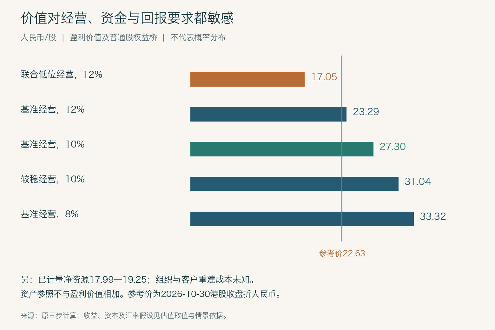

成组经营状态与单独改变回报要求分别比较，竖线为2026年10月30日历史参考价折人民币。不是概率区间，不能相加或平均。

只改变回报要求、经营和资金保持基准时，8%与12%的每股值分别为［13.31264575÷8%＋17.93819575］÷5.533334＝33.32元、［13.31264575÷12%＋17.93819575］÷5.533334＝23.29元。此处17.93819575是剩余资金加联营、减其他股东及旧账后的净调整，恰与不利情景的剩余现金同数，但含义不同。回报要求降低并没有让经营自动改善。

更直接的核验次序来自单项影响：基础物业毛利率少1个百分点，年度税后收益少139.05257×1%×75%＝1.042894275亿元，10%下每股少约1.88元；正常信用损耗每年多0.5亿元，每股少约0.68元；周转储备多留5亿元，每股少约0.90元。几项相关误差足以侵蚀4.67元余量。暂时多垫钱应重估储备，未来持续少收应下修盈利，已有旧账额外损失应一次扣减，不能看到应收增加就全部扣一遍。

现有外拓成果已计入当前收益。未来增长若要另加价，还须把同批项目的税后增量收益，与接管、设备、垫款及追加资金对应起来，证明回报超过要求；公司现有披露尚未完成这种对应，因此暂不另加增长溢价。后续优先核验完整年度基础物业毛利、旧账真实回收、车位资金峰值及返还、2027租赁续签和实际股东分配。经营改善或买入价格改变，都可能改变判断；新签面积本身不足以证明价值增加。

经营与资本条件（亿元人民币，比例及每股值另注明）

| 经营与资本条件 | 不利经营 | 本章基准 | 较稳经营 |
| --- | --- | --- | --- |
| 三类毛利率：基础/非业主/社区 | 12% / 12% / 38% | 13% / 15% / 43% | 13.5% / 16% / 44% |
| 行政费用 | 10.5 | 10.0 | 9.8 |
| 年度正常信用损耗 | 1.8 | 1.2 | 0.8 |
| 完整年度租金 | 3.6 | 3.4 | 3.3 |
| 年度维护投入 | 1.2 | 1.0 | 0.9 |
| 一般经营储备 | 25 | 20 | 15 |
| 条件剩余资金 | 17.93820 | 22.93820 | 27.93820 |
| 子公司其他股东价值 | 4.0 | 3.5 | 3.0 |
| 旧应收额外损失 | 3.0 | 2.0 | 1.0 |
| 人民币回报要求 | 12% | 10% | 10% |

表中约数便于比较；复算采用相邻正文的完整小数。

现有规模支持年度约13.31亿元合并经营收益；每股27.30元是10%回报要求下的条件参照，历史参考价的折扣尚不足以认定为稳健安全边际。

## 第8章 · 预测、跟踪与复盘

后续怎样更新这本书

### 后续怎样更新这本书

目前最需要验证的不是保利还能不能取得任何新项目，而是已有扩张怎样转成利润、现金和股东回报。后续更新以新事实推翻或强化本书判断，不能把最新结果倒填成今天已经知道的事。下列数值是本轮研究假设和观察触发点，不是公司指引，也不是已经实现的预测。

### 拓展：从签约走到项目回报

下一次年报先延续同名新拓展单年合同额，确认是否包含续签或退出，再与第三方确认收入、进场时间共同看。2025披露29.295亿元、2026上半年14.060亿元，是当前基点。更能改变判断的是外拓批次利润和收款：若合同增加主要靠降低报价、毛利持续下降，不能因为签约金额扩大就上调增长价值；若重点客户多地续购同时带来稳定毛利和付款，则品牌与专业能力获得更强经济证据。

依据 · [保利物业2025年度报告 · 第16页](https://www1.hkexnews.hk/listedco/listconews/sehk/2026/0430/2026043001633_c.pdf#page=16)；[保利物业2026中期报告 · 第8页](https://www1.hkexnews.hk/listedco/listconews/sehk/2026/0916/2026091600311_c.pdf#page=8)

### 履约：质量和成本必须一起看

2026下半年及2027年的基础物业毛利、区域管理费用、同项目质量和续留，是检验片区整合的下一组事实。基准取当前规模基础物业毛利率13%；若完整年度明显低于12%，且无法由可结束的启动成本解释，应采用更低正常盈利。相反，若毛利率稳定、费用维持、回访与续留也改善，才有理由把改善视作可重复。员工减少或机器人增多，单独都不能触发上调。

### 回款：等待一年结束，也比较同一季度

2026年中一年以上净应收约5.19亿元，半年经营现金流出4.82亿元。2026年报披露后，先核对旧账是否实际收到、账龄是否迁移、代业主垫款有无收回，再看供应商是否只是被推迟付款。2027中报仍与上年同季比较，避免把半年结算节奏当成全年趋势。

如果收入增长放慢，应收和代垫却继续增加，应重新检验当前固定规模、周转需求趋稳的假设。只是收款更迟但最终能全额收到，首先重估需要多留多少周转资金，减少22.94亿元条件剩余；以后业务持续发生更多收款损失，才提高年度信用成本、下修13.31亿元正常合并经营收益；现有旧账超出已计拨备的损失，另从普通股价值一次扣除。不能把一次占款永久资本化，也不能把同一笔坏账在各处重复扣。

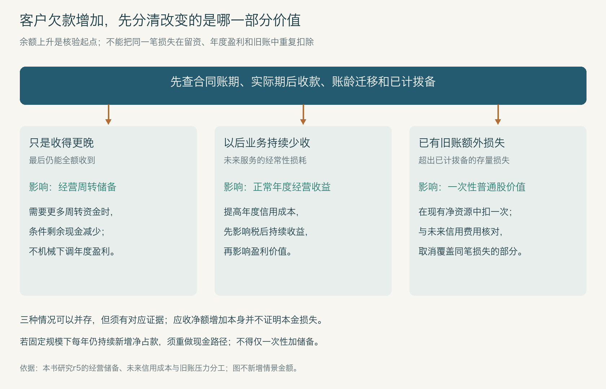

先核实收付事实，再选择调整经营储备、年度损耗或旧账价值。三种情况可以并存，但同一损失不重复扣；持续逐年占款还需重做现金路径。

若证据进一步显示，即使收入不再增长，未来每年仍要继续新增净占款，就应重做逐年现金路径，不能仅加一次储备便宣称稳态恢复。13.31亿元是有经营与周转条件的年度收益估计，不是已经收到或宣布分给普通股股东的现金。

依据 · [保利物业2026中期报告 · 第38页](https://www1.hkexnews.hk/listedco/listconews/sehk/2026/0916/2026091600311_c.pdf#page=38)；[保利物业2026中期报告 · 第39页](https://www1.hkexnews.hk/listedco/listconews/sehk/2026/0916/2026091600311_c.pdf#page=39)

### 资本：2027是一个具体观察窗口

2024写字楼租赁将在2027年5月27日到期，续签价格、预付金额及实际租赁回报，会检验目前完整租赁成本假设。两期车位代理要看平均及最高保证金、实际返还与代理净收益，而不只看半年末现金。财务公司存款要看期末余额和提款安排；普通股分红则看董事会实际决议，不能把约22.94亿元研究剩余资金当成已确定特别分红。

最有利的新事实，是基础物业利润率稳定、旧账持续回收、车位与租赁资金回报透明，并且不需要的资金开始分给股东。最不利的组合，是低价拓展掩盖毛利下降、现金继续转成应收，关联资金又不断追加。两种结果会直接改变正常盈利或普通股权益桥；仅有新的荣誉、面积排名或业务口号，不足以改变估值。

下一轮继续核对这些经营变化：项目是否更赚钱，旧账是否收回，租赁和车位资金是否按预期周转，不需要的资金是否分给股东。判断与估值随新证据修订，当前条件及原始记录留作对照。

依据 · [保利物业2025年度报告 · 第64页](https://www1.hkexnews.hk/listedco/listconews/sehk/2026/0430/2026043001633_c.pdf#page=64)；[2026车位代理第二期续约通函 · 第10页](https://www1.hkexnews.hk/listedco/listconews/sehk/2026/0209/2026020900306.pdf#page=10)

以后沿同口径合同、项目利润、旧账回收与资本返还更新判断，保留本次条件和原记录。

## 保利物业：现有服务能赚多少钱，股东又能拿走多少

保利物业的估值，关键不在于项目面积还会增长多少，而在于现有业务的利润能否维持，以及收款、车位保证金和租赁经营会留下多少可支配资金。按最近四季业务规模、较近期表现留有余量的利润率计算，正常年度合并经营收益约13.31亿元；为经营和已知用途留足资金后，在10%的人民币回报要求下，普通股条件价值约每股27.30元。这个结果可以逐项计算，却仍依赖利润率、回款和资金用途的判断。以下先检查资产，再算现有收益，最后检查这种估值能否承受判断错误。金额除特别说明外均为亿元人民币，每股金额为人民币元；财务截至2026年中，价格只采用2026年10月30日历史参考，不代表最新行情。

### 一、先把家底摊开：约18—19元的资产参照怎样算出

2026年6月底，公司总资产188.10亿元，总负债79.00亿元，其中属于子公司其他股东的净资产1.92亿元。因此，账面上归上市公司普通股股东的净资产为188.09796－79.00474－1.92182＝107.17140亿元。除以5.533334亿股，是每股约19.37元。这只是账面起点：欠款能否收回、设备重新购置要花多少钱、租赁权益还能用多久，都可能使经济价值偏离账面。

为与后面的资金估计一致，资产表先处理七月已经支付的7.75220亿元股息。六月末这笔钱仍在银行，也已列为应付股息；付款后现金和负债同时减少，股东净资产并不因此再减少一次。下表“账面起点”已经作了这项已知付款调整，没有推算七月至十一月其他经营收付。各项估值是对已披露资源的工作估计，不是资产评估机构的报价。

表中每项怎样调整，决定了结果有没有意义。现金由含应计利息的存单账面额改按本金，少计0.90581亿元；这是暂不把尚未到账利息算入本金的保守处理，不是认定利息损失。贸易应收44.33191亿元已经扣过公司计提的坏账准备，另减1—3亿元，是对旧账可能继续收不回来的压力，而非再扣一次原拨备。中间值减2亿元，相当于一年以上净应收5.18869亿元的约39%；区间两端约为19%和58%。这说明压力有多大，不说明已经测得这些旧账的最终损失率。

其他应收、预付款和按金合计11.30045亿元，加存货0.30271亿元及购置设备预付款0.11180亿元，形成11.71496亿元。它们有的能退回现金，有的只能通过以后接受服务或交付商品消耗，不能一律按现金看待。取9.5—11.5亿元，是资料尚不能逐笔确认回收与使用价值时的折价范围；中间值10.5亿元比账面少1.21496亿元。这一范围仍有判断成分，不能称为已经核定的可回收金额。

设备及自用租赁权的净账面额2.66254亿元，受到历年折旧影响。2025年底相关资产原值合计5.94350亿元，因此暂以3.5—5.5亿元估计维持现有设施能力所需的资源，中间取4.5亿元。原值可以约束数量级，却不能替代当前设备清单、年龄与重置报价，这仍是粗估。出租物业权益按2.5—3.5亿元、居中3亿元计，围绕现有3.30721亿元账面额留出差异；公司取得的是合同期内的使用和经营权，楼宇产权属于房东，不能按整栋楼的市价入账。租期、未来收租和租金义务共同决定这项权利的价值。

联营合营暂按0.25858亿元账面额；已购无形资产0.82185亿元和递延所得税资产0.72105亿元暂不另外计价。前者的合同、客户等价值尚未逐项验证，后者要靠未来应税利润才能使用，并非可立即取走的现金。未核实的品牌也不另加。至此，中间估计相对普通股账面净资产的调整为：－0.90581－2－1.21496＋1.83746－0.30721－0.82185－0.72105＝－4.13342亿元；107.17140－4.13342＝103.03798亿元，除以股数为18.62元。四项有区间的资产共同取较低或较高值，净资源分别为99.53798和106.53798亿元，得到17.99—19.25元。

负债也没有漏掉。六月末79.00474亿元包括供应商款27.86931亿元、应计及其他应付款26.50278亿元、已收而尚需履约的合同负债20.77299亿元、租赁负债0.89383亿元，以及税款和递延税负债合计2.96583亿元。付款调整后全部扣71.25254亿元；业主暂存款和按金已包含其中，不能再从这张资产表中重复扣。由此得到的是已计量资源的净额。

全国项目关系、员工组织、服务网络和客户合同的完整重建成本，目前没有可靠全量计量；退出时资产又可能折价、产生额外费用。因此18—19元既不是完整再生产价值，也不是清算底价或股价保底。它的用途，是检查现有收益背后压了多少可识别资源；服务网络究竟值多少，仍要由它持续创造的收益来证明。下面估盈利价值时，也就不能把这份资产净额再加一次。

项目（金额为亿元人民币，另注明的除外）

| 项目 | 账面起点 | 较低取值 | 中间取值 | 较高取值 |
| --- | --- | --- | --- | --- |
| 现金、存单；已扣七月股息 | 116.528 | 115.622 | 115.622 | 115.622 |
| 贸易应收净额；已扣报表拨备 | 44.332 | 41.332 | 42.332 | 43.332 |
| 其他应收、预付、按金、存货等 | 11.715 | 9.500 | 10.500 | 11.500 |
| 设备及自用租赁使用权 | 2.663 | 3.500 | 4.500 | 5.500 |
| 出租物业的租赁权益等 | 3.307 | 2.500 | 3.000 | 3.500 |
| 联营合营投资 | 0.259 | 0.259 | 0.259 | 0.259 |
| 已购无形资产 | 0.822 | 0 | 0 | 0 |
| 递延所得税资产 | 0.721 | 0 | 0 | 0 |
| 调整后资产合计 | 180.346 | 172.712 | 176.212 | 179.712 |
| 减：全部已知负债；已扣已付股息 | 71.253 | 71.253 | 71.253 | 71.253 |
| 减：子公司其他股东净资产 | 1.922 | 1.922 | 1.922 | 1.922 |
| 普通股股东净资源 | 107.171 | 99.538 | 103.038 | 106.538 |
| 除以5.533334亿股：元/股 | 19.37 | 17.99 | 18.62 | 19.25 |

表中约数用于阅读；正文保留关键复算小数。

依据 · [保利物业2026中期报告 · 第25页](https://www1.hkexnews.hk/listedco/listconews/sehk/2026/0916/2026091600311_c.pdf#page=25)；[保利物业2026中期报告 · 第26页](https://www1.hkexnews.hk/listedco/listconews/sehk/2026/0916/2026091600311_c.pdf#page=26)；[2026年9月股份变动月报 · 第2页](https://www1.hkexnews.hk/listedco/listconews/sehk/2026/1005/2026100500994.pdf#page=2)；[保利物业2026中期报告 · 第35页](https://www1.hkexnews.hk/listedco/listconews/sehk/2026/0916/2026091600311_c.pdf#page=35)；[保利物业2026中期报告 · 第42页](https://www1.hkexnews.hk/listedco/listconews/sehk/2026/0916/2026091600311_c.pdf#page=42)；[保利物业2026中期报告 · 第38页](https://www1.hkexnews.hk/listedco/listconews/sehk/2026/0916/2026091600311_c.pdf#page=38)；[保利物业2026中期报告 · 第39页](https://www1.hkexnews.hk/listedco/listconews/sehk/2026/0916/2026091600311_c.pdf#page=39)；[保利物业2026中期报告 · 第40页](https://www1.hkexnews.hk/listedco/listconews/sehk/2026/0916/2026091600311_c.pdf#page=40)；[保利物业2025年度报告 · 第130页](https://www1.hkexnews.hk/listedco/listconews/sehk/2026/0430/2026043001633_c.pdf#page=130)

### 二、先固定收入规模，再决定可以留下多少毛利

盈利价值回答的是：如果现有业务规模长期维持，持续经营每年能留下多少收益。它暂时不奖励未来新增面积，也不假定开发商业务回到高峰。收入取最近四季，即2025全年加2026上半年、减2025上半年；这样能纳入最新业务结构，又避免直接将有季节性的半年结果翻倍。三类业务都按同一期间拼接。

基础物业的取值最重要，因为它占最近四季收入约79%。2024至2025全年毛利率由14.33%降至13.39%，2026上半年15.82%也低于上年同期16.59%。服务合同拿到以后，工资、外包和项目服务支出还要持续发生；规模增加没有阻止单位收入利润下降。因此用13%，接近但略低于最近四季表现，不预先把规模效应计成利润率反弹。半年毛利率本来高于全年，不能拿15.82%直接作全年正常水平。

非业主增值收入由2025全年16.36亿元降到最近四季14.92亿元，其中包含面向开发商等非业主客户的服务。它的季节和项目组合波动较大：2026上半年毛利率12.78%，最近四季则约17%。采用15%是两者之间的工作判断，并非已经出现稳定15%的长期均衡；若地产相关需求或项目结算继续恶化，下文用12%检验后果。

社区增值最近四季收入21.66亿元，低于2025全年23.40亿元，毛利率却升至约44.61%。低毛利商品销售收缩等组合变化，可以使收入减少而综合毛利率提高。采用43%承认这种结构变化，同时低于最近四季和2026上半年46.78%的实际水平。车位代理和写字楼运营已经包含在披露的业务分类中，不再另加一次收入或利润。三项毛利合计18.0768341＋2.2377225＋9.3146944＝29.629251亿元。

收入和毛利率（金额为亿元人民币，另注明的除外）

| 收入和毛利率 | 基础物业 | 非业主增值 | 社区增值 |
| --- | --- | --- | --- |
| 2025全年收入 | 131.49815 | 16.36115 | 23.40138 |
| 加：2026上半年收入 | 70.80193 | 7.18781 | 10.30203 |
| 减：2025上半年收入 | 63.24751 | 8.63081 | 12.04133 |
| 得到最近四季收入 | 139.05257 | 14.91815 | 21.66208 |
| 2024全年实际毛利率 | 14.33% | 16.02% | 36.82% |
| 2025全年实际毛利率 | 13.39% | 15.80% | 41.25% |
| 最近四季实际毛利率，约 | 13.18% | 17.00% | 44.61% |
| 本报告正常化采用值 | 13.00% | 15.00% | 43.00% |
| 当前规模×采用毛利率 | 18.07683 | 2.23772 | 9.31469 |

表中约数用于阅读；正文保留关键复算小数。

依据 · [保利物业2025年度报告 · 第26页](https://www1.hkexnews.hk/listedco/listconews/sehk/2026/0430/2026043001633_c.pdf#page=26)；[保利物业2026中期报告 · 第13页](https://www1.hkexnews.hk/listedco/listconews/sehk/2026/0916/2026091600311_c.pdf#page=13)

### 三、从29.63亿元毛利走到13.31亿元正常收益

毛利还没有支付总部管理、销售、坏账、税和持续更新设施的费用。维持现有规模也要续约、培训、招聘和管理，不能因为模型“不增长”就把这些支出全部加回。下图从经营毛利顺序扣到可持续年度收益；租赁与维护调整在下一节解释。财务利息、补贴及杂项收益不放入核心服务盈利，联营合营另行估价。

累计扣减展示各项成本怎样压缩毛利；13.31亿元为条件正常合并收益、其他股东分配前。完整算式及依据仍在下文。

行政费用采用10亿元，贴近2025实际约9.93亿元；销售0.2亿元、其他经营开支0.1亿元，保留持续履约所需费用。员工股权报酬也不因当期没有付现就全部忽略，它仍是取得劳动的成本。税率取25%，略高于近期约24%的实际水平，避免依赖税收优惠长期存在。以上都是维持当前规模的取值；未来规模明显改变时，不能继续沿用固定费用而只改收入。

1.2亿元正常信用损耗是比近期全年更谨慎、但未将最新半年简单翻倍的判断。2025净信用费用约0.46481亿元，2026上半年已达0.75672亿元，最近四季约0.65169亿元；同期一年以上净应收由2025年底约3.64亿元升至2026年中约5.19亿元。收入确认后，如果一部分客户最终不付款，公司仍已付出人员和服务成本，所以正常盈利必须承担这种经常性损失。基准1.2亿元高于最近四季，较稳和不利经营分别用0.8、1.8亿元。它不是公司已经确认的未来坏账，也不证明1.2亿元足以覆盖一切收款风险。

计算用完整小数：［29.629251－10－0.2－0.1－1.2＋3.00811＋0.30362－3.4］×75%＋0.78191－1＝13.31264575亿元。这里的13.31亿元是合并集团、子公司其他股东分配前的正常年度经营收益，不是已经宣布的股息，也不是直接摘自某张现金流量表的数。它以收入不再增长、正常周转需求不持续扩大为前提；旧应收额外损失与现有资金能否释放，还要在后面另算。

依据 · [保利物业2025年度报告 · 第123页](https://www1.hkexnews.hk/listedco/listconews/sehk/2026/0430/2026043001633_c.pdf#page=123)；[保利物业2025年度报告 · 第124页](https://www1.hkexnews.hk/listedco/listconews/sehk/2026/0430/2026043001633_c.pdf#page=124)；[保利物业2026中期报告 · 第33页](https://www1.hkexnews.hk/listedco/listconews/sehk/2026/0916/2026091600311_c.pdf#page=33)

### 四、租金与维护为什么要重算，而不能只加回折旧

写字楼业务先从房东取得使用权，再向企业客户出租、提供运营服务并收租。保利物业没有买下这些楼。2024年续约集中预付8.4亿元，换取2024年5月至2027年5月的经营使用权；财务报表把这笔权利分期消耗，所以支付现金最多的年份和利润表确认成本的年份不同。只看2025年租金付现很少，再把租赁折旧加回，会把“上一年已经预付”误当成“以后不用付租金”。

房东保留楼宇产权；保利物业取得有期限的使用和运营权，并向租户收款。预付租金逐年消耗，续用物业仍需再付款。

基准撤回已扣的自用使用权折旧0.25355亿元、出租使用权折旧2.75456亿元及短租费用0.30362亿元，合计3.31173亿元，再统一扣完整年度租金3.4亿元。这样相对原费用多承担0.08827亿元，税后少0.06620亿元；不会因付款集中在某一年而突然把持续经营收益抬高。完整租金已经承担租赁义务，后面的盈利权益桥不再重复扣同一租赁债务，也不把已经支撑这笔收益的预付使用权另外加成一项资产。

3.4亿元并非从合同得到的永久固定租金。除8.4亿元预付外，合同原预计三年剩余租金合计1.03亿元；实际收租高于或低于基准时，剩余租金按差额的50%上调或下调，每个十二个月结算期结束后六十天内支付。2025年这一部分实际支付为零。因而3.4亿元是在近期低浮动付款状态下，略高于3.31173亿元年度消耗与短租费用的工作估计。若实际收租、浮动租金或2027年续约条件变化，要连同收入一起重估；单独把年度租金升至3.7亿元，税后收益就少0.225亿元，10%要求下每股价值少约0.41元。1.03亿元是三年预估，不能当作每年再付1.03亿元。

设备等更新采用相同思路，但与租赁分开。2025折旧摊销合计3.79002亿元，减已处理的使用权折旧3.00811亿元，剩下0.78191亿元；将它加回，改扣1亿元年度维护投入。2025设备实际付现约0.45亿元，2026上半年约0.63亿元，单一年度低支出不足以代表长期需求。因此0.8—1.2亿元作为工作范围，中间用1亿元；它仍需以后设施投入和合同续用情况检验，不能声称已取得精确更新清单。

依据 · [保利物业2024年物业租赁协议公告 · 第4页](https://www.hkexnews.hk/listedco/listconews/sehk/2024/0422/2024042201952_c.pdf#page=4)；[保利物业2024年物业租赁协议公告 · 第5页](https://www.hkexnews.hk/listedco/listconews/sehk/2024/0422/2024042201952_c.pdf#page=5)；[保利物业2025年度报告 · 第64页](https://www1.hkexnews.hk/listedco/listconews/sehk/2026/0430/2026043001633_c.pdf#page=64)；[保利物业2025年度报告 · 第130页](https://www1.hkexnews.hk/listedco/listconews/sehk/2026/0430/2026043001633_c.pdf#page=130)；[保利物业2025年度报告 · 第131页](https://www1.hkexnews.hk/listedco/listconews/sehk/2026/0430/2026043001633_c.pdf#page=131)；[保利物业2025年度报告 · 第132页](https://www1.hkexnews.hk/listedco/listconews/sehk/2026/0430/2026043001633_c.pdf#page=132)；[保利物业2025年度报告 · 第124页](https://www1.hkexnews.hk/listedco/listconews/sehk/2026/0430/2026043001633_c.pdf#page=124)；[保利物业2026中期报告 · 第29页](https://www1.hkexnews.hk/listedco/listconews/sehk/2026/0916/2026091600311_c.pdf#page=29)

### 五、报表现金在变弱，为什么仍能估13.31亿元

正常收益模型不能遮住实际收款。公司2019年末净应收约3.91亿元，2025年末升至34.44亿元；相对当年收入，由约6.6%升至20.1%。这个比例不是逾期率，但说明更多收入尚未转成现金。2025经营现金流18.27亿元，低于2024年的23.03亿元；2026上半年进一步为负4.82亿元，上年同期为负2.00亿元。半年度有结算季节性，不能翻倍为全年，但同比恶化仍然需要解释。

旧账存量也在增加。下图单独比较一年以上的净应收，已扣公司拨备；年中与年末存在季节差异，不能把余额上升全认作新增损失，但它说明不能只看收入增长，忽略较长时间仍未变成现金的部分。

一年以上净应收的存量比较；2026年中与此前年末并非同季。余额不是已确认损失，仍需核验实际回收及账龄迁移。

最大变化之一，是供应商欠款在2024年提供约4.59亿元现金增量，2025只提供约0.76亿元。公司没有同样多地延后付款，银行留下的钱便少了；这不等于公司当年把全部供应商债务还清。另一方面，应收继续占用资金。2026年中净应收进一步到44.33亿元，其中最新应收增量主要来自第三方；披露并不足以把第三方全部认作政府客户。不能用“央企客户可靠”或“只是回款慢”代替核实实际付款。

13.31亿元与18.27亿元不能直接相减，就把差额称为多余现金。前者使用当前规模、正常毛利和费用，并重新承担租金、维护与未来信用损耗；后者是2025真实收付，受当年项目增长、结算、应付变动和预付租金时点影响。这里没有把未披露的全部差额塞进一个残差项。模型允许当前项目所需的应收、保证金及周转资金继续留在经营中，但假设收入固定后，不必每年再追加相同规模的净占款。

如果固定收入下仍不断多垫钱，或者旧应收持续拖长而回收不足，这个假设就失效：暂时多垫的资金要增加储备；持续收不回来的收入则要提高正常信用损耗、降低可持续收益；既有旧账的额外损失另扣一次。三者影响不同，不能全部按短期时点差处理，也不能把同一笔坏账在每处重复扣。下一步估计剩余现金时，需要为这种周转和履约留足资金。

2025经营现金流比2024少了什么（金额为亿元人民币，另注明的除外）

| 2025经营现金流比2024少了什么 | 对同比变化的影响 |
| --- | --- |
| 营运资金变动前的经营现金增加 | ＋0.70587 |
| 贸易应收占款的现金影响变差 | −1.69839 |
| 供应商应付款提供的现金增量减少 | −3.83850 |
| 其他营运资金变化合计改善 | ＋0.60317 |
| 所得税及利息付现的合计影响 | −0.52817 |
| 经营现金流净减少 | −4.75602 |
| 2024现金流23.02756减4.75602 | 2025为18.27154 |

表中约数用于阅读；正文保留关键复算小数。

依据 · [保利物业2025年度报告 · 第156页](https://www1.hkexnews.hk/listedco/listconews/sehk/2026/0430/2026043001633_c.pdf#page=156)；[保利物业2026中期报告 · 第29页](https://www1.hkexnews.hk/listedco/listconews/sehk/2026/0916/2026091600311_c.pdf#page=29)

### 六、123.37亿元银行资金，为什么只留下22.94亿元条件剩余

2026年6月底，现金及现金等价物101.31516亿元，加存单本金22.05889亿元，合计123.37405亿元。这里使用存单本金，未把含应计利息的账面额再加一次。财务公司存款20.23012亿元已在银行资金之内，也不能单列相加。数额很大，但其中有已付股息、代管资金和维持业务所需现金。

50亿元车位储备与20亿元一般流动性属于研究判断；各项扣留沿余额向左推进，最后22.94亿元仍未承诺派发。图中为约数，复算使用下文完整小数。

16.62531亿元包括业主暂收款9.84159亿元及按金6.78372亿元。它们会用于代付或按约退回，公司只是暂时保管，不能把它们当成可任意分配给股东的余额。供应商款、预收服务费等日常经营责任则通过一般周转储备和持续经营模型处理。这里与第一节资产净额的算法不同：资产表扣全部负债，盈利估值把经营资产和经营责任留在业务中，只另加可以脱离经营的资金。如果先扣全部负债，又把同一笔日常用款全额保留，就会重复扣减。

50亿元来自两项车位代理安排最高保证金额度20亿元和30亿元之和；年报同时披露，2025年两项各自实际每日最高结余也分别达到20亿元和30亿元。公司先向委托方提供可退保证金，销售车位后取得代理服务收入；保证金退回并不等于销售收入。续约安排允许在六月末、十二月末退回后再重新交付，部分未售车位还涉及替换及退款条件。所以报告日钱回到银行，也可能很快再次交出去。为维持已计入毛利的代理收益，基准保留全部50亿元，不再把这笔钱列作闲置现金。

公司未披露两项保证金是否同日同时达到最高额度，也缺少可用来核算回报的平均占款。50亿元因此是参照各自已发生峰值、按合同上限作的保守储备，不是已证明全年占用50亿元；以后取得真实峰值与周转数据，才有依据释放其中一部分。它也不是费用或已经损失的本金，不能每年从13.31亿元盈利再减50亿元。

一般流动性取20亿元，工作范围15—25亿元。2025服务成本约141.41亿元、行政费用约9.93亿元，合计每月约12.61亿元，20亿元约覆盖1.6个月；15—25亿元约为1.2—2.0个月。这个比较说明储备的量级，仍不能替代逐月收付款预测。客户晚付、供应商结算和集中续租可能相遇，尤其2027年租约续签时，需要检查这笔储备是否真够。年度收益已经扣了租金，并不能保证集中付款当天一定有足够现金。

剩余募资中，投资收购用途5.393亿港元、数字化用途1.685亿港元，合计7.078亿港元，按本报告参考汇率0.85594折合6.05834332亿元人民币，另行保留。一般营运用途2.513亿港元已纳入前面的20亿元，不再扣一遍。募资来自向股东发行股份，并不是公司赚来的自由现金；未用部分仍是资产，但已有用途意味着当前不能假定它马上分配。用途安排也不等于法律上完全不可调整。

因此，123.37405－7.75220093－16.62531－50－20－6.05834332＝22.93819575亿元。这个数是上述用款判断成立后的条件剩余；七月至十一月其他经营收付未更新，也没有董事会承诺把它全部派出。其归属、用途及等待时间，都会影响它对今日股东的价值。

依据 · [保利物业2026中期报告 · 第14页](https://www1.hkexnews.hk/listedco/listconews/sehk/2026/0916/2026091600311_c.pdf#page=14)；[保利物业2026中期报告 · 第40页](https://www1.hkexnews.hk/listedco/listconews/sehk/2026/0916/2026091600311_c.pdf#page=40)；[保利物业2026中期报告 · 第41页](https://www1.hkexnews.hk/listedco/listconews/sehk/2026/0916/2026091600311_c.pdf#page=41)；[保利物业2026中期报告 · 第42页](https://www1.hkexnews.hk/listedco/listconews/sehk/2026/0916/2026091600311_c.pdf#page=42)；[保利物业2025年度报告 · 第70页](https://www1.hkexnews.hk/listedco/listconews/sehk/2026/0430/2026043001633_c.pdf#page=70)；[保利物业2025年度报告 · 第71页](https://www1.hkexnews.hk/listedco/listconews/sehk/2026/0430/2026043001633_c.pdf#page=71)；[2026车位代理第二期续约通函 · 第10页](https://www1.hkexnews.hk/listedco/listconews/sehk/2026/0209/2026020900306.pdf#page=10)；[保利物业2026中期报告 · 第17页](https://www1.hkexnews.hk/listedco/listconews/sehk/2026/0916/2026091600311_c.pdf#page=17)；[外汇局人民币汇率中间价](https://www.safe.gov.cn/AppStructured/hlw/RMBQuery.do?COLLCC=546877760)

### 七、把持续收益和剩余资金接到普通股：27.30元的完整算式

正常盈利价值把可持续年度收益折算成今天愿意支付的资本价格。假定13.31264575亿元每年持续、规模不增长，采用10%的人民币回报要求，经营价值为13.31264575÷10%＝133.1264575亿元，也就是按十倍年度收益计价。10%是本次比较服务竞争、收款和资本用途风险的投资要求，不是公司测得的融资成本、利润增长率或所有公司的统一买入门槛。后面同时展示8%和12%，让这一选择的影响可见。

联营合营估0.5亿元，参考近期约0.05亿元年度收益按10%资本化；它与第一节0.25858亿元账面资产是不同视角，不能同时相加。子公司其他股东价值扣3.5亿元、情景取3—4亿元。2024、2025年他们分得的年度利润分别为0.15586、0.18407亿元，2026上半年为0.09155亿元；按最近两个完整年度、10%要求简单资本化约为1.56—1.84亿元。半年数不混成年度区间；基准进一步保守多扣，留出对应资源和收益归属尚不精确的余量。3.5亿元并不是可以由已披露少数股东净资产精确推出的市场价值，不能把全额净资产再叠加到已资本化利润上。即使这一项上下变动0.5亿元，每股影响也只有约0.09元，主要判断仍取决于主业盈利和经营用款。

旧应收另扣2亿元，与第三节每年1.2亿元信用损耗分工不同：前者针对今天已有、扣过报表拨备的净应收，后者针对以后服务中正常发生的信用损失。两者都保留是为防止用未来正常利润掩盖旧账风险；若以后核实它们覆盖同一损失，必须取消重叠。租赁成本已完整承担，权益桥也不再减同一租赁负债。收益、资产、本金与一次性损失分别落位，才不会把同一家企业重复加价或重复扣价。

完整权益计算为133.1264575＋22.93819575＋0.5－3.5－2＝151.06465325亿元，除以5.533334亿股，得到27.30083766元。2026年10月30日历史收盘26.44港元，按0.85594折合22.6310536元人民币；比条件价值低约17.1%，即每股相差约4.67元。这个折扣只有在关键经营条件站得住时才有意义，不能因为算出了小数，就当成已确认的安全边际。

剩余资金的等待还会削弱这一差额。若22.93820亿元本金五年后才交给股东，每年仅产生1%的税后收益并逐年交付，按10%要求折现：年度收益现值为0.22938196×［1－1.1的负五次方］÷10%≈0.86954亿元，本金现值为22.93819575÷1.1的五次方≈14.24281亿元，合计15.11235亿元。用它替换原22.93820亿元，其他条件不变，每股为25.89元，比即时计价少约1.41元。这是资金延迟兑现的演示，并非公司承诺五年后派款。27.30元也不是未来必然出现的股价。

从经营价值到上市公司普通股（金额为亿元人民币，另注明的除外）

| 从经营价值到上市公司普通股 | 增减金额 | 经济含义 |
| --- | --- | --- |
| 正常经营收益13.31264575÷10% | 133.12646 | 维持现有服务能力的收益价值 |
| 加：条件剩余资金 | ＋22.93820 | 已留足上述用途后，未包含在服务收益中的本金 |
| 加：联营合营价值 | ＋0.50000 | 相关收益已排除在核心经营盈利之外 |
| 减：子公司其他股东的价值 | −3.50000 | 合并收益并非全部属于上市公司股东 |
| 减：旧净应收的额外损失压力 | −2.00000 | 针对已有旧账，一次性扣减 |
| 普通股价值合计 | 151.06465 | 不是公司银行现金余额 |
| 除以5.533334亿股 | 27.30元/股 | 人民币条件价值 |

表中约数用于阅读；正文保留关键复算小数。

依据 · [保利物业2025年度报告 · 第81页](https://www1.hkexnews.hk/listedco/listconews/sehk/2026/0430/2026043001633_c.pdf#page=81)；[保利物业2026中期报告 · 第24页](https://www1.hkexnews.hk/listedco/listconews/sehk/2026/0916/2026091600311_c.pdf#page=24)；[保利物业2025年度报告 · 第159页](https://www1.hkexnews.hk/listedco/listconews/sehk/2026/0430/2026043001633_c.pdf#page=159)；[保利物业历史股价（已核验2026-10-30收盘）](https://cn.investing.com/equities/poly-property-development-co-ltd-historical-data)；[外汇局人民币汇率中间价](https://www.safe.gov.cn/AppStructured/hlw/RMBQuery.do?COLLCC=546877760)

### 八、哪些判断最容易把4.67元的余量吃掉

最大的经营风险是利润率和回款一起变差：工资与服务成本没有随收费同步下降，项目少赚；客户还迟付，公司又要多留周转资金。不利情景把这几个因素放在同一种经营状态里，而不是只换一个更高折现率。较稳情景则假定组合改善、信用损失和资金占用同时减轻。三种情景都固定当前收入规模，未来增长尚未加入。

不利情景三类毛利合计26.7080768亿元；代入相同租金、税和维护计算，年度收益为9.9467651亿元。普通股价值为［9.9467651÷12%＋17.93819575＋0.5－4－3］÷5.533334＝17.05元。较稳情景毛利30.69031615亿元、年度收益14.7334446125亿元；普通股价值为［14.7334446125÷10%＋27.93819575＋0.5－3－1］÷5.533334＝31.04元。销售0.2亿元、其他开支0.1亿元、税率25%及撤回原折旧等与基准相同。17.05和31.04元没有已知概率，不是统计置信区间，也不能平均成目标价。

成组变化说明企业如何整体变好或变差，单项变化则帮助判断究竟哪个假设最值得核验。只降低基础物业毛利率1个百分点，毛利少139.05257×1%＝1.3905257亿元，税后少1.042894275亿元，10%要求下每股价值少约1.88元。正常信用损耗每年多0.5亿元，税后少0.375亿元，每股少约0.68元；一般储备多留5亿元，每股少约0.90元。这些变化已经能侵蚀相当一部分4.67元的基准余量；若来自同一组经营恶化，应组成一致情景，不能任意相加再当发生概率。

单独改变回报要求也影响很大。经营和资金保持基准，8%下为［13.31264575÷8%＋17.93819575］÷5.533334＝33.32元；12%下为［13.31264575÷12%＋17.93819575］÷5.533334＝23.29元。其中17.93819575是剩余资金加联营、减其他股东及旧账压力后的净调整，别与不利情景同数的剩余现金混淆。这里改变的是愿意为相同收益支付的价格，没有让公司经营自动变好或变坏。

成组经营情景与单独改变回报要求分别比较；竖线为2026年10月30日历史参考价折人民币，不代表当前价格或概率分布。情景输入见前表，完整算式见相邻正文。

本金损失还可能与利润率不同步。财务公司期末存款20.23012亿元若有20%永久损失，约减0.73元/股；车位50亿元资金若有10%永久损失，约减0.90元/股。当前没有证据据此认定已经损失；合同可退、可提取也不替代实际履约。两项只是显示暴露规模，实际采用时要核对资金时点、是否重叠以及是否已计入其他损失，不能机械叠加。

经营与资本条件（金额为亿元人民币，另注明的除外）

| 经营与资本条件 | 不利经营 | 本报告基准 | 较稳经营 |
| --- | --- | --- | --- |
| 基础物业毛利率 | 12% | 13% | 13.5% |
| 非业主增值毛利率 | 12% | 15% | 16% |
| 社区增值毛利率 | 38% | 43% | 44% |
| 行政费用 | 10.5 | 10.0 | 9.8 |
| 每年正常信用损耗 | 1.8 | 1.2 | 0.8 |
| 年度完整租金 | 3.6 | 3.4 | 3.3 |
| 年度维护投入 | 1.2 | 1.0 | 0.9 |
| 一般流动性储备 | 25 | 20 | 15 |
| 因而剩余资金 | 17.93820 | 22.93820 | 27.93820 |
| 子公司其他股东价值 | 4.0 | 3.5 | 3.0 |
| 旧应收额外损失压力 | 3.0 | 2.0 | 1.0 |
| 人民币回报要求 | 12% | 10% | 10% |

表中约数用于阅读；正文保留关键复算小数。

依据 · [2026—2028财务公司存款服务框架通函 · 第10页](https://www1.hkexnews.hk/listedco/listconews/sehk/2025/1215/2025121500486.pdf#page=10)；[2026车位代理第二期续约通函 · 第10页](https://www1.hkexnews.hk/listedco/listconews/sehk/2026/0209/2026020900306.pdf#page=10)

### 九、增长暂不加价，因为新增收入还没有配上完整资本回报

保利物业的外拓已经进入当前收入和13.31亿元正常收益，估值没有把这些成果抹掉。暂不加价的是未来尚未实现的增量。要证明它有价值，需将同批新增项目的持续利润，与接管投入、设备、垫款及后续追加资金对应起来：多赚的税后经营收益，除以为此新增的经营资本，才接近新增资本回报。新增面积、合同额或者收入增长率，单独都回答不了这个问题。

现有资本用途也不支持无条件给予增长溢价。车位代理服务收入2023年约3.890亿元，2024年约2.376亿元，2025年约2.255亿元；对应两项最高保证金额度合计50亿元。2.255÷50≈4.51%，只是年度代理收入与最高额度的比例，尚未扣费用，分母也不是平均投入，不能称为投资回报率。它至少说明不能只因为保证金可退，就忽略长期占用资金而收入已经收缩的事实。要判断回报，需要取得平均占款、全年收入和相关成本的同口径配对。

写字楼租赁也一样。2025披露相关租赁收入约2.368亿元、直接相关支出约2.364亿元，显示这部分已披露口径的结余很薄；但它与完整使用权折旧、预付款和全部运营费用还缺逐项一致的对应，不能拿两数之差算完整资本回报，也不能把可能已含在支出中的折旧再次扣除。未来是否值得续租，应把整段合同的预付、实际收租、后续租金及经营费用连起来判断。

因此，资产参照、现有盈利价值和增长分别停在各自证据能支持的位置：资产是部分计量，现有盈利是有明确假设的估计，增长尚不足以单独加价。不会把三者相加，也不因增长暂未计价，就认定新增项目一定没有价值。

依据 · [保利物业2023年度报告 · 第62页](https://www1.hkexnews.hk/listedco/listconews/sehk/2024/0425/2024042503584_c.pdf#page=62)；[保利物业2023年度报告 · 第63页](https://www1.hkexnews.hk/listedco/listconews/sehk/2024/0425/2024042503584_c.pdf#page=63)；[保利物业2025年度报告 · 第70页](https://www1.hkexnews.hk/listedco/listconews/sehk/2026/0430/2026043001633_c.pdf#page=70)；[保利物业2025年度报告 · 第71页](https://www1.hkexnews.hk/listedco/listconews/sehk/2026/0430/2026043001633_c.pdf#page=71)；[保利物业2025年度报告 · 第122页](https://www1.hkexnews.hk/listedco/listconews/sehk/2026/0430/2026043001633_c.pdf#page=122)；[保利物业2025年度报告 · 第134页](https://www1.hkexnews.hk/listedco/listconews/sehk/2026/0430/2026043001633_c.pdf#page=134)

### 十、当前判断与下一次改判

现有服务业务能够支持一套可复算的盈利估计；最大的疑问不是有没有利润，而是这份利润能否在收款、续用资产和资本配置之后成为股东所得。基准27.30元以正常年度收益13.31亿元、50亿元车位储备、20亿元一般储备及其余明确调整为条件。历史参考价22.63元低于它，但不利经营的17.05元也说明，几项相关假设一起出错时，这份折扣不能保护本金。因此目前不把约17%的表面折扣认定为稳健安全边际。

最先改变判断的应是利润与收款的共同证据：完整年度基础物业毛利能否稳定在接近13%的水平；一年以上净应收是否实际收回，而不是仅延后分类；新增业务在计信用损失后是否仍留下现金。若毛利改善但旧账继续拉长，不能只抬高盈利；若毛利稳定、回款改善且周转所需资金确实减少，才有依据同时上修收益和剩余现金。

随后检验资金责任：保证金是否按约退回并以多大规模重新交付；2027年租赁续用要付多少钱、能从租户收回多少；尚未使用募资是否投入能证明回报的项目；剩余资金最终怎样分配。规模扩张本身不足以改判，反过来，一次半年度现金流为负也不足以判定永久损失。后续应由这些经营事实推动参数更新，而不是在17.05、27.30和31.04元之间挑一个更合意的数字。

## 扩张继续，经营重心转向利润与收现

保利物业先跟随开发商项目进入不同城市，再从外部取得住宅、校园和公共服务合同。上市融资又为车位代理和租赁经营提供资金。把这些阶段连起来，才能理解今天为什么既要争取项目，也要提高每项服务留下的利润，并管好先付后收的钱。 图中的毛利是收入减现场直接成本后的金额；归母净利润还扣掉管理费用、坏账、税和子公司其他股东份额。

### 哪些力量支持公司，哪些力量正在拖累它

已经形成的外部客户和跨地区组织，是继续取得项目的基础。2025年第三方基础物业收入占该业务44.6%，公司已能获得集团之外的规模化收入。年报将行政开支下降主要归因于区域合并管理、效率提升和管理成本下降；费用减少也为利润提供了实际支持。

另一边，2025年面向开发商销售现场等的非业主增值服务收入下降16.5%，社区增值服务收入下降13.6%；第一期、第二期两份车位代理协议的服务费合计，从2023年的3.89亿元降到2025年的2.26亿元。这两年，公司各自披露的两份协议实际最高保证金余额，相加均为50亿元，说明在代理收入减少时，年内仍可能需要动用大笔资金。两项峰值是否同时发生、全年平均占用多少及代理净收益，尚不能从这些数据中得到；因此还不能算出实际资本回报，需要继续核对资金占用是否与业务收益相称。

据此，当前不是所有业务同时走向成熟或衰退。基础物业还在增长，部分增值业务在收缩，管理整合在降费，旧应收却在增加。正常盈利采用现有规模和组合，不预设原来收缩的业务回到高点。

依据 · [保利物业2025年度报告 · 第16页](https://www1.hkexnews.hk/listedco/listconews/sehk/2026/0430/2026043001633_c.pdf#page=16)；[保利物业2025年度报告 · 第27页](https://www1.hkexnews.hk/listedco/listconews/sehk/2026/0430/2026043001633_c.pdf#page=27)；[保利物业2025年度报告 · 第26页](https://www1.hkexnews.hk/listedco/listconews/sehk/2026/0430/2026043001633_c.pdf#page=26)；[保利物业2023年度报告 · 第62页](https://www1.hkexnews.hk/listedco/listconews/sehk/2024/0425/2024042503584_c.pdf#page=62)；[保利物业2023年度报告 · 第63页](https://www1.hkexnews.hk/listedco/listconews/sehk/2024/0425/2024042503584_c.pdf#page=63)；[保利物业2025年度报告 · 第70页](https://www1.hkexnews.hk/listedco/listconews/sehk/2026/0430/2026043001633_c.pdf#page=70)；[保利物业2025年度报告 · 第71页](https://www1.hkexnews.hk/listedco/listconews/sehk/2026/0430/2026043001633_c.pdf#page=71)

### 怎样的改善，才能说明增长重新带来更多可用现金

先看新增项目有没有稳住基础物业毛利，再看旧账是否真正收到钱。若毛利率稳定、总部费用没有反弹，且应收回收改善，公司才可能把已有收入规模转成更多年度可用现金。单靠裁员、工单提速或新签合同增加，都不足以完成这条判断。

随后要看多出来的钱去哪里。如果车位业务所需资金下降而利润保留，或者租赁续签获得更好的投入与收益安排，就可能少占用一部分资本；如果不再需要的资金最终通过分红等方式交给普通股股东，资本效率的改善才进一步落到股东回报。这里是待验证的路径，没有预报改善必然发生。

依据 · [保利物业2025年度报告 · 第26页](https://www1.hkexnews.hk/listedco/listconews/sehk/2026/0430/2026043001633_c.pdf#page=26)；[保利物业2026中期报告 · 第39页](https://www1.hkexnews.hk/listedco/listconews/sehk/2026/0916/2026091600311_c.pdf#page=39)；[保利物业2025年度报告 · 第64页](https://www1.hkexnews.hk/listedco/listconews/sehk/2026/0430/2026043001633_c.pdf#page=64)

### 哪些结果会支持更不利的解释

如果低报价带来更多项目，却持续压低毛利，服务网络越大未必赚得越多；如果客户又拖欠更久，公司还要先支付员工与外包商，扩张便同时消耗利润和现金。收入增长放慢后，应收与代垫仍持续增加，会比单个半年的现金流出更有力地支持这一解释。

若在这种情况下，车位或租赁仍要求追加资金、已有投入回报又继续下降，就应下调正常经营盈利或减少估计可分配的剩余资金。短期收款错期、某次启动费用与长期坏账不是同一种损失，需要按合同、同季现金和后续回收分别判断；当前不把它们全部称为永久损失。

依据 · [保利物业2026中期报告 · 第13页](https://www1.hkexnews.hk/listedco/listconews/sehk/2026/0916/2026091600311_c.pdf#page=13)；[保利物业2026中期报告 · 第29页](https://www1.hkexnews.hk/listedco/listconews/sehk/2026/0916/2026091600311_c.pdf#page=29)；[保利物业2026中期报告 · 第39页](https://www1.hkexnews.hk/listedco/listconews/sehk/2026/0916/2026091600311_c.pdf#page=39)

## 先看变化：规模、利润和现金已经不同步

### 早期规模与利润同增，近两年毛利趋平

2019—2023年，收入从59.67亿元增至150.62亿元，毛利从12.11增至29.53亿元，归母利润从4.91增至13.80亿元，项目网络扩大伴随盈利增加。2023—2025年收入继续增至171.26亿元，毛利却只到29.85亿元。基础物业多做的收入被较低毛利率部分抵消，开发商及部分社区业务又在收缩，不能把早期增长速度直接外推。

2025年归母利润仍增至15.49亿元，行政费用由2024年11.22降至9.93亿元提供支持。这是总部费用改善，未证明所有项目都更赚钱。下方原表保留逐年数据；先用趋势图辨认变化，再点击具体数值回到原报表。

收入、毛利、归母利润用各自零起金额轴观察，刻度不同；2023以后毛利趋平，最终利润仍受费用变化影响。

依据 · [保利物业2019年度报告 · 第80页](https://www1.hkexnews.hk/listedco/listconews/sehk/2020/0422/2020042201147_c.pdf#page=80)；[保利物业2023年度报告 · 第75页](https://www1.hkexnews.hk/listedco/listconews/sehk/2024/0425/2024042503584_c.pdf#page=75)；[保利物业2025年度报告 · 第26页](https://www1.hkexnews.hk/listedco/listconews/sehk/2026/0430/2026043001633_c.pdf#page=26)；[保利物业2025年度报告 · 第27页](https://www1.hkexnews.hk/listedco/listconews/sehk/2026/0430/2026043001633_c.pdf#page=27)

### 利润继续增长，经营现金却在全年与同季转弱

2023—2025完整年度经营现金由24.16降到18.27亿元，与归母利润上升方向不同。2025现金流附注显示，周转变化前的经营现金略增，客户欠款占用增加，供应商应付带来的资金增量却由4.59降到0.76亿元，收付节奏抵消了利润改善。它不是利润与现金差额全部变成坏账。

2024、2025、2026各上半年经营现金分别为4.27、－2.00、－4.82亿元，最新归母利润仍增到9.33亿元。年度与同季应分开比较：半年负数不能翻倍成全年，连续同季走弱也不能单说季节性。2026年中净应收44.33亿元，一年以上约5.19亿元，还须看真实收回、代垫及供应商支付；中报没有完整现金调节表，不用余额差凑出精确原因。

年度与上半年分面比较利润和经营现金；不把不同期间连成同一趋势，也不把两项相减称为股东所得。

这里展示的是已发生的合并经营收付，尚未扣全部设备、租赁和其他用款，也含子公司其他股东份额。它既不是归母利润的同义词，也不是估值采用的正常年度收益或股东分红。各类金额在相邻定义中分别说明。

依据 · [保利物业2025年度报告 · 第156页](https://www1.hkexnews.hk/listedco/listconews/sehk/2026/0430/2026043001633_c.pdf#page=156)；[保利物业2025中期报告 · 第30页](https://www1.hkexnews.hk/listedco/listconews/sehk/2025/0925/2025092500521_c.pdf#page=30)；[保利物业2026中期报告 · 第29页](https://www1.hkexnews.hk/listedco/listconews/sehk/2026/0916/2026091600311_c.pdf#page=29)；[保利物业2026中期报告 · 第39页](https://www1.hkexnews.hk/listedco/listconews/sehk/2026/0916/2026091600311_c.pdf#page=39)

## 从已有判断接到下一次披露

下列事项承接本书第八章。它们是核验安排，不是已经发生的新结果；当前没有新增方向预测，也尚无可结算的后续经营复盘。

### 外拓项目：合同增加后，利润和付款是否跟上

2025新拓展单年合同额29.295亿元，2026上半年14.060亿元；2025第三方基础物业收入58.60亿元。

2026年报实际披露后，随后跟踪2027中报。

同名新拓展合同额的范围、项目进场与退出、第三方收入，以及能取得的同批项目利润和收款。

合同增加且毛利、回款稳定，才增强新增项目创造价值的证据；若主要靠降价且收款变慢，不上调增长价值。

### 履约效率：降费有没有伤及服务和项目利润

2025基础物业毛利率13.39%，2026上半年15.82%，低于上年同期16.59%；正常化工作假设采用全年13%。

2026全年披露后核对全年；2027中报只与同季比较。

基础物业毛利、行政费用、外包费用，以及公开的服务质量与客户续留结果。

毛利和质量共同稳定，才支持节约可以维持；完整年度明显低于12%且无法用可结束的启动成本解释时，重估正常盈利。12%是本次复核触发点，非买卖门槛。

### 回款：旧账减少是否来自实际收回

2026年中一年以上净应收5.19亿元；2026上半年经营现金流出4.82亿元。

2026年报实际披露后；2027中报再核同季变化。

旧账回收、账龄迁移、预计坏账拨备及实际核销、代业主付款，以及供应商应付变化。

现金回升要对应客户实际付款，而非只延后付给供应商。仅收款推迟时重估周转储备；以后经常性少收时重估年度信用费用和正常收益；已有旧账额外损失一次扣减，避免重复。固定规模下仍逐年新增净占款，则重做现金路径。

### 车位与租赁：续约是否继续需要大额资金

第一期车位安排原期限到2026年底；2024写字楼租赁到2027年5月27日。估值保留50亿元车位储备、完整年租金3.4亿元作为条件。

相关续约或变更公告发布时；2026年报及2027年5月租赁到期前后。

车位保证金实际峰值、返还、代理净收益，租赁续签的预付金额、租金和实际运营结果。

较低资金占用且利润可维持，可能释放资本；追加投入却没有相应回报时，减少条件剩余资金或下修盈利。新合同未公开前不假定原安排永久延续。

### 股东分配：不再需要的资金是否真的交付

本轮估计条件剩余资金约22.94亿元，尚无对应特别分红承诺；参考估值保留资金交付时间的影响。

董事会分红、回购或重大新投资公告发布时。

实际决议、支付日期和资金来源；同时看全年业务用款及财务公司存款。

已付分红才是股东已收到的钱；继续低回报留存会降低现值。核对分配后现金及每股权益，避免同时加回本金和已经分掉的同一笔钱。

## 专题 · 保利物业的一单生意：从拿到项目，到把服务费收回来

保利物业（06049.HK）的项目主要来自保利发展开发的物业，以及市场上承接的第三方项目。到2026年6月底，公司管理3,221个项目、约8.94亿平方米；第三方项目已占在管面积的66.9%，贡献上半年物业管理收入的46.5%。公司经营的物业既有住宅，也有写字楼、学校和公共空间，收费依据和服务投入随项目而变。[2026中报：项目来源与经营规模 · 第8页](https://www1.hkexnews.hk/listedco/listconews/sehk/2026/0916/2026091600311_c.pdf#page=8)[2026中报：物业类型 · 第9页](https://www1.hkexnews.hk/listedco/listconews/sehk/2026/0916/2026091600311_c.pdf#page=9)

招股书对两类收费作了具体区分：大部分住宅及商办物业按面积计费，大部分公共及其他物业按项目报价，报价考虑服务范围、预计员工成本和目标利润。由此看公司的扩张，需要先分清承接了哪类项目、合同要求投入多少人和设备，再看取得多少服务收入。[招股书：按面积计费与按项目报价 · 第128页](https://www1.hkexnews.hk/listedco/listconews/sehk/2019/1209/2019120900028_c.pdf#page=128)

## 谁带来项目，谁决定续约，谁付服务费

保利发展为公司带来住宅项目入口，但入住后的物业管理费由业主等客户依合同缴纳。开发商的前期选聘、业主组织的后续选聘，以及日常缴费，是三种不同关系。招股书描述的住宅合同安排如下。[招股书：住宅项目合同与付费关系 · 第129页](https://www1.hkexnews.hk/listedco/listconews/sehk/2019/1209/2019120900028_c.pdf#page=129)

经营统计中的“保利发展控股集团项目”，包括保利发展及其合营、联营企业单独或联合开发的项目。2026年上半年，这类项目贡献53.5%的物业管理收入。这个比例反映保利发展项目给公司带来了多少业务；财务附注中的关联交易则统计公司实际向关联方提供了多少服务。住宅业主缴纳的物业费，可以来自保利发展开发的小区，付款人仍是业主。[2026中报：项目来源定义 · 第7页](https://www1.hkexnews.hk/listedco/listconews/sehk/2026/0916/2026091600311_c.pdf#page=7)[2026中报：来源分类收入 · 第8页](https://www1.hkexnews.hk/listedco/listconews/sehk/2026/0916/2026091600311_c.pdf#page=8)[2026中报：关联方交易 · 第46页](https://www1.hkexnews.hk/listedco/listconews/sehk/2026/0916/2026091600311_c.pdf#page=46)

第三方项目的面积占比高于收入占比，值得追问的是具体承接了哪些业态、怎样报价，以及何时进场。项目类型、服务密度和进场时间都会改变同一管理面积对应的收入；公司没有在这张来源分类表中披露各类项目的完整利润和回款，当前还不能据此比较两类项目的投资回报。[2026中报：来源分类面积与收入 · 第8页](https://www1.hkexnews.hk/listedco/listconews/sehk/2026/0916/2026091600311_c.pdf#page=8)

## 一所大学实际买了什么

2026年4月，哈尔滨理工大学公布物业服务中标结果，保利物业中标价为1,135万元。采购内容覆盖校园建筑和室外空间的保洁、绿化、设备设施维护、电梯运行、垃圾清运、清冰雪以及部分会议和综合保障。采购要求进一步规定人员岗位、到岗率及考核，保利物业中标后需要据此安排服务。[哈尔滨理工大学物业服务中标结果公告 · 第1页](https://gzc.hrbust.edu.cn/2026/0430/c1291a104627/pagem.htm#page=1)

1,135万元对应一年服务费用。保利物业需要提供24小时报事服务，并按合同处理突发及应急事件，同时承担约定的人员和服务支出；学校检查到岗情况及服务质量。电梯日常运行保障属于服务范围，大修则由学校主导并承担费用、物业方配合。分析这个项目的利润时，应计入公司承担的日常履约支出，把学校承担的大修另列；公告未提供各项成本及实际项目利润。

公告的服务期为三年，采用“1+1+1”：合同一年一签，履约考核合格才续签。项目还规定了不达标的整改、解除合同及履约保证金责任。后两年的收入要以通过考核、继续签约为前提。公告提供了报价和履约条件，实际收款进度仍未披露。[采购方公告：年度费用、服务期、考核和责任 · 第1页](https://gzc.hrbust.edu.cn/2026/0430/c1291a104627/pagem.htm#page=1)

## 同一个现场，可能产生三类收入

保利物业按物业管理、非业主增值和社区增值三类列示收入。基础物业管理贡献约八成收入、三分之二毛利，社区增值则以较少的收入贡献了更高比例的毛利。服务收入减去员工、外包商和材料等直接成本，剩下的叫毛利；以后还要扣总部管理、坏账损失和税等，才到净利润。[2026中报：收入构成及确认时间 · 第32页](https://www1.hkexnews.hk/listedco/listconews/sehk/2026/0916/2026091600311_c.pdf#page=32)

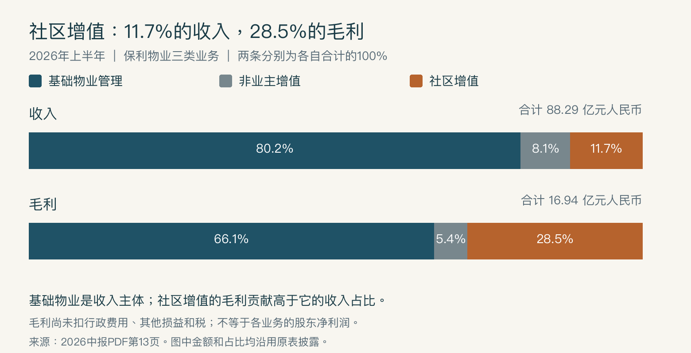

基础物业管理收入随服务履约进度确认。项目已经提供了服务，若客户还未付款，这部分收入就留在应收款中；持续提供服务、确认利润和收到现金因而会发生在不同时间。

非业主增值收入7.19亿元，主要包括面向开发商的案场协销、交付前服务等，以及办公楼租赁。售楼处需要接待、保洁和秩序维护，楼盘交付前需要查验和准备，这些需求跟开发商推盘和交付活动联系更紧。2026年上半年该类收入下降16.7%；管理层解释包括开发商清理尾盘项目、调整低效案场，以及写字楼租赁市场变化。案场和交付前服务依赖开发商的销售及交付活动，办公楼租赁还受出租情况影响。[2026中报：非业主增值服务及变化原因 · 第11页](https://www1.hkexnews.hk/listedco/listconews/sehk/2026/0916/2026091600311_c.pdf#page=11)

社区增值收入10.30亿元，包括社区零售、家政、停车及空间运营、装修、车位和房屋代理等。公司已有现场和客户接触，能继续提供额外服务，但住户购买零售、装修或经纪服务的意愿，与缴纳基本物业费不同。2026年上半年这类收入下降14.4%，毛利却大致持平，毛利率从39.93%升至46.78%。管理层表示，公司调整业务结构、聚焦核心品类，房屋租售经纪、家政和空间运营等业务增长支持了毛利稳定。公司没有披露这些细分类别各自的毛利，整体毛利率提高对持续盈利的贡献，仍需结合业务组合判断。[2026中报：社区增值服务 · 第11页](https://www1.hkexnews.hk/listedco/listconews/sehk/2026/0916/2026091600311_c.pdf#page=11)[2026中报：各类收入、毛利及毛利率 · 第13页](https://www1.hkexnews.hk/listedco/listconews/sehk/2026/0916/2026091600311_c.pdf#page=13)

社区业务还要分清公司在交易中的角色。保利自己供货时，交货后确认商品销售收入并扣进货成本；只是为其他供应方促成交易时，则确认自己应得的服务费或佣金。车位代理就是一例：买方把成交款付给保利发展，保利发展再按月向保利物业支付成交价超过基准价的代理费。保利另交的可退保证金占用资金，却不是销售收入或商品进货成本。不同业务比重变化，足以改变社区板块的平均毛利率。[收入确认的直接供应与代理区别 · 第98页](https://www1.hkexnews.hk/listedco/listconews/sehk/2026/0430/2026043001633_c.pdf#page=98)[商品及社区服务收入 · 第99页](https://www1.hkexnews.hk/listedco/listconews/sehk/2026/0430/2026043001633_c.pdf#page=99)[车位付款与代理费结算 · 第9页](https://www1.hkexnews.hk/listedco/listconews/sehk/2026/0209/2026020900306.pdf#page=9)

## 服务做得更多，钱为什么不一定留下更多

2026年上半年，保利物业员工薪酬约16.16亿元，期末员工27,906人。公司同时使用外包服务：6月底贸易应付款项约27.87亿元，管理层把该项余额下降主要解释为加快支付外包服务费用。自有人员与外包支出共同承担履约任务，成本研究需要把两者放在一起，再与具体项目的服务要求和毛利变化比较。[2026中报：雇员及薪酬 · 第18页](https://www1.hkexnews.hk/listedco/listconews/sehk/2026/0916/2026091600311_c.pdf#page=18)[2026中报：应付款变化 · 第16页](https://www1.hkexnews.hk/listedco/listconews/sehk/2026/0916/2026091600311_c.pdf#page=16)

招股书说明了包干制和酬金制的区别：包干制下，公司从约定收费中承担服务成本，成本超支会挤压自身利润；酬金制下，公司按约定收取管理酬金，项目资金和费用的归属不同。招股书所述早期收入以包干制为主，但这份历史材料不能证明今天每类项目都采用同样合同。包干项目若需要增加必要岗位、材料或设备投入，原有报价能够留下的利润就会减少；哈尔滨理工大学合同中的到岗和考核要求，给出了这种费用责任的具体例子。[招股书：服务组织与收费模式 · 第127页](https://www1.hkexnews.hk/listedco/listconews/sehk/2019/1209/2019120900028_c.pdf#page=127)[招股书：包干费用责任 · 第129页](https://www1.hkexnews.hk/listedco/listconews/sehk/2019/1209/2019120900028_c.pdf#page=129)[招股书：收费及收入确认 · 第130页](https://www1.hkexnews.hk/listedco/listconews/sehk/2019/1209/2019120900028_c.pdf#page=130)

归母利润是扣除子公司其他股东份额后，属于保利物业上市公司股东的利润。经营现金流则先汇总受控子公司的全部经营收付，范围比归母利润更宽。2023至2025年归母利润逐年增加，经营现金流逐年下降；最近三个上半年的同季比较也出现分离。下图将全年与半年度分别比较。

2023年的完整年度比较数见2024年报。[2024年报：利润表及2023比较数 · 第82页](https://www1.hkexnews.hk/listedco/listconews/sehk/2025/0428/2025042802401_c.pdf#page=82)[2024年报：现金流及2023比较数 · 第87页](https://www1.hkexnews.hk/listedco/listconews/sehk/2025/0428/2025042802401_c.pdf#page=87)

2025年公司收入和归母利润仍增长，经营活动现金净额却从2024年的23.03亿元降到18.27亿元。现金流附注显示，营运资金变动前的经营现金流仍增加，但客户欠款占用增加，向供应商暂缓支付而留在公司的款项减少，削弱了现金兑现。这里应采用现金流附注的变动额，不能直接把两期资产负债表差额全部当成当年经营现金流。[2025年报：利润表 · 第81页](https://www1.hkexnews.hk/listedco/listconews/sehk/2026/0430/2026043001633_c.pdf#page=81)[2025年报：现金流量表 · 第85页](https://www1.hkexnews.hk/listedco/listconews/sehk/2026/0430/2026043001633_c.pdf#page=85)[2025年报：经营现金流调节 · 第156页](https://www1.hkexnews.hk/listedco/listconews/sehk/2026/0430/2026043001633_c.pdf#page=156)

2026年上半年归母利润继续增长，经营现金净流出扩大到4.82亿元。前两个上半年分别是2024年净流入4.27亿元、2025年净流出2.00亿元。年度与半年度的差别说明存在收付款节奏影响，而同为上半年仍连续走弱，要求进一步解释客户回款、垫付与供应商结算的变化。现阶段既不能据半年现金流认定全年会亏现金，也不能用季节性把变化略过。[2025中报：2025及2024上半年现金流 · 第30页](https://www1.hkexnews.hk/listedco/listconews/sehk/2025/0925/2025092500521_c.pdf#page=30)[2026中报：现金流量表 · 第29页](https://www1.hkexnews.hk/listedco/listconews/sehk/2026/0916/2026091600311_c.pdf#page=29)

2026年6月底，贸易应收款及票据净额为44.33亿元，较2025年底增加约9.89亿元。附注列示第三方贸易应收款原值39.26亿元，坏账准备是公司对可能收不回部分的估计；从欠款原值扣掉它，才得到净额。这是账面估计，客户实际付款才会变成现金。按发票日期计算，净应收中一年以上的约5.19亿元，也高于年末约3.64亿元。商业办公和公共服务项目通常获授30至90天信用期，因此“一年以内”不等于“尚未逾期”。公司有没有把增长做成更长的欠款，需要客户类别、账龄和实际期后收款共同回答。[2026中报：应收款性质与信用期 · 第38页](https://www1.hkexnews.hk/listedco/listconews/sehk/2026/0916/2026091600311_c.pdf#page=38)[2026中报：账龄与代业主付款 · 第39页](https://www1.hkexnews.hk/listedco/listconews/sehk/2026/0916/2026091600311_c.pdf#page=39)

## 后续判断沿着哪三件事展开

**拓展**决定业务能否继续：保利发展带来的项目、市场招投标及现有客户续约分别怎样变化，新签合同有多少真正进入服务和收费阶段。新签年合同额是一个合同指标，不能直接加进当年收入。

**履约**决定收入能留下多少利润：项目的人员、外包、设备和管理费用怎样配置，降本是否维持服务，新增项目需要多久达到正常运转。2026年上半年基础物业管理毛利率从16.59%降到15.82%，提醒研究不能用全公司平均利润率盖住基本盘的成本变化。[2026中报：物业管理毛利率 · 第13页](https://www1.hkexnews.hk/listedco/listconews/sehk/2026/0916/2026091600311_c.pdf#page=13)

**回款**决定利润何时变成现金：住宅业主、企业客户和公共项目的付款节奏有何不同，欠款和代垫费用能否收回，供应商款项和预收物业费需要保留多少资金。大量账面现金之后还要经过资本配置研究，才能判断有多少真正属于可分配的剩余资金。

正常盈利、全年用款和三步估值已在后续专题展开：当前规模、扣过维持经营支出后的年度收益基准约13.31亿元；必要资金留在业务中，并扣清子公司其他股东份额后，10%回报要求下每股条件价值约人民币27.30元；这依赖毛利、收款和资本分配假设，增长暂不加价。

## 专题 · 保利物业如何赢得外部项目：品牌、投标与专业能力

保利物业已经能够在保利发展开发的物业之外，持续取得相当规模的业务。2025年第三方项目贡献物业管理收入58.60亿元，同比增长17.5%；同年取得33个存量住宅项目，服务范围还延伸到银行总部、企业园区、高校和城镇公共空间。这些业绩支持它拥有外部获客能力。进一步判断这种能力有多强，需要看客户为什么选它、对手如何报价，以及拿到的合同能否留下利润。[2025年报：第三方收入 · 第16页](https://www1.hkexnews.hk/listedco/listconews/sehk/2026/0430/2026043001633_c.pdf#page=16)[存量住宅拓展 · 第17页](https://www1.hkexnews.hk/listedco/listconews/sehk/2026/0430/2026043001633_c.pdf#page=17)[商办及公共服务客户 · 第19页](https://www1.hkexnews.hk/listedco/listconews/sehk/2026/0430/2026043001633_c.pdf#page=19)

目前较有依据的判断是：**保利的优势来自集团信誉、已有项目经验、专业服务组织和重点城市布局的共同作用；品牌能够帮助取得信任，但最终赢单仍需要具体方案和有竞争力的价格。**公司已有规模化获客实绩，但最近披露的“新拓展”单年合同额没有继续增长，现有披露也不足以证明它能凭品牌长期收取更高价格。

## 外拓已有实绩，披露的新拓展合同额趋稳

保利披露的新拓展第三方项目单年合同额，2024年为30.05亿元，2025年为29.30亿元，减少约2.5%；2026年上半年为14.060亿元，与2025年同期的14.061亿元基本持平。与此同时，第三方物业管理收入仍在增加，2026年上半年达到32.90亿元，同比增长18.4%。单年合同额与收入反映的内容不同：前者按一年的服务金额表示项目规模，后者是当期已提供服务所确认的收入，也包含过去取得的项目。[2024年报：拓展合同额 · 第16页](https://www1.hkexnews.hk/listedco/listconews/sehk/2025/0428/2025042802401_c.pdf#page=16)[2025年报：拓展及第三方收入 · 第16页](https://www1.hkexnews.hk/listedco/listconews/sehk/2026/0430/2026043001633_c.pdf#page=16)[2025中报：新拓展合同额 · 第8页](https://www1.hkexnews.hk/listedco/listconews/sehk/2025/0925/2025092500521_c.pdf#page=8)[2026中报：新拓展及来源分类收入 · 第8页](https://www1.hkexnews.hk/listedco/listconews/sehk/2026/0916/2026091600311_c.pdf#page=8)

“单年合同额”把拓展项目换算成一整年服务对应的合同金额。项目分批进场，当期能确认多少收入还取决于实际服务了几个月；以前取得并继续执行的合同也会贡献本期收入。因此，新拓展金额趋稳与第三方收入增加可以同时出现。

披露的“新拓展”合同额并不等于已经签署且全部剔除续约的新增合同。2024年报同页还列出“新签约、不含续签”单年合同额25.47亿元，低于“新拓展”的30.05亿元，却没有解释两项在签约阶段、项目范围上的对应关系。因此，这里比较的是各期公布的同名指标，不能把差额认作续签，也不能从中反推整体中标率。可以确认的是，这一披露金额最近同比没有增长，而第三方收入仍在增加；收入的增长率不能直接当作当前新增获客能力的增速。

细分市场中，存量住宅的进展更明确。2025年新拓展的33个存量住宅项目，单年合同额1.80亿元；2026年上半年存量住宅新拓展单年合同额达到2.00亿元，同比增长114.7%。这些项目不是等待保利发展的新楼盘交付，公司需要获得已有小区的选聘。但这一细分市场仍只占总外拓的一部分：2026年上半年第三方住宅、商办、公共及其他物业的新拓展单年合同额分别为2.575亿、5.509亿、5.976亿元，商办与公共项目才是更大的获客来源。[2025年存量住宅项目 · 第17页](https://www1.hkexnews.hk/listedco/listconews/sehk/2026/0430/2026043001633_c.pdf#page=17)[2026中报：住宅外拓 · 第9页](https://www1.hkexnews.hk/listedco/listconews/sehk/2026/0916/2026091600311_c.pdf#page=9)[商办及公共项目外拓 · 第10页](https://www1.hkexnews.hk/listedco/listconews/sehk/2026/0916/2026091600311_c.pdf#page=10)

面积也容易夸大对获客能力的直觉。2026年6月底，第三方占在管面积66.9%，对应上半年物业管理收入46.5%。公共空间、住宅和办公楼的服务密度、计价方式不同；部分第三方合同甚至没有约定管理面积。因此，项目数量、面积、单年合同额和实际收入各有用途，不能用面积排名直接替代竞争判断。[项目来源及面积统计说明 · 第7页](https://www1.hkexnews.hk/listedco/listconews/sehk/2026/0916/2026091600311_c.pdf#page=7)[第三方面积与收入 · 第8页](https://www1.hkexnews.hk/listedco/listconews/sehk/2026/0916/2026091600311_c.pdf#page=8)

## 住宅、企业和公共机构，选物业的方式不同

**新建住宅首先面对开发商。**开发商在房屋销售、交付和后续品牌维护中需要物业配合，物业公司则在进场后向业主等客户收费。《物业管理条例》规定住宅建设单位应通过招投标选聘，符合条件并获批准的情形可采用协议方式。保利物业的母公司关系使它更熟悉楼盘设计、交付安排和客户定位，也提供了稳定的业务入口。招股书披露，在2016年至2019年上半年的往绩期，它在参与的保利发展相关项目招投标中几乎全部中标；同一时期第三方投标并没有这样的结果。母公司入口与外部竞争能力需要分别判断。[物业管理条例第21—26条](https://www.samr.gov.cn/zw/zfxxgk/fdzdgknr/bgt/art/2023/art_f716cd25569f491a80528f22e8da464e.html)[母公司来源与第三方招投标 · 第142页](https://www1.hkexnews.hk/listedco/listconews/sehk/2019/1209/2019120900028_c.pdf#page=142)

**存量住宅面对业主的集体选择。**更换物业涉及服务标准、收费、共同设施资料和现场交接，须完成业主共同决策及相应程序。个人愿意换一家物业，并不等于整个小区已经作出决定。由此可以理解，既有物业通常具有熟悉现场和持续在场的优势，新进入者需要让业主相信换物业后的服务改善值得付出组织与交接成本。这是合同结构带来的进入难度，不能把长期未换物业全部解释为满意度或品牌忠诚。

上海自2026年施行的办法提供了具体例子：业主选聘方案要明确服务内容、标准或收费及合同条件；投标文件还包括企业信用、管理业绩、拟派项目经理、费用测算和实施方案，并按综合评估法评标。这里比较的是能够执行的服务安排。各地程序和评标细则有所不同，上海规则不能套成全国统一权重。[上海物业招投标办法第8、10、16及18条](https://www.shanghai.gov.cn/202614bmgfxwj/20260729/b5f6159a9dc242b89a779f24b025f612.html)

**商办面对机构客户的经营需要。**总部、工厂、银行网点和办公楼，服务停摆、设备故障或人员管理失误会干扰客户经营。保利2025年报披露已服务六家银行总行、近百个分支行项目，并取得京东、小鹏、中芯国际、歌尔等客户或项目。公司把基础物业与企业服务、资产管理结合，机构客户因此可以采购更完整的后勤安排。这些实际客户是能力已被采用的证据；客户各自怎样评选、是否继续扩大采购，还要看对应合同，不能把全部商办或国企客户都套进政府采购程序。[商办客户与服务组织 · 第19页](https://www1.hkexnews.hk/listedco/listconews/sehk/2026/0430/2026043001633_c.pdf#page=19)

**政府和事业单位的采购还要落到具体评审规则。**政府采购招标包括最低评标价法和综合评分法：标准统一的服务重视满足要求后的价格，有量化技术、商务因素的综合评分则同时比较方案与报价。品牌名称本身不能替代文件响应；制度也禁止指定品牌、非法限定所有制等不合理差别待遇。分析保利公共服务的竞争力，必须知道实际项目属于哪类采购、怎样评分，而不能从“央企客户”直接推出“央企物业必然占优”。[政府采购法实施条例第20、34条](https://www.mof.gov.cn/zhengwuxinxi/zhengcefabu/201502/t20150227_1195516.htm)

## 看一场真实竞争：保利怎样赢过丹田

2026年哈尔滨理工大学物业服务招标，保利以每年1,135万元中标。项目要求供应商制定适合高校的服务方案，按规定数量配备人员，提供报事与过程管理系统，并承担约定的设备维护、校园保洁和应急保障。公告同时公开了同场供应商的技术、商务和价格分，因而可以把“中标”拆开来看。[采购方公告：要求及评标明细 · 第1页](https://gzc.hrbust.edu.cn/2026/0430/c1291a104627/pagem.htm#page=1)

保利对丹田的领先只有0.15分。它的技术分低0.10分，商务分相同，价格分则高0.25分；较低报价带来的分数优势，使它在两家接近的方案之间胜出。与报价更低的明德相比，保利的技术分优势又超过了价格分劣势。**这场竞争同时要求方案得分和价格竞争力，保利既不是靠最低报价获胜，也不是凭最高技术分独胜。**公告没有拆出品牌贡献，不能把它的全部技术或商务得分归给“保利”两个字。

同一项目也能看出报价的约束。合同要求人员配置和实际到岗，且不允许转包、分包；低价承诺后，人员和服务责任仍然要兑现。服务期采用“1+1+1”，一年一签，考核合格才续签。拿到首年合同是一项获客成果，后两年仍依赖履约，项目利润还需要扣除公司实际承担的成本。[采购方公告：人员、分包限制和年度续签条件 · 第1页](https://gzc.hrbust.edu.cn/2026/0430/c1291a104627/pagem.htm#page=1)

保利也会在同类客户竞争中落败。2025年中南大学新南校区招标，保利持股60%的湖南保利天创报价约1,807.36万元/年，综合得分93.74；绿城报价约1,702.55万元/年、得分97.60，最终中标。该项目还规定两个标包可以都投、不能同时中标，因此校本部标包并不是简单授给得分最高的绿城，而是按规定递补给中海。评标排名、标包规则和最终中标必须一起看。公告没有细项评分，无法进一步认定保利天创具体败在哪项能力上。[湖南保利天创股权归属 · 第159页](https://www1.hkexnews.hk/listedco/listconews/sehk/2026/0430/2026043001633_c.pdf#page=159)[中南大学两标包报价、得分与授标规则](https://www.ccgp.gov.cn/cggg/zygg/zbgg/202501/t20250116_24078107.htm)

山东财经大学2025年度物业采购结果中，保利主公司又被列入符合性评审废标名单。公告未给出具体不符合事项，不能据此臆测违法或服务能力；但它足以说明大品牌仍须逐项响应招标文件。这里选取的胜败案例用于解释竞争机制，不构成保利整体中标率的抽样统计。[采购方公告：未中标原因](https://zcb.sdufe.edu.cn/index/article/announcement_detail/id/1545.html)

## 品牌怎样起作用，哪些能力必须另外建设

保利的品牌在拓展中有商业价值。客户选择未来几年的服务商时，不能事先完整观察每一个现场的表现；熟悉的集团背景、已有机构客户和相近项目记录，可以降低客户了解供应商的成本，使承诺更容易获得信任。保利招股书也把国资背景、公信力以及与政府、国有机构的合作列为公共服务拓展的有利条件。这是公司的解释；与已经披露的机构客户相结合，可以支持品牌有助于建立商业信任的判断，但不能据此量化它提高了多少中标概率。[公司对品牌与公共服务合作的说明 · 第115页](https://www1.hkexnews.hk/listedco/listconews/sehk/2019/1209/2019120900028_c.pdf#page=115)[已服务机构客户 · 第19页](https://www1.hkexnews.hk/listedco/listconews/sehk/2026/0430/2026043001633_c.pdf#page=19)

这种信任需要实际组织能力承接。保利2018年花7,800万元收购湖南保利天创60%股权，明确目的是建设校园物业平台。进入高校服务，既需要品牌，也需要懂校园的管理团队、工作安排和项目经验。2026年哈尔滨理工大学所要求的信息系统、人员配置和应急方案，就是这些能力要落到投标与现场的地方。收购动作证明公司为专业能力付过成本，不能只把业务扩大解释成品牌自然延伸；收购回报好坏仍须另看经营结果。[校园物业平台收购 · 第101页](https://www1.hkexnews.hk/listedco/listconews/sehk/2019/1209/2019120900028_c.pdf#page=101)[高校项目的具体履约要求 · 第1页](https://gzc.hrbust.edu.cn/2026/0430/c1291a104627/pagem.htm#page=1)

地域布局同样重要。2025年保利80.4%的新拓展第三方单年合同额来自核心50城，2026年上半年为80.8%。在已有团队、供应商和项目的城市继续拿单，具有共享管理、调配人员和服务响应的条件，比仅有全国品牌更接近可执行能力。这里能够确认的是拓展集中于重点城市；公开材料还没有把城市密度带来的成本节约单独列出，不能直接给每个新增项目更高利润率。[2025年核心城市拓展 · 第16页](https://www1.hkexnews.hk/listedco/listconews/sehk/2026/0430/2026043001633_c.pdf#page=16)[2026年上半年拓展布局 · 第8页](https://www1.hkexnews.hk/listedco/listconews/sehk/2026/0916/2026091600311_c.pdf#page=8)

住宅品牌的溢价也需要同样克制地判断。2025年公司新拓展存量住宅的平均物业费为2.9元/平方米/月，但这只是所获项目的平均费率，年报没有按城市、房龄、设备和服务标准给出与原有项目可比的费率对照。它说明公司拿到了相应收费水平的项目，不能把与其他项目的价差全部算成品牌溢价。真正的定价优势，需要在服务责任相近时仍能取得更好收费，且客户愿意持续购买。[新拓展存量住宅的收费水平 · 第17页](https://www1.hkexnews.hk/listedco/listconews/sehk/2026/0430/2026043001633_c.pdf#page=17)

## 能拿到项目之后，怎样判断拓展值得继续

保利的第三方收入、存量住宅更换项目和机构客户，已经支持“外部获客能力成立”。但最近披露的新拓展单年合同额趋稳，真实投标中也存在接近的对手和失标，不能把这种能力解释成不受竞争影响的增长。品牌有助于取得信任，专业能力和重点城市经营为这种信任提供支撑，报价仍然参与最终选择。

进一步确认优势是否形成股东回报，需要把新项目收入与全部履约责任相接。2026年上半年基础物业管理毛利率降至15.82%，低于上年同期16.59%；这属于整体基础物业，不能据此认定新拓展项目普遍亏损，也不能忽略它而给所有新合同套用稳定高利润率。公司尚未按新拓展批次披露独立利润、收款与续约结果。当前可以认可保利持续争取外部业务的能力，新增业务的回报水平仍需项目兑现证据支持。[基础物业收入、毛利及毛利率 · 第13页](https://www1.hkexnews.hk/listedco/listconews/sehk/2026/0916/2026091600311_c.pdf#page=13)

后续最有解释力的变化，是“新拓展”及剔除续签后的签约金额如何变化、存量住宅的进场和续留情况、重点客户是否追加采购，以及新增服务收入能否伴随合理利润和回款。这些结果会决定保利的拓展优势是否继续扩大，也决定增长是否值得在估值中多付钱。

## 专题 · 履约：服务网络怎样留下利润

保利物业的服务能力，首先体现在它能同时组织大量不同项目，而不是每项服务都由上市公司员工亲手完成。2025年末，公司有28,692名员工，少于上一年的30,125名；年报同时说分包规模增加。基础物业收入增长12.6%，毛利率却由14.33%降到13.39%。人员减少、规模增加、利润率下降发生在同一年，说明“少用人”并不足以解释效率，更不能据此判断服务质量。[业务毛利 · 第26页](https://www1.hkexnews.hk/listedco/listconews/sehk/2026/0430/2026043001633_c.pdf#page=26)[分包变化 · 第29页](https://www1.hkexnews.hk/listedco/listconews/sehk/2026/0430/2026043001633_c.pdf#page=29)[员工人数 · 第72页](https://www1.hkexnews.hk/listedco/listconews/sehk/2026/0430/2026043001633_c.pdf#page=72)

## 一张合同怎样变成每天的工作

公司把职责分为总部、平台和项目三层。总部确定服务体系和专业标准，平台连接区域资源，项目组织现场执行。住宅管家面对业主报修和诉求；工程、秩序、清洁等岗位处理具体事项。可外包的专业工作交给供应商，项目团队仍要检查到岗、完成和异常处理。采购合同若要求不得分包，就要依该项目组织人员，不能拿集团的一般模式代替个别合同条件。[三级服务组织 · 第65页](https://www1.hkexnews.hk/listedco/listconews/sehk/2026/0430/2026043001880.pdf#page=65)[哈尔滨理工项目条件](https://gzc.hrbust.edu.cn/2026/0430/c1291a104627/pagem.htm)

这套组织的经济价值，在于同城项目可以共用管理、采购和部分专业能力。2025年报披露累计完成141个片区整合，核心50城贡献八成物业收入，具备形成密度效应的基础。例如同一片区的专业维修和管理人员不必各项目都完整配一套，但保安、保洁等需要固定在岗的服务，不能只靠集中管理消除成本。新合同若分散在远处、驻场配置更重，新增收入仍可能稀释利润率。公司没有给出同城密度对单位成本的完整测算，因此组织整合是效率改善的机制，不是可以直接加到利润上的金额。[片区整合 · 第12页](https://www1.hkexnews.hk/listedco/listconews/sehk/2026/0430/2026043001633_c.pdf#page=12)[核心城市收入 · 第11页](https://www1.hkexnews.hk/listedco/listconews/sehk/2026/0430/2026043001633_c.pdf#page=11)

## 工单和巡检真正改变了什么

2025年公司已经上线统一工单中心，并应用远程视频巡检和客户月报。问题从发现、派发、处理到回访有记录，管理者因而更容易发现漏单、超时和反复发生的故障。天津河西环卫项目采用自动发现、派单和复核后，公司报告平均工单处理时间缩短33%。这是一个具体项目的处理速度改善；工作量、设备投入及人员成本没有同步披露，尚不能换算全公司的节省额。[数字化工具 · 第71页](https://www1.hkexnews.hk/listedco/listconews/sehk/2026/0430/2026043001880.pdf#page=71)[天津项目 · 第72页](https://www1.hkexnews.hk/listedco/listconews/sehk/2026/0430/2026043001880.pdf#page=72)

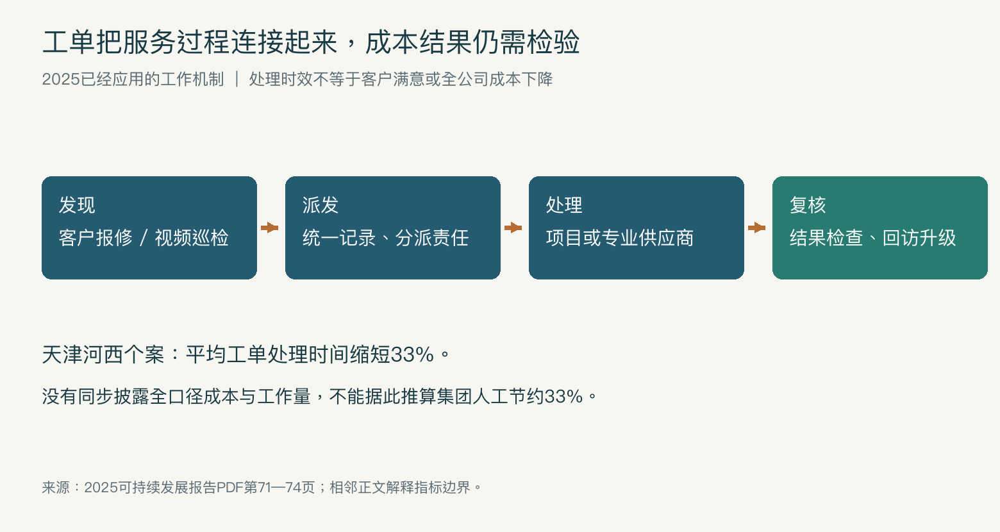

服务反馈也有具体边界。2025年住宅第三方满意度为88分，商业物业企业调查为98.42%，两者问卷、对象及单位不同，不能画成同一排名或合成“全公司满意度”。公司称7,564项服务诉求按规定时限处理，投诉回访率100%；后一个指标说明进行了回访，不等于所有投诉都已满意解决。总部30分钟派发、项目24小时跟进、超过三天升级，同样是处理程序，而非所有问题24小时修好。[满意度与投诉处理 · 第74页](https://www1.hkexnews.hk/listedco/listconews/sehk/2026/0430/2026043001880.pdf#page=74)

这些披露支持公司建立了覆盖较广的反馈和纠错机制。若要证明服务质量长期优于同行，还需同一调查方法下的连续结果、重大故障和实际续留表现。现在可以承认机制存在及局部改善，不宜凭两个高分就认定客户愿意长期支付溢价。

## 外包降低了固定负担，也把难题移到供应商管理

秩序维护、环境和工程供应商要经过资格准入，再接受过程及年度评价，不合格者可被淘汰。供应商可以让公司随项目增减调整人员，也可能带来执行差异：采购报价过低，后续容易表现为缺岗、人员流动或服务缩水，客户仍会向保利追责。因而外包的有效性应同时体现为成本受控、服务稳定和合同留下，而不是只看上市公司工资开支下降。[供应商准入 · 第95页](https://www1.hkexnews.hk/listedco/listconews/sehk/2026/0430/2026043001880.pdf#page=95)[评价与退出 · 第96页](https://www1.hkexnews.hk/listedco/listconews/sehk/2026/0430/2026043001880.pdf#page=96)

2025年员工福利开支34.86亿元，低于2024年的37.92亿元；这与分包增加放在一起看，更接近服务供给方式的调整。年报没有足够数据把直接员工、外包人员总工时与服务产出还原，不能把两期工资差额全部视为生产率收益。2026年上半年应付款下降，公司解释包括加快供应商付款；这样做可能维持供应链，但会先减少当期现金，效率与付款节奏也应分开。[员工开支 · 第124页](https://www1.hkexnews.hk/listedco/listconews/sehk/2026/0430/2026043001633_c.pdf#page=124)[应付款变动 · 第16页](https://www1.hkexnews.hk/listedco/listconews/sehk/2026/0916/2026091600311_c.pdf#page=16)

## 财务结果有没有接住这些改善

总部层面已有结果：2025行政开支由11.22亿元降至9.93亿元。公司将其与组织合并、效率改善联系起来，但员工股权激励原本要计入费用，2025年相关估计调整使一部分过去计入的费用转回，改善了利润；这种账面调整没有新收进一笔客户现金。该变化不能全部指定给行政费，也不能在估值里一面采用已降低的费用，一面再额外加一遍“降本收益”。2026上半年行政费4.36亿元，同比略降，说明新的费用水平已有后续支持。[行政开支 · 第27页](https://www1.hkexnews.hk/listedco/listconews/sehk/2026/0430/2026043001633_c.pdf#page=27)[股份支付 · 第124页](https://www1.hkexnews.hk/listedco/listconews/sehk/2026/0430/2026043001633_c.pdf#page=124)[中期利润表 · 第24页](https://www1.hkexnews.hk/listedco/listconews/sehk/2026/0916/2026091600311_c.pdf#page=24)

项目层面则仍承压。2025基础物业增收14.75亿元，只增加毛利0.88亿元。毛利率从14.33%降到13.39%，意味着每收100元服务费，扣直接服务成本后留下的钱少了约0.94元；2026上半年收入增11.9%，毛利增6.8%，同季毛利率继续下降。新增项目结构、竞争报价和启动成本都可能造成这种组合，但没有项目毛利桥，不能选一个原因当全部解释。其投资含义明确：全国组织和质量工具有价值，单位经济改善尚未完成证明。正常盈利采用13%的基础物业毛利率与10亿元行政费，不把机器人、数字化或片区整合的未来收益另作加项。

最能改变这一判断的，是同一批项目在服务考核稳定的同时，单位成本降低、续约价格保持并按时收款。若效率只体现为少报几名员工，实际外包成本和应收继续增加，就没有形成可供股东持续取得的改善。

## 专题 · 回款：新增收入为什么没有同时成为现金

保利物业2025年归母利润15.49亿元，经营现金流18.27亿元；单看一年，现金高于利润。但经营现金流从2023年的24.16亿元连续下降。到了2026上半年，公司赚得归母利润9.33亿元，经营现金却净流出4.82亿元。问题不在于物业行业是否存在季节性，而在于同样的半年，现金结果也在变差。[2023现金流 · 第79页](https://www1.hkexnews.hk/listedco/listconews/sehk/2024/0425/2024042503584_c.pdf#page=79)[2025现金流 · 第85页](https://www1.hkexnews.hk/listedco/listconews/sehk/2026/0430/2026043001633_c.pdf#page=85)[2026现金流 · 第29页](https://www1.hkexnews.hk/listedco/listconews/sehk/2026/0916/2026091600311_c.pdf#page=29)

## 项目来源不等于付款人

集团开发的住宅交付后，大量物业费由住户支付；“集团来源基础物业收入”不是关联方应收的同义词。商业与公共项目常由机构统一付款，合同还包含开票、服务考核和验收程序。公司对多数公共及商业项目给予30—90天信用期，但员工工资和供应商费用持续发生。收入已确认、付款流程尚未完成时，应收就会增加；超过合同期限或久拖不决，才进一步涉及回收风险。[项目来源 · 第16页](https://www1.hkexnews.hk/listedco/listconews/sehk/2026/0430/2026043001633_c.pdf#page=16)[信用期 · 第38页](https://www1.hkexnews.hk/listedco/listconews/sehk/2026/0916/2026091600311_c.pdf#page=38)

因此，基础物业业务在会计上重复性强，不等于所有客户先付款。收缴速度、信用期与合同考核决定多少利润被留在周转里；公司还会代业主支付能源等费用，这些通常放在其他应收而非物业收入中，要一并看资金需求。

## 客户欠多少，账上预计还能收回多少

客户已经接受服务但还没付款，保利就持有一笔收款权利，记作应收款资产。合同尚欠的金额是原值；公司估计其中可能收不回的部分，叫坏账准备或拨备；从原值扣掉拨备，报表显示净额。净额仍是估计能收回的钱，客户真正付款才会增加现金。

2026年中贸易应收及票据净额44.33亿元，比2025年底34.44亿元多9.89亿元。拨备前第三方余额从29.86亿元增至39.26亿元，关联方从6.37亿元增至7.38亿元。这一组原值尚未扣拨备，与前面的净额不能直接相加核对。新增欠款主要来自第三方，但没有住宅、商办和政府各自的完整账龄，无法进一步认定哪类客户造成了多少拖欠。第三方也不自动意味着风险分散充分。

贸易应收净额中，一年以上部分从2024年底约1.94亿元，增至2025年底3.64亿元，2026年中5.19亿元。2025年第三方拨备前的一年以上余额为3.63亿元，较2024年1.66亿元扩大。旧账积累比单纯期末新增收入更值得关注，因为它不容易完全用本期新进场解释。[应收账龄 · 第138页](https://www1.hkexnews.hk/listedco/listconews/sehk/2026/0430/2026043001633_c.pdf#page=138)[第三方预期信用损失 · 第153页](https://www1.hkexnews.hk/listedco/listconews/sehk/2026/0430/2026043001633_c.pdf#page=153)[中期净账龄 · 第39页](https://www1.hkexnews.hk/listedco/listconews/sehk/2026/0916/2026091600311_c.pdf#page=39)

拨备的变化先影响账面利润：预计损失增加时，计入费用并降低应收净额；预计损失减少时，可能转回以前的费用。它并不表示当期又支付一笔现金，也不是把钱存到专户。后续客户付款、确认核销或重新估计损失，是另外的动作。

与此同时，2025第三方1—2年和两年以上余额的拨备率分别16.5%、70.7%，低于2024的27.8%、86.6%。分组客户构成、前瞻判断和回收预期都可能改变拨备率；公开表格不足以证明公司故意少提，也不足以证明旧账变安全。2026上半年贸易及其他应收减值损失合计约0.76亿元，已计入利润。判断应把实际收回、账龄迁移和损失计提连起来，而非只看净应收扣过拨备便放心。[信用损失分组 · 第153页](https://www1.hkexnews.hk/listedco/listconews/sehk/2026/0430/2026043001633_c.pdf#page=153)[中期损失费用 · 第33页](https://www1.hkexnews.hk/listedco/listconews/sehk/2026/0916/2026091600311_c.pdf#page=33)

代业主付款从2025年底5.05亿元增至2026年中6.20亿元。它有对应追偿对象，却占用真金白银；若长期收不回来，也会产生损失。它与贸易应收分列，不能因为公司报告“现金充裕”就从周转分析中省略。[代业主付款 · 第39页](https://www1.hkexnews.hk/listedco/listconews/sehk/2026/0916/2026091600311_c.pdf#page=39)

## 2025现金下降并非利润下滑造成

现金流附注先从利润中撤掉折旧、拨备等不涉及本期付款的账面项目，再加入客户及供应商的收付时间差。客户欠款增加，意味着有收入还没收到钱；公司取得外包服务却尚未结算，则暂时把现金留在账上。应付提供的这种周转减少，就会在其他条件不变时压低现金流。

2025现金流量表中，营运资金变化前的经营现金约23.94亿元，略高于2024的23.24亿元。贸易应收耗用3.84亿元，上一年耗用2.15亿元；贸易应付带来的资金增加只有0.76亿元，上一年为4.59亿元。其他项目合计后，经营产生现金由27.35亿元降至23.12亿元，再扣税及利息，得到18.27亿元。客户欠款增加，供应商结算又较少留下周转资金，抵消了利润改善对现金的帮助。[经营现金调节 · 第156页](https://www1.hkexnews.hk/listedco/listconews/sehk/2026/0430/2026043001633_c.pdf#page=156)

这张表中的应收、应付变化并不等于资产负债表两期余额之差。例如，应收净额还可能因增加拨备而减少，但这并没有收进现金。年报没有把全部差异逐项拆开，不能把两张表的差额直接解释为客户又少付了多少。现金下降的方向来自正式现金调节表；风险来源与账龄则来自应收附注，两者应各按自己的口径使用。

## 2026上半年又差在哪里

同季经营现金净额从2025年的流出2.00亿元扩大为2026年的流出4.82亿元，差2.82亿元。正式现金表显示，税息前经营现金少3.02亿元，税款和利息反而少付约0.20亿元，合计才是2.82亿元；并非税息突然上升造成。[同季现金收付 · 第29页](https://www1.hkexnews.hk/listedco/listconews/sehk/2026/0916/2026091600311_c.pdf#page=29)

资产负债表显示，2026上半年应收净额比年初增加9.89亿元，少于上年同期的11.10亿元；单看这一项，新增客户欠款占用有所减轻。但应付款减少额由上年同期1.43亿元扩大到3.85亿元，意味着公司更快结算了供应商的账。

客户预先付费、保利还需在以后提供服务，会形成合同负债，也给公司带来暂时的周转资金。2026上半年这一余额只增加0.06亿元，上年同期增加0.68亿元；与此同时，代业主垫款增量由0.50亿元扩大到1.15亿元。更快付钱、更少新增预收和更多代垫，解释了为什么不能只看应收增量便宣布现金改善。中报没有完整调节表，这些余额又含拨备等非现金变化，因此只能说明压力方向，不能相加冒充全部现金差额的精确分解。[2025年中余额 · 第26页](https://www1.hkexnews.hk/listedco/listconews/sehk/2025/0925/2025092500521_c.pdf#page=26)[2025代垫 · 第40页](https://www1.hkexnews.hk/listedco/listconews/sehk/2025/0925/2025092500521_c.pdf#page=40)[2026年中余额 · 第25页](https://www1.hkexnews.hk/listedco/listconews/sehk/2026/0916/2026091600311_c.pdf#page=25)[2026代垫 · 第39页](https://www1.hkexnews.hk/listedco/listconews/sehk/2026/0916/2026091600311_c.pdf#page=39)

## 多少属于周转，多少会变成永久损失

客户晚付但最终全额付清，会占用资金并降低回报；客户永远不付，则同时损害资本。对前一种风险，估值保留15—25亿元一般经营流动性，承担净账期、预收服务义务及应付结算。它不等于把44.33亿元应收全部重新扣一次，亦不等于历史现金流中每一年的应收增加都永久重复。

对最终收不回的钱，本书分两个期间处理。以后持续服务也会遇到坏账，基准每年先扣1.2亿元正常信用损耗，范围0.8—1.8亿元。它参考2025全年约0.46亿元、2026上半年约0.76亿元的实际减值费用：旧账增加时不能继续照搬过去低费用，但一个半年的损失也不一定每半年重复。

截至估值时已经形成的旧账，报表已经扣过拨备。本书另外用1—3亿元、基准2亿元，演示这些旧账回收仍低于账面估计的后果。这是对现有净资产的额外一次性压力，不是每年再扣2亿元，也不是已核实的核销额。当前一年以上净应收5.19亿元，1—3亿元约为其19%—58%；这个比较说明压力的大小，不代表逐户测得的坏账率。以后新业务的损耗与今天旧账的额外损失需要分清，同一笔损失不得重复扣。

回款目前是三条经营主线中最弱的一环。若2026下半年能收回较多旧账、减少代垫，全年现金可能恢复；若利润继续增加而一年以上余额、信用损失和代垫同时走高，应按证据分别处理：周转需要更多资金时提高储备；以后正常损耗增加时下修持续盈利；已有旧账额外损失一次扣除。如果固定规模下每年仍继续新增净占款，须重做逐年现金路径，不能只加一次储备。新增管理面积和账面现金余额，都不能替代这一判断。

## 专题 · 资本配置：123亿元资金，为什么不能全部算给股东

2026年6月底，保利物业有现金等价物约101.32亿元，另有存单本金22.06亿元，合计123.37亿元。公司没有银行借款，但这笔钱还要承担代业主保管款项、日常履约、车位保证金和租赁等用途。要知道股东能拿走多少，必须先沿合同把属于别人的钱、业务还要使用的钱分出来。存单这里仅计本金；报表含应计利息的账面金额约22.96亿元，不再拿来重复加一次。[存单本金 · 第40页](https://www1.hkexnews.hk/listedco/listconews/sehk/2026/0916/2026091600311_c.pdf#page=40)[现金等价物 · 第41页](https://www1.hkexnews.hk/listedco/listconews/sehk/2026/0916/2026091600311_c.pdf#page=41)[借款情况 · 第16页](https://www1.hkexnews.hk/listedco/listconews/sehk/2026/0916/2026091600311_c.pdf#page=16)

## 车位业务赚的是代理费，交出去的是保证金

本节两期代理安排中的目标车位由保利发展及其关联公司持有，保利物业获得独家代理机会，介绍买家或租户并跟进付款。客户把成交款付给保利发展，保利发展收到款后按月向保利物业结算代理费，金额是实际成交价超过约定基准价的部分。保利物业记入收入的是这笔代理费，而不是客户支付的全部车位价款；人员、营销等成本仍要从代理收入中扣掉。[基准价与代理安排 · 第8页](https://www1.hkexnews.hk/listedco/listconews/sehk/2026/0209/2026020900306.pdf#page=8)[客户付款及代理费结算 · 第9页](https://www1.hkexnews.hk/listedco/listconews/sehk/2026/0209/2026020900306.pdf#page=9)

取得代理机会还要先向开发商交保证金。它按合同可退回，在占用期间却不能用来付其他款项；它不属于买断车位的价款，退回时也不会产生一笔新的代理利润。基准价原则上不高于代理参考价的80%，保证金不超过相应基准价总额的50%，两项约定分别影响代理收入空间和需要先交出的资金。2025年，两期安排各自最高保证金达到30亿元、20亿元，两项代理收入合计约2.26亿元。[保证金 · 第9页](https://www1.hkexnews.hk/listedco/listconews/sehk/2026/0209/2026020900306.pdf#page=9)[第二期框架 · 第69页](https://www1.hkexnews.hk/listedco/listconews/sehk/2026/0430/2026043001633_c.pdf#page=69)[两期执行 · 第70页](https://www1.hkexnews.hk/listedco/listconews/sehk/2026/0430/2026043001633_c.pdf#page=70)[最高余额 · 第71页](https://www1.hkexnews.hk/listedco/listconews/sehk/2026/0430/2026043001633_c.pdf#page=71)

2026第二期续约把资金循环写得很清楚：6月30日和12月31日前归还既有保证金，再重新评估并可支付新的保证金。未售车位可以替换成等值车位，无可用替换时终止并在七个营业日内退款。公司称以往均按约收回，这是支持可回收性的重要事实。但报表日资金回到公司，并不代表下一阶段不再用钱，也不能拿期末现金与年内保证金峰值重复相加。[返还及重新投入 · 第10页](https://www1.hkexnews.hk/listedco/listconews/sehk/2026/0209/2026020900306.pdf#page=10)[执行历史 · 第11页](https://www1.hkexnews.hk/listedco/listconews/sehk/2026/0209/2026020900306.pdf#page=11)

两项50亿元是峰值/上限之和，未披露是否同时达到，实际年平均占用可能更低。计算真实资金回报，需要知道平均有多少钱被占住，以及代理费扣完人员、营销和税以后还剩多少；单拿全年代理收入除以最高额度，回答不了这两个问题。估值为维持现有代理盈利保守留50亿元运行储备；若以后披露证明所需峰值更低，可释放一部分。第一期原安排到2026年底，其后是否续签、额度是否变化仍需跟踪，不能把当前假设写成永不变动的合同事实。

三年的结果也值得放在一起：两期代理费合计从2023年3.890亿元，降到2024年2.376亿元、2025年2.255亿元，而各年披露的两项最高保证金合计都为50亿元。峰值不变、毛收入减少，是资金效率承压的信号；它仍不提供真实平均资金回报率。当前正常盈利采用最近四季业务组合，不预设代理收入回到2023高点；若代理费继续下滑而用款额度不降，经营盈利和资金桥都要重新判断。[第一期2023执行 · 第62页](https://www1.hkexnews.hk/listedco/listconews/sehk/2024/0425/2024042503584_c.pdf#page=62)[第二期2023执行 · 第63页](https://www1.hkexnews.hk/listedco/listconews/sehk/2024/0425/2024042503584_c.pdf#page=63)[第二期2024执行 · 第68页](https://www1.hkexnews.hk/listedco/listconews/sehk/2025/0428/2025042802401_c.pdf#page=68)[第一期2024执行 · 第70页](https://www1.hkexnews.hk/listedco/listconews/sehk/2025/0428/2025042802401_c.pdf#page=70)

## 写字楼租赁的支出不是每年都均匀出现

以2024年续签协议为例，房东是保利发展及广州睿驰、广州瑞富、广州瑞咨三家子公司；承租并经营的是保利物业全资子公司保利商业物业。标的位于广州，包括保利天慕广场东、西塔、保利国际广场和广州保利中心。保利物业取得的是2024年5月28日至2027年5月27日期间的使用与经营权，没有买下这四处楼宇的产权。

保利商业物业再与租户签分租合同，把办公空间租出去并收租。它要承接现有租约、处理到期续租和新租合同；新的关联租约由其运营、财务、法务及管理层审批，并按市场原则定价。原房东集团也租回部分空间自用，因此同一集团一方面作为房东向保利商业物业收租，另一方面作为租户向它付租金。2025年这项协议下的关联分租收入为0.63亿元。

向房东付款分两部分：先一次付约8.4亿元，另有随实际收租情况调整的剩余租金。协议起初预计后三年剩余租金合计约1.03亿元；实际收到的租金高于或低于约定基准时，按差额的50%相应上调或下调这部分付款。经营方与房东由此分担部分收租波动，但前面的大笔预付款已经交出，空置或收租不佳仍会压缩经营方的回报。

预付的8.4亿元换来的是未来三年的使用权。付款时现金先减少，账上保留尚未使用的租赁权利作为资产；随后随租期经过，把这一权利的消耗逐期计入成本，年报称为折旧。所以，资产表里出现“租赁资产”并不表示公司拥有楼宇产权；2025年扣了折旧，也不表示2025年又支付一次同额租金。

公司还租用其他物业供自己办公或分租。2025年全部租赁现金流出约0.60亿元，远低于2024年集中付款时的9.16亿元；同年出租用途的租赁资产及投资物业折旧约2.76亿元。钱在哪一年付出去，与使用权在哪一年被消耗不同。若2027年继续经营到期项目，通常还需为新的租期付费，不能拿2025年的低付款额当作永久维持这门生意的成本。

2025年披露写字楼租赁收入约2.37亿元，出租资产及投资物业的相关直接经营开支约2.36亿元。报告没有把这两项与全部折旧、各楼宇现金收支接成完整项目利润表，因此不能靠两个接近的数字精算回报；现有披露也不足以支持高回报的判断。本书估值在全公司层面保留维持租赁所需的完整年度成本，第七章说明替换方法。

[交易双方与四处物业 · 第3页](https://www.hkexnews.hk/listedco/listconews/sehk/2024/0422/2024042201952_c.pdf#page=3)[租期、预付与浮动租金 · 第4页](https://www.hkexnews.hk/listedco/listconews/sehk/2024/0422/2024042201952_c.pdf#page=4)[使用权及分租会计说明 · 第6页](https://www.hkexnews.hk/listedco/listconews/sehk/2024/0422/2024042201952_c.pdf#page=6)[分租定价与签约 · 第10页](https://www.hkexnews.hk/listedco/listconews/sehk/2024/0422/2024042201952_c.pdf#page=10)[协议执行与关联分租 · 第64页](https://www1.hkexnews.hk/listedco/listconews/sehk/2026/0430/2026043001633_c.pdf#page=64)[全部租赁现金流及用途 · 第131页](https://www1.hkexnews.hk/listedco/listconews/sehk/2026/0430/2026043001633_c.pdf#page=131)[租赁资产折旧 · 第132页](https://www1.hkexnews.hk/listedco/listconews/sehk/2026/0430/2026043001633_c.pdf#page=132)[写字楼租赁收入 · 第21页](https://www1.hkexnews.hk/listedco/listconews/sehk/2026/0430/2026043001633_c.pdf#page=21)[出租资产直接成本 · 第134页](https://www1.hkexnews.hk/listedco/listconews/sehk/2026/0430/2026043001633_c.pdf#page=134)

估值因此把过去租金的账面折旧撤掉，改扣维持同类业务所需的完整年度租金，基准为3.4亿元。这个年度成本解决“生意平均每年需要花多少”，保留周转资金则解决“集中预付时能不能拿出钱”。2027年若续租仍要求先付多年租金，需检验20亿元一般周转储备是否足够；不够就应下调可交给股东的剩余现金。2025年剩余可变租金实际为零，不能据此假定今后都不需要付。[剩余租金实际支付 · 第64页](https://www1.hkexnews.hk/listedco/listconews/sehk/2026/0430/2026043001633_c.pdf#page=64)

## 集团财务公司：可提现与集中风险同时存在

2026年中财务公司存款20.23亿元包含在现金中。2026—2028框架上限20.30亿元，存放由公司自主选择，提款按要求当日处理，定价参照国有银行等机构。凭这些条款，把它全额视为受限现金不合适；把它与无集团联系的国债视为完全等价也不合适。风险取决于金融机构和集团信用、资金调度，以及公司是否持续拥有现实可行的退出选择。[关联存款 · 第41页](https://www1.hkexnews.hk/listedco/listconews/sehk/2026/0916/2026091600311_c.pdf#page=41)[存款额度 · 第10页](https://www1.hkexnews.hk/listedco/listconews/sehk/2025/1215/2025121500486.pdf#page=10)[选择权及提现 · 第10页](https://www1.hkexnews.hk/listedco/listconews/sehk/2025/1215/2025121500486.pdf#page=10)

目前没有据此认定本金已经损失。估值单独演示：若期末存款出现20%永久损失，普通股价值约少0.73元人民币/股；若车位50亿元运行资金出现10%永久损失，约少0.90元/股。两者是独立的资本压力，不代表发生概率，也不能不问时点和资金重叠就机械叠加。

## 上市收到的钱，后来变成了什么

2019年上市及随后在2020年1月完成的超额配股，合计净募集约52.18亿港元。新股认购款进入公司时，现金资产和股东投入的权益增加，营业收入和经营利润没有因此增加。此后钱可能用于采购、收购、保证金或预付租金；现金转成其他资产，或随着服务消耗进入费用。今天评估公司拥有多少资源，应看当前各项资产及负债，不能在它们之外再加一次历史募集额。[募集款及超额配售 · 第31页](https://www1.hkexnews.hk/listedco/listconews/sehk/2020/0422/2020042201147_c.pdf#page=31)[股本与溢价 · 第140页](https://www1.hkexnews.hk/listedco/listconews/sehk/2020/0422/2020042201147_c.pdf#page=140)[2020年1月超额配股 · 第167页](https://www1.hkexnews.hk/listedco/listconews/sehk/2020/0422/2020042201147_c.pdf#page=167)

## 从资金余额走到可分配余额

2025年度股息每股人民币1.401元，合计约7.75亿元，2026年7月已经支付。六月末观察普通股现有资金，必须扣这项已知期后流出。业主暂收和可退按金合计约16.63亿元，也不能当作股东永久资源。[股息 · 第35页](https://www1.hkexnews.hk/listedco/listconews/sehk/2026/0916/2026091600311_c.pdf#page=35)[其他应付 · 第42页](https://www1.hkexnews.hk/listedco/listconews/sehk/2026/0916/2026091600311_c.pdf#page=42)

保留50亿元车位储备后，再留20亿元一般经营流动性，范围15—25亿元，约相当于一至两个月服务及行政支出。这一项处理净收付节奏、预收服务责任与供应商结算，不能再机械把所有经营负债逐项加扣一次。尚未使用的募集款中，约6.06亿元人民币已安排用于投资收购和数字化，另行保留；用于一般营运的部分已包含在20亿元储备中，不再扣一次。原用途金额分别为5.39亿、1.69亿和2.51亿港元，换算时沿用本书参考汇率。[未用募集资金 · 第17页](https://www1.hkexnews.hk/listedco/listconews/sehk/2026/0916/2026091600311_c.pdf#page=17)

由此得到约22.94亿元条件剩余资金。股东能否取得、何时取得，仍由实际资本配置决定。控股集团持有72.289%，过去已持续派息，但没有宣布把这笔研究剩余资金作为特别股息分配。基准先按立即可兑现资源比较，同时保留延后五年的价值情景。[控制关系 · 第21页](https://www1.hkexnews.hk/listedco/listconews/sehk/2026/0916/2026091600311_c.pdf#page=21)

资本配置的现阶段判断是：公司有充足账面流动性和真实分红，全年车位及租赁用款又显著缩小了现金自由度。若未来资金退回后少做低回报项目、多交给股东，价值可以改善；若不断追加关联业务、长期维持低收益留存，现金余额再大也难以等比例提高普通股回报。

## 专题 · 估值取值与情景依据：哪些是事实，哪些是判断

现金与估值主报告采用现有业务、无额外增长溢价的基准。主报告已完整列出资产调整、正常收益、资金留存和每股价值的计算；本篇保留取值依据、来源定位及情景复算口径，便于核对。经营金额以人民币计算，股价比较才换算币种；采用2026年9月底已发行5.533334亿股。参数和条件计算沿用2026年11月3日研究，财务至2026年中，价格及汇率为2026年10月30日参考。[法定已发行股数 · 第2页](https://www1.hkexnews.hk/listedco/listconews/sehk/2026/1005/2026100500994.pdf#page=2)

## 收入和毛利：当前业务规模怎样生成盈利

最近四季使用2025全年加2026上半年减2025上半年。基础物业、非业主增值、社区增值收入分别为139.053、14.918、21.662亿元，合计约175.633亿元；三项收入没有另外叠加车位或写字楼收入，因为这些业务已经包含在原披露分类中。全年与上半年季节不同，采用这一路径比直接将半年翻倍更适合固定当前规模。[年度三业务 · 第26页](https://www1.hkexnews.hk/listedco/listconews/sehk/2026/0430/2026043001633_c.pdf#page=26)[中期三业务 · 第13页](https://www1.hkexnews.hk/listedco/listconews/sehk/2026/0916/2026091600311_c.pdf#page=13)

基础物业基准毛利率13%，低于2025全年13.39%，也略低于最近四季约13.18%，反映同季毛利继续下降；非业主增值采用15%，低于最近四季约17%，不假定开发商相关业务恢复高峰；社区采用43%，低于最近四季约44.61%和2026上半年46.78%，承认低毛利商品收缩后的组合，也为组合持续性留余量。三项形成约29.63亿元毛利。这是经营状态判断，不能将几个百分比称为已经测得的永久利润率。

## 费用、税、租金与维护：如何保留持续经营成本

基准行政费用10亿元，接近2025实际9.93亿元；销售费用0.2亿元、其他经营开支0.1亿元。正常信用损耗采用1.2亿元，0.8—1.8亿元用于经营情景，参考2025约0.46亿元及2026上半年约0.76亿元实际减值，同时考虑长账龄增长。正常服务、培训、获客及员工股权报酬仍属于成本，不因无增长或非当期现金付款就全部加回。补贴、罚款、杂项和金融利息排除在核心经营之外；联营合营收益另外计价。[年度信用费用 · 第123页](https://www1.hkexnews.hk/listedco/listconews/sehk/2026/0430/2026043001633_c.pdf#page=123)[费用与折旧 · 第124页](https://www1.hkexnews.hk/listedco/listconews/sehk/2026/0430/2026043001633_c.pdf#page=124)[减值费用 · 第33页](https://www1.hkexnews.hk/listedco/listconews/sehk/2026/0916/2026091600311_c.pdf#page=33)

租赁按完整经营成本处理。已扣使用权折旧包括自用0.25355亿元和出租2.75456亿元，合计3.00811亿元；连同已扣短租0.30362亿元撤回，再扣年度租金3.4亿元，统一承担自用、转租和短租的持续成本。该取值略高于当前年度消耗与短租合计约3.31亿元，较稳与低位经营情景分别采用3.3和3.6亿元。2024续约曾集中预付8.4亿元，2025实际租赁付现较少；2027若续用仍须付钱，因此不能把2025低支出永续。完整租金已承担租赁义务，权益桥不再扣同一租赁债务，也不另加已经支撑盈利的预付租赁权。[续约及实际付款 · 第64页](https://www1.hkexnews.hk/listedco/listconews/sehk/2026/0430/2026043001633_c.pdf#page=64)[自用使用权 · 第130页](https://www1.hkexnews.hk/listedco/listconews/sehk/2026/0430/2026043001633_c.pdf#page=130)[短租及现金 · 第131页](https://www1.hkexnews.hk/listedco/listconews/sehk/2026/0430/2026043001633_c.pdf#page=131)[出租使用权 · 第132页](https://www1.hkexnews.hk/listedco/listconews/sehk/2026/0430/2026043001633_c.pdf#page=132)

预付8.4亿元之外，合同还预估三年剩余租金合计1.03亿元，并非每年固定支付同一个数：当期实际收租高于或低于基准时，按差额的50%上调或下调剩余租金，每个十二个月结算期结束后六十天内支付。2025年这一部分实际支付为零。因此3.4亿元是按近期低浮动付款状态选取的年度工作估计，不能视为所有收租状态下的长期总成本。若付款增加，要连同实际收租和续约条件重估；后文保留3.7亿元租金单项压力。1.03亿元是三年预估数，不机械整笔追加为每年费用。[剩余租金公式及结算 · 第4页](https://www.hkexnews.hk/listedco/listconews/sehk/2024/0422/2024042201952_c.pdf#page=4)[三年租约与2025实际支付 · 第64页](https://www1.hkexnews.hk/listedco/listconews/sehk/2026/0430/2026043001633_c.pdf#page=64)

经营税率采用25%，略高于近期实际约24%。其后将非租赁折旧摊销0.78191亿元加回，以1亿元年度维护投入替代；0.8—1.2亿元用于情景，涵盖自有设施和合同经济消耗，租赁续用已在租金中承担。2025设备付现约0.45亿元、2026上半年约0.63亿元，不能仅拿某一年低值作永久维护成本。以上处理生成基准年度合并经营收益13.31264575亿元，子公司其他股东权益在后面扣除。

为把前面的取值接成一条完整计算，正常毛利为139.05257×13%＋14.91815×15%＋21.66208×43%＝29.629251亿元；年度收益为［29.629251－10－0.2－0.1－1.2＋3.00811＋0.30362－3.4］×75%＋0.78191－1＝13.31264575亿元。税前替换租赁成本，税后以维护投入替换非租赁折旧，顺序不能调换。图展示累计扣减，原始输入和选择理由仍在上文。

## 资金和权益：哪些可以加，哪些要扣

六月末现金及存单本金123.374亿元，先扣已知七月股息约7.752亿元、业主暂收及可退按金约16.625亿元。存单本金与含应计利息的账面金额不重复相加，财务公司存款已在现金内；未估算七月至十一月其他收付。[资金概况 · 第14页](https://www1.hkexnews.hk/listedco/listconews/sehk/2026/0916/2026091600311_c.pdf#page=14)[七月股息 · 第35页](https://www1.hkexnews.hk/listedco/listconews/sehk/2026/0916/2026091600311_c.pdf#page=35)[现金与存单 · 第40页](https://www1.hkexnews.hk/listedco/listconews/sehk/2026/0916/2026091600311_c.pdf#page=40)[业主暂收及可退按金 · 第42页](https://www1.hkexnews.hk/listedco/listconews/sehk/2026/0916/2026091600311_c.pdf#page=42)

两期车位代理最高保证金额度合计50亿元；2025年各自实际每日最高结余也分别达到20亿元和30亿元。未披露两项是否同时达到峰值，也缺平均余额，基准为持续取得代理收益保留全部50亿元；不是认定全年都占用50亿元，也不是把保证金当费用或已损失资本。一般经营流动性保留20亿元、范围15—25亿元，承担当期净收付与履约责任，约相当于一至两个月服务和行政支出。未来集中续租还需检验这笔储备是否足够，不能因年度盈利已扣租金，就假定付款时一定有现金。[第二期代理费及最高余额 · 第70页](https://www1.hkexnews.hk/listedco/listconews/sehk/2026/0430/2026043001633_c.pdf#page=70)[第一期代理费及最高余额 · 第71页](https://www1.hkexnews.hk/listedco/listconews/sehk/2026/0430/2026043001633_c.pdf#page=71)[退款及重新交付条件 · 第10页](https://www1.hkexnews.hk/listedco/listconews/sehk/2026/0209/2026020900306.pdf#page=10)

未使用募资中的投资收购与数字化部分，按参考汇率折合约6.058亿元另留；一般营运部分已包括在20亿元中。由此得到22.93819575亿元条件剩余资金。它仍归董事会配置，不是已宣布分红。此处把它按及时实现价值计入基准，延后交付另列情景；不能同时把这笔本金的利息留在核心盈利中永久资本化。[未使用募资用途 · 第17页](https://www1.hkexnews.hk/listedco/listconews/sehk/2026/0916/2026091600311_c.pdf#page=17)

联营合营价值另估0.5亿元，其利润已排除在核心收益外。子公司其他股东权益基准扣3.5亿元，情景3—4亿元，2024、2025年度其他股东利润分别0.15586、0.18407亿元，2026上半年0.09155亿元；最近两年年度利润按10%资本化约1.56—1.84亿元，半年数不年化冒充年度实绩。3.5亿元是进一步保守扣减的工作估计，并非精确评估，不把完整净资产与已资本化利润重复相加。上下改变0.5亿元，每股约变0.09元。旧净应收另承受2亿元额外损失压力，范围1—3亿元；相对2026年中一年以上净应收约5.19亿元，约为其19%—58%。这个比例用于显示压力量级，不是测得的实际损失率；2亿元也不是已核实核销额，不按年重复。它针对存量旧账，前面正常信用费用针对以后业务；若证据显示重叠须取消重复部分。[年度利润归属 · 第81页](https://www1.hkexnews.hk/listedco/listconews/sehk/2026/0430/2026043001633_c.pdf#page=81)[半年利润归属 · 第24页](https://www1.hkexnews.hk/listedco/listconews/sehk/2026/0916/2026091600311_c.pdf#page=24)[子公司持股与其他股东 · 第159页](https://www1.hkexnews.hk/listedco/listconews/sehk/2026/0430/2026043001633_c.pdf#page=159)

基准算式为：13.31264575÷10%＋22.93819575＋0.5－3.5－2＝151.06465325亿元普通股权益价值；再除5.533334亿股，为每股27.30083766元人民币。复算使用未四舍五入输入，正文采用约数。10%是人民币投资比较要求，针对服务竞争、回款和资本用途风险，不是测定的市场融资成本，也不是统一买入门槛。

## 资产参照：已计量部分与仍然未知的部分

资产再生产关注重建同等服务能力所需资源。已计量部分从2026年中资产负债表出发：现金与存单采用本金，贸易应收在已计拨备外再施加1—3亿元压力，其他应收预付与存货取9.5—11.5亿元，设备及自用租赁权3.5—5.5亿元，出租物业权益2.5—3.5亿元，联营合营暂按账面；已购无形和递延税资产不另外加价，未核实品牌也不另加。扣全部已知负债和子公司其他股东净资源，已付七月股息同步减少现金与应付，得到每股17.99—19.25元已计量净资源。[资产负债表 · 第25页](https://www1.hkexnews.hk/listedco/listconews/sehk/2026/0916/2026091600311_c.pdf#page=25)[设备原值及租赁权益 · 第130页](https://www1.hkexnews.hk/listedco/listconews/sehk/2026/0430/2026043001633_c.pdf#page=130)

| 项目 | 账面起点 | 较低取值 | 中间取值 | 较高取值 |
| --- | ---: | ---: | ---: | ---: |
| 现金、存单；已扣七月股息 | 116.528 | 115.622 | 115.622 | 115.622 |
| 贸易应收净额；已扣报表拨备 | 44.332 | 41.332 | 42.332 | 43.332 |
| 其他应收、预付、按金、存货等 | 11.715 | 9.500 | 10.500 | 11.500 |
| 设备及自用租赁使用权 | 2.663 | 3.500 | 4.500 | 5.500 |
| 出租物业的租赁权益等 | 3.307 | 2.500 | 3.000 | 3.500 |
| 联营合营投资 | 0.259 | 0.259 | 0.259 | 0.259 |
| 已购无形资产 | 0.822 | 0 | 0 | 0 |
| 递延所得税资产 | 0.721 | 0 | 0 | 0 |
| 调整后资产合计 | 180.346 | 172.712 | 176.212 | 179.712 |
| 减：全部已知负债；已扣已付股息 | 71.253 | 71.253 | 71.253 | 71.253 |
| 减：子公司其他股东净资产 | 1.922 | 1.922 | 1.922 | 1.922 |
| 普通股股东净资源 | 107.171 | 99.538 | 103.038 | 106.538 |
| 除以5.533334亿股：元/股 | 19.37 | 17.99 | 18.62 | 19.25 |

中间估计相对普通股账面净资产的调整为：现金利息−0.90581、旧应收−2、其他资产−1.21496、设备及自用权＋1.83746、出租权益−0.30721、已购无形−0.82185、递延税资产−0.72105，合计−4.13342亿元。107.17140−4.13342＝103.03798亿元，除以5.533334亿股为18.62元；两端99.53798与106.53798亿元分别为17.99和19.25元。表中按亿元列示并四舍五入，复算用上述完整小数。

其他资产原始合计为11.30045＋0.30271＋0.11180＝11.71496亿元。9.5—11.5亿元是未逐笔核实回收和使用价值时的折价估计，不是已测回收率；设备3.5—5.5亿元仅以2025年底原值5.94350亿元约束数量级，没有当前设备清单与重置报价。出租物业权益2.5—3.5亿元也只是围绕账面使用权的工作范围，不含房东产权。区间不能因此升级为正式资产评估。

客户关系、人员组织、跨城市服务网络与合同替换时间没有可靠全量计量，所以这个结果不是完整再生产价值，也不是清算回收底价。它限制了“盈利价值高于重建成本，因此存在壁垒”的推论；资产与盈利是同一家企业的不同观察角度，不能相加。

## 各种情景分别检验什么

基准按当前规模与组合、基础物业13%等毛利、每年1.2亿元信用损耗和20亿元一般储备，回答近期经营状态持续时现有盈利支持什么价值。增长暂不加价；新增项目若产生更多收益，也必须同时承担启动投入、信用损失和新增周转，不能只添加收入增速。

低位经营将三类毛利率降到12%、12%、38%，行政费用增至10.5亿元，信用损耗1.8亿元、维护1.2亿元、租金3.6亿元，年度经营收益约9.95亿元；一般储备提高到25亿元，旧账压力3亿元、其他股东价值4亿元，再用12%要求资本化，得到约17.05元/股。较稳经营采用13.5%、16%、44%毛利率，行政9.8亿元、信用损耗0.8亿元、维护0.9亿元、租金3.3亿元，一般储备15亿元、旧账压力1亿元、其他股东价值3亿元，10%要求下约31.04元/股。两者是成组经营条件，不是给每个参数独立挑选最有利取值。

只改回报要求、经营和资金保持基准，8%与12%分别得到33.32元和23.29元。它们检验愿意为同一收益支付多少，不证明经营变好或变坏。下图将它们和经营情景分别标明；主报告采用27.30元作基准比较，其他结果不相加、不平均，也没有已知发生概率。

现金等待单独计算：22.94亿元税后收益率1%、收益逐年归股东、本金五年后交付，按10%折现，其余基准不变，每股约25.89元。租金单项升至3.7亿元、其余基准不变，每股约26.89元。前者检验资本分配时间，后者检验维持经营成本，都不冒充另一套全面经营情景。

本金永久损失也须单列对象：财务公司期末存款若损失20%，约少0.73元/股；车位50亿元资金若损失10%，约少0.90元/股。它们是资本压力演示，不是已发生损失，也不是发生概率；实际采用前须核对资金时点与是否重叠。当前没有据此认定本金已经损失，合同能否实际履行和资金能否退回才是后续判断依据。

## 研究依据

从物业服务的实际合同和收款过程出发，正常盈利能否转成股东现金，哪些资金必须继续留在企业？

已有规模化获客和服务组织能力，基础物业毛利率及回款仍承压。当前规模正常经营盈利基准约13.31亿元，增长暂不加价；10%条件价值27.30元人民币，参考价格下尚无稳健安全边际。

若服务整合持续降本、旧账收回且资金及时返还，当前估计可能偏保守；若低价获客、信用损失及关联用款持续增加，价值会明显下修。

追踪2026全年旧账回收和同批项目盈利、2027租赁续约、车位实际峰值与返还及股东分配；新证据追加新版本。

## 公开来源目录

- [保利物业2019年度报告](https://www1.hkexnews.hk/listedco/listconews/sehk/2020/0422/2020042201147_c.pdf)

- [保利物业2020年度报告](https://www1.hkexnews.hk/listedco/listconews/sehk/2021/0419/2021041901271_c.pdf)

- [保利物业2021年度报告](https://www1.hkexnews.hk/listedco/listconews/sehk/2022/0419/2022041901322_c.pdf)

- [保利物业2022年度报告](https://www1.hkexnews.hk/listedco/listconews/sehk/2023/0425/2023042502530_c.pdf)

- [保利物业2023年度报告](https://www1.hkexnews.hk/listedco/listconews/sehk/2024/0425/2024042503584_c.pdf)

- [保利物业2024年度报告](https://www1.hkexnews.hk/listedco/listconews/sehk/2025/0428/2025042802401_c.pdf)

- [保利物业2025年度报告](https://www1.hkexnews.hk/listedco/listconews/sehk/2026/0430/2026043001633_c.pdf)

- [2025环境、社会及管治报告](https://www1.hkexnews.hk/listedco/listconews/sehk/2026/0430/2026043001880.pdf)

- [2026—2028财务公司存款服务框架通函](https://www1.hkexnews.hk/listedco/listconews/sehk/2025/1215/2025121500486.pdf)

- [保利物业2025中期报告](https://www1.hkexnews.hk/listedco/listconews/sehk/2025/0925/2025092500521_c.pdf)

- [保利物业2026中期报告](https://www1.hkexnews.hk/listedco/listconews/sehk/2026/0916/2026091600311_c.pdf)

- [哈尔滨理工大学物业服务中标结果公告](https://gzc.hrbust.edu.cn/2026/0430/c1291a104627/pagem.htm)

- [保利物业2021更改上市募集资金用途公告](https://www1.hkexnews.hk/listedco/listconews/sehk/2021/0401/2021040104560_c.pdf)

- [2026车位代理第二期续约通函](https://www1.hkexnews.hk/listedco/listconews/sehk/2026/0209/2026020900306.pdf)

- [保利物业2019招股章程](https://www1.hkexnews.hk/listedco/listconews/sehk/2019/1209/2019120900028_c.pdf)

- [山东财经大学2025年度物业管理服务项目中标结果公告](https://zcb.sdufe.edu.cn/index/article/announcement_detail/id/1545.html)

- [2026年9月股份变动月报](https://www1.hkexnews.hk/listedco/listconews/sehk/2026/1005/2026100500994.pdf)

- [中华人民共和国政府采购法实施条例](https://www.mof.gov.cn/zhengwuxinxi/zhengcefabu/201502/t20150227_1195516.htm)

- [物业管理条例（2018年修订）](https://www.samr.gov.cn/zw/zfxxgk/fdzdgknr/bgt/art/2023/art_f716cd25569f491a80528f22e8da464e.html)

- [上海市物业服务招投标管理办法（2026年施行）](https://www.shanghai.gov.cn/202614bmgfxwj/20260729/b5f6159a9dc242b89a779f24b025f612.html)

- [中南大学校本部、新南校区2025—2026年物业服务中标公告](https://www.ccgp.gov.cn/cggg/zygg/zbgg/202501/t20250116_24078107.htm)

- [保利物业历史股价（已核验2026-10-30收盘）](https://cn.investing.com/equities/poly-property-development-co-ltd-historical-data)

- [外汇局人民币汇率中间价](https://www.safe.gov.cn/AppStructured/hlw/RMBQuery.do?COLLCC=546877760)

- [保利物业2024年物业租赁协议公告](https://www.hkexnews.hk/listedco/listconews/sehk/2024/0422/2024042201952_c.pdf)
