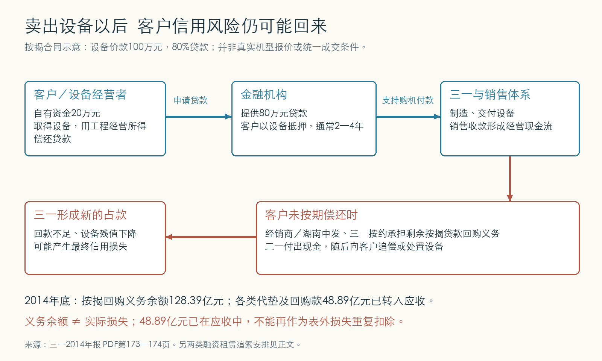
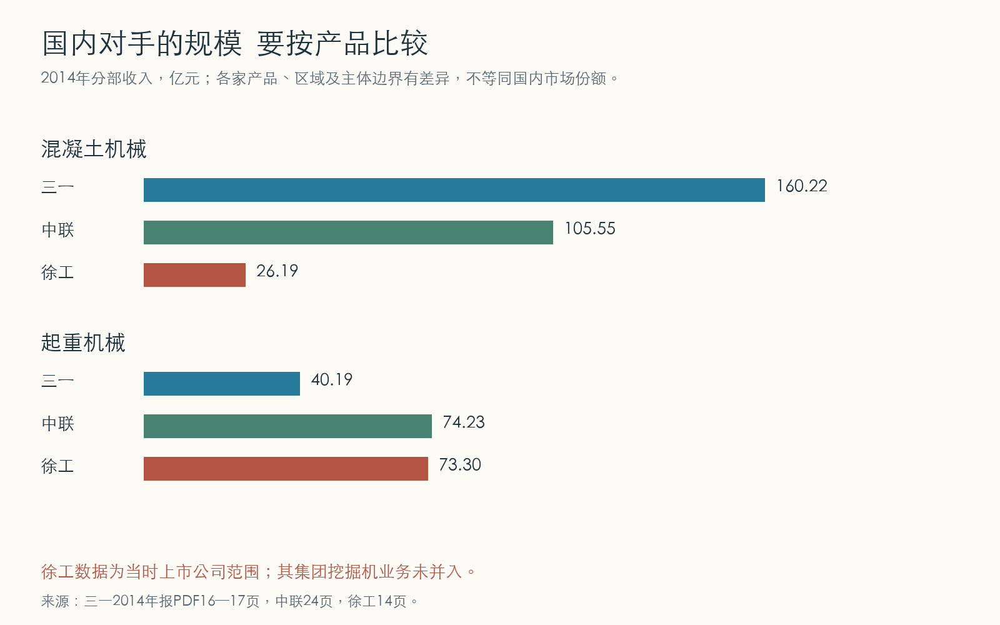
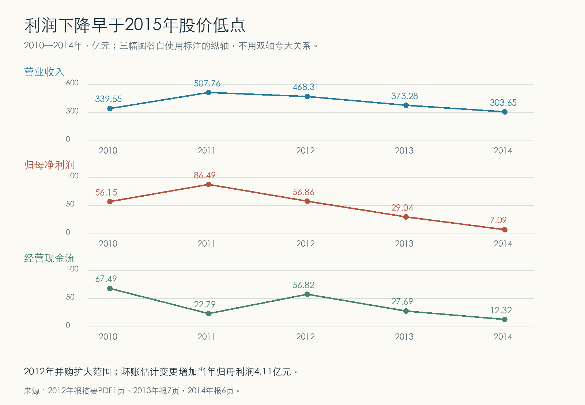
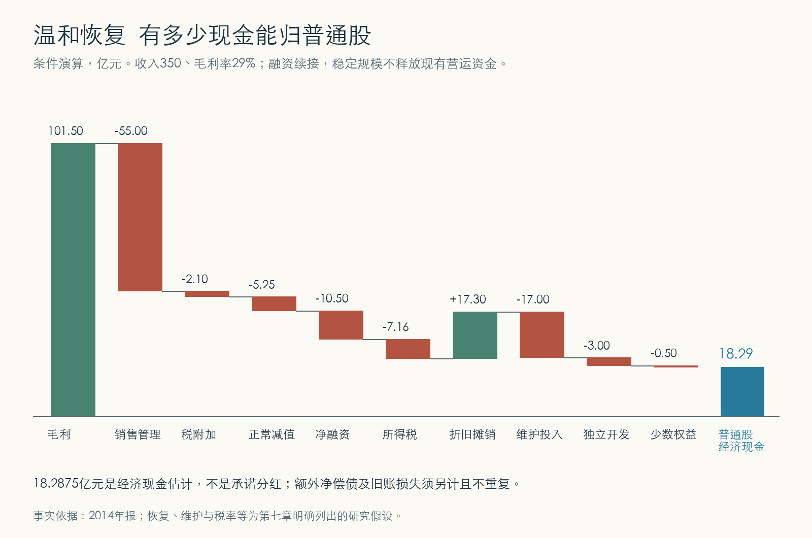
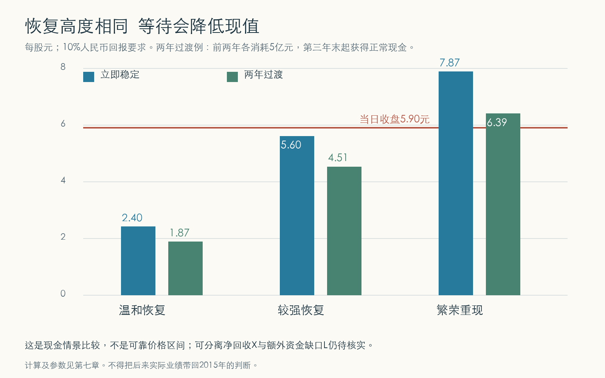

# 三一重工 2015 年历史案例 v3

研究时点 2015-08-26 · 本地发布版本 1461ea392b284b51

## 设备制造和信用销售

到这个时点，公司已有重要产品和渠道，却经历数年收缩。2011—2014年收入从507.76亿元降到303.65亿元，归母利润从86.49亿元降到7.09亿元；2015年一季度接近盈亏平衡。国内中联、徐工各有强项，三一的恢复高度取决于行业需求、竞争和回款共同改善。[历史财务 · 第7页](https://static.cninfo.com.cn/finalpage/2014-04-30/63951687.PDF#page=7)[2014财务 · 第7页](https://static.cninfo.com.cn/finalpage/2015-04-21/1200877170.PDF#page=7)[一季度财务 · 第3页](https://static.cninfo.com.cn/finalpage/2015-04-22/1200883180.PDF#page=3)

本书以2015年8月26日收盘为信息边界，先讲公司，再估值，随后才推进市场归因及模拟动作。那天三一盘中最低5.71元、收盘5.90元，是2015年内的极端低点样本；选中这个日期属于事后挑选研究样本，不能假装当时已知它是底。它也不是跨年最终最低点。估值用收盘5.90元，行情采用当时不复权价格。

## 第1章 · 公司怎样走到2015年

# 公司怎样走到2015年

**站在2015年8月26日，三一重工是一家在混凝土机械和挖掘机上已经建立地位、正在承受工程建设低谷与客户信用压力的设备制造商。** 它具备继续经营和参与下一轮需求恢复的产品基础，但过去的高利润已经大幅收缩，资金回收比新增销售更值得重视。这是理解公司的起点，尚不能从“行业龙头”直接跳到“现在值得买”。

本书把信息停在这一天收盘。最新完整年度是2014年，最新公司定期财务报告是2015年一季报；8月31日才公布的半年报不进入这次判断。2015年内最低盘中价5.71元出现在8月26日，当天收盘5.90元，估值比较采用后者。“年内低点”是为学习而作的事后选样，当时的投资者不知道它会成为2015年的最低价，也不知道下一年会发生什么。

## 先确定买到哪一家企业

研究对象是上海上市的三一重工股份有限公司，代码600031。三一集团是控股股东，梁稳根是最终控制人，集团的全部业务并不都属于这家上市公司。2000年公司改制为股份有限公司，2003年公开发行6,000万股并上市。此后通过产品开发、股权收购与海外布局，把混凝土、挖掘、起重、路面和桩工机械纳入主要业务。2010年向梁稳根等自然人发行股份，是相关资产整合历史的一部分；它不是无成本获得业务，须与少数股权、关联交易和后续资金需求一起理解。[改制与上市 · 第76页](https://static.cninfo.com.cn/finalpage/2015-04-21/1200877170.PDF#page=76)[发行股份及业务边界 · 第77页](https://static.cninfo.com.cn/finalpage/2015-04-21/1200877170.PDF#page=77)

对普通股股东而言，合并报表上的全部利润也不全归自己。挖掘机核心经营主体三一重机在2014年底为全资子公司，汽车起重机主体持股90%，湖南三一路面持股74.30%，部分零部件主体持股75%左右。子公司完成经营、偿付各自义务后，其他股东仍享有对应权益。后面的现金估值会扣除这部分所得，不能把子公司收入或合并净利润都算成上市公司普通股的可分配现金。[主要子公司及持股比例 · 第22页](https://static.cninfo.com.cn/finalpage/2015-04-21/1200877170.PDF#page=22)

三一还有参股的帕尔菲格、银行等金融或产业投资。帕尔菲格10%持股带来的权益法收益与控股工厂营业利润不同；计划参与发起的三湘银行也不是已经成熟的盈利来源。集团宣布进入新领域，须先看出资主体、持股比例和实际业务，才能决定是否属于600031的价值。

## 2014年的业务重心

2014年收入303.65亿元，其中工程机械主营收入297.05亿元。最大的混凝土机械收入160.22亿元，占总收入约52.8%；挖掘机械66.57亿元，约21.9%；起重机械40.19亿元，约13.2%。其余是桩工、路面及其他产品。这意味着当时三一仍首先是一家对混凝土施工需求高度敏感的公司，不能用后来挖掘机或海外业务的结构理解它。[混凝土产品收入 · 第16页](https://static.cninfo.com.cn/finalpage/2015-04-21/1200877170.PDF#page=16)[其余产品及地区收入 · 第17页](https://static.cninfo.com.cn/finalpage/2015-04-21/1200877170.PDF#page=17)

混凝土机械覆盖生产、运输和泵送，连接混凝土企业与工地浇筑；挖掘机覆盖土石方施工；起重机服务吊装，桩工机械参与地基，路面机械服务道路施工。产品分布较广，但客户需求仍共同受工程项目、设备利用率和融资条件影响。多产品并没有把建设周期风险完全分散掉。

国内主营收入198.83亿元、同比下降21.92%；国际主营收入98.22亿元、同比下降9.68%。海外占总收入约32.3%，确实减轻了对国内的单一依赖。不过，国内收入掉得更快也会推高海外占比，不能把占比上升全部解释为海外高速增长。海外制造、服务和客户信用管理同时需要投入，不是把同一台机器运出去就能无成本获得新增利润。

## 两次能力扩展和它们留下的资产

第一类扩展是把核心部件、制造与服务组织做深。公司持续投入研发，逐步自制油缸、控制器和传动等部件，既要减少对外部供应的依赖，也希望控制质量和成本。2014年研发支出16.02亿元，占收入5.28%。这些投入帮助产品进入客户名单，但也是维持竞争所需的成本；有些研发在会计上先形成资产，并不意味着普通股股东当年没有付钱。[部件与产品开发 · 第11页](https://static.cninfo.com.cn/finalpage/2015-04-21/1200877170.PDF#page=11)[研发费用化与资本化 · 第15页](https://static.cninfo.com.cn/finalpage/2015-04-21/1200877170.PDF#page=15)

第二类是国际化并购和合作。普茨迈斯特于2012年4月进入合并范围，给三一带来海外混凝土品牌、技术和渠道；因此2012年与2011年的收入、资产并非完全同范围比较。2014年进一步以约9.24亿元取得帕尔菲格10%股权，并与其合作发展特种车辆。集团营业收入即使缩小，已买入的企业、工厂和技术资产仍须管理和维护，经营不能像一张订单表那样随时收缩。[普茨迈斯特并表日期 · 第17页](https://static.cninfo.com.cn/finalpage/2013-04-27/62439948.PDF#page=17)[对外投资 · 第20页](https://static.cninfo.com.cn/finalpage/2015-04-21/1200877170.PDF#page=20)[帕尔菲格投资及权益变化 · 第124页](https://static.cninfo.com.cn/finalpage/2015-04-21/1200877170.PDF#page=124)

2015年一季度末，固定资产156.75亿元，在建工程13.11亿元，无形资产42.98亿元。这些资源使三一有能力在需求回来时交付产品；闲置、维护成本和回收困难则构成另一面。判断公司值多少钱，需要估计资源未来能产生多少现金，而非简单把建设成本视为股东保底回收额。

## 本书围绕的三个公司特征

三一的第一个特征是产品和服务已经形成竞争地位，第二个是销售依赖客户未来还款能力，第三个是在国内低谷中仍保持国际化及产业投资。前两个特征解释为什么它可能熬过下行，也解释为什么低谷会消耗现金；第三个特征决定未来恢复能否提高普通股所得，还是继续把资金留在扩张中。

下一章从一台设备的买卖及融资过程讲起，第三章比较国内主要对手，第四至第六章把历史利润、资金与资本选择连起来。第七章据此计算价值，并检验5.90元需要哪些条件。第八章保留当时能够登记的观察和动作纪律，等待下一段历史给出新的证据。

## 第2章 · 设备卖出以后 钱怎样回来

# 设备卖出以后 钱怎样回来

三一卖的是客户用来赚钱的生产工具。混凝土泵车把混凝土送到浇筑位置，搅拌车负责运输；挖掘机完成土石方挖装；起重机承担吊装；旋挖钻机参与基础施工。买机器的人需要有工程可做，而且工程款能够收到，才有能力继续买机器和还贷款。房地产开发商、地方基础设施项目和矿山等最终需求，通过施工、设备租赁及混凝土生产运输等经营者传到设备厂。这里描述的是用途和需求传导，并不意味着三一把设备直接卖给所有这些最终投资者。2014年年报没有公开完整的终端客户名单，前五大销售客户只占收入8.42%。[销量与客户集中度 · 第14页](https://static.cninfo.com.cn/finalpage/2015-04-21/1200877170.PDF#page=14)[产品分部定义 · 第174页](https://static.cninfo.com.cn/finalpage/2015-04-21/1200877170.PDF#page=174)

这笔生意的特点，是设备已经交付、收入已经确认，风险仍可能留在三一。理解这一点，才能理解2015年为什么不能只拿旧利润乘市盈率。

## 客户得到的价值和三一承担的工作

对设备经营者而言，采购价只是成本的一部分。同样一台挖掘机，能否多开工、少耗油、及时修好，决定它能否覆盖司机、燃料、维修及融资支出。三一把产品开发、整机制造、零部件配套和营销服务组织在一起。2014年已批量生产驾驶室、四轮一带、油缸、控制器、减速机和回转支承，泵阀等关键部件自制仍在推进；不能据此说全部关键零件都已自主供应。年报列出的服务网络、远程控制及CRM建设，经济用途是减少设备停机、接住配件维修需求，并跟踪从订单到回款的过程。[产品与部件研发 · 第11页](https://static.cninfo.com.cn/finalpage/2015-04-21/1200877170.PDF#page=11)[订单与服务系统 · 第12页](https://static.cninfo.com.cn/finalpage/2015-04-21/1200877170.PDF#page=12)

制造商先采购材料及零部件，安排加工、装配、调试，再交付设备。2014年工程机械成本中，原材料占84.11%，人工9.06%，折旧摊销4.40%。材料价格和供应商议价影响毛利，产量下降则使工厂和研发组织的固定支出更难摊薄。实际销售32,974台、生产31,956台、期末库存4,635台，产量低于销量，结合期末库存比上年下降18.01%，支持公司在减少成品占用的判断，但总台数本身不能区分降产、调拨或产品结构的贡献；不同吨位和产品混在这个台数里，不能用收入除以总台数推断同一产品售价。[生产销售与成本构成 · 第14页](https://static.cninfo.com.cn/finalpage/2015-04-21/1200877170.PDF#page=14)

经销和服务体系也需要付钱。2014年销售费用28.72亿元，其中销售佣金10.72亿元、产品运输4.91亿元、人员薪酬福利5.45亿元。年报支持“渠道与服务有持续成本”，并未给出一个适用于全部经销商的统一合同、买断方式或佣金率。因此，估值不能把这些费用一律当作可取消的低效开支；但也不能凭“服务好”直接给出高于同行的利润率。[销售费用明细 · 第142页](https://static.cninfo.com.cn/finalpage/2015-04-21/1200877170.PDF#page=142)

## 交付和收款不是同一时刻

现款交易中，客户支付设备价款；分期收款交易中，三一先取得部分价款，其余成为客户欠款。公司2014年报明确，分期收款销售满足确认条件时一次确认收入，增值税纳税义务则随合同约定收款时点产生；收入确认并不等于全部钱已收到。不同合同的首付、账期和交付验收安排未作统一披露，本书不编造一套全公司的成交条件。按揭和租赁则再加入提供融资的金融机构。[分期收款与收入确认 · 第134页](https://static.cninfo.com.cn/finalpage/2015-04-21/1200877170.PDF#page=134)[销售收入确认条件 · 第98页](https://static.cninfo.com.cn/finalpage/2015-04-21/1200877170.PDF#page=98)

## 按揭使客户提前买到设备 也让三一继续承担风险

年报披露的按揭方式中，终端客户以购买的设备抵押，经经销商或湖南中发办理金融机构贷款。单个客户贷款通常相当于设备价款的70%—80%，期限2—4年。银行贷款支持购机付款，客户以后用经营所得偿还贷款。客户没有按时还款时，经销商或湖南中发以及三一负有回购剩余按揭贷款的义务。合同扩大了客户的购买能力，同时把未来几年的客户还款能力带进三一的风险范围。[按揭合同及追索安排 · 第173页](https://static.cninfo.com.cn/finalpage/2015-04-21/1200877170.PDF#page=173)

可以用一笔100万元的设备交易理解这件事：假设采用80%贷款，客户自有资金20万元、银行融资80万元。100万元是解释合同的示意金额，不是三一某一机型报价，也不表示所有客户都采用20%首付。设备厂得到销售回款，并不意味着剩下80万元的客户信用风险完全归银行。如果客户停工或工程款收不回来，回购安排可能让三一重新付出现金，再向客户追偿或处置设备。旧机器的回收价还会随行业景气、机龄和损耗变化，抵押物不能保证全额收回。

2014年底，三一负有回购义务的按揭贷款余额128.39亿元。这个数是有条件承担责任的贷款余额，不能直接当成当年损失，也不能因为它在表外就当作没有风险。真正损失取决于违约、回收和处置结果；付款时间也可能早于最终损失确认。

## 融资租赁有两条不同的追索路径

融资租赁先有一笔设备买卖，再有一段设备使用和付租关系。公司2014年股东大会资料说明：终端客户选择出卖人和设备，出租人即租赁公司购买设备，交客户占有使用，按期向客户收租；期满可以按合同留购、续租或退租。三一取得的是设备销售价款，客户按月或按期支付的租金归租赁合同的收款方，不能把两笔都算作三一的收入。具体付款日取决于融资到账和合同，年报并未说明所有租赁销售均在交机当天一次收齐。[融资租赁的初始设备买卖 · 第24页](https://static.cninfo.com.cn/finalpage/2014-06-25/1200004238.pdf#page=24)

第一条涉及康富国际、湖南中宏和金融机构。康富、湖南中宏在这条路径中作为提供融资租赁的公司，承接客户未来应付的租金。早期康富合作公告把资金用途说明得很具体：康富向三一买设备，再租给客户，将应收租金债权转让给金融机构融通资金，专项支付三一的设备价款。2014年报继续披露这类应收租赁款转让及回购安排；早期公告的三年合作期限和额度不能自动视为2015年的合同条件。[康富设备购款的资金来源 · 第2页](https://static.cninfo.com.cn/finalpage/2009-04-21/51494880.PDF#page=2)

在这条路径中，租赁公司把应收租赁款出售给金融机构；承租人不能按约付租时，三一有义务向金融机构回购相关租赁物。2014年底这类回购担保余额41.77亿元。

第二条的出租人是第三方租赁公司，它按融资租赁安排提供购机资金并取得租赁合同项下的权利，客户取得设备的占有使用并承担租金。年报披露客户与三一或经销商签订产品买卖安排，湖南中宏或经销商代理办理租赁；它们在这条路径中主要是融资办理及首层担保方，不应与第三方出租人混为一家公司。三一或经销商作为出卖方收取设备价款，第三方融资支持这笔购款；公开资料没有披露每笔资金是否经过经销商账户，不能进一步画成统一的银行直付路径。承租人不付租，先由湖南中宏或经销商承担担保责任；它们不能履行时，三一承担设备回购义务。2014年底这类余额77.78亿元。两条路径的合同对手和责任触发顺序不同，不能缩成“银行承担客户风险”。这里按年报给出的三类余额分别展示；没有逐笔贷款清单，不把它们与应收账款再简单加总成一个可确认损失。[融资租赁第一类安排 · 第173页](https://static.cninfo.com.cn/finalpage/2015-04-21/1200877170.PDF#page=173)[第三方租赁及第二层回购责任 · 第174页](https://static.cninfo.com.cn/finalpage/2015-04-21/1200877170.PDF#page=174)

## 风险已经从合同变成了真实占款

截至2014年底，三一代客户垫付逾期按揭款、逾期租赁款和回购款的余额合计48.89亿元。公司已将这些款项转入应收账款并计提坏账准备。这不是另外一项应在资产负债表之外重复扣除的48.89亿元；它已经包含在应收账款中。分析时要追问其中还有多少能够回收，而非把整笔金额重复扣一遍。[代垫及回购款进入应收账款 · 第174页](https://static.cninfo.com.cn/finalpage/2015-04-21/1200877170.PDF#page=174)

2014年底应收账款原值212.49亿元，减坏账准备13.98亿元后，净额198.51亿元。年报没有单列48.89亿元代垫回购款对应的全部准备和最终回收率，因此不能用全体应收的准备率证明这部分已经足额覆盖。2015年一季度，应收净额进一步增至222.41亿元，同时收入比上年同期下降37.80%。回款与信用收缩是低谷的核心经营问题，不是利润表旁边的一项附注。[应收原值和坏账准备 · 第109页](https://static.cninfo.com.cn/finalpage/2015-04-21/1200877170.PDF#page=109)[一季度应收账款 · 第8页](https://static.cninfo.com.cn/finalpage/2015-04-22/1200883180.PDF#page=8)[一季度经营数据 · 第3页](https://static.cninfo.com.cn/finalpage/2015-04-22/1200883180.PDF#page=3)

这里也能看见信用政策的两难。三一在2014年及2015年一季度都强调严控成交条件。收紧信用会少卖一些机器，却可能减少新的坏客户；放宽信用可能暂时保住销量，但未来占款和损失会回来。判断竞争力时，应把份额、毛利、实际回款及代垫变化放在一起。只奖励销量，会把更宽松的贷款条件误认成更强的产品。

客户集中度较低，也不能消除这种共同风险。许多不同客户都依靠同一个工程建设周期赚钱，项目放慢时会同时遇到开工和回款困难。三一的竞争优势必须在这一环境里兑现：设备仍有客户愿意选择，销售条件没有持续恶化，最终收回的钱能够覆盖制造、服务、研发、融资和设备更新。后续估值就沿这条资金过程展开。

## 第3章 · 国内竞争怎样改变盈利

# 国内竞争怎样改变盈利

**三一在2015年有继续参与竞争的实力，但没有证据表明它能摆脱行业价格与信用条件的约束。** 国内同行并非一群等待被淘汰的弱者：中联在混凝土及起重机械上具备技术和渠道，徐工在轮式起重机等产品上拥有强势地位。产品领先能争取订单，真正留给股东的收益还取决于竞争者是否一起降价、放宽账期，以及客户能否支付。

## 混凝土机械是最大的利润修复难题

2014年三一混凝土机械收入160.22亿元，毛利率22.12%；中联同类收入105.55亿元、毛利率22.43%。三一收入同比下降15.81%，中联下降38.60%。这组数据支持“三一在这一年的业务收缩程度较轻”，也说明三一的收入规模优势没有变成明显更高的报表毛利率。海外与产品组合不同，不能把两家的收入降幅差全部算成国内份额转移。[三一产品数据 · 第16页](https://static.cninfo.com.cn/finalpage/2015-04-21/1200877170.PDF#page=16)[中联产品数据 · 第24页](https://static.cninfo.com.cn/finalpage/2015-03-28/1200756955.PDF#page=24)

更关键的是时间变化。三一该业务毛利率从2012年的35.69%降至2013年的22.34%，2014年为22.12%。2013年的大幅下降说明问题已超过短期销量波动；低需求、竞争、产品和区域结构变化共同影响盈利。公司没有给出把这13.35个百分点变化逐项分清的同口径价量成本桥，因此不能把它全部归于降价，也不能假定需求一回升就全部恢复。[2012产品毛利 · 第10页](https://static.cninfo.com.cn/finalpage/2013-04-27/62439948.PDF#page=10)[2013产品毛利 · 第16页](https://static.cninfo.com.cn/finalpage/2014-04-30/63951687.PDF#page=16)

中联拥有CIFA混凝土技术，2014年还在推进产品研发、国际服务与其他设备业务。徐工上市公司披露的混凝土收入26.19亿元、毛利率32.14%，并强调与施维英技术协同。这个高毛利率不能直接证明徐工在三一同款泵车上更挣钱：披露分部的产品组合、主体范围与交易边界不同。它至少提醒我们，三一不能把国内竞争理解为只有中联一家，更不能把“全球第一”的公司自述当作高利润的保证。[中联产品研发 · 第18页](https://static.cninfo.com.cn/finalpage/2015-03-28/1200756955.PDF#page=18)[徐工技术协同 · 第10页](https://static.cninfo.com.cn/finalpage/2015-03-30/1200753519.PDF#page=10)[徐工产品构成 · 第14页](https://static.cninfo.com.cn/finalpage/2015-03-30/1200753519.PDF#page=14)

## 挖掘机给了三一更强的产品证据

三一在2014年报中披露，挖掘机连续四年国内销量第一，市场占有率超过15%。挖掘机收入66.57亿元，毛利率32.55%，比混凝土业务高约10个百分点；2013年毛利率33.62%，这两年相对稳定。因此，挖掘机的产品竞争表现比“整个公司都是强周期”这个笼统标签更有信息量。[公司披露的挖掘机地位 · 第10页](https://static.cninfo.com.cn/finalpage/2015-04-21/1200877170.PDF#page=10)[产品毛利 · 第17页](https://static.cninfo.com.cn/finalpage/2015-04-21/1200877170.PDF#page=17)

客户在国产与外资品牌之间比较的，是设备价格、可靠性、油耗、维修响应和融资条件。三一的部件研发和服务网络有助于改善这套组合，份额和毛利共同提供了结果证据。不过，当时超过15%的份额仍意味着大部分市场由其他企业供应，远非垄断。2015年8月10日的行业报道显示，7月28家主要生产企业合计销量2612台，同比下降38.3%；其中三一420台、占样本16.1%，卡特彼勒288台、11.0%，日立227台、8.7%，小松206台、7.9%，徐工149台、5.7%。三一处在领先位置，但国内市场同时面对强劲外资品牌和徐工等本土对手。1—7月样本累计销量38028台、同比下降39%，说明单月低迷还有持续背景。样本包含的销售范围并非一张完整国内终端销量表，单月品牌份额也不能替代全年国内份额。[当时公开的7月行业销售报道 · 第1页](https://www.6300.net/info/detail_143374.html#page=1)

国内还存在徐工、柳工、龙工、山河等参与者，但本书不编造它们当时的统一市场份额。尤其要分清徐工集团和2015年的上市公司徐工机械：徐工2014年报仍把挖掘机械公司列作拟注入的集团资产，上市公司财务表没有覆盖整个集团的挖掘机经营。用今天的上市公司范围回填2015年，会把竞争比较的分母弄错。[当时未注入的挖掘机械资产 · 第39页](https://static.cninfo.com.cn/finalpage/2015-03-30/1200753519.PDF#page=39)

## 起重机和桩工机械不能沿用混凝土的排名

徐工2014年报披露轮式起重机国内份额53%；三一披露250吨级以上履带起重机约40%份额，以及50吨及以上汽车起重机位居行业第二。这些是各公司对不同细分市场的披露，分母不同，不能拼成同一张份额饼图。它们说明三一在大吨位部分产品上有能力，同时徐工在更广的轮式起重机领域保持优势。[徐工轮式起重机 · 第10页](https://static.cninfo.com.cn/finalpage/2015-03-30/1200753519.PDF#page=10)[三一大吨位细分 · 第10页](https://static.cninfo.com.cn/finalpage/2015-04-21/1200877170.PDF#page=10)

就披露分部而言，三一起重机收入40.19亿元、毛利率27.81%；中联74.23亿元、27.79%；徐工73.30亿元、25.19%。两家国内对手的该分部规模都高于三一，三一的毛利率与中联接近。三家分部均包含多类设备，规模差距是竞争组织和客户覆盖的线索，不能直接推断单台盈利或行业议价权。

桩工方面，三一2014年收入12.51亿元，毛利率41.19%，但收入下降41.46%；徐工披露桩工收入16.92亿元，并有资产注入及业务扩展因素。高毛利的小业务也可能遇到更剧烈的销量波动，不能把41%的毛利率外推到整家公司。路面机械规模更小，2014年三一收入10.19亿元、毛利率24.65%，需要持续产品与渠道投入，不能在估值中只保留毛利、删掉费用。[三一桩工及路面 · 第17页](https://static.cninfo.com.cn/finalpage/2015-04-21/1200877170.PDF#page=17)[徐工桩工业务 · 第14页](https://static.cninfo.com.cn/finalpage/2015-03-30/1200753519.PDF#page=14)

## 竞争开始围绕回款质量展开

三一与中联都在2014年强调严控成交条件。中联明确表示收紧销售政策、主动放弃低质订单，并逐台评估设备残值与债权、清理逾期、处置二手机。徐工也把资产安全、风险控制和消化过剩产能作为经营重点。这样的竞争环境有两个方向：企业一起收紧信用，可能减少未来无效供给并改善回款；若为争夺有限订单再放宽条件，则销量恢复可能仍然不能变成股东现金。[逐户风险及二手机管理 · 第19页](https://static.cninfo.com.cn/finalpage/2015-03-28/1200756955.PDF#page=19)[行业与经营策略 · 第10页](https://static.cninfo.com.cn/finalpage/2015-03-30/1200753519.PDF#page=10)

三一2014年经营现金流12.32亿元，中联为负76.90亿元，徐工7.38亿元。三一当年表现较好，但不能据此直接排出信用风险的绝对优劣。中联披露减少无追索保理和应付款，是现金流下降的重要原因；保理政策改变会移动现金收到的时间。公司间比较必须接回融资、应收和应付变化，不能只比较一个经营现金流数字。[中联现金流及保理变化 · 第23页](https://static.cninfo.com.cn/finalpage/2015-03-28/1200756955.PDF#page=23)[徐工经营数据 · 第11页](https://static.cninfo.com.cn/finalpage/2015-03-30/1200753519.PDF#page=11)

国内竞争对估值的直接约束是：温和复苏可以让三一在既有产能上多卖设备、摊薄费用，但不能自动恢复2011年前后的高毛利。挖掘机较强的地位支持给公司保留恢复能力；混凝土毛利的下台阶和国内强劲对手，要求把较强恢复单列为乐观情景。下一章检验这种区别怎样出现在历史数字中。

## 第4章 · 从扩张高峰到低谷

# 从扩张高峰到低谷

三一的低谷并不是2015年股市下跌才出现的。收入在2011年达到507.76亿元，此后2012年468.31亿元、2013年373.28亿元、2014年303.65亿元；归母净利润相应为86.49、56.86、29.04和7.09亿元。到2015年一季度，收入62.75亿元，同比下降37.80%，归母利润只有0.32亿元，同比下降96.18%。股价可以在几天内改变，经营恶化已经持续数年。[2011至2013主要财务 · 第7页](https://static.cninfo.com.cn/finalpage/2014-04-30/63951687.PDF#page=7)[2014主要财务 · 第7页](https://static.cninfo.com.cn/finalpage/2015-04-21/1200877170.PDF#page=7)[2015一季度 · 第3页](https://static.cninfo.com.cn/finalpage/2015-04-22/1200883180.PDF#page=3)

## 高增长留下的不只是利润

2010年收入339.55亿元，归母利润56.15亿元；2011年收入增长49.54%，利润增长约54%。但2011年的经营现金流只有22.79亿元，明显低于86.49亿元归母利润，且低于2010年的67.49亿元。利润和经营现金流本来就有税息、应收应付等差异，不能把两者差额直接称为坏账；它至少表明繁荣期的会计利润没有同期全部变成现金。[2010至2012收入利润及现金 · 第1页](https://static.cninfo.com.cn/finalpage/2013-04-27/62439948.PDF#page=1)

设备制造在繁荣期容易形成相互促进的过程：客户看到工程机会，融资购机；制造商增加生产、渠道和信用支持；新增设备又扩大下一阶段的市场供给。进入低谷，已经购买的设备仍在市场上，客户可能先提高旧设备利用率、租用或购买二手机，而不是立刻订购新机。徐工2014年报明确提到社会存量设备饱和与行业产能过剩，支持这种供需约束确实存在；本书没有完整设备年龄结构，因此不指定某一年必然出现更新潮。[存量设备与产能过剩 · 第10页](https://static.cninfo.com.cn/finalpage/2015-03-30/1200753519.PDF#page=10)

## 2012年利润还包含会计口径的影响

三一2012年降低了部分较短账龄应收款的坏账计提比例，例如一年以内由5%调整为1%、一至两年由10%调为6%；较长账龄部分则提高。公司披露，这项会计估计变更增加当年归母利润4.11亿元，占当年利润7.23%。这不等于已证明造假，也不意味着全部应收会损失；它意味着2012年56.86亿元利润不能原封不动当成跨期正常盈利。[会计估计变更及利润影响 · 第16页](https://static.cninfo.com.cn/finalpage/2013-04-27/62439948.PDF#page=16)

同期普茨迈斯特并表扩展了资产和业务范围。投资者如果只把2011、2012、2013的利润平均，会把行业繁荣、收购扩张和会计估计变化揉进一个数字。正常化必须回到产品毛利、费用、研发、信用损失和融资，而不是机械取多年均值。

## 2013至2014年 费用收缩赶不上毛利减少

2013年混凝土业务毛利率大幅下降，而销售、研发、工厂和服务组织不能按收入同比例缩小。到2014年，总收入下降18.65%，销售费用只下降5.66%，管理费用下降14.02%。即使管理层努力降费，较小的收入仍需承受一套相当大的经营组织。2014年毛利78.26亿元，减销售和管理费用54.05亿元后，只剩24.21亿元，还要支付税金、信用损失和融资费用。[费用与收入变化 · 第13页](https://static.cninfo.com.cn/finalpage/2015-04-21/1200877170.PDF#page=13)[合并利润表 · 第65页](https://static.cninfo.com.cn/finalpage/2015-04-21/1200877170.PDF#page=65)

资金的价格也改变了结果。2014年财务费用12.30亿元，远高于2013年的3.25亿元；但不能把差额全当作借款利率上升。2013年有6.47亿元汇兑收益，2014年转为1.90亿元汇兑损失，部分金融工具损益又列在投资收益等科目。2014年实际披露的利息支出10.38亿元，2013年9.56亿元。后续估值把正常融资成本单独取出，不重复享受某年汇兑收益，也不把对冲两边拆开只留下有利一边。[利息及汇兑 · 第142页](https://static.cninfo.com.cn/finalpage/2015-04-21/1200877170.PDF#page=142)[衍生工具和投资损益 · 第143页](https://static.cninfo.com.cn/finalpage/2015-04-21/1200877170.PDF#page=143)

回款问题还在累积。代垫逾期及回购款从2013年底38.89亿元增至2014年底48.89亿元。按揭回购义务余额同期下降，代垫余额却增加，说明“新发生融资收缩”和“旧账清理完成”是两回事。行业不再快速放贷，也不能自动让旧客户恢复偿债。[2013按揭及租赁安排 · 第177页](https://static.cninfo.com.cn/finalpage/2014-04-30/63951687.PDF#page=177)[2013代垫余额 · 第178页](https://static.cninfo.com.cn/finalpage/2014-04-30/63951687.PDF#page=178)[2014代垫余额 · 第174页](https://static.cninfo.com.cn/finalpage/2015-04-21/1200877170.PDF#page=174)

## 2015年一季度 暂未出现足以确认反转的公司证据

公司把一季度收入下降解释为固定资产及房地产投资放慢、严控成交条件，以及春节较晚导致项目开工推迟。春节因素可能移动季度分布，但它无法单独解释此前数年的收入下行；也不能据此把单季利润直接乘四预测全年。合并营业利润为负0.15亿元，加上营业外项目后归母净利润为正0.32亿元，经营活动净流出9.62亿元。[管理层解释 · 第6页](https://static.cninfo.com.cn/finalpage/2015-04-22/1200883180.PDF#page=6)[季度利润表 · 第12页](https://static.cninfo.com.cn/finalpage/2015-04-22/1200883180.PDF#page=12)[季度现金流 · 第15页](https://static.cninfo.com.cn/finalpage/2015-04-22/1200883180.PDF#page=15)

到8月26日，外部已有一些早期改善线索。8月12日国家统计局公布的1—7月房地产数据中，商品房销售面积同比增长6.1%，房地产企业到位资金增长0.5%，住宅投资增速有小幅回升。但全国房地产投资增速仍只有4.3%，工程机械7月销售仍显著下降。房子卖得更多，可能先改善开发商回款，再传到施工与设备利用率，最后才影响新增购机。这是一条可以观察的恢复路径，尚不是已经验证的三一收入反转。[国家统计局2015年8月12日解读](https://www.stats.gov.cn/sj/sjjd/202302/t20230202_1896939.html)。[7月挖掘机销售 · 第1页](https://www.6300.net/info/detail_143374.html#page=1)

因此，当时最合适的阶段描述是：**公司处在持续下行后的低盈利、信用清理阶段，具有恢复能力，恢复的时间和高度尚未确认。** 这个判断比“已经跌了四年所以该上涨”更严格，也比“利润差所以公司没有价值”保留了更多有依据的机会。

## 第5章 · 利润 现金与偿债

# 利润 现金与偿债

2014年三一仍然盈利，真正紧张的是现金同时要服务于旧客户欠款、设备与研发、银行融资以及股东分配。理解这种竞争关系，比只看资产负债率更能判断低谷中会不会损伤普通股本金。

## 利润表中的收益要经过几次核对

2014年归母净利润7.09亿元，扣除非经常性项目后只有2.54亿元。补助、处置和金融项目影响了当年报表，但扣非利润也不等于完整的经济现金。公司研发统计表披露6.96亿元资本化研发，但开发支出附注中当年未入损益的开发成本为2.72亿元，两者范围尚未完全桥接，不能把6.96亿元直接作为额外开发现金全额扣除；另因激励计划未达到条件，冲回以前确认的股份支付费用1.14亿元。正常化时不能把资本化研发当作免费投入，也不能永远享受这次费用冲回。[归母与扣非利润 · 第7页](https://static.cninfo.com.cn/finalpage/2015-04-21/1200877170.PDF#page=7)[研发资本化 · 第15页](https://static.cninfo.com.cn/finalpage/2015-04-21/1200877170.PDF#page=15)[激励费用冲回 · 第173页](https://static.cninfo.com.cn/finalpage/2015-04-21/1200877170.PDF#page=173)

在已知一季报下，最近十二个月归母利润可直接计算为：2014全年7.09206亿元，加2015年一季度0.31576亿元，减2014年一季度8.27151亿元，等于负0.86369亿元。这不是2015全年预测，而是截至当时最新报告期的滚动结果。因此5.90元对应的2014年静态市盈率约63倍，并不能代表当时滚动盈利估值；滚动利润已为负，通常的正数市盈率失去解释力。

## 2014年现金没有形成充足的自由余量

2014年经营现金流12.32亿元。将净利润调到经营现金流时，存货减少提供21.19亿元，经营性应收增加消耗28.03亿元，经营性应付减少再消耗16.35亿元。存货释放在支持当期现金，客户和往来占款却在吸收现金；这是去库存与清信用同时进行的低谷。[经营现金桥起点 · 第146页](https://static.cninfo.com.cn/finalpage/2015-04-21/1200877170.PDF#page=146)[周转变化 · 第147页](https://static.cninfo.com.cn/finalpage/2015-04-21/1200877170.PDF#page=147)

购建固定资产、无形资产和其他长期资产现金流出15.51亿元，已经超过经营现金流。两者简单相减为负3.19亿元，还没有覆盖全部投资与筹资用途。这项差额只是报表收付比较，不是维护后自由现金流：购建支出混有更新和扩张，研发支出的现金归类也不能凭项目名称全部拆清。估值需要另定维持产能与竞争的支出，而非把本年现金支出永久冻结。[投资及筹资现金流 · 第68页](https://static.cninfo.com.cn/finalpage/2015-04-21/1200877170.PDF#page=68)

2014年公司还投入资金购买股权，并支付股利和利息，同时从借款和子公司其他股东取得资金。合并现金流中的9.40亿元吸收投资来自子公司少数股东，不能说成上市公司普通股经营创造了这些现金。公司具有融资能力，并不等于它已能用自由现金覆盖全部扩张和分红。

## 资产中最大的不确定性在应收

2015年一季度末，应收账款净额222.41亿元，存货75.00亿元，其他应收26.33亿元，三项合计超过323亿元。应收仍按会计估计扣除准备后的净额列示；若未来回收更差，损失还会侵蚀净资产和现金。反过来，若能有效收回，则能缓解融资需求，但回收已有应收主要是把已有资产变成现金，不能再作为额外营业利润加一次。[最新资产构成 · 第8页](https://static.cninfo.com.cn/finalpage/2015-04-22/1200883180.PDF#page=8)

2014年应收原值212.49亿元，准备13.98亿元，整体约6.58%。这一平均值混合了未到期、不同账龄、保险及单项减值客户。代垫及回购款48.89亿元已经在应收里面，没有独立完整的回收率披露。估值不把它全额扣掉，也不把平均准备率视为安全保证；后面单独显示每增加10亿元未覆盖损失，对每股价值减少约0.13元的影响。

## 现金储备与到期债务要放在一起看

2015年一季度货币资金38.62亿元，其中现金流量表的现金及现金等价物30.99亿元，两者差额7.63亿元不是同样可随时动用的现金。仅短期借款53.81亿元与一年内到期非流动负债13.25亿元就合计67.06亿元，超过这30.99亿元。长期借款170.47亿元、应付债券4.96亿元也需要持续服务。把四类融资余额合计约242.48亿元，与全部货币资金相比，净额仍约203.86亿元；这不是把全部负债叫作有息债务，而是列明近似融资范围，部分一年内项目含融资租赁等义务。[货币资金 · 第8页](https://static.cninfo.com.cn/finalpage/2015-04-22/1200883180.PDF#page=8)[债务到期结构 · 第9页](https://static.cninfo.com.cn/finalpage/2015-04-22/1200883180.PDF#page=9)[现金等价物 · 第16页](https://static.cninfo.com.cn/finalpage/2015-04-22/1200883180.PDF#page=16)

公司可以依靠回款、续贷和长期融资处理这些到期额，不能因为现金少于短债就断言会破产。但这足以否定“把账上现金全部作为多余资产发给股东”的估值方式。2015年一季度借款流入65.23亿元、偿还73.61亿元，经营还净流出9.62亿元，现金等价物比年初减少14.69亿元。历史低谷中的主要约束是融资可持续性与旧账回收，而不只是会计净资产是否为正。

## 留资不是永远扣同一笔钱

维持现有生意，需要让资金继续停留在客户欠款、库存、保证金和最低现金中。稳定规模下，维持这笔存量不代表每年再扣同样金额；恢复或扩张使占款增加时，才需要新增资金。坏账则是永久损耗，即使销量不增长，也可能反复发生。两者必须分开：正常年度信用损失进入经营费用，历史存量中超出已有准备的额外损失另扣；同一笔不能两边重复扣。

第七章使用的是扣除正常融资成本后的普通股现金模型，保留现有债务被持续服务、周转资金不再恶化的条件。因此不会再把242亿元融资本金整体扣第二次，也不额外加38.62亿元货币资金。若银行要求净偿还或恢复需要额外周转，必须在过渡期现金中另扣；如果续贷中断，稳态模型本身就不适用，不能只提高一点折现率继续计算。

## 第6章 · 资本选择与股东所得

# 资本选择与股东所得

三一在下行期没有停止国际化和产业投资。这个选择可能在未来创造增长，也使“公司熬过低谷”和“股东很快拿到现金”成为两个不同问题。

## 收购和投入要看增量所得

2012年并购普茨迈斯特让三一进入既有海外技术和渠道体系。2013年国际主营收入增长24.42%，但2014年又下降9.68%。这说明国际化已成为实质业务，而不是只有概念；也说明它同样承受市场波动。收购后的经营改善需要扣除取得业务的代价、资金成本、维护和整合投入，不能因为增加了海外收入就认定收购已经创造超过资本成本的回报。[并表日期 · 第17页](https://static.cninfo.com.cn/finalpage/2013-04-27/62439948.PDF#page=17)[2013国际收入 · 第17页](https://static.cninfo.com.cn/finalpage/2014-04-30/63951687.PDF#page=17)[2014国际收入 · 第17页](https://static.cninfo.com.cn/finalpage/2015-04-21/1200877170.PDF#page=17)

2014年帕尔菲格10%股权新增投资9.24亿元，当年权益法确认收益0.23亿元，年末账面值约8.29亿元。权益法收益不是同额现金到账；投资年限又不足完整年度，不宜把这0.23亿元机械年化成长期回报率。三一希望通过双方产业合作增强产品和渠道，普通股股东仍须等待这种合作转成可归属的持续收益。[帕尔菲格股权变动 · 第124页](https://static.cninfo.com.cn/finalpage/2015-04-21/1200877170.PDF#page=124)

公司在2014年报提出2015年拟发行不超过45亿元可转债，投向巴西产业园、建筑工业化研发及部分收购等。低点时已知的是融资与投资安排，不能把以后发行完成和后续项目盈利带回当时。借款暂时提供资金，也带来利息、偿债或潜在股份摊薄；估值不提前计入新项目利润，也不提前增加尚未到账的45亿元现金。[资金需求及可转债计划 · 第25页](https://static.cninfo.com.cn/finalpage/2015-04-21/1200877170.PDF#page=25)

## 分红真实存在 但低谷中的绝对金额已缩小

2012年度、2013年度、2014年度每股现金分配分别为0.25、0.12、0.048元，绝对金额随盈利下降而减少。2014年度派息占当年归母利润51.55%，比例高于前两年，并没有改变每股现金大幅缩小的事实。公司按2015年6月5日实施公告于6月11日除息及发放0.048元。8月26日的新买家已不能领取这笔历史股息；若未来仍按同样金额分红，5.90元的税前股息率才约0.81%，这只是假设延续，不是承诺。[2014年度分红实施公告](https://epaper.stcn.com/paper/zqsb/html/2015-06/05/content_697360.htm)。[历年利润分配 · 第26页](https://static.cninfo.com.cn/finalpage/2015-04-21/1200877170.PDF#page=26)

因此，这笔潜在投资的主要回报须来自经营恢复和重新定价。小额股息能减少一点等待成本，无法独自补偿长期低迷或明显价值高估。把过去的分红加到未来回报上，会错算低点买入者真正能收到的钱。

## 大股东增持提供行动证据 不提供价格底线

8月4日公司披露，三一集团在7月15日至31日通过资管计划和基金份额等方式投入70,130万元，完成当月增持计划，并承诺自7月31日起六个月内不减持。公告同时指出，部分通过基金间接增持，无法计算三一集团准确增持股数和交易金额，因此不能用总金额擅自倒推一个精确的“大股东成本价”。[增持计划及完成 · 第1页](https://static.cninfo.com.cn/finalpage/2015-08-04/1201388326.PDF#page=1)[持股与披露边界 · 第2页](https://static.cninfo.com.cn/finalpage/2015-08-04/1201388326.PDF#page=2)

这个信号也有前史：一季度末集团直接持股50.26%，8月公告披露增持前直接持股46.17%；4月控股股东曾通过大宗交易减持。集团筹资、上市公司投资与普通股股东回报不是同一件事。增持反映其当时支持股价的行动，但并不证明5.90元以下不会再跌，也不能替代对经营现金的估计。[三一集团官网转载的2015年4月减持说明](https://m.sanygroup.com/industryNews/3595.html)。[一季度股东持股 · 第4页](https://static.cninfo.com.cn/finalpage/2015-04-22/1200883180.PDF#page=4)

## 对资本配置的当前判断

三一具备长期建设产品和渠道的意愿，也有实际分红历史；低谷中继续投资，则要求投资者同时跟踪“钱留下来做什么”和“新增投入是否产生回报”。当经营现金偏弱、净融资负担较大时，不能自动给每一元留存利润一元以上的价值。

本轮估值因此只为既有业务在明确恢复条件下的现金能力定价，新增增长暂不给溢价。这个取舍不等于断言新项目无价值，而是把验证责任放在具体投入和实际增量所得上。若后续必须大量净偿债、补旧账或向新项目输血，则先减少普通股可得现金；只有确认新增业务能赚到超过资金成本的收益，才值得提高估值。

## 第7章 · 估值与五元九角的条件

# 估值与五元九角的条件

**2015年8月26日收盘5.90元，尚不构成有足够价值余量的逆向买点。** 三一有恢复能力，但这个价格需要较强的盈利恢复，而当时的公司数据仍在恶化。主判断是继续观察、保留资金，下一份财报先核回款和融资，再决定是否承担复苏风险。这里不因后来股价表现而改变当时的判断依据。

以下先看资产能提供什么参照，再估计既有业务恢复后的现金，最后检查增长和等待。估值全部用人民币；金额单位为亿元，股数76.16504037亿股，按已公开的7,616,504,037股计算。5.90元对应市值449.37亿元。不同模块不能相加或平均成一个目标价。

## 资产参照不能提供5.90元的硬底

最新已知的2015年3月末总资产621.80538亿元，负债378.52226亿元，少数股东权益9.67070亿元，因此归母净资产为233.61242亿元，每股3.0672元。6月已实施的普通股分红3.65592亿元再扣去，则静态调整余额229.95650亿元、每股3.0192元。这里只是在3月末资产上扣除一项已知分配，未加入尚未披露的4月至8月利润、损失和汇率变化，不是8月26日实际净资产。[资产 · 第8页](https://static.cninfo.com.cn/finalpage/2015-04-22/1200883180.PDF#page=8)[负债 · 第9页](https://static.cninfo.com.cn/finalpage/2015-04-22/1200883180.PDF#page=9)[归母与少数权益 · 第10页](https://static.cninfo.com.cn/finalpage/2015-04-22/1200883180.PDF#page=10)

主要资产及其经济含义如下。数字均为3月末账面净额，已有减值准备不再重复扣除。

| 项目 | 账面金额 | 估值时需要判断的内容 |
| --- | ---: | --- |
| 货币资金 | 38.62073 | 其中现金等价物30.98794；须服务偿债与经营，不当作全部余资 |
| 应收账款 | 222.41201 | 包含代垫及回购占款；新增损失和回收时间决定实际价值 |
| 存货 | 75.00140 | 原料、在制及成品，低需求下可能继续降价或占款 |
| 其他应收 | 26.32651 | 往来回收，不能全部等同现金 |
| 固定资产 | 156.74755 | 维持制造能力，不能假设闲置产能都能按账面转售 |
| 在建工程及工程物资 | 14.56507 | 完工尚需投入，形成能力不等于形成利润 |
| 无形资产及开发支出 | 46.47008 | 包括土地、技术等及在研项目，重建与回收价值不同 |
| 其他资产 | 41.66203 | 其余票据、投资、税项、长期应收、商誉等，需按各自义务和用途理解 |
| 合计 | 621.80538 | 减全部负债及少数权益后才归普通股 |

这张表不是完整资产再生产估值。复制三一的客户服务、品牌、研发组织可能要花钱，过剩工厂和低质量债权又可能低于账面；本轮没有足够依据给这两类调整定出一个可靠净值。因此不把3.02元叫作重建价值或清算底价，也不把未知调整一律填零。

为了看本金对资产质量的敏感程度，做一个明确的压力演算：在上述已扣分红的229.95650亿元归母账面基础上，假设应收净额额外损失10%，即22.24120亿元；存货再减20%，即15.00028亿元；固定资产再减10%，即15.67476亿元；其他应收再减10%，即2.63265亿元；开发支出及商誉3.82322亿元不计回收。合计减少59.37211亿元，剩170.58439亿元，即每股2.2397元。

这些折扣是展示损失敏感性的情景，不是逐笔回收率鉴定；没有把它包装成2.24—3.02元“可靠价值区间”。该演算尚未计入未被已有准备覆盖的其他担保损失、处置成本及时间，也未给表外品牌补值。它能够支持的结论是：**449.37亿元市值并没有被当时账面资源覆盖，资产折价逻辑不能直接证明5.90元便宜。**

## 正常收益怎样从实际经营走出来

不能用2011年86.49亿元利润直接恢复，也不能用一季度0.32亿元利润永久外推。本轮将“温和恢复”作为主要工作情景：收入350亿元、总收入毛利率29%，销售及管理费用合计55亿元。这个选择意味着公司比2014年好转，但没有回到2011年的繁荣水平。

350亿元处在2013年373.28亿元与2014年303.65亿元之间，略高于管理层在2014年报提出的2015年收入目标338.6亿元；目标只作规模参照，不当作预测已兑现。29%毛利率高于2013—2014年的约26%，低于2012年工程机械主营32.74%的水平，体现产能利用率和产品组合改善，同时承认混凝土竞争不易恢复。总收入与主营毛利率有范围差异，29%是对集团总收入的独立假设，不是把主营比率原样搬过来。[管理层经营计划 · 第24页](https://static.cninfo.com.cn/finalpage/2015-04-21/1200877170.PDF#page=24)[2013主营毛利 · 第16页](https://static.cninfo.com.cn/finalpage/2014-04-30/63951687.PDF#page=16)[2012主营毛利 · 第10页](https://static.cninfo.com.cn/finalpage/2013-04-27/62439948.PDF#page=10)

55亿元销售管理费用略高于2014年实际54.05亿元、低于2013年59.90亿元；收入恢复后依靠已有组织摊薄费用，但不假设渠道、服务和研发免费。该金额包含费用化研发、正常人员激励及持续售后保障，不再享受2014年1.14亿元股份支付冲回。2014年还把部分质量保证及亏损合同成本列在营业外，不能因科目名称把它们都当成一次性。本例55亿元是对正常服务组织总成本的估计，仍有费用效率改善要求；若另需每年1—2亿元未被覆盖的正常保修成本，税后现金再减0.75—1.50亿元，10%价值约少0.10—0.20元/股。公司未把相关支出完整拆开，本书不把营业外其他支出1.32051亿元全部硬定为永久费用。[质量保证及亏损合同影响 · 第16页](https://static.cninfo.com.cn/finalpage/2015-04-21/1200877170.PDF#page=16)[其他营业外支出 · 第145页](https://static.cninfo.com.cn/finalpage/2015-04-21/1200877170.PDF#page=145)

信用及存货等正常减值按收入1.5%，即5.25亿元；参考2013年资产减值4.25亿元和2014年6.82亿元，体现清理后改善，但不取零。营业税金及附加按0.6%收入，为2.10亿元，接近2014年1.83亿元占收入的比例。这些是稳定年份的年度耗损，不能再把同一批正常损失在价值里扣第二遍。

由此得到税息前经营利润：350×29%−55−5.25−2.10＝39.15亿元。接着扣正常净融资成本10.50亿元，得到税前28.65亿元。10.50亿元以2014年利息支出10.3844亿元、利息收入1.0314亿元及金融手续费等约1.0530亿元为参照，合计约10.41亿元后取整，不外推汇兑损益。它已保留必要现金所产生的利息收入，所以后面不能再把这笔现金本金全额加到价值上。[利息和费用 · 第142页](https://static.cninfo.com.cn/finalpage/2015-04-21/1200877170.PDF#page=142)[财务费用续页 · 第143页](https://static.cninfo.com.cn/finalpage/2015-04-21/1200877170.PDF#page=143)

采用25%所得税压力口径，税为28.65×25%＝7.1625亿元，税后利润21.4875亿元。公司部分主体享有优惠税率，实际税负可能更低；这里不给永久优惠承诺。税在会计税前利润上计算，再处理资本支出现金，不把资本化研发假定为当年立即取得同额税盾。

## 从利润到普通股年度现金

2014年现金流附注披露固定资产折旧14.84272亿元、无形资产摊销2.45962亿元，合计17.30234亿元，主例取17.30亿元加回。无形资产摊销中专有技术为1.51214亿元，余下约0.94748亿元；固定折旧与余下摊销合计约15.79亿元。专有技术包含购入和自研，不能把这项拆分冒充精确的维护现金分类，但可以帮助判断投入数量级。[折旧与摊销 · 第146页](https://static.cninfo.com.cn/finalpage/2015-04-21/1200877170.PDF#page=146)[无形资产摊销构成 · 第128页](https://static.cninfo.com.cn/finalpage/2015-04-21/1200877170.PDF#page=128)

主例用17亿元维持实体产能和非开发型无形资产，包含研发设备的更新；费用中已经支付的日常维修不重复扣。17亿元以15.79亿元折旧摊销量级及恢复后的资产需求作参照，是研究估计，不是公司披露的维护资本开支。再单列3亿元技术开发投入，覆盖未进入当期损益而仍需付出的开发成本。

这3亿元不能直接从年报“资本化研发6.95628亿元”整项照搬。开发支出附注显示，当年内部开发增加11.77966亿元，转入当期损益9.06128亿元，差额2.71838亿元；其中1.81031亿元转入无形资产，其余留在开发支出，另有汇率变动。9.06128亿元已在管理费用中；2.71838亿元是当年未进入损益的开发成本量级，按收入从303.65亿元恢复至350亿元推算约3.13亿元，主例取3亿元。[开发支出滚动表 · 第129页](https://static.cninfo.com.cn/finalpage/2015-04-21/1200877170.PDF#page=129)[费用化研发 · 第142页](https://static.cninfo.com.cn/finalpage/2015-04-21/1200877170.PDF#page=142)

经营章节研发表的资本化数与2.71838亿元相差4.23790亿元，公开材料没有给出完整分类桥，不能擅自说差额全是研发设备，也不能在已经包含研发设备维护的17亿元之外再全额追加。主例因此使用“17亿元综合维护＋3亿元独立技术开发”的互斥估计，并保留投入总额敏感性。开发成本仍可能含非现金成分，3亿元是成本转现金的估计，未经核实的差额不会被包装成已知现金支出。[研发统计口径 · 第15页](https://static.cninfo.com.cn/finalpage/2015-04-21/1200877170.PDF#page=15)

最后扣其他子公司股东现金份额0.50亿元，以2014年少数股东净利润约0.47亿元及已有非全资主体为参照。主例普通股年度经济现金为：

**21.4875＋17.30−17−3−0.50＝18.2875亿元。**

这是维持经营和现有融资后可归普通股的条件现金，不是公司承诺的年度股息。稳定规模下假定周转资金不再增加；存量资金仍留在客户、库存和现金备用中，没有释放给股东。债务被持续服务和续接，净融资成本已经扣除，故不再把债务本金从这个股权现金现值中整体扣一遍。额外净偿债、恢复所需新增周转和历史未覆盖损失另作过渡调整。

## 稳态价值及最强的不同解释

本轮用10%人民币名义股权回报要求作主比较，并展示8%和12%。10%是对高周期、客户信用和融资风险所要求的投资回报假设，不是通过精确资本市场模型测出的唯一资本成本，也不是新体系固定买入门槛。长期收益的危险还通过经营情景和额外用款单列，不能只用一个高折现率代替损失研究。

若第一年末即取得18.2875亿元并永久维持，普通股收益能力的条件现值为18.2875÷10%＝182.875亿元，每股**2.4010元**。这只是所计量经营现金的股权价值，不含未确认可分离投资净回收X，尚需扣去超出经营假设的额外损失和资金缺口L。完整表达是2.4010＋X/76.16504−L/76.16504；X与L均需按实际兑现时点折现。

最强反方是三一恢复得比主例强得多。把收入提高到450亿元，总毛利率33%，销售管理65亿元，正常减值降到收入1%，维护19亿元、独立开发投入4亿元、少数权益1亿元，其他口径相同，年度普通股现金为42.65亿元；10%下每股5.5997元。如果再假设接近繁荣期的500亿元收入、35%毛利率，同时销售管理仍只有65亿元、维护20亿元、独立开发投入4.5亿元、少数权益1.5亿元，现金为59.925亿元，每股7.8678元。这最后一例要求规模、毛利及费用效率同时较好，属于用于检验结论的乐观情景，不是主预测。

| 经营情景 | 收入 | 毛利率 | 销售管理 | 正常减值 | 税息前利润 | 普通股现金 | 8%现值/股 | 10%现值/股 | 12%现值/股 |
| --- | ---: | ---: | ---: | ---: | ---: | ---: | ---: | ---: | ---: |
| 低迷延续 | 300 | 26% | 54 | 6.75 | 15.45 | 0.8125 | 0.1333 | 0.1067 | 0.0889 |
| 温和恢复主例 | 350 | 29% | 55 | 5.25 | 39.15 | 18.2875 | 3.0013 | 2.4010 | 2.0009 |
| 较强恢复 | 450 | 33% | 65 | 4.50 | 76.30 | 42.6500 | 6.9996 | 5.5997 | 4.6664 |
| 繁荣重现 | 500 | 35% | 65 | 5.00 | 102.00 | 59.9250 | 9.8347 | 7.8678 | 6.5565 |

各情景的税息前利润均为收入×毛利率−销售管理−0.6%营业税附加−正常减值。普通股现金均为（税息前利润−10.50）×75%＋17.30−维护−独立开发投入−少数权益；低迷例维护17、独立开发投入2.70、少数权益0.50。表中税前利润都为正，若未来税前亏损，不能自动取得25%现金退税。

用这张表不能声称2.40—7.87元是统计置信区间。它揭示的是决定价格的经营条件：**温和恢复仍不足以解释5.90元；较强恢复、较低税负或更快兑现的组合可能覆盖价格，繁荣重现则有更大空间。** 不能据此断言只有重现繁荣才能覆盖价格，投资取舍在于这些较好条件是否足够可信。主例只要求温和恢复，和5.90元仍有明显距离。

对主例做单项敏感性也有助于避免过度保守而误判机会：毛利率每提高1个百分点，税后现金增加2.625亿元，10%下约增加0.345元/股；税率从25%降至15%，约增加0.376元/股；维护支出减少3亿元，约增加0.394元/股。单项变化不能直接拼成一个毫无约束的最优组合，但说明结果最依赖恢复高度及持续投入，而非某个小数点。

把对买入最有利且有事实基础的反方也组合起来：较强恢复情景若采用15%而非25%税率，年度现金增加6.58亿元至49.23亿元，10%立即稳态价值6.4636元；经过下节设定的两年过渡后为5.2279元。较强恢复在8%回报要求下立即稳态约6.9996元。由此可见，更低税负、较低回报要求或更快兑现可以改变价格比较；本书的等待判断依赖于尚未确认较强恢复及兑现，而非声称所有合理情景都低于市价。

3月末交易性金融资产、可供出售金融资产和长期股权投资的账面合计约16.00亿元，若全部能在不损害主营、不产生额外税费的情况下按账面变现，约0.21元/股。这个算术只显示数量级，不证明均可分离或可以马上分配；它不足以单独填平主例与5.90元之间的差距。

## 恢复要等多久 需要再投入多少

稳态现值默认第一年就拿到正常现金，现实中恢复要花时间。设未来两年每年净消耗5亿元，第三年末开始永久取得相应正常现金，10%下的公式为：

**价值＝［正常现金÷10%÷1.1²−5÷1.1−5÷1.1²］÷76.16504037。**

温和恢复主例降为1.8704元，较强恢复降为4.5139元，繁荣重现降为6.3884元。两年各消耗5亿元是净现金流的独立过渡压力例，代表经营所得不足以覆盖当期增量周转、净偿债及其他用款的合计结果，不是从低迷稳态现金推导出的亏损。低迷稳态例现金仍有0.8125亿元，不能据它证明过渡必然为负；这里也没有使用未披露2015、2016业绩。若过渡期不消耗资金，去掉两项5即可，每股约增加0.114元。

若第一年还需额外净偿债、补周转或承担未覆盖旧账损失合计30亿元，每股再减少30÷1.1÷76.16504＝0.3581元。30亿元不是已查明损失，而是资金缺口敏感性；同一损失若已在5亿元过渡消耗或正常信用成本中计入，就不能再加。要达到350亿元收入，能否利用已有库存和回款、是否需要新增融资，决定这一调整实际有多大。

现有融资需要持续续接，是上述估值共同条件。若客户拖欠扩大、银行要求大额净偿债，未来现金要优先修复资产负债表，普通股得到的会更少。如果发生实质融资中断，应重新研究资产回收与融资重组，不能继续把同一稳态收益当作可靠下限。

## 价格到底隐含了什么

在不计X、L且立即稳定、10%要求下，5.90元需要每年普通股现金449.37374×10%＝**44.9374亿元**，略高于较强恢复情景的42.65亿元。如果前两年各消耗5亿元、第三年才稳定，需要后续年度现金约**55.4242亿元**，低于繁荣重现例的59.925亿元，但高于较强恢复例的42.65亿元。盘中5.71元稍便宜，但不会消除恢复高度、时间和融资的约束。

因此，本轮没有把低价解释成“市场完全错杀”。企业盈利下滑与信用压力提供了有经济理由的折价；从6月12日13.99元收盘跌至5.90元，跌幅约57.8%，还包含市场整体风险偏好和交易环境变化，但各因素贡献不能仅由股价曲线精确分摊。市场层面的拆解留在下一阶段，用当时的资金、制度和事件资料单独核对。

## 增长暂不支付溢价 三问在此时点的答案

三一的研发、海外渠道及产品地位使未来增长有可能，但没有足够证据证明低点之后新增资本能持续取得超过股权资金成本的回报。温和恢复已经在主例收入和毛利中计入，不能把同一恢复再作为增长价值追加一次。新项目未验证、融资资金尚未到位，也不能仅凭规划提高目标价。

**为什么便宜：** 它相对6月高点便宜很多，但相对当前盈利及资产并不便宜；若认定价值低估，必须提出比温和恢复更强的经营依据。利润坍缩、客户信用与融资负担解释了折价的主要经济基础，市场恐慌是否过头仍须单独研究。

**为什么会改变：** 产品竞争力尚在、地产销售及资金已有早期改善、企业收紧信用并清理库存，构成可能的恢复路径；必须进一步传到设备利用率、新机需求、三一订单与回款。大股东增持能影响交易需求，不能直接修复客户现金。到此时点，路径存在，拐点未确认。

**现在为什么值得投入：** 本轮答案是**暂不投入**。5.90元已要求较强恢复或更有利的税负、回报要求与兑现组合，等待期股息有限，财务与融资改善尚未确认。持有现金及等待下一轮公司披露，是比仅因跌幅大而买入更有依据的选择。未来价格更低或经营证据明显改善，两者都可能改变比较；不能把今天的等待写成永远不买。

## 第8章 · 低点开始怎样观察和行动

# 低点开始怎样观察和行动

这次重演停在2015年8月26日收盘。我们已知三一的产品地位、持续下行的经营、客户信用与融资负担，也有一套可以修改的现金估计；未知的是以后恢复多快、恢复多高，以及市场何时改变价格。第一笔动作由这些已知与未知共同决定，不能由后来涨了多少倒推。

## 当前动作是等待 但等待必须有下一次判断

在5.90元，本书不建立基于价值恢复的初始仓位。理由不是已经证明三一将失败，而是温和恢复现金约18.29亿元、较强恢复42.65亿元，都不足以在10%回报要求下覆盖449.37亿元市值；更强恢复还有时间与资金消耗。此时仅凭跌幅买入，实际是在承担较高恢复假设，不能把它称为已经验证的低估。

这个选择可以被新证据改变。收入、毛利或回款明显好于现有预期，可能提高价值；价格继续下降，可能让原有价值判断变得有吸引力。我们需要分别更新价值和价格，不坚持“看好公司就必须买”，也不坚持“第一次没买以后就不能买”。

2015年中报尚未纳入本书；后续历史推进到它实际公开时，再打开原件。即使后来发现报告包含改善，今天也不能提前享用。当公司披露的信息仍不足时，动作可以继续等待，但必须明确是哪项事实尚不支持投入，而不是无限重复“再看看”。

## 先追踪能推翻判断的经营链条

第一条是施工需求怎样传到新机。7月挖掘机销量仍大幅下降，而房地产销售开始改善；两者之间还隔着开发商现金、施工安排、设备利用率及存量设备消化。后续依次核对行业同月销售、客户开工和公司分产品收入，尽量比较同季或滚动口径。单月同比改善可能只是低基数，销售额增长也可能是价格、海外或并表变化，不直接升级为国内需求全面反转。

第二条是竞争地位能否变成利润。混凝土毛利在2013年明显下台阶，挖掘机则相对稳定。后续分产品检查收入、毛利、国内外范围及费用；如果收入恢复必须依靠更长账期或更多融资支持，正常信用损失就不能下调。若混凝土毛利持续低于恢复假设，不能用挖掘机的高毛利替它填补。

第三条是卖出设备后现金是否回来。最新可知的3月末应收净额222.41亿元、现金等价物30.99亿元，有息借款及债券242.48亿元；2014年底代垫和回购款48.89亿元已经在应收里。以后核对应收账龄、代垫、减值与实际核销，再看经营现金流和借款变化。应收下降可能源于收回，也可能是核销、保理或业务萎缩，必须找到对应说明。只有持续回款改善、旧账负担收敛，才有理由减少资金缺口，而不是仅因股价涨了就降低风险估计。[应收资产 · 第8页](https://static.cninfo.com.cn/finalpage/2015-04-22/1200883180.PDF#page=8)[借款与债券 · 第9页](https://static.cninfo.com.cn/finalpage/2015-04-22/1200883180.PDF#page=9)[期末现金 · 第16页](https://static.cninfo.com.cn/finalpage/2015-04-22/1200883180.PDF#page=16)[代垫回购款 · 第174页](https://static.cninfo.com.cn/finalpage/2015-04-21/1200877170.PDF#page=174)

第四条是留在公司的钱怎样使用。维护和研发支持未来能力，新项目和收购也可能推迟普通股所得。后续把投入与具体产品、产能、订单和现金联系起来，核对可转债是否实际发行、条款怎样影响利息及股数。没有收益证据前，不因“国际化”“智能化”等目标给新增增长付溢价。

## 对自己的纪律也设定可核对的事实

本次是模拟研究动作，不是实际账户买卖。若后续出现可投入机会，先记录买入依赖哪一种恢复情景、哪些事实已经出现、哪些仍只是预期，再确定可承受损失和投入金额。用户的实际资金及承受能力本轮未用于计算，不编造统一仓位百分比。

追加需要新的支持：价值提高，或价格降低后价值余量扩大，同时原有信用和融资判断仍成立。价格下跌本身不证明便宜程度增加；如果它来自回款、竞争或融资条件恶化，价值也可能下降。不得为了降低账面成本而自动追加，不以融资加仓来等待不确定的复苏。

退出也要在买入前说清。若竞争地位或可回收现金被实质破坏，修正判断、比较退出；若股价已兑现所依赖的恢复，而更强恢复没有足够证据，则重新比较继续持有、减持和现金；若只是市场短期波动且价值依据未变，不由盈亏数字单独决定动作。没有实际持仓时，这些是待落实的原则，不冒充已经存在的订单或止损价格。

## 每次推进只使用新到达的信息

下一段先研究8月低点当时的市场：6月以来的整体下跌、杠杆与流动性变化、交易限制、大股东行动，哪些影响三一，哪些只是市场共振。市场研究既可能解释折价过头，也可能说明便宜为何维持；不能仅凭指数和个股同跌就分配精确归因比例。

随后按真实公告日期逐段推进。每次留下四段记录：当时新知道什么，原解释哪部分改变，价值和等待成本怎样变，采取什么模拟动作及反证。未发生的未来结果保持待观察；事后复盘时，先判断当时的观察和动作是否有依据，再解释盈亏。即使后来大涨，也不能因此追认今天必买；即使后来再跌，也不能因此证明今天的所有估值参数都对。

这本书已回答低点上的三问，市场归因则是下一段的具体工作。以后回读，应从这个冻结时点接续，而不是重新混入今天的公司资料。

## 从上市扩张到信用清理的生命周期

截至2015年8月26日，三一重工已经走过上市后的业务扩张，也经历了需求转弱后的数年收缩。理解当时的低谷，要把它和此前扩张留下的产品、渠道及客户信用放在一起看。

## 2000—2006年：改制、上市与早期产品

2000年改制为股份有限公司，2003年在上交所上市。上市时，公司主要做混凝土机械和路面机械。前一类设备服务于混凝土的生产、运输与泵送，后一类服务于道路施工。理解这段起点，可以看出后来的挖掘机与起重机业务怎样进入上市公司。[改制及上市 · 第76页](https://static.cninfo.com.cn/finalpage/2015-04-21/1200877170.PDF#page=76)[上市时的产品组合 · 第6页](https://static.cninfo.com.cn/finalpage/2015-04-21/1200877170.PDF#page=6)

## 2007—2010年：收购扩展业务范围

公司先后收购北京三一重机、三一重机、三一汽车起重机和湖南汽车，产品从混凝土及路面机械扩展到挖掘机、汽车起重机、履带起重机等。施工客户在土方开挖、浇筑、吊装等多个环节都可能采购三一设备。业务范围扩大后，公司面对的对手和客户用途更多，各产品仍共同受施工需求影响。[收购及产品组合变化 · 第6页](https://static.cninfo.com.cn/finalpage/2015-04-21/1200877170.PDF#page=6)[主要子公司及持股 · 第22页](https://static.cninfo.com.cn/finalpage/2015-04-21/1200877170.PDF#page=22)

## 2011年：需求高峰，现金落后于利润

客户购机与制造商供给扩张相互促进，2011年收入507.76亿元、归母利润86.49亿元。同期经营现金流为22.79亿元。两者的差额受多项收付影响。客户信用是后来压力集中的一处。按年报披露的融资销售安排，三一交付设备后仍可能承担担保或回购义务。客户逾期时，三一可能先行付款，并将垫付款列入应收账款。[2010至2012年主要财务数据 · 第1页](https://static.cninfo.com.cn/finalpage/2013-04-27/62439948.PDF#page=1)[融资销售的担保及回购条款 · 第173页](https://static.cninfo.com.cn/finalpage/2015-04-21/1200877170.PDF#page=173)[逾期垫付款的记录 · 第174页](https://static.cninfo.com.cn/finalpage/2015-04-21/1200877170.PDF#page=174)

## 2012年：需求转弱，海外业务扩展

行业开始调整，三一同期并购普茨迈斯特，扩大海外混凝土机械业务及渠道。收入和利润下降，同时合并范围改变。该年坏账估计调整增加归母利润4.11亿元。比较高峰前后盈利时，需要分辨需求、并购和会计估计各自带来的变化。[历史财务 · 第1页](https://static.cninfo.com.cn/finalpage/2013-04-27/62439948.PDF#page=1)[坏账估计变更 · 第16页](https://static.cninfo.com.cn/finalpage/2013-04-27/62439948.PDF#page=16)[并购范围 · 第17页](https://static.cninfo.com.cn/finalpage/2013-04-27/62439948.PDF#page=17)

## 2013—2014年：盈利收缩，客户回款压力上升

收入下滑，销售费用缩减慢于收入，混凝土机械毛利率下降，客户逾期形成的代垫及回购款从2013年底的38.89亿元增至2014年底的48.89亿元。到2014年，收入已降至303.65亿元，归母利润降至7.09亿元。公司收紧成交条件、清理库存及控制支出。新业务收紧可以控制新增风险，旧账仍取决于原客户的经营与偿还能力。[2013年主要财务数据 · 第7页](https://static.cninfo.com.cn/finalpage/2014-04-30/63951687.PDF#page=7)[2014年主要财务数据 · 第7页](https://static.cninfo.com.cn/finalpage/2015-04-21/1200877170.PDF#page=7)[费用变化 · 第13页](https://static.cninfo.com.cn/finalpage/2015-04-21/1200877170.PDF#page=13)[收紧成交条件 · 第10页](https://static.cninfo.com.cn/finalpage/2015-04-21/1200877170.PDF#page=10)[2013年底代垫及回购 · 第178页](https://static.cninfo.com.cn/finalpage/2014-04-30/63951687.PDF#page=178)[2014年底代垫及回购 · 第174页](https://static.cninfo.com.cn/finalpage/2015-04-21/1200877170.PDF#page=174)

## 2015年1月至8月26日：低谷仍在，恢复有待验证

一季度营业利润小幅为负，货币资金下降，应收账款上升。到8月，房地产销售与开发商到位资金出现早期改善，7月挖掘机销量仍弱。对于三一，恢复要经过施工、设备使用、新机销售和客户付款。若新机销量恢复同时回款改善，公司的产品与渠道才有机会带来更好的现金结果。若销量主要靠放宽信用，旧账会拖住资金，担保付款与偿债也会压缩手头可用资金。[一季度主要财务数据 · 第3页](https://static.cninfo.com.cn/finalpage/2015-04-22/1200883180.PDF#page=3)[一季度资产负债表 · 第8页](https://static.cninfo.com.cn/finalpage/2015-04-22/1200883180.PDF#page=8)[一季度合并利润表 · 第12页](https://static.cninfo.com.cn/finalpage/2015-04-22/1200883180.PDF#page=12)[2015年7月挖掘机销量 · 第1页](https://www.6300.net/info/detail_143374.html#page=1) [国家统计局8月12日房地产解读](https://www.stats.gov.cn/sj/sjjd/202302/t20230202_1896939.html)

## 2010至2015年初的经营与财务

# 2010至2015年初的经营与财务

2010—2014年收入依次339.55、507.76、468.31、373.28、303.65亿元；归母利润56.15、86.49、56.86、29.04、7.09亿元；经营现金流67.49、22.79、56.82、27.69、12.32亿元。2012年普茨迈斯特并表及坏账估计改变，不能把序列全部解释为同口径内生变化。原始数值见财报，图保留两位小数。[2010至2012 · 第1页](https://static.cninfo.com.cn/finalpage/2013-04-27/62439948.PDF#page=1)[2011至2013 · 第7页](https://static.cninfo.com.cn/finalpage/2014-04-30/63951687.PDF#page=7)[2014 · 第7页](https://static.cninfo.com.cn/finalpage/2015-04-21/1200877170.PDF#page=7)

2011年利润增得快，现金却减少，客户信用和周转需要随规模一同研究；2013年混凝土毛利下台阶后，费用和融资负担使利润跌幅大于收入。2014年经营现金为正又受到库存释放支持，不能当作没有信用问题的证据。

| 同季比较，亿元 | 2014年一季度 | 2015年一季度 |
| --- | ---: | ---: |
| 营业收入 | 100.88222 | 62.75211 |
| 归母净利润 | 8.27151 | 0.31576 |
| 扣非归母净利润 | 8.31282 | 0.47511 |
| 经营现金流 | −8.06147 | −9.62196 |

[同季公开数据 · 第3页](https://static.cninfo.com.cn/finalpage/2015-04-22/1200883180.PDF#page=3)

最新可计算的归母滚动利润为2014全年7.09206＋2015Q1的0.31576−2014Q1的8.27151＝负0.86369亿元。按2014全年利润计算的静态市盈率约63.36倍，不能标作滚动市盈率；滚动亏损时该倍数不适合作为低估证据。也不把单季亏弱直接乘四预测全年。

本页没有2015中报及全年实际数。后续推进到公开日才新增，不用后来结果改写本页冻结的观察。

## 下一次披露怎样改变判断

# 下一次披露怎样改变判断

当前观察基点为2015年8月26日，模拟动作等待。后续先按真实公开日期读取下一份公司报告；中报尚未在当时公开，本页不使用其内容。

| 观察对象 | 已知基点 | 下一次要核对什么 | 对判断的影响 |
| --- | --- | --- | --- |
| 需求传导 | 房地产销售有早期改善；7月挖掘机销量仍弱 | 同期施工与行业新机销售、公司分产品收入及范围 | 改变恢复速度和收入情景 |
| 竞争盈利 | 混凝土2014毛利22.12%；挖掘机32.55% | 价格及产品区域组合、毛利与费用，是否放宽信用 | 改变恢复毛利与正常减值 |
| 旧账回收 | 2014末代垫回购48.89亿元，已入应收 | 账龄、垫付、核销、回购、保理及实际收回 | 改变额外损失L与现金兑现时间 |
| 融资与现金 | 2015Q1现金等价物30.99亿元，借款债券242.48亿元 | 到期、续借、利息、受限资金和净偿债 | 判断稳定现金模型是否仍可用 |
| 资本投入 | 维护及研发仍需投入，45亿元可转债为计划 | 实际融资条款、投向、股数及项目收益证据 | 改变留资、利息和普通股归属 |

改善不能只看一个同比数：应收下降要分辨收回和核销，毛利上升要分辨产品组合和售价，现金增加要分辨经营和新借款。出现融资中断或持续回款恶化，先重估本金损失，不能只是提高折现率。

下一步市场研究将单独检查6月至8月的整体下跌、杠杆与流动性、交易制度和大股东行动。它决定市场折价怎样作用到三一，但不会代替公司现金估计。

每次新披露到来，记录观察、判断、模拟动作和反证。尚未发生的结果保持待观察，评价以当时信息下的合理性及及时纠错为主，不以最终收益替代。

## 低点上的三个回答

# 低点上的三个回答

**2015年8月26日收盘5.90元：本轮模拟动作等待，不建立初始仓位。** 这是基于当时信息和本书明确经营条件的取舍，后续事实与价格都可改变它。

**为什么便宜？** 相对6月高点跌得很多，并不等于相对企业价值便宜。收入、利润下行，国内强劲竞争、客户信用及融资负担给折价提供了经济理由。主例只支持温和恢复；5.90元需要更强的恢复证据。市场恐慌是否造成过度折价，下一段另行研究，不编造归因比例。

**为什么会改变？** 挖掘机等产品地位和服务能力仍在，房地产销售有早期改善，信用收紧和库存清理可能改善经营。但须经过施工、设备利用率、新机销售和回款，才能形成股东现金。截至此时，恢复路径存在，拐点未确认；大股东增持不是经营改善的替代物。

**现在为什么值得投入？** 目前还不值得承担这套价值恢复假设。温和恢复年度普通股现金18.2875亿元，在10%下立即稳定的已计量经营价值2.4010元/股；较强恢复5.5997元，繁荣重现7.8678元。若先两年各消耗5亿元，三者降为1.8704、4.5139、6.3884元。已计量部分之外的可分离净回收X和额外缺口L尚需核实，不能把这些情景称为可靠价格区间。

较强恢复若按15%税率、立即稳态，10%价值可达6.4636元；两年过渡后为5.2279元。较好条件能够改变取舍，不能说所有合理情景都不能覆盖5.90元。

本书对三一的评价是“有恢复能力，当前价格缺乏足够价值余量”，不是断言公司必然衰败。低谷股息很小，等待主要依赖复苏与重新定价。继续保留资金并核对下一披露，比只因跌得多而买入更符合本轮证据。

## 哪些是事实 哪些是取值

# 哪些是事实 哪些是取值

事实基准是2014年报、2015一季报和截至8月26日已公开的行业及公告。350亿元恢复收入、29%毛利率等都属于研究假设，不是公司披露预测。详细理由与完整计算在现金估值正文，这里提供复核索引。

主例收入350亿元位于2013—2014规模之间，毛利率29%要求从约26%改善；销售管理55亿元以2014实际54.05亿元及2013的59.90亿元作参照。正常减值为收入1.5%，参考2013年4.25亿与2014年6.82亿，营业税附加0.6%。恢复及信用改善须后续验证。

正常净融资10.5亿元据2014利息、收入和手续费估计，剔除波动汇兑；税25%为压力口径，另说明15%敏感性。折旧摊销17.3亿元据2014披露；维护17亿元（含研发设备）、独立开发投入3亿元分别估计；开发附注2.71838亿元与研发表6.95628亿元未完全桥接，不把差额重复追加，费用化研发仍在经营费用内。少数现金0.5亿元参考2014归属及持股结构。

稳态周转增量假设为零，既有营运资金及经营备用不释放；债务可续接、利息持续支付。额外净偿债、补周转或旧账损失进入L，不得和正常损失、过渡亏耗重复。X仅指能够分离、扣税扣义务后可实际分给股东的净回收，本轮未确认。

10%人民币名义股权回报要求为主比较，8%和12%为敏感性；不是固定买入门槛。立即稳态、两年每年消耗5亿元、额外第一年用款30亿元都是不同时间和资金情景，不宣称未来一定如此。

资产压力折扣10%应收、20%存货、10%固定及其他应收、开发与商誉不计回收，仅用于测试损失敏感性，不构成逐项资产鉴定。增长没有单独支付溢价，避免把主例已含恢复再算一次。

## 可复算的价格与现金

# 可复算的价格与现金

单位：亿元、亿股；每股元。股数S＝76.16504037，价格5.90，市值＝449.373738。2015Q1借款债券＝53.81045＋13.24604＋170.47011＋4.95589＝242.48249亿元。

主例税息前利润＝350×29%−55−350×0.6%−350×1.5%＝39.15。税前＝39.15−10.5＝28.65；税后＝28.65×75%＝21.4875。普通股年度经济现金＝21.4875＋17.3−17−3−0.5＝18.2875。

立即稳定、首笔现金在一年末：每股已计量经营价值＝18.2875÷10%÷S＝2.4010。相同公式下较强恢复现金42.65对应5.5997，繁荣现金59.925对应7.8678。不是把公司净利润和现金流直接相加，且不得重复扣完整债务本金。

两年过渡、每年末现金消耗5、第三年末起稳定：每股＝［正常现金÷10%÷1.1²−5÷1.1−5÷1.1²］÷S。主例1.8704，较强恢复4.5139，繁荣6.3884。额外首年净用款30，每股再减30÷1.1÷S＝0.3581；同一用款不重复计入。

价格反推：立即稳态所需年度现金＝5.90×S×10%＝44.9374；有上述两年过渡，则需要［5.90×S＋5÷1.1＋5÷1.1²］×10%×1.1²＝55.4242亿元。

资产参照：Q1归母233.61242，扣已付普通股分红3.65592194，余229.95649806，每股3.0192；压力减值＝222.41201×10%＋75.00140×20%＋156.74755×10%＋26.32651×10%＋3.49327＋0.32995＝59.372107。剩170.58439106，每股2.2397。不是8月末账面，不是清算底价，也不是与收益价值相加的项目。

完整经营参数、理由、税、投入及归属见现金估值页。可分离净回收X和额外资金缺口L按兑现时点折现后分别加减，未查明不自动填零。

## 信息边界与事实来源

# 信息边界与事实来源

信息截止2015年8月26日收盘。采集和写作于2026年11月进行，采集日不等于历史可知日。所有原始报告以实际公告日和PDF页序引用；报告内更早的比较数只能说明当时已知历史，不能产生提前可知的未来结果。

主要原件：三一2012年报摘要（2013年4月27日）、2013年报（2014年4月30日）、2014年报（2015年4月21日）、2015一季报（4月22日）；中联2014年报（2015年3月28日）、徐工2014年报（3月30日）；三一2009融资租赁关联交易公告、2013年度股东大会材料（2014年6月25日）、2015年8月4日增持进展公告。旧合同用于解释资金机制，不把到期期限外推为2015现行统一条款。

7月挖掘机销售采用2015年8月10日工程机械信息网公开报道。它是行业二手报道，不能当作独立审计后的完整公司销量数据库。集团披露的市场份额按公司自述处理，不跨分母拼接。

其他已读公开资料：[国家统计局2015年8月12日房地产解读](https://www.stats.gov.cn/sj/sjjd/202302/t20230202_1896939.html)、[2015年6月5日三一分红实施公告](https://epaper.stcn.com/paper/zqsb/html/2015-06/05/content_697360.htm)、[三一集团2015年4月29日转载减持说明](https://m.sanygroup.com/industryNews/3595.html)。网页现有地址或迁移目录中的2023年份不改变原文公布日期。

行情来自腾讯历史日线接口，采用不复权价。2015年8月26日盘中5.71、收盘5.90，6月12日收盘13.99。原始采样还覆盖后续日期用于确认样本定位；企业判断和估值仅使用截止日前的资料。市场新闻与交易机制的完整归因尚待下一段，不将价格同步波动直接解释为因果。

2015中报8月31日才公开；2015全年、2025年报及其经营结果全部排除。上轮2025导读保留为历史误用版本，不作为这本历史企业书的事实依据。

## 已知结论与未查明的部分

# 已知结论与未查明的部分

完整企业介绍覆盖产品、客户合同及收付、制造服务、国内同行、历史经营、财务、资本配置、估值和交易纪律。信息冻结在2015年8月26日。完整书稿不等于每个经济参数都已被公开数据唯一确定。

资产再生产净值、逐笔应收及担保最终损失、资金续接条件、最低经营备用、按产品的可比价量成本桥、维护资本开支与研发摊销拆分，都没有可靠完整披露。本书分别采用明确条件或压力演算，不能据此声称存在硬底价。融资中断会破坏收益模型，需要转向资产与重组研究。

已补2015年7月28家样本的品牌销量和份额，但国内挖掘机各品牌统一全年全市场份额尚未取得；已披露的三一、徐工细分份额保留分母，未把徐工集团未上市资产并入上市公司财务。行业月度销量来自当时报道，后续要与同口径连续数据核对。

本轮没有查明所有交易性及长期投资可独立分配的净回收X，也没有查明超出正常损耗的额外缺口L。它们应按时点影响价值；16亿元相关账面投资只能帮助判断数量级，不能直接当余资。

研究给出的是当时条件下的模拟等待判断。恢复高度与时间仍须新披露检验；市场流动性、参与者及涨跌归因属于下一段。实际账户、资金能力、仓位上限未纳入，不生成真实交易。
